# BỘ QUY CHUẨN THIẾT KẾ RESPONSIVE TOOLBAR, WIDGET & DATAGRID (PARADISE HRM)

> **MỤC ĐÍCH**: Đây là bộ quy chuẩn kỹ thuật và giải pháp kiến trúc bất biến dành cho AI Agent khi thiết kế, căn chỉnh hoặc sửa lỗi Responsive trên tất cả các màn hình Dashboard, Widget, Toolbar và DevExtreme DataGrid trong hệ thống Paradise HRM. Đảm bảo giao diện luôn đạt chuẩn 100% thẩm mỹ, tối ưu không gian, thích ứng hoàn hảo trên mọi tỷ lệ màn hình và không bao giờ bị lỗi hiển thị đè chéo hay bóp méo widget.

---

## 🛑 ĐIỀU BẤT BIẾN TIÊN QUYẾT: BẢO TOÀN 100% STYLE GỐC CỦA CÁC COMPONENT (PRESERVE ORIGINAL COMPONENT STYLING)

> [!CAUTION]
> **TUYỆT ĐỐI KHÔNG ĐƯỢC PHÉP TỰ Ý SỬA STYLE CỦA CÁC COMPONENT**:
> 1. **Component ban đầu người ta style như thế nào thì BẮT BUỘC ĐỂ Y NGUYÊN 100% NHƯ VẬY**:
>    - Tuyệt đối không tự ý thêm `border`, không tự ý thêm `background` vào các icon button (các icon `+`, `⋮`, `Column Chooser` vốn dĩ là icon thuần minimalist không viền, không nền; nghiêm cấm tự ý bọc chúng vào các ô vuông xám/đen).
>    - Tuyệt đối không thay đổi màu sắc, viền (`border`), độ bo góc (`border-radius`), padding hay font chữ của các thanh capsule pill, status chips, phễu lọc hoặc ô tìm kiếm.
>    - Giữ nguyên bản 100% vị trí bố cục gốc (như checkbox "Xem của tôi" nằm ở Hàng 2 ngay dưới capsule).
> 2. **Phạm vi của Responsive CHỈ ĐƯỢC GIỚI HẠN Ở BỐ CỤC (LAYOUT & FLOW)**:
>    - Nhiệm vụ của Responsive **chỉ là**:
>      - Đưa Toolbar về Normal Document Flow (`height: auto !important`, `position: static !important`).
>      - Dàn đều hàng, cho phép xuống hàng tự nhiên khi hết chỗ (`flex-wrap: wrap !important`).
>      - Căn khối hành động & tìm kiếm sang lề phải (`margin-left: auto !important`).
>      - Cho phép capsule cuộn ngang êm ái khi màn hình co hẹp (`overflow-x: auto; -webkit-overflow-scrolling: touch`).
>      - Triệt tiêu 100% lỗi DataGrid che khuất Toolbar.
>    - **Tuyệt đối không can thiệp visual style, không "vẽ lại" giao diện theo ý cá nhân của Agent!**

---

## 🏛️ BỘ 9 NHÓM QUY TẮC BẤT BIẾN VỀ BỐ CỤC VÀ WIDGET (THE 9 CORE PILLARS)

```mermaid
flowchart TD
    A["Màn hình hiển thị"] --> B["1. BẢO TOÀN ĐỘ PHÂN GIẢI GỐC"]
    B --> B1["Master Layout Lock: Khóa tỷ lệ chuẩn 1440/1920"]
    B --> B2["Max-Width Pinning: margin: 0 auto trên 2K/4K"]

    A --> C["2. BẤT BIẾN STYLE CỦA WIDGET"]
    C --> C1["Zero Internal Mutation: Không đổi font, padding, color"]
    C --> C2["flex-shrink: 0 & min-width: Không bị ép nhỏ"]
    C --> C3["aspect-ratio: Khóa tỷ lệ chart, canvas"]

    A --> D["3. RỚT DÒNG TỪ PHẢI SANG TRÁI"]
    D --> D1["Right-to-Left: Widget phụ/ngoài cùng bên phải rớt trước"]
    D --> D2["Alignment on Wrap: Cụm Action bám lề phải"]
    D --> D3["DOM Order Integrity: Thành phần cốt lõi bên trái"]

    A --> E["4. KHOẢNG CÁCH & LUỒNG CUỘN"]
    E --> E1["Fixed Gap: row-gap & column-gap cố định đồng nhất"]
    E --> E2["Horizontal to Vertical: Cấm cuộn ngang trang, cuộn dọc tự nhiên"]
    E --> E3["Last-Resort Scroll: Cuộn ngang cục bộ riêng widget khi màn hình quá nhỏ"]

    A --> F["5. THÀNH PHẦN CỐ ĐỊNH"]
    F --> F1["Header/Action: Cụm phải rớt thành dòng 2 khi đụng tiêu đề"]
    F --> F2["Sidebar: Giữ nguyên 260px, chỉ Overlay Drawer khi hết chỗ"]

    A --> G["6. RỚT DÒNG GỘP HÀNG NGANG"]
    G --> G1["Flat Sibling: Đồng cấp hóa, cấm bọc nhóm giả tạo"]
    G --> G2["Row Consolidation: Đứng chung hàng ngang với cụm bên phải"]
    G --> G3["margin-left: auto: Đẩy sát phải nhưng gộp dòng mượt mà"]

    A --> H["7. KHÓA NGUYÊN TỬ WIDGET CHỮ"]
    H --> H1["Atomic Text: Cấm cắt/xuống dòng chữ bên trong"]
    H --> H2["Non-Shrink Lock: flex-shrink: 0 & white-space: nowrap"]
    H --> H3["Instant Wrap: Thiếu 1px rớt nguyên khối xuống dòng"]

    A --> I["8. KHÓA BIÊN KHUNG NHÌN VIEWPORT"]
    I --> I1["Viewport Boundary: Toolbar max-width <= 100vw - Sidebar"]
    I --> I2["Wrap Point Trigger: Nhận biết mép phải thực tế"]
    I --> I3["Main Content: min-width: 0; max-width: 100%; flex: 1 1 0%"]

    A --> J["9. CÔ LẬP CUỘN BẢNG DỮ LIỆU LỚN"]
    J --> J1["Wide-Component Isolation: Cấm bảng đẩy phình Main Content"]
    J --> J2["Independent Horizontal Scroll: Cuộn ngang riêng cho bảng"]
    J --> J3["Toolbar Width Preservation: Toolbar giữ đúng chiều rộng màn hình"]
```



---

### 1️⃣ NHÓM QUY TẮC 1: BẢO TOÀN ĐỘ PHÂN GIẢI GỐC (BASELINE RESOLUTION RULE)

1. **Khóa bố cục chuẩn (Master Layout Lock)**:
   - Chọn một độ phân giải gốc làm chuẩn (ví dụ: `1920x1080` hoặc `1440x900`).
   - Ở kích thước này hoặc lớn hơn, giao diện giữ nguyên 100% vị trí, tỷ lệ và khoảng cách như bản thiết kế gốc.
2. **Canh giữa hoặc giữ lề khi màn hình lớn hơn gốc (Max-Width Pinning)**:
   - Khi mở trên màn hình lớn hơn độ phân giải gốc (2K, 4K, Ultrawide): Khóa `max-width` của vùng chứa chính theo độ phân giải gốc và canh giữa (`margin: 0 auto`), hoặc giữ nguyên vị trí neo (anchor) thay vì kéo giãn làm biến dạng widget.
   - Tránh hiện tượng nội dung bị bè ra hai bên biên màn hình khiến mắt người phải đảo góc quá xa.

---

### 2️⃣ NHÓM QUY TẮC 2: BẤT BIẾN STYLE CỦA WIDGET (WIDGET STYLE IMMUTABILITY)

1. **Không bóp méo nội tại (Zero Internal Mutation)**:
   - Không thay đổi `font-size`, `padding`, `border-radius`, màu sắc, hoặc ẩn bớt các phần tử con bên trong widget khi thu nhỏ màn hình.
2. **Khóa kích thước cứng hoặc tối thiểu (`flex-shrink: 0` & `min-width`)**:
   - Mỗi widget phải có một chiều rộng tối thiểu (`min-width`) hoặc chiều rộng cố định (`width`) đúng bằng thiết kế gốc.
   - Tuyệt đối không cho phép trình duyệt tự động ép nhỏ chiều ngang của widget gây vỡ chữ hoặc chồng chéo nội dung bên trong (`flex: 0 0 auto`).
3. **Bảo toàn tỷ lệ khung hình (`aspect-ratio`)**:
   - Với các widget chứa biểu đồ, hình ảnh hoặc canvas, khóa cứng tỷ lệ rộng/cao (ví dụ: `aspect-ratio: 16 / 9` hoặc `aspect-ratio: 4 / 3`) để không bị méo hình khi không gian thay đổi.

---

### 3️⃣ NHÓM QUY TẮC 3: CƠ CHẾ RỚT DÒNG TỪ PHẢI SANG TRÁI (RIGHT-TO-LEFT WRAPPING)

1. **Tự động rớt phần tử ngoài cùng bên phải**:
   - Khi chiều ngang màn hình hẹp hơn tổng chiều rộng của các widget trên một hàng, widget nằm ở ngoài cùng bên phải sẽ tự động rớt xuống dòng tiếp theo trước tiên, lần lượt từ phải qua trái (`flex-wrap: wrap`).
2. **Quy ước vị trí sau khi rớt dòng (Alignment on Wrap)**:
   - Nếu là cụm công cụ / nút chức năng ở góc phải (như Action Bar, Filter), khi rớt dòng vẫn bám theo lề phải (`margin-left: auto !important` hoặc `justify-content: flex-end`).
3. **Bảo toàn thứ tự ưu tiên (DOM Order Integrity)**:
   - Widget quan trọng nhất đặt bên trái (giữ nguyên vị trí khi màn hình hẹp).
   - Widget ít quan trọng hơn hoặc bổ trợ đặt bên phải (chấp nhận rớt xuống dưới trước).

---

### 4️⃣ NHÓM QUY TẮC 4: KHOẢNG CÁCH & LUỒNG CUỘN (SPACING & OVERFLOW FLOW)

1. **Khoảng cách cố định (Fixed Gap)**:
   - Khoảng cách giữa các widget (`gap` hoặc `margin`) được giữ cố định (ví dụ luôn là `16px` hoặc `20px`), ngay cả khi widget đã rớt xuống dòng dưới (sử dụng thuộc tính `row-gap` và `column-gap` đồng nhất).
2. **Chuyển dịch từ Ngang sang Dọc (Horizontal-to-Vertical Overflow)**:
   - Tuyệt đối không để xuất hiện thanh cuộn ngang của toàn trang (`overflow-x: hidden` trên body / container chính).
   - Toàn bộ diện tích bị thiếu theo chiều ngang phải được bù đắp bằng việc đẩy chiều cao trang dài xuống dưới (cuộn dọc tự nhiên).
3. **Xử lý khi màn hình nhỏ hơn 1 Widget đơn lẻ (Last-Resort Scroll)**:
   - Nếu màn hình thu nhỏ đến mức hẹp hơn cả `min-width` của một widget đơn lẻ (do quy tắc không đổi style widget), cho phép cuộn ngang cục bộ (`overflow-x: auto`) cho riêng khu vực chứa widget đó để bảo toàn nguyên vẹn hình dáng widget mà không làm vỡ khung trang chính.

---

### 5️⃣ NHÓM QUY TẮC 5: CÁC THÀNH PHẦN CỐ ĐỊNH (SIDEBAR, HEADER, TOOLBAR)

1. **Header / Action Bar**:
   - Các cụm thông tin bên phải Header (Profile, Notification, Search, Actions) rớt xuống thành dòng thứ 2 của Header khi đụng vào Logo/Tiêu đề bên trái, giữ nguyên kích thước nút bấm.
2. **Sidebar & Main Content**:
   - Giữ nguyên chiều rộng cố định của Sidebar (ví dụ `260px`). Phần diện tích giảm đi sẽ trừ vào vùng Main Content để kích hoạt các widget trong Main Content rớt dòng từ phải sang trái.
   - Chỉ khi vùng Main Content không còn đủ chứa 1 cột widget tối thiểu, Sidebar mới chuyển sang trạng thái đóng mở đè lên trên (Overlay Drawer) nhưng vẫn giữ nguyên kích thước và style gốc của Sidebar.

---

### 6️⃣ NHÓM QUY TẮC 6: ĐỒNG CẤP HÓA & GỘP CHUNG HÀNG KHI RỚT DÒNG (FLAT SIBLING & ROW CONSOLIDATION)

#### 6.1. Quy tắc "Đồng cấp hóa" các Widget trên cùng một Thanh công cụ (Flat Sibling Hierarchy)
- **Không bọc nhóm giả tạo (No Nested Wrapper Trap)**: Các widget/cụm điều khiển nằm trên cùng một thanh ngang (như Chọn nhân viên, Bộ lọc thời gian, Làm mới, Tìm kiếm, + Thêm mới, Capsule trạng thái, Tickbox "Xem của tôi") phải là **anh em ruột đồng cấp (direct siblings)** trong cùng một Flex Container duy nhất có `flex-wrap: wrap !important;`.
- **Tác dụng**: Khi phần tử bên phải của cụm trái (như nút Làm mới hoặc Tickbox) rớt xuống dòng 2, phần diện tích trống còn lại bên phải của dòng 2 sẽ **lập tức chứa luôn ô Tìm kiếm và các nút hành động trên cùng một hàng ngang**, tuyệt đối không đẩy chúng xuống dòng thứ 3 nếu chiều ngang dòng 2 vẫn đủ chỗ.

#### 6.2. Quy tắc "Rớt theo Cụm nguyên tử" (Atomic Group Wrapping)
- Một số phần tử đi đôi với nhau thì bọc thành 1 cụm không tách rời (ví dụ: `[Tìm kiếm]` + `[+ Thêm mới]` là 1 cụm hành động bên phải; hoặc `[Capsule pills]` + `[Nút phễu]` là 1 cụm bộ lọc bên trái).
- Khi dòng 1 không đủ chỗ cho cụm bên phải, cụm bên phải rớt xuống dòng 2. Nếu dòng 1 tiếp tục hẹp hơn làm nút Làm mới hoặc Tickbox rớt xuống dòng 2, thì trên dòng 2 lúc này: `[Làm mới / Tickbox]` nằm bên trái và `[Tìm kiếm] [+ Thêm mới]` nằm ngay bên phải trên cùng một đường thẳng ngang (`align-items: center`).

#### 6.3. Quy tắc Đẩy sát lề phải tự động nhưng Gộp dòng mượt (`margin-left: auto !important;`)
- Ở độ phân giải gốc (1 dòng): Cụm Hành động/Tìm kiếm cần nằm sát lề phải, trong khi cụm Bộ lọc/Capsule/Tickbox nằm sát lề trái.
- Thay vì chia làm 2 div trái-phải dùng `justify-content: space-between` (gây ra lỗi bậc thang 3 tầng), bắt buộc dùng **1 container chung** và gán `margin-left: auto !important;` cho phần tử đầu tiên của cụm bên phải.
- Kết quả:
  - Khi màn hình rộng (1 dòng): Cụm trái nằm sát trái, cụm phải tự động đẩy sát phải.
  - Khi màn hình hơi hẹp: Cụm phải rớt xuống dòng 2 và nằm sát lề phải dòng 2.
  - Khi màn hình hẹp hơn nữa: Nút Làm mới hoặc Tickbox rớt xuống dòng 2 (nằm sát trái), và đứng ngang hàng luôn với cụm bên phải trên cùng dòng số 2! Tổng chiều cao chỉ tốn đúng 2 dòng thay vì bị tách làm 3 dòng lệch nhau.

#### 6.4. QUY TẮC TRIỆT TIÊU BẪY THẺ BỌC TRUNG GIAN (NO INTERMEDIATE WRAP-BLOCKER TRAP & DISPLAY: CONTENTS FLATTENING)
> [!CAUTION]
> **THỦ PHẠM KHIẾN TICKBOX BỊ CẮT CHỮ DÙ ĐÃ CÓ QUY TẮC 7**:
> Nhiều trường hợp widget con (như Checkbox `[ ] Xem của tôi`) đã được gán cứng `flex-shrink: 0` và `white-space: nowrap` (theo Quy tắc 7), nhưng **vẫn bị cắt cụt chữ (hiển thị `"Xem..."`) mà không tự nhảy xuống dòng**!
> **Nguyên nhân cốt lõi**: Nằm ở việc thẻ cha bao bọc trung gian của nó (ví dụ `.dc-status-wrapper`, `.dx-toolbar-before`, `.filter-group`) bị gán `flex-wrap: nowrap !important;`!
> Khi thẻ cha trung gian có `flex-wrap: nowrap`:
> - Nó biến thành một "chiếc xích" giam lỏng widget con trên Hàng 1, **tước đoạt hoàn toàn khả năng rớt dòng của widget con**.
> - Khi Hàng 1 hết chỗ, thẻ cha ép widget con tràn qua biên mép màn hình (overflow), dẫn đến việc chữ bị cắt cụt.

**Quy chuẩn giải pháp bắt buộc**:
1. **Cấm tuyệt đối gán `flex-wrap: nowrap !important;` trên bất kỳ thẻ cha trung gian nào chứa từ 2 nhóm widget trở lên**. Nếu giữ thẻ cha thì thẻ cha đó bắt buộc phải có `flex-wrap: wrap !important;`.
2. **Kỹ thuật Phẳng hóa Tối thượng (Ultimate Sibling Flattening with `display: contents`)**:
   - Đối với các thanh công cụ của thư viện bên thứ 3 (như DevExtreme DataGrid Toolbar) có cấu trúc lồng nhau phức tạp (`.dx-toolbar-items-container` > `.dx-toolbar-before` > `.dc-status-wrapper` > con), áp dụng `display: contents !important;` lên toàn bộ các thẻ bọc trung gian:
   ```css
   /* Phẳng hóa các thẻ bọc trung gian để giải phóng các widget con */
   #<componentId> .dx-toolbar .dx-toolbar-before,
   #<componentId> .dc-status-wrapper {
       display: contents !important;
   }
   ```
   - Khi áp dụng `display: contents !important;`:
     * Trình duyệt sẽ "xóa sổ" các hộp bọc trung gian trong cây layout Flexbox.
     * Cụm Capsule (`.dc-status-filter-row`), Tickbox (`.dc-quick-mydata-row`) và Cụm Action (`.dx-toolbar-after`) lập tức trở thành **anh em ruột đồng cấp trực tiếp** của Flex Container chính (`.dx-toolbar-items-container`).
     * Nhờ đó, ngay khi màn hình co hẹp không đủ chỗ chứa cả Capsule và Tickbox trên Hàng 1, Tickbox **lập tức rớt xuống Hàng 2** (bám lề trái) và đứng ngang hàng với Cụm Action (bám lề phải) mà **không bao giờ bị che khuất hay cắt cụt chữ**!

#### 6.5. QUY TẮC CẤM DÙNG JUSTIFY-CONTENT: SPACE-BETWEEN TRÊN WRAPPING CONTAINER (STRICT FLEX-START ALIGNMENT & SELF-RIGHT PUSHING)
> [!CAUTION]
> **THỦ PHẠM KHIẾN PHẦN TỬ TRÁI BỊ DỒN SANG TÍT MÃI BÊN PHẢI KHI CỤM PHẢI RỚT DÒNG**:
> Một lỗi nghiêm trọng thường gặp là developer gán `justify-content: space-between !important;` lên Flex Container cha chứa Toolbar (`.dx-toolbar-items-container` hoặc `.ms-filter-toolbar`).
> **Hậu quả tai hại**:
> Khi màn hình thu hẹp, cụm hành động bên phải (`+`, `⋮`, `▤`, ô tìm kiếm) rớt xuống Hàng 2. Lúc này trên Hàng 1 chỉ còn lại 2 phần tử của cụm bên trái (ví dụ: `[Capsule + Phễu]` và `[Tickbox "Xem của tôi"]`).
> Thuộc tính `space-between` của container cha sẽ **lập tức xé toạc 2 phần tử này ra 2 đầu đối diện của màn hình**:
> - Phần tử 1 bị ghim ở sát mép trái.
> - Phần tử 2 (Tickbox) bị **đẩy văng tít sang sát mép phải**, để lại một khoảng trống rỗng vô duyên ở giữa Hàng 1! Người dùng nhìn vào sẽ thấy Tickbox bị "lạc lõng" mất tự nhiên và mất tính liên kết cụm nghiệp vụ.

**Quy chuẩn bất biến**:
1. **Container bao bọc Toolbar BẮT BUỘC PHẢI DÙNG `justify-content: flex-start !important;`**:
   - Tuyệt đối cấm dùng `space-between` trên bất kỳ Flex Container nào có `flex-wrap: wrap`.
   ```css
   /* Bắt buộc dùng flex-start cho Container có wrap */
   .dx-toolbar-items-container,
   .ms-filter-toolbar {
       display: flex !important;
       flex-direction: row !important;
       flex-wrap: wrap !important;
       align-items: center !important;
       justify-content: flex-start !important; /* KHÔNG DÙNG space-between */
       row-gap: 8px !important;
       column-gap: 12px !important;
   }
   ```
2. **Các phần tử cụm bên trái luôn giữ nguyên vị trí ban đầu (Natural Proximity)**:
   - Khoảng cách giữa các phần tử cụm trái (Capsule, Phễu, Tickbox) hoàn toàn do `column-gap` (8px - 12px) quyết định.
   - Khi cụm bên phải rớt dòng, các phần tử cụm trái **vẫn giữ nguyên vị trí liền kề bên trái**, tuyệt đối không bị dạt sang phải.
3. **Căn sát lề phải là trách nhiệm nội tại của Cụm bên phải (`margin-left: auto !important;`)**:
   - Việc cụm hành động nằm sát lề phải (cả khi ở Hàng 1 lẫn khi rớt xuống Hàng 2) phải **100% do `margin-left: auto !important;` trên chính khối đó đảm nhiệm** (`.dx-toolbar-after` hoặc `.toolbar-right-actions`), không bao giờ được dựa dẫm vào `space-between` của thẻ cha!

---

### 7️⃣ NHÓM QUY TẮC 7: KHÓA NGUYÊN TỬ CHIỀU RỘNG CỦA WIDGET CHỮ (ATOMIC TEXT & NON-SHRINK LOCK)

1. **Nội dung**:
   - Mọi widget đơn lẻ có chứa nhãn chữ (như Checkbox + Label, Button, Tag, Status Pill, Dropdown) phải được coi là một **khối cứng nguyên tử (Atomic Block)**: cấm tự co nhỏ và cấm cắt/xuống dòng chữ bên trong.
2. **Hành vi**:
   - Chỉ cần chiều ngang màn hình thiếu dù chỉ 1px không đủ chứa trọn vẹn cả cái tickbox lẫn dòng chữ kế bên, **toàn bộ cụm [Tickbox + Chữ] phải lập tức rớt nguyên khối xuống dòng dưới**, không được phép đứng lại dòng trên rồi bị co ép cắt cụt chữ (như lỗi hiển thị `"Xem d..."`).
3. **Kỹ thuật**:
   - Gán cứng `flex-shrink: 0 !important;` và `white-space: nowrap !important;` cho từng widget đơn lẻ và mọi thẻ bọc nhãn bên trong.
   - Tuyệt đối không để giá trị mặc định `flex-shrink: 1` trên các widget chữ có nguy cơ rớt dòng.

```css
/* Khóa nguyên tử cho Tickbox và các Widget chứa text */
.toolbar-checkbox-wrap,
.toolbar-btn,
.stock-btn,
.dx-checkbox {
    flex-shrink: 0 !important;   /* Cấm trình duyệt tự ý ép nhỏ */
    white-space: nowrap !important; /* Cấm ngắt dòng hoặc cắt xén chữ */
}
```

---

### 8️⃣ NHÓM QUY TẮC 8: KHÓA BIÊN VÙNG CHỨA THEO KHUNG NHÌN THỰC TẾ (VIEWPORT BOUNDARY LOCK)

1. **Nội dung**:
   - Chiều rộng tối đa của mọi thanh công cụ (Toolbar / Filter bar) **không bao giờ được vượt quá chiều rộng hiển thị thực tế còn lại của màn hình** (`100vw` trừ đi chiều rộng Sidebar).
2. **Hành vi**:
   - Trình duyệt phải nhận biết chính xác mép phải của màn hình nằm ở đâu để kích hoạt điểm rớt dòng (wrap point) ngay tại mép đó, không để các nút bấm bị trôi ra ngoài biên màn hình.
3. **Kỹ thuật**:
   - Khung Main Content (nằm cạnh Sidebar) bắt buộc phải có:
     ```css
     min-width: 0 !important;
     max-width: 100% !important;
     flex: 1 1 0% !important;
     overflow-x: hidden !important;
     ```
   - Nhờ có `min-width: 0`, Flexbox container cha không bị phình to vô tận theo nội dung con, đảm bảo Toolbar bên trong luôn tính đúng 100% bề rộng hiển thị thực tế.

---

### 9️⃣ NHÓM QUY TẮC 9: CÔ LẬP CHIỀU RỘNG CỦA BẢNG DỮ LIỆU LỚN (WIDE-COMPONENT SCROLL ISOLATION)

1. **Nội dung**:
   - Các thành phần có chiều ngang cố định rất lớn (như Bảng dữ liệu / Data Table nhiều cột ở phía dưới) **phải bị cô lập trong khung cuộn ngang riêng biệt**, tuyệt đối không được đẩy phình chiều rộng của khung chứa cha (Main Content / Page Container).
2. **Hành vi**:
   - Khi bảng dữ liệu bên dưới rộng hơn màn hình (ví dụ table rộng 2000px): **chỉ có khung chứa bảng xuất hiện thanh cuộn ngang cục bộ**.
   - Các thanh Toolbar/Filter phía trên **vẫn giữ đúng chiều rộng khung nhìn màn hình** để các nút chức năng và Tickbox nhận diện đúng mép phải và tự động rớt dòng hợp lý.
3. **Kỹ thuật**:
   - Bọc riêng thẻ `<table>` / `.dx-datagrid` trong một container wrapper:
     ```css
     .table-scroll-wrapper,
     #gridContainer,
     .dx-datagrid-rowsview {
         width: 100% !important;
         max-width: 100% !important;
         overflow-x: auto !important;
         -webkit-overflow-scrolling: touch !important;
     }
     ```
   - Cấm đặt `overflow-x: visible` hoặc để table tự do kéo dãn toàn bộ layout của trang.

---

### 💻 MẪU CSS CỐT LÕI THỂ HIỆN ĐÚNG BỘ QUY TẮC TRÊN

```css
/* Container chứa các widget: giữ bố cục gốc và tự đẩy phần tử bên phải xuống dòng */
.widget-container {
    display: flex;
    flex-wrap: wrap;              /* Tự động rớt phần tử ngoài cùng bên phải xuống dưới */
    justify-content: flex-start;  /* Hoặc space-between tùy bố cục gốc */
    align-items: flex-start;      /* Không tự kéo giãn chiều cao các widget cùng hàng */
    gap: 20px;                    /* Khoảng cách cố định cả ngang lẫn dọc */
    max-width: 1920px;            /* Khóa theo độ phân giải gốc */
    margin: 0 auto;               /* Căn giữa khi mở trên 2K/4K */
    position: static;             /* Luồng văn bản tự nhiên, không che khuất */
}

/* Bản thân từng Widget: Bất biến style và kích thước */
.widget-item {
    flex: 0 0 auto;               /* flex-grow: 0 (không tự phình), flex-shrink: 0 (không bị ép nhỏ) */
    width: 360px;                 /* Giữ nguyên kích thước thiết kế gốc của widget */
    min-width: 320px;             /* Chiều rộng tối thiểu bảo toàn nội dung */
    box-sizing: border-box;
    /* Toàn bộ font-size, padding, border bên trong giữ cố định 100% */
}

/* Khối Hành động / Tìm kiếm căn phải: Luôn bám lề phải cả khi nằm hàng 1 lẫn khi rớt hàng 2 */
.toolbar-right-actions {
    display: flex;
    align-items: center;
    gap: 12px;
    margin-left: auto !important; /* Đẩy sát lề phải trang */
    flex-wrap: nowrap;
    flex-shrink: 0;
}
```

---

## 🎯 BỐ CỤC 1 HÀNG CHUẨN MỰC TRÊN TOOLBAR (1366px - 1440px) & WINDOWS SNAP

1. **Nguyên tắc "1 Hàng Duy Nhất" trên màn hình chuẩn (`rowCount = 1`)**:
   - Trên màn hình làm việc thông thường (Desktop 1440px - 1920px hoặc Laptop 1366x768): **Toàn bộ thanh Toolbar phải nằm gọn gàng trên đúng 1 hàng duy nhất**.
   - Phân tách hai đầu trang:
     * **Bên trái (Căn trái - Natural Sequence)**: Gom toàn bộ các bộ lọc dữ liệu nghiệp vụ: `[Nhân viên]` -> `[Từ ngày]` -> `[Đến ngày]` -> `[Tìm kiếm]` -> `[Làm mới]`.
     * **Bên phải (Căn phải - Action Group)**: Gom khối hành động tạo mới và tìm kiếm: `[+ Thêm mới]` -> `[🔍 Tìm kiếm theo nội dung]`.
2. **Dàn đều và Wrap tự nhiên trên Windows Snap Layouts**:
   - **Snap 1/2 (~960px - 1024px)**: Cụm bên phải (`.toolbar-right-actions`) tự động chuyển xuống hàng 2 và bám lề phải, vùng dữ liệu bên dưới trượt xuống tương ứng (tổng chiều cao toolbar ~78px - 84px).
   - **Snap 1/3 (~640px - 768px)**: Toolbar tự co cụm thành 3 hàng ngắn gọn, ngăn nắp.
   - **Nghiêm cấm dùng Media Query cưỡng bức cột dọc**: Tuyệt đối không viết `@media (max-width: 768px) { flex-direction: column !important; width: 100% !important; }`. Kiểu code này sẽ dựng đứng thanh công cụ thành một "cột tháp" 7-10 tầng chiếm hết chiều cao trang.

---

## 🛑 CÔNG THỨC VÀNG TRIỆT TIÊU 100% LỖI DATAGRID CHE KHUẤT TOOLBAR (NORMAL FLOW FIX)

### 1. Bản chất nguyên nhân lỗi ngầm định của DevExtreme:
- DevExtreme mặc định gán cho `.dx-toolbar-before` thuộc tính `position: absolute` và `.dx-datagrid-header-panel` có chiều cao cứng `58px`.
- Khi thanh toolbar xuống dòng làm chiều cao tăng lên (78px - 84px), nội dung bị tràn ra ngoài (`overflow: visible`).
- Khối tiêu đề bảng `.dx-datagrid-headers` vẫn neo chết ở mốc `y = 58px`, dẫn đến việc các tiêu đề cột **render đè trực tiếp lên nửa dưới của các nút bấm, checkbox và ô tìm kiếm**.

### 2. Bộ mã nguồn CSS chuẩn hóa bất biến (The Golden CSS Fix):
> [!IMPORTANT]
> Mọi màn hình có DevExtreme DataGrid trong Paradise HRM **BẮT BUỘC PHẢI CÓ** khối CSS sau để đưa Toolbar về luồng hiển thị tự nhiên (Normal Document Flow):

```css
/* ============================================================================
   BỘ NGUYÊN TẮC FIX TRIỆT TIÊU LỖI DATAGRID CHE KHUẤT TOOLBAR
   ============================================================================ */

/* 1. Header panel tự động co giãn theo chiều cao thực tế của Toolbar */
#<gridId> .dx-datagrid-header-panel {
    height: auto !important;
    min-height: auto !important;
    overflow: visible !important;
    padding: 4px 0 8px 0 !important;
}

/* 2. Toolbar & Container mở rộng tự do, không cố định pixel */
#<gridId> .dx-toolbar {
    height: auto !important;
    min-height: auto !important;
    overflow: visible !important;
    background: transparent !important;
}

#<gridId> .dx-toolbar-items-container {
    height: auto !important;
    min-height: auto !important;
    display: flex !important;
    flex-wrap: wrap !important;
    align-items: center !important;
    width: 100% !important;
    padding: 0 !important;
}

/* 3. ĐƯA DX-TOOLBAR-BEFORE VỀ NORMAL FLOW (ĐIỀU KIỆN TIÊN QUYẾT) */
#<gridId> .dx-toolbar-before {
    position: static !important; /* Đánh sập position: absolute ngầm của DevExtreme */
    display: flex !important;
    flex-wrap: wrap !important;
    align-items: center !important;
    width: 100% !important;
    max-width: 100% !important;
    min-width: 0 !important;
    height: auto !important;
    padding: 0 !important;
}

#<gridId> .dx-toolbar-after,
#<gridId> .dx-toolbar-center {
    display: none !important; /* Ẩn vùng rác, dồn 100% vào template location: before */
}

#<gridId> .dx-toolbar-item,
#<gridId> .dx-toolbar-item-content {
    position: static !important;
    flex: 1 1 100% !important;
    width: 100% !important;
    max-width: 100% !important;
    height: auto !important;
    padding: 0 !important;
}

/* 4. Vùng chứa Filter Toolbar co giãn mượt mà */
#<gridId> .ms-filter-toolbar {
    display: flex !important;
    flex-wrap: wrap !important;
    align-items: center !important;
    justify-content: flex-start !important;
    gap: 6px !important;
    width: 100% !important;
    max-width: 100% !important;
    min-width: 0 !important;
    box-sizing: border-box !important;
}
```

---

## 📏 BẢNG KÍCH THƯỚC COMPACT CHUẨN TỪNG PHẦN TỬ (CHỐNG RỚT DÒNG & KHUẤT CHỮ)

Để đảm bảo toàn bộ 8-9 phần tử vừa vặn trên 1 hàng ở màn hình 1366px - 1440px mà **chữ không bao giờ bị ngắt dòng hay bị cắt cụt**, áp dụng kích thước chuẩn sau:

| Phần tử UI | Kích thước chuẩn | Thuộc tính chống lỗi | Mục đích kỹ thuật |
| :--- | :--- | :--- | :--- |
| **Dropdown Chọn Nhân viên** | `width: 165px - 180px !important;` | `white-space: nowrap !important;` trên cả thẻ cha lẫn con | Giữ nguyên bản 100% style gốc. Text `"Chọn nhân viên..."` nằm thẳng tắp trên 1 hàng, **không bao giờ bị rớt chữ `"viên..."` xuống dòng 2**. |
| **Ô Chọn ngày (Từ / Đến)** | `width: 105px !important;` | Viền đơn, nhãn `<label>` đặt bên ngoài ô | Hiển thị trọn vẹn 10 ký tự `dd/MM/yyyy`, không bị co cụm thành dấu ba chấm (`01/10/20...`). |
| **Nút Tìm kiếm / Làm mới** | Chiều cao 30-32px chuẩn hệ thống | `display: inline-flex; gap: 4px;` | Giữ nguyên style gốc, gọn gàng, vừa khít nội dung text và icon. |
| **Nhóm Checkbox** | `gap: 6px - 8px;` | `white-space: nowrap;` | Text gọn gàng, độc lập, không bị đè bẹp. |
| **Nút + Thêm mới** | Chiều rộng 110-120px chuẩn hệ thống | `white-space: nowrap;` | Giữ nguyên 100% inline style/class gốc, nằm đầu khối bên phải. |
| **Ô Tìm kiếm theo nội dung** | `width: 240px - 260px !important;` | `min-width: 240px;` | Hiển thị trọn vẹn 100% placeholder dài (`"Tìm kiếm theo tên, công ty, SĐT..."` hoặc `"Tìm kiếm theo nội dung"`), **không bao giờ bị nút clear che khuất chữ cuối**. |

---

## 📊 QUY CHUẨN CHO BẢNG DỮ LIỆU ĐA CỘT (DATAGRID COLUMN HYBRID RESPONSIVE)

Đối với DevExtreme DataGrid có nhiều cột, áp dụng cơ chế co giãn linh hoạt:

1. **Tuyệt đối không dùng pixel cứng cho tất cả các cột**:
   - Nếu đặt `width: 150`, `width: 200` cứng trên toàn bộ cột, trên màn hình lớn DevExtreme sẽ dồn pixel dư thừa vào một cột duy nhất gây méo bảng.
2. **Phân bổ tỷ lệ phần trăm (`%`) chuẩn (Tổng = 100%)**:
   - Mã / Số hiệu: `width: "18%"`, `minWidth: 130`
   - Ngày tháng: `width: "14%"`, `minWidth: 110`
   - Đối tượng / Nhân sự: `width: "24%"`, `minWidth: 160`
   - Phân loại / Danh mục: `width: "22%"`, `minWidth: 150`
   - Trạng thái: `width: "16%"`, `minWidth: 130`
   - Thao tác (Xóa / Sửa): `width: "6%"`, `minWidth: 50`
3. **Cấu hình Widget bắt buộc trong JS**:
   ```javascript
   columnAutoWidth: false,
   allowColumnReordering: true,
   allowColumnResizing: true,
   columnResizingMode: "widget",
   columnHidingEnabled: true,
   columnMinWidth: 80,
   wordWrapEnabled: false,
   ```
4. **Phân bổ `hidingPriority` hợp lý**:
   - Cột cốt lõi (Mã, Tên): `hidingPriority: 6` (ưu tiên giữ lại cao nhất).
   - Cột thứ cấp: `hidingPriority: 5`, `4`, `3`...
   - Cột Thao tác / Nút phụ: `hidingPriority: 1` (tự động co vào nút 3 chấm khi màn hình quá nhỏ).

---

## 📋 CHECKLIST KIỂM SOÁT NHANH TRƯỚC KHI BÀN GIAO (PRE-DELIVERY CHECKLIST)

- [ ] **0. Bảo toàn 100% Style gốc của component**: Giữ nguyên bản toàn bộ màu sắc, viền (border), nền (background), padding và icon của component gốc. Tuyệt đối không tự ý thêm viền ô vuông hay nền cho các icon button!
- [ ] **1. Master Layout Lock & Max-Width**: Khóa max-width theo độ phân giải gốc và `margin: 0 auto` trên màn hình siêu lớn (2K/4K).
- [ ] **2. Zero Internal Mutation**: Widget không bị đổi font-size, padding, border-radius; có `flex-shrink: 0` và `min-width` chống ép nhỏ.
- [ ] **3. Right-to-Left Wrapping**: Phần tử bên phải rớt xuống trước khi hết chỗ; cụm Action Bar khi rớt dòng vẫn bám lề phải (`margin-left: auto`).
- [ ] **4. Không có cuộn ngang toàn trang**: `overflow-x: hidden` trên body/khung chính; chuyển dịch sang cuộn dọc tự nhiên; chỉ cuộn ngang cục bộ (`overflow-x: auto`) cho riêng widget khi màn hình quá nhỏ.
- [ ] **5. Màn hình ban đầu (1366px - 1440px)**: Toàn bộ phần tử trên Toolbar nằm trên **đúng 1 hàng duy nhất** (`rowCount = 1`).
- [ ] **6. Phân tách hai đầu trang & Chống dạt phải (Quy tắc 6.5)**: Container Toolbar bắt buộc dùng `justify-content: flex-start !important;` (tuyệt đối cấm dùng `space-between`); các phần tử cụm trái giữ nguyên vị trí liền kề bên trái; việc căn sát lề phải hoàn toàn do `margin-left: auto !important;` của khối Action đảm nhiệm.
- [ ] **7. Flat Sibling & Row Consolidation (Quy tắc 6)**: Các widget trên toolbar là direct siblings trong 1 flex container duy nhất (không bọc nhóm giả tạo `header-actions`); triệt tiêu bẫy thẻ bọc trung gian (No Intermediate Wrap-Blocker) bằng `display: contents !important;` hoặc `flex-wrap: wrap !important;`; khi rớt dòng, các phần tử tự động gộp hàng ngang (Row Consolidation), triệt tiêu hoàn toàn lỗi bậc thang 3 hàng.
- [ ] **8. Khóa nguyên tử Widget chữ (Quy tắc 7)**: Gán cứng `flex-shrink: 0 !important;` và `white-space: nowrap !important;` cho Tickbox + Label, Buttons, Tags. Thiếu dù 1px phải lập tức rớt nguyên khối xuống dòng dưới, cấm đứng lại dòng trên rồi bị co ép cắt cụt chữ.
- [ ] **9. Khóa biên Khung nhìn thực tế (Quy tắc 8)**: Khung Main Content có `min-width: 0; max-width: 100%; flex: 1 1 0%;` để Toolbar nhận diện chính xác mép phải màn hình (`100vw` trừ Sidebar) và kích hoạt điểm rớt dòng đúng lúc.
- [ ] **10. Cô lập cuộn Bảng dữ liệu lớn (Quy tắc 9)**: DataGrid/Table có `width: 100%; max-width: 100%; overflow-x: auto;` để thanh cuộn ngang chỉ xuất hiện riêng cho bảng, tuyệt đối không đẩy phình chiều ngang của Toolbar phía trên.
- [ ] **11. Không che khuất DataGrid**: `position: static !important` trên `.dx-toolbar-before` và `height: auto !important` trên header panel; tiêu đề cột DataGrid luôn trượt xuống phía dưới.
- [ ] **12. Clean Code 3 bước**: Xuất file SQL đúng chuẩn (Bước 1: `ALTER SP_html`, Bước 2: Chuẩn hóa SP điều phối, Bước 3: Biên dịch cache `sp_GenerateHTMLScript_new`).
