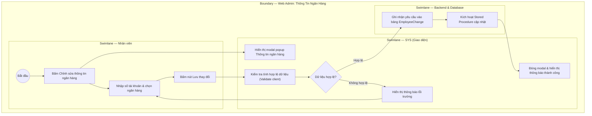

# UI Crawl To User Story Skill — Cào Nghiệp Vụ & Đảo Ngược Đặc Tả

Kỹ năng này biến AI Agent thành một **Business Analyst (BA) & Kỹ sư Đảo ngược Nghiệp vụ (Reverse-Engineering Specialist)** tự động hóa 100%. 

Thay vì phải ngồi soi DevTools thủ công từng ô hoặc tự đoán mò nghiệp vụ, Agent sẽ điều khiển Google Chrome thật qua Playwright, tự động quét sạch cây DOM, kích hoạt các Modal/Popup, bóc tách toàn bộ trường dữ liệu và bắt trọn các luồng API/Stored Procedure, sau đó biên dịch trực tiếp thành bộ hồ sơ tài liệu đặc tả chuẩn 100% format của skill **`/spec-epic-user-story`**.

---

## 1. Triết Lý Hoạt Động: Kỹ Thuật Hybrid 3 Tầng (Tối Ưu Hóa Độ Chuẩn Xác)

Để đảm bảo tài liệu đặc tả chính xác 100% so với hệ thống đang chạy thực tế, Agent phối hợp đồng thời 3 tầng dữ liệu:

```
┌────────────────────────────────────────────────────────────────────────┐
│                      HYBRID CRAWLING ARCHITECTURE                      │
└───────────────────────────────────┬────────────────────────────────────┘
                                    │
    ┌───────────────────────────────┼───────────────────────────────┐
    ▼                               ▼                               ▼
【TẦNG 1: RUNTIME DOM】     【TẦNG 2: JS CONTEXT】       【TẦNG 3: NETWORK TRAFFIC】
• Quét toàn bộ Form Items    • Móc vào DevExtreme /      • Lắng nghe request XHR/Fetch
• Bóc tách Label, Control      React Component Instances • Trích xuất Stored Procedures
  Type, Required (*),        • Trích xuất Validation     • Đọc Payload gửi lên
  Disabled, Placeholder        Rules ngầm (min/max/regex)• Đọc Response Schema Backend
                                    │
                                    ▼
┌────────────────────────────────────────────────────────────────────────┐
│        BIÊN DỊCH BẰNG LLM THÀNH TÀI LIỆU CHUẨN /spec-epic-user-story    │
│  1. docs/epic/<module>/<MA_EPIC>-<Ten-Epic>.md                         │
│  2. docs/user-stories/<module>/<MA_EPIC>-<Ten-Epic>/<MA_US>.md         │
└────────────────────────────────────────────────────────────────────────┘
```

---

## 2. Cấu Trúc Hồ Sơ Tài Liệu Đầu Ra (Scaffolding Structure)

Mọi tài liệu do skill này sản sinh bắt buộc phải được tổ chức theo chuẩn cấu trúc của `/spec-epic-user-story`:

```text
docs/
├── raw_crawled/                                  <-- Dữ liệu JSON thô do crawler trích xuất
│   └── <ten_menu>.json
├── epic/                                         <-- Tài liệu Epic cấp cao
│   └── <module_hoac_vai_tro>/
│       ├── <MA_EPIC>-<Ten-Epic>.md
│       └── README.md
└── user-stories/                                 <-- Tài liệu User Story chi tiết
    └── <module_hoac_vai_tro>/
        └── <MA_EPIC>-<Ten-Epic>/
            ├── <MA_EPIC>-US01-<Ten-US-01>.md    <-- Kèm bảng 6 cột & Mermaid Swimlane
            ├── <MA_EPIC>-US02-<Ten-US-02>.md
            └── README.md
```

---

## 3. Quy Trình 5 Bước Thực Thi Của Agent (Step-by-Step Execution)

### Bước 1: Tiếp Nhận Mục Tiêu & Cấu Hình Môi Trường
1. Đọc thông tin kết nối từ file `test.env.json` (URL website, tài khoản, mật khẩu, selectors đăng nhập).
2. Xác định phân hệ / menu cần cào nghiệp vụ (do người dùng cung cấp hoặc quét toàn bộ).

### Bước 2: Kích Hoạt Công Cụ Cào Nghiệp Vụ Tự Động (`crawler_engine.cjs`)
Agent chạy script trích xuất chuyên dụng có sẵn tại [`helpers/crawler_engine.cjs`](file:///c:/Users/Y.Thach/Desktop/paradiseHR/helpers/crawler_engine.cjs):

```powershell
node helpers/crawler_engine.cjs --menu "<Tên_Menu_Mục_Tiêu>"
```

Script này tự động:
* Mở Google Chrome thật và đăng nhập vào hệ thống.
* Điều hướng đến đúng menu được chỉ định.
* Quét toàn bộ DOM màn hình chính (bảng, controls, bộ lọc, toolbar).
* Dò tìm và tự động click mở các Modal/Popup (Thêm, Sửa, Chi tiết, Phê duyệt...) để cào sâu các form ẩn.
* Ghi lại toàn bộ API Payload & Stored Procedures (`sp_*`).
* Xuất file kết quả JSON hoàn chỉnh tại `docs/raw_crawled/<ten_menu>.json`.

---

### Bước 3: Phân Tích & Phân Rã Thành Các User Stories
Dựa trên file JSON thu thập được, Agent phân tách nghiệp vụ thành:
1. **Epic Tổng Quan**: Bao quát toàn bộ giao diện và các luồng chức năng của phân hệ.
2. **Các User Story Đơn Lẻ (Atomic User Stories)**:
   * **US01 (Xem/Tra cứu)**: Danh sách, bộ lọc, tìm kiếm, hiển thị DataGrid.
   * **US02 (Tạo mới / Thêm mới)**: Form nhập liệu tạo mới, validation, API insert.
   * **US03 (Cập nhật / Chỉnh sửa)**: Form chỉnh sửa, nạp dữ liệu cũ, API update.
   * **US04 (Phê duyệt / Xử lý nghiệp vụ)**: Modal duyệt/từ chối, cập nhật trạng thái.
   * **US05 (Xóa / Hủy bỏ)**: Hộp thoại xác nhận, ràng buộc toàn vẹn dữ liệu.

---

### Bước 4: Tạo Tài Liệu Epic Chuẩn (`docs/epic/...`)
Khởi tạo file `<MA_EPIC>-<Ten-Epic>.md` với đầy đủ các mục:
* **Role**: Actor chính thao tác.
* **Platform**: Web Admin / Portal / Mobile.
* **Menu / Route**: Vị trí trên cây menu hoặc đường dẫn URL.
* **Goal & Scope**: Mục tiêu nghiệp vụ và phạm vi chức năng bao gồm/không bao gồm.
* **UI Components & Layout**: Mô tả bố cục Header, DataGrid, Toolbar, Filter.
* **Danh sách User Stories và Giao diện tương ứng**: Bảng map 1:1 sang các file `US-xx.md`.
* **Flow Specification & Traceability**: Luồng nghiệp vụ tổng quan kết nối các US.

---

### Bước 5: Tạo Từng Tài Liệu User Story Chuẩn (`docs/user-stories/...`)
Mỗi file `<MA_EPIC>-US<STT>-<Ten-US>.md` bắt buộc phải có đầy đủ các cấu phần sau:

#### 1. Preconditions & Trigger:
* Điều kiện đăng nhập, quyền hạn (Role), dữ liệu tiền đề bắt buộc phải có sẵn trong CSDL.
* Sự kiện kích hoạt (Ví dụ: Click nút "Chỉnh sửa" tại dòng nhân viên).

#### 2. Main Flow & Business Rules:
* Từng bước tương tác tuần tự giữa Actor và SYS.
* Business Rules: Giới hạn ký tự, công thức tính toán, tính duy nhất, ràng buộc chi nhánh.

#### 3. BẢNG ĐẶC TẢ FIELD-LEVEL 6 CỘT CHUẨN MỰC (QUAN TRỌNG NHẤT):
Trích xuất từ dữ liệu cào được sang bảng 6 cột không được để trống:

| Field / control | Loại UI Control | State | Required | Conditional / dynamic | Source / validation |
| :--- | :--- | :--- | :--- | :--- | :--- |
| **Số tài khoản** | `TextBox (Text / String)` | `ENABLED` | `YES (*)` | Hiển thị mặc định | Bắt buộc nhập, tối đa 30 ký tự số |
| **Ngân hàng** | `Dropdown / SelectBox` | `ENABLED` | `YES (*)` | Hiển thị mặc định | Danh mục nạp từ API `sp_GetBankList` |
| **Chủ tài khoản** | `TextBox (Text / String)` | `ENABLED` | `YES (*)` | Hiển thị mặc định | Tự động chuyển in hoa, không dấu |
| **Nút "Lưu thay đổi"** | `Button (Primary Action)` | `ENABLED` | `NO` | Sáng khi form hợp lệ | Kích hoạt API `sp_approve_EmployeeChange` |

*Quy ước các giá trị hợp lệ:*
* **Loại UI Control**: `TextBox`, `Dropdown / SelectBox`, `DatePicker / DateBox`, `NumberInput`, `CheckBox`, `RadioGroup`, `TextArea`, `Button`.
* **State**: `ENABLED`, `DISABLED`, `READONLY`, `HIDDEN`.
* **Required**: `YES (*)` hoặc `NO`.
* **Conditional / dynamic**: Ghi rõ điều kiện kích hoạt/ẩn hiện/disable (hoặc `Hiển thị mặc định`).
* **Source / validation**: Nguồn nạp dữ liệu (Danh mục cứng/API) và các quy tắc kiểm tra (Regex, Min, Max, Range).

#### 4. Alternate Flows & Exception Flows:
* **AF-01, AF-02**: Người dùng bấm Hủy bỏ, chọn các tùy chọn rẽ nhánh khác.
* **Exception Flows**: Lỗi trùng mã, lỗi mạng, lỗi Stored Procedure backend từ chối.

#### 5. Sơ Đồ UML Activity Diagram Swimlane Bằng Mermaid:
Vẽ sơ đồ với cú pháp chuẩn Mermaid `flowchart TB`, phân chia rõ 3 làn bơi (Subgraphs):
* **L0: Swimlane — <Primary Actor>** (Người dùng thao tác)
* **L1: Swimlane — SYS** (Hệ thống frontend xử lý giao diện)
* **L2: Swimlane — Database / Backend** (Xử lý API / Stored Procedure)

*Mẫu Mermaid chuẩn:*


---

## 4. Tiêu Chuẩn Thẩm Định Bàn Giao (Definition of Done)

Hồ sơ đặc tả chỉ được coi là hoàn tất khi đạt đủ các tiêu chí:
1. ✅ **Thực tế 100%**: Tất cả các trường, nút bấm, dropdown và API đều được trích xuất từ web đang chạy thật, không bịa đặt.
2. ✅ **Tuân thủ cấu trúc `/spec-epic-user-story`**: Có đầy đủ file Epic cấp cao và các file User Story chi tiết trong thư mục `docs/`.
3. ✅ **Bảng 6 cột chuẩn mực**: Mọi trường dữ liệu đều có thông tin cụ thể ở cả 6 cột, không có ô nào để trống.
4. ✅ **Sơ đồ Mermaid Swimlane chuẩn UML**: Có đầy đủ Initial Node `(())`, Action Nodes `[]`, Decision Node `{}`, phân tách đúng làn bơi của Actor, SYS và Database.
5. ✅ **Truy vết kỹ thuật (Traceability)**: Ghi chú rõ các Stored Procedure (`sp_*`) hoặc API Endpoint tương ứng ở từng nút hành động để đội ngũ Dev có thể bắt tay vào code ngay.
