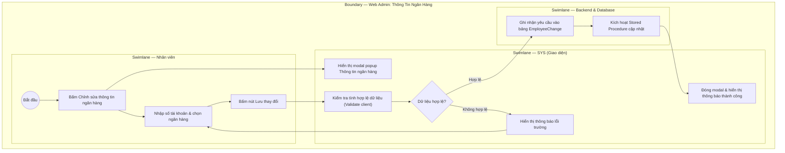

# UI Crawl To User Story Skill — Cào Nghiệp Vụ & Đảo Ngược Đặc Tả

Kỹ năng này biến AI Agent thành một **Business Analyst (BA) & Kỹ sư Đảo ngược Nghiệp vụ (Reverse-Engineering Specialist)** tự động hóa 100%. 

Thay vì phải ngồi soi DevTools thủ công từng ô hoặc tự đoán mò nghiệp vụ, Agent sẽ điều khiển Google Chrome thật qua Playwright, tự động quét sạch cây DOM, kích hoạt các Modal/Popup, bóc tách toàn bộ trường dữ liệu và bắt trọn các luồng API/Stored Procedure, sau đó biên dịch trực tiếp thành bộ hồ sơ tài liệu đặc tả chuẩn 100% format của skill **`/spec-epic-user-story`**.

---

## 1. Triết Lý Hoạt Động: Kỹ Thuật Hybrid 3 Tầng (Tối Ưu Hóa Độ Chuẩn Xác)

Để đảm bảo tài liệu đặc tả chính xác 100% so với hệ thống đang chạy thực tế, Agent phối hợp đồng thời 3 tầng dữ liệu:

```
┌────────────────────────────────────────────────────────────────────────┐
│                      HYBRID CRAWLING ARCHITECTURE                      │
└───────────────────────────────────┬────────────────────────────────────┘
                                    │
    ┌───────────────────────────────┼───────────────────────────────┐
    ▼                               ▼                               ▼
【TẦNG 1: RUNTIME DOM】     【TẦNG 2: JS CONTEXT】       【TẦNG 3: NETWORK TRAFFIC】
• Quét toàn bộ Form Items    • Móc vào DevExtreme /      • Lắng nghe request XHR/Fetch
• Bóc tách Label, Control      React Component Instances • Trích xuất Stored Procedures
  Type, Required (*),        • Trích xuất Validation     • Đọc Payload gửi lên
  Disabled, Placeholder        Rules ngầm (min/max/regex)• Đọc Response Schema Backend
                                    │
                                    ▼
┌────────────────────────────────────────────────────────────────────────┐
│        BIÊN DỊCH BẰNG LLM THÀNH TÀI LIỆU CHUẨN /spec-epic-user-story    │
│  1. docs/epic/<module>/<MA_EPIC>-<Ten-Epic>.md                         │
│  2. docs/user-stories/<module>/<MA_EPIC>-<Ten-Epic>/<MA_US>.md         │
└────────────────────────────────────────────────────────────────────────┘
```

---

## 2. Cấu Trúc Hồ Sơ Tài Liệu Đầu Ra (Scaffolding Structure)

Mọi tài liệu do skill này sản sinh bắt buộc phải được tổ chức theo chuẩn cấu trúc của `/spec-epic-user-story`:

```text
docs/
├── raw_crawled/                                  <-- Dữ liệu JSON thô do crawler trích xuất
│   └── <ten_menu>.json
├── epic/                                         <-- Tài liệu Epic cấp cao
│   └── <module_hoac_vai_tro>/
│       ├── <MA_EPIC>-<Ten-Epic>.md
│       └── README.md
└── user-stories/                                 <-- Tài liệu User Story chi tiết
    └── <module_hoac_vai_tro>/
        └── <MA_EPIC>-<Ten-Epic>/
            ├── <MA_EPIC>-US01-<Ten-US-01>.md    <-- Kèm bảng 6 cột & Mermaid Swimlane
            ├── <MA_EPIC>-US02-<Ten-US-02>.md
            └── README.md
```

```

---

## 3. Cẩm Nang Cấu Hình & Tùy Biến Bộ Máy Crawler Engine (`helpers/crawler_engine.cjs`)

Cỗ máy cào nghiệp vụ [`helpers/crawler_engine.cjs`](file:///c:/Users/Y.Thach/Desktop/paradiseHR/helpers/crawler_engine.cjs) là một **Master Engine dùng chung** cho toàn bộ mọi menu trên website. Dưới đây là chi tiết các thông số cấu hình và cách tùy biến:

### A. Các Tham Số Dòng Lệnh (CLI Flags & Parameters)

Khi gọi chạy cỗ máy bằng lệnh terminal hoặc thông qua Agent:

```powershell
node helpers/crawler_engine.cjs [OPTIONS]
```

| Tham số CLI | Ý nghĩa & Mô tả | Ví dụ thực tế |
| :--- | :--- | :--- |
| `--menu "<tên>"` | **Tên menu mục tiêu**: Chuỗi văn bản hiển thị trên giao diện của menu cần click mở. | `--menu "Hồ sơ nhân viên"` |
| `--url "<link>"` | **URL website mục tiêu**: Nếu không truyền, mặc định đọc `baseUrl` từ `test.env.json`. | `--url "https://paradisehrm.com/Tai3/#"` |
| `--role "<vai_trò>"` | **Vai trò đăng nhập**: Nạp tài khoản tương ứng từ mục `roles.<vai_trò>` trong `test.env.json`. | `--role "quan_ly"` hoặc `--role "nhan_vien"` |
| `--username "<user>"` | **Tài khoản chỉ định trực tiếp**: Ghi đè tài khoản đăng nhập mà không cần sửa file cấu hình. | `--username "Cuong.Vu"` |
| `--password "<pass>"` | **Mật khẩu chỉ định trực tiếp**: Đi kèm với `--username`. | `--password "123"` |

---

### B. Cấu Hình File Môi Trường Liên Kết (`test.env.json`)

Engine tự động đọc file `test.env.json` tại thư mục gốc của dự án:

```json
{
  "baseUrl": "https://paradisehrm.com/Tai3/#",
  "auth": {
    "username": "Tai.Dang",
    "password": "123",
    "usernameSelector": "#username",
    "passwordSelector": "input[type=\"password\"]",
    "submitSelector": "#submitLogin"
  },
  "roles": {
    "nhan_vien": {
      "username": "Tai.Dang",
      "password": "123"
    },
    "quan_ly": {
      "username": "Cuong.Vu",
      "password": "123"
    },
    "admin": {
      "username": "Chien.nguyen",
      "password": "123"
    }
  }
}
```

* **`baseUrl`**: Đường dẫn trang chủ của hệ thống.
* **`auth`**: Tài khoản mặc định kèm bộ chọn CSS của form đăng nhập (`usernameSelector`, `passwordSelector`, `submitSelector`).
* **`roles`**: Danh bạ tài khoản đa vai trò, cho phép cỗ máy tự động chuyển đổi giữa các vai trò khi truy vết dữ liệu chéo.

---

### C. Các Khối Cấu Hình Kỹ Thuật Nội Tại Của Engine

Bên trong mã nguồn [`helpers/crawler_engine.cjs`](file:///c:/Users/Y.Thach/Desktop/paradiseHR/helpers/crawler_engine.cjs), bạn có thể tùy biến các thông số sau tùy theo đặc thù website:

1. **Cấu hình Trình duyệt & Hiển thị (`chromium.launch`)**:
   ```javascript
   headless: false,              // Mở Chrome thật trên màn hình để quan sát
   channel: 'chrome',            // Sử dụng Google Chrome chính thức của Windows
   slowMo: 50,                   // Độ trễ 50ms giữa các hành động để DOM kịp phản hồi
   args: ['--start-maximized']   // Mở toàn màn hình để tránh menu responsive bị ẩn
   ```
2. **Quản lý Thời Gian Chờ (Timeouts)**:
   * `page.goto(..., { timeout: 45000 })`: Thời gian chờ tải trang tối đa 45 giây.
   * `login waitFor({ timeout: 30000 })`: Thời gian chờ đăng nhập thành công tối đa 30 giây.
   * `menuLocator.isVisible({ timeout: 5000 })`: Thời gian chờ menu xuất hiện 5 giây.
   * `activeModal.isVisible({ timeout: 3000 })`: Thời gian chờ modal popup nổi lên 3 giây.
3. **Bộ Chọn Khung Form Wrapper (`formItems`)**:
   ```javascript
   .dx-field, .dx-form-group, .form-group, .form-item, tr, .field-wrapper, .sec-field, .dx-item.dx-field-item
   ```
   *Quét đồng thời cả DevExtreme, Bootstrap, AntDesign, HTML table rows.* Nếu gặp website dùng thư viện khác (như Material UI), có thể thêm `.MuiFormControl-root` vào danh sách này.
4. **Bộ Phân Loại Kiểu Control (`detectControlType`)**:
   * Tự động nhận diện 7 loại control chính: `Dropdown / SelectBox`, `DatePicker / DateBox`, `NumberInput`, `CheckBox`, `RadioGroup`, `TextArea`, `TextBox`.
5. **Bộ Từ Khóa Kích Hoạt Modal / Popup Ẩn (`editBtns`)**:
   ```javascript
   /chỉnh sửa|sửa|thêm|thêm mới|tạo mới|chi tiết|cập nhật|edit|create|add|new/i
   ```
   * Tự động click thử tối đa `btnCount = 8` nút tiêu biểu trên màn hình để kích hoạt form modal ẩn bên dưới.
   * Sau khi cào xong, tự động tìm nút Đóng/Hủy hoặc nhấn phím `Escape` để đóng modal trước khi sang nút kế tiếp.
6. **Bộ Lọc Network API (`filterRelevantApiCalls`)**:
   * Tự động loại bỏ toàn bộ tài nguyên tĩnh (`.css`, `.js`, `.png`, `.jpg`, `.svg`, `.woff`...).
   * Chỉ giữ lại các API `XHR` / `Fetch` chứa dữ liệu nghiệp vụ và các Stored Procedure (`sp_*`).
7. **Thư Mục Đầu Ra**:
   * Dữ liệu bóc tách được lưu tự động tại: `docs/raw_crawled/<safe_menu_name>.json`.

---

## 4. Quy Trình 5 Bước Thực Thi Của Agent (Step-by-Step Execution)

### Bước 1: Tiếp Nhận Mục Tiêu & Cấu Hình Môi Trường
1. Đọc thông tin kết nối từ file `test.env.json` (URL website, tài khoản, mật khẩu, selectors đăng nhập).
2. Xác định phân hệ / menu cần cào nghiệp vụ (do người dùng cung cấp hoặc quét toàn bộ).

### Bước 2: Kích Hoạt Công Cụ Cào Nghiệp Vụ Tự Động (`crawler_engine.cjs`)
Agent chạy script trích xuất chuyên dụng có sẵn tại [`helpers/crawler_engine.cjs`](file:///c:/Users/Y.Thach/Desktop/paradiseHR/helpers/crawler_engine.cjs):

```powershell
node helpers/crawler_engine.cjs --menu "<Tên_Menu_Mục_Tiêu>"
```

Script này tự động:
* Mở Google Chrome thật và đăng nhập vào hệ thống.
* Điều hướng đến đúng menu được chỉ định.
* Quét toàn bộ DOM màn hình chính (bảng, controls, bộ lọc, toolbar).
* Dò tìm và tự động click mở các Modal/Popup (Thêm, Sửa, Chi tiết, Phê duyệt...) để cào sâu các form ẩn.
* Ghi lại toàn bộ API Payload & Stored Procedures (`sp_*`).
* Xuất file kết quả JSON hoàn chỉnh tại `docs/raw_crawled/<ten_menu>.json`.

---

### Kỹ Thuật Truy Vết Nguồn Gốc Dữ Liệu & Quy Tắc Đổi Role (Data Lineage & Cross-Role Protocol)

Khi cào một Menu hiển thị danh sách (DataGrid / Table) mà **KHÔNG CÓ nút Tạo mới / Thêm mới** (Màn hình Hạ nguồn / Consumer / Phê duyệt):

#### 4 CƠ CHẾ KỸ THUẬT DÒ TÌM NGUỒN GỐC DỮ LIỆU:

##### CƠ CHẾ 1: Đọc "Dấu vân tay" trong API & Stored Procedure (Network Fingerprinting)
Khi Menu A tải dữ liệu của B lên bảng, Playwright đã bắt được gói tin `XHR/Fetch` hoặc Stored Procedure trả về. Cỗ máy crawler mổ xẻ JSON trả về của dòng dữ liệu đó:
* **Các trường siêu dữ liệu (Metadata Fields) luôn tố cáo nguồn gốc**:
  - `CreatedBy` / `CreatedByRole`: Ví dụ trả về `Tai.Dang` $\rightarrow$ Biết ngay do tài khoản nhân viên tạo ra, không phải do Admin tự gõ.
  - `SourceType` / `OriginModule`: Ví dụ trả về `FROM_MOBILE_APP` hoặc `LEAVE_REQUEST` $\rightarrow$ Biết ngay dữ liệu sinh ra từ App mobile hoặc từ Phân hệ Nghỉ phép.
  - `Status` / `State`: Nếu có các giá trị như `PENDING`, `SUBMITTED`, `WAITING_APPROVAL` $\rightarrow$ Khẳng định 100% đây là **Luồng yêu cầu - phê duyệt (Approval Flow)**, dữ liệu phải do người nộp đơn gửi lên trước.
* **Tên Stored Procedure / API**:
  - Nếu Menu A gọi `sp_GetList_EmployeeChange_Pending` $\rightarrow$ Từ chữ `EmployeeChange`, Agent lập tức biết phải đi tìm chức năng "Thay đổi thông tin nhân viên" ở phía nhân viên.

##### CƠ CHẾ 2: Dò quét chéo cây Menu cùng tài khoản (Cross-Menu Entity Matching)
Khi Playwright mở trang web, hàm `extractSidebarMenus()` tự động quét toàn bộ cây Sidebar (Menu cha, menu con).
Nếu Menu A là "Danh sách B" mà không có nút tạo:
* Agent dùng thuật toán so khớp ngữ nghĩa (Semantic & Entity Matcher) để xác định thực thể là gì (Ví dụ: Hợp đồng, Quyết định lương, Bảo hiểm).
* Tự động lùng sục trên thanh Menu xem có menu nào chứa động từ hành động liên quan không: *"Tạo hợp đồng"*, *"Đăng ký gói"*, *"Điều chỉnh lương"*, *"Nhập dữ liệu Excel"*...
* Agent điều khiển trình duyệt click thử sang menu đó để xác nhận xem form tạo mới có chứa các trường trùng khớp với các cột của bảng B ở Menu A hay không.

##### CƠ CHẾ 3: Ma trận Đa tài khoản / Đa vai trò (Multi-Role Matrix Crawling)
Đây chính là trường hợp "B được tạo từ một Account / Role khác" (như luồng `employee_bank_approval`: Quản lý `Cuong.Vu` duyệt bản ghi do Nhân viên `Tai.Dang` tạo).
* Danh sách các Role được khai báo trong `test.env.json`:
  ```json
  {
    "roles": {
      "nhan_vien": { "username": "Tai.Dang", "password": "123" },
      "quan_ly": { "username": "Cuong.Vu", "password": "123" },
      "admin": { "username": "Chien.nguyen", "password": "123" }
    }
  }
  ```
* Khi Agent nhận thấy Menu ở Role Quản lý chỉ có "Duyệt/Xem" và dữ liệu mang tính chất "Yêu cầu từ nhân viên", Agent sẽ:
  1. Đăng xuất khỏi tài khoản Quản lý.
  2. Tự động đăng nhập vào tài khoản Role Nhân viên (`Tai.Dang`).
  3. Quét form gửi yêu cầu tương ứng bên phía nhân viên.

##### CƠ CHẾ 4: Truy vết ngược từ Database / Codebase (Backend Inbound Trace)
Nếu có mã nguồn backend hoặc database (qua MCP Graph / SQL):
* Chạy truy vấn tìm kiếm: *"Ai thực hiện lệnh `INSERT INTO tbl_B`?"*
* Ngay lập tức sẽ lộ ra chính xác API nào, Controller nào, hoặc màn hình nào đã tạo ra bản ghi B đó mà không cần phải đoán mò.

---

#### QUY TẮC BẮT BUỘC TƯƠNG TÁC VỚI NGƯỜI DÙNG:
* Nếu phát hiện dữ liệu bắt nguồn từ một vai trò/tài khoản khác mà chưa có cấu hình trong `test.env.json`, Agent **BẮT BUỘC DỪNG LẠI VÀ HỎI NGƯỜI DÙNG**:
  > *"Tôi phát hiện màn hình [Tên Menu hiện tại] hiển thị danh sách [Thực thể] nhưng không có nút tạo mới. Dữ liệu này được tạo từ vai trò [Tên Role] (tại chức năng [Tên chức năng]). Bạn vui lòng cung cấp tài khoản & mật khẩu của vai trò [Tên Role] để tôi đăng nhập cào tiếp màn hình tạo dữ liệu nhé!"*
* Tuyệt đối không tự đoán mò tài khoản. Đợi người dùng cung cấp tài khoản rồi mới tiếp tục.

---

#### 💡 CÁCH ĐƯA DỮ LIỆU TRUY VẾT VÀO TÀI LIỆU ĐẶC TẢ USER STORY:
Toàn bộ phát hiện trên sẽ được đưa thẳng vào **3 mục quan trọng nhất** của tài liệu đặc tả chuẩn `/spec-epic-user-story`:
1. **Mục Tiền điều kiện (Preconditions)**:
   > *"Dữ liệu bản ghi B phải được tạo trước từ Menu X (bởi Role Nhân viên) với trạng thái 'Chờ duyệt'."*
2. **Cột Ghi chú nghiệp vụ (Cột 6 trong Bảng 6 cột)**:
   > *"Cột 'Số tài khoản' là trường Read-only nạp từ dữ liệu do Nhân viên gửi lên tại form Yêu cầu thay đổi hồ sơ."*
3. **Sơ đồ Mermaid Activity Diagram Swimlane (Phân làn vai trò đa bên)**:
   * **Làn 1 (Nhân viên)** $\rightarrow$ Điền form và Gửi yêu cầu.
   * **Làn 2 (Hệ thống / Database)** $\rightarrow$ Lưu bản ghi vào bảng tạm với trạng thái `PENDING`.
   * **Làn 3 (Quản lý - Menu A)** $\rightarrow$ Hiển thị danh sách yêu cầu chờ duyệt $\rightarrow$ Bấm nút Duyệt.

---

### Bước 3: Phân Tích & Phân Rã Thành Các User Stories
Dựa trên file JSON thu thập được, Agent phân tách nghiệp vụ thành:
1. **Epic Tổng Quan**: Bao quát toàn bộ giao diện và các luồng chức năng của phân hệ.
2. **Các User Story Đơn Lẻ (Atomic User Stories)**:
   * **US01 (Xem/Tra cứu)**: Danh sách, bộ lọc, tìm kiếm, hiển thị DataGrid.
   * **US02 (Tạo mới / Thêm mới)**: Form nhập liệu tạo mới, validation, API insert.
   * **US03 (Cập nhật / Chỉnh sửa)**: Form chỉnh sửa, nạp dữ liệu cũ, API update.
   * **US04 (Phê duyệt / Xử lý nghiệp vụ)**: Modal duyệt/từ chối, cập nhật trạng thái.
   * **US05 (Xóa / Hủy bỏ)**: Hộp thoại xác nhận, ràng buộc toàn vẹn dữ liệu.

---

### Bước 4: Tạo Tài Liệu Epic Chuẩn (`docs/epic/...`)
Khởi tạo file `<MA_EPIC>-<Ten-Epic>.md` với đầy đủ các mục:
* **Role**: Actor chính thao tác.
* **Platform**: Web Admin / Portal / Mobile.
* **Menu / Route**: Vị trí trên cây menu hoặc đường dẫn URL.
* **Goal & Scope**: Mục tiêu nghiệp vụ và phạm vi chức năng bao gồm/không bao gồm.
* **UI Components & Layout**: Mô tả bố cục Header, DataGrid, Toolbar, Filter.
* **Danh sách User Stories và Giao diện tương ứng**: Bảng map 1:1 sang các file `US-xx.md`.
* **Flow Specification & Traceability**: Luồng nghiệp vụ tổng quan kết nối các US.

---

### Bước 5: Tạo Từng Tài Liệu User Story Chuẩn (`docs/user-stories/...`)
Mỗi file `<MA_EPIC>-US<STT>-<Ten-US>.md` bắt buộc phải có đầy đủ các cấu phần sau:

#### 1. Preconditions & Trigger:
* Điều kiện đăng nhập, quyền hạn (Role), dữ liệu tiền đề bắt buộc phải có sẵn trong CSDL.
* Sự kiện kích hoạt (Ví dụ: Click nút "Chỉnh sửa" tại dòng nhân viên).

#### 2. Main Flow & Business Rules:
* Từng bước tương tác tuần tự giữa Actor và SYS.
* Business Rules: Giới hạn ký tự, công thức tính toán, tính duy nhất, ràng buộc chi nhánh.

#### 3. BẢNG ĐẶC TẢ FIELD-LEVEL 6 CỘT CHUẨN MỰC (QUAN TRỌNG NHẤT):
Trích xuất từ dữ liệu cào được sang bảng 6 cột không được để trống:

| Field / control | Loại UI Control | State | Required | Conditional / dynamic | Source / validation |
| :--- | :--- | :--- | :--- | :--- | :--- |
| **Số tài khoản** | `TextBox (Text / String)` | `ENABLED` | `YES (*)` | Hiển thị mặc định | Bắt buộc nhập, tối đa 30 ký tự số |
| **Ngân hàng** | `Dropdown / SelectBox` | `ENABLED` | `YES (*)` | Hiển thị mặc định | Danh mục nạp từ API `sp_GetBankList` |
| **Chủ tài khoản** | `TextBox (Text / String)` | `ENABLED` | `YES (*)` | Hiển thị mặc định | Tự động chuyển in hoa, không dấu |
| **Nút "Lưu thay đổi"** | `Button (Primary Action)` | `ENABLED` | `NO` | Sáng khi form hợp lệ | Kích hoạt API `sp_approve_EmployeeChange` |

*Quy ước các giá trị hợp lệ:*
* **Loại UI Control**: `TextBox`, `Dropdown / SelectBox`, `DatePicker / DateBox`, `NumberInput`, `CheckBox`, `RadioGroup`, `TextArea`, `Button`.
* **State**: `ENABLED`, `DISABLED`, `READONLY`, `HIDDEN`.
* **Required**: `YES (*)` hoặc `NO`.
* **Conditional / dynamic**: Ghi rõ điều kiện kích hoạt/ẩn hiện/disable (hoặc `Hiển thị mặc định`).
* **Source / validation**: Nguồn nạp dữ liệu (Danh mục cứng/API) và các quy tắc kiểm tra (Regex, Min, Max, Range).

#### 4. Alternate Flows & Exception Flows:
* **AF-01, AF-02**: Người dùng bấm Hủy bỏ, chọn các tùy chọn rẽ nhánh khác.
* **Exception Flows**: Lỗi trùng mã, lỗi mạng, lỗi Stored Procedure backend từ chối.

#### 5. Sơ Đồ UML Activity Diagram Swimlane Bằng Mermaid:
Vẽ sơ đồ với cú pháp chuẩn Mermaid `flowchart TB`, phân chia rõ 3 làn bơi (Subgraphs):
* **L0: Swimlane — <Primary Actor>** (Người dùng thao tác)
* **L1: Swimlane — SYS** (Hệ thống frontend xử lý giao diện)
* **L2: Swimlane — Database / Backend** (Xử lý API / Stored Procedure)

*Mẫu Mermaid chuẩn:*


---

## 5. Tiêu Chuẩn Thẩm Định Bàn Giao (Definition of Done)

Hồ sơ đặc tả chỉ được coi là hoàn tất khi đạt đủ các tiêu chí:
1. ✅ **Thực tế 100%**: Tất cả các trường, nút bấm, dropdown và API đều được trích xuất từ web đang chạy thật, không bịa đặt.
2. ✅ **Tuân thủ cấu trúc `/spec-epic-user-story`**: Có đầy đủ file Epic cấp cao và các file User Story chi tiết trong thư mục `docs/`.
3. ✅ **Bảng 6 cột chuẩn mực**: Mọi trường dữ liệu đều có thông tin cụ thể ở cả 6 cột, không có ô nào để trống.
4. ✅ **Sơ đồ Mermaid Swimlane chuẩn UML**: Có đầy đủ Initial Node `(())`, Action Nodes `[]`, Decision Node `{}`, phân tách đúng làn bơi của Actor, SYS và Database.
5. ✅ **Truy vết kỹ thuật (Traceability)**: Ghi chú rõ các Stored Procedure (`sp_*`) hoặc API Endpoint tương ứng ở từng nút hành động để đội ngũ Dev có thể bắt tay vào code ngay.
