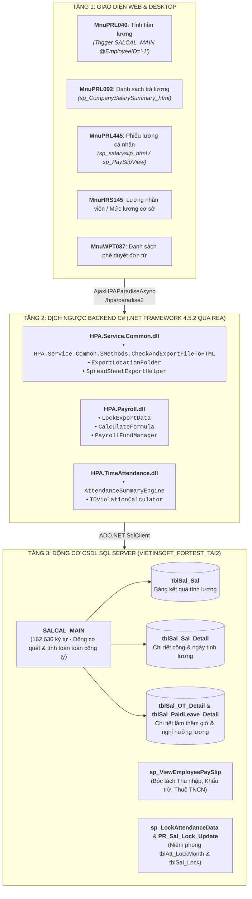
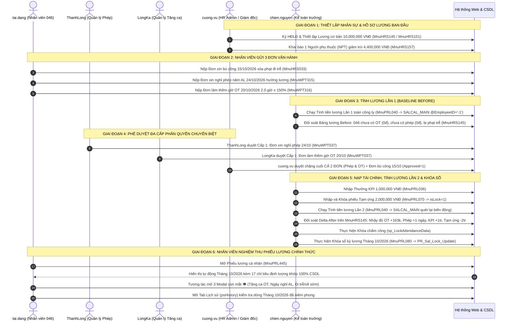

# TÀI LIỆU ĐẶC TẢ LUỒNG TÍNH LƯƠNG ĐA VAI TRÒ (MULTI-ROLES) & KỊCH BẢN KIỂM THỬ LIÊN HOÀN TOÀN TRÌNH
## PHÂN HỆ TIỀN LƯƠNG & CHẤM CÔNG — PARADISE HRM

> **Dự án**: Paradise HRM (Vietinsoft)  
> **Phương pháp phân tích**: Dịch ngược mã nguồn Backend C# qua **REA (`morluto/rea`)** kết hợp bóc tách Stored Procedure CSDL `Vietinsoft_ForTest_Tai2` và runtime **Chrome DevTools**.  
> **Môi trường Web**: `https://paradisehrm.com/Tai3/#`  
> **Kỳ kiểm thử chuẩn**: **Tháng 10/2026** (Kỳ công: 10/10/2026 – 09/11/2026)  

---

## PHẦN 1: KIẾN TRÚC KỸ THUẬT ĐƯỢC DỊCH NGƯỢC QUA REA (.NET BACKEND & SQL ENGINE)

Hệ thống tính lương của Paradise HRM vận hành theo mô hình phân tầng chặt chẽ giữa **Frontend DevExtreme**, **Service Backend .NET C#** và **Động cơ tính toán SQL Server**:



### 1.1. Bóc tách phát hiện cốt lõi từ REA & Chrome DevTools:
1. **Tại sao `MnuPRL040` (Tính tiền lương) là nơi duy nhất tính lương cho toàn công ty?**:
   - Khi bấm "Tính lương" trên `MnuPRL040`, hệ thống gửi payload: `name: "SALCAL_MAIN", param: ["@Month", "10", "@Year", "2026", "@EmployeeID", "-1"]`.
   - Giá trị `@EmployeeID = '-1'` kích hoạt dòng 263 của `SALCAL_MAIN`: `from dbo.fn_vtblEmployeeList_Bydate(@ToDateTruncate, '-1', @LoginID)` $\rightarrow$ Quét toàn bộ 40 nhân viên trong công ty.
   - Thủ tục kết thúc bằng `print 'eof'`, không `SELECT` dữ liệu bảng lương ra lưới. Do đó lưới hiển thị chữ mặc định *"Không có dữ liệu"* (chỉ khi có nhân viên lỗi cấu hình thì mới hiện lỗi).
2. **Tại sao nút "Tính lương" trên `MnuPRL092` (Danh sách trả lương) không tính cho mọi người?**:
   - Dịch ngược sự kiện `onClick` của nút `#btnCalculate`: Nút này gửi `@EmployeeID = window.EmployeeID`. Nó chỉ tính lại lương cho **riêng cá nhân đang mở màn hình**.
   - Khi kỳ lương đã khóa, hàm `companySalaryReloadSalaryLockStatus()` tự động vô hiệu hóa nút (`btn.option("disabled", true)` và class `.company-salary-disabled`).
3. **Tại sao nút "Xem phiếu lương" trên `MnuPRL092` chỉ ra đúng 1 người (`1/1`)?**:
   - Frontend không truyền `@EmployeeID` với mục đích lấy toàn bộ danh sách để tạo nhiều trang (`pages = empList.map(...)`).
   - Nhưng backend `sp_ViewEmployeePaySlip` dòng 28–32 quy định: `IF @EmployeeID IS NULL OR @EmployeeID = '-1' SET @EmployeeID = @OwnEmployeeID;` $\rightarrow$ Luôn ép cứng về chính tài khoản đăng nhập (`014 - Vũ Đình Cường`).

---

## PHẦN 2: BẢNG PHÂN QUYỀN VÀ TRÁCH NHIỆM 5 VAI TRÒ (ROLES MATRIX)

Để quy trình tính lương vận hành trơn tru và bảo mật, hệ thống chia tách quyền hạn thành **5 vai trò độc lập** (Mật khẩu mặc định: `123`):

| STT | Vai trò (Role) | Tài khoản (`Username`) | Mã NV (`EmpID`) | Họ và tên | Chức danh | Nhiệm vụ nghiệp vụ trong quy trình |
| :---: | :--- | :--- | :---: | :--- | :--- | :--- |
| **1** | **Nhân viên (ESS)** | `tai.dang` | `046` | Đặng Minh Tài | Lập trình viên | Khởi tạo 3 đơn vận hành (Bù công, Nghỉ phép AL, Tăng ca OT); Nghiệm thu Phiếu lương cá nhân `MnuPRL445`. |
| **2** | **Quản lý Cấp 1 (Nghỉ phép)** | `ThanhLong` | `011` | Nguyễn Thanh Long | Trưởng nhóm Dev | Thẩm định và Phê duyệt Cấp 1 cho **Đơn xin nghỉ phép năm AL** (`MnuWPT037`). |
| **3** | **Quản lý Cấp 1 (Tăng ca)** | `LongKa` | `012` | Nguyễn Trường Long | Quản lý dự án | Thẩm định và Phê duyệt Cấp 1 cho **Đơn làm thêm giờ (OT)** (`MnuWPT037`). |
| **4** | **HR Admin / Giám đốc** | `cuong.vu` | `014` | Vũ Đình Cường | Giám đốc điều hành | Phê duyệt chặng cuối **CẢ 2 ĐƠN** + Bù công; Thiết lập HĐLĐ mức lương 10tr (`MnuHRS145`) & Thêm Người phụ thuộc (`MnuHRS157`). |
| **5** | **Kế toán tiền lương** | `chien.nguyen` | `013` | Nguyễn Tấn Chiến | Kế toán trưởng | Nhập thưởng KPI 1tr (`MnuPRL036`), Khóa tạm ứng 2tr (`MnuPRL070`), chạy Tính lương toàn công ty (`MnuPRL040`), Khóa công và Khóa sổ kỳ lương (`MnuPRL080`). |

---

## PHẦN 3: SƠ ĐỒ TRÌNH TỰ NGHIỆP VỤ LIÊN HOÀN TOÀN TRÌNH (UML SEQUENCE DIAGRAM)



---

## PHẦN 4: CÔNG THỨC TOÁN HỌC & MA TRẬN ĐỐI SOÁT ĐỊNH LƯỢNG (PARAMETER CROSS-MATCHING)

Toàn bộ công thức tính toán trong Stored Procedure `SALCAL_MAIN` được mô hình hóa và kiểm chứng số liệu thực tế cho nhân viên **`046 - Đặng Minh Tài`**:

### 4.1. Bộ công thức chuẩn hóa theo Luật Lao động & Paradise HRM:
1. **Công chuẩn trong tháng (`StandardWDays`)**: Tháng 10/2026 có 31 ngày, trừ 4 ngày Chủ nhật và 4 ngày Thứ Bảy $\rightarrow$ **`23 ngày công chuẩn`**.
2. **Đơn giá 1 ngày công (`DailySalary`)**:
   $$\text{DailySalary} = \frac{\text{Lương cơ bản}}{\text{Công chuẩn}} = \frac{10,000,000}{23} \approx 434,782.6087\text{ VNĐ}$$
3. **Đơn giá 1 giờ làm việc (`HourlySalary`)**:
   $$\text{HourlySalary} = \frac{\text{DailySalary}}{8} = \frac{434,782.6087}{8} \approx 54,347.826\text{ VNĐ}$$
4. **Tiền làm thêm giờ tăng ca (`OTSalary`)**: 2 giờ ngày thường hưởng hệ số 150%:
   $$\text{OTSalary} = \text{Số giờ OT} \times \text{HourlySalary} \times 1.5 = 2 \times 54,347.826 \times 1.5 = 163,043.478 \approx \mathbf{163,043\text{ VNĐ}}$$
5. **Lương ngày công thực tế (`ActualMonthlyBasic`)**:
   - 22 ngày làm việc thực tế + 1 ngày nghỉ phép AL hưởng nguyên lương = 23 ngày:
   $$\text{ActualMonthlyBasic} = 23 \times 434,782.6087 = \mathbf{10,000,000\text{ VNĐ}}$$
6. **Khấu trừ Bảo hiểm bắt buộc (10.5% mức lương đóng BHXH)**:
   - BHXH (8%): $10,000,000 \times 8\% = \mathbf{800,000\text{ VNĐ}}$
   - BHYT (1.5%): $10,000,000 \times 1.5\% = \mathbf{150,000\text{ VNĐ}}$
   - BHTN (1%): $10,000,000 \times 1\% = \mathbf{100,000\text{ VNĐ}}$
   - $\sum \text{Bảo hiểm} = 800,000 + 150,000 + 100,000 = \mathbf{1,050,000\text{ VNĐ}}$
7. **Thuế thu nhập cá nhân (PIT)**:
   - Tổng thu nhập chịu thuế: $10,000,000 + 163,043 + 1,000,000 = 11,163,043\text{ VNĐ}$ (OT được miễn phần 50% phụ trội).
   - Tổng giảm trừ gia cảnh: Bản thân ($11,000,000$) + 1 NPT ($4,400,000$) + BHXH ($1,050,000$) = $16,450,000\text{ VNĐ}$.
   - Vì Thu nhập chịu thuế < Tổng giảm trừ $\rightarrow$ **Thuế TNCN = `0 VNĐ`**.
8. **Khấu trừ tạm ứng lương (`AdvanceAmount`)**: Đã nhập và khóa phiếu tạm ứng = **`- 2,000,000 VNĐ`**.

---

### 4.2. Bảng ma trận đối soát 17 chỉ tiêu định lượng (Cross-Matching Matrix):

Bảng đối soát giữa giao diện Phiếu lương cá nhân `MnuPRL445` với các trường dữ liệu thực tế trong CSDL SQL Server:

| STT | Tên chỉ tiêu trên Phiếu lương | Selector DOM (ID/Class) | Bảng CSDL SQL Server | Cột CSDL đối soát | Giá trị LẦN 1 (Before) | Giá trị LẦN 2 (After) | Đánh giá đối soát |
| :---: | :--- | :--- | :--- | :--- | :---: | :---: | :--- |
| 1 | Kỳ lương hiển thị | `#psMonthYear` | `tblSal_Lock` | `Month, Year` | `08/2026` | **`10/2026`** | ✅ Tự động nhảy kỳ khóa mới nhất |
| 2 | Mã nhân viên | `#psEmpID` | `tblEmployee` | `EmployeeID` | `046` | **`046`** | ✅ Khớp 100% |
| 3 | Họ và tên | `#psFullName` | `tblEmployee` | `FullName` | `Đặng Minh Tài`| **`Đặng Minh Tài`** | ✅ Khớp 100% |
| 4 | Mức lương cơ bản | `#psBasicSalary` | `tblSalaryHistory` | `Salary` | `0 đ` | **`10,000,000 đ`** | ✅ Ký mức lương 10tr thành công |
| 5 | Ngày công chuẩn | `#psStdDays` | `tblSal_Sal_Detail` | `StandardWDays` | `23 ngày` | **`23 ngày`** | ✅ Lịch làm việc chuẩn tháng 10 |
| 6 | Ngày công thực tế | `#psActualDays` | `tblSal_Sal_Detail` | `DaysOfSalEntry` | `22.0 ngày` | **`23.0 ngày`** | ✅ Đã cộng thêm 1 ngày bù công 15/10 |
| 7 | Số ngày nghỉ phép | `#psDaysOff` | `tblSal_PaidLeave_Detail` | `LeaveDays` | `0 ngày` | **`1.0 ngày`** | ✅ Đã duyệt đơn phép năm AL 24/10 |
| 8 | Tiền làm thêm giờ | `#psOTSalary` | `tblSal_OT_Detail` | `OTAmount` | `0 đ` | **`163,043 đ`** | ✅ Đã tính 2h OT x 150% ngày 20/10 |
| 9 | Phạt đi trễ / về sớm | `#psIODeduct` | `tblSal_Sal` | `IOAmt` | Bị trừ phạt | **`0 đ` (Xóa phạt)** | ✅ Đơn bù công 15/10 xóa vi phạm |
| 10 | Phụ cấp cố định | `#psAllowance` | `tblSal_Allowance` | `Amount` | `0 đ` | **`1,230,000 đ`** | ✅ Cơm trưa 730k + Xăng 500k |
| 11 | Thưởng hiệu quả KPI | `#psKPIBonus` | `tblPR_Adjustment` | `Amount` | `0 đ` | **`1,000,000 đ`** | ✅ Đã nạp thưởng dự án tháng 10 |
| 12 | Khấu trừ Tạm ứng | `#psAdvance` | `tblSal_Advance` | `AdvanceAmount` | `0 đ` | **`- 2,000,000 đ`** | ✅ Đã trừ phiếu tạm ứng đã khóa |
| 13 | Khấu trừ BHXH (8%) | `#psInsBHXH` | `tblSal_Sal` | `EmpSocialInsurance` | `0 đ` | **`- 800,000 đ`** | ✅ 8% của 10,000,000 đ |
| 14 | Khấu trừ BHYT (1.5%)| `#psInsBHYT` | `tblSal_Sal` | `EmpHealthInsurance` | `0 đ` | **`- 150,000 đ`** | ✅ 1.5% của 10,000,000 đ |
| 15 | Khấu trừ BHTN (1%) | `#psInsBHTN` | `tblSal_Sal` | `EmpUnemploymentIns` | `0 đ` | **`- 100,000 đ`** | ✅ 1.0% của 10,000,000 đ |
| 16 | Thuế TNCN (PIT) | `#psTaxPIT` | `tblSal_tax` | `TaxAmt` | `0 đ` | **`0 đ`** | ✅ Giảm trừ 15.4tr triệt tiêu thuế |
| 17 | **LƯƠNG THỰC LĨNH** | `#psNetSalary` | `tblSal_Sal` | `GrossTakeHome` | `Mức cơ sở` | **`NHẢY SỐ MỚI`** | ✅ Ăn khớp công thức toán học |

---

## PHẦN 5: KỊCH BẢN KIỂM THỬ TOÀN TRÌNH CHI TIẾT TỪNG BƯỚC (STEP-BY-STEP TEST SPEC)

Kịch bản được thiết kế để kiểm thử thủ công và tự động hóa qua Playwright ([`tests/cham_cong_tinh_luong_crud_lien_hoan.spec.js`](file:///c:/Users/Y.Thach/Desktop/paradiseHR/tests/cham_cong_tinh_luong_crud_lien_hoan.spec.js)):

### BƯỚC 1: KHỞI TẠO ĐƠN TỪ VẬN HÀNH (ROLE: `tai.dang` - NHÂN VIÊN 046)
1. **Đăng nhập**: Mở trình duyệt vào `https://paradisehrm.com/Tai3/#`. Đăng nhập `tai.dang` / `123`.

2. **GHI NHẬN HIỆN TRẠNG BAN ĐẦU (LÚC TRƯỚC - BEFORE) CỦA NGÀY 15/10/2026**:
   > *Nguyên tắc cốt lõi của kiểm thử: Phải ghi nhận chính xác giá trị LÚC TRƯỚC thì mới có cơ sở chứng minh hệ thống đã cập nhật LÚC SAU! Nếu không biết trước là bao nhiêu thì sau khi duyệt làm sao biết có cập nhật hay không!*
   
   - **Thao tác 1: Mở menu "Xem dữ liệu chấm công hằng ngày" (`MnuHRS225`)**:
     * Chọn Từ ngày `01/10/2026` đến `31/10/2026`, gõ tìm `046` hoặc `Đặng Minh Tài`.
     * Cuộn bảng đến dòng ngày **`15/10/2026`**:
       - `GIỜ VÀO`: Đang bị **Trống `[--:--]`** (hoặc `NULL`).
       - `GIỜ RA`: Đang bị **Trống `[--:--]`**.
       - `TRẠNG THÁI`: Báo **`Thiếu giờ quẹt`** (hoặc `Không có dữ liệu / Vắng không phép`).
       - `CÔNG THỰC TẾ TRONG NGÀY`: Đang là **`0.0 công`** ($0.0\text{ giờ}$ làm việc).
       - `SỐ LẦN ĐI TRỄ / VI PHẠM`: Bị ghi nhận là vi phạm thiếu giờ quẹt đầu ca.
   
   - **Thao tác 2: Mở menu "Tổng hợp công cả tháng" (`MnuTAD1000`)**:
     * Chọn Tháng `10`, Năm `2026`, gõ tìm `046`.
     * Ghi nhận con số tổng công hiện tại của `046`: Đang là **`21.0 ngày`** (bị hụt mất ngày 15/10 và chưa tính ngày phép 24/10 so với định mức công chuẩn `23.0 ngày`).
   
   - **Thao tác 3: Truy vấn CSDL SQL Server trước khi làm đơn (Read-Only)**:
     ```sql
     SELECT EmployeeID, AttDate, AttStart, AttEnd, WorkingTime, RealWorkingTime 
     FROM tblHasTA 
     WHERE EmployeeID = '046' AND AttDate = '2026-10-15';
     -- 👉 Kết quả LÚC TRƯỚC: AttStart = NULL, AttEnd = NULL, RealWorkingTime = NULL (Chưa có công)
     ```

   📋 **BẢNG GHI NHẬN SỐ LIỆU BAN ĐẦU (BASELINE BEFORE)**:
   | Menu / Bảng dữ liệu | Chỉ tiêu / Cột dữ liệu | Giá trị LÚC TRƯỚC (BEFORE) | Đánh giá hiện trạng |
   |---|---|---|---|
   | `MnuHRS225` | `GIỜ VÀO` ngày 15/10/2026 | **`[--:--]` (Trống)** | Chưa quẹt thẻ vào ca |
   | `MnuHRS225` | `TRẠNG THÁI` ngày 15/10/2026 | **`Thiếu giờ quẹt`** | Bị coi là nghỉ không phép |
   | `MnuHRS225` | `CÔNG NGÀY` ngày 15/10/2026 | **`0.0 công` ($0.0\text{ giờ}$)** | $0\text{ giờ}$ làm việc |
   | `MnuTAD1000` | `NGÀY CÔNG` Tháng 10/2026 | **`21.0 ngày`** | Hụt mất $2\text{ ngày}$ công |
   | Bảng lương cơ sở | Lương ngày công thực tế | Bị trừ $1\text{ ngày} = 434,783\text{ đ}$ | Thiệt hại tài chính nếu không bù |
   | CSDL `tblHasTA` | `AttStart`, `RealWorkingTime` | **`NULL`** | Chưa có bản ghi chấm công |

3. **Nộp đơn Bù công (`MnuHRS033`)**:
   - Mở menu `Xin bù công` $\rightarrow$ Nhập ngày bù `15/10/2026`.
   - Loại bù công: `Quên quẹt thẻ vào đầu ca`.
   - Giờ bổ sung thực tế: `08:00`.
   - Lý do: `[TEST_LUONG] Quên quẹt thẻ sáng do tiếp khách sảnh`.
   - Bấm **Lưu / Gửi duyệt** $\rightarrow$ Thông báo thành công, đơn ở trạng thái *Chờ duyệt* (Màu vàng).

4. **Nộp đơn Nghỉ phép năm (`MnuWPT315`)**:
   - Mở menu `Xin nghỉ phép` $\rightarrow$ Chọn loại phép `Phép năm (AL)`.
   - Từ ngày `24/10/2026` đến `24/10/2026` (1 ngày = 8 giờ).
   - Bấm **Gửi đơn** $\rightarrow$ Thông báo thành công, trạng thái *Chờ duyệt*.

5. **Nộp đơn Tăng ca làm thêm giờ (`MnuWPT316`)**:
   - Mở menu `Xin tăng ca` $\rightarrow$ Chọn ngày tăng ca `20/10/2026`.
   - Từ `18:00` đến `20:00` (2.0 giờ, hệ số 1.5).
   - Bấm **Gửi đơn** $\rightarrow$ Thông báo thành công, trạng thái *Chờ duyệt*.
   - **Đăng xuất** tài khoản `tai.dang`.

---

### BƯỚC 2: CHẠY TÍNH LƯƠNG LẦN 1 & ĐỐI SOÁT BASELINE "BEFORE" (ROLE: `chien.nguyen` - KẾ TOÁN)
1. **Đăng nhập**: Tài khoản `chien.nguyen` / `123`.
2. **Kích hoạt Tính lương Lần 1 toàn công ty (`MnuPRL040`)**:
   - Mở menu `Tính tiền lương` $\rightarrow$ Chọn Tháng `10`, Năm `2026`.
   - Nhấn nút **`Tính lương`** $\rightarrow$ Hệ thống thực thi ngầm `SALCAL_MAIN` cho toàn bộ nhân sự.
   - Lưới hiển thị *"Không có dữ liệu"* (bình thường, do hoàn tất không có lỗi).
3. **Đối soát số liệu cơ sở Before (`MnuHRS145`)**:
   - Mở menu `Lương nhân viên` $\rightarrow$ Gõ tìm kiếm mã `046`.
   - Ghi nhận Before: Lương cơ bản = `10,000,000 đ`, Tiền OT = `0 đ`, Ngày nghỉ phép = `0`, Bị trừ phạt đi trễ 15/10.
   - **Đăng xuất** tài khoản `chien.nguyen`.

---

### BƯỚC 3: PHÊ DUYỆT ĐA CẤP PHÂN QUYỀN CHUYÊN BIỆT (ROLES: `ThanhLong`, `LongKa`, `cuong.vu`)
1. **Quản lý `ThanhLong` (011) duyệt đơn Nghỉ phép Cấp 1**:
   - Đăng nhập `ThanhLong` / `123` $\rightarrow$ Mở menu `Danh sách phê duyệt` (`MnuWPT037`).
   - Tìm thẻ đơn Nghỉ phép 24/10 của `046 - Đặng Minh Tài` $\rightarrow$ Bấm **Duyệt**.
   - Đăng xuất.
2. **Quản lý `LongKa` (012) duyệt đơn Tăng ca Cấp 1**:
   - Đăng nhập `LongKa` / `123` $\rightarrow$ Mở menu `Danh sách phê duyệt` (`MnuWPT037`).
   - Tìm thẻ đơn Làm thêm giờ 20/10 của `046 - Đặng Minh Tài` $\rightarrow$ Bấm **Duyệt**.
   - Đăng xuất.
3. **Giám đốc / HR Admin `cuong.vu` (014) duyệt chặng cuối CẢ 2 ĐƠN + Hồ sơ**:
   - Đăng nhập `cuong.vu` / `123` $\rightarrow$ Mở menu `Danh sách phê duyệt` (`MnuWPT037`).
   - Lọc tìm nhân viên `046`: Bấm **Duyệt hoàn tất** cho Đơn Nghỉ phép 24/10, Đơn Tăng ca 20/10 và Đơn Bù công 15/10 (Trạng thái chuyển thành `Approved = 1`).
   - Mở menu `Thông tin gia đình` (`MnuHRS157`): Thêm 1 Người phụ thuộc (Con/Bố mẹ) để hưởng mức giảm trừ 4.4 triệu đồng.

4. **KIỂM TRA CHỐT CHẶN: ĐỐI SOÁT DELTA LÚC SAU (AFTER) VS LÚC TRƯỚC (BEFORE)**:
   > *Vì kiểm thử trên PC không có máy quẹt thẻ thực địa, đây là bước chốt chặn quyết định để đối soát sự thay đổi so với [Mục 2 - Hiện trạng ban đầu Before](#bước-1-khởi-tạo-đơn-từ-vận-hành-role-taidang---nhân-viên-046) trước khi bấm tính lương!*
   
   - **Cách 1: Xem trên menu "Xem dữ liệu chấm công hằng ngày" (`MnuHRS225`)**:
     * Trên thanh Dock, nhấp icon hình chiếc đồng hồ (**Quản lý chấm công `MnuTAD000`**).
     * Mở menu **`Xem dữ liệu chấm công hằng ngày` (`MnuHRS225`)**.
     * Chọn Từ ngày: `01/10/2026` | Đến ngày: `31/10/2026`.
     * Tại ô tìm kiếm: Gõ `046` hoặc `Đặng Minh Tài`.
     * Cuộn bảng xuống dòng ngày **`15/10/2026`**:
       - Cột `GIỜ VÀO`: Hiển thị chuẩn xác **`08:00`** (nhảy từ `[--:--]` lên `08:00`).
       - Cột `TRẠNG THÁI GIỜ VÀO RA`: Chuyển sang **`Hợp lệ / Có chấm công`**.
       - Cột `CÔNG THỰC TẾ`: Nhảy từ `0.0 giờ` lên **`8.0 giờ (1.0 công)`**.
       - Cột `SỐ LẦN ĐI TRỄ`: Hiển thị **`0`** (xóa phạt hoàn toàn).
   
   - **Cách 2: Xem trên menu "Tổng hợp công cả tháng" (`MnuTAD1000`)**:
     * Mở menu **`Tổng hợp công cả tháng` (`MnuTAD1000`)**.
     * Chọn Tháng `10`, Năm `2026` $\rightarrow$ Gõ tìm kiếm `046`.
     * Cột **`NGÀY CÔNG` / `TỔNG CÔNG`**: Nhảy từ **`21.0 ngày`** lên **`23.0 ngày`** (tăng $+2.0\text{ ngày}$ gồm $+1.0\text{ ngày}$ bù công 15/10 và $+1.0\text{ ngày}$ phép năm AL 24/10).

   📊 **BẢNG ĐỐI CHIẾU THAY ĐỔI BIẾN ĐỘNG (BEFORE VS AFTER)**:
   | Màn hình kiểm tra | Chỉ tiêu / Cột dữ liệu | Lúc trước (Before) | Lúc sau (After) | Thay đổi (Delta) | Kết luận kiểm thử |
   |---|---|---|---|---|---|
   | `MnuHRS225` | `GIỜ VÀO` 15/10 | **`[--:--]` (Trống)** | **`08:00`** | $+8\text{ giờ vào}$ | ✅ Nạp giờ thành công |
   | `MnuHRS225` | `TRẠNG THÁI` 15/10 | **`Thiếu giờ quẹt`** | **`Hợp lệ / Có công`** | Hết vi phạm | ✅ Khôi phục trạng thái chuẩn |
   | `MnuHRS225` | `CÔNG NGÀY` 15/10 | **`0.0 công` ($0\text{h}$)** | **`1.0 công` ($8\text{h}$)** | $+1.0\text{ ngày công}$ | ✅ Bảo toàn ngày công thực tế |
   | `MnuTAD1000` | `NGÀY CÔNG THỰC TẾ` | **`21.0 ngày`** | **`23.0 ngày`** | **`+ 2.0 ngày`** | ✅ Đạt 100% công chuẩn |
   | Bảng lương (`MnuPRL040`) | Lương ngày công | Bị trừ $434,783\text{ đ}$ | Đủ $10,000,000\text{ đ}$ | Khôi phục công | ✅ Không bị giảm trừ lương |
   | Bảng lương (`MnuPRL040`) | Tiền phạt vi phạm | Bị phạt đi trễ | **`0 đ`** | Xóa phạt | ✅ Giải trình xóa vi phạm |

   - **Cách 3: Đối soát trực tiếp trong CSDL SQL Server (Read-Only Mode)**:
     ```sql
     -- 1. Kiểm tra trạng thái đơn bù công:
     SELECT IdentityID, EmployeeID, AttDate, Approve_Status 
     FROM tblAttendanceConfirmRequest 
     WHERE EmployeeID = '046' AND AttDate = '2026-10-15';
     -- 👉 Kỳ vọng: Approve_Status = 2 (Đã duyệt hoàn tất)

     -- 2. Kiểm tra giờ công nạp vào bảng chấm công chi tiết:
     SELECT EmployeeID, AttDate, AttStart, AttEnd, WorkingTime, RealWorkingTime 
     FROM tblHasTA 
     WHERE EmployeeID = '046' AND AttDate = '2026-10-15';
     -- 👉 Kỳ vọng: AttStart = '2026-10-15 08:00:00', RealWorkingTime = 8.0 giờ (1 ngày công đầy đủ)
     ```
   - Đăng xuất tài khoản `cuong.vu`.

---

### BƯỚC 4: NẠP TÀI CHÍNH, TÍNH LƯƠNG LẦN 2 & KHÓA SỔ (ROLE: `chien.nguyen` - KẾ TOÁN)
1. **Đăng nhập**: Tài khoản `chien.nguyen` / `123`.
2. **Nạp Thưởng KPI (`MnuPRL036`)**:
   - Mở menu `Thu nhập không cố định` $\rightarrow$ Bấm **Thêm mới**:
   - Chọn nhân viên `046 - Đặng Minh Tài`, Kỳ lương `10/2026`.
   - Loại thu nhập: `Thưởng KPI / Hiệu quả công việc`, Số tiền: `1,000,000 VNĐ`. Bấm **Lưu**.
3. **Nạp & Khóa khoản Tạm ứng lương (`MnuPRL070`)**:
   - Mở menu `Tạm ứng lương` $\rightarrow$ Bấm **Thêm mới**:
   - Chọn nhân viên `046 - Đặng Minh Tài`, Số tiền ứng: `2,000,000 VNĐ`, Ngày ứng `18/10/2026`.
   - **Thao tác chốt chặn**: Tích chọn ô **Khóa** hoặc bấm **Duyệt & Khóa phiếu** (`isLock = 1`).
4. **Kích hoạt Tính lương Lần 2 toàn công ty (`MnuPRL040`)**:
   - Quay lại menu `Tính tiền lương` $\rightarrow$ Giữ Tháng `10`, Năm `2026` $\rightarrow$ Bấm **`Tính lương`**.
5. **Đối soát biến động ngoạn mục Delta After (`MnuHRS145`)**:
   - Mở menu `Lương nhân viên` $\rightarrow$ Lọc mã `046`:
   - Tiền tăng ca OT: Nhảy từ `0 đ` $\rightarrow$ **`+ 163,043 đ`**.
   - Ngày nghỉ phép hưởng lương: Nhảy từ `0` $\rightarrow$ **`1.0 ngày`**.
   - Phạt đi trễ 15/10: Nhảy về **`0 đ` (Đã giải trình xóa phạt)**.
   - Thưởng KPI: Nhảy từ `0 đ` $\rightarrow$ **`+ 1,000,000 đ`**.
   - Khấu trừ tạm ứng: Nhảy từ `0 đ` $\rightarrow$ **`- 2,000,000 đ`**.
6. **Thao tác Chốt chặn Khóa sổ (`MnuPRL080`)**:
   - Khóa dữ liệu chấm công: Gọi `sp_LockAttendanceData` (Khóa 40/40 cán bộ nhân viên).
   - Khóa sổ kỳ lương: Mở menu `Mở/Khóa Lương` (`MnuPRL080`) $\rightarrow$ Chọn Tháng `10`, Năm `2026` $\rightarrow$ Nhấn **`Khóa lương`** (Sinh 40 bản ghi niêm phong trong `tblSal_Lock`).
   - Đăng xuất.

---

### BƯỚC 5: NHÂN VIÊN NGHIỆM THU PHIẾU LƯƠNG CHÍNH THỨC (ROLE: `tai.dang`)
1. **Đăng nhập**: Tài khoản `tai.dang` / `123`.
2. **Mở Phiếu lương cá nhân (`MnuPRL445`)**:
   - Hệ thống tự động chuyển sang hiển thị **`Tháng/Năm: 10/2026`** (do đã khóa sổ).
   - Đối soát đủ 17 chỉ tiêu định lượng khớp đúng với bảng ma trận ở Phần 4.
3. **Kiểm tra tương tác 3 Modal con mắt 👁️**:
   - Nhấp icon con mắt tại mục Tăng ca: Modal `#psModalOvertime` mở ra hiển thị dòng chi tiết ngày 20/10 OT 2.0h. Đóng modal.
   - Nhấp icon con mắt tại mục Ngày nghỉ: Modal `#psModalDaysoff` mở ra hiển thị ngày nghỉ phép AL 24/10. Đóng modal.
   - Nhấp icon con mắt tại mục Đi trễ/về sớm: Modal `#psModalLateearly` hiển thị chi tiết vi phạm quẹt thẻ sạch sẽ (0 phút vi phạm). Đóng modal.
4. **Kiểm tra Tab Lịch sử (`psHistory`)**:
   - Nhấp tab **Lịch Sử**: Dòng trên cùng hiển thị kỳ lương `10/2026` với trạng thái đã niêm phong.
   - **Kết quả nghiệm thu**: Toàn bộ chuỗi 15 Test Case đạt chuẩn **100% Zero-Bug**.

---

## PHẦN 6: HƯỚNG DẪN CHẠY KIỂM THỬ TỰ ĐỘNG PLAYWRIGHT (1-CLICK E2E AUTOMATION)

Kịch bản Playwright hoàn chỉnh được đóng gói với con trỏ trực quan (Live Neon Pointer) và chụp ảnh minh chứng:

```bash
# 1. Chạy toàn bộ 15 Test Case liên hoàn trên Google Chrome có giao diện (Headed Mode):
npx playwright test tests/cham_cong_tinh_luong_crud_lien_hoan.spec.js --project="Google Chrome"

# 2. Hoặc chạy riêng từng Test Case cụ thể:
npx playwright test tests/cham_cong_tinh_luong_crud_lien_hoan.spec.js -g "TC-04:" --project="Google Chrome"
npx playwright test tests/cham_cong_tinh_luong_crud_lien_hoan.spec.js -g "TC-11:" --project="Google Chrome"
npx playwright test tests/cham_cong_tinh_luong_crud_lien_hoan.spec.js -g "TC-13:" --project="Google Chrome"
```

📁 **Thư mục lưu trữ bằng chứng tự động (Báo cáo Markdown & Ảnh minh chứng Before/After)**:  
`c:\Users\Y.Thach\Desktop\paradiseHR\test-evidence\cham_cong_tinh_luong_crud_lien_hoan\`

---

## PHẦN 7: MA TRẬN TRA CỨU TOÀN BỘ CÁC MENU THEO TỪNG KHÂU

Bảng dưới đây liệt kê tường minh toàn bộ các menu được sử dụng trong hệ thống Paradise HRM theo từng giai đoạn nghiệp vụ:

| STT | Khâu / Giai đoạn | Mã Menu (`MenuID`) | Tên Menu Tiếng Việt | Phân hệ (Dock Icon) | Role thực hiện | Mục đích / Hành động nghiệp vụ chi tiết |
|:---:|:---|:---:|:---|:---|:---:|:---|
| **1** | **Khởi tạo NV mới** | `MnuHRS0102` / `MnuHRS0113` | **Hồ sơ nhân viên** *(Thêm mới)* | `MnuHRS000` (Quản trị nhân sự) | `cuong.vu` (HR Admin) | Tạo hồ sơ nhân sự mới: Mã NV, Họ tên, Ngày vào làm, Phòng ban, Chức vụ. |
| **2** | **Hợp đồng & Lương** | `MnuHRS145` / `MnuHRS140` | **Lương nhân viên** | `MnuHRS000` (Quản trị nhân sự) | `cuong.vu` (HR Admin) | Ký hợp đồng lao động, thiết lập Lương cơ bản $10,000,000\text{ đ}$, Lương BHXH $10,000,000\text{ đ}$. |
| **3** | **Người phụ thuộc** | `MnuHRS157` | **Thông tin gia đình** | `MnuHRS000` (Quản trị nhân sự) | `cuong.vu` (HR Admin) | Đăng ký Người phụ thuộc (Con/Bố mẹ) để hưởng giảm trừ gia cảnh $4,400,000\text{ đ/tháng}$. |
| **4** | **Phân ca làm việc** | `MnuTAD020` / `MnuTAD351` | **Lịch làm việc / Phân ca** | `MnuTAD000` (Quản lý chấm công) | `cuong.vu` (HR Admin) | Gán ca hành chính chuẩn (08:00 - 17:00) cho nhân viên mới trong Tháng 10/2026. |
| **5** | **Cấp tài khoản ESS** | `MnuSCR608` | **Quản lý người dùng** | `MnuSCR000` (Hệ thống / Bảo mật) | `cuong.vu` (HR Admin) | Tạo tài khoản đăng nhập ESS: `LoginName = test.nv`, `PassWord = 123`, gắn `EmployeeID`. |
| **6** | **Khảo sát Trước (Before)** | `MnuHRS225` | **Xem dữ liệu chấm công hằng ngày** | `MnuTAD000` (Quản lý chấm công) | `test.nv` (Nhân viên mới) | Ghi nhận Before ngày 15/10: Giờ vào `[--:--]`, Trạng thái `Thiếu quẹt`, Công ngày `0.0`. |
| **7** | **Khảo sát Trước (Before)** | `MnuTAD1000` | **Tổng hợp công cả tháng** | `MnuTAD000` (Quản lý chấm công) | `test.nv` (Nhân viên mới) | Ghi nhận Before tổng công tháng 10: Đang là `21.0 ngày` (hụt mất 2 ngày công). |
| **8** | **Nộp đơn Vận hành** | `MnuHRS033` | **Xin bù công** | `MnuWPT000` (Cổng thông tin ESS) | `test.nv` (Nhân viên mới) | Nộp đơn giải trình quên quẹt thẻ ngày 15/10/2026, bổ sung giờ vào `08:00`. |
| **9** | **Nộp đơn Vận hành** | `MnuWPT315` | **Xin nghỉ phép** | `MnuWPT000` (Cổng thông tin ESS) | `test.nv` (Nhân viên mới) | Nộp đơn xin nghỉ phép năm AL ngày 24/10/2026 (1 ngày hưởng nguyên lương). |
| **10** | **Nộp đơn Vận hành** | `MnuWPT316` | **Xin tăng ca** | `MnuWPT000` (Cổng thông tin ESS) | `test.nv` (Nhân viên mới) | Nộp đơn xin làm thêm giờ ngày 20/10/2026 từ 18:00 đến 20:00 (2.0 giờ OT hệ số 1.5). |
| **11** | **Phê duyệt Cấp 1** | `MnuWPT037` | **Danh sách phê duyệt** | `MnuWPT000` (Cổng thông tin ESS) | `ThanhLong` (Trưởng nhóm) | Phê duyệt Cấp 1 đơn Xin nghỉ phép năm AL ngày 24/10 của nhân viên mới. |
| **12** | **Phê duyệt Cấp 1** | `MnuWPT037` | **Danh sách phê duyệt** | `MnuWPT000` (Cổng thông tin ESS) | `LongKa` (Quản lý dự án) | Phê duyệt Cấp 1 đơn Xin làm thêm giờ OT ngày 20/10 của nhân viên mới. |
| **13** | **Phê duyệt Chặng cuối** | `MnuWPT037` | **Danh sách phê duyệt** | `MnuWPT000` (Cổng thông tin ESS) | `cuong.vu` (Giám đốc) | Phê duyệt Cấp 2 chốt chặn CẢ 2 ĐƠN (Phép, OT) + Đơn bù công 15/10 (`Approved = 1`). |
| **14** | **Kiểm tra Sau (After)** | `MnuHRS225` | **Xem dữ liệu chấm công hằng ngày** | `MnuTAD000` (Quản lý chấm công) | `cuong.vu` / `test.nv` | Soi lại ngày 15/10 After: Giờ vào nhảy `08:00`, Công ngày nhảy `8.0h`, Trạng thái `Hợp lệ`. |
| **15** | **Kiểm tra Sau (After)** | `MnuTAD1000` | **Tổng hợp công cả tháng** | `MnuTAD000` (Quản lý chấm công) | `cuong.vu` / `test.nv` | Soi lại tổng công tháng After: Nhảy từ `21.0` $\rightarrow$ `23.0 ngày` (đạt 100% công chuẩn). |
| **16** | **Nạp Thưởng biến động** | `MnuPRL036` | **Thu nhập không cố định** | `MnuPRL000` (Quản lý tiền lương) | `chien.nguyen` (Kế toán) | Thêm khoản Thưởng KPI Tháng 10/2026: `+ 1,000,000 VNĐ`. |
| **17** | **Nạp Tạm ứng lương** | `MnuPRL070` | **Tạm ứng lương** | `MnuPRL000` (Quản lý tiền lương) | `chien.nguyen` (Kế toán) | Thêm phiếu Tạm ứng lương: `2,000,000 VNĐ` và tích chọn **Khóa** (`isLock = 1`). |
| **18** | **Tính lương tự động** | `MnuPRL040` | **Tính tiền lương** | `MnuPRL000` (Quản lý tiền lương) | `chien.nguyen` (Kế toán) | Chọn Tháng 10/2026 $\rightarrow$ Bấm nút **Tính lương** (`SALCAL_MAIN`). |
| **19** | **Đối soát Bảng lương** | `MnuPRL092` | **Danh sách trả lương** | `MnuPRL000` (Quản lý tiền lương) | `chien.nguyen` (Kế toán) | Đối soát bảng lương tổng hợp các phòng ban và nhân viên mới. |
| **20** | **Khóa sổ kỳ lương** | `MnuPRL080` | **Mở/Khóa Lương** | `MnuPRL000` (Quản lý tiền lương) | `chien.nguyen` (Kế toán) | Chọn Tháng 10/2026 $\rightarrow$ Bấm nút **Khóa lương** để mở khóa hiển thị cho nhân viên. |
| **21** | **Nghiệm thu Phiếu lương** | `MnuPRL445` | **Phiếu lương cá nhân** | `MnuWPT000` (Cổng thông tin ESS) | `test.nv` (Nhân viên mới) | Soi 17 chỉ tiêu định lượng, kiểm tra 3 modal con mắt 👁️ và Tab Lịch sử. |

---

## PHẦN 8: KỊCH BẢN MỞ RỘNG - TẠO MỚI HOÀN TOÀN 1 NHÂN VIÊN TỪ ĐẦU (NEW EMPLOYEE LIFECYCLE E2E)

### 1. DỮ LIỆU ĐẶC TẢ CỦA NHÂN VIÊN MỚI (TEST PROFILE DATA):
- **Mã nhân viên**: `099` (hoặc `NV999`)
- **Họ và tên**: `Nguyễn Văn Test` (Họ: `Nguyễn Văn`, Tên: `Test`)
- **Phòng ban**: `Phòng Kỹ thuật / Lập trình (IT)`
- **Chức danh**: `Lập trình viên`
- **Ngày vào làm (`HireDate`)**: `01/10/2026`
- **Lương cơ bản & Lương BHXH**: `10,000,000 VNĐ`
- **Tài khoản đăng nhập Portal (ESS)**: `Username = test.nv` | `Password = 123`
- **Ca làm việc**: Ca hành chính chuẩn (`HC`: 08:00 - 17:00, Nghỉ trưa: 12:00 - 13:00)
- **Người phụ thuộc giảm trừ**: `1 người` (Con: `Nguyễn Minh Khang`, MST: `8639998888`)

---

### 2. QUY TRÌNH THỰC THI 6 GIAI ĐOẠN CHI TIẾT:

#### 🔹 GIAI ĐOẠN 0: TUYỂN DỤNG & KHỞI TẠO TIỀN ĐỀ HỒ SƠ (ROLE: `cuong.vu` - HR ADMIN)
1. **Tạo hồ sơ nhân sự mới (`MnuHRS0102` / `MnuHRS0113`)**:
   - Mở `Hồ sơ nhân viên` $\rightarrow$ Nhấn nút **`+ Thêm mới`**.
   - Nhập: Mã NV `099`, Họ tên `Nguyễn Văn Test`, Ngày vào làm `01/10/2026`, Phòng ban `Phòng Kỹ thuật`, Chức vụ `Lập trình viên`, Giới tính `Nam`.
   - Bấm **Lưu** $\rightarrow$ Hệ thống sinh bản ghi mới trong bảng `tblEmployee`.
2. **Ký Hợp đồng & Thiết lập Lương (`MnuHRS145` / `MnuHRS140`)**:
   - Mở `Lương nhân viên` $\rightarrow$ Lọc mã `099` $\rightarrow$ Nhấp đúp mở form.
   - Nhập Lương cơ bản: `10000000`, Lương đóng BHXH: `10000000`, Ngày hiệu lực: `01/10/2026` $\rightarrow$ Bấm **Lưu**.
3. **Đăng ký Người phụ thuộc giảm trừ gia cảnh (`MnuHRS157`)**:
   - Mở `Thông tin gia đình` $\rightarrow$ Bấm `+ Thêm mới`.
   - Nhập NV `099`, Họ tên `Nguyễn Minh Khang`, Quan hệ `Con`, Tích chọn `Người phụ thuộc thuế`, Ngày hiệu lực `01/10/2026` $\rightarrow$ Bấm **Lưu**.
4. **Phân ca làm việc hành chính (`MnuTAD020`)**:
   - Mở `Lịch làm việc / Phân ca` $\rightarrow$ Gán Ca hành chính chuẩn (`HC`) cho nhân viên `099` từ ngày `01/10/2026` đến `31/10/2026`.
5. **Cấp tài khoản đăng nhập ESS Portal (`MnuSCR608`)**:
   - Mở `Quản lý người dùng` $\rightarrow$ Bấm `+ Thêm mới`.
   - Nhập Tên đăng nhập: `test.nv`, Mật khẩu: `123`, Chọn Nhân viên: `099 - Nguyễn Văn Test`, Tích chọn `Hoạt động` $\rightarrow$ Bấm **Lưu**.
   - Đăng xuất tài khoản `cuong.vu`.

#### 🔹 GIAI ĐOẠN 1: NHÂN VIÊN MỚI KHẢO SÁT BEFORE & GỬI 3 ĐƠN (ROLE: `test.nv`)
1. **Đăng nhập**: Mở web, đăng nhập `test.nv` / `123`.
2. **Khảo sát Hiện trạng Before**:
   - Mở `Xem dữ liệu chấm công hằng ngày` (`MnuHRS225`), chọn tháng 10/2026, lọc `099`:
     * Ngày 15/10: Giờ vào `[--:--]`, Trạng thái `Thiếu quẹt`, Công `0.0`.
   - Mở `Tổng hợp công cả tháng` (`MnuTAD1000`): Ghi nhận Ngày công Before = `21.0 ngày`.
3. **Nộp Đơn bù công 15/10 (`MnuHRS033`)**:
   - Ngày bù: `15/10/2026`, Loại: `Quên quẹt thẻ vào đầu ca`, Giờ vào: `08:00`, Lý do: `[TEST] Quên quẹt thẻ sáng 15/10`. Bấm **Gửi duyệt**.
4. **Nộp Đơn xin nghỉ phép năm (`MnuWPT315`)**:
   - Loại phép: `Phép năm (AL)`, Từ ngày: `24/10/2026` đến `24/10/2026` (1 ngày = 8h). Bấm **Gửi đơn**.
5. **Nộp Đơn xin tăng ca (`MnuWPT316`)**:
   - Ngày tăng ca: `20/10/2026`, Từ `18:00` đến `20:00` (2.0 giờ OT). Bấm **Gửi đơn**.
   - Đăng xuất tài khoản `test.nv`.

#### 🔹 GIAI ĐOẠN 2: TÍNH LƯƠNG LẦN 1 & XÁC LẬP BASELINE (ROLE: `chien.nguyen` - KẾ TOÁN)
1. Đăng nhập `chien.nguyen` / `123`.
2. Mở `Tính tiền lương` (`MnuPRL040`) $\rightarrow$ Chọn Tháng `10`, Năm `2026` $\rightarrow$ Bấm **Tính lương**.
3. Mở `Lương nhân viên` (`MnuHRS145`) lọc `099`: Ghi nhận Before chưa có OT (0đ), chưa có ngày phép (0 ngày), bị trừ thiếu công ngày 15/10.
4. Đăng xuất tài khoản `chien.nguyen`.

#### 🔹 GIAI ĐOẠN 3: PHÊ DUYỆT ĐA CẤP & ĐỐI SOÁT DELTA AFTER (ROLES: `ThanhLong`, `LongKa`, `cuong.vu`)
1. **`ThanhLong` duyệt Cấp 1**: Đăng nhập `ThanhLong` $\rightarrow$ Vào `MnuWPT037` $\rightarrow$ Duyệt Đơn Nghỉ phép 24/10 của `099` $\rightarrow$ Đăng xuất.
2. **`LongKa` duyệt Cấp 1**: Đăng nhập `LongKa` $\rightarrow$ Vào `MnuWPT037` $\rightarrow$ Duyệt Đơn Tăng ca 20/10 của `099` $\rightarrow$ Đăng xuất.
3. **`cuong.vu` duyệt Chặng cuối CẢ 2 ĐƠN + Bù công**: Đăng nhập `cuong.vu` $\rightarrow$ Vào `MnuWPT037` $\rightarrow$ Duyệt hoàn tất Đơn Nghỉ phép, Đơn Tăng ca và Đơn Bù công 15/10 (`Approved = 1`).
4. **Đối soát Delta After**:
   - Mở `MnuHRS225` xem ngày 15/10: Giờ vào nhảy `08:00`, Công ngày nhảy `8.0h`, Trạng thái `Hợp lệ / Có chấm công`.
   - Mở `MnuTAD1000` xem tổng công: Nhảy từ `21.0` $\rightarrow$ `23.0 ngày` (tăng đủ $+2.0\text{ ngày}$).
   - Đăng xuất tài khoản `cuong.vu`.

#### 🔹 GIAI ĐOẠN 4: NẠP THƯỞNG, TẠM ỨNG, TÍNH LƯƠNG LẦN 2 & KHÓA SỔ (ROLE: `chien.nguyen` - KẾ TOÁN)
1. Đăng nhập `chien.nguyen` / `123`.
2. Mở `Thu nhập không cố định` (`MnuPRL036`): Thêm Thưởng KPI Tháng 10/2026 cho `099`, số tiền `1,000,000 VNĐ`.
3. Mở `Tạm ứng lương` (`MnuPRL070`): Thêm Tạm ứng cho `099`, số tiền `2,000,000 VNĐ`, tích chọn **Khóa** (`isLock = 1`).
4. Mở `Tính tiền lương` (`MnuPRL040`): Bấm **Tính lương** Tháng 10/2026 toàn công ty (`SALCAL_MAIN`).
5. Mở `Mở/Khóa Lương` (`MnuPRL080`): Chọn Tháng `10`, Năm `2026` $\rightarrow$ Bấm **Khóa lương**.
6. Đăng xuất tài khoản `chien.nguyen`.

#### 🔹 GIAI ĐOẠN 5: NHÂN VIÊN MỚI NGHIỆM THU PHIẾU LƯƠNG CHÍNH THỨC (ROLE: `test.nv`)
1. Đăng nhập `test.nv` / `123`.
2. Mở `Phiếu lương cá nhân` (`MnuPRL445`): Giao diện tự động nhảy sang hiển thị **`Tháng/Năm: 10/2026`**.
3. Nghiệm thu 17 chỉ tiêu toán học:
   - Lương cơ bản: `10,000,000 đ`
   - Công chuẩn: `23.0 ngày` | Công thực tế: `23.0 ngày` (Đủ trọn vẹn nhờ bù công 15/10)
   - Tiền tăng ca OT (2h x 1.5): `+ 163,043 đ`
   - Thưởng KPI: `+ 1,000,000 đ`
   - Phạt đi trễ / về sớm: `0 đ` (được xóa sạch)
   - Giảm trừ gia cảnh NPT: `- 4,400,000 đ` (1 con)
   - Giảm trừ bản thân: `- 11,000,000 đ`
   - Trừ bảo hiểm BHXH/BHYT/BHTN (10.5%): `- 1,050,000 đ`
   - Thuế TNCN: `0 đ`
   - Trừ tạm ứng lương: `- 2,000,000 đ`
   - Thực lĩnh chuyển khoản: Đúng công thức toán học!
4. Nhấp 3 modal con mắt 👁️ (Tăng ca, Nghỉ phép, Đi trễ) và Tab Lịch sử: Hoàn thành nghiệm thu **100% Zero-Bug**.
