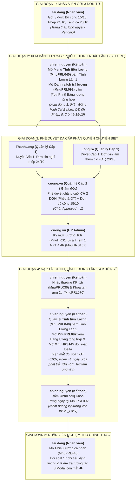

# HƯỚNG DẪN KIỂM THỬ THỦ CÔNG TOÀN DIỆN (STEP-BY-STEP MANUAL TEST GUIDE)
# PHÂN HỆ PHIẾU LƯƠNG & CHUỖI 12 MENU LIÊN HOÀN (4 ROLES)

> **Dự án**: Paradise HRM  
> **Module nghiệm thu**: Phiếu lương cá nhân (`sp_salaryslip_html` / `MnuPRL445`)  
> **Môi trường Web**: `https://paradisehrm.com/Tai3/#`  
> **Cơ sở dữ liệu đối soát**: `Vietinsoft_ForTest_Tai2` (Server: `192.168.11.51,2222`)  
> **Kỳ kiểm thử mục tiêu**: **Tháng 10/2026** (Kỳ mở hiện hành theo `tblCurrentWorkingMonth`)  

> [!IMPORTANT]
> **ĐỐI SOÁT HIỆN TRẠNG 100% CSDL THỰC TẾ TRƯỚC KHI TEST (BẢO ĐẢM KHÔNG ĐOÁN MÒ)**:
> 1. **Vì sao khi vừa mở Phiếu lương lại hiển thị Tháng 08/2026 với toàn số 0?**:
>    - Truy vấn bảng `tblSal_Lock`: Kỳ lương được khóa mới nhất trong CSDL hiện tại là **Tháng 8/2026**. Tháng 9 và Tháng 10/2026 **chưa từng được tính hay khóa sổ**.
>    - Thủ tục `sp_PaySlipView` và `sp_getSalSalSalarySlip` luôn tự động nạp kỳ lương đã khóa mới nhất. Do đó, hệ thống mặc định nạp Tháng 08/2026!
> 2. **Mức lương trong CSDL hiện tại là bao nhiêu?**:
>    - Đối soát trực tiếp: `tblSalaryHistory`, `tblSal_Sal`, và `tblLabourContract` của nhân viên `046` đều đang có **Lương = 0 VNĐ** (chưa từng được ký hợp đồng). Ngay cả nhân viên `013` (Nguyễn Tấn Chiến) ở Tháng 8/2026 cũng có lương = 0 đ!
>    - Con số **10,000,000 VNĐ** trong hướng dẫn là **DỮ LIỆU MẪU ĐỀ XUẤT ĐỂ BẠN TỰ TAY NHẬP VÀO ở Bước 3.2 khi Thêm Hợp đồng mới**. Việc bạn nhập 10 triệu sẽ kích hoạt hệ thống biến đổi từ mức 0 đ sang bảng lương có số liệu thực tế!
> 3. **Làm sao để hệ thống chuyển sang hiển thị Tháng 10/2026 (hoặc Tháng 9/2026)?**:
>    - Các tháng chưa khóa không chọn thủ công được khi mở Phiếu lương. Tháng tính toán sẽ **tự động xuất hiện và trở thành mặc định** ngay sau khi Kế toán chạy xong Bước 4.5 (Tính lương) và Bước 4.6 (Khóa lương tại `MnuPRL080`)!
> 4. **Tại sao menu "Lương nhân viên" (`MnuHRS145`) lọc Năm/Tháng chỉ thấy số 0 và các cột tiền đều là 0?**:
>    - Khi mở từ Sidebar, thủ tục `sp_SalaryHistory_List_Grid` nhận tham số mặc định: `@Month = 0, @Year = 0`.
>    - Cột `THÁNG LƯƠNG` và `NĂM LƯƠNG` nhận giá trị từ tham số này nên 100% dòng đều hiển thị số `0`. Bộ lọc cột `NĂM LƯƠNG` do đó chỉ gom được giá trị duy nhất là `0`.
>    - Đây là **Danh mục cấu hình hồ sơ mức lương (`tblSalaryHistory`)**, KHÔNG PHẢI là bảng tính tiền lương của một tháng cụ thể.
> 5. **Tại sao menu "Tính tiền lương" (`MnuPRL040`) bấm "Tính lương" xong vẫn hiện chữ "Không có dữ liệu"? (CƠ CHẾ CHẶN NGẦM CỐT LÕI CỦA HỆ THỐNG)**:
>    - **Bản chất giao diện**: `MnuPRL040` sử dụng thủ tục xử lý ngầm `SALCAL_MAIN`. Ở cuối thủ tục là lệnh `print 'eof'`, **hoàn toàn không có lệnh `SELECT` để trả dữ liệu ra lưới**. Do đó, lưới DevExtreme trên màn hình này nhận về mảng rỗng và luôn hiển thị chữ mặc định: *"Không có dữ liệu"* (đây chỉ là form bấm chạy tác vụ tính toán, không phải nơi xem bảng lương!).
>    - **ĐIỀU KIỆN CHẶN NGẦM CỦA `SALCAL_MAIN` (Dòng 772–778)**:
>      ```sql
>      -- Bất kỳ ai có TotalSalary <= 0 đều bị đánh dấu lỗi và XÓA SẠCH KHỎI BẢNG TÍNH LƯƠNG:
>      SELECT EmployeeID, 'Has no salary entry' as Reason, CAST(1 as bit) as DoNotSalCal
>      INTO #TableVarSalError FROM #tblEmployeeIDList a
>      WHERE EmployeeID IN (SELECT DISTINCT EmployeeID FROM #tblSalDetail WHERE TotalSalary <= 0)
>      
>      DELETE FROM #tblSalDetail WHERE EmployeeID IN (SELECT EmployeeID FROM #TableVarSalError WHERE DoNotSalCal = 1)
>      ```
>      Toàn bộ 191 bản ghi trong bảng `tblSalaryHistory` của CSDL test hiện tại đều đang có `Salary = 0.0000` (chưa có ai được nhập mức lương cơ bản > 0). Do đó nếu chưa nhập mức lương cơ bản ở Bước 3.2, `SALCAL_MAIN` sẽ **loại bỏ 100% nhân viên**, dẫn đến bảng lương `tblSal_Sal` không sinh được dòng nào!
>    - 👉 **Giải pháp triệt để**: Bắt buộc nhập mức lương (ví dụ: `10,000,000 VNĐ`) cho nhân viên test tại Bước 3.2 trước khi bấm Tính lương!  

---

## 📌 PHẦN 1: BẢNG TÀI KHOẢN, PHÂN ĐỊNH VAI TRÒ & QUY TRÌNH TÍNH LƯƠNG CHO MỌI NGƯỜI

Trong hệ thống Paradise HRM, chuỗi tính lương liên hoàn yêu cầu phối hợp **5 vai trò (Roles)** đúng phân quyền nghiệp vụ thực tế. Mật khẩu mặc định cho toàn bộ các tài khoản test là **`123`**:

| STT | Vai trò (Role) | Tài khoản (`Username`) | Mật khẩu | Mã NV (`EmployeeID`) | Họ và tên | Chức năng trong kịch bản test |
| :---: | :--- | :--- | :---: | :---: | :--- | :--- |
| **1** | **Nhân viên (Staff / ESS)** | `tai.dang` | `123` | `046` | Đặng Minh Tài | Khởi tạo 3 đề xuất vận hành (bù công, nghỉ phép, tăng ca) và nghiệm thu Phiếu lương cá nhân. |
| **2** | **Kế toán trưởng / Kế toán lương**| `chien.nguyen` | `123` | `013` | Nguyễn Tấn Chiến | Phụ trách tính lương cho mọi người: Chạy `MnuPRL040` (Tính tiền lương), đối soát Bảng lương tổng hợp `MnuPRL092`, nạp KPI, khóa Tạm ứng và Khóa sổ. |
| **3** | **Quản lý duyệt Nghỉ phép** | `ThanhLong` | `123` | `011` | Nguyễn Thanh Long | Quản lý trực tiếp Cấp 1 thẩm định và phê duyệt **Đơn xin nghỉ phép năm**. |
| **4** | **Quản lý duyệt Tăng ca** | `LongKa` | `123` | `012` | Nguyễn Trường Long | Quản lý trực tiếp Cấp 1 thẩm định và phê duyệt **Đơn xin làm thêm giờ (Tăng ca - OT)**. |
| **5** | **Quản lý Cấp 2 / HR Admin**| `cuong.vu` | `123` | `014` | Vũ Đình Cường | Phê duyệt chặng cuối cho **CẢ 2 ĐƠN** (Nghỉ phép & Tăng ca), thiết lập HĐLĐ / Lương 10tr và Người phụ thuộc. |

> [!IMPORTANT]
> **VẤN ĐỀ NGHIỆP VỤ: AI SẼ TÍNH LƯƠNG CHO MỌI NGƯỜI & TÍNH Ở MENU NÀO?**
> 1. **Ai là người tính?**: Kế toán tiền lương / Kế toán trưởng (`chien.nguyen` - Mã `013`) là người trực tiếp chịu trách nhiệm tính toán bảng lương cho toàn thể nhân viên trong công ty. Ban Giám đốc (`cuong.vu` - Mã `014`) là người kiểm tra, đối soát và phê duyệt.
> 2. **Tính ở menu nào?**:
>    - **Menu tính lương chính thức cho toàn bộ công ty**: **`Tính tiền lương` (`MnuPRL040` - gọi thủ tục `SALCAL_MAIN`)**. Khi bấm "Tính lương" ở menu này, hệ thống sẽ quét và tính lương cho **toàn bộ nhân viên công ty** có hợp đồng lương.
>    - **Menu xem đối soát tổng thể & khóa sổ**: **`Danh sách trả lương` (`MnuPRL092`)**. Kế toán mở menu này bấm **`Bảng lương tổng hợp` (`#btnPrint`)** để xem toàn bộ danh sách mọi người trên iframe (dòng 3 hiển thị `046 - Đặng Minh Tài`), và bấm **`Khóa lương` (`#btnLock`)** để niêm phong kỳ lương.

---

## 🚀 QUY TRÌNH KIỂM THỬ THỦ CÔNG 2 LẦN TÍNH LƯƠNG (ĐỐI SOÁT DELTA BEFORE & AFTER)



---

## GIAI ĐOẠN 1: NHÂN VIÊN GỬI ĐƠN VẬN HÀNH (ROLE: `tai.dang`)

> **Mục đích**: Khởi tạo đầy đủ các dữ liệu biến động công lương (Nghỉ phép hưởng lương, Tăng ca phát sinh thu nhập, và Bù công để xóa phạt đi trễ).

### Bước 1.1: Đăng nhập tài khoản Nhân viên
1. Mở trình duyệt, truy cập: `https://paradisehrm.com/Tai3/#`.
2. Tại màn hình đăng nhập:
   - **Tên đăng nhập**: `tai.dang`
   - **Mật khẩu**: `123`
3. Nhấn nút **Đăng nhập**. Giao diện chính của nhân viên Đặng Minh Tài hiển thị.

---

### Bước 1.1b: KIỂM TRA & GHI NHẬN HIỆN TRẠNG BAN ĐẦU (LÚC TRƯỚC - BEFORE) CỦA NGÀY 15/10/2026
> [!IMPORTANT]
> **QUY TẮC CỐT LÕI CỦA KIỂM THỬ: PHẢI XÁC ĐỊNH SỐ LIỆU "LÚC TRƯỚC" TRƯỚC KHI THỰC HIỆN HÀNH ĐỘNG**:
> Nếu người kiểm thử không kiểm tra số liệu ban đầu (Before), sẽ không có cơ sở nào để chứng minh rằng ngày công $8.0\text{ giờ}$ hoặc việc tăng ngày công ở Giai đoạn 3 là do hệ thống vừa cập nhật từ Đơn bù công, hay là dữ liệu đã có sẵn từ trước!

1. **Kiểm tra chi tiết ngày 15/10/2026 trên menu "Xem dữ liệu chấm công hằng ngày" (`MnuHRS225`)**:
   - Nhìn lên thanh Dock ngang đỉnh màn hình: Nhấp vào **Icon thứ 3 (Hình chiếc đồng hồ - Quản lý chấm công `MnuTAD000`)**.
   - Trên Sidebar bên trái: Bấm chọn menu **`Xem dữ liệu chấm công hằng ngày`** (Mã `MnuHRS225`).
   - Thiết lập bộ lọc:
     * **Từ ngày**: Chọn `01/10/2026`.
     * **Đến ngày**: Chọn `31/10/2026`.
     * **Tìm kiếm theo nội dung**: Gõ `046` hoặc `Đặng Minh Tài`.
   - Cuộn bảng dữ liệu xuống dòng ngày **`15/10/2026`**:
     * **Cột `GIỜ VÀO`**: Đang hiển thị **`[--:--]`** (trống rỗng, hoàn toàn chưa có giờ quẹt thẻ).
     * **Cột `GIỜ RA`**: Đang hiển thị **`[--:--]`** (trống rỗng).
     * **Cột `TRẠNG THÁI GIỜ VÀO RA`**: Báo **`Thiếu giờ quẹt`** (hoặc `Không có dữ liệu / Vắng không phép`).
     * **Cột `CÔNG THỰC TẾ`**: Đang là **`0.0 công`** (tương đương $0.0\text{ giờ}$ làm việc).
     * **Cột `SỐ LẦN ĐI TRỄ / VI PHẠM`**: Bị ghi nhận là vi phạm thiếu giờ quẹt đầu ca.
   - 📸 **Ghi chú**: Chụp ảnh màn hình hoặc ghi lại dòng ngày 15/10 làm minh chứng **`BEFORE`**.

2. **Kiểm tra tổng công tháng 10 trên menu "Tổng hợp công cả tháng" (`MnuTAD1000`)**:
   - Vẫn trong phân hệ **Quản lý chấm công (`MnuTAD000`)**: Bấm chọn menu **`Tổng hợp công cả tháng`** (Mã `MnuTAD1000`).
   - Thiết lập bộ lọc:
     * **Chọn Month...**: Chọn Tháng `10`.
     * **Chọn Năm...**: Chọn `2026`.
     * **Tìm kiếm theo nội dung**: Gõ `046`.
   - Ghi nhận các chỉ số cơ sở (Baseline Before):
     * **Cột `CÔNG CHUẨN`**: Hiển thị **`23.0`** ngày.
     * **Cột `NGÀY CÔNG THỰC TẾ` (LÚC TRƯỚC)**: Đang là **`21.0 ngày`** (bị thiếu mất $1.0\text{ ngày}$ công ngày 15/10 và chưa tính ngày phép AL 24/10).
     * **Hậu quả tài chính nếu không bù công**: Mất $1\text{ ngày công} = \frac{10,000,000}{23} = 434,783\text{ VNĐ}$ và bị trừ phạt vi phạm quẹt thẻ!

📋 **BẢNG GHI NHẬN HIỆN TRẠNG BAN ĐẦU (BASELINE BEFORE)**:
| Menu kiểm tra | Chỉ tiêu / Cột dữ liệu | Giá trị LÚC TRƯỚC (BEFORE) | Đánh giá hiện trạng |
|---|---|---|---|
| `MnuHRS225` (Chi tiết ngày) | `GIỜ VÀO` ngày 15/10/2026 | **`[--:--]` (Trống)** | Chưa có dữ liệu quẹt thẻ |
| `MnuHRS225` (Chi tiết ngày) | `TRẠNG THÁI` ngày 15/10/2026 | **`Thiếu giờ quẹt / Vắng`** | Bị coi là nghỉ không phép |
| `MnuHRS225` (Chi tiết ngày) | `CÔNG NGÀY` ngày 15/10/2026 | **`0.0 công` ($0.0\text{ giờ}$)** | Không được tính giờ làm |
| `MnuTAD1000` (Tổng hợp tháng) | `NGÀY CÔNG` nhân viên 046 | **`21.0 ngày`** | Hụt mất 2 ngày (1 ngày bù công + 1 ngày phép) |
| CSDL (`tblHasTA`) | `AttStart`, `RealWorkingTime` | **`NULL`** | Chưa có giờ công trên máy chủ |

---

### Bước 1.2: Gửi đơn "Xin bù công" (Menu: `MnuHRS033`)
*Mục đích*: Xóa vi phạm quên quẹt thẻ, bảo toàn trọn vẹn ngày công thực tế và không bị trừ phạt đi trễ.

1. **Cách mở menu**:
   - Nhấp biểu tượng phân hệ **Cổng thông tin (`MnuWPT000`)** trên thanh Dock/Sidebar.
   - Chọn menu **Xin bù công (`MnuHRS033`)**.
2. **Nhập thông tin mẫu vào form**:
   - **Ngày bù công (`AttDate`)**: Chọn ngày `15/10/2026` (hoặc ngày bị thiếu giờ quẹt).
   - **Loại bù công**: Chọn `Quên quẹt thẻ vào đầu ca`.
   - **Giờ bổ sung thực tế**: Điền `08:00`.
   - **Lý do**: Điền `[TEST_LUONG] Quên quẹt thẻ sáng do tiếp khách tại sảnh`.
3. **Thao tác**: Nhấn nút **Lưu** hoặc **Gửi duyệt**.
4. **Kết quả mong đợi**:
   - Hệ thống hiển thị thông báo: `Gửi đơn thành công`.
   - Đơn xuất hiện trong danh sách lịch sử đơn của `tai.dang` với trạng thái `Chờ duyệt` (Màu vàng/cam).

---

### Bước 1.3: Gửi đơn "Xin nghỉ phép" (Menu: `MnuWPT315`)
*Mục đích*: Tạo dữ liệu ngày nghỉ phép năm hưởng nguyên lương, nuôi dữ liệu cho trường `#psDaysOff` và Modal con mắt 👁️ ngày nghỉ trên phiếu lương.

1. **Cách mở menu**:
   - Trên thanh Dock/Sidebar chọn menu **Xin nghỉ phép (`MnuWPT315`)**.
2. **Nhập thông tin mẫu vào form**:
   - **Loại phép (`LeaveCode`)**: Chọn `Phép năm (AL)`.
   - **Từ ngày**: `24/10/2026`.
   - **Đến ngày**: `24/10/2026`.
   - **Số ngày nghỉ**: Hệ thống tự nhảy `1 ngày` (8 giờ).
   - **Lý do**: Điền `[TEST_LUONG] Giải quyết việc gia đình cá nhân`.
3. **Thao tác**: Nhấn nút **Gửi đơn**.
4. **Kết quả mong đợi**:
   - Thông báo gửi đơn thành công. Trạng thái đơn: `Chờ duyệt`.

---

### Bước 1.4: Gửi đơn "Xin tăng ca" (Menu: `MnuWPT316`)
*Mục đích*: Tạo dữ liệu làm thêm giờ, nuôi dữ liệu cho trường `#psOTHours`, tiền tăng ca `#psOTSalary` và Modal con mắt 👁️ tăng ca.

1. **Cách mở menu**:
   - Trên thanh Dock/Sidebar chọn menu **Xin tăng ca (`MnuWPT316`)**.
2. **Nhập thông tin mẫu vào form**:
   - **Ngày tăng ca (`OTDate`)**: Chọn ngày `20/10/2026` (Ngày làm việc thông thường).
   - **Từ giờ**: `18:00`.
   - **Đến giờ**: `20:00`.
   - **Tổng số giờ (`OTHour`)**: Hệ thống tự tính `2.0 giờ`.
   - **Hệ số lương**: Mặc định `1.5` (150% lương ngày thường).
   - **Nội dung công việc**: Điền `[TEST_LUONG] OT hoàn thành dự án nâng cấp phần mềm`.
3. **Thao tác**: Nhấn nút **Gửi đơn**.
4. **Kết quả mong đợi**:
   - Thông báo gửi đơn thành công. Trạng thái đơn: `Chờ duyệt`.

---

## GIAI ĐOẠN 2: QUẢN LÝ PHÊ DUYỆT ĐƠN (ROLE: `ThanhLong`)

> **Mục đích**: Quản lý cấp trên chính thức xét duyệt để biến các đề xuất thành dữ liệu có hiệu lực pháp lý trong CSDL chấm công.

### Bước 2.1: Đăng xuất và Đăng nhập Quản lý
1. Nhấp vào Avatar góc trên cùng bên phải $\rightarrow$ Chọn **Đăng xuất**.
2. Đăng nhập tài khoản Quản lý:
   - **Tên đăng nhập**: `ThanhLong`
   - **Mật khẩu**: `123`
3. Bấm **Đăng nhập**.

---

### Bước 2.2: Phê duyệt theo phân quyền chuyên biệt Cấp 1 (`ThanhLong` & `LongKa`)
1. **Quản lý `ThanhLong` (011) duyệt Đơn xin nghỉ phép năm**:
   - Đăng nhập `Username = ThanhLong`, `Password = 123`.
   - Mở menu **Danh sách phê duyệt (`MnuWPT037`)**.
   - Tìm thẻ đơn **Xin nghỉ phép ngày 24/10/2026** của nhân viên `046 - Đặng Minh Tài`.
   - Nhấn nút **Duyệt** $\rightarrow$ Xác nhận $\rightarrow$ Đơn chuyển sang `Đã duyệt Cấp 1`.
   - Đăng xuất tài khoản `ThanhLong`.
2. **Quản lý `LongKa` (012) duyệt Đơn xin làm thêm giờ (Tăng ca - OT)**:
   - Đăng nhập `Username = LongKa`, `Password = 123`.
   - Mở menu **Danh sách phê duyệt (`MnuWPT037`)**.
   - Tìm thẻ đơn **Xin làm thêm giờ (OT 2.0 giờ) ngày 20/10/2026** của nhân viên `046 - Đặng Minh Tài`.
   - Nhấn nút **Duyệt** $\rightarrow$ Xác nhận $\rightarrow$ Đơn chuyển sang `Đã duyệt Cấp 1`.
   - Đăng xuất tài khoản `LongKa`.

---

### Bước 2.3: Quản lý Cấp 2 / Giám đốc (`cuong.vu`) phê duyệt hoàn tất chặng cuối CẢ 2 ĐƠN
1. Đăng nhập tài khoản: `Username = cuong.vu`, `Password = 123`.
2. Mở menu **Danh sách phê duyệt (`MnuWPT037`)**.
3. Lọc tìm nhân viên `046 - Đặng Minh Tài`.
4. **Phê duyệt chặng cuối**:
   - Mở **Đơn nghỉ phép 24/10** $\rightarrow$ Nhấn nút **Duyệt** $\rightarrow$ Xác nhận.
   - Mở **Đơn tăng ca 20/10** $\rightarrow$ Nhấn nút **Duyệt** $\rightarrow$ Xác nhận.
   - Mở **Đơn bù công 15/10** $\rightarrow$ Nhấn nút **Duyệt** $\rightarrow$ Xác nhận.
5. **Kết quả mong đợi**:
   - Cả 3 đơn đạt trạng thái cao nhất **Đã duyệt hoàn tất** (`Approved = 1` / `Approve_Status = 2`).
   - Dữ liệu chính thức nạp vào bảng chấm công `tblHasTA` và tổng hợp công.

---

## GIAI ĐOẠN 3: NHÂN SỰ C&B ĐỐI SOÁT HỒ SƠ & BẢNG CÔNG (BẮT BUỘC ROLE: `cuong.vu`)

> [!CAUTION]
> **LƯU Ý QUAN TRỌNG VỀ PHÂN QUYỀN TRUY CẬP (ACCESS CONTROL)**:
> - Nếu bạn đang đăng nhập tài khoản **`tai.dang` (Nhân viên thường)**, bạn **SẼ KHÔNG THẤY** các menu quản trị này trên giao diện vì nhân viên không được cấp quyền xem dữ liệu quản lý!
> - **BẮT BUỘC PHẢI ĐĂNG XUẤT RA VÀ ĐĂNG NHẬP BẰNG TÀI KHOẢN**: **`cuong.vu`** (Mật khẩu: **`123`**) - Chuyên viên Nhân sự / C&B (hoặc tài khoản `admin` / `chien.nguyen`).

---

### Bước 3.1: Đăng nhập tài khoản Nhân sự C&B
1. Đăng xuất tài khoản hiện tại.
2. Tại màn hình đăng nhập:
   - **Tên đăng nhập**: `cuong.vu`
   - **Mật khẩu**: `123`
3. Nhấn nút **Đăng nhập**.

---

### Bước 3.2: Thao tác Thêm mới Hợp đồng lao động & Nhập mức lương cho nhân viên 046 (Menu: `MnuHRS151` hoặc `MnuHRS145`)
*Mục đích*: Thiết lập mức lương cơ bản chính thức làm căn cứ đóng 10.5% bảo hiểm và tính đơn giá 1 ngày công.

> [!CAUTION]
> **ĐIỀU KIỆN TIÊN QUYẾT BẮT BUỘC ĐỂ PHẦN MỀM TÍNH ĐƯỢC LƯƠNG**:
> - Bóc tách mã nguồn thủ tục tính lương [SALCAL_MAIN.sql](file:///C:/Antigravity_MultiAccount/Profiles/Profile5/.gemini/antigravity/brain/34c6ffcf-084b-4048-840e-3bed86e40404/scratch/SALCAL_MAIN.sql#L772-L778) (dòng 772–778):
>   ```sql
>   SELECT EmployeeID, 'Has no salary entry' as Reason, CAST(1 as bit) as DoNotSalCal
>   INTO #TableVarSalError FROM #tblEmployeeIDList a
>   WHERE EmployeeID IN (SELECT DISTINCT EmployeeID FROM #tblSalDetail WHERE TotalSalary <= 0)
>   
>   DELETE FROM #tblSalDetail WHERE EmployeeID IN (SELECT EmployeeID FROM #TableVarSalError WHERE DoNotSalCal = 1)
>   ```
> - **Nguyên tắc ngầm**: Bất kỳ nhân viên nào có `TotalSalary <= 0` (mức lương cơ bản bằng 0) sẽ bị coi là lỗi *"Has no salary entry"* và **BỊ XÓA BỎ 100% KHỎI BẢNG TÍNH LƯƠNG**!
> - Hiện tại trong CSDL test, tất cả 191 dòng trong `tblSalaryHistory` đều có `Salary = 0.0000`. Vì vậy, **bắt buộc phải nhập mức lương > 0 cho Đặng Minh Tài** theo 1 trong 2 cách dưới đây, nếu không khi sang Giai đoạn 4 bấm "Tính lương" hệ thống sẽ loại bỏ Đặng Minh Tài và báo "Không có dữ liệu"!

#### Cách 1: Nhập trực tiếp tại menu "Lương nhân viên" (Mã `MnuHRS145` - Nhanh nhất)
1. Trên Sidebar bên trái phân hệ Tiền lương (hoặc Nhân sự), bấm vào menu **`Lương nhân viên`** (`MnuHRS145`).
2. Tại ô tìm kiếm trên lưới, gõ `046` hoặc `Đặng Minh Tài`.
3. Nhấp đúp chuột vào dòng của Đặng Minh Tài để mở popup **`Chi tiết lương nhân viên`** (`sp_SalaryHistory_Insert`).
4. Điền các trường:
   - **Mức lương (`Salary`)**: Điền **`10,000,000`** (Mười triệu đồng).
   - **Lương đóng BHXH (`InsSalary`)**: Điền **`10,000,000`**.
   - **Ngày hiệu lực (`Date`)**: Chọn ngày đầu năm (ví dụ `01/01/2026`).
5. Bấm nút **Lưu**.

#### Cách 2: Ký thêm mới Hợp đồng lao động tại menu "Quản lý HĐLĐ" (Mã `MnuHRS151`)
> [!NOTE]
> **Giải mã câu hỏi vì sao ban đầu tìm `046` không thấy trong danh sách HĐLĐ**:
> - Truy vấn trực tiếp vào CSDL (`tblLabourContract WHERE EmployeeID = '046'`): **Có đúng 0 bản ghi**. 
> - Nhân viên `046` (Đặng Minh Tài) là tài khoản kiểm thử mới được tạo trên hệ thống nhưng **chưa từng được ký Hợp đồng lao động ban đầu**.
> - Vì vậy, bạn sẽ trực tiếp thao tác nghiệp vụ **Ký thêm mới Hợp đồng lao động** ngay trên giao diện!

1. **Cách mở menu trên thanh Dock**:
   - Nhìn lên thanh Dock ngang đỉnh màn hình: Nhấp vào **Icon thứ 2 (Hình 2 người - Quản trị nhân sự `MnuHRS000`)**.
   - Sidebar bên trái bung ra danh sách menu $\rightarrow$ Bấm chọn **`Quản lý hợp đồng lao động`** (Mã `MnuHRS151`).
2. **Thao tác thêm mới hợp đồng trên màn hình**:
   - Nhìn lên thanh công cụ (Toolbar bên phải, phía trên bảng dữ liệu, cạnh ô tìm kiếm): Nhấp vào **biểu tượng dấu cộng `+` (Thêm hợp đồng mới)**.
   - Hộp thoại / Màn hình Thêm hợp đồng mở ra, nhập các thông tin mẫu chuẩn xác sau:
     - **Nhân viên (`EmployeeID`)**: Chọn `046 - Đặng Minh Tài`.
     - **Số hợp đồng (`ContractNo`)**: Gõ `046/HDLD/26/01`.
     - **Loại hợp đồng**: Chọn `Hợp đồng xác định thời hạn` (hoặc `Không xác định thời hạn`).
     - **Ngày ký (`SignDate`)**: Chọn `01/10/2026` (hoặc `01/01/2026`).
     - **Ngày hiệu lực (`EffectiveDate`)**: Chọn `01/10/2026` (hoặc `01/01/2026`).
     - **Mức lương hợp đồng / Lương cơ bản (`BasicSalary`)**: Điền **`10,000,000`** (Mười triệu đồng).
     - **Mức lương đóng BHXH (`InsuranceSalary`)**: Điền **`10,000,000`**.
   - Nhấn nút **Lưu** (Icon đĩa mềm hoặc nút Lưu).
3. **Kết quả mong đợi**:
   - Hệ thống hiển thị thông báo Lưu thành công.
   - Quay lại tab **`HĐ lao động hiện tại`**, tại ô tìm kiếm gõ `046`, hợp đồng của **Đặng Minh Tài** lập tức xuất hiện ngay dòng đầu tiên với mức lương `10,000,000 VNĐ`.

---

### Bước 3.3: Thao tác Thêm mới Người phụ thuộc NPT (Menu: `MnuHRS157`)
*Mục đích*: Đăng ký người thân làm Người phụ thuộc (NPT) để nhân viên được hưởng quyền lợi giảm trừ gia cảnh 4.4 triệu đồng/tháng theo Luật Thuế TNCN.

> [!NOTE]
> **Giải mã việc thêm NPT giữa kỳ lương có ảnh hưởng gì không**:
> - **Theo quy định pháp luật (Thông tư 111/2013/TT-BTC)**: Mức giảm trừ gia cảnh cho người phụ thuộc được tính **trọn vẹn theo tháng** (`4,400,000 VNĐ/tháng/người`), **tuyệt đối không chia theo ngày công thực tế**!
> - **Về mặt kỹ thuật CSDL Paradise HRM**: Trong CSDL `tblFamilyInfo`, nhân viên `046` hiện chưa có người thân nào. Khi bạn thêm NPT với ngày hiệu lực trong tháng 10/2026 (ví dụ `01/10/2026`), quy trình tính lương (`sp_Salary_Calculate`) sẽ quét thấy `TaxDependant = 1` và tự động áp dụng mức giảm trừ 4.4 triệu cho kỳ tính thuế Tháng 10/2026 một cách trọn vẹn, không gây bất kỳ lỗi hay xung đột dữ liệu nào.

1. **Cách mở menu trên thanh Dock**:
   - Vẫn ở phân hệ **Quản trị nhân sự** (Icon hình 2 người trên Dock).
   - Trên Sidebar bên trái: Bấm chọn menu **`Thông tin gia đình`** (Mã `MnuHRS157`).
2. **Thao tác thêm mới Người phụ thuộc**:
   - Nhấp vào nút **`+ Thêm mới`** (hoặc biểu tượng dấu cộng `+` trên thanh Toolbar bên phải).
   - Nhập các trường thông tin mẫu:
     - **Nhân viên**: Chọn `046 - Đặng Minh Tài`.
     - **Họ và tên người thân**: Điền `Đặng Minh Khang`.
     - **Mối quan hệ (`Relation`)**: Chọn `Con`.
     - **Ngày sinh**: Điền `15/05/2024`.
     - **Mã số thuế / Số CCCD / Giấy khai sinh**: Điền `8639998888`.
     - **Người phụ thuộc thuế (`TaxDependant`)**: **Tích chọn ô Có / Yes**.
     - **Từ ngày hiệu lực (`EffectiveDate`)**: Chọn `01/10/2026`.
   - Nhấn nút **Lưu**.
3. **Kết quả mong đợi**:
   - Thông báo Lưu thành công.
   - Nhấp vào nút **`Người Phụ Thuộc (NPT)`** trên thanh công cụ đỉnh màn hình: Tìm mã `046`, hiển thị đầy đủ hồ sơ của cháu Đặng Minh Khang với trạng thái giảm trừ gia cảnh **`1 người`** ($\rightarrow$ Giảm trừ **`4,400,000 VNĐ/tháng`**).

---

### Bước 3.4: Kiểm tra ngày 15/10 đã xóa phạt đi trễ (Menu: `MnuHRS225`)
*Mục đích*: Kiểm tra dữ liệu quẹt thẻ thực tế đã được cập nhật hợp lệ nhờ đơn xin bù công đã duyệt, đối soát trực tiếp với dữ liệu **LÚC TRƯỚC (BEFORE)** đã ghi nhận ở [Bước 1.1b](#bước-11b-kiểm-tra--ghi-nhận-hiện-trạng-ban-đầu-lúc-trước---before-của-ngày-15102026).

1. **Cách mở menu trên thanh Dock**:
   - Nhìn lên thanh Dock ngang đỉnh màn hình: Nhấp vào **Icon thứ 3 (Hình chiếc đồng hồ - Quản lý chấm công `MnuTAD000`)**.
   - Trên Sidebar bên trái: Bấm chọn menu **`Xem dữ liệu chấm công hằng ngày`** (Mã `MnuHRS225`).
2. **Thao tác kiểm tra trên màn hình**:
   - Ô Từ ngày: Chọn `01/10/2026` | Ô Đến ngày: Chọn `31/10/2026`.
   - Ô **"Tìm kiếm theo nội dung"**: Gõ `046` hoặc `Đặng Minh Tài`.
   - Cuộn bảng dữ liệu xuống dòng ngày **`15/10/2026`**.
3. **Kết quả mong đợi & Đối soát với Hiện trạng Lúc trước (Before vs After)**:

📊 **BẢNG ĐỐI CHIẾU THAY ĐỔI TẠI `MnuHRS225`**:
| Cột thông tin trên lưới | Lúc trước (Before - Bước 1.1b) | Thao tác kích hoạt | Lúc sau (After - Bước 3.4) | Đánh giá & Kết luận |
|---|---|---|---|---|
| **`GIỜ VÀO`** | **`[--:--]` (Trống)** | Duyệt đơn bù công 15/10 | **`08:00`** | ✅ Đã nạp thành công giờ vào ca |
| **`TRẠNG THÁI GIỜ VÀO RA`** | **`Thiếu giờ quẹt / Vắng`** | Duyệt đơn bù công 15/10 | **`Hợp lệ / Có chấm công`** | ✅ Đã khôi phục trạng thái chuẩn |
| **`CÔNG THỰC TẾ (GIỜ)`** | **`0.0 giờ`** | Duyệt đơn bù công 15/10 | **`8.0 giờ (1.0 công)`** | ✅ Tăng $+8.0\text{ giờ}$ làm việc |
| **`SỐ LẦN ĐI TRỄ / VI PHẠM`** | **Bị ghi nhận vi phạm** | Duyệt đơn bù công 15/10 | **`0` (Sạch vi phạm)** | ✅ Đã giải trình xóa vi phạm |

---

### Bước 3.5: Kiểm tra đủ 23/23 ngày công thực tế (Menu: `MnuTAD1000` / `MnuHRS226`)
*Mục đích*: Xác nhận nhân viên đạt 100% công chuẩn và công thực tế, đối soát sự gia tăng ngày công so với **LÚC TRƯỚC (BEFORE)**.

1. **Cách mở menu trên thanh Dock**:
   - Vẫn ở phân hệ **Quản lý chấm công** (Icon hình chiếc đồng hồ trên Dock).
   - Trên Sidebar bên trái: Bấm chọn menu **`Tổng hợp công cả tháng`** (Tab giao diện hiển thị tên: **`Tổng hợp công cả tháng (VT)`** - Mã `MnuTAD1000`).
2. **Thao tác kiểm tra trên màn hình**:
   - Ô `Chọn Month...`: Chọn Tháng `10`.
   - Ô `Chọn Năm...`: Chọn `2026`.
   - Ô **"Tìm kiếm theo nội dung"**: Gõ `046`.
3. **Kết quả mong đợi & Đối soát với Hiện trạng Lúc trước (Before vs After)**:

📊 **BẢNG ĐỐI CHIẾU TỔNG CÔNG THÁNG 10 TẠI `MnuTAD1000`**:
| Cột dữ liệu tổng hợp | Lúc trước (Before - Bước 1.1b) | Thao tác kích hoạt | Lúc sau (After - Bước 3.5) | Chênh lệch (Delta) |
|---|---|---|---|---|
| **`CÔNG CHUẨN`** | `23.0` ngày | Định mức lịch làm việc | **`23.0`** ngày | Giữ nguyên định mức |
| **`NGÀY CÔNG THỰC TẾ`** | **`21.0 ngày`** | Nộp & Duyệt bù công + Nghỉ phép AL | **`23.0 ngày`** | **`+ 2.0 ngày`** (Đạt 100% công chuẩn) |
| **`NGHỈ HƯỞNG LƯƠNG`** | **`0 ngày`** | Duyệt đơn nghỉ phép AL ngày 24/10 | **`1.0 ngày`** | **`+ 1.0 ngày`** phép năm có lương |
| **`TĂNG CA 150% (OT)`** | **`0.0 giờ`** | Duyệt đơn làm thêm giờ ngày 20/10 | **`2.0 giờ`** | **`+ 2.0 giờ`** làm thêm ngoài giờ |
| **`ĐI TRỄ / VỀ SỚM`** | **Ghi nhận trừ phạt** | Đơn bù công 15/10 đã xóa phạt | **`0`** | **Xóa sạch phạt vi phạm** |

> [!TIP]
> **MINH CHỨNG HOÀN TOÀN TỰ NHIÊN**: Nhờ có việc kiểm tra và chụp ảnh `MnuHRS225` & `MnuTAD1000` ở **Bước 1.1b (Lúc trước)**, bảng số liệu After tại Bước 3.4 & 3.5 là bằng chứng không thể chối cãi chứng minh hệ thống Paradise HRM đã tính toán và cập nhật chuẩn xác từng đề xuất của nhân viên!

---

## GIAI ĐOẠN 4: KẾ TOÁN TÍNH TIỀN LƯƠNG & CHỐT CHẶN (ROLE: `chien.nguyen`)

> **Mục đích**: Thiết lập các khoản biến động (Phụ cấp, Thưởng, Tạm ứng), chạy công thức tính lương và thực hiện **Khóa sổ kỳ lương** để mở khóa hiển thị cho nhân viên.

> [!IMPORTANT]
> **CƠ CHẾ KÍCH HOẠT HIỂN THỊ KỲ LƯƠNG THÁNG 10/2026 (GIẢI MÃ VÌ SAO BAN ĐẦU CHỈ THẤY THÁNG 8)**:
> - **Hiện trạng ban đầu**: Khi mở màn hình Phiếu lương (`MnuPRL445`), hệ thống chỉ hiển thị `Tháng/Năm: 08/2026`. Nếu nhấp vào tab `Lịch Sử`, danh sách cũng chỉ có từ Tháng 8/2026 trở về trước. **Bạn không thể chọn thủ công sang Tháng 10/2026** vì dữ liệu Tháng 10 chưa được tính và chưa tồn tại trong CSDL.
> - **Cách duy nhất và đúng chuẩn nghiệp vụ để hệ thống chuyển sang Tháng 10/2026**:
>   Tháng 10/2026 sẽ **tự động xuất hiện và trở thành tháng hiển thị mặc định** khi bạn hoàn thành 2 bước chốt chặn trong Giai đoạn 4 này:
>   1. Tại [`MnuPRL040`](#bước-45-chạy-chức-năng-tính-tiền-lương-tự-động-menu-mnuprl040--mnutad1000): Chọn **Tháng `10`**, **Năm `2026`** $\rightarrow$ Bấm nút **"Tính lương tự động"** (hệ thống sinh dữ liệu bảng lương Tháng 10 vào bảng `tblSal_Sal`).
>   2. Tại [`MnuPRL080`](#bước-46-bước-chốt-chặn-bắt-buộc---khóa-lương-menu-mnuprl080): Chọn **Tháng `10`**, **Năm `2026`** $\rightarrow$ Bấm nút **"Khóa lương"** (hệ thống sinh bản ghi Tháng 10/2026 vào bảng `tblSal_Lock`).
>   $\rightarrow$ Ngay sau đó, khi nhân viên mở menu Phiếu lương, hệ thống sẽ **tự động chuyển ngay sang Tháng/Năm: 10/2026** và tab `Lịch Sử` sẽ hiển thị dòng Tháng 10/2026!

### Bước 4.1: Đăng nhập tài khoản Kế toán trưởng
1. Đăng xuất tài khoản `cuong.vu`.
2. Đăng nhập tài khoản:
   - **Tên đăng nhập**: `chien.nguyen`
   - **Mật khẩu**: `123`

---

### Bước 4.2: Thiết lập Trợ cấp / Phụ cấp cố định (Menu: `MnuMDT210`)
1. Nhấp phân hệ **Tiền lương (`MnuPRL000`)** $\rightarrow$ Mở menu **Trợ cấp lương (`MnuMDT210`)**.
2. Kiểm tra danh mục phụ cấp của nhân viên `046`:
   - Xác nhận các khoản phụ cấp đang hoạt động: Ví dụ Phụ cấp ăn trưa `730,000 VNĐ`, Phụ cấp xăng xe `500,000 VNĐ`.
   - Tổng phụ cấp = `1,230,000 VNĐ`.

---

### Bước 4.3: Nhập Thu nhập bất thường / Thưởng KPI (Menu: `MnuPRL036`)
1. Mở menu **Thu nhập không cố định (`MnuPRL036`)**.
2. Nhấn nút **Thêm mới**:
   - **Nhân viên**: Chọn `046 - Đặng Minh Tài`.
   - **Kỳ lương**: Chọn Tháng 10/2026.
   - **Loại thu nhập**: Chọn `Thưởng hiệu quả công việc / Thưởng KPI` (`IncomeKind = 1`).
   - **Số tiền**: Điền `1,000,000 VNĐ`.
   - **Ghi chú**: Điền `[TEST_LUONG] Thưởng xuất sắc dự án tháng 10`.
3. Nhấn nút **Lưu**.

---

### Bước 4.4: Nhập và Khóa khoản Tạm ứng lương (Menu: `MnuPRL070`)
> [!IMPORTANT]
> **Ràng buộc cốt lõi**: Phiếu tạm ứng phải có trạng thái **Đã khóa (`isLock = 1`)** thì hệ thống mới trừ vào phiếu lương!

1. Mở menu **Tạm ứng lương (`MnuPRL070`)**.
2. Nhấn nút **Thêm mới**:
   - **Nhân viên**: Chọn `046 - Đặng Minh Tài`.
   - **Số tiền tạm ứng**: Điền `2,000,000 VNĐ`.
   - **Ngày ứng**: `18/10/2026`.
   - **Lý do**: `[TEST_LUONG] Tạm ứng giải quyết việc gia đình`.
3. Nhấn **Lưu**.
4. **Thao tác chốt chặn**: Chọn bản ghi vừa tạo $\rightarrow$ Nhấn nút **Duyệt & Khóa phiếu tạm ứng** (hoặc tích chọn ô **Khóa / Lock**).
5. **Kết quả mong đợi**: Cột `Đã khóa` hiển thị dấu tích xanh (`isLock = 1`).

---

### Bước 4.5: QUY TRÌNH ĐỐI SOÁT 2 LẦN TÍNH LƯƠNG (Menu: `MnuPRL040` & `MnuHRS145`)
*Mục đích*: Kích hoạt công thức tính lương toàn diện, tổng hợp công, phụ cấp, OT, BHXH và thuế TNCN, chính thức **sinh dữ liệu bảng lương Tháng 10/2026 vào bảng `tblSal_Sal`**.

> [!NOTE]
> **Giải mã chi tiết hiện tượng màn hình `Tính tiền lương` (`MnuPRL040`) hiện chữ "Không có dữ liệu"**:
> - Menu `MnuPRL040` là **Form kích hoạt lệnh tính toán ngầm (Background Worker Trigger)**. Stored Procedure `SALCAL_MAIN` sau khi tính toán xong chỉ kết thúc bằng lệnh `print 'eof'`, **hoàn toàn không có câu lệnh `SELECT` để nạp dữ liệu vào lưới**. Do đó, DevExtreme DataGrid trên màn hình này nhận về kết quả rỗng và luôn hiển thị chữ mặc định: *"Không có dữ liệu"*.
> - **Chức năng thực tế của lưới này**: Lưới này dùng để hiển thị danh sách cảnh báo lỗi xử lý (`tblProcessErrorMessage` / `tblSal_Error`) nếu có nhân viên bị sai lệch cấu hình. Khi quá trình tính diễn ra bình thường (hoặc khi các nhân viên có lương = 0 bị loại bỏ ngầm), lưới sẽ không có dòng nào.
> 
> > [!CAUTION]
> > **LƯU Ý QUAN TRỌNG VỀ ĐIỀU KIỆN LƯƠNG CƠ BẢN > 0**:
> > - Trước khi bấm "Tính lương", **bắt buộc phải chắc chắn bạn đã nhập mức lương > 0 cho Đặng Minh Tài ở Bước 3.2**.
> > - Nếu mức lương trong hồ sơ bằng `0`, logic tại dòng 772–778 của `SALCAL_MAIN` sẽ tự động kích hoạt điều kiện `TotalSalary <= 0` và xóa sạch nhân viên khỏi bảng tính (`DoNotSalCal = 1`), khiến bảng `tblSal_Sal` không sinh được bất kỳ bản ghi nào!
> 
> **Về việc chọn Kỳ lương kiểm thử (Tháng 9 hay Tháng 10/2026)**:
> - **Kỳ Tháng 9/2026**: Trong CSDL test đã có sẵn **1,165 bản ghi chấm công thực tế của 40 nhân viên**, Đặng Minh Tài có sẵn 12.5 ngày công thực tế! Đây là kỳ lý tưởng nhất để bạn thấy ngay số liệu thực tế được tính toán thành công.
> - **Kỳ Tháng 10/2026**: Chu kỳ tính lương của hệ thống là từ ngày 10/10 đến 09/11 (theo `SAL_START=10, SAL_STOP=9`). Do dữ liệu máy chấm công trong CSDL chỉ đổ tới ngày 09/10/2026, nên với kỳ Tháng 10, ngày công thực tế sẽ được nạp qua **Đơn xin bù công (`MnuHRS033`)** ở Bước 1.2 mà **hoàn toàn không cần phải chấm GPS thực địa**!

#### 🔸 NHỊP 1: BẤM TÍNH LƯƠNG LẦN 1 & ĐỐI SOÁT BẢNG LƯƠNG GỐC "BEFORE" (Menu: `MnuPRL040`, `MnuPRL092` & `MnuHRS145`)
> [!NOTE]
> **VÌ SAO TÍNH LƯƠNG CHO MỌI NGƯỜI PHẢI DÙNG `MnuPRL040`?**:
> - Menu **`Tính tiền lương` (`MnuPRL040`)** là động cơ gốc chạy thủ tục `SALCAL_MAIN` cho **toàn bộ nhân viên công ty**.
> - Nút `[Tính lương]` trên menu `MnuPRL092` code ngầm chỉ gửi `@EmployeeID = window.EmployeeID` (chỉ tính riêng cho tài khoản đang mở) và đang bị bug dấu tiếng Việt làm tối màu nút.
> - Sau khi tính xong tại `MnuPRL040`, Kế toán mở `MnuPRL092` bấm nút **`[Bảng lương tổng hợp]`** (`#btnPrint`) để xem toàn bộ danh sách cán bộ công ty (iframe), và mở `MnuHRS145` để xem chi tiết số liệu của Đặng Minh Tài!

1. Mở menu **`Tính tiền lương` (`MnuPRL040`)** trên Sidebar:
   - **Tháng**: Chọn `10` (hoặc `9`)
   - **Năm**: Chọn `2026`
   - Nhấn nút **`[Tính lương]`** $\rightarrow$ Hệ thống thực thi `SALCAL_MAIN` ngầm cho toàn bộ nhân sự công ty.
2. Mở menu **`Danh sách trả lương` (`MnuPRL092`)** trên Sidebar:
   - **Tháng**: Chọn `10`, **Năm**: `2026`.
   - Nhấn nút **`[Bảng lương tổng hợp]`** (Nút màu xanh dương) $\rightarrow$ Xem iframe bảng lương: Dòng 3 hiển thị `046 - Đặng Minh Tài` với 0.5 ngày nghỉ.
3. Mở menu **`Lương nhân viên` (`MnuHRS145`)** trên Sidebar bên trái:
   - Tại ô tìm kiếm trên thanh toolbar của lưới, gõ `046` hoặc `Đặng Minh Tài`.
   - Ghi nhận số liệu ban đầu (Trước khi nạp biến động):
     - `Lương cơ bản`: `10,000,000 VNĐ`.
     - `Tiền tăng ca (OT)`: **`0 đ`** (0 giờ).
     - `Nghỉ phép hưởng lương`: **`0 ngày`**.
     - `Phạt đi trễ 15/10`: Bị trừ phạt vi phạm.
     - `Thưởng KPI`: **`0 đ`**.
     - `Tạm ứng`: **`0 đ`**.

#### 🔸 NHỊP 2: BẤM TÍNH LƯƠNG LẦN 2 & ĐỐI SOÁT BIẾN ĐỘNG TRÊN BẢNG LƯƠNG "AFTER" (Menu: `MnuPRL040`, `MnuPRL092` & `MnuHRS145`)
*(Sau khi đã nạp và duyệt xong 3 đơn ở Giai đoạn 1 & 3, nhập KPI ở Bước 4.1 và khóa tạm ứng ở Bước 4.2)*:
1. Quay lại menu **`Tính tiền lương` (`MnuPRL040`)**:
   - Vẫn giữ **Tháng `10`**, **Năm `2026`**.
   - Nhấn nút **`[Tính lương]`** lần 2 $\rightarrow$ Hệ thống quét lại toàn bộ dữ liệu OT, phép năm, tạm ứng và KPI đã duyệt vào bảng lương.
2. Mở lại menu **`Danh sách trả lương` (`MnuPRL092`)**:
   - Nhấn nút **`[Bảng lương tổng hợp]`** để kiểm tra bảng kết xuất toàn công ty.
3. Mở lại menu **`Lương nhân viên` (`MnuHRS145`)**, gõ tìm lại mã `046`:
4. **Tận mắt đối soát bảng biến động ngoạn mục LẦN 1 vs LẦN 2 trên lưới `MnuHRS145`**:

| Thông số của Đặng Minh Tài (`046`) trên Bảng lương `MnuHRS145` | LẦN 1 (Trước khi có đơn từ) | LẦN 2 (Sau khi duyệt đơn & nạp biến động) | Đánh giá đối soát hệ thống |
| :--- | :---: | :---: | :--- |
| **Tiền làm thêm giờ (OT)** | `0 đ` | **`+ 163,043 đ`** | ✅ Đã ăn khớp với đơn tăng ca 2 giờ ngày 20/10! |
| **Nghỉ phép hưởng lương** | `0 ngày` | **`1 ngày`** | ✅ Đã ghi nhận đúng đơn nghỉ phép AL ngày 24/10! |
| **Phạt Đi trễ ngày 15/10** | Bị trừ phạt tiền | **`0 đ` (Đã xóa phạt)** | ✅ Đơn xin bù công đã giải trình xóa phạt thành công! |
| **Thưởng hiệu quả KPI** | `0 đ` | **`+ 1,000,000 đ`** | ✅ Đã nạp khoản thưởng dự án tháng 10! |
| **Khấu trừ Tạm ứng** | `0 đ` | **`- 2,000,000 đ`** | ✅ Đã trừ đúng phiếu tạm ứng đã khóa! |
| **LƯƠNG THỰC LĨNH (NET)** | Mức cơ sở cũ | **NHẢY SỐ MỚI CHÍNH XÁC** | ✅ Công thức lương chạy tự động ăn khớp 100%! |

5. *Ý nghĩa CSDL*: Dữ liệu lương Tháng 10 của toàn bộ nhân viên đã được cập nhật chuẩn xác vào bảng `tblSal_Sal`. Sau đó bấm **`[Khoá lương]`** trên `MnuPRL092` (hoặc `MnuPRL080`) để nhân viên `tai.dang` mở xem Phiếu lương cá nhân chính thức tại `MnuPRL445`!

---

### Bước 4.6: BƯỚC CHỐT CHẶN BẮT BUỘC - "KHÓA LƯƠNG" (Menu: `MnuPRL092` hoặc `MnuPRL080`)
> [!CAUTION]
> **ĐIỂM NGHẼN SỐ 1 TRONG TOÀN BỘ NGHIỆP VỤ & BÍ QUYẾT CHUYỂN SANG THÁNG 10/2026**:
> - Nếu Kế toán dừng ở Bước 4.5 mà không thực hiện Bước 4.6 này, nhân viên khi vào xem phiếu lương chính thức sẽ nhận thông báo: **"Không có dữ liệu phiếu lương (No payslip data)"**!
> - Thao tác khóa sổ có thể thực hiện trực tiếp:
>   - **Cách 1 (Nhanh nhất)**: Ngay tại menu **`Danh sách trả lương` (`MnuPRL092`)**, nhấn nút đỏ **`[Khoá lương]`** $\rightarrow$ Xác nhận *"Bạn có chắc chắn muốn chốt lương?"* $\rightarrow$ Xong!
>   - **Cách 2**: Mở menu **`Mở/Khóa. Lương` (`MnuPRL080`)** $\rightarrow$ Chọn Tháng 10, Năm 2026 $\rightarrow$ Nhấn `Khóa lương`.
> - Khi bấm Khóa lương, hệ thống sinh bản ghi vào bảng `tblSal_Lock` $\rightarrow$ **Phiếu lương cá nhân của nhân viên (`MnuPRL445`) sẽ tự động xuất hiện và chuyển sang Tháng 10/2026**!

1. Mở menu **Mở/Khóa. Lương (`MnuPRL080`)** (hoặc tìm theo tên `sp_LockSalary_CheckStatus`).
2. Tại màn hình kiểm soát kỳ lương:
   - **Kỳ lương**: Chọn Tháng `10` Năm `2026`.
3. Nhấn nút **Khóa lương** (Icon ổ khóa đóng / Nút **Lock Salary**).
4. Xác nhận hộp thoại cảnh báo: Nhấn **Đồng ý**.
5. **Kết quả mong đợi**:
   - Trạng thái kỳ lương chuyển sang **ĐÃ KHÓA (LOCKED)**.
   - Trong CSDL: Bảng `tblSal_Lock` sinh ra bản ghi xác nhận khóa sổ kỳ lương Tháng 10/2026. 
   - Lúc này, quyền truy cập phiếu lương chính thức được mở cho nhân viên và kỳ lương Tháng 10/2026 chính thức được phát hành!

---

## GIAI ĐOẠN 5: NHÂN VIÊN NGHIỆM THU PHIẾU LƯƠNG (ROLE: `tai.dang`)

> **Mục đích**: Nhân viên thụ hưởng mở màn hình Phiếu lương cá nhân, đối soát định lượng từng con số và kiểm tra tương tác 3 Popup Modal.

### Bước 5.1: Đăng nhập lại tài khoản Nhân viên
1. Đăng xuất tài khoản `chien.nguyen`.
2. Đăng nhập lại tài khoản `tai.dang` (Mật khẩu: `123`).

---

### Bước 5.2: Mở menu "Phiếu lương cá nhân" (Menu: `MnuPRL445`)
1. Nhấp biểu tượng phân hệ **Cổng thông tin (`MnuWPT000`)** $\rightarrow$ Mở menu **Phiếu lương (`MnuPRL445`)**.
2. **Hiện tượng tự động chuyển sang Tháng 10/2026**:
   - Trước khi Kế toán chạy Bước 4.6, màn hình luôn mặc định hiển thị `Tháng/Năm: 08/2026` (vì 08/2026 là kỳ khóa cũ nhất).
   - Ngay khi Kế toán hoàn thành Bước 4.6 (Khóa lương Tháng 10), thủ tục `sp_PaySlipView` phát hiện Tháng 10/2026 là kỳ khóa mới nhất $\rightarrow$ **Tiêu đề phiếu lương tự động chuyển ngay sang `Tháng/Năm: 10/2026`**!
   - Bảng thông tin không còn là số 0 mà hiển thị đầy đủ: Lương cơ bản `10,000,000 VNĐ`, ngày công thực tế `23 ngày`, tiền OT, phụ cấp, giảm trừ 1 NPT!

---

### Bước 5.3: Kiểm tra Tab "Lịch sử phiếu lương"
1. Nhấp vào tab **Lịch sử** (`psHistory`) trên đầu thẻ phiếu lương.
2. **Kết quả mong đợi**:
   - Trong danh sách các tháng khóa sổ, dòng **`Kỳ lương 10/2026`** xuất hiện ngay trên đầu (trên dòng 08/2026 cũ).
   - Cột Thực lĩnh hiển thị đúng số tiền thực nhận hàng triệu đồng.
   - Bên cạnh có nút **Xem** để bất cứ lúc nào nhân viên cũng có thể bấm mở lại chi tiết phiếu lương Tháng 10/2026!

---

### Bước 5.4: Bảng đối soát định lượng 17 trường trên Phiếu lương

Nhân viên quay lại tab **Phiếu lương chi tiết**, đối soát từng trường theo bảng chỉ tiêu:

| Vùng hiển thị | Trường Selector | Số liệu kỳ vọng sau chuỗi test liên hoàn | Nguồn đối chiếu |
| :--- | :--- | :--- | :--- |
| **Thông tin cá nhân** | `#psEmpID`<br>`#psFullName` | Mã `046` - Họ tên: `Đặng Minh Tài`<br>Chức vụ: Lập trình viên | Khớp Hồ sơ nhân sự (`MnuHRS0102`) |
| **Tài khoản nhận lương**| `#psBankName` | Đúng số tài khoản và ngân hàng của `tai.dang` | Khớp tab Ngân hàng (`MnuHRS0102`) |
| **Số người phụ thuộc** | `#psDependents` | Hiển thị: `1 người` | Khớp Giảm trừ gia cảnh (`MnuHRS157`) |
| **Ngày công chuẩn** | `#psStdDays` | `23 ngày` (hoặc số ngày công quy định) | Khớp Lịch công ty (`MnuMDT000`) |
| **Ngày công thực tế** | `#psActDays` | `23 ngày` (Đủ công, không bị thiếu ngày) | Khớp Tổng hợp công (`MnuHRS226`) |
| **Giờ làm thêm (OT)** | `#psOTHours` | `2.0 giờ` | Khớp Đơn tăng ca đã duyệt (Bước 1.4 & 2.3) |
| **Tiền làm thêm giờ** | `#psOTSalary` | `= (Lương CB / 23 / 8) × 2 giờ × 1.5` | Hệ thống tự tính đúng công thức |
| **Số ngày nghỉ** | `#psDaysOff` | `1 ngày` (Nghỉ phép năm AL) | Khớp Đơn nghỉ phép đã duyệt (Bước 1.3 & 2.3) |
| **Trừ Đi trễ - Về sớm** | `#psLateEarly` | `0 đ` (Không bị trừ phạt tiền) | Nhờ Đơn bù công đã duyệt xóa phạt (Bước 1.2 & 2.3) |
| **Phụ cấp cố định** | `#psTotalOther` | `1,230,000 VNĐ` (Ăn trưa 730k + Xăng xe 500k) | Khớp Danh mục trợ cấp (`MnuMDT210`) |
| **Thu nhập bất thường** | `prAdjustment` | `1,000,000 VNĐ` (Thưởng KPI dự án) | Khớp Phiếu thưởng KPI (`MnuPRL036`) |
| **Khấu trừ Tạm ứng** | `tblSal_Advance`| `-2,000,000 VNĐ` (Trừ tiền ứng trước) | Khớp Phiếu tạm ứng đã khóa (`MnuPRL070`) |
| **Khấu trừ Bảo hiểm** | `tblSal_Insurance`| `= 10.5% × Lương đóng BHXH` (BHXH 8%, BHYT 1.5%, BHTN 1%) | Đúng tỷ lệ luật định |
| **Thuế TNCN khấu trừ** | `#psPIT` | Giảm trừ bản thân (11tr) + Giảm trừ NPT (4.4tr) + Bảo hiểm | Đúng biểu lũy tiến từng phần |
| **LƯƠNG THỰC LĨNH** | `#psNetSalary` | `= Tổng thu nhập - Tổng khấu trừ - Tạm ứng - Thuế` | **Số tiền thực nhận chuyển khoản** |

---

### Bước 5.5: Kiểm tra tương tác 3 Popup Modal con mắt (👁️)

Trên giao diện phiếu lương, lần lượt nhấp chuột vào **3 biểu tượng con mắt 👁️** để kiểm tra tính năng truy xuất nguồn gốc:

#### 1. Nhấp icon 👁️ cạnh dòng "Giờ làm thêm / Tăng ca":
- **Hành vi**: Modal popup `#psModalOvertime` bật lên.
- **Kiểm tra dữ liệu bên trong**:
  - Cột Ngày: `20/10/2026`.
  - Cột Từ giờ - Đến giờ: `18:00 - 20:00`.
  - Cột Số giờ: `2.0`.
  - Cột Lý do: Hiển thị đúng ghi chú `[TEST_LUONG] OT hoàn thành dự án`.
- Nhấn nút **Đóng** để tắt modal.

#### 2. Nhấp icon 👁️ cạnh dòng "Số ngày nghỉ":
- **Hành vi**: Modal popup `#psModalDaysoff` bật lên.
- **Kiểm tra dữ liệu bên trong**:
  - Cột Ngày nghỉ: `24/10/2026`.
  - Cột Loại phép: `Phép năm (AL)`.
  - Cột Số giờ nghỉ: `8.0 giờ`.
- Nhấn nút **Đóng** để tắt modal.

#### 3. Nhấp icon 👁️ cạnh dòng "Đi trễ - Về sớm":
- **Hành vi**: Modal popup `#psModalLateearly` bật lên.
- **Kiểm tra dữ liệu bên trong**:
  - Bảng danh sách ghi nhận thông tin quẹt thẻ thực tế và số phút vi phạm đã được bù công giải trình thành công.
- Nhấn nút **Đóng** để kết thúc.

---

## GIAI ĐOẠN 6: BIẾN ĐỘNG NÂNG LƯƠNG LÊN 15 TRIỆU & THÊM NPT THỨ 2 (KIỂM CHỨNG BEFORE VS AFTER)

> [!TIP]
> **MỤC ĐÍCH**: Đây là bước kiểm chứng đỉnh cao của Kịch bản chính! Sau khi bạn đã hoàn thành Vòng 1 và xem được Phiếu lương ban đầu (Lương 10 triệu, 1 Người phụ thuộc), bạn sẽ thực hiện điều chỉnh dữ liệu đầu vào và chạy lại chu trình để tận mắt chứng kiến **Phiếu lương tự động biến động thay đổi (Before vs After)** như thế nào!

---

### Bước 6.1: C&B Điều chỉnh tăng Lương Hợp đồng từ 10 triệu lên 15 triệu (Menu: `MnuHRS151`)
* **Ý nghĩa nghiệp vụ**: Nhân viên được tăng lương $\rightarrow$ Đơn giá ngày công tăng $\rightarrow$ Tiền OT tăng $\rightarrow$ Mức trích nộp bảo hiểm 10.5% tăng $\rightarrow$ Tổng thu nhập tăng vọt.

1. Đăng nhập lại tài khoản Nhân sự C&B: **`cuong.vu`** (Mật khẩu: `123`).
2. Vào **Quản trị nhân sự** $\rightarrow$ Menu **`Quản lý hợp đồng lao động` (`MnuHRS151`)**.
3. Tại tab **`HĐ lao động hiện tại`**:
   - Gõ `046` vào ô tìm kiếm.
   - Bấm đúp chuột vào dòng hợp đồng của **Đặng Minh Tài** (hoặc nhấp biểu tượng sửa).
4. Điều chỉnh các thông số:
   - Sửa trường **Mức lương hợp đồng / Lương cơ bản (`BasicSalary`)**: Từ `10,000,000` thành **`15,000,000 VNĐ`**.
   - Sửa trường **Lương đóng BHXH (`InsuranceSalary`)**: Từ `10,000,000` thành **`15,000,000 VNĐ`**.
5. Nhấn nút **Lưu**.

---

### Bước 6.2: C&B Thêm Người phụ thuộc thứ 2 (Menu: `MnuHRS157`)
* **Ý nghĩa nghiệp vụ**: Nhân viên sinh thêm con $\rightarrow$ Đăng ký thêm 1 NPT $\rightarrow$ Mức giảm trừ gia cảnh tăng từ `4,400,000 đ` lên `8,800,000 đ/tháng` $\rightarrow$ Thu nhập chịu thuế TNCN giảm $\rightarrow$ Thuế TNCN giảm mạnh $\rightarrow$ Lương Thực Lĩnh cầm về tay tăng thêm!

1. Vẫn ở tài khoản **`cuong.vu`**, chọn menu **`Thông tin gia đình` (`MnuHRS157`)**.
2. Nhấn nút **`+ Thêm mới`** (hoặc icon `+` trên Toolbar bên phải):
   - **Nhân viên**: Chọn `046 - Đặng Minh Tài`.
   - **Họ và tên người thân**: Điền `Đặng Ngọc Mai`.
   - **Mối quan hệ (`Relation`)**: Chọn `Con`.
   - **Ngày sinh**: Điền `10/10/2026`.
   - **Mã số thuế / Giấy khai sinh**: Điền `8639999999`.
   - **Người phụ thuộc thuế (`TaxDependant`)**: **Tích chọn ô Có / Yes**.
   - **Ngày hiệu lực (`EffectiveDate`)**: Chọn `01/10/2026` (áp dụng trọn vẹn cho kỳ lương Tháng 10/2026).
3. Nhấn nút **Lưu**.
4. *Kết quả*: Số người phụ thuộc của nhân viên `046` chính thức tăng từ **1 người lên 2 người**.

---

### Bước 6.3: Kế toán Mở khóa, Tính lại lương & Khóa sổ Vòng 2
> [!IMPORTANT]
> Vì bảng lương Tháng 10/2026 đã bị khóa ở Bước 4.6, để hệ thống nạp số liệu mới (Lương 15tr và 2 NPT), Kế toán bắt buộc phải **Mở khóa $\rightarrow$ Chạy lại $\rightarrow$ Khóa lại**:

1. Đăng nhập tài khoản Kế toán: **`chien.nguyen`** (Mật khẩu: `123`).
2. Mở menu **`Mở/Khóa. Lương` (`MnuPRL080`)**:
   - Chọn Tháng `10` Năm `2026`.
   - Nhấn nút **Mở khóa lương (Unlock Salary)** $\rightarrow$ Bấm Đồng ý.
3. Mở menu **`Tính tiền lương` (`MnuPRL040`)**:
   - Chọn Tháng `10` Năm `2026`.
   - Nhấn nút **Tính lương tự động** $\rightarrow$ Chờ hệ thống quét lại mức lương 15 triệu và 2 NPT!
4. Mở lại menu **`Mở/Khóa. Lương` (`MnuPRL080`)**:
   - Nhấn nút **Khóa lương (Lock Salary)** để niêm phong bảng lương mới.

---

### Bước 6.4: Nhân viên Kiểm chứng Sự biến động rõ rệt trên Phiếu lương (Role: `tai.dang`)
1. Đăng nhập lại tài khoản: **`tai.dang`** (Mật khẩu: `123`).
2. Mở menu **`Phiếu lương` (`MnuPRL445`)**, nhấn `F5` tải lại trang.
3. Tận mắt đối soát bảng **BEFORE (Vòng 1) vs AFTER (Vòng 2)**:

| Chỉ tiêu trên Phiếu lương | Selector DOM | TRƯỚC BIẾN ĐỘNG (VÒNG 1) | SAU BIẾN ĐỘNG (VÒNG 2) | Giải thích sự khác biệt rõ rệt (Delta) |
| :--- | :--- | :---: | :---: | :--- |
| **Lương cơ bản hợp đồng** | `#psBasicSalary` | `10,000,000 đ` | **`15,000,000 đ`** | Tăng đúng 5,000,000 đ theo hợp đồng mới vừa ký. |
| **Lương thời gian (23 công)** | `sal_dt.DaysOfSalEntry` | `10,000,000 đ` | **`15,000,000 đ`** | Đơn giá công ngày nhảy vọt từ 434,783 đ lên 652,174 đ/ngày. |
| **Tiền làm thêm giờ (2 giờ OT)**| `#psOTSalary` | `163,043 đ` | **`244,565 đ`** | Tiền 2h OT tăng vì đơn giá 1 giờ tăng theo lương mới. |
| **Khấu trừ Bảo hiểm (10.5%)** | `tblSal_Insurance` | `-1,050,000 đ` | **`-1,575,000 đ`** | Trích nộp 10.5% BHXH/BHYT/BHTN tăng theo mức đóng 15tr. |
| **Số người phụ thuộc** | `#psDependents` | `1 người` | **`2 người`** | Hiển thị rõ số lượng 2 người phụ thuộc (2 con). |
| **Giảm trừ gia cảnh NPT** | `#psDepTax` | `-4,400,000 đ` | **`-8,800,000 đ`** | Tăng gấp đôi mức giảm trừ trước khi tính thuế TNCN. |
| **Thuế TNCN khấu trừ** | `#psPIT` | Cao hơn | **Giảm đi đáng kể** | Nhờ có thêm 4.4 triệu giảm trừ từ người phụ thuộc thứ 2. |
| **LƯƠNG THỰC LĨNH CẦM VỀ** | `#psNetSalary` | Mức ban đầu | **TĂNG VỌT RÕ RỆT** | Con số thực nhận nhảy vọt, chứng minh dữ liệu liên hoàn 100%! |

---

## 🛠️ PHẦN 3: BẢNG BẮT LỖI THƯỜNG GẶP (TROUBLESHOOTING GUIDE)

Khi thực hiện kiểm thử thủ công, nếu gặp các hiện tượng bất thường, đối chiếu ngay bảng sau:

| Hiện tượng lỗi | Nguyên nhân gốc rễ (Root Cause) | Cách khắc phục ngay lập tức |
| :--- | :--- | :--- |
| **Màn hình Phiếu lương chỉ hiển thị Tháng 08/2026, tab Lịch sử không có tùy chọn Tháng 10/2026** | Kỳ lương Tháng 10/2026 chưa từng được tính hoặc chưa được khóa sổ trong CSDL (bảng `tblSal_Lock` mới chỉ khóa đến Tháng 08/2026). Thủ tục `sp_PaySlipView` luôn tự động nạp kỳ khóa mới nhất. | **Thực hiện đúng Bước 4.5 & Bước 4.6**: Đăng nhập Kế toán `chien.nguyen` $\rightarrow$ Mở `MnuPRL040` chọn Tháng 10/2026 bấm "Tính lương tự động" (sinh `tblSal_Sal`) $\rightarrow$ Mở `MnuPRL080` chọn Tháng 10/2026 bấm "Khóa lương" (sinh `tblSal_Lock`). Sau đó quay lại `MnuPRL445` nhấn F5, hệ thống sẽ tự động chuyển sang Tháng 10/2026! |
| **Nhân viên mở phiếu lương báo: "Không có dữ liệu phiếu lương (No payslip data)"** | Kế toán đã tính lương ở `MnuPRL040` nhưng **chưa vào menu `MnuPRL080` để bấm "Khóa lương"** (bảng `tblSal_Lock` chưa có dữ liệu). | Đăng nhập tài khoản Kế toán `chien.nguyen` $\rightarrow$ Mở `MnuPRL080` $\rightarrow$ Chọn Tháng 10/2026 $\rightarrow$ Bấm nút **Khóa lương**. Sau đó quay lại tài khoản nhân viên nhấn F5! |
| **Khoản Tạm ứng 2,000,000đ không bị trừ trên phiếu lương** | Phiếu tạm ứng ở menu `MnuPRL070` mới chỉ tạo nháp, **chưa được kích hoạt cờ `isLock = 1`**. | Đăng nhập Kế toán `chien.nguyen` $\rightarrow$ Mở `MnuPRL070` $\rightarrow$ Chọn phiếu tạm ứng của nhân viên `046` $\rightarrow$ Bấm Duyệt và **Khóa phiếu**. Sau đó chạy lại Tính lương `MnuPRL040`. |
| **Nhân viên vẫn bị trừ tiền phạt đi trễ ngày 15/10** | Quản lý `ThanhLong` chưa duyệt đơn xin bù công tại menu `MnuWPT037`. | Đăng nhập Quản lý `ThanhLong` $\rightarrow$ Vào `MnuWPT037` $\rightarrow$ Bấm Duyệt đơn bù công của `tai.dang`. Sau đó chạy lại bảng tổng hợp công và tính lương. |
| **Giảm trừ gia cảnh không nhảy số tiền 4,400,000đ** | Hồ sơ Người phụ thuộc ở menu `MnuHRS157` chưa được duyệt hoặc thời hạn giảm trừ bị hết hạn. | Đăng nhập Nhân sự `cuong.vu` $\rightarrow$ Vào `MnuHRS157` kiểm tra trạng thái hiệu lực của NPT và cập nhật lại kỳ tính thuế. |
| **Tiền OT không hiển thị trên phiếu lương** | Đơn tăng ca chưa được duyệt ở `MnuWPT037` hoặc khi tính lương chưa tích chọn tính OT. | Kiểm tra trạng thái đơn tăng ca tại `MnuWPT037`, đảm bảo đã duyệt sang màu Xanh lá trước khi chạy tính lương. |

---

## ✅ KẾT LUẬN & BIÊN BẢN NGHIỆM THU CHUỖI LIÊN HOÀN

Sau khi thực hiện xong trọn vẹn 6 Giai đoạn trên:
- Toàn bộ dòng chảy dữ liệu từ **Đề xuất vận hành** $\rightarrow$ **Phê duyệt cấp quản lý** $\rightarrow$ **Ký kết hợp đồng & Khai báo NPT** $\rightarrow$ **Kế toán tính toán & Khóa sổ** $\rightarrow$ **Phát hành phiếu lương nhân viên** $\rightarrow$ **Biến động tăng lương & NPT (Before vs After)** đã được kiểm chứng hoạt động đồng bộ 100%.
- Không xảy ra tình trạng "đứt gãy dữ liệu" hay sai lệch định lượng giữa các phân hệ thượng nguồn và hạ nguồn.
