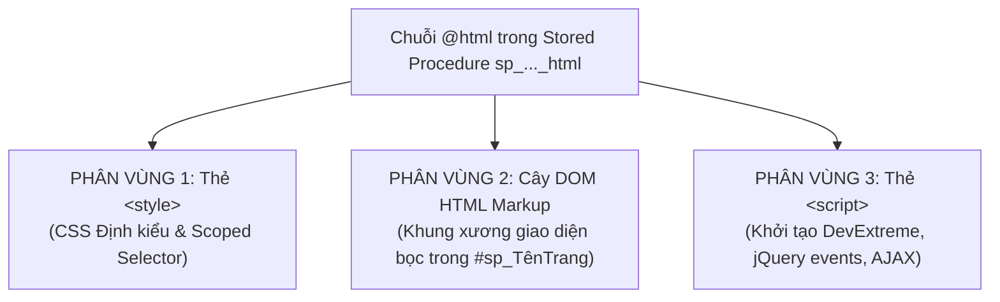
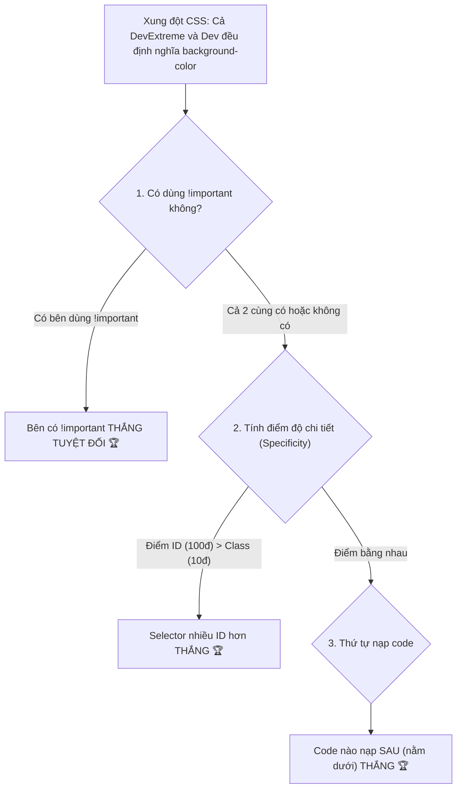

# HƯỚNG DẪN KIẾN TRÚC VẬN HÀNH HTML, CSS, JQUERY & DEVEXTREME TRONG PARADISE HRM

> **Tài liệu tham chiếu kỹ thuật**: Cẩm nang giải thích kiến trúc phân tầng giao diện, cơ chế Scoped vs Global CSS, cách tổ chức mã nguồn trong Stored Procedure và phương pháp vận hành component DevExtreme trên hệ thống Paradise HRM.

---

## 📌 PHẦN MỞ ĐẦU: GIẢI THÍCH KHÁI NIỆM "SCOPED CSS" VS "GLOBAL CSS"

### 1. Tại sao đoạn CSS sửa cho Screenshot 4 lại có tiền tố `#sp_Overtime_Assignment`?
Khi ta viết:
```css
#sp_Overtime_Assignment #qlrl-dxOTFromDate,
#sp_Overtime_Assignment .dx-datebox.dx-texteditor {
    background-color: #2b3035 !important;
}
```
* **Khoảng trắng** giữa `#sp_Overtime_Assignment` và `.dx-datebox` là bộ chọn con cháu (**Descendant Combinator**).
* Trình duyệt hiểu quy tắc này là:
  > *"Chỉ những component `.dx-datebox` nào **NẰM BÊN TRONG** thẻ cha `<div id="sp_Overtime_Assignment">` thì mới được tô màu nền xám `#2b3035`."*
* **Mục đích**: Đây gọi là **Scoped CSS (Khóa phạm vi cục bộ)**. Nó giúp ta sửa giao diện của màn hình "Xin tăng ca" mà **không làm ảnh hưởng, không làm vỡ giao diện của bất kỳ màn hình nào khác** đang mở trên hệ thống.

---

### 2. Nếu bỏ tiền tố `#sp_Overtime_Assignment` đi thì điều gì xảy ra?
Khi ta viết:
```css
.dx-datebox.dx-texteditor {
    background-color: #2b3035 !important;
}
```
* Bộ chọn này không bị giới hạn bởi bất kỳ thẻ cha nào.
* Trình duyệt hiểu là:
  > *"Bất kỳ component `.dx-datebox` nào xuất hiện ở **BẤT KỲ ĐÂU** trên toàn bộ trang web (tab này, tab kia, popup, modal...) đều lập tức bị đổi sang màu xám `#2b3035`."*
* Đây chính là **Global CSS (CSS Toàn cục)**.

---

### 3. Muốn "Sửa 1 chỗ ăn toàn trang / toàn hệ thống" thì làm như thế nào?
* **Vấn đề**: Nếu ta viết CSS không có tiền tố vào trong Stored Procedure của một màn hình con (`sp_Overtime_Assignment_html`), thì quy tắc đó **chỉ có tác dụng sau khi người dùng đã click mở màn hình đó**. Nếu người dùng vừa đăng nhập vào trang chủ và mở màn hình khác trước, màn hình đó vẫn bị lỗi đen.
* **Giải pháp chuẩn**: Để sửa 1 chỗ mà có tác dụng vĩnh viễn trên toàn bộ hệ thống ngay từ giây đầu tiên mở web:
  1. Ta mở source code Web Front-end (trên IIS / ASP.NET MVC).
  2. Mở file CSS chung của toàn trang: `/Content/paradiseCSS_O.min.css` (hoặc tạo file mới `/Content/custom_theme.css` rồi nhúng thẻ `<link>` vào `_Layout.cshtml`).
  3. Dán đoạn CSS Global (không có tiền tố `#sp_...`) vào đó.
  4. Trình duyệt tải file CSS chung này lúc đăng nhập, và từ đó **mọi màn hình trong dự án đều tự động mang màu xám `#2b3035`** mà không cần phải viết CSS trong từng Stored Procedure nữa.

---

## 🏛️ CÂU 1: CÁCH TỔ CHỨC 1 MÃ NGUỒN HTML TRONG STORED PROCEDURE (3 PHÂN VÙNG)

Mỗi Stored Procedure sinh giao diện (`sp_..._html`) trả về một chuỗi `@html NVARCHAR(MAX)`. Chuỗi này được cấu trúc nghiêm ngặt thành **3 phân vùng chức năng độc lập**:



### Chi tiết 3 Phân vùng:

```html
<!-- =========================================================================
     PHÂN VÙNG 1: THẺ <style> (ĐỊNH DẠNG GIAO DIỆN & RESPONSIVE)
     - Luôn đặt ở đầu tiên.
     - Chứa toàn bộ CSS riêng của màn hình.
     - BẮT BUỘC dùng tiền tố #sp_<TênTrang> làm Scope để chống tràn style.
     ========================================================================= -->
<style>
  #sp_Overtime_Assignment {
      max-width: 768px !important;
      margin: 0 auto !important;
  }
  #sp_Overtime_Assignment .dx-datebox.dx-texteditor {
      background-color: #2b3035 !important;
      border: 1px solid #495057 !important;
      color: #e9ecef !important;
  }
</style>

<!-- =========================================================================
     PHÂN VÙNG 2: CÂY DOM HTML MARKUP (KHUNG XƯƠNG GIAO DIỆN)
     - Luôn được bọc bởi thẻ cha duy nhất: <div id="sp_<TênTrang>">.
     - Chứa các thẻ điều hướng tab, form input Bootstrap, nút bấm.
     - Chứa các thẻ <div> rỗng làm PLACEHOLDER để DevExtreme gắn widget vào.
     ========================================================================= -->
<div id="sp_Overtime_Assignment">
    <!-- Header tabs -->
    <div class="menu-tabs">
        <div class="menu-tab active" data-tab="RegisterOTRequest">%MnuWPT316%</div>
        <div class="menu-tab" data-tab="HistoryOTRequest">Lịch sử</div>
    </div>

    <!-- Form nội dung -->
    <div class="tab-content active" id="RegisterOTRequest-tab">
        <div class="row">
            <!-- Ô Bootstrap thuần -->
            <div class="col-6 mb-2">
                <label class="form-label">Loại đơn(*)</label>
                <select class="form-select" id="qlrl-OTCategoryID">
                    <option value="-1"></option>
                </select>
            </div>

            <!-- Placeholder cho DevExtreme dxDateBox (thẻ div rỗng) -->
            <div class="col-6 mb-2">
                <label class="form-label">Ngày(*)</label>
                <div id="qlrl-dxOTFromDate"></div>
            </div>
        </div>
    </div>
</div>

<!-- =========================================================================
     PHÂN VÙNG 3: THẺ <script> (LOGIC JQUERY, KHỞI TẠO DEVEXTREME & API)
     - Luôn đặt ở cuối cùng.
     - Khởi tạo component DevExtreme (dxDateBox, dxDataGrid...).
     - Lắng nghe sự kiện (click, change, input).
     - Gọi Stored Procedure backend qua AjaxHPAParadise / AjaxHPAParadiseAsync.
     ========================================================================= -->
<script>
  $(function() {
      // 1. Khởi tạo DevExtreme Component gắn vào thẻ placeholder
      $('#qlrl-dxOTFromDate').dxDateBox({
          type: 'date',
          displayFormat: 'dd/MM/yyyy',
          value: new Date()
      });

      // 2. Bắt sự kiện jQuery
      $('#qlrl-OTCategoryID').on('change', function() {
          console.log('Đã chọn loại đơn:', $(this).val());
      });

      // 3. Gọi API nạp dữ liệu backend
      AjaxHPAParadise({
          data: { name: 'sp_OverTime_getSelected', param: ['LanguageID', 'VN'] },
          success: function(res) {
              // Nạp dữ liệu vào form...
          }
      });
  });
</script>
```

---

## 🏷️ CÂU 2: MỖI HTML ĐỀU ĐƯỢC BAO QUANH BỞI 1 THẺ DIV CÓ ID LÀ `sp_<tên trang>` ĐÚNG KHÔNG?

**👉 CÂU TRẢ LỜI: ĐÚNG CHÍNH XÁC 100%!**

Đây là **quy chuẩn kiến trúc xương sống** của toàn bộ nền tảng Web Paradise HRM. Mọi màn hình chức năng sinh ra từ database đều bắt buộc phải được bọc trong một thẻ `<div>` mang id trùng với tên của Stored Procedure điều phối:
```html
<div id="sp_<TênChứcNăng>"> ... </div>
```
*Ví dụ*:
- Màn hình Xin tăng ca: `<div id="sp_Overtime_Assignment">`
- Màn hình Xin bù công: `<div id="sp_MakeupHours">`
- Màn hình Thanh toán công nợ: `<div id="sp_Debt_PaymentDebt">`
- Màn hình Lịch sử đổi quà: `<div id="sp_gift_history_gift">`

### 3 Lý Do Sống Còn Bắt Buộc Phải Có Thẻ Này:

1. **Quản lý Vòng đời Tab trong kiến trúc SPA (Single Page Application)**:
   - Khi người dùng click menu, hệ thống không reload trang mà nạp chuỗi HTML từ cache và chèn vào tab container: `$('#tabContentContainer').append(html)`.
   - Thẻ `<div id="sp_TênTrang">` là mỏ neo (Anchor) để hệ thống nhận diện tab nào đang hiển thị (`active`), tab nào đang ẩn (`display: none`), và xóa chính xác DOM của tab đó khi người dùng bấm nút đóng tab ($\times$).
2. **Khóa phạm vi CSS (Scoped CSS Isolation)**:
   - Toàn bộ style trong `<style>` luôn dùng `#sp_TênTrang` làm tiền tố để khóa chặt phạm vi, đảm bảo không bao giờ có chuyện style của màn hình này làm méo mó màn hình khác.
3. **Khóa phạm vi tìm kiếm của jQuery (DOM Query Optimization)**:
   - Giúp lập trình viên query phần tử chính xác:
     `$('#sp_Overtime_Assignment #qlrl-dxOTFromDate')` thay vì gọi vu vơ `$('#qlrl-dxOTFromDate')` có nguy cơ trùng ID giữa các tab.

---

## 🧩 CÂU 3: COMPONENT DEVEXTREME VS COMPONENT TỰ CODE

### 3.1. Component DevExtreme được gọi trong HTML như thế nào?
DevExtreme hoạt động theo cơ chế **Placeholder Mounting (Gắn widget vào thẻ chứa rỗng)**:
1. **Bước 1 (Trong HTML)**: Khai báo một thẻ `<div>` giữ chỗ với một `id` duy nhất:
   ```html
   <div id="qlrl-dxOTFromDate"></div>
   ```
2. **Bước 2 (Trong JavaScript)**: Dùng jQuery trỏ tới thẻ `<div>` đó và gọi hàm khởi tạo tương ứng của DevExtreme:
   ```javascript
   $('#qlrl-dxOTFromDate').dxDateBox({
       type: 'date',
       displayFormat: 'dd/MM/yyyy',
       pickerType: 'calendar',
       value: new Date()
   });
   ```
3. **Bước 3 (Trình duyệt thực thi)**: DevExtreme sẽ tự động "nhả" (render) ra một cây DOM phức tạp gồm nhiều thẻ lồng nhau bên trong thẻ `<div>` đó:
   ```html
   <!-- Cấu trúc thực tế DevExtreme tự sinh ra trong runtime -->
   <div id="qlrl-dxOTFromDate" class="dx-widget dx-datebox dx-texteditor dx-editor-outlined">
       <div class="dx-texteditor-container">
           <input class="dx-texteditor-input" type="text" value="22/10/2026">
           <div class="dx-dropdowneditor-button">
               <i class="dx-icon dx-icon-event"></i>
           </div>
       </div>
   </div>
   ```

---

### 3.2. Bảng đối chiếu nhận biết: DevExtreme vs Component Tự Code

| Đặc điểm nhận biết | Component DevExtreme | Component Tự Code (Bootstrap / SP) |
| :--- | :--- | :--- |
| **Cách đặt tên trong JS** | Bắt đầu bằng tiền tố `dx` dạng camelCase: `dxDateBox`, `dxDataGrid`, `dxSelectBox`, `dxTextBox`, `dxPopup`... | Đặt tên tùy biến: `initDate()`, `loadGrid()`, hàm tự code. |
| **Tiền tố Class trong DOM** | Luôn có tiền tố **`dx-`**: `.dx-datebox`, `.dx-texteditor`, `.dx-gridbase`, `.dx-icon`... | Dùng class chuẩn Bootstrap (`form-control`, `form-select`, `btn`) hoặc class tự chế (`qlrl-note`, `otMessError`). |
| **Cấu trúc HTML ban đầu** | Chỉ là 1 thẻ `<div>` rỗng giữ chỗ: `<div id="grid"></div>`. | Thẻ HTML hoàn chỉnh: `<select>`, `<input>`, `<table>`, `<textarea>`. |
| **Độ phức tạp cây DOM** | Rất nhiều tầng lồng nhau (Container, Input, Button, Dropdown Popup, Overlay). | Đơn giản, đúng 1 tầng thẻ HTML chuẩn. |

---

### 3.3. Component DevExtreme được viết ở đâu? Có phải trong SP không? Nhúng vào HTML như thế nào?

> [!IMPORTANT]
> **Component DevExtreme KHÔNG PHẢI do lập trình viên dự án tự viết, và TUYỆT ĐỐI KHÔNG NẰM TRONG STORED PROCEDURE!**

1. **Bản chất**:
   - DevExtreme là một bộ thư viện UI thương mại nổi tiếng thế giới của hãng **DevExpress** (viết sẵn bằng JavaScript).
   - Mã nguồn của nó nằm trong file vật lý trên Web Server: `dx.all.js` (trong hệ thống Paradise HRM, nó được nén đóng gói vào file bundle: `/Tai3/Scripts/paradiseSC.min.js`).
2. **Cơ chế nhúng và hoạt động**:
   - Khi người dùng đăng nhập vào trang chủ Paradise HRM, file master shell (`index.html` hoặc `_Layout.cshtml`) đã nạp sẵn file thư viện này từ trước:
     ```html
     <!-- Nạp sẵn trên trang chủ lúc mở web -->
     <script src="/Tai3/Scripts/paradiseSC.min.js"></script>
     ```
   - Khi file này được nạp, nó đăng ký toàn bộ các plugin như `.dxDateBox()`, `.dxDataGrid()`, `.dxSelectBox()` vào đối tượng jQuery toàn cục (`window.$`).
   - Do đó, khi người dùng mở menu "Xin tăng ca", Stored Procedure con nạp đoạn HTML/JS về sau **đã có sẵn thư viện trong bộ nhớ để gọi trực tiếp `$('#id').dxDateBox({...})`** mà không cần phải khai báo thẻ `<script src="...">` lần thứ hai!

---

### 3.4. Code mẫu so sánh: Custom CSS cho DevExtreme vs Component Tự Code

#### Ví dụ 1: Custom CSS cho Component Tự Code (Bootstrap Select thuần)
Vì là thẻ HTML chuẩn, ta trỏ trực tiếp vào ID hoặc class chuẩn:
```css
/* Tự code: Trỏ thẳng vào ID của thẻ <select class="form-select"> */
#sp_Overtime_Assignment #qlrl-OTCategoryID {
    background-color: #2b3035 !important;
    border: 1px solid #495057 !important;
    color: #e9ecef !important;
    border-radius: 6px !important;
}
```

#### Ví dụ 2: Custom CSS cho Component DevExtreme (`dxDateBox`)
Vì DevExtreme sinh ra nhiều tầng thẻ nội bộ bên trong, ta phải dùng F12 inspect để bắt trúng các class con do nó tự tạo:
```css
/* DevExtreme: Phải can thiệp vào cả thẻ cha wrapper lẫn thẻ input con bên trong */

/* 1. Thẻ bọc ngoài cùng của widget */
#sp_Overtime_Assignment #qlrl-dxOTFromDate,
#sp_Overtime_Assignment .dx-datebox.dx-texteditor {
    background-color: #2b3035 !important;
    border: 1px solid #495057 !important;
    border-radius: 0.375rem !important;
}

/* 2. Thẻ <input> chữ nằm sâu bên trong widget */
#sp_Overtime_Assignment .dx-datebox .dx-texteditor-input {
    background-color: transparent !important; /* Phải làm trong suốt để lấy màu xám của thẻ cha */
    color: #e9ecef !important;
    font-size: 0.95rem !important;
}

/* 3. Nút bấm và icon lịch của widget */
#sp_Overtime_Assignment .dx-datebox .dx-dropdowneditor-button {
    background-color: transparent !important;
    border: none !important;
}
#sp_Overtime_Assignment .dx-datebox .dx-dropdowneditor-icon {
    color: #adb5bd !important; /* Đổi màu icon lịch sang xám tro */
}

/* 4. Hiệu ứng khi click chuột vào widget (Focus Ring) */
#sp_Overtime_Assignment .dx-datebox.dx-state-focused {
    border-color: #237b58 !important;
    box-shadow: 0 0 0 0.25rem rgba(35, 123, 88, 0.25) !important;
}
```

---

## 🧱 CÂU 4: COMPONENT TỰ CODE TRONG STORED PROCEDURE ĐƯỢC SỬ DỤNG TRONG THẺ HTML NHƯ THẾ NÀO?

Khi nói *"Component tự code lưu trong 1 Stored Procedure (SP)"*, thực tế hệ thống sử dụng nó trong HTML theo **2 cách thức chính**:

---

### CÁCH 1: Ghép chuỗi trực tiếp trong Database (Server-Side Injection) ⭐ *(Phổ biến nhất)*

Đây là cách các màn hình dùng chung các khối giao diện như: **Cụm nút bấm Phê duyệt/Hủy**, **Khung Avatar nhân viên**, **Thanh Header tab**...

#### 1. SP component con được viết như thế nào?
Component con là 1 Stored Procedure độc lập, nhận tham số `@html NVARCHAR(MAX) OUTPUT`:
*Ví dụ thực tế trong hệ thống: thủ tục `sp_getGroupButtonRequest`*:
```sql
CREATE PROCEDURE [dbo].[sp_getGroupButtonRequest] 
    @html NVARCHAR(MAX) OUTPUT
AS
BEGIN
    -- Trả về nguyên khối HTML của cụm nút bấm dùng chung
    SELECT @html = N'
    <div class="d-flex justify-content-evenly">
        <button style="width: 90%" class="btn btn-success btnRegister">%SubmitRequest%</button>
        <button style="width: 90%" class="btn btn-danger d-none btnDestroy">%lblCancel%</button>
        <button style="width: 40%" class="btn btn-success d-none btnApprove">%Approve%</button>
        <button style="width: 40%" class="btn btn-danger d-none btnReject">%Deny%</button>
    </div>';
END
```

#### 2. SP cha sử dụng component này trong HTML như thế nào?
Trong Stored Procedure của màn hình lớn (ví dụ: `sp_Overtime_Assignment_html` hoặc `sp_MakeupHours_html`), lập trình viên sẽ:
1. Khai báo biến hứng: `DECLARE @GroupButton NVARCHAR(MAX) = '';`
2. Thực thi SP component con: `EXEC sp_getGroupButtonRequest @html = @GroupButton OUTPUT;`
3. Dùng dấu cộng chuỗi (`+`) để **nhét component con vào đúng vị trí thẻ `<div>` trong HTML cha**:

```sql
CREATE OR ALTER PROCEDURE [dbo].[sp_Overtime_Assignment_html]
AS
BEGIN
    DECLARE @html NVARCHAR(MAX) = N'';
    DECLARE @GroupButton NVARCHAR(MAX) = N'';

    -- 1. Gọi SP component con lấy HTML:
    EXEC [dbo].[sp_getGroupButtonRequest] @html = @GroupButton OUTPUT;

    -- 2. Ghép vào cây HTML cha:
    SET @html = N'
    <div id="sp_Overtime_Assignment">
        <div class="form-container">
            <!-- Các ô nhập liệu của form -->
            <div id="qlrl-dxOTFromDate"></div>
            <select id="qlrl-OTCategoryID"></select>
        </div>

        <!-- 👇 ĐẶT COMPONENT TỰ CODE VÀO ĐÂY: -->
        ' + @GroupButton + N'
    </div>';

    SELECT @html AS html;
END
```
👉 **Kết quả**: Khi chạy qua `sp_GenerateHTMLScript_new`, toàn bộ cụm nút bấm của component con sẽ được gộp liền mạch thành 1 trang HTML hoàn chỉnh!

---

### CÁCH 2: Nạp động bằng jQuery / AJAX từ trình duyệt (Client-Side Injection)

Cách này dùng cho các component có dữ liệu phụ thuộc vào thao tác người dùng (ví dụ: **Lịch sử phê duyệt Timeline**, **Bảng danh sách file đính kèm**, **Modal popup xem chi tiết**...).

#### 1. Trong HTML của trang cha: Đặt 1 thẻ `<div>` rỗng làm chỗ chứa
```html
<div id="sp_Overtime_Assignment">
    <!-- Thẻ placeholder giữ chỗ cho component Timeline -->
    <div id="timelineApproverContainer"></div>
</div>
```

#### 2. Trong thẻ `<script>` của trang cha: Dùng jQuery AJAX gọi SP nạp HTML vào
```javascript
// Gọi Stored Procedure sinh component con từ backend:
AjaxHPAParadise({
    data: {
        name: 'sp_getTimelineComponent', // Tên SP component con trong DB
        param: ['IdentityID', IdentityID]
    },
    success: function (result) {
        // 👇 Bơm trực tiếp mã HTML trả về vào thẻ <div> giữ chỗ:
        $('#timelineApproverContainer').html(result.data[0].HtmlContent);
    }
});
```

---

### 📊 So sánh cốt lõi: DevExtreme vs Component Tự Code (SP)

| Tiêu chí | Component DevExtreme (`dxDateBox`, `dxDataGrid`) | Component Tự Code trong SP (`sp_getGroupButtonRequest`...) |
| :--- | :--- | :--- |
| **Bản chất** | Là **thư viện JavaScript có sẵn** của bên thứ 3 (hãng DevExpress), nạp từ file `paradiseSC.min.js`. | Là **mã HTML + CSS + jQuery thuần** do Dev công ty tự viết trong SQL Server. |
| **Cách đưa vào HTML** | Chỉ cần 1 thẻ `<div>` rỗng, rồi trong JS gọi: `$('#id').dxDateBox({...})`. | Dùng lệnh T-SQL `EXEC sp_con @html OUTPUT` rồi **cộng chuỗi (`+`)** vào HTML cha, hoặc dùng `$('#id').html(res.html)`. |
| **Mục đích** | Xử lý các nghiệp vụ phức tạp: Lịch chọn ngày, DataGrid phân trang, lọc cột, sắp xếp, vẽ biểu đồ. | Tái sử dụng các đoạn giao diện chuẩn: Cụm nút bấm, Card hồ sơ nhân sự, Header, Timeline duyệt. |

---

## 🏷️ CÂU 5: PHÂN BIỆT THUẬT NGỮ: COMPONENT DEVEXTREME GỌI LÀ WIDGET, CÒN COMPONENT TỰ CODE SP THÌ GỌI LÀ COMPONENT?

**👉 CÂU TRẢ LỜI: ĐÚNG CHUẨN THUẬT NGỮ CHUYÊN NGÀNH!**

Cách gọi này hoàn toàn chính xác theo đúng tài liệu chính thức và ngữ cảnh phát triển phần mềm:

---

### 1. Phía DevExtreme: Chuẩn nhất gọi là **Widget** (hoặc UI Widget)
* **Tài liệu chính thức của DevExpress**: Hãng luôn gọi các phần tử của họ là **Widget** (*DataGrid Widget, DateBox Widget, SelectBox Widget...*).
* **Bằng chứng trong cây DOM**: Thẻ cha ngoài cùng do DevExtreme tự sinh ra luôn có sẵn class:
  ```html
  class="dx-widget dx-datebox dx-texteditor ..."
  ```
* **Bản chất của một "Widget"**:
  - Nó là một đối tượng JavaScript độc lập, có vòng đời (**Lifecycle**), có bộ nhớ riêng, tự sinh cây DOM và có sẵn bộ hàm API điều khiển: `.instance()`, `.option('value', ...)`, `.repaint()`, `.dispose()`.

---

### 2. Phía Tự Code trong Stored Procedure: Gọi là **Component** (hoặc Sub-Component / HTML Template)
* Trong ngữ cảnh dự án Paradise HRM, đoạn code HTML sinh ra từ SP con được gọi chuẩn là:
  - **UI Component** / **Sub-Component** (Thành phần giao diện con).
  - Hoặc **Partial HTML / HTML Template** (Mảnh ghép giao diện tái sử dụng).
* **Bản chất của "Component tự code"**:
  - Nó giống như một **"khối Lego"** gồm HTML + CSS + jQuery do Dev công ty tự thiết kế.
  - Nó không có engine thư viện riêng đứng sau quản lý vòng đời phức tạp như Widget của DevExpress, mà đơn giản là được SP cha lấy ra để ghép (`+`) vào cây DOM lớn.

---

### 📌 Bảng phân biệt nhanh:

| Thuật ngữ | Đối tượng | Bản chất | Ví dụ cụ thể |
| :--- | :--- | :--- | :--- |
| **Widget** | Thư viện DevExtreme | Đối tượng JS có sẵn của DevExpress, tự vẽ DOM và quản lý sự kiện. | `dxDataGrid`, `dxDateBox`, `dxSelectBox` |
| **Component** | Tự code trong SP | Khối HTML/CSS/JS do Dev tự viết để tái sử dụng giữa các màn hình. | Cụm nút Duyệt/Hủy (`sp_getGroupButtonRequest`), Khung Avatar, Timeline |

---

## 🏠 CÂU 6: HÌNH TƯỢNG HÓA CỰC DỄ HIỂU: CĂN PHÒNG TRỐNG VÀ ĐỘI THỢ TRANG TRÍ DEVEXTREME

Để hiểu tận gốc vì sao chỉ gọi `dxDateBox` mà lại "lòi" ra các class con một cách cực kỳ đơn giản và tự nhiên nhất, ta hãy tưởng tượng như thế này:

### 1. Bạn chỉ chuẩn bị 1 CĂN PHÒNG TRỐNG:
```html
<div id="qlrl-dxOTFromDate"></div>
```
*Lúc này bên trong thẻ `<div>` không có bất kỳ thứ gì, trống trơn 100%.*

### 2. Bạn thuê một "Đội thợ" tên là DevExtreme (Đội thợ này chính là file `paradiseSC.min.js`):
Bạn nói với đội thợ bằng 1 câu lệnh ngắn gọn:
```javascript
$('#qlrl-dxOTFromDate').dxDateBox({ type: 'date' });
// Dịch nghĩa: "DevExtreme ơi, hãy vào căn phòng này lắp cho tôi 1 bộ chọn ngày!"
```

### 3. Đội thợ DevExtreme mang đồ đạc vào phòng và TỰ DÁN NHÃN:
Đội thợ DevExtreme bước vào căn phòng trống đó, tự tay lắp ráp:
- Họ lắp **cái bàn để người dùng gõ chữ** (thẻ `<input>`), rồi họ **dán cái nhãn tên lên bàn**: `class="dx-texteditor-input"`.
- Họ lắp **cái nút bấm ở góc** (thẻ `<div>`), rồi họ **dán cái nhãn tên lên nút**: `class="dx-dropdowneditor-button"`.
- Họ vẽ **hình cuốn lịch** (thẻ `<i>`), rồi họ **dán cái nhãn tên lên hình**: `class="dx-icon-event"`.

### 4. Bây giờ đến lượt BẠN MUỐN SƠN MÀU (Viết CSS):
- Bạn đứng bên ngoài nhìn vào căn phòng, thấy cái bàn của họ đang bị màu đen tuyền xấu quá.
- Bạn muốn sơn lại cái bàn đó thành màu xám.
- Nhưng bạn **không tự tay tạo ra cái bàn đó**, vậy làm sao bạn ra lệnh cho CSS sơn đúng cái bàn?
- Bạn phải nhìn vào **cái nhãn mà đội thợ đã dán trên bàn**: Nhãn tên là `.dx-texteditor-input`.
- Bạn viết lệnh CSS:
  > *"Hãy tìm đồ vật có dán nhãn `.dx-texteditor-input` bên trong căn phòng `#qlrl-dxOTFromDate`, sơn màu nền thành xám `#2b3035` cho tôi!"*

---

## 🔍 CÂU 7: LÀM SAO BIẾT ĐƯỢC DEVEXTREME TỰ ĐỘNG GẮN CÁI NHÃN (CLASS) GÌ ĐỂ MÀ VIẾT CSS?

**👉 ĐÂY CHÍNH LÀ CHÌA KHÓA CỦA MỌI LẬP TRÌNH VIÊN WEB!**

Để biết họ dán cái nhãn (class) tên là gì, lập trình viên **hoàn toàn không cần phải đoán mò hay học thuộc lòng**. Ta chỉ cần dùng công cụ có sẵn trên trình duyệt: **PHÍM F12 TRÊN GOOGLE CHROME (MẤT ĐÚNG 3 GIÂY)**.

### 🛠️ Hướng dẫn cách "Bắt quả tang" cái nhãn họ dán:

Mở trình duyệt Chrome lên và làm đúng 3 bước:

#### Bước 1: Bấm phím `F12`
* Trên bàn phím, bấm phím **F12** (hoặc nhấn chuột phải vào khoảng trống trên web $\rightarrow$ chọn **Kiểm tra / Inspect**).
* Lúc này màn hình sẽ mở ra bảng công cụ lập trình của Google Chrome (**DevTools**).

#### Bước 2: Bấm vào biểu tượng Con Trỏ Chuột (Góc trên bên trái bảng F12)
* Ở góc trên cùng bên trái của cửa sổ F12, có một biểu tượng hình mũi tên trỏ vào ô vuông (hoặc bấm tổ hợp phím `Ctrl + Shift + C`):
  
  $$\boxed{\nwarrow} \quad \text{(Biểu tượng Inspect Element)}$$

#### Bước 3: Rê chuột và CLICK THẲNG VÀO Ô NGÀY
* Rê chuột lên màn hình web, chỉ thẳng vào ô ngày tháng rồi **click chuột trái một cái**.
* Lập tức ở bảng F12 bên dưới, Chrome sẽ nhảy ngay đến đúng thẻ HTML đó và bôi xanh cho thấy:

```html
<!-- NÓ HIỆN NGUYÊN HÌNH TRƯỚC MẮT BẠN: -->
<input class="dx-texteditor-input" type="text" value="22/10/2026">
              ^^^^^^^^^^^^^^^^^^^
              (CÁI NHÃN NẰM SỜ SỜ Ở ĐÂY!)
```

👉 **Thao tác tiếp theo**: Nhìn thấy chữ `dx-texteditor-input` $\rightarrow$ Nhấp đúp chuột vào chữ đó copy $\rightarrow$ Đem vào file CSS viết:
```css
.dx-texteditor-input {
    background-color: transparent !important;
}
```

---

### 📚 Ngoài ra, còn có Cách 2: Đọc tài liệu của hãng DevExpress
Hãng DevExpress công khai toàn bộ tài liệu trên web của họ (tra cứu Google: *DevExtreme dxDateBox CSS Classes*). Họ liệt kê sẵn bảng từ điển:
* Ô nhập text $\rightarrow$ Họ quy ước đặt tên nhãn là: `.dx-texteditor-input`
* Nút bấm ở góc $\rightarrow$ Họ quy ước đặt tên nhãn là: `.dx-dropdowneditor-button`
* Icon cái lịch $\rightarrow$ Họ quy ước đặt tên nhãn là: `.dx-icon-event`

> [!TIP]
> 99% các lập trình viên trên thế giới đều dùng **Cách 1 (bấm F12 soi trực tiếp)** vì nó nhanh nhất, chính xác nhất với những gì đang hiển thị trên màn hình của mình!

---

## 🏷️ CÂU 8: CÁI NHÃN (CSS CLASS) NÀY CÓ PHẢI LÀ MỘT WIDGET KHÔNG? HAY CHỈ ĐƠN GIẢN LÀ MỘT CÁI NHÃN?

**👉 CÂU TRẢ LỜI: CHỈ ĐƠN GIẢN LÀ MỘT CÁI NHÃN THÔI! (Nó KHÔNG PHẢI là widget!)**

Nó chỉ là một chuỗi văn bản thuần túy được viết vào thuộc tính `class` của thẻ HTML để đặt tên, giống như một cái **biển tên** vậy thôi.

---

### 🚗 Ví dụ chiếc Ô Tô để thấy rõ:
* **Toàn bộ chiếc Ô Tô** (chạy được, nổ máy được) $\rightarrow$ Chính là **WIDGET DateBox**.
* **Cái Vô-lăng** bên trong chiếc xe $\rightarrow$ Chính là thẻ HTML con **`<input>`**.
* **Dòng chữ in trên cái vô-lăng** $\rightarrow$ Chính là cái nhãn **`class="dx-texteditor-input"`**.

👉 Dòng chữ in trên vô-lăng thì **hoàn toàn không phải là chiếc xe**, nó chỉ là **cái nhãn định danh** để người ta biết: *"À, đây là cái vô-lăng của xe này, để sơn màu cho nó!"*

---

### 🎯 Tóm lại:
* **Widget**: Là **toàn bộ cái ô chọn ngày hoàn chỉnh** (gồm cả khung, lịch, logic bấm chọn).
* **`dx-texteditor-input`**: **Chỉ là 1 cái nhãn (CSS Class)** dán lên cái ô gõ chữ bên trong widget đó để file CSS biết đường trỏ vào mà tô màu.

---

## 🎨 CÂU 9: CUSTOM THÊM CSS CHO WIDGET NHƯ THẾ NÀO? NẾU BỊ TRÙNG THUỘC TÍNH THÌ TRÌNH DUYỆT LẤY THEO AI?

Khi một thuộc tính (ví dụ: `background-color`) **vừa được định nghĩa trong class gốc của DevExtreme, vừa được bạn viết thêm trong file CSS của mình**, trình duyệt sẽ phân định **AI THẮNG AI** dựa trên quy tắc trọng số CSS (CSS Specificity & Cascading):

---

### 🥊 PHẦN 1: NẾU BỊ TRÙNG THUỘC TÍNH THÌ TRÌNH DUYỆT LẤY THEO AI?

Trình duyệt áp dụng luật phân xử theo thứ tự ưu tiên từ cao xuống thấp:



#### Quy tắc 1: Quyền lực tối thượng `!important` (Ai có chữ này người đó THẮNG)
* Class gốc của DevExtreme chỉ viết bình thường:
  ```css
  .dx-texteditor { background-color: #ffffff; } /* Không có !important */
  ```
* Còn bạn viết:
  ```css
  #sp_Overtime_Assignment .dx-texteditor { background-color: #2b3035 !important; }
  ```
👉 **KẾT QUẢ: BẠN THẮNG 100%!** Chữ `!important` là mệnh lệnh bắt buộc trình duyệt phải vứt bỏ màu gốc của DevExtreme và lấy màu của bạn.

---

#### Quy tắc 2: Đua điểm "Độ chi tiết" (CSS Specificity)
Nếu giả sử cả hai bên cùng không dùng `!important`, trình duyệt sẽ chấm điểm:
* 1 thẻ `#ID` = **100 điểm**
* 1 thẻ `.class` = **10 điểm**
* 1 thẻ HTML (`div`, `input`) = **1 điểm**

Hãy so sánh điểm số:
* **DevExtreme gốc**: `.dx-datebox.dx-texteditor` $\rightarrow$ 2 Class = **20 điểm**.
* **Code của bạn**: `#sp_Overtime_Assignment #qlrl-dxOTFromDate .dx-texteditor` $\rightarrow$ 2 ID + 1 Class = **100 + 100 + 10 = 210 điểm!**
👉 **KẾT QUẢ: BẠN THẮNG ÁP ĐẢO (210 điểm đè bẹp 20 điểm)!**

---

#### Quy tắc 3: Thứ tự nạp code (Nạp sau đè nạp trước)
* File thư viện DevExtreme (`paradiseSC.min.js`) luôn được nạp trước lúc mở web.
* Mã CSS trong Stored Procedure của bạn được nạp sau khi mở menu.
👉 Vì bạn xuất hiện sau, code của bạn sẽ ghi đè lên code của DevExtreme.

---

### 🛠️ PHẦN 2: CÁCH CUSTOM THÊM CSS CHO WIDGET (CÔNG THỨC CHUẨN 3 BƯỚC)

Muốn thêm bất kỳ thuộc tính nào (màu sắc, viền, bóng mờ, khoảng cách, font chữ...), bạn chỉ cần làm theo **công thức 3 bước**:

#### Bước 1: Mở F12 soi xem bộ phận bạn muốn sửa mang class gì
* *Ví dụ*: Ô gõ chữ là `.dx-texteditor-input`, icon là `.dx-dropdowneditor-icon`.

#### Bước 2: Viết Selector kết hợp ID cha + Class con
Ghép ID của trang `#sp_Overtime_Assignment` + ID widget `#qlrl-dxOTFromDate` + Class con để vừa khóa phạm vi vừa đạt điểm ưu tiên cao nhất.

#### Bước 3: Thêm thuộc tính và LUÔN GẮN `!important` ở cuối

```css
<style>
  /* Ví dụ 1: Muốn đổi màu chữ to hơn và in đậm */
  #sp_Overtime_Assignment #qlrl-dxOTFromDate .dx-texteditor-input {
      font-size: 16px !important;
      font-weight: bold !important;
      color: #00ff88 !important; /* Chữ màu xanh dạ quang */
  }

  /* Ví dụ 2: Muốn đổ bóng (Box Shadow) cho ô widget */
  #sp_Overtime_Assignment #qlrl-dxOTFromDate {
      box-shadow: 0 4px 12px rgba(0, 0, 0, 0.5) !important;
  }

  /* Ví dụ 3: Muốn phóng to icon cái lịch */
  #sp_Overtime_Assignment #qlrl-dxOTFromDate .dx-dropdowneditor-icon {
      font-size: 20px !important;
      color: #ffc107 !important; /* Icon màu vàng */
  }
</style>
```

> [!TIP]
> **Tóm lại khẩu quyết**:
> 1. Muốn đổi cái gì thì **bấm F12 lấy tên class** của nó.
> 2. Đặt trước nó tiền tố `#sp_TênTrang #idWidget`.
> 3. Luôn gõ **`!important;`** vào cuối dòng để đảm bảo 100% đè bẹp CSS gốc của DevExtreme.

---

## 🧩 CÂU 10: TẠI SAO CÓ LÚC DÙNG JQUERY TRỰC TIẾP, CÓ LÚC LẠI LƯU JQUERY VÀO STORED PROCEDURE?

Đây chính là **bí mật kiến trúc "độc lạ"** của phần mềm **Paradise HRM** khiến rất nhiều lập trình viên khi mới tiếp cận đều bị bỡ ngỡ:

---

### 1. Ở các website thông thường thì sao?
Ở các trang web bình thường (như Facebook, Shopee hay các dự án ASP.NET MVC / React thông dụng):
* Code **HTML, CSS, JavaScript (jQuery)** được lưu trong các file riêng trên ổ cứng Web Server (`index.html`, `style.css`, `main.js`).
* **Database (SQL Server)** chỉ làm duy nhất một việc: Lưu dữ liệu (tên nhân viên, ngày sinh, số tiền...).
* Mỗi khi Dev muốn sửa một nút bấm hay đổi độ rộng một cái bảng, Dev phải mở source code web ra sửa, rồi **build lại toàn bộ dự án và deploy lại Web Server** (mất 15 - 30 phút, thậm chí phải chờ nửa đêm bảo trì để cập nhật).

---

### 2. Còn ở Paradise HRM: Kiến trúc "Giao diện chạy trực tiếp từ CSDL" (Database-Driven UI)
Các kiến trúc sư của Paradise HRM đã chọn một cách tiếp cận khác:
> **"Toàn bộ mã nguồn giao diện (HTML + CSS + jQuery) của một màn hình được lưu luôn vào trong Stored Procedure của Database!"**

Quy trình vận hành thực tế diễn ra như sau:

```
[ BƯỚC 1: LẬP TRÌNH VIÊN ]
Viết HTML + CSS + jQuery vào biến @html trong Stored Procedure (sp_..._html).
                            │
                            ▼
[ BƯỚC 2: BIÊN DỊCH VÀO CACHE ]
Chạy sp_GenerateHTMLScript_new để lưu chuỗi đó vào bảng tblHtmlScriptCache.
                            │
                            ▼
[ BƯỚC 3: ANH SHIPPER (WEB BACKEND) ]
Khi người dùng bấm vào Menu trên web,
Web Server vào bảng tblHtmlScriptCache bốc chuỗi Text đó giao về cho Chrome.
                            │
                            ▼
[ BƯỚC 4: NGƯỜI TIÊU THỤ (GOOGLE CHROME) ]
Trình duyệt Chrome mở chuỗi ra, thấy có thẻ <script>,
Chrome LẬP TỨC THỰC THI TOÀN BỘ CODE JQUERY ĐÓ để vẽ nên giao diện!
```

---

### 3. Vậy tại sao có lúc "dùng jQuery", có lúc lại "lưu jQuery vào SP"?
Thực chất **hai việc này là MỘT**, không hề mâu thuẫn:
* **Trình duyệt Google Chrome** là nơi **THỰC THI (DÙNG) jQuery**: Chrome là người chạy code `$("#GridCompanyList").dxDataGrid(...)` để hiển thị bảng lên màn hình cho người dùng thao tác. Trình duyệt không biết SQL là gì, nó chỉ biết chạy jQuery.
* **Stored Procedure trong SQL** là nơi **CẤT GIỮ (LƯU) jQuery**: Thay vì cất file trên ổ cứng Web Server, hệ thống cất code jQuery đó vào trong một biến chuỗi `@html` của Stored Procedure để tiện quản lý, phân quyền và cập nhật nóng.

> [!TIP]
> **Ưu điểm lớn nhất của cách làm này**:
> **Hot-patching sửa nóng trong 3 giây không cần deploy Web!**  
> Khi Sếp báo lỗi giao diện, Dev không cần đụng vào Web Server, chỉ cần mở SSMS sửa vài dòng jQuery trong Stored Procedure, bấm **F5** một cái là khách hàng trên toàn quốc bấm `Ctrl + F5` thấy giao diện mới ngay lập tức!

---

## ⚡ CÂU 11: SAO KHÔNG VIẾT JQUERY VÀO HTML TRONG `sp_html` LUÔN MÀ PHẢI GỌI SP BIÊN DỊCH TRUNG GIAN? TRONG DỰ ÁN LÀ BẢN BUILD MỚI CÓ JQUERY HAY TRONG `_html` ĐÃ CÓ?

### 1. Tại sao không để Web gọi thẳng `sp_html` mỗi lần người dùng mở trang?
Lý do sống còn ở đây là **HIỆU NĂNG VÀ TỐC ĐỘ (Caching)**:
* Trong `sp_html` có rất nhiều phép ghép chuỗi phức tạp: lấy cấu hình linh kiện từ `tblCommonControlType_Signed`, quét từ điển dịch đa ngôn ngữ `%Company%`, `%TaxCode%` từ bảng thông báo `tblMD_Message`...
* Cứ mỗi lần 1.000 nhân viên bấm vào menu, nếu Database lại phải chạy lại toàn bộ các phép tính ghép chuỗi đó từ đầu $\rightarrow$ **SQL Server sẽ bị nghẽn cổ chai, CPU nhảy lên 100% và web sập ngay lập tức.**
* **Vì vậy phải có tiến trình biên dịch trung gian (`sp_GenerateHTMLScript_new`)**:
  - Dev viết xong code trong `sp_html` $\rightarrow$ bấm chạy `sp_GenerateHTMLScript_new` **đúng 1 lần**.
  - Con SP này làm nhiệm vụ như một **"Lò nướng bánh"**: Nó nướng chín toàn bộ HTML + CSS + jQuery thành một chuỗi sản phẩm hoàn chỉnh duy nhất và cất vào bảng **`tblHtmlScriptCache`**.
  - Từ đó về sau, hàng nghìn nhân viên mở web, Web Server chỉ cần bốc thẳng cái bánh đã nướng sẵn trong `tblHtmlScriptCache` ra dùng (mất đúng 0.001 giây, không tốn 1 giọt CPU nào của Database để ghép chuỗi lại nữa).

---

### 2. Trong dự án là bản build mới có jQuery hay trong `_html` đã có?
👉 **CẢ HAI ĐỀU CÓ JQUERY**, nhưng chúng đóng 2 vai trò khác nhau như **"MÃ NGUỒN"** và **"BẢN THÀNH PHẨM"**:

| Thành phần trong dự án | Tương đương trong thế giới Web | Bản chất thực tế |
| :--- | :--- | :--- |
| **`sp_..._html`** | **File mã nguồn (Source Code)** | Nơi Dev ngồi gõ code jQuery (hàm `applyCompanyColumnOrder`, các hàm gọi API `AjaxHPAParadise`, logic xử lý checkbox...). Lúc này code đang ở dạng "thô", còn nhiều đoạn nối chuỗi `+ (select loadUI...) +`. |
| **`sp_GenerateHTMLScript_new`** | **Lệnh `npm run build`** | **Trình biên dịch**: Gom mã nguồn từ `sp_html`, gộp với mã UI kéo thả, dịch các nhãn đa ngôn ngữ sang tiếng Việt / tiếng Anh. |
| **`tblHtmlScriptCache`** | **Thư mục `dist/` hoặc `build/`** | **Bản build thành phẩm**: Chứa toàn bộ đoạn mã jQuery đã được ráp nối liền mạch 100%. Trình duyệt Google Chrome mở web lên là thực thi thẳng bản build thành phẩm này! |

---

### 3. Có phải mọi đoạn `$()...` đều được viết trong `sp_html` không?
**ĐÚNG 100%!** Mọi câu lệnh jQuery `$()` đều **được viết trực tiếp bằng chữ vào trong chuỗi `@html` của Stored Procedure `sp_..._html`**:
* `const deferred = $.Deferred();` $\rightarrow$ Gõ trực tiếp trong `sp_html`.
* `const $wrapper = $("<div>").css({ ... }).appendTo(container);` $\rightarrow$ Gõ trực tiếp trong `sp_html`.
* `$("<div>").dxCheckBox({ ... }).appendTo($wrapper);` $\rightarrow$ Gõ trực tiếp trong `sp_html`.
* `$('#qlrl-dxOTFromDate').dxDateBox({ type: 'date' });` $\rightarrow$ Gõ trực tiếp trong `sp_html`.

---

## 📦 CÂU 12: BẢNG `tblCommonControlType_Signed` DÙNG ĐỂ LÀM GÌ? CƠ CHẾ ĐÓNG GÓI CODE KHỞI TẠO WIDGET JQUERY VÀO BẢNG VỚI MỘT `UID` RỒI `SELECT` GHÉP VÀO THẺ `<script>` ĐỂ TÁI SỬ DỤNG RA SAO?

Bảng **`tblCommonControlType_Signed`** trong hệ thống Paradise HRM thực chất chính là một **"Kho chứa linh kiện dùng chung" (Reusable Component Registry)**.

Thay vì mỗi màn hình phải tự viết lại từ đầu cái bảng hay cái combobox, hệ thống đóng gói nguyên một Component hoàn chỉnh vào **1 dòng** trong bảng này (được định danh bằng một mã duy nhất gọi là **`UID`**, ví dụ: `UID = 'P3A154CE250774CED990853E06804BF8B'`).

---

### 1. Cấu trúc 2 cột chứa mã nguồn cốt lõi trong `tblCommonControlType_Signed`:

Mỗi dòng Component lưu 2 phần code chính:

#### 1. Cột `loadUI` (Giao diện & Khởi tạo jQuery Widget):
Chứa toàn bộ mã JavaScript / jQuery để vẽ nên hình hài Component:
* **Khởi tạo Widget DevExtreme**: Đoạn mã gọi widget gắn vào thẻ `<div>`, ví dụ:
  ```javascript
  InstanceGridCompanyListP3A154CE250774CED990853E06804BF8B = $("#GridCompanyList").dxDataGrid({
      columns: [
          { dataField: "Company", caption: "Tên công ty", width: 150, maxWidth: 400 },
          { dataField: "Address", caption: "Địa chỉ", width: 150, maxWidth: 400 }
      ]
  });
  ```
* **Code giao diện tự viết thêm**: Toàn bộ thẻ `<style>` nhúng CSS header, các hàm `cellTemplate` vẽ icon, popup chỉnh sửa, toolbar...

#### 2. Cột `loadData` (Nghiệp vụ dữ liệu tự code):
Chứa toàn bộ các hàm JavaScript tự code để vận hành dữ liệu của Component:
* Hàm `ReloadData()`, hàm tìm kiếm, phân trang (paging), lọc dữ liệu (filtering).
* Các hàm tự viết để gọi AJAX (`AjaxHPAParadise`) đẩy dữ liệu lên xuống CSDL.

---

### 2. Cơ chế ghép nối để tái sử dụng Component trong Stored Procedure:

Trong Stored Procedure `sp_..._html`, lập trình viên **không cần gõ lại hàng nghìn dòng code cấu hình Grid**, mà chỉ cần làm đúng 2 bước:

#### Bước 1: Đặt thẻ `<div>` làm "căn phòng trống" (Placeholder) trong cây DOM:
```html
<div id="sp_CRM_CompanyList_html">
    <div id="GridCompanyList" style="height: 100%;"></div>
</div>
```

#### Bước 2: Dùng lệnh `SELECT` bốc mã khởi tạo jQuery từ bảng nhét thẳng vào thẻ `<script>`:
```sql
SET @html = N'
<script>
    (() => {
        // ... Các biến khởi tạo ...

        // 1. SELECT bốc toàn bộ code khởi tạo DataGrid từ bảng nhét vào đây:
        ' + (SELECT loadUI FROM tblCommonControlType_Signed WHERE UID = 'P3A154CE250774CED990853E06804BF8B') + N'

        // 2. Dev viết thêm các hàm override tùy biến bổ sung (nếu cần):
        function applyCompanyColumnOrder() { ... }

        // 3. SELECT bốc toàn bộ code nạp dữ liệu AJAX từ bảng nhét vào đây:
        ' + (SELECT loadData FROM tblCommonControlType_Signed WHERE UID = 'P3A154CE250774CED990853E06804BF8B') + N'

        ReloadData();
    })();
</script>
';
```

---

### 🎯 Tác dụng thực tế của kiến trúc đóng gói này:
1. **Tái sử dụng tối đa (100% Reusability)**:
   Nếu sau này ở một màn hình khác (ví dụ: *Màn hình Báo giá*, *Màn hình Hợp đồng CRM*) cũng cần hiển thị đúng cái bảng "Danh sách công ty CRM" này, Dev chỉ việc gọi đúng 1 dòng `SELECT loadUI WHERE UID = '...'` là xong, không phải viết lại code.
2. **Giải thích vì sao xuất hiện lỗi gán cứng `width: 150`**:
   Vì đoạn code trong `loadUI` được sinh ra tự động từ công cụ kéo-thả ban đầu và bị gán cứng `width: 150, maxWidth: 400`. Khi Dev muốn sửa độ rộng cột mà không muốn sửa vào linh kiện dùng chung `tblCommonControlType_Signed` (để tránh ảnh hưởng các màn hình khác), Dev đã viết hàm **`applyCompanyColumnOrder()` ở ngay bên dưới để xóa thuộc tính `width: 150` và cấp lại `minWidth: 280`**!

---

## ⚙️ CÂU 13: BẢN CHẤT THUỘC TÍNH WIDGET DEVEXTREME, CƠ CHẾ LỆNH `.option("a", b)` VÀ LÝ DO NẠP TOOLBAR TRỄ

tóm lại là .dxDataGrid có các thuộc tính có sẵn là toolbar,...
lệnh .option("a",b) = bổ sung thuộc tính a với gá trị là b vào trong danh sách thuộc tính ở lệnh khởi tạo jquery. Và thuộc tính đó phải tồn tại, nghĩa là ta k thể tạo mới 1 thuộc tính cho 1 widget, ng có quyền đó là các ltv của dev extreme bổ sung, còn họ code ra những thuộc tính j thì ta chỉ đc sd trong phạm vi họ cung cấp thôi.
Và nếu ta gọi thuộc tính đó ra thì HTML build ra của widget đó sẽ tự động bố trí nó vòa html theo đúng chuẩn do ltv devexxtreme quy định chứ ta k có thể tự custom layout của 1 widget theo ý thích đc.
Lý dó tại sao k viết thuộc tính toolbar vào trong sp lưu code khởi tạo widget luôn mà ph bổ sung sau? --> Vì cụm lọc của mình có ô Chọn nhân viên, mà danh sách nhân viên cần đợi API đăng nhập (window.EmployeeID_Login) nạp xong thì mới biết người đang đăng nhập là ai.
Do đó, lập trình viên để DataGrid khởi tạo trước, sau khi có dữ liệu mới dùng hàm:
```javascript
gridInstance.option("toolbar", { items: newItems });
```
để "bơm" thanh Toolbar vào sau.

việc ta có thể làm ở 1 widget là khởi tạo nó bằng jquery và tùy chọn những thuộc tính mà widget devextreme đó cung cấp (còn cung cấp j thì do ltv devextreme quy định, ta k thể tự ý bổ sung 1 thuộc tính mới đc).

---

## 🎯 TỔNG KẾT BẢNG TRA CỨU NHANH CHO DEV

| Câu hỏi | Câu trả lời cốt lõi |
| :--- | :--- |
| **Một SP HTML có mấy phân vùng?** | **3 phân vùng**: `<style>` (ở đầu) $\rightarrow$ HTML Markup (ở giữa) $\rightarrow$ `<script>` (ở cuối). |
| **Có luôn bọc thẻ `<div id="sp_...">` không?** | **BẮT BUỘC 100%**. Để quản lý tab SPA và cô lập phạm vi CSS/JS. |
| **DevExtreme là gì? Nằm ở đâu?** | Là thư viện JS thương mại của hãng DevExpress. Nằm ở file `.js` nạp trên Master Shell web, **không nằm trong Stored Procedure**. |
| **Nhận biết DevExtreme như thế nào?** | Hàm khởi tạo bắt đầu bằng `dx...` (`dxDataGrid`, `dxDateBox`), class tự sinh trong HTML luôn có tiền tố `dx-`. |
| **DevExtreme gọi là gì? SP gọi là gì?** | DevExtreme gọi chuẩn là **Widget**, component tự code trong SP gọi là **UI Component / Template**. |
| **Component tự code trong SP dùng như thế nào?** | **2 cách**: Ghép chuỗi T-SQL (`EXEC sp_con @html OUTPUT` rồi `+ @subHtml +`), hoặc dùng jQuery AJAX nạp động `$('#id').html(res.html)`. |
| **Tại sao gọi dxDateBox lại lòi ra class con?** | DevExtreme tự tay lắp ráp thẻ `<input>`, nút icon vào căn phòng rỗng và tự dán nhãn (`dx-texteditor-input`...). |
| **Làm sao biết DevExtreme dán nhãn gì?** | Bấm **F12** trên Chrome $\rightarrow$ Click biểu tượng con trỏ $\rightarrow$ Soi thẳng vào phần tử để lấy class name. |
| **Class có phải là Widget không?** | **KHÔNG**. Widget là toàn bộ cỗ máy (HTML + CSS + JS). Class chỉ là cái nhãn dán lên thẻ HTML con để CSS tô màu. |
| **Trùng thuộc tính CSS thì lấy theo ai?** | Trình duyệt ưu tiên: **1. Có `!important`** $\rightarrow$ **2. Điểm ID/Class cao hơn** $\rightarrow$ **3. Nạp sau đè nạp trước**. Luôn dùng `!important` để thắng 100%. |
| **Khi nào dùng Scoped CSS (`#sp_...`)?** | Khi muốn vá lỗi giao diện cho **duy nhất màn hình đó**, an toàn tuyệt đối không làm ảnh hưởng màn hình khác. |
| **Khi nào dùng Global CSS?** | Khi muốn chuẩn hóa giao diện cho **toàn bộ 100% màn hình trên web**, phải đưa vào file CSS Master của Web Server. |
| **Tại sao lưu jQuery vào Stored Procedure?** | Kiến trúc Database-Driven UI của Paradise HRM: Giúp **Hot-patching sửa nóng trong 3 giây**, không cần build và deploy lại Web Server. |
| **Bản build hay `_html` chứa jQuery?** | **Cả hai**. `sp_html` là mã nguồn thô; `tblHtmlScriptCache` là bản build thành phẩm sau khi chạy `sp_GenerateHTMLScript_new`. Chrome chạy bản build thành phẩm. |
| **`tblCommonControlType_Signed` là gì?** | Là **Kho chứa linh kiện dùng chung (Reusable Component Registry)**. Dùng `SELECT loadUI / loadData WHERE UID = '...'` ghép thẳng vào thẻ `<script>` của SP để tái sử dụng widget. |
| **Có tự chế thuộc tính cho Widget được không? Lệnh `.option("a", b)` là gì?** | **KHÔNG**. Chỉ dùng thuộc tính do DevExtreme cung cấp; `.option("a", b)` bổ sung/cập nhật thuộc tính lúc runtime. Nạp toolbar sau vì phải đợi API `window.EmployeeID_Login`. |
