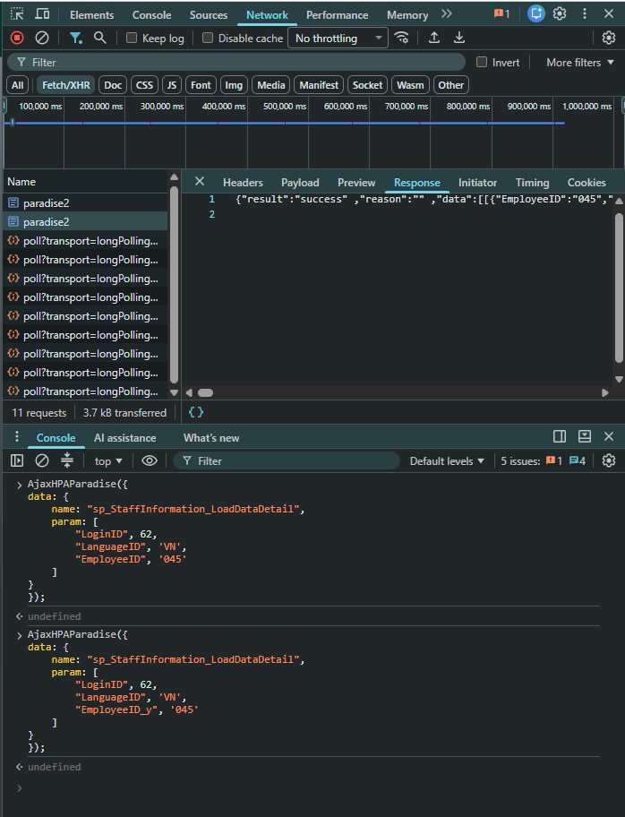
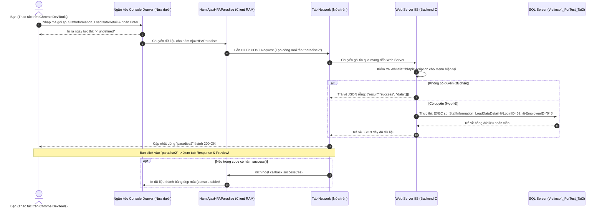

# CẨM NANG THỰC CHIẾN SỬ DỤNG CHROME DEVTOOLS (PARADISE HRM)
## CHUYÊN ĐỀ: BẮT GÓI TIN NETWORK, THỰC THI CONSOLE & DEBUG AJAX/API THỰC TẾ

> **Mục tiêu**: Tài liệu hướng dẫn chi tiết từ A-Z cách sử dụng công cụ **Chrome DevTools** theo dạng **Hỏi & Đáp (Q&A: Câu hỏi 1 $\rightarrow$ Câu hỏi n)**. Hướng dẫn trực quan cách kết hợp song song giữa **Tab Network** và **Console Drawer**, cách viết mã JavaScript gọi hàm `AjaxHPAParadise` để test Stored Procedure, giải thích bản chất ngầm của AJAX và cách đọc dữ liệu trả về từ Database.  
> **Áp dụng trực tiếp**: Hệ thống Web Quản trị & Nhân sự **Paradise HRM** (`Vietinsoft_ForTest_Tai2`).

---

## 📸 ẢNH CHỤP MINH HỌA THỰC TẾ (SCREENSHOT WORKFLOW)

Dưới đây là hình ảnh thực tế bạn đang thao tác trên Chrome DevTools khi vừa bắt gói tin mạng vừa mở ngăn kéo Console:



*Hình 1: Chế độ 2 ngăn (Drawer) trên Chrome DevTools — Nửa trên theo dõi Tab Network (request `paradise2` và gói JSON `Response`), nửa dưới gõ lệnh `AjaxHPAParadise` tại Console.*

---

## 📑 MỤC LỤC BỘ CÂU HỎI HỎI & ĐÁP (Q&A INDEX)

1. [CÂU HỎI 1: Chrome DevTools là gì? Các phím tắt vàng để mở siêu tốc?](#câu-hỏi-1-chrome-devtools-là-gì-các-phím-tắt-vàng-để-mở-siêu-tốc)
2. [CÂU HỎI 2: Giao diện trong bức ảnh chụp là gì? Tại sao vừa có Tab Network lại vừa có chỗ gõ code Console bên dưới?](#câu-hỏi-2-giao-diện-trong-bức-ảnh-chụp-là-gì-tại-sao-vừa-có-tab-network-lại-vừa-có-chỗ-gõ-code-console-bên-dưới)
3. [CÂU HỎI 3: Phần viết code Console ở Tab Network là viết code gì? Viết để làm gì?](#câu-hỏi-3-phần-viết-code-console-ở-tab-network-là-viết-code-gì-viết-để-làm-gì)
4. [CÂU HỎI 4: Cách viết và chạy mã code tại Console như thế nào? (Enter vs Shift + Enter)](#câu-hỏi-4-cách-viết-và-chạy-mã-code-tại-console-như-thế-nào)
5. [CÂU HỎI 5: Tại sao khi chạy lệnh `AjaxHPAParadise` ở Console lại hiện `< undefined`? Có phải bị lỗi không?](#câu-hỏi-5-tại-sao-khi-chạy-lệnh-ajaxhpaparadise-ở-console-lại-hiện--undefined-có-phải-bị-lỗi-không)
6. [CÂU HỎI 6: Output thực sự (dữ liệu JSON từ Database) nằm ở đâu? Làm sao để xem?](#câu-hỏi-6-output-thực-sự-dữ-liệu-json-từ-database-nằm-ở-đâu-làm-sao-để-xem)
7. [CÂU HỎI 7: Cấu trúc chi tiết các Tab con trong Network: Headers, Payload, Preview, Response là gì?](#câu-hỏi-7-cấu-trúc-chi-tiết-các-tab-con-trong-network-headers-payload-preview-response-là-gì)
8. [CÂU HỎI 8: Bộ lọc (Filter) trong Tab Network: Tại sao bắt buộc phải chọn nút `Fetch/XHR`?](#câu-hỏi-8-bộ-lọc-filter-trong-tab-network-tại-sao-bắt-buộc-phải-chọn-nút-fetchxhr)
9. [CÂU HỎI 9: Sơ đồ luồng toàn cảnh: Console $\rightarrow$ AJAX $\rightarrow$ IIS API $\rightarrow$ Stored Procedure $\rightarrow$ Network Output](#câu-hỏi-9-sơ-đồ-luồng-toàn-cảnh-console--ajax--iis-api--stored-procedure--network-output)
10. [CÂU HỎI 10: Tổng hợp các đoạn code mẫu thực chiến copy-paste chạy ngay trên Console](#câu-hỏi-10-tổng-hợp-các-đoạn-code-mẫu-thực-chiến-copy-paste-chạy-ngay-trên-console)

---

## ❓ CÂU HỎI 1: CHROME DEVTOOLS LÀ GÌ? CÁC PHÍM TẮT VÀNG ĐỂ MỞ SIÊU TỐC?

### 1. Bản chất:
**Chrome DevTools (Developer Tools)** là bộ công cụ chuyên dụng dành cho lập trình viên và kỹ sư phần mềm được Google tích hợp sẵn 100% bên trong trình duyệt Google Chrome. 

Nó đóng vai trò như một **"chiếc máy soi X-quang"** và **"phòng phẫu thuật"** trực tiếp cho trang web:
* Cho phép bạn xem mã nguồn HTML/CSS (Tab *Elements*).
* Cho phép bạn theo dõi dữ liệu truyền qua lại giữa Trình duyệt và Server (Tab *Network*).
* Cho phép bạn gõ và chạy trực tiếp các câu lệnh JavaScript (Tab *Console*).
* Cho phép bạn đặt điểm dừng để gỡ lỗi từng dòng code (Tab *Sources*).

### 2. Các phím tắt vàng trên Windows:
* **`F12`** hoặc **`Ctrl + Shift + I`**: Mở hoặc đóng cửa sổ DevTools ngay lập tức.
* **`Ctrl + Shift + J`**: Mở thẳng vào tab **Console** để sẵn sàng gõ lệnh.
* **`Ctrl + Shift + C`**: Mở chế độ chọn phần tử (Inspect Element) để bấm chuột soi thẻ HTML.
* **`Ctrl + F5`** (hoặc `Ctrl + Shift + R`): Tải lại trang web và **xóa sạch Cache** (bắt Chrome kéo mã nguồn mới nhất từ Server về).

> [!NOTE] 🌟 TÍNH NĂNG ĐẶC BIỆT TRONG PARADISE HRM: PHÍM `F1`
> Trong phần mềm Paradise HRM, ngoài các phím tắt của Chrome, hệ thống còn gắn sẵn sự kiện phím **`F1`**. Khi bạn đang ở bất kỳ trang nào và nhấn `F1`, một popup hệ thống sẽ hiện ra cho biết mã Menu (`MenuID`, vd `MnuHRS0102`), danh sách Stored Procedure sinh mã HTML, nạp UI và các API đã được whitelist!

---

## ❓ CÂU HỎI 2: GIAO DIỆN TRONG BỨC ẢNH CHỤP LÀ GÌ? TẠI SAO VỪA CÓ TAB NETWORK LẠI VỪA CÓ CHỖ GÕ CODE CONSOLE BÊN DƯỚI?

### 1. Hiện tượng trong ảnh:
Trong ảnh chụp, màn hình DevTools được chia làm 2 nửa rõ rệt:
* **Nửa trên**: Đang mở tab **`Network`**, với bộ lọc đang chọn `Fetch/XHR`. Danh sách bên trái hiện các request `paradise2`, bên phải hiện tab `Response` chứa chuỗi JSON:
  `{"result":"success" ,"reason":"" ,"data":[[{"EmployeeID":"045", ...}]]}`.
* **Nửa dưới**: Đang mở một khung có tiêu đề **`Console`** (kế bên có nút `top`, `Filter`, dấu xóa `⊘`), bên dưới có dấu nhắc lệnh `>` cho phép gõ code.

### 2. Bản chất: Đó là tính năng **Console Drawer (Ngăn kéo Console)**!
Bình thường, bạn chỉ có thể xem **hoặc** Network **hoặc** Console (chuyển đổi qua lại giữa các tab ở trên cùng). 

Tuy nhiên, Chrome hỗ trợ một tính năng cực kỳ tiện lợi gọi là **Console Drawer**:
* Khi bạn đang ở tab **Network**, bạn chỉ cần nhấn phím **`Esc`** trên bàn phím.
* Trình duyệt sẽ mở một "ngăn kéo" (Drawer) phụ ở nửa dưới màn hình chính là tab **Console**.
* Nhấn **`Esc`** một lần nữa: Ngăn kéo Console sẽ tự động thu gọn lại để trả lại toàn bộ không gian cho Network.

> [!TIP] 🎯 TẠI SAO PHẢI MỞ SONG SONG 2 NGĂN NHƯ THẾ NÀY?
> Đây là quy trình làm việc chuẩn mực của các lập trình viên chuyên nghiệp:
> 1. **Nửa dưới (Console)**: Dùng làm "bệ phóng" để gõ lệnh gọi API.
> 2. **Nửa trên (Network)**: Dùng làm "màn hình quan sát" xem tên lửa API phóng lên Server có thành công (màu trắng/xanh HTTP 200) hay bị nổ tung (màu đỏ HTTP 400/500), và Server phản hồi gói hàng JSON gì về!

---

## ❓ CÂU HỎI 3: PHẦN VIẾT CODE CONSOLE Ở TAB NETWORK LÀ VIẾT CODE GÌ? VIẾT ĐỂ LÀM GÌ?

### 1. Viết code gì ở đó?
Tại khung Console, bạn có thể viết **mọi đoạn mã JavaScript** hợp lệ. Đặc biệt trong hệ thống Paradise HRM, bạn sẽ viết đoạn mã gọi hàm thư viện lõi của công ty:
```javascript
AjaxHPAParadise({
    data: {
        name: "Tên_Stored_Procedure_Cần_Chạy",
        param: [
            "Tên_Tham_Số_1", Giá_Trị_1,
            "Tên_Tham_Số_2", Giá_Trị_2
        ]
    }
});
```

### 2. Viết để làm gì? (3 Mục đích thực chiến tối quan trọng):

#### 🔹 Mục đích 1: Chủ động Test Stored Procedure mà không cần click chuột thủ công
Thay vì bạn phải: Đăng xuất $\rightarrow$ Đăng nhập tài khoản nhân viên $\rightarrow$ Tìm đến menu Hồ sơ $\rightarrow$ Kéo xuống mục Ngân hàng $\rightarrow$ Bấm nút cây bút Chỉnh sửa để xem SP có trả về số tài khoản không...  
👉 Bạn chỉ cần **mở Console lên, dán đoạn code gọi SP và bấm Enter**. Trong 0.2 giây, bạn biết ngay Stored Procedure đó chạy thành công hay thất bại!

#### 🔹 Mục đích 2: Kiểm tra cơ chế Whitelist API (`tblApiDecription`)
Backend C# của Paradise HRM có cơ chế bảo mật rất nghiêm: Nếu Stored Procedure chưa được đăng ký trong danh sách `ApiList` của Menu, Server sẽ âm thầm trả về `data: []` rỗng.  
👉 Khi gõ thử ở Console, nếu bạn thấy Network trả về mảng `data: []` rỗng dù trong DB chắc chắn có dữ liệu, bạn phát hiện ngay: **SP này chưa được cấp quyền trong `tblApiDecription`!**

#### 🔹 Mục đích 3: Bẫy lỗi và thử nghiệm tham số (Parameter Testing)
Như chính trong bức ảnh của bạn đã thử:
* Lần 1: Truyền đúng `"EmployeeID", '045'` $\rightarrow$ Trả về đúng dữ liệu nhân viên 045.
* Lần 2: Cố tình truyền sai `"EmployeeID_y", '045'` $\rightarrow$ Xem hệ thống xử lý ra sao khi tham số bị sai lệch.

---

## ❓ CÂU HỎI 4: CÁCH VIẾT VÀ CHẠY MÃ CODE TẠI CONSOLE NHƯ THẾ NÀO?

Nhiều bạn mới dùng Console thường gặp tình trạng: Vừa gõ xong dòng thứ nhất, bấm `Enter` để xuống dòng viết tiếp thì code đã bị chạy ngay và báo lỗi cú pháp. Dưới đây là quy tắc chuẩn:

### 1. Thao tác gõ và thực thi:
| Thao tác | Phím bấm | Tác dụng |
| :--- | :---: | :--- |
| **Xuống dòng (Không chạy)** | **`Shift + Enter`** | Cho phép bạn gõ đoạn code dài nhiều dòng, thụt lề rõ ràng như viết trong file. |
| **Chạy code (Execute)** | **`Enter`** | Ra lệnh cho Chrome thực thi toàn bộ khối code bạn vừa viết. |
| **Lấy lại lệnh cũ** | **`Mũi tên Lên (↑)`** | Lấy lại nguyên văn câu lệnh trước đó để sửa nhanh tham số mà không phải gõ lại. |
| **Xóa sạch màn hình Console** | **`Ctrl + L`** (hoặc gõ `clear()`) | Dọn dẹp màn hình Console cho sạch sẽ, đỡ rối mắt. |

### 2. Các bước gõ mẫu chuẩn chỉ:
1. Nhấp chuột vào vị trí có dấu nháy `>` ở dòng cuối cùng của Console.
2. Gõ dòng đầu: `AjaxHPAParadise({` $\rightarrow$ Nhấn **`Shift + Enter`**.
3. Gõ tiếp dòng tham số $\rightarrow$ Nhấn **`Shift + Enter`**.
4. Đóng ngoặc `});` $\rightarrow$ Nhấn **`Enter`** (đơn).

---

## ❓ CÂU HỎI 5: TẠI SAO KHI CHẠY LỆNH `AjaxHPAParadise` Ở CONSOLE LẠI HIỆN `< undefined`? CÓ PHẢI BỊ LỖI KHÔNG?

Nhìn vào bức ảnh của bạn, sau mỗi lần chạy lệnh:
```javascript
> AjaxHPAParadise({ data: { ... } });
< undefined
```
Nhiều bạn hoang mang nghĩ rằng: *"Ủa sao lại undefined? Có phải code bị lỗi hay không tìm thấy dữ liệu không?"*.

### 👉 Câu trả lời: KHÔNG HỀ BỊ LỖI! ĐÂY LÀ ĐIỀU HOÀN TOÀN TỰ NHIÊN CỦA JAVASCRIPT!

### 🔍 Giải thích bản chất:
1. **Console luôn in ra giá trị trả về tức thì (Return value)**: Bất kỳ câu lệnh nào bạn gõ vào Console, sau khi chạy xong nó đều in ra kết quả trả về của hàm đó (biểu thị bằng mũi tên trỏ sang trái `<`). Ví dụ nếu bạn gõ `Math.sqrt(9)` thì Console in ra `< 3`.
2. **`AjaxHPAParadise` là hàm BẤT ĐỒNG BỘ (Chạy ngầm)**:
   * Bản thân hàm `AjaxHPAParadise` không có lệnh `return` ra giá trị gì cả. Nhiệm vụ của nó là ném một yêu cầu HTTP Request vào hàng đợi mạng rồi lập tức kết thúc.
   * Do hàm không có giá trị trả về (`return`), JavaScript mặc định coi kết quả trả về là `undefined`.
   * Gói dữ liệu từ Database lúc này **vẫn còn đang trên đường truyền từ Server về**, chưa cập bến trình duyệt ngay tại tích tắc bạn bấm `Enter`!

---

## ❓ CÂU HỎI 6: OUTPUT THỰC SỰ (DỮ LIỆU JSON TỪ DATABASE) NẰM Ở ĐÂU? LÀM SAO ĐỂ XEM?

Kết quả thực sự chứa thông tin Số tài khoản, Ngân hàng, Mã nhân viên... từ SQL Server trả về sẽ hiển thị ở **2 NƠI**:

---

### 🟢 NƠI 1: XEM TẠI TAB NETWORK (NỬA TRÊN - TRỰC QUAN NHẤT)

Đây chính là khu vực nửa trên trong ảnh chụp của bạn:

```
[Tab Network]
 ├── Filter: [Fetch/XHR]
 ├── Danh sách Request bên trái:
 │    └── [paradise2]  <-- Click vào đây!
 └── Chi tiết bên phải:
      ├── [Headers]  : Địa chỉ URL, Phương thức POST, Mã phản hồi HTTP 200 OK
      ├── [Payload]  : Các tham số bạn gửi lên: name, LoginID, LanguageID, EmployeeID
      ├── [Preview]  : Cây dữ liệu JSON có thể bấm mũi tên bung ra xem từng trường
      └── [Response] : Chuỗi JSON thô Server trả về: {"result":"success", "data":[[...]]}
```

#### Các bước xem chi tiết:
1. Nhìn lên bảng Network ở nửa trên màn hình.
2. Click chuột vào dòng request có tên là **`paradise2`**.
3. Ở khung bên phải, chọn tab **`Response`** hoặc **`Preview`**:
   * Bạn sẽ thấy mảng `data` chứa đầy đủ các cột trong Database:
     ```json
     {
       "result": "success",
       "reason": "",
       "data": [
         [
           {
             "EmployeeID": "045",
             "FullName": "Đặng Minh Tài",
             "AccountNo": "123143254353",
             "BankName": "Sacombank"
           }
         ]
       ]
     }
     ```

---

### 🟢 NƠI 2: IN THẲNG RA MÀN HÌNH CONSOLE (DẠNG BẢNG `console.table`)

Nếu bạn không muốn phải nhấp chuột lên tab Network mà muốn **kết quả in thẳng ra màn hình Console bên dưới ngay khi Server trả lời**, bạn chỉ cần thêm tham số `success` vào đoạn mã:

#### 📄 Mã code mẫu:
```javascript
AjaxHPAParadise({
    data: {
        name: "sp_StaffInformation_LoadDataDetail",
        param: [
            "LoginID", 62,
            "LanguageID", 'VN',
            "EmployeeID", '045'
        ]
    },
    success: function (res) {
        let json = typeof res === "string" ? JSON.parse(res) : res;
        console.log("🎉 ĐÃ NHẬN DỮ LIỆU THÀNH CÔNG TỪ DATABASE:");
        console.table(json.data[0]); // Lệnh thần thánh in ra bảng lưới!
    }
});
```

#### 📊 Kết quả hiển thị trực tiếp ở Console:
Console sẽ vẽ ra một bảng kẻ ô cực kỳ chuyên nghiệp như sau:

| (index) | EmployeeID | FullName | AccountNo | BankName | TaxRegNo |
| :---: | :---: | :---: | :---: | :---: | :---: |
| **0** | `"045"` | `"Đặng Minh Tài"` | `"123143254353"` | `"Sacombank"` | `"123123"` |

---

## ❓ CÂU HỎI 7: CẤU TRÚC CHI TIẾT CÁC TAB CON TRONG NETWORK: HEADERS, PAYLOAD, PREVIEW, RESPONSE LÀ GÌ?

Khi bạn bấm vào một request (ví dụ `paradise2`) trong tab Network, phía bên phải có 6 tab con. Dưới đây là ý nghĩa và cách dùng từng tab:

```
┌───────────┬───────────┬───────────┬────────────┬───────────┬─────────┐
│  Headers  │  Payload  │  Preview  │  Response  │ Initiator │ Timing  │
└───────────┴───────────┴───────────┴────────────┴───────────┴─────────┘
```

1. **`Headers` (Tiêu đề)**:
   * Cho biết request gửi đến địa chỉ URL nào (ví dụ: `http://localhost/ashx/api...`).
   * Phương thức gì (`Request Method: POST`).
   * Trạng thái thành công hay thất bại (`Status Code: 200 OK` là chuẩn, `404 Not Found` là sai URL, `500 Server Error` là sập code C# Backend).
2. **`Payload` (Hàng hóa gửi đi)**:
   * **Cực kỳ quan trọng**: Xem chính xác trình duyệt đã đóng gói những tham số gì để gửi lên Server. Giúp bạn phát hiện ngay các lỗi như gửi nhầm tên param (`EmployeeID_y`) hay gửi giá trị rác (`EmployeeID: undefined`).
3. **`Preview` (Xem trước có định dạng)**:
   * Hiển thị gói JSON trả về dưới dạng cây đối tượng (Object tree). Bạn có thể bấm vào các mũi tên hình tam giác để bung ra xem từng cấp con.
4. **`Response` (Dữ liệu gốc)**:
   * Hiển thị chuỗi văn bản thô (Raw text) 100% nguyên bản mà máy chủ IIS trả về (như ô số 1 màu đen trong ảnh bạn đang xem).
5. **`Initiator` (Nguồn gốc gọi lệnh)**:
   * Cho biết file JavaScript nào và dòng code số mấy đã kích hoạt cuộc gọi API này.
6. **`Timing` (Thời gian)**:
   * Cho biết request mất bao nhiêu mili-giây (ms) để chạy: thời gian gửi đi, thời gian chờ SQL Server xử lý (Waiting TTFB), và thời gian tải kết quả về.

---

## ❓ CÂU HỎI 8: BỘ LỌC (FILTER) TRONG TAB NETWORK: TẠI SAO BẮT BUỘC PHẢI CHỌN NÚT `Fetch/XHR`?

Nhìn vào thanh công cụ nhỏ bên dưới tab Network:
`[All] [Fetch/XHR] [Doc] [CSS] [JS] [Font] [Img] [Media] [Manifest] [Socket] [Wasm] [Other]`

### 1. Tại sao không nên để nút `All`?
Khi một trang web chạy, trình duyệt tải hàng trăm file cùng lúc: hình ảnh logo (`.png`, `.jpg`), file giao diện (`.css`), file mã nguồn (`.js`), font chữ... Nếu để `All`, danh sách Network sẽ dài dằng dặc hàng trăm dòng, request API của bạn sẽ bị trôi mất không tìm thấy.

### 2. Tại sao phải chọn `Fetch/XHR`?
* **XHR** là viết tắt của **XMLHttpRequest** (tên gọi kỹ thuật gốc của AJAX).
* **Fetch** là API mạng hiện đại của JavaScript.
* Khi bạn bấm chọn nút **`Fetch/XHR`**: Trình duyệt sẽ **lọc bỏ toàn bộ rác** (ảnh, font, css), **CHỈ GIỮ LẠI DUY NHẤT các cuộc gọi API gửi/nhận dữ liệu động** với Database!  
👉 Nhờ vậy, ngay khi bạn chạy lệnh AJAX, request `paradise2` sẽ hiện ra nổi bật ngay trước mắt bạn!

---

## ❓ CÂU HỎI 9: SƠ ĐỒ LUỒNG TOÀN CẢNH: CONSOLE $\rightarrow$ AJAX $\rightarrow$ IIS API $\rightarrow$ STORED PROCEDURE $\rightarrow$ NETWORK OUTPUT

Dưới đây là sơ đồ Mermaid mô tả chính xác những gì diễn ra trong máy tính từ giây phút bạn bấm `Enter` ở Console:



---

## ❓ CÂU HỎI 10: TỔNG HỢP CÁC ĐOẠN CODE MẪU THỰC CHIẾN COPY-PASTE CHẠY NGAY TRÊN CONSOLE

Dưới đây là các đoạn code đã được chuẩn hóa, bạn có thể sao chép và dán thẳng vào Console để kiểm thử hệ thống bất cứ lúc nào:

### 🎯 Mẫu 1: Test Stored Procedure đọc dữ liệu và in thành bảng đẹp mắt
```javascript
AjaxHPAParadise({
    data: {
        name: "sp_StaffInformation_LoadDataDetail",
        param: [
            "LoginID", 62,
            "LanguageID", 'VN',
            "EmployeeID", '045'
        ]
    },
    success: function (res) {
        let json = typeof res === "string" ? JSON.parse(res) : res;
        console.log("=== KẾT QUẢ DỮ LIỆU NHÂN VIÊN ===");
        console.table(json.data[0]);
    },
    error: function (err) {
        console.error("❌ Lỗi gọi API:", err);
    }
});
```

---

### 🎯 Mẫu 2: Test Stored Procedure nạp thông tin ngân hàng của Popup (TC-03)
```javascript
AjaxHPAParadise({
    data: {
        name: "sp_StaffInformation_PopupInfoBank_LoadDataDetail",
        param: [
            "LoginID", 62,
            "LanguageID", 'VN',
            "EmployeeID", '045'
        ]
    },
    success: function (res) {
        let json = typeof res === "string" ? JSON.parse(res) : res;
        if (json.data && json.data.length > 0 && json.data[0].length > 0) {
            console.log("✅ SP ĐÃ ĐƯỢC CẤP PHÉP WHITELIST VÀ TRẢ VỀ DỮ LIỆU:");
            console.table(json.data[0]);
        } else {
            console.warn("⚠️ CẢNH BÁO: Dữ liệu rỗng! Kiểm tra lại Whitelist tblApiDecription hoặc điều kiện SP.");
            console.log("Raw Response:", json);
        }
    }
});
```

---

### 🎯 Mẫu 3: Lấy thông tin người dùng đang đăng nhập trên trình duyệt
Trước khi gọi API, nếu bạn muốn biết tài khoản hiện tại trên trang có `LoginID` và `EmployeeID` là bao nhiêu:
```javascript
console.log({
    "LoginID": window.UserID || window.LoginID,
    "EmployeeID_Login": window.EmployeeID_Login,
    "Employee": window.Employee,
    "LanguageID": window.LanguageID
});
```

---

## 🏆 TỔNG KẾT BỎ TÚI (CHEAT SHEET)

1. Muốn mở nhanh Console Drawer khi đang đứng ở tab Network: **Bấm phím `Esc`**.
2. Muốn xuống dòng gõ tiếp code: **Bấm `Shift + Enter`**.
3. Muốn chạy lệnh: **Bấm `Enter`**.
4. Thấy hiện `< undefined` ở Console: **Hoàn toàn bình thường**, không phải lỗi.
5. Muốn xem dữ liệu Server trả về: Click vào request **`paradise2`** ở nửa trên Network $\rightarrow$ Xem tab **`Response`** hoặc **`Preview`**.
6. Luôn bật bộ lọc **`Fetch/XHR`** trên tab Network để lọc sạch các file ảnh, CSS rác.

---
*Tài liệu được biên soạn đồng bộ với hệ thống tài liệu kiến trúc của dự án:*
* [Tài liệu Kiến trúc hệ thống Paradise HRM](file:///c:/Users/Y.Thach/Desktop/paradiseHR/docs/KIEN_TRUC_HE_THONG_VA_TONG_QUAN_DU_AN.md)
* [Sổ tay thao tác SQL Server Management Studio (SSMS)](file:///c:/Users/Y.Thach/Desktop/paradiseHR/docs/HUONG_DAN_THAO_TAC_SSMS.md)
* [Quy chuẩn an toàn Database & Skill Fix Bug](file:///c:/Users/Y.Thach/Desktop/paradiseHR/AGENTS.md)
