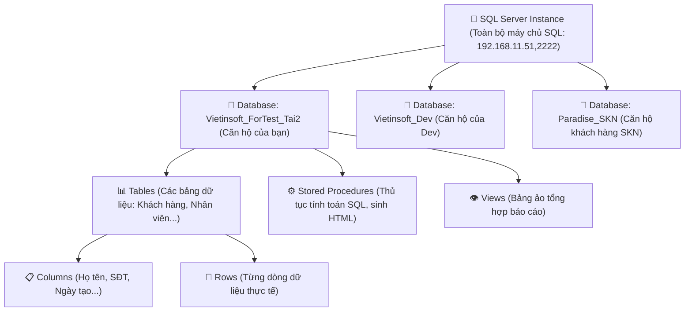
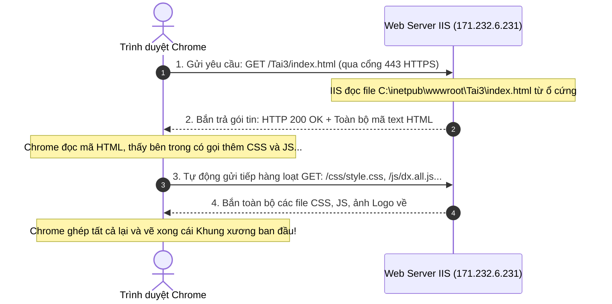
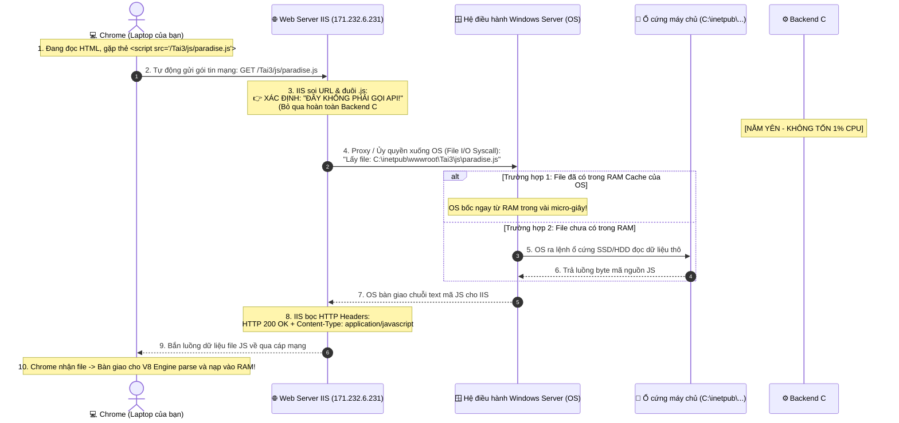
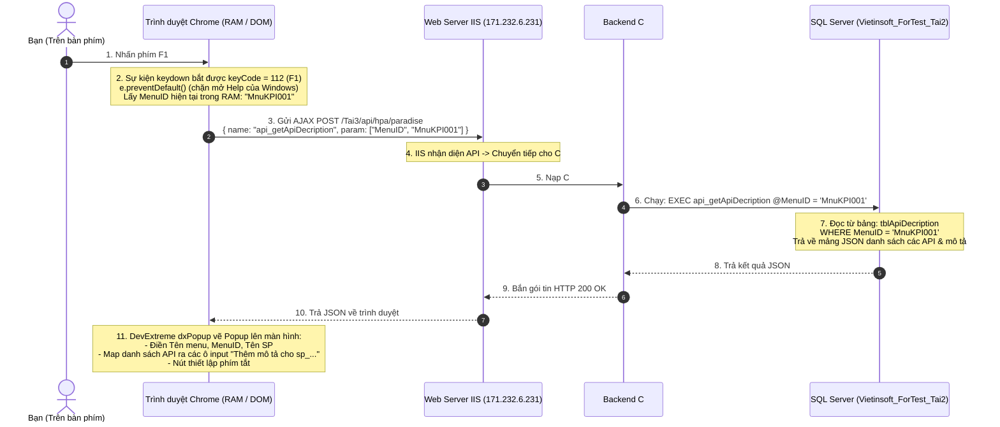

# SỔ TAY TOÀN CẢNH KIẾN TRÚC HỆ THỐNG & GIẢI ĐÁP TỔNG QUAN DỰ ÁN PARADISE HRM

> **Dự án**: Paradise HRM / CRM Testing & Business Reverse-Engineering  
> **Tài liệu**: Tổng quan kiến trúc mạng, máy chủ Web, máy chủ Cơ sở dữ liệu và Giải đáp chi tiết toàn bộ các câu hỏi nghiệp vụ & kỹ thuật.  
> **Người tổng hợp**: Antigravity Pair-Programming Assistant  
> **Đối tượng**: Kỹ sư Kiểm thử / Phát triển phần mềm (Vietinsoft)  
> **Thời gian cập nhật**: 16/10/2026  

---

## MỤC LỤC TỔNG QUAN

1. [PHẦN 1: BỨC TRANH 2 TRỤ CỘT DỰ ÁN ("AUTOMATION-TEST" & "CRAW-BUSSINESS")](#phần-1-bức-tranh-2-trụ-cột-dự-án-automation-test--craw-bussiness)
2. [PHẦN 2: TẬP HỢP TOÀN BỘ CÂU HỎI & GIẢI ĐÁP VỀ CƠ SỞ DỮ LIỆU (SQL SERVER)](#phần-2-tập-hợp-toàn-bộ-câu-hỏi--giải-đáp-về-cơ-sở-dữ-liệu-sql-server)
   - [Câu 1: Địa chỉ SQL Server (192.168.11.51,2222) là gì? Có phải IP Public không?](#câu-1-địa-chỉ-sql-server-19216811512222-là-gì-có-phải-ip-public-không)
   - [Câu 2: Tài khoản xác thực là gì? Tại sao cần? Ai cấp và phân quyền như thế nào?](#câu-2-tài-khoản-xác-thực-là-gì-tại-sao-cần-ai-cấp-và-phân-quyền-như-thế-nào)
   - [Câu 3: Tại sao trong SQL Server lại có "một đống Database"? Hệ thống CRM dùng hết hay chỉ 1?](#câu-3-tại-sao-trong-sql-server-lại-có-một-đống-database-hệ-thống-crm-dùng-hết-hay-chỉ-1)
   - [Câu 4: Kiến trúc phân cấp trong SQL Server hoạt động như thế nào?](#câu-4-kiến-trúc-phân-cấp-trong-sql-server-hoạt-động-như-thế-nào)
   - [Câu 5: SQL Server Instance có giống Docker không? Khác gì với CDB/PDB của Oracle?](#câu-5-sql-server-instance-có-giống-docker-không-khác-gì-với-cdbpdb-của-oracle)
   - [Câu 6: Truy vấn chéo giữa 2 DB (Cross-Database Query) là gì? Tại sao cần?](#câu-6-truy-vấn-chéo-giữa-2-db-cross-database-query-là-gì-tại-sao-cần)
   - [Câu 7: `dbo` là gì? 1 Database có nhiều Schema để làm gì? Các bảng khác Schema có liên kết và khóa ngoại được không?](#câu-7-dbo-là-gì-1-database-có-nhiều-schema-để-làm-gì-các-bảng-khác-schema-có-liên-kết-và-khóa-ngoại-được-không)
   - [Câu 8: SSMS có giống Ultraviewer không? Bản chất lưu trữ dữ liệu thực sự ở đâu?](#câu-8-ssms-có-giống-ultraviewer-không-bản-chất-lưu-trữ-dữ-liệu-thực-sự-ở-đâu)
   - [Câu 9: Cơ sở dữ liệu ở máy chủ có được host lên Internet không?](#câu-9-cơ-sở-dữ-liệu-ở-máy-chủ-có-được-host-lên-internet-không)
3. [PHẦN 3: TẬP HỢP CÂU HỎI & GIẢI ĐÁP VỀ MẠNG & WEB SERVER (IIS)](#phần-3-tập-hợp-câu-hỏi--giải-đáp-về-mạng--web-server-iis)
   - [Câu 10: Tên miền `paradisehrm.com` và IP Public `171.232.6.231` hoạt động thế nào?](#câu-10-tên-miền-paradisehrmcom-và-ip-public-1712326231-hoạt-động-thế-nào)
   - [Câu 11: Microsoft IIS là gì? Có giống Nginx không? Virtual Application (VA) `/Tai3/` là gì?](#câu-11-microsoft-iis-là-gì-có-giống-nginx-không-virtual-application-va-tai3-là-gì)
   - [Câu 12: Windows Server là gì và mối quan hệ với Microsoft IIS?](#câu-12-windows-server-là-gì-và-mối-quan-hệ-với-microsoft-iis)
   - [Câu 13: Web Server IIS chỉ chứa Backend hay chứa cả Frontend?](#câu-13-web-server-iis-chỉ-chứa-backend-hay-chứa-cả-frontend)
4. [PHẦN 4: VÒNG ĐỜI WEB (LIFECYCLE) & TECH STACK CỐT LÕI](#phần-4-vòng-đời-web-lifecycle--tech-stack-cốt-lõi)
   - [Câu 14: Tech Stack chính xác của Frontend và Backend là gì?](#câu-14-tech-stack-chính-xác-của-frontend-và-backend-là-gì)
   - [Câu 15: Giao diện ban đầu từ đâu ra? Luồng End-to-End từ lúc gõ URL đến khi sửa UI đổi tức thì](#câu-15-giao-diện-ban-đầu-từ-đâu-ra-luồng-end-to-end-từ-lúc-gõ-url-đến-khi-sửa-ui-đổi-tức-thì)
   - [Câu 16: Quy trình sửa C# Backend DLL vs Vị thế Thực tập sinh: Tại sao chỉ cần sửa Stored Procedure?](#câu-16-quy-trình-sửa-c-backend-dll-vs-vị-thế-thực-tập-sinh-tại-sao-chỉ-cần-sửa-stored-procedure)
   - [Câu 17: Kiến trúc Universal Gateway / Stored Procedure Dispatcher: Toàn bộ API dùng chung 1 Controller?](#câu-17-kiến-trúc-universal-gateway--stored-procedure-dispatcher-toàn-bộ-api-dùng-chung-1-controller)
   - [Câu 18: IIS gửi file Frontend lên Chrome như thế nào?](#câu-18-iis-gửi-file-frontend-lên-chrome-như-thế-nào)
   - [Câu 19: File FE ban đầu gửi lên là UI hoàn chỉnh hay chỉ là Layout?](#câu-19-file-fe-ban-đầu-gửi-lên-là-ui-hoàn-chỉnh-hay-chỉ-là-layout)
   - [Câu 20: Nếu muốn sửa phần nằm trong file gửi lên đó (không sửa bằng SP được) thì sửa ở đâu và quy trình ra sao?](#câu-20-nếu-muốn-sửa-phần-nằm-trong-file-gửi-lên-đó-không-sửa-bằng-sp-được-thì-sửa-ở-đâu-và-quy-trình-ra-sao)
   - [Câu 21: Tại sao không có "FE Server" mà Chrome vẫn biết phải làm gì với dữ liệu trả về từ Web Server?](#câu-21-tại-sao-không-có-fe-server-mà-chrome-vẫn-biết-phải-làm-gì-với-dữ-liệu-trả-về-từ-web-server)
   - [Câu 22: Làm sao Chrome biết khi nào cần chạy đoạn code JavaScript đó? (Kiến trúc hướng sự kiện)](#câu-22-làm-sao-chrome-biết-khi-nào-cần-chạy-đoạn-code-javascript-đó-kiến-trúc-hướng-sự-kiện)
   - [Câu 23: Thẻ `<script src="...">` tải file JS từ Web Server về như thế nào?](#câu-23-thẻ-script-src-tải-file-js-từ-web-server-về-như-thế-nào)
   - [Câu 24: Tại sao code SQL/HTML sinh ra lại bị lỗi font tiếng Việt (dấu hỏi `?` và chữ kỳ dị `PhAA_A?A?`)?](#câu-24-tại-sao-code-sqlhtml-sinh-ra-lại-bị-lỗi-font-tiếng-việt-dấu-hỏi--và-chữ-kỳ-dị-phaa_aa)
   - [Câu 25: Phím tắt `F1` — Popup Thông tin Menu & Danh sách API dùng để làm gì? Luồng hiển thị hoạt động như thế nào?](#câu-25-phím-tắt-f1--popup-thông-tin-menu--danh-sách-api-dùng-để-làm-gì-luồng-hiển-thị-hoạt-động-như-thế-nào)
   - [Câu 26: Các control trên giao diện có được tổ chức thành Component trong Database không? Cách lắp ráp thành 1 trang như thế nào?](#câu-26-các-control-trên-giao-diện-có-được-tổ-chức-thành-component-trong-database-không-cách-lắp-ráp-thành-1-trang-như-thế-nào)
   - [Câu 27: Thư viện DevExtreme nạp vào ở đâu? Tại sao lại gọi Component bằng JavaScript thuần mà không dùng JSX (React)? JS làm sao tạo được UI?](#câu-27-thư-viện-devextreme-nạp-vào-ở-đâu-tại-sao-lại-gọi-component-bằng-javascript-thuần-mà-không-dùng-jsx-react-js-làm-sao-tạo-được-ui)
   - [Câu 28: Giải mã cú pháp `$('#id').dxSelectBox({...})` và bên trong file DevExtreme thực sự viết những gì?](#câu-28-giải-mã-cú-pháp-iddxselectbox-và-bên-trong-file-devextreme-thực-sự-viết-những-gì)
   - [Câu 29: jQuery là gì? DevExtreme có mối quan hệ gì với jQuery?](#câu-29-jquery-là-gì-devextreme-có-mối-quan-hệ-gì-với-jquery)
   - [Câu 30: Trước khi có jQuery thì thế giới Web dùng cái gì? Và jQuery đã giải quyết vấn đề đó như thế nào?](#câu-30-trước-khi-có-jquery-thì-thế-giới-web-dùng-cái-gì-và-jquery-đã-giải-quyết-vấn-đề-đó-như-thế-nào)
   - [Câu 31: Quy trình chuẩn 5 bước Fix Bug trên một trang web: Từ lúc bấm F1 tra cứu đến sửa DB và nghiệm thu trên Chrome](#câu-31-quy-trình-chuẩn-5-bước-fix-bug-trên-một-trang-web-từ-lúc-bấm-f1-tra-cứu-đến-sửa-db-và-nghiệm-thu-trên-chrome)
5. [PHẦN 5: SƠ ĐỒ TỔNG THỂ HỆ THỐNG END-TO-END](#phần-5-sơ-đồ-tổng-thể-hệ-thống-end-to-end)

---

## PHẦN 1: BỨC TRANH 2 TRỤ CỘT DỰ ÁN ("AUTOMATION-TEST" & "CRAW-BUSSINESS")

Hệ thống hiện tại được tổ chức chặt chẽ xoay quanh 2 trụ cột nghiệp vụ:

```
[craw-bussiness]                                   [automation-test]
Cào DOM + API từ Web thật ──► Tạo hồ sơ Epic & US ──► Viết kịch bản E2E kiểm thử
 (docs/raw_crawled/)           (docs/user-stories/)     (tests/*.spec.js)
                                                              │
                                                              ▼
                                                   Chạy Chrome thật có chuột Neon
                                                   và xuất bằng chứng nghiệm thu
                                                   (test-evidence/test-report.md)
```

### 1. Trụ cột "craw-bussiness" (`ui-crawl-to-user-story`)
* **Mục tiêu**: Đóng vai trò **BA & Kỹ sư Đảo ngược Nghiệp vụ**. Dùng Chrome thật quét tự động cây DOM, bóc tách instance DevExtreme và lắng nghe các API Stored Procedure ngầm.
* **Tiến độ hoàn thành**:
  * Đã cào sạch **36/36 Menu** phân hệ CRM vào `docs/raw_crawled/crm/` (gồm file JSON đặc tả trường dữ liệu + ảnh chụp giao diện PNG). Quản lý tập trung tại `docs/raw_crawled/crm/crm_manifest.json`.
  * Đã phân rã và lập tài liệu chuẩn:
    * `CRM-EPIC-01: Tổng quan Vận hành CRM` (`CRM-US01-Dashboard-Tong-Quan-KPI.md`, `CRM-US02-Them-Lead-Nhanh.md`).
    * `CRM-EPIC-02: Quản lý Khách hàng & Sales Pipeline` (`CRM-US04-Quan-Ly-Du-Lieu-Khach-Hang.md`).
    * `CRM-EPIC-05: Quản lý Báo giá Phần mềm` (`CRM-US13-Danh-Sach-Bao-Gia-Phan-Mem.md`).
  * Script tự động hóa sinh tài liệu: `helpers/generate_crm_specs.cjs`.

### 2. Trụ cột "automation-test" (`playwright-live-visual-e2e`)
* **Mục tiêu**: Khung kiểm thử tự động **Live Visual E2E** trên Chrome thật với chuột Neon phát sáng, gõ phím chân thực, quay video `.webm`, chụp ảnh từng bước (Storyboard) và lưu vết Playwright trace `.zip`.
* **Cơ chế đặc thù & Cải tổ kiến trúc**:
  * **Chuẩn Báo cáo kép (Dual Status)**: Phân tách minh bạch giữa Kỹ thuật (Playwright Execution) và Logic nghiệp vụ (Business Output).
  * **Phân tách 2 giai đoạn (Fact vs. RCA Separation)**: Kịch bản `.spec.js` chỉ làm thước đo sự thật khách quan (`defect_evidence`: Issue, Expected, Actual, Technical Evidence). Tuyệt đối không gán cứng nguyên nhân gốc hay đề xuất sửa đổi vào test script. Khâu phân tích nguyên nhân gốc (RCA) bắt buộc do AI Agent trực tiếp động não (Brainstorming) và điều tra từ Database (READ-ONLY) & Source Code thật.
  * **Bộ xuất báo cáo tích lũy thông minh (`markdown-reporter.js` - Cumulative Merge Engine)**: Tự động quét và hợp nhất toàn bộ các file `results.json` của các kịch bản có sẵn trên đĩa. Khi người dùng chạy riêng lẻ một kịch bản đơn lẻ (ví dụ `TC-03`), báo cáo cấp trang và Master vẫn bảo toàn đầy đủ các kịch bản khác (`TC-01`, `TC-02`), không bao giờ bị co rút hay ghi đè mất kết quả.
  * **Hệ thống 3 cấp độ file `.bat` 1-Click**:
    - *Cấp 1 (Gốc dự án)*: `Run-ParadiseHR-Interactive.bat` (quét động toàn bộ menu hệ thống).
    - *Cấp 2 (Cấp trang)*: `test-evidence/<trang>/Run-This-Page.bat` (chạy toàn bộ các TC của trang).
    - *Cấp 3 (Cấp kịch bản)*: `test-evidence/<trang>/<TC-0x>/Run-This-TC.bat` (chạy riêng lẻ 1 TC để debug nhanh).
* **Tiến độ hoàn thành**:
  * Bộ kịch bản CRM gồm **26 kịch bản**:
    * `tests/crm_overview.spec.js`: 4 TC (100% Pass)
    * `tests/crm_service_tracking.spec.js`: 4 TC (Phát hiện 1 lỗi Backend SQL: *Incorrect syntax near ')'*)
    * `tests/crm_customer_data.spec.js`: 10 TC (Phát hiện 1 lỗi Logic bộ lọc tuần làm mất dữ liệu toàn thời gian)
    * `tests/crm_sales_pipeline.spec.js`: 3 TC (100% Pass)
    * `tests/crm_sales_revenue.spec.js`: 4 TC (100% Pass)
    * `tests/crm_business_flow.spec.js`: 1 TC (Luồng liên hoàn khép kín Pass 100%)
  * Báo cáo nghiệm thu Master: `test-evidence/test-report.md`.
  * Menu 1-Click bất tử: `Run-ParadiseHR-Interactive.bat` (`menu_runner.ps1`).

---

## PHẦN 2: TẬP HỢP TOÀN BỘ CÂU HỎI & GIẢI ĐÁP VỀ CƠ SỞ DỮ LIỆU (SQL SERVER)

### Câu 1: Địa chỉ SQL Server (`192.168.11.51,2222`) là gì? Có phải IP Public không? Về nhà có vào được không?
* **Địa chỉ IP `192.168.11.51`**: Là địa chỉ **IP Private (Mạng nội bộ / LAN)** của chiếc máy tính vật lý đóng vai trò máy chủ Database, đặt tại phòng Server công ty Vietinsoft.
  * Mọi dải IP dạng `192.168.x.x`, `10.x.x.x`, `172.16-31.x.x` đều là IP nội bộ, không có giá trị ngoài Internet.
* **Cổng `2222` (Port)**: Là cánh cửa dịch vụ của tiến trình SQL Server. Cổng mặc định của SQL Server là `1433`, nhưng quản trị viên đã đổi sang `2222` để tăng bảo mật.
* **Về nhà có kết nối được không?**
  * **KHÔNG THỂ** nếu không có VPN! Mạng wifi ở nhà bạn hoàn toàn không thể tìm thấy máy chủ `192.168.11.51` ở công ty.
  * Muốn ở nhà làm việc: Phải bật **VPN công ty** để tạo đường hầm mã hóa chui vào mạng LAN văn phòng.

---

### Câu 2: Tài khoản xác thực là gì? Tại sao cần? Ai cấp và phân quyền như thế nào?
* **Bản chất**: Tài khoản xác thực là lớp phòng thủ ngăn chặn người lạ truy cập và phá hoại dữ liệu.
* **Loại tài khoản đang dùng**: **Windows Authentication (`VIETINSOFT\Y.Thach`)**.
  * Đây là tài khoản Domain (Active Directory) của công ty. Khi bạn đăng nhập Windows vào máy tính bằng mật khẩu của bạn, hệ điều hành cấp một chiếc "Vé xác thực Kerberos". Khi mở SSMS, SQL Server nhận diện chiếc vé này và cho vào thẳng mà không cần nhập lại mật khẩu.
* **Ai là người cấp và phân quyền?**
  * **IT System Admin**: Tạo user `VIETINSOFT\Y.Thach` trong máy chủ Windows Server Active Directory.
  * **Sếp / DBA**: Giữ quyền quản trị tối cao (`sa` / `sysadmin`) trong SQL Server. Sếp phân quyền bằng các lệnh:
    ```sql
    -- 1. Tạo Login ở cấp Server:
    CREATE LOGIN [VIETINSOFT\Y.Thach] FROM WINDOWS;

    -- 2. Dẫn bạn vào riêng DB Vietinsoft_ForTest_Tai2:
    USE [Vietinsoft_ForTest_Tai2];
    CREATE USER [Y.Thach] FOR LOGIN [VIETINSOFT\Y.Thach];

    -- 3. Cấp toàn quyền thao tác trong DB này:
    ALTER ROLE [db_owner] ADD MEMBER [Y.Thach];
    ```
  * 👉 Vì Sếp **không cấp quyền ở các DB khác (như `Paradise_SKN`)**, nên khi bạn bấm vào DB khác, SQL Server sẽ báo ngay: *"Permission Denied!"*.

---

### Câu 3: Tại sao trong SQL Server lại có "một đống Database"? Hệ thống CRM dùng hết hay chỉ 1?
👉 **Hệ thống web CRM bạn đang test chỉ dùng ĐÚNG 1 DATABASE DUY NHẤT (là `Vietinsoft_ForTest_Tai2`), KHÔNG PHẢI gộp tất cả lại!**

Các Database khác trong danh sách thuộc về 3 nhóm:
1. **Môi trường Sandbox thử nghiệm của từng người**:
   * `Vietinsoft_ForTest_Tai`: Môi trường của anh Tài (version 1).
   * `Vietinsoft_ForTest_Tai2`: Môi trường bạn đang test (version 2 của anh Tài).
   * `Vietinsoft_ForTest3_Thang`, `Vietinsoft_NIVS_Duy`, `Vietinsoft_NIVS_HIEU`, `Vietinsoft_SE_Thanh`: Môi trường riêng của các lập trình viên/QC khác. Mỗi người 1 DB để tha hồ test mà không làm hỏng dữ liệu của nhau.
2. **Database khách hàng thật (Multi-Tenant)**:
   * `Paradise_SF`, `Paradise_SKN`, `Paradise_STVN`, `Paradise_TATA_Thong`: Là DB của các doanh nghiệp khách hàng mua bản quyền phần mềm Paradise HRM. Mỗi công ty sở hữu 1 DB độc lập để bảo mật dữ liệu lương và nhân sự.
3. **Database Môi trường Dev & Sao lưu**:
   * `Vietinsoft_Dev`, `Vietinsoft_Debug`, `Vietinsoft_20260309` (bản backup ngày 09/03/2026).

---

### Câu 4: Kiến trúc phân cấp trong SQL Server hoạt động như thế nào?



* **Cấp 1: SQL Server Instance**: Dịch vụ máy chủ cơ sở dữ liệu (`sqlservr.exe`) chạy ngầm trên máy vật lý.
* **Cấp 2: Database**: Từng cơ sở dữ liệu độc lập (chứa các file vật lý `.mdf` dữ liệu và `.ldf` nhật ký giao dịch).
* **Cấp 3: Schemas**: Thư mục phân loại logic (mặc định là `dbo`).
* **Cấp 4: Objects**:
  * **Table**: Bảng chứa dữ liệu (dòng & cột).
  * **Stored Procedure**: Các chương trình con viết bằng T-SQL lưu sẵn trong DB để xử lý logic, tính toán, và sinh mã giao diện HTML.
  * **View**: Bảng ảo lưu câu lệnh truy vấn báo cáo.

---

### Câu 5: SQL Server Instance có giống Docker không? Khác gì với CDB/PDB của Oracle?
* **So sánh với Docker**: Cực kỳ chuẩn xác về mặt tư duy "Cô lập tài nguyên trên cùng một phần cứng":
  * Docker: 1 máy host chạy Docker Engine $\rightarrow$ chia nhiều Container (mỗi container 1 port).
  * SQL Server: 1 máy host Windows $\rightarrow$ cài được nhiều Instance (mỗi instance 1 tiến trình `sqlservr.exe`, 1 port mạng riêng, 1 vùng RAM riêng).
* **So sánh với Oracle Multitenant (CDB / PDB)**:
  * SQL Server Instance tương đương với **CDB (Container Database)**.
  * Từng Database con (`Vietinsoft_ForTest_Tai2`) tương đương với **PDB (Pluggable Database)**.
  * Khác biệt: Oracle PDB được thiết kế để "Cắm/Rút" (Plug/Unplug) cực nhanh qua file XML descriptor; trong khi SQL Server cần Detach/Attach file `.mdf` hoặc Backup/Restore file `.bak`.

---

### Câu 6: Truy vấn chéo giữa 2 DB (Cross-Database Query) là gì? Tại sao cần?
* **Cơ chế**: Khi mở một cửa sổ Query trong SSMS, bạn đang kết nối tới **toàn bộ Instance**. Dùng quy tắc gọi tên 3 phần:
  $$\text{[Tên\_Database]} . \text{[Tên\_Schema]} . \text{[Tên\_Bảng]}$$
  ```sql
  SELECT * 
  FROM Vietinsoft_ForTest_Tai2.dbo.tblCustomer c
  JOIN Paradise_Common.dbo.tblCities city ON c.CityId = city.Id
  ```
* **Tại sao cần?**
  1. **Dữ liệu dùng chung (Master Data)**: Danh mục 63 Tỉnh thành, danh sách Ngân hàng để ở 1 DB chung `Paradise_Common`, các DB khác truy vấn chéo sang để đọc, tránh nhân bản dữ liệu 50 lần.
  2. **Tách biệt phân hệ (Module)**: Phân hệ Tính lương (`Vietinsoft_Luong2`) truy vấn chéo sang DB CRM để lấy doanh số tính hoa hồng.
  3. **Lưu trữ lịch sử (Archiving)**: DB chính lưu 2 năm gần nhất; khi cần báo cáo 10 năm thì query chéo sang DB Archive.

---

### Câu 7: `dbo` là gì? 1 Database có nhiều Schema để làm gì? Các bảng khác Schema có liên kết và khóa ngoại được không?
* **`dbo`**: Viết tắt của **Database Owner** (Chủ sở hữu DB). Đây là **Schema mặc định** của SQL Server khi tạo bảng mà không chỉ định tên nhóm.
* **1 Database chứa nhiều Schema**: Hoàn toàn đúng (ngược với MySQL gộp DB và Schema làm một).
* **Các bảng khác Schema có liên kết / khóa ngoại được không?**
  * **HOÀN TOÀN ĐƯỢC 100%!** Bảng `sales.Orders` hoàn toàn có thể tạo Foreign Key (khóa ngoại) liên kết đến `hr.Employees(Id)`. Chúng nằm chung 1 DB nên chia sẻ chung mọi giao dịch, không bị cô lập.
* **Tại sao cần chia nhiều Schema?**
  1. **Phân quyền bảo mật**: Cấp quyền cho phòng Sales chỉ được xem schema `sales.*`, cấm tiệt schema `hr.*` (lương thưởng nhân sự).
  2. **Tránh trùng tên bảng**: Cho phép tồn tại cả `sales.Orders` (đơn bán hàng) và `warehouse.Orders` (đơn đặt nguyên liệu kho).

---

### Câu 8: SSMS có giống Ultraviewer không? Bản chất lưu trữ dữ liệu thực sự ở đâu?
* **SSMS KHÔNG PHẢI Ultraviewer!**
  * Ultraviewer truyền hình ảnh pixel màn hình (livestream video màn hình máy tính từ xa).
  * SSMS là phần mềm độc lập: Chỉ gửi chuỗi văn bản SQL qua cáp mạng LAN, máy chủ xử lý xong chỉ trả về dữ liệu thô (chữ, số). SSMS trên laptop tự vẽ lưới bảng kết quả.
* **Dữ liệu lưu ở đâu?**
  * Lưu **100% trên ổ cứng vật lý của máy chủ `192.168.11.51`** (trong các file `.mdf` và `.ldf`).
  * Laptop của bạn chỉ là màn hình hiển thị. Bạn có tắt laptop thì dữ liệu vừa thêm vẫn nằm nguyên vẹn trên máy chủ.

---

### Câu 9: Cơ sở dữ liệu ở máy chủ có được host lên Internet không?
* **KHÔNG BAO GIỜ!**
* IP `192.168.11.51` là IP Private, được giấu kín hoàn toàn sau Tường lửa (Firewall) của công ty.
* Không có bất kỳ ai ngoài Internet có thể kết nối trực tiếp vào máy chủ Database. Đây là nguyên tắc bảo mật sống còn của mọi hệ thống thông tin.

---

## PHẦN 3: TẬP HỢP CÂU HỎI & GIẢI ĐÁP VỀ MẠNG & WEB SERVER (IIS)

### Câu 10: Tên miền `paradisehrm.com` và IP Public `171.232.6.231` hoạt động thế nào?
* `171.232.6.231` là **IP Public Tĩnh (Static Public IP)** do nhà mạng viễn thông (Viettel/VNPT) cấp cho đường truyền cáp quang của công ty.
* Tên miền `paradisehrm.com` được cấu hình bản ghi DNS (A Record) trỏ về IP Public này.
* Khi người dùng truy cập web, gói tin bay tới Router công ty. Router cài đặt **Port Forwarding (NAT)**: chuyển tiếp mọi yêu cầu ở cổng 80/443 vào máy tính Web Server nội bộ.

---

### Câu 11: Microsoft IIS là gì? Có phải "IIS = Nginx" không? Virtual Application (VA) `/Tai3/` là gì?

👉 **CHÍNH XÁC 100%! Trong kiến trúc hệ thống, IIS = Nginx (IIS là phiên bản Nginx của thế giới Windows Server)!**

Nếu trong thế giới Linux mã nguồn mở, lập trình viên dùng **Nginx** làm máy chủ web đón đầu (Web Server / Reverse Proxy), thì trong thế giới doanh nghiệp của Microsoft, họ dùng **Microsoft IIS (Internet Information Services)**.

#### Bảng so sánh tương đương 1-1 giữa IIS và Nginx:

| Tiêu chí | 🐧 Thế giới Linux (Nginx) | 🪟 Thế giới Windows (IIS) |
| :--- | :--- | :--- |
| **Bản chất** | Web Server & Reverse Proxy hàng đầu | Web Server & Reverse Proxy hàng đầu |
| **Hệ điều hành nền tảng** | Linux (Ubuntu, CentOS, Debian...) | Windows Server (2019, 2022...) |
| **Xử lý File tĩnh (`.js, .css, .html`)** | Nhận diện file tĩnh $\rightarrow$ proxy/gọi OS Linux đọc ổ cứng siêu tốc (`sendfile`) | Nhận diện file tĩnh $\rightarrow$ proxy/gọi OS Windows đọc ổ cứng siêu tốc (`TransmitFile`) |
| **Xử lý API / Logic động** | Chuyển tiếp (Reverse Proxy) sang Node.js, Python, hoặc PHP-FPM | Chuyển tiếp vào runtime C# / ASP.NET (.dll) |
| **Cách quản trị** | Gõ dòng lệnh CLI, sửa file text `nginx.conf` | Giao diện đồ họa (GUI) bấm chuột hoặc PowerShell |
| **Tích hợp sâu hệ điều hành** | Chạy trên Linux Kernel (gọi `epoll`) | Tích hợp thẳng vào nhân Windows Server (trình điều khiển Kernel `http.sys`) |

* **Virtual Application (VA) `/Tai3/` là gì?**
  * Là một **thư mục ứng dụng ảo** bên trong IIS (tương đương với một khối `location /Tai3/ { ... }` độc lập trong file cấu hình Nginx).
  * Nhờ có Virtual App, trên cùng một chiếc máy chủ vật lý, công ty có thể chạy song song `/Tai/` (version 1), `/Tai2/` (version 2), `/Tai3/` (version 3) với các cấu hình và phiên bản code độc lập mà không cần tốn tiền mua thêm máy tính mới!

---

### Câu 12: Windows Server là gì và mối quan hệ với Microsoft IIS?
* **Windows Server**: Là Hệ điều hành (OS) dành riêng cho máy chủ doanh nghiệp của Microsoft.
* **Mối quan hệ**: IIS là một **Tính năng / Dịch vụ máy chủ (Server Role)** có sẵn bên trong Windows Server. Chỉ cần bật tính năng Web Server lên là Windows Server có thể tiếp đón hàng triệu lượt truy cập web.

---

### Câu 13: Web Server IIS chỉ chứa Backend hay chứa cả Frontend? Cơ chế phân loại Request như thế nào?
👉 **IIS chứa CẢ HAI (Frontend lẫn Backend) trong cùng một thư mục vật lý, và hoạt động như một Trạm kiểm soát giao thông thông minh!**

Khi bất kỳ một gói tin HTTP nào từ trình duyệt Chrome bay đến cổng 80/443, IIS sẽ thẩm định URL để chia làm 2 làn đường riêng biệt:
1. **Làn phát file tĩnh (Frontend - `.html`, `.css`, `.js`, hình ảnh)**:
   * IIS soi thấy URL yêu cầu file có đuôi mở rộng tĩnh (ví dụ: `/Tai3/js/paradise.js`).
   * **IIS lập tức xác định: "Đây KHÔNG PHẢI là gọi API!"**.
   * IIS **không chuyển cho Backend C#** (không tốn 1% CPU xử lý logic), mà ủy quyền (proxy) thẳng xuống Hệ điều hành (OS) để đọc ổ cứng và phát cho Chrome siêu nhanh.
2. **Làn xử lý logic (Backend - C# Web API)**:
   * IIS soi thấy URL gọi vào endpoint động (ví dụ: `/Tai3/api/hpa/...` hoặc `/Tai3/hpa/paradise2`).
   * **IIS nhận diện: "Đây là một cú gọi API nghiệp vụ!"**.
   * Lúc này IIS mới kích hoạt mã C# (các file `.dll` trong thư mục `bin/`) để phân tích tham số, kết nối qua mạng sang SQL Server (`192.168.11.51:2222`), chạy Stored Procedure và trả về dữ liệu.

---

## PHẦN 4: VÒNG ĐỜI WEB (LIFECYCLE) & TECH STACK CỐT LÕI

### Câu 14: Tech Stack chính xác của Frontend và Backend là gì?
* **Frontend**:
  * **DevExtreme (DevExpress HTML5/jQuery Widgets)**: `dxDataGrid`, `dxPopup`, `dxSelectBox`, `dxForm`.
  * **jQuery & Bootstrap**: Điều khiển sự kiện DOM và bố cục giao diện theme xanh lá `#00673b`.
  * **Kiến trúc SPA (Single Page Application)**: Điều hướng bằng hash URL (`/#/`).
  * *(Không sử dụng React, Next.js hay Tailwind CSS!)*
* **Backend**:
  * **C# / ASP.NET Web API** chạy trên **Microsoft IIS**.
  * *(Không sử dụng Node.js/Express, Python hay PHP!)*
* **Database**:
  * **Microsoft SQL Server 2022 Enterprise Edition (64-bit)**.

---

### Câu 15: Giao diện ban đầu từ đâu ra? Luồng End-to-End từ lúc gõ URL đến khi sửa UI đổi tức thì

Vòng đời trang trải qua **2 giai đoạn rõ rệt**:

```mermaid
sequenceDiagram
    autonumber
    actor User as Bạn (Trình duyệt Chrome)
    participant IIS as Web Server (IIS)
    participant DB as SQL Server (192.168.11.51)
    participant SSMS as SSMS trên Laptop của bạn

    Note over User, IIS: GIAI ĐOẠN 1: Nạp Khung Vỏ tĩnh ban đầu (Static Shell)
    User->>IIS: 1. Gõ URL https://paradisehrm.com/Tai3/#
    IIS-->>User: 2. Phát file tĩnh: index.html, CSS xanh lá, jQuery, dx.all.js
    Note over User: Chrome vẽ xong Khung sườn: Header, Menu Sidebar, vùng trắng ở giữa

    Note over User, DB: GIAI ĐOẠN 2: Bấm nút mở Modal -> Nạp Form động từ SQL
    User->>IIS: 3. Click nút "+ Thêm Lead" (Gọi POST /Tai3/hpa/paradise2)
    IIS->>DB: 4. Chuyển lệnh gọi Stored Procedure: EXEC sp_Adjustment_html
    DB-->>IIS: Ghép chuỗi HTML thẻ input + script cấu hình DevExtreme
    IIS-->>User: Bắn chuỗi HTML về cho Chrome
    Note over User: jQuery nhúng HTML vào màn hình -> Popup Modal hiện lên!

    Note over User, DB: GIAI ĐOẠN 3: Submit dữ liệu lên Server
    User->>IIS: 5. Nhập tên khách hàng -> Bấm [Lưu]
    IIS->>DB: Gọi EXEC sp_InsertCustomer @Name=...
    DB->>DB: Ghi bản ghi vào bảng tblCustomer trên ổ cứng
    DB-->>IIS-->>User: Báo thành công -> Chrome đóng Modal, tự gọi ReloadData()

    Note over SSMS, User: GIAI ĐOẠN 4: Sửa Stored Procedure và thấy UI đổi tức thì
    SSMS->>DB: 6. Bạn mở SSMS: ALTER PROCEDURE sp_Adjustment_html (thêm ô Mã số thuế)
    DB->>DB: Ghi đè mã nguồn mới của Stored Procedure vào DB
    User->>IIS: Bạn quay lại Chrome, bấm lại nút "+ Thêm Lead"
    IIS->>DB: Gọi lại EXEC sp_Adjustment_html (chạy bản MỚI NHẤT vừa sửa)
    DB-->>IIS-->>User: Trả về Form có thêm ô Mã số thuế
    Note over User: Chrome lập tức hiện ngay Form có ô Mã số thuế mới!
```

---

### Câu 16: Quy trình sửa C# Backend DLL vs Vị thế Thực tập sinh: Tại sao chỉ cần sửa Stored Procedure?
* **Muốn sửa C# Backend**: Phải có toàn bộ Source Code Visual Studio (`.sln`), chỉnh sửa, đẩy lên Git, qua kiểm duyệt Pull Request, chạy CI/CD build ra file nhị phân `.dll` mới rồi triển khai lên IIS. Mã nguồn này do Tech Lead / Senior nắm giữ để bảo mật tài sản công ty.
* **Tại sao Thực tập sinh chỉ cần sửa Stored Procedure?**
  * Do hệ thống thiết kế theo mô hình **Metadata-Driven Dynamic UI**: Toàn bộ logic nghiệp vụ, tính toán và cả mã HTML/JS của Form đều nằm trong **Stored Procedure** (`sp_Adjustment_html`, `tblCommonControlType_Signed`...).
  * Sếp cấp cho bạn quyền vào Database `Vietinsoft_ForTest_Tai2` đồng nghĩa với việc bạn **nắm 90% quyền năng can thiệp vào logic và giao diện hệ thống** mà không cần đụng tới mã C#!

---

### Câu 17: Kiến trúc Universal Gateway / Stored Procedure Dispatcher: Toàn bộ API dùng chung 1 Controller?
👉 **CHÍNH XÁC 100%!**

* Hệ thống không dùng hàng trăm endpoint RESTful riêng lẻ (`/api/customers`, `/api/salaries`...).
* Toàn bộ website chỉ gọi đúng **1 - 2 endpoint dùng chung**:
  `/Tai3/api/hpa/paradise` hoặc `/Tai3/hpa/paradise2`
* **Cơ chế**:
  * Phía Client gửi lên tên Stored Procedure và mảng tham số:
    `param = ["paradisepublic", "sp_CRMDashboard", "LanguageID", "VN"]`
  * Controller C# trên Web Server là một **Generic Handler duy nhất**: Đọc tên SP, nạp tham số, mở kết nối tới SQL Server, chạy `EXEC sp_...` và bắn kết quả JSON về cho Chrome.
* **Lợi ích**: Suốt nhiều năm phát triển với hàng nghìn tính năng mới, đội ngũ phát triển **không bao giờ phải mở lại code C# để viết thêm Controller mới hay deploy lại Web Server**!

---

### Câu 18: IIS gửi file Frontend lên Chrome như thế nào? (Bản chất giao thức HTTP/HTTPS)



* **Cơ chế kỹ thuật**: 
  * Khi bạn gõ URL, Chrome gửi một gói tin yêu cầu **`GET`** qua giao thức HTTPS.
  * IIS đọc trực tiếp file `index.html` trên ổ cứng của nó, đóng gói vào các gói tin mạng TCP kèm mã phản hồi `HTTP 200 OK` và loại nội dung `Content-Type: text/html`.
  * Sau khi Chrome nhận được `index.html`, nó quét thấy trong file có dòng gọi thư viện `<script src="dx.all.js">` và `<link rel="stylesheet" href="bootstrap.css">`, Chrome sẽ tự động gửi tiếp các request khác để kéo nốt các file CSS, JS về laptop của bạn để vẽ giao diện.

---

### Câu 19: File FE ban đầu gửi lên là UI hoàn chỉnh hay chỉ là Layout?
👉 **Nó CHÍNH LÀ LAYOUT TỔNG THỂ (Khung sườn / Shell của ngôi nhà)!**

File `index.html` ban đầu gửi về cho Chrome **chưa hề có dữ liệu khách hàng hay form nhập liệu nào cả**. Nó chỉ chứa:
1. **Thanh Header trên cùng**: Logo Paradise HRM, chuông thông báo, tên người dùng `Chien.nguyen`, nút Đăng xuất.
2. **Thanh Menu Sidebar bên trái**: Khung chứa danh sách các menu.
3. **Vùng làm việc chính ở giữa**: Thực chất chỉ là một chiếc thẻ rỗng: `<div id="main-content"></div>` kèm một biểu tượng xoay xoay (Loading Spinner).

> 💡 **Chi tiết cực kỳ thú vị**: Ngay cả **danh sách các menu trên Sidebar bên trái** (như Tổng quan CRM, Dữ liệu KH, Chấm công...), người ta cũng **không viết cứng trong file `index.html`**!  
> Vừa nạp xong file HTML, đoạn JS sẽ tự động gọi 1 API vào Database: `EXEC sp_GetMenuByUser 'Chien.nguyen'` $\rightarrow$ SQL Server kiểm tra tài khoản này có quyền xem những menu nào thì mới trả về danh sách để vẽ lên Sidebar!

---

### Câu 20: Nếu muốn sửa phần nằm trong file gửi lên đó (không sửa bằng SP được) thì sửa ở đâu và quy trình ra sao?

#### Bảng phân chia ranh giới vàng:

| Muốn sửa cái gì? | Sửa ở đâu? | Có cần sửa file trên Web Server không? |
| :--- | :--- | :--- |
| **1. Nội dung bên trong form popup, các cột trên bảng dữ liệu, nút bấm trong từng menu, thuật toán tính KPI...** | **Sửa Stored Procedure trong SQL Server (Bạn đang làm được bằng SSMS!)** | ❌ **KHÔNG!** Vì toàn bộ phần này do Stored Procedure sinh ra động, sửa SP là web tự đổi. |
| **2. Đổi Logo công ty ở góc màn hình, đổi màu thanh Header từ xanh lá sang xanh dương, đổi font chữ toàn hệ thống, thêm 1 thư viện JS mới...** | **Sửa trực tiếp các file tĩnh (`index.html`, `style.css`, `app.js`) trên Web Server!** | ✅ **BẮT BUỘC!** Vì những thứ này nằm cứng trong file trên ổ cứng Web Server, Stored Procedure không can thiệp được. |

#### Quy trình sửa file tĩnh gốc trên Web Server:
* **Cách 1: Quy trình chuẩn qua Git & CI/CD (Dành cho Dev chính thức)**:
  1. Lập trình viên mở thư mục source code Frontend trên máy cá nhân (`index.html`, `style.css`, `main.js`...).
  2. Sửa mã nguồn (đổi logo, đổi mã màu CSS).
  3. Đẩy code lên **Git (GitHub / GitLab)**.
  4. Hệ thống CI/CD hoặc lệnh deploy sẽ copy đè các file tĩnh mới này vào thư mục `C:\inetpub\wwwroot\Tai3\` trên máy chủ Web Server.
* **Cách 2: Sửa trực tiếp tại chỗ trên Web Server (Khi cần fix nhanh)**:
  * Các file Frontend (`.html`, `.css`, `.js`) là **file văn bản thuần (Plain Text)**, nó **KHÔNG BỊ ĐÓNG BĂNG THÀNH `.dll` NHƯ CODE C# BACKEND**!
  * Do đó, nếu có quyền **Remote Desktop (RDP)** vào máy tính Web Server:
    - Mở thư mục `C:\inetpub\wwwroot\Tai3\`.
    - Mở file `index.html` hoặc `style.css` bằng **Notepad** hoặc **VS Code**.
    - Sửa xong bấm **Ctrl + S (Save)** là xong ngay lập tức mà **không cần build, không cần compile hay khởi động lại server gì cả!**

---

### Câu 21: Tại sao không có "FE Server" mà Chrome vẫn biết phải làm gì với dữ liệu trả về từ Web Server?

Nhiều người học các framework hiện đại (như Next.js, Nuxt.js) quen với việc phải có một "FE Server" (máy chủ Node.js) trung gian để lắp ráp dữ liệu. Nhưng ở dự án Paradise HRM (và các ứng dụng Client-Side SPA):
👉 **HOÀN TOÀN KHÔNG CÓ "FE SERVER", MÀ CHÍNH TRÌNH DUYỆT CHROME ĐẢM NHẬN VAI TRÒ ĐÓ!**

1. **Bộ não bên trong Chrome**:
   * **V8 Engine**: Cỗ máy chạy JavaScript cực mạnh do Google phát triển (chính là cỗ máy được bóc tách ra để tạo nên Node.js). Laptop của bạn đang chạy JavaScript y hệt như một chiếc Server thu nhỏ!
   * **Blink Engine**: Cỗ máy đọc HTML, CSS và tính toán điểm ảnh để vẽ giao diện.
2. **Ai hướng dẫn Chrome phải làm gì với dữ liệu nhận được?**
   * **Chính là hàm Callback (`success`) của mã JavaScript đang nằm sẵn trong RAM máy bạn!**
   * Ở bước nạp trang đầu tiên, Chrome đã tải các file JS (`paradise.js`, `dx.all.js`, `jquery.min.js`). Khi một nút bấm gửi AJAX, nó đã cài sẵn hàm hứng dữ liệu:
     ```javascript
     $.ajax({
         url: '/Tai3/hpa/paradise2',
         method: 'POST',
         data: { param: 'sp_CRM_CreateLead_html' },
         success: function(responseHtml) {
             // 👉 CHROME BIẾT PHẢI LÀM GÌ NHỜ ĐOẠN NÀY:
             $('#popup-container').html(responseHtml); // Bơm HTML vào DOM
             $('#popup-create-lead').dxPopup('instance').show(); // Bật Popup lên
         }
     });
     ```
3. **So sánh 2 mô hình**:
   * **Mô hình có FE Server (Next.js SSR)**: `Chrome` $\leftrightarrow$ `FE Server (Node.js)` $\leftrightarrow$ `BE Server` $\leftrightarrow$ `DB`. Server tốn CPU lắp ráp HTML trên mây rồi mới gửi về.
   * **Mô hình Client-Side SPA (Paradise HRM)**: `Chrome (Tự chạy JS V8)` $\leftrightarrow$ `Web Server IIS` $\leftrightarrow$ `DB`. Tiết kiệm chi phí máy chủ tối đa, tận dụng chip CPU của laptop người dùng để tự render!

---

### Câu 22: Làm sao Chrome biết khi nào cần chạy đoạn code JavaScript đó? (Bản chất: Cơ chế ĐĂNG KÝ SỰ KIỆN)

> 🎯 **BẢN CHẤT CỐT LÕI THEO ĐÚNG TƯ DUY CỦA BẠN**:  
> *"Nói một cách ngắn gọn và chuẩn xác nhất: Đó là **Cơ chế Đăng ký sự kiện (Event Registration)**. Lập trình viên 'đặt cọc' trước một kịch bản: Cứ sau này người dùng click vào button này $\rightarrow$ phát sinh sự kiện này $\rightarrow$ sự kiện kích hoạt chạy đoạn code này $\rightarrow$ đoạn code gọi API này $\rightarrow$ nhận Response từ server xong thì render lại giao diện!"*

Hãy cùng bóc tách chi tiết từng mắt xích trong chuỗi phản ứng dây chuyền này:

---

#### 📍 MẮT XÍCH 1: ĐĂNG KÝ SỰ KIỆN (EVENT REGISTRATION) — "LÚC MỞ TRANG WEB"
Khi bạn vừa mở web, Chrome tải file `paradise.js` về và đọc từ trên xuống dưới. Khi gặp dòng code:
```javascript
$('#btnThemLead').on('click', function() {
    $.ajax({
        url: '/Tai3/hpa/paradise2',
        method: 'POST',
        data: { param: 'sp_CRM_CreateLead_html' },
        success: function(responseHtml) {
            $('#popup-container').html(responseHtml);
            $('#popup-create-lead').dxPopup('instance').show();
        }
    });
});
```

* **Lúc này đoạn code bên trong ĐÃ CHẠY CHƯA?**
  * 👉 **CHƯA HỀ CHẠY!** Lúc này chưa có API nào được gọi, chưa có popup nào mở ra cả.
* **Vậy dòng lệnh trên làm gì?**
  * Nó thực hiện việc **"Đăng ký (Register)"**: 
    1. Tìm đến phần tử có ID là `#btnThemLead` (Nút "+ Thêm Lead").
    2. Nói với trình duyệt Chrome: *"Này Chrome, hãy ghi vào sổ nhớ (Event Registry trong RAM): Gắn chiếc 'bẫy sự kiện' tên là `click` vào chiếc nút này. Đính kèm theo chiếc bẫy là toàn bộ đoạn code gọi API kia!"*.
  * Xong việc đăng ký, đoạn code đi vào trạng thái **"ngủ đông"** trong bộ nhớ RAM của Chrome.

---

#### 📍 MẮT XÍCH 2: PHÁT SINH SỰ KIỆN (EVENT TRIGGERING) — "KHI NGƯỜI DÙNG BẤM CHUỘT"
* Bạn ngồi đọc màn hình, di chuột... Chrome hoàn toàn không tốn 1% CPU nào (Trạng thái Idle).
* Khi ngón tay bạn nhấn chuột trái trúng vào nút **"+ Thêm Lead"**:
  1. Chuột phần cứng gửi tín hiệu điện ngắt tới hệ điều hành Windows.
  2. Windows báo cho Chrome: *"Vừa có một cú click chuột tại tọa độ màn hình (X: 520, Y: 180)"*.
  3. Chrome soi tọa độ đó trên cây giao diện DOM $\rightarrow$ Xác định: *"Đúng là phần tử `<button id="btnThemLead">` rồi!"*.
  4. Chrome lật sổ ghi nhớ trong RAM ra kiểm tra: *"Nút này có sự kiện `click` nào được đăng ký trước đó không?"* $\rightarrow$ **"CÓ! Có đoạn code gọi API đang nằm chờ!"**.

---

#### 📍 MẮT XÍCH 3: KÍCH HOẠT ĐOẠN CODE XỬ LÝ (EVENT HANDLER EXECUTION)
* Bộ máy **V8 Engine** của Chrome lập tức bốc đoạn code đã đăng ký trong RAM ra chạy:
  * Đọc các giá trị dữ liệu cần thiết (nếu có).
  * Chuẩn bị gói tham số payload: `{ param: 'sp_CRM_CreateLead_html' }`.

---

#### 📍 MẮT XÍCH 4: GỌI API SANG WEB SERVER (NETWORK REQUEST)
* Dòng lệnh `$.ajax()` (hoặc `fetch()`) được kích hoạt:
  * Chrome đóng gói một request HTTP POST gửi qua mạng tới Web Server IIS:  
    👉 `POST https://paradisehrm.com/Tai3/hpa/paradise2`
  * Trong lúc chờ Web Server và SQL Server xử lý, Chrome **hoàn toàn không bị đơ/treo màn hình** (Cơ chế bất đồng bộ - Asynchronous). Trình duyệt vẫn hiển thị mượt mà.

---

#### 📍 MẮT XÍCH 5: NHẬN RESPONSE XONG $\rightarrow$ RENDER LẠI GIAO DIỆN (CALLBACK & RE-RENDER)
Khi Web Server IIS chạy xong Stored Procedure trong SQL Server và bắn kết quả về:
* **Bước 5.1: Nhận Response**:
  * Chrome nhận gói tin `HTTP 200 OK` kèm chuỗi dữ liệu (mã HTML hoặc JSON).
* **Bước 5.2: Kích hoạt hàm `success(responseHtml)`**:
  * Bộ não V8 Engine chạy dòng lệnh xử lý kết quả:
    ```javascript
    // 1. Nhét chuỗi HTML nhận được vào một thẻ <div> rỗng trên trang
    $('#popup-container').html(responseHtml);

    // 2. Ra lệnh cho thư viện DevExtreme mở chiếc Popup này lên!
    $('#popup-create-lead').dxPopup('instance').show();
    ```
* **Bước 5.3: Họa sĩ Blink Render lên màn hình**:
  * Chrome cập nhật lại cây cấu trúc DOM $\rightarrow$ Tính toán kích thước $\rightarrow$ Vẽ popup màu xanh đè lên giữa màn hình trước mắt bạn!

> 💡 **Kịch bản khi BẤM NÚT LƯU FORM**:
> Chuỗi phản ứng này lặp lại y hệt:
> 1. Click nút **[Lưu]** $\rightarrow$ Kích hoạt sự kiện click của nút Lưu.
> 2. Chạy đoạn code gom thông tin khách hàng vừa nhập.
> 3. Gọi API POST `sp_CRM_CreateCustomer` sang server để INSERT vào Database.
> 4. Nhận Response báo `{ result: 'success' }` xong $\rightarrow$ Đóng Popup, tự động gọi tiếp hàm `ReloadData()` để **DataGrid vẽ thêm dòng khách hàng mới vào bảng**!

---

#### 🌐 MỞ RỘNG: MÔ HÌNH NÀY ÁP DỤNG CHO MỌI HÀNH VI TRÊN WEB

Không chỉ riêng nút bấm `click`, toàn bộ các tính năng khác của Paradise HRM đều chạy theo đúng 5 mắt xích này:
* **Sự kiện `change` (Chọn Dropdown)**: Chọn xem theo *"Tháng"* thay vì *"Tuần"* $\rightarrow$ Phát sinh sự kiện `change` $\rightarrow$ Chạy code $\rightarrow$ Gọi API tính lại số liệu $\rightarrow$ Nhận số mới $\rightarrow$ **Render lại các thẻ Metric KPI**!
* **Sự kiện `input / keyup` (Gõ phím)**: Gõ chữ *"Nguyễn"* vào ô Tìm kiếm $\rightarrow$ Phát sinh sự kiện gõ phím $\rightarrow$ Chạy code $\rightarrow$ Lọc dữ liệu $\rightarrow$ **Render lại danh sách DataGrid tức thì**!
* **Sự kiện `submit` (Gửi form)**: Nhấn Enter gửi form $\rightarrow$ Validate dữ liệu $\rightarrow$ Gọi API $\rightarrow$ **Render bảng thông báo xanh/đỏ**!

👉 **Đây chính là "xương sống bất tử" của toàn bộ thế giới Web hiện đại (từ jQuery, DevExtreme cho đến React, Vue, Angular)!**

---

### Câu 23: Thẻ `<script src="...">` tải file JS từ Web Server về như thế nào? (Bản chất: IIS xác định KHÔNG PHẢI API $\rightarrow$ Proxy tới OS lấy file)

Khi Chrome đang đọc `index.html` và gặp dòng thẻ:
```html
<script src="/Tai3/js/paradise.js"></script>
```
Làm sao file JavaScript nằm trên máy chủ lại bay được về laptop của bạn?  
👉 **Đó là quy trình phối hợp nhịp nhàng giữa Chrome, Web Server IIS và Hệ điều hành (Windows OS):**



---

#### 🔍 BÓC TÁCH CHI TIẾT 6 BƯỚC VẬN HÀNH:

1. **Bước 1: Chrome tự động gửi thêm HTTP GET Request**:
   * Khi gặp thẻ `<script src="...">`, Chrome tạm dừng dựng hình DOM và tự động tạo một yêu cầu mạng:  
     👉 `GET https://paradisehrm.com/Tai3/js/paradise.js`
2. **Bước 2: IIS thẩm định Request & Xác định KHÔNG PHẢI GỌI API**:
   * Gói tin đến cổng 80/443 của máy chủ web.
   * **IIS phân tích đường dẫn URL**: Thấy đường dẫn trỏ vào thư mục tĩnh `/js/` và có đuôi mở rộng file là `.js`.
   * **IIS XÁC ĐỊNH RÕ RÀNG**: *"Đây là một yêu cầu xin file tĩnh thông thường, **KHÔNG PHẢI là một cú gọi API** (không phải `/Tai3/api/...` hay `/Tai3/hpa/...`)!"*.
   * **Hành động của IIS**: Bỏ qua hoàn toàn tầng Backend C#, không nạp các file logic `.dll`, không kết nối tới SQL Server (tiết kiệm tối đa tài nguyên máy chủ).
3. **Bước 3: IIS ủy quyền / Proxy xuống Hệ điều hành (Windows Server OS)**:
   * IIS kích hoạt mô-đun **Static File Handler** (bộ xử lý file tĩnh mặc định).
   * Thay vì tự đọc đĩa, IIS đóng vai trò ủy quyền, gọi xuống tầng giao tiếp hệ thống (System Call / Win32 I/O: hàm `TransmitFile` của trình điều khiển nhân `http.sys`):  
     👉 *"Này Windows OS, hãy lấy nội dung file vật lý tại đường dẫn: `C:\inetpub\wwwroot\Tai3\js\paradise.js`!"*
4. **Bước 4: Hệ điều hành (OS) truy xuất file từ RAM hoặc Ổ cứng**:
   * **Kiểm tra OS File Cache**: Hệ điều hành kiểm tra vùng nhớ đệm File Cache trong RAM. Nếu file `paradise.js` đã được truy cập trước đó $\rightarrow$ OS lấy ngay từ RAM với tốc độ hàng chục GB/s!
   * **Đọc ổ cứng vật lý**: Nếu file chưa có trong RAM, OS phát tín hiệu điều khiển ổ đĩa SSD/HDD tìm đến đúng thư mục và đọc chuỗi byte dữ liệu của file.
5. **Bước 5: OS bàn giao lại cho IIS $\rightarrow$ IIS đóng gói gửi về Chrome**:
   * OS trả luồng dữ liệu file cho tiến trình IIS.
   * IIS bọc thêm các tiêu đề mạng chuẩn (HTTP Headers):
     * `HTTP/1.1 200 OK` (Tải thành công).
     * `Content-Type: application/javascript; charset=utf-8` (Báo cho Chrome biết đây là mã nguồn JavaScript).
     * `Content-Length: ...` (Kích thước file để Chrome hiển thị thanh tiến trình).
   * IIS bắn gói tin qua kết nối TCP mạng về lại trình duyệt của bạn.
6. **Bước 6: Chrome tiếp nhận và nạp vào bộ não V8 Engine**:
   * Chrome nhận trọn vẹn chuỗi text JavaScript.
   * Chuyển thẳng sang cho **V8 Engine** phân tích cú pháp (parse) và nạp toàn bộ các hàm sự kiện (như đã giải thích ở Câu 22) vào bộ nhớ RAM, sẵn sàng chờ bạn bấm chuột để kích hoạt!

* **Cách "bắt tận tay" quá trình này trên máy bạn**:
  1. Mở web trên Chrome $\rightarrow$ Nhấn **`F12`** (mở DevTools).
  2. Chọn tab **Network (Mạng)** $\rightarrow$ Bấm nút lọc **`JS`**.
  3. Bấm **`F5`** tải lại trang $\rightarrow$ Bạn sẽ thấy danh sách toàn bộ các file: `jquery.min.js`, `dx.all.js`, `paradise.js` với trạng thái xanh `200 OK`, thời gian tải vài chục mili-giây!

---

### Câu 24: Tại sao code SQL/HTML sinh ra lại bị lỗi font tiếng Việt (dấu hỏi `?` và chữ kỳ dị `PhAA_A?A?`)?

Đây là căn bệnh kinh điển số 1 khi làm việc với SQL Server tại Việt Nam:
* `Tr? v? m?t button cA3 ch?a icon ph?u` $\rightarrow$ Đáng lẽ: *"Trả về một button có chứa icon phễu"*
* `1. G?n control ch?n PhAA_A?A?ng ban` $\rightarrow$ Đáng lẽ: *"1. Gắn control chọn Phòng ban"*

#### 3 Nguyên nhân cốt lõi:
1. **Quên chữ `N` trước chuỗi nháy đơn trong SQL**:
   * Viết `'Tiếng Việt'` (không có `N`): SQL Server coi đây là `VARCHAR` (mã ASCII 1-byte). Các dấu móc tiếng Việt (`ơ, ư, ế, ắ...`) bị vứt bỏ và thay bằng dấu `?`!
   * Viết **`N'Tiếng Việt'`** (có tiền tố `N` = National/Unicode): SQL Server hiểu là `NVARCHAR` (Unicode 2-bytes), giữ nguyên vẹn 100% tiếng Việt có dấu.
2. **Collation của máy chủ công ty là chuẩn Châu Âu (`SQL_Latin1_General_CP1_CI_AS`)**:
   * Máy chủ cài bảng mã Latin1 (Code Page 1252), không có bảng tra dấu tiếng Việt nếu không có chữ `N`.
3. **Lỗi mã hóa kép (Mojibake - sinh ra chữ `PhAA_A?A?`)**:
   * Chuỗi tiếng Việt UTF-8 bị đọc nhầm qua bộ mã ANSI 1-byte, làm 1 ký tự có dấu (3 bytes) bị xé toạc thành 3 chữ cái rác Latinh.

#### 3 Nguyên tắc vàng khắc phục:
* **Nguyên tắc 1**: Mọi chuỗi gán có tiếng Việt luôn viết: `SET @html = N'...'`
* **Nguyên tắc 2**: Luôn khai báo biến `NVARCHAR(MAX)`, tuyệt đối không dùng `VARCHAR(MAX)`.
* **Nguyên tắc 3**: Trong các dòng comment JavaScript (`// ...`), nên **viết tiếng Việt không dấu** hoặc tiếng Anh để code luôn sạch và không bao giờ bị vỡ font!

---

### Câu 25: Phím tắt `F1` — Popup Thông tin Menu & Danh sách API dùng để làm gì? Luồng hiển thị hoạt động như thế nào?

Khi bạn đang đứng ở bất kỳ màn hình nào (ví dụ: *Tổng quan CRM*), bấm phím **`F1`** trên bàn phím sẽ bật lên một chiếc Popup đặc biệt màu xanh lá.

#### 1. Popup F1 có tác dụng gì? Dùng để làm gì?
Đây là công cụ **"Menu Inspector & Developer/Admin Console" (Bảng điều tra menu và quản trị kỹ thuật)** được tích hợp sẵn vào hệ thống:
1. **Dành cho Developer / QC / BA tra cứu tức thì**:
   * Không cần lục tìm mã nguồn: Biết ngay trang hiện tại có **`MenuID`** là gì (ví dụ: `MnuKPI001`) và được sinh ra từ **Stored Procedure nào** (ví dụ: `sp_CRMDashboard`). Dev/QC chỉ cần mở SSMS gõ đúng tên SP đó là sửa được ngay!
2. **Liệt kê toàn bộ các API/SP mà trang đó sử dụng ("Danh sách các API được sử dụng")**:
   * Hệ thống tự động quét (thông qua SP nền `sp_scanAPI`) để phát hiện trang web này gọi những Stored Procedure nào (ví dụ: `sp_KPIgetEmailListCompany`, `sp_CRM_RecalculateKPI`, `sp_CRM_SaveConfigKPI`...).
   * Cho phép Developer/Admin **nhập và lưu lại mô tả cho từng API** (để tài liệu hóa tính năng, sau này ai nhìn vào cũng hiểu API đó dùng để làm gì).
3. **Thiết lập phím tắt truy cập nhanh (Shortcut Keys)**:
   * Cho phép người dùng hoặc Admin gán tổ hợp phím tắt riêng (ví dụ: `Ctrl+Alt+C`) cho menu này. Sau khi lưu, thông tin được ghi vào bảng `MEN_Menu` (cột `ShortcutKeys`) để sau này chỉ cần gõ phím tắt là web tự nhảy sang trang đó.

#### 2. Luồng hoạt động chi tiết khi nhấn F1:



> 💾 **Cơ chế lưu mô tả API**: Khi bạn gõ mô tả vào ô *"Thêm mô tả cho sp_..."* và bấm Lưu, Chrome gửi request gọi Stored Procedure **`api_saveApiDecription`** để thực hiện lệnh `MERGE INTO tblApiDecription` lưu vĩnh viễn vào Database!

---

### Câu 26: Các control trên giao diện có được tổ chức thành Component trong Database không? Cách lắp ráp thành 1 trang như thế nào?

👉 **CHÍNH XÁC 100%! Đây là kiến trúc cốt lõi độc đáo nhất của Paradise HRM: "Database-Driven Component Architecture" (Kiến trúc linh kiện điều khiển từ Database).**

Thay vì lập trình viên phải ngồi gõ từng thẻ `<input>`, `<select>` hay viết code khởi tạo thư viện DevExtreme lặp đi lặp lại hàng nghìn lần trên frontend, hệ thống thiết kế một **Kho linh kiện dùng chung (Component Library)** nằm trực tiếp bên trong Database!

#### 1. Bảng lưu trữ Component: `tblCommonControlType_Signed`
Toàn bộ hơn **1.400 linh kiện giao diện** của dự án được đăng ký tập trung trong bảng `tblCommonControlType_Signed`. Mỗi dòng là một Component hoàn chỉnh với các thông tin then chốt:

| Tên Cột | Ý nghĩa kỹ thuật | Ví dụ thực tế |
| :--- | :--- | :--- |
| **`TableName`** | Tên Form / Màn hình sở hữu linh kiện này | `sp_CRM_EmailKPIFollow_html` |
| **`Type`** | Loại linh kiện Component | `hpaControlSelectBox`, `hpaControlText`, `hpaControlGrid`, `hpaControlDate`... |
| **`DisplayName`** | Nhãn hiển thị của control | `%LBL_ContentType%`, `%Email%` |
| **`html`** | Đoạn mã HTML khung sườn của control | `<div id="P6575D537E6A84FDCB9FEF0598C3225D3"></div>` |
| **`loadUI`** | Mã JavaScript khởi tạo linh kiện (DevExtreme instance) | Khởi tạo `.dxSelectBox({...})`, gán `DataSourceSP`, `valueExpr`, `displayExpr`... |
| **`loadData`** | Mã JavaScript nạp dữ liệu khi có API trả về | Gán dữ liệu vào control khi hàm `ReloadData()` hoàn tất |
| **`DataSourceSP`** | Tên Stored Procedure cấp nguồn dữ liệu động | `sp_CRM_ProcedureCategoryList` |
| **`AutoSave / IsRequired`** | Các cờ hành vi và ràng buộc | Tự động lưu (`AutoSave = 1`), bắt buộc nhập (`IsRequired = 1`) |

* **Các loại Component phổ biến nhất trong hệ thống**:
  * `hpaControlText`: Textbox nhập chữ thông minh (576 controls)
  * `hpaControlSelectBox`: Dropdown chọn danh mục từ SP (229 controls)
  * `hpaControlNumber` / `hpaControlMoney`: Ô nhập số và tiền tệ có định dạng (248 controls)
  * `hpaControlDate` / `hpaControlDateTime`: Bộ chọn lịch và thời gian (159 controls)
  * `hpaControlGrid` / `hpaControlGrid_Duc`: Lưới bảng dữ liệu DevExtreme DataGrid (101 controls)
  * `hpaControlSelectEmployee`: Hộp chọn nhân viên đa năng (50 controls)
  * `hpaControlPipeline`: Bảng Kanban trực quan chuyển đổi cơ hội (1 control)

---

#### 2. Bộ máy "Lắp ráp trang" (UI Compiler Engine): Stored Procedure `sptblCommonControlType_Signed`
Làm sao từ các Component rải rác trong bảng lại biến thành một trang HTML + JS hoàn chỉnh?
Hệ thống sử dụng một Stored Procedure đóng vai trò **Bộ biên dịch giao diện (UI Compiler)**:  
👉 **`sptblCommonControlType_Signed`** (dài hơn 174.000 ký tự code SQL!).

Quy trình biên dịch và lắp ráp diễn ra như sau:
1. **Bước 1: Ghép nối HTML (DOM Structure Assembly)**:
   * SP quét tất cả các control trong `tblCommonControlType_Signed` có `TableName = @TableName`.
   * Ghép toàn bộ các thẻ `<div id="...">` của từng control thành một khối HTML duy nhất đặt trong thẻ bao ngoài:
     ```html
     <div id="sp_CRM_EmailKPIFollow_html">
         <div id="GridEmailKPIList"></div>
         <div id="P3649C063B0674562BCCA3FB6B2F4DBF6"></div>
         <div id="PA7D7F5081185488CA62C1F211136902A"></div>
     </div>
     ```
2. **Bước 2: Ghép nối JavaScript Khởi tạo (loadUI Assembly)**:
   * Bốc toàn bộ đoạn script `loadUI` của từng component và nối lại với nhau trong hàm ẩn danh tự thực thi:
     ```javascript
     <script>
         (() => {
             // 1. Chèn script loadUI của từng Control từ tblCommonControlType_Signed
             // 2. Chèn các hàm tiện ích chung: loadDataSourceCommon(), ReloadData()...
             // 3. Đăng ký sự kiện tự động lưu qua SignalR: onHpaAutoSaveSuccess...
         })();
     </script>
     ```
3. **Bước 3: Ghép nối JavaScript Đổ dữ liệu (loadData Assembly)**:
   * Ghép các đoạn script `loadData` vào bên trong hàm callback `success` của `ReloadData()`. Khi API nạp dữ liệu xong, từng component sẽ tự động lấy đúng trường dữ liệu của mình để hiển thị lên UI.

---

#### 3. Tối ưu hiệu năng: Bảng bộ nhớ đệm `tblHtmlScriptCache`
Vì việc biên dịch và lắp ráp hàng chục Component bằng SQL tốn thời gian, hệ thống áp dụng cơ chế **Cache sẵn mã HTML/JS đã biên dịch** vào bảng:  
👉 **`tblHtmlScriptCache`**!

* Nhờ có bảng này, khi người dùng mở trang (ví dụ: mở `sp_CRMDashboard`), SP chính chỉ cần chạy đúng **1 dòng lệnh duy nhất**:
  ```sql
  CREATE PROCEDURE [dbo].[sp_CRMDashboard](@LoginID int, @LanguageID varchar(5) = 'VN')
  AS
  BEGIN
      SELECT TOP 1 html FROM tblHtmlScriptCache 
      WHERE TableName = 'sp_CRMDashboard_html' AND ScreenType = -1 AND LanguageID = @LanguageID;
  END
  ```
* **Kết quả**: Trang web được lấy từ RAM/Cache của SQL Server và bắn về Chrome trong vòng **dưới 10 mili-giây**, giúp ứng dụng tải cực kỳ nhanh mà vẫn đảm bảo tính tái sử dụng component 100%!

---

### Câu 27: Thư viện DevExtreme nạp vào ở đâu? Tại sao lại gọi Component bằng JavaScript thuần mà không dùng JSX (React)? JS làm sao tạo được UI?

Đây là câu hỏi xuất sắc làm sáng tỏ sự khác biệt giữa **Thế giới React (JSX)** hiện đại và **Thế giới Web nền tảng (DOM Manipulation / jQuery)**:

#### 1. Thư viện DevExtreme nạp vào ở đâu?
Không có gì tự nhiên sinh ra cả! Ngay khi bạn vừa gõ URL `https://paradisehrm.com/Tai3/#`, trong mã HTML gốc của trang chủ đã nạp sẵn toàn bộ bộ thư viện này qua các thẻ:

* **File JavaScript lõi khổng lồ (5.2 Megabytes!)**:
  ```html
  <script src="/Tai3/Scripts/paradiseSC3.min.js"></script>
  ```
  *(File `paradiseSC3.min.js` này thực chất chính là toàn bộ thư viện **DevExtreme `dx.all.js`** được đóng gói nén lại, chứa toàn bộ mã nguồn của `dxDataGrid`, `dxSelectBox`, `dxPopup`, `dxForm`, `dxNumberBox`...)*
* **File CSS kiểu dáng giao diện**:
  ```html
  <link href="/Tai3/Content/paradiseCSS_O.min.css" rel="stylesheet" />
  ```
  *(Chứa toàn bộ màu sắc, icon, hiệu ứng shadow, viền, popup của DevExtreme).*

👉 Khi file JS 5.2 MB này tải xong, nó tự động đăng ký vào thư viện jQuery toàn cục các hàm: `$.fn.dxSelectBox`, `$.fn.dxDataGrid`, `$.fn.dxPopup`... Nhờ đó, bất kỳ đoạn script nào chạy sau đó đều có thể gọi `$('#id').dxSelectBox(...)` mà không hề bị báo lỗi!

---

#### 2. Thư viện này cung cấp các Component viết sẵn đúng không?
👉 **Đúng 100%!** Hãng DevExpress đã lập trình sẵn hàng trăm linh kiện giao diện cực kỳ phức tạp (Lưới dữ liệu phân trang, lọc cột, xuất Excel, Lịch chọn ngày tháng, Hộp thoại Popup kéo thả...). Lập trình viên không cần tự viết lại từ đầu, chỉ việc lôi ra dùng.

---

#### 3. Tại sao lại gọi Component trong JS mà không viết thẻ HTML? Component phải code bằng JSX chứ sao lại thuần JS? JS làm gì code được UI?

> 💡 **BẢN CHẤT CỐT LÕI VỀ TRÌNH DUYỆT (CHROME)**:  
> **Trình duyệt Chrome hoàn toàn KHÔNG HIỂU JSX!**  
> Khi bạn học React và viết thẻ `<SelectBox dataSource={data} />`, đây thực chất là cú pháp "giả HTML". Trình duyệt không thể đọc được dòng đó. Trước khi chạy trên Chrome, công cụ biên dịch (Babel/Webpack) phải dịch đoạn JSX đó thành mã **JavaScript thuần túy**: `React.createElement(...)`.

#### Vậy "JavaScript làm sao code được UI?":
* **JavaScript chính là "vua" tạo dựng giao diện trên trình duyệt thông qua DOM API!**
* Trình duyệt cung cấp cho JavaScript các quyền năng tối thượng: `document.createElement()`, `element.innerHTML`, `element.appendChild()`.
* Khi bạn viết lệnh JavaScript:
  ```javascript
  $('#box-khach-hang').dxSelectBox({
      placeholder: 'Chọn khách hàng...',
      searchEnabled: true
  });
  ```
* **Bên dưới gầm máy, mã nguồn JavaScript của thư viện DevExtreme tự động làm những việc sau:**
  1. Tìm đến thẻ rỗng `<div id="box-khach-hang"></div>`.
  2. Dùng JavaScript **tự động sinh ra hơn 20 thẻ HTML con**:
     * Sinh thẻ `<input class="dx-texteditor-input">` để nhận phím gõ.
     * Sinh thẻ `<div class="dx-dropdowneditor-icon">` làm nút mũi tên xổ xuống.
     * Sinh thẻ `<div>` bay lơ lửng ngoài màn hình để làm danh sách popup khi bấm vào.
  3. Bơm toàn bộ các thẻ HTML con này vào ruột của `#box-khach-hang`.
  4. Gắn các sự kiện click, hover, bàn phím.
* 👉 **Như vậy, chính JavaScript đã tự tay "vẽ" ra toàn bộ giao diện HTML động ngay trong bộ nhớ RAM của trình duyệt!**

#### 4. Bản chất sâu xa: JavaScript tự tay "đẻ" ra thẻ HTML như thế nào? (Cơ chế DOM Manipulation)

👉 **CHÍNH XÁC 100%! Bạn đã hiểu đúng bản chất cốt lõi: Chạy đoạn code JS đó sẽ trực tiếp tạo ra các thẻ HTML thật và nhét vào trang web!**  
Và đoạn code JS làm công việc kỳ diệu đó **chính là mã nguồn nằm bên trong thư viện DevExtreme**!

##### 🧪 Thử nghiệm trực quan để hiểu cách JavaScript tạo ra HTML:
Ngay cả khi không có thư viện nào, bản thân ngôn ngữ JavaScript gốc của trình duyệt đã có khả năng tạo ra thẻ HTML bất kỳ lúc nào:

```html
<!-- 1. Lúc đầu file HTML chỉ có đúng 1 thẻ div rỗng: -->
<div id="hop-chua"></div>

<script>
    // 2. JavaScript chạy và tự tay "đẻ" ra thẻ HTML:
    let hop = document.getElementById("hop-chua");
    
    // Cách 1: Bơm chuỗi HTML thẳng vào ruột thẻ div
    hop.innerHTML = `
        <input type="text" placeholder="Nhập họ tên..." />
        <button onclick="alert('Đã bấm!')">Bấm vào đây</button>
    `;

    // Hoặc Cách 2: Dùng hàm tạo phần tử của trình duyệt
    let nutMoi = document.createElement("button");
    nutMoi.innerText = "Nút sinh ra từ JS";
    hop.appendChild(nutMoi);
</script>
```
* Khi trình duyệt đọc đoạn script trên, ngay lập tức trong thẻ `<div id="hop-chua">` xuất hiện 1 ô nhập text và 2 nút bấm thật! Người dùng có thể gõ phím và bấm chuột bình thường.

---

##### 🏭 Vậy DevExtreme làm gì bên trong hàm `dxSelectBox()`?
Thay vì bạn phải tự ngồi viết tay hàng trăm dòng code `document.createElement()` để làm một cái Dropdown xịn (có khung viền, icon mũi tên, kính lúp tìm kiếm, hiệu ứng hover, danh sách cuộn mượt mà), các kỹ sư của hãng DevExpress đã viết sẵn toàn bộ logic đó và đóng gói vào file **`paradiseSC3.min.js` (5.2 MB)**!

Khi bạn viết một dòng ngắn gọn:
```javascript
$('#P6575D537E6A84FDCB9FEF0598C3225D3').dxSelectBox({ placeholder: 'Chọn...' });
```
Đoạn code trong thư viện DevExtreme sẽ lập tức:
1. Bắt lấy thẻ `<div id="P6575...">`.
2. Chạy hàng loạt lệnh JavaScript để tự động tạo ra hơn 20 thẻ con bên trong:
   * `<div class="dx-dropdowneditor-input-wrapper">` (khung bọc ngoài)
   * `<input class="dx-texteditor-input" type="text">` (ô nhận bàn phím)
   * `<div class="dx-dropdowneditor-button">` (nút chứa icon mũi tên)
   * `<div class="dx-popup">` (chiếc hộp chứa danh sách lựa chọn thả xuống)
3. Gắn các sự kiện: khi bạn bấm chuột vào mũi tên $\rightarrow$ DevExtreme sẽ tính toán tọa độ và mở chiếc hộp danh sách ra ngay phía dưới con trỏ chuột!

---

##### 🔍 Cách tự kiểm chứng bằng mắt thật trên máy bạn (10 giây):
1. Mở web Paradise HRM trên Chrome $\rightarrow$ Tìm bất kỳ ô Dropdown nào.
2. Bấm **chuột phải vào ô Dropdown đó** $\rightarrow$ Chọn **Inspect (Kiểm tra)** (hoặc bấm `F12` $\rightarrow$ tab **Elements**).
3. **Bạn sẽ thấy tận mắt**:
   * Ban đầu trong mã nguồn SQL/HTML chỉ có **đúng 1 thẻ rỗng**: `<div id="P6575..."></div>`.
   * Nhưng ngay bây giờ trong tab Elements, bên trong thẻ `div` đó đang chứa một "bầy" hơn 15 thẻ HTML con lồng nhau mang class `dx-dropdowneditor...`, `dx-texteditor-input...`!
   * **Ai đã nhét đống thẻ đó vào?** $\rightarrow$ **Chính là mã JavaScript của DevExtreme đã tự động tạo và nhét vào lúc trang tải!**

---

### Câu 28: Giải mã cú pháp `$('#id').dxSelectBox({...})` và bên trong file DevExtreme thực sự viết những gì?

Đây là hai câu hỏi giúp bạn "vén màn bí mật" để nhìn thấu tận gốc rễ cách thức hoạt động của jQuery và DevExtreme:

#### 1. Bóc tách từng ký tự trong cú pháp: `$('#P6575...').dxSelectBox({...})`

Hãy mổ xẻ dòng lệnh này thành 4 thành phần:

```
    $ ( '#P6575D537E6A84FDCB9FEF0598C3225D3' ) . dxSelectBox ( { ... } )
   ─┬─   ────────────────┬───────────────────     ─────┬──────   ───┬───
    │                    │                             │            │
  Mục 1                Mục 2                         Mục 3        Mục 4
```

1. **`$` (Dấu Đô-la là gì?)**:
   * Trong JavaScript, `$` **chỉ là một tên hàm (Function Name)** hoàn toàn bình thường, giống như hàm `f(x)` hay hàm `tinhTong()`.
   * Thư viện **jQuery** lấy ký tự `$` làm tên đại diện ngắn gọn (`window.$ = window.jQuery`).
   * Thay vì phải gõ dài dòng: `document.querySelector(...)` hay `jQuery(...)`, bạn chỉ cần gõ `$(...)`.
2. **`#` (Dấu Thăng là gì?)**:
   * Đây là chuẩn **CSS Selector** mà trình duyệt quy định từ xưa đến nay:
     * Gõ tên trần (ví dụ `$('div')`): Tìm theo **Tên thẻ HTML**.
     * Gõ dấu chấm (ví dụ `$('.nut-bam')`): Tìm theo **Class** (`class="nut-bam"`).
     * Gõ dấu thăng (ví dụ `$('#P6575...')`): Tìm theo **ID** (`id="P6575..."`).
   * 👉 **Tóm lại**: `$('#P6575...')` có nghĩa là: *"Này jQuery, hãy quét cây HTML trên màn hình, tóm lấy thẻ nào có `id="P6575..."` cho tôi!"*.
3. **`.dxSelectBox(...)` (Dấu chấm và tên hàm là gì?)**:
   * Dấu chấm `.` là toán tử gọi hàm/phương thức của một đối tượng trong JavaScript.
   * `dxSelectBox` là một hàm mở rộng (jQuery Plugin) do hãng DevExpress viết ra. Khi nạp file `paradiseSC3.min.js`, DevExtreme đã cấy sẵn hàm này vào jQuery.
   * 👉 Có nghĩa là: *"Hãy ném thẻ HTML vừa tóm được vào cỗ máy `dxSelectBox` để nó nhào nặn thành chiếc Dropdown!"*.
4. **`{ placeholder: 'Chọn khách hàng...', searchEnabled: true }`**:
   * Đây là một **JavaScript Object** (gói cấu hình): Bạn truyền các thông số bạn muốn (lời nhắc, bật kính lúp tìm kiếm...) để cỗ máy biết đường mà vẽ.

---

#### 2. Bên trong file JavaScript của DevExtreme viết những gì? (Code thực tế thu nhỏ)

Để bạn dễ hình dung, dưới đây là **mã nguồn thực tế (phiên bản thu nhỏ, lược bỏ phần rườm rà)** minh họa chính xác những gì các kỹ sư DevExtreme đã viết bên trong file `paradiseSC3.min.js`:

```javascript
// ============================================================================
// ĐOẠN CODE NẰM BÊN TRONG FILE THƯ VIỆN DEVEXTREME (paradiseSC3.min.js):
// ============================================================================

// BƯỚC 1: Đăng ký hàm dxSelectBox vào thư viện jQuery
$.fn.dxSelectBox = function(userOptions) {
    // "this" ở đây chính là thẻ <div id="P6575..."> mà jQuery vừa tóm được
    return this.each(function() {
        let $element = $(this);
        
        // BƯỚC 2: Gọi bộ máy khởi tạo Dropdown
        new DevExtremeSelectBox($element, userOptions);
    });
};

// BƯỚC 3: Cỗ máy tạo giao diện (UI Generator)
class DevExtremeSelectBox {
    constructor($element, options) {
        this.$element = $element;
        this.options = options || {};
        this._buildHTML(); // Bắt đầu tự "đẻ" ra thẻ HTML!
    }

    _buildHTML() {
        // 1. Thêm class trang trí của DevExtreme vào thẻ div cha
        this.$element.addClass("dx-widget dx-dropdowneditor dx-selectbox");

        // 2. Tự tay sinh ra thẻ bọc ngoài (Wrapper)
        let $wrapper = $('<div class="dx-dropdowneditor-input-wrapper"></div>');

        // 3. Tự tay sinh ra thẻ <input> để người dùng gõ phím
        let $input = $('<input type="text" class="dx-texteditor-input" />');
        if (this.options.placeholder) {
            $input.attr("placeholder", this.options.placeholder); // Gắn lời nhắc
        }

        // 4. Tự tay sinh ra thẻ chứa icon mũi tên xổ xuống
        let $arrowButton = $(`
            <div class="dx-dropdowneditor-button">
                <div class="dx-dropdowneditor-icon">▼</div>
            </div>
        `);

        // 5. BƠM (INJECT) CÁC THẺ CON VÀO THẺ DIV BAN ĐẦU:
        $wrapper.append($input);
        $wrapper.append($arrowButton);
        this.$element.append($wrapper);

        // 6. Gắn sự kiện click: Bấm vào mũi tên thì mở Popup danh sách
        this._attachEvents($arrowButton);
    }

    _attachEvents($arrowButton) {
        $arrowButton.on("click", () => {
            // Tự sinh ra thêm 1 thẻ <div> bay lơ lửng ngoài màn hình làm danh sách thả xuống
            this._showDropdownPopup();
        });
    }

    _showDropdownPopup() {
        let $popup = $('<div class="dx-dropdowneditor-overlay">Danh sách lựa chọn...</div>');
        $("body").append($popup); // Bơm popup vào cuối trang body
    }
}
```

---

#### 3. Bức tranh so sánh Trước và Sau khi chạy dòng code:

* **TRƯỚC KHI CHẠY DÒNG LỆNH**:
  Trên cây DOM của trình duyệt chỉ có một thẻ rỗng trơ trọi do SQL Server trả về:
  ```html
  <div id="P6575D537E6A84FDCB9FEF0598C3225D3"></div>
  ```

* **SAU KHI CHẠY DÒNG LỆNH**:
  Mã nguồn JavaScript của DevExtreme đã tự động "đẻ" và nhồi nhét toàn bộ đống thẻ con này vào bên trong:
  ```html
  <div id="P6575D537E6A84FDCB9FEF0598C3225D3" class="dx-widget dx-dropdowneditor dx-selectbox">
      <div class="dx-dropdowneditor-input-wrapper">
          <input type="text" class="dx-texteditor-input" placeholder="Chọn khách hàng...">
          <div class="dx-dropdowneditor-button">
              <div class="dx-dropdowneditor-icon">▼</div>
          </div>
      </div>
  </div>
  ```
👉 **Đó chính là toàn bộ quy trình: Một dòng code ngắn gọn kích hoạt hàng trăm dòng mã JS bên trong DevExtreme để tự tay lắp ráp thẻ HTML ngay trong bộ nhớ RAM của Chrome!**

---

### Câu 29: jQuery là gì? DevExtreme có mối quan hệ gì với jQuery?

Đây là câu hỏi then chốt giúp bạn hiểu được nền tảng kiến trúc của 90% các ứng dụng web doanh nghiệp truyền thống:

#### 1. jQuery là gì? (Kẻ thống trị thế giới Web một thời)

Vào những năm 2000, thế giới web là một "cơn ác mộng": Trình duyệt Internet Explorer (IE) hiểu một kiểu, Firefox hiểu một kiểu, Safari hiểu một kiểu khác. Để chọn 1 thẻ HTML hay gửi 1 gói tin AJAX bằng JavaScript thuần, lập trình viên phải viết hàng chục dòng code `if/else` để phân nhánh theo từng trình duyệt.

Năm 2006, thiên tài John Resig tạo ra thư viện **jQuery** với tôn chỉ: *"Write less, do more" (Viết ít hơn, làm được nhiều hơn)*:
* **jQuery giải quyết 4 bài toán lớn**:
  1. **Chọn phần tử HTML siêu ngắn**: Thay vì `document.querySelectorAll('.btn-luu')`, chỉ cần viết `$('.btn-luu')`.
  2. **Thao tác giao diện (DOM Manipulation)**: Nhồi thẻ (`.append()`), thay đổi nội dung (`.html()`), ẩn/hiện (`.hide()`, `.show()`), thêm class (`.addClass()`).
  3. **Lắng nghe sự kiện mượt mà**: `$('#btnThem').on('click', function() { ... })`.
  4. **Gửi API ngầm (AJAX)**: `$.ajax({ url: '...', method: 'POST', success: ... })` chạy êm ru trên mọi loại trình duyệt mà không cần quan tâm là Chrome, Firefox hay Safari.

---

#### 2. DevExtreme có mối quan hệ gì với jQuery?

👉 **MỐI QUAN HỆ CỘNG SINH: jQuery là NỀN MÓNG (Khung gầm), còn DevExtreme là TÒA NHÀ CAO CẤP (Nội thất siêu xe) xây trên nền móng đó!**

Bản chất kỹ thuật: **Phiên bản DevExtreme dùng trong Paradise HRM chính là một tập hợp các "jQuery Plugins"!**

##### Cơ chế "cắm ghép" (Plugin System):
* jQuery được thiết kế cực kỳ thông minh: Nó để lại một cánh cổng mở mang tên **`$.fn`** để các công ty bên ngoài có thể "cắm" thêm các tính năng mở rộng vào jQuery.
* Hãng DevExpress (tác giả của DevExtreme) không muốn tự viết lại từ đầu các hàm chọn thẻ, hàm bắt sự kiện click hay hàm gửi Ajax. Họ quyết định **dựa vào jQuery làm nền tảng**.
* Khi file DevExtreme (`paradiseSC3.min.js`) được tải vào trang, nó "cắm" các widget cao cấp của mình vào cổng `$.fn` của jQuery:
  ```javascript
  $.fn.dxSelectBox = ...; // Cắm thêm Dropdown vào jQuery
  $.fn.dxDataGrid  = ...; // Cắm thêm Bảng dữ liệu vào jQuery
  $.fn.dxPopup     = ...; // Cắm thêm Popup vào jQuery
  $.fn.dxDateBox   = ...; // Cắm thêm Bộ chọn lịch vào jQuery
  ```
* Nhờ đó, lập trình viên có thể kết hợp sức mạnh chọn phần tử của jQuery với vẻ đẹp của DevExtreme:  
  👉 Lấy thẻ bằng jQuery: `$('#P6575...')` $\rightarrow$ Biến hình bằng DevExtreme: `.dxSelectBox({...})`!

---

#### 3. Bằng chứng sống động trong mã nguồn Paradise HRM: Quy tắc "Ai sinh ra trước, ai sinh ra sau"

Vì DevExtreme phụ thuộc hoàn toàn vào jQuery, **bắt buộc jQuery phải được nạp trước, sau đó DevExtreme mới được nạp sau**!

Hãy nhìn lại đúng thứ tự các thẻ `<script>` trong file `index.html` của dự án Paradise HRM mà chúng ta đã bắt tận tay ở Câu 27:
```html
<!-- BƯỚC 1: Nạp jQuery làm nền móng trước -->
<script src="/Tai3/Scripts/paradise.jquery.min.js"></script>

<!-- BƯỚC 2: Nạp bộ định dạng ngày tháng, tiền tệ -->
<script src="/Tai3/Scripts/paradise.cldrglobalize.min.js"></script>

<!-- BƯỚC 3: Nạp DevExtreme (SC3) đè lên trên nền móng jQuery -->
<script src="/Tai3/Scripts/paradiseSC3.min.js"></script>
```

> ⚠️ **Hậu quả nếu đảo ngược thứ tự**:  
> Nếu bạn đổi chỗ đưa `paradiseSC3.min.js` lên trước `paradise.jquery.min.js`, trình duyệt Chrome sẽ "nổ tung" ngay lập tức với lỗi đỏ lòm trong Console:  
> `Uncaught ReferenceError: jQuery is not defined` hoặc `DevExtreme requires jQuery to run!`  
> Vì khi DevExtreme thức dậy, nó nhìn quanh không thấy "người bảo trợ" jQuery đâu để bám vào!

---

#### 4. Bảng so sánh phân vai giữa jQuery và DevExtreme:

| Tiêu chí | 🟢 jQuery (`$`) | 🔷 DevExtreme (`dx...`) |
| :--- | :--- | :--- |
| **Vai trò** | Nền tảng cốt lõi (Khung sườn, Giao tiếp DOM, Ajax) | Bộ giao diện doanh nghiệp cao cấp (Widget) |
| **Thế mạnh** | Bắt sự kiện, chọn thẻ nhanh, gửi API ngầm | Bảng lưới DataGrid, Dropdown tìm kiếm, Biểu đồ, Lịch |
| **Độ độc lập** | Chạy độc lập, không cần ai cả | **Bắt buộc phải có jQuery mới chạy được** |
| **Ví dụ cú pháp** | `$('#myDiv').hide()` (Ẩn thẻ đi) | `$('#myDiv').dxDataGrid({...})` (Vẽ bảng dữ liệu) |

---

### Câu 30: Trước khi có jQuery thì thế giới Web dùng cái gì? Và jQuery đã giải quyết vấn đề đó như thế nào?

Để hiểu vì sao jQuery trở thành "huyền thoại" thay đổi toàn bộ lịch sử thế giới Web, chúng ta hãy quay ngược thời gian về giai đoạn **1995 – 2006**:

#### 1. Trước khi có jQuery (trước năm 2006), các lập trình viên dùng cái gì?

👉 **Họ dùng JavaScript thuần túy (Vanilla JavaScript / Native DOM API / XMLHttpRequest)!**

Nhưng JavaScript thời kỳ đó không êm đẹp như ngày nay, mà là một **"cơn ác mộng kinh hoàng"** bắt nguồn từ cuộc chiến trình duyệt (**Browser Wars**):
* **Internet Explorer (IE6)** của Microsoft nắm hơn 90% thị phần máy tính toàn cầu, nhưng tự ý đẻ ra các hàm riêng theo chuẩn của Microsoft.
* **Firefox (Mozilla) & Netscape / Safari** thì đi theo chuẩn mở W3C.
* **Hậu quả**: Hai phe không chịu nói chuyện với nhau! Một đoạn mã chạy mượt trên Firefox thì sang IE6 sẽ bị "văng lỗi đỏ lòm", và ngược lại!

---

#### 2. Bốn "nỗi đau kinh điển" của lập trình viên trước khi có jQuery

##### 💥 Nỗi đau 1: Bắt sự kiện bấm chuột (Event Listener)
* **Firefox / W3C chuẩn**: Dùng hàm `addEventListener('click', fn)`.
* **Internet Explorer 6/7/8**: Không hề có hàm `addEventListener`! Microsoft bắt dùng `attachEvent('onclick', fn)`.
* **Để bắt 1 cú click chuột, lập trình viên thời đó phải viết 10 dòng code rác**:
  ```javascript
  // CODE TRƯỚC 2006: Khổ sở phân nhánh theo từng trình duyệt
  var btn = document.getElementById("myButton");
  if (btn.addEventListener) {
      btn.addEventListener("click", xuLyClick, false); // Cho Firefox, Chrome, Safari
  } else if (btn.attachEvent) {
      btn.attachEvent("onclick", xuLyClick); // Riêng cho anh cả khó tính IE!
  } else {
      btn.onclick = xuLyClick;
  }
  ```

---

##### 💥 Nỗi đau 2: Gửi API ngầm (Gọi AJAX)
* **Firefox / W3C**: Tạo đối tượng `new XMLHttpRequest()`.
* **Internet Explorer**: Không có `XMLHttpRequest`! IE coi đây là một phần mềm nhúng của Windows mang tên `ActiveXObject`!
* **Để gửi 1 yêu cầu mạng ngầm, lập trình viên phải viết gần nửa trang giấy**:
  ```javascript
  // CODE TRƯỚC 2006: Để gửi 1 request AJAX
  var xhr;
  if (window.XMLHttpRequest) {
      xhr = new XMLHttpRequest();
  } else if (window.ActiveXObject) {
      // Phải thử qua 2 phiên bản ActiveX khác nhau của Windows:
      try {
          xhr = new ActiveXObject("Msxml2.XMLHTTP");
      } catch (e) {
          try {
              xhr = new ActiveXObject("Microsoft.XMLHTTP");
          } catch (e) {
              alert("Trình duyệt quá cổ, không hỗ trợ AJAX!");
          }
      }
  }
  xhr.open("POST", "/api/data", true);
  xhr.onreadystatechange = function() {
      if (xhr.readyState == 4 && xhr.status == 200) {
          // Tự parse chuỗi text thành JSON bằng hàm eval nguy hiểm...
      }
  };
  xhr.send();
  ```

---

##### 💥 Nỗi đau 3: Tìm kiếm thẻ HTML theo Class
* Ngày nay ta có `document.querySelector('.btn-xanh')` (mãi đến năm 2008 mới xuất hiện).
* Thời đó chỉ có `document.getElementById('id')`. **IE6 hoàn toàn không có hàm tìm theo Class!**
* Muốn tìm tất cả các thẻ có class là `"btn-xanh"`, lập trình viên phải **tự viết vòng lặp `for` duyệt qua hàng nghìn thẻ HTML trên toàn bộ trang web**, tự dùng biểu thức chính quy (Regex) xé nhỏ chuỗi class để so sánh từng từ!

---

##### 💥 Nỗi đau 4: Xử lý độ mờ trong suốt (Opacity)
* **Firefox**: `element.style.opacity = 0.5;`
* **IE6/7**: Không hiểu thuộc tính `opacity`! Phải viết: `element.style.filter = 'alpha(opacity=50)';`

---

#### 3. jQuery xuất hiện (2006) và giải quyết vấn đề như thế nào?

Năm 2006, thiên tài **John Resig** tung ra thư viện **jQuery** và tạo nên một cuộc cách mạng chấn động địa cầu trong ngành công nghệ phần mềm:

1. **Lớp áo giáp che giấu mọi sự khác biệt (Cross-Browser Abstraction Layer)**:
   * jQuery gom toàn bộ hàng chục đoạn `if/else` phân nhánh trình duyệt xấu xí kia nhét hết vào ruột của mình.
   * Lập trình viên không cần biết người dùng đang mở web bằng IE6, Firefox hay Safari nữa.
2. **Phát minh ra bộ máy tìm kiếm Sizzle (CSS Selector Engine)**:
   * Cho phép tìm bất kỳ thẻ nào bằng cú pháp CSS siêu ngắn: `$('#id')`, `$('.class')`, `$('table tr:first td')`.
3. **Cú pháp "Write less, do more"**:
   * Rút gọn những tác vụ 20 – 30 dòng code thành đúng **1 hoặc 2 dòng duy nhất**!

---

#### 4. Bảng đối chiếu: Cuộc cách mạng của jQuery

| Tác vụ lập trình | 💀 Trước năm 2006 (JavaScript thuần) | 🚀 Sau năm 2006 (Với jQuery) |
| :--- | :--- | :--- |
| **Bắt sự kiện Click** | 10 dòng `if (addEventListener) ... else if (attachEvent)` | `$('#btn').on('click', fn)` |
| **Gửi API ngầm (AJAX)** | 25 dòng tạo `ActiveXObject` + bắt lỗi `try/catch` | `$.ajax({ url: '...', success: fn })` *(hoặc `$.post(...)`)* |
| **Tìm thẻ theo Class** | Viết vòng lặp `for` quét qua toàn bộ thẻ DOM của trang web | `$('.btn-xanh')` |
| **Ẩn / Hiện phần tử** | `el.style.display = 'none'` (phải nhớ display gốc là block hay inline) | `$('#box').hide()` hoặc `$('#box').show()` |
| **Hiệu ứng mờ dần** | Tự viết hàm `setInterval` tính toán pixel và độ mờ từng tích tắc | `$('#box').fadeOut()` hoặc `$('#box').fadeIn()` |

👉 **Tóm lại**: Trước khi có jQuery, lập trình web giống như việc mỗi hãng xe máy dùng một loại đinh ốc riêng, thợ sửa xe phải mang theo 10 bộ cờ-lê khác nhau. **jQuery chính là chiếc cờ-lê vạn năng đầu tiên** vặn vừa mọi loại ốc trên mọi loại trình duyệt, mở ra kỷ nguyên bùng nổ của các ứng dụng Web hiện đại!

---

### Câu 31: Quy trình chuẩn 5 bước Fix Bug trên một trang web: Từ lúc bấm F1 tra cứu đến sửa DB và nghiệm thu trên Chrome

Đây là **Quy trình chuẩn mực (Standard Operating Procedure - SOP)** dành cho kỹ sư phát triển và kiểm thử để truy tìm tận gốc, sửa đổi và kiểm chứng bất kỳ lỗi nào trên một màn hình của Paradise HRM:

```
[BƯỚC 1: TRÊN CHROME]            [BƯỚC 2: PHÂN LOẠI]           [BƯỚC 3: MỞ SSMS]          [BƯỚC 4: SỬA & LƯU]        [BƯỚC 5: NGHIỆM THU]
Nhấn F1 + F12             ──►  Lỗi Giao diện (HTML)     ──►  Lọc tìm đúng SP     ──►  Modify code         ──►  Quay lại Chrome
Lấy Tên SP & API lỗi            hay Lỗi Logic (Data API)        (Database Tai2)         Ctrl+F5 -> F5              Ctrl+F5 kiểm tra lại
```

---

#### 📌 BƯỚC 1: "BẮT BỆNH" TRÊN TRÌNH DUYỆT CHROME (`F12` + `F1`)

Khi bạn đang đứng ở màn hình bị lỗi (ví dụ: màn hình *Tổng quan CRM*):

1. **Bấm `F12` trước (Mở Chrome DevTools)**:
   * Chuyển sang tab **Console**: Xem có dòng chữ đỏ nào báo lỗi JavaScript không.
   * Chuyển sang tab **Network** $\rightarrow$ Bấm nút lọc **`Fetch/XHR`**: Nhìn xem khi bạn bấm nút hoặc load trang, có request nào bị đỏ `500 Internal Server Error` không. Bấm vào dòng đỏ đó xem tab **Response** để đọc câu thông báo lỗi của SQL Server (ví dụ: *Incorrect syntax near ')'* hoặc *Invalid column name...*).
2. **Bấm phím `F1` (Mở Menu Inspector của hệ thống)**:
   * Chiếc Popup màu xanh lá sẽ hiện ra. Bạn ghi chép lại **3 thông tin sống còn**:
     * **`MenuID`**: Ví dụ `MnuKPI001`.
     * **`Tên thủ tục` (Tên SP trang chủ)**: Ví dụ `sp_CRMDashboard`.
     * **`Danh sách các API được sử dụng`**: Danh sách toàn bộ các Stored Procedure con mà trang này gọi (ví dụ: `sp_CRM_RecalculateKPI`, `sp_KPIgetEmailListCompany`...).

---

#### 📌 BƯỚC 2: PHÂN LOẠI XEM CON BUG NẰM Ở ĐÂU?

Từ thông tin ở Bước 1, bạn xác định ngay SP mục tiêu cần mở:

* **Trường hợp A — Lỗi Giao diện (UI / Chữ / Bố cục)**:
  * *Triệu chứng*: Sai chính tả chữ tiếng Việt, sai màu sắc, thiếu ô nhập liệu, lỗi vỡ khung popup.
  * 👉 **Đích đến**: Tìm Stored Procedure có đuôi **`..._html`** (ví dụ: `sp_CRMDashboard_html` hoặc `sp_CRM_CreateLead_html`).
* **Trường hợp B — Lỗi Dữ liệu / Nghiệp vụ (Data / Logic / Tính toán)**:
  * *Triệu chứng*: Bấm nút Lưu báo lỗi đỏ, bảng DataGrid không hiện bản ghi nào, tính sai tổng doanh số, lọc ngày tháng bị mất dữ liệu.
  * 👉 **Đích đến**: Tìm Stored Procedure nghiệp vụ nằm trong danh sách API của Popup F1 (ví dụ: `sp_CRM_CustomerList`, `sp_CRM_SaveConfigKPI`...).

---

#### 📌 BƯỚC 3: MỞ SSMS VÀ TÌM ĐÚNG STORED PROCEDURE ĐÓ

1. Mở phần mềm **SSMS** trên laptop của bạn.
2. Kiểm tra thanh kết nối: Đảm bảo đang kết nối vào `192.168.11.51,2222` với tài khoản Windows Auth (`VIETINSOFT\Y.Thach`).
3. Mở cây thư mục:  
   `Databases` $\rightarrow$ **`Vietinsoft_ForTest_Tai2`** $\rightarrow$ `Programmability` $\rightarrow$ **`Stored Procedures`**.
4. **Mẹo tìm SP siêu tốc trong 3 giây (Dùng Filter)**:
   * Click chuột phải vào thư mục `Stored Procedures` $\rightarrow$ Chọn **`Filter`** $\rightarrow$ **`Filter Settings...`**.
   * Dòng **`Name`**: Chọn `Contains`, gõ tên SP bạn vừa lấy từ F1 (ví dụ: gõ `sp_CRM_` hoặc tên cụ thể).
   * Bấm **`OK`** $\rightarrow$ SSMS sẽ giấu hết các SP khác, chỉ hiện đúng SP bạn cần tìm!

---

#### 📌 BƯỚC 4: TIẾN HÀNH SỬA CODE & LƯU LẠI VÀO DATABASE

1. **Mở mã nguồn SP ra sửa**:
   * Click chuột phải vào Stored Procedure đó $\rightarrow$ Chọn **`Script Stored Procedure as`** $\rightarrow$ **`ALTER To`** $\rightarrow$ **`New Query Editor Window`** *(hoặc chọn nhanh: **`Modify`**)*.
   * SSMS sẽ tự động mở một tab query có sẵn lệnh:
     ```sql
     ALTER PROCEDURE [dbo].[Tên_Thủ_Tục]
     ...
     ```
2. **Tiến hành sửa logic**:
   * Sửa lại câu lệnh `SELECT`, điều kiện `WHERE`, câu lệnh tính toán `SUM`, `COUNT`.
   * **Nguyên tắc vàng tiếng Việt (như Câu 24)**: Mọi chuỗi gán có dấu tiếng Việt bắt buộc phải có chữ `N` phía trước: `N'Nội dung sửa'`.
3. **Kiểm tra và Thực thi (2 phím tắt sống còn: Phân biệt `Ctrl + F5` vs `F5`)**:
   * **Bước 4.1: Bấm `Ctrl + F5` (Parse — "Duyệt lỗi cú pháp trong bộ nhớ")**:
     * **Bản chất**: SQL Server chỉ đọc lướt qua đoạn code trên màn hình xem có sai chính tả, thiếu dấu phẩy `,` hay ngoặc `)` không.
     * **Quan trọng**: `Ctrl + F5` **HOÀN TOÀN CHƯA THAY ĐỔI GÌ TRONG DATABASE**! Database vẫn giữ 100% code cũ. Giống như việc đọc dò lỗi trên giấy nháp trước khi nộp.
     * Nếu thấy dòng chữ xanh: *"Command(s) completed successfully"* $\rightarrow$ Cú pháp an toàn 100%!
   * **Bước 4.2: Bấm `F5` (Execute — "Chính thức áp dụng và lưu đè vào Database")**:
     * **Bản chất**: Khi câu lệnh bắt đầu bằng `ALTER PROCEDURE ...`, bấm **`F5`** mới là lúc SQL Server chính thức lấy toàn bộ mã mới **ghi đè vĩnh viễn vào Database** trên máy chủ `192.168.11.51`!
     * 🚨 **CẠM BẪY CHÍ MẠNG**: Tuyệt đối không được chỉ bấm `Ctrl + S` rồi tắt máy! `Ctrl + S` chỉ là lưu file nháp ra laptop! Bắt buộc phải bấm **`F5`** (hoặc nút **`! Execute`**) để thực thi lệnh `ALTER`.
     * Nhìn xuống cửa sổ Messages bên dưới, thấy dòng chữ:  
       👉 **`Commands completed successfully.`**
     * Lúc này, phiên bản SP mới chính thức có hiệu lực trên toàn bộ hệ thống ngay tức thì!

   * 💡 **BÀI HỌC THỰC TẾ KINH ĐIỂN: Lỗi vô tình gõ phím cách trong tên biến (Case Study `@LoginI D`)**:
     * *Hiện tượng*: Khi mở SP ra sửa, trước đó SP vẫn chạy bình thường nhưng khi bấm chạy lại thì văng ra 5 lỗi đỏ:
       * `Incorrect syntax near '('. Expecting ')', ',', AS, FOR, or WITH.`
       * `Must declare the scalar variable "@LoginID".`
     * *Nguyên nhân*: Trong lúc thao tác, tay vô tình chạm phím Space làm tên biến bị xé toạc: `@LoginI D VARCHAR(50)` thay vì `@LoginID VARCHAR(50)`. SQL Server đọc thấy `@LoginI` là tưởng hết tên biến, chữ `D` đứng trơ trọi làm đứt gãy toàn bộ cấu trúc tham số!
     * *Khắc phục*: Xóa dấu cách thừa $\rightarrow$ sửa về `@LoginID VARCHAR(50)` $\rightarrow$ bấm `Ctrl + F5` thấy sạch lỗi đỏ $\rightarrow$ bấm `F5` lưu vào DB!

---

#### 📌 BƯỚC 5: QUY TRÌNH NGHIỆM THU LẠI TRÊN CHROME

Vì hệ thống Paradise HRM dùng kiến trúc Universal Gateway gọi động trực tiếp Stored Procedure, bạn **KHÔNG CẦN khởi động lại máy chủ Web IIS**:

1. **Quay lại cửa sổ Chrome**:
   * Nếu là sửa **Stored Procedure API / Dữ liệu** (`sp_...List`, `sp_...Save`): Bạn chỉ việc bấm lại nút thao tác trên web (bấm nút Lọc, hoặc bấm nút Lưu), Chrome sẽ gửi API lên và nhận ngay kết quả mới vừa sửa trong SQL Server!
   * Nếu là sửa **Stored Procedure Giao diện** (`sp_..._html`): Bấm tổ hợp phím **`Ctrl + F5`** trên Chrome (Hard Refresh - Xóa sạch cache trình duyệt) để Chrome tải lại khung giao diện mới nhất.
2. **Kiểm tra tab DevTools (`F12`)**:
   * Request API báo `200 OK` màu xanh.
   * Dữ liệu trên bảng DataGrid hiển thị đúng.
   * Bug đã được fix triệt để!

---

## PHẦN 5: SƠ ĐỒ TỔNG THỂ HỆ THỐNG END-TO-END

```
[1. NGƯỜI DÙNG / TRÌNH DUYỆT CHROME]
      │
      │ Truy cập qua Internet: https://paradisehrm.com/Tai3/#
      ▼
[2. ROUTER CÔNG TY - IP PUBLIC: 171.232.6.231]
      │
      │ Chuyển tiếp cổng 80/443 (Port Forwarding / NAT)
      ▼
[3. WEB SERVER (Chạy Windows Server + Microsoft IIS) - Mạng LAN]
      │ ├── Frontend: index.html, DevExtreme dx.all.js, jQuery, CSS
      │ ├── Virtual App: /Tai3/
      │ └── Backend API: C# Universal Gateway Handler (Chuyển tiếp Stored Procedure)
      │
      │ Kết nối nội bộ qua Cổng TCP 2222
      ▼
[4. DATABASE SERVER - Mạng LAN: 192.168.11.51:2222]
      │ • Phần mềm: Microsoft SQL Server 2022 Enterprise Edition
      │ • Database thử nghiệm: Vietinsoft_ForTest_Tai2
      │ • Chứa:
      │    ├── Dữ liệu thực tế: Khách hàng, Nhân viên, Doanh số, KPI
      │    └── Mã nguồn động: tblCommonControlType_Signed, Stored Procedures
      ▲
      │ (Quản trị & Sửa mã SQL trực tiếp bằng Windows Auth: VIETINSOFT\Y.Thach)
[5. LAPTOP CỦA BẠN (Cài đặt SSMS & Bộ công cụ Automation Test Playwright)]
```

---
*Tài liệu này được biên soạn độc quyền phục vụ việc nắm bắt toàn diện kiến trúc kỹ thuật và vận hành kiểm thử/phát triển tại dự án Paradise HRM.*
