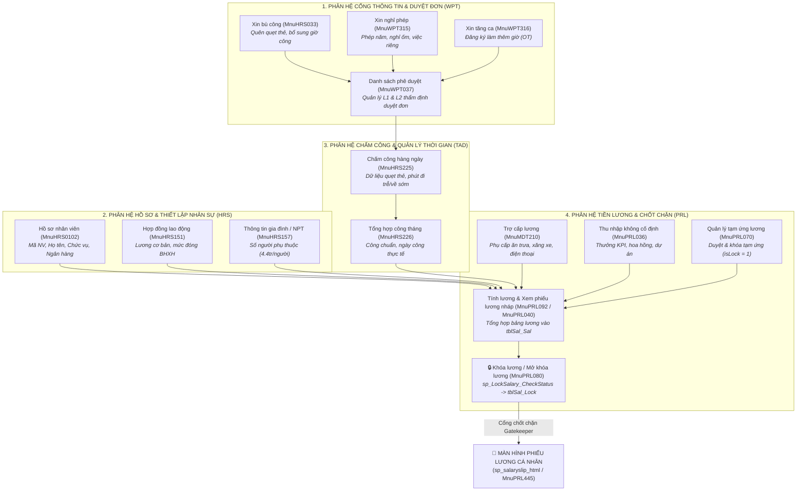

# TÀI LIỆU ĐẶC TẢ NGHIỆP VỤ PHÂN HỆ PHIẾU LƯƠNG & MA TRẬN LIÊN KẾT MENU - ROLES

> **Hệ thống**: Paradise HRM (Hệ Thống Quản Trị Nhân Sự & Chấm Công - Tính Lương Doanh Nghiệp)  
> **Module hạ nguồn**: Cổng thông tin nhân viên - Phiếu lương cá nhân (`sp_salaryslip_html` / `MnuPRL445`)  
> **Phiên bản tài liệu**: 1.0  
> **Ngày lập**: 04/11/2026  

---

## 1. TỔNG QUAN VỀ KIẾN TRÚC DÒNG CHẢY DỮ LIỆU (DATA PIPELINE ARCHITECTURE)

Trong hệ thống **Paradise HRM**, **Phiếu Lương Cá Nhân (`sp_salaryslip_html` / `MnuPRL445`)** không phải là một màn hình nhập liệu độc lập, mà là **Điểm hội tụ hạ nguồn cuối cùng (Final Downstream Convergence Point)** của toàn bộ hệ sinh thái HRM.

Mỗi con số xuất hiện trên phiếu lương của nhân viên đều được kết tinh và tổng hợp từ **hơn 12 màn hình menu**, trải dài qua **4 phân hệ nền tảng**:
1. **Phân hệ Cổng thông tin nhân viên & Phê duyệt (Web Portal - WPT)**
2. **Phân hệ Quản lý Hồ sơ & Nhân sự (Human Resource System - HRS)**
3. **Phân hệ Quản lý Thời gian & Chấm công (Time & Attendance - TAD)**
4. **Phân hệ Tiền lương, Phụ cấp & Khấu trừ (Payroll & Benefits - PRL)**



> [!CAUTION]
> **QUY TẮC BẤT BIẾN TẠI KHÂU TÍNH TIỀN LƯƠNG (`MnuPRL040` / `SALCAL_MAIN`)**:
> - **Chức năng Trigger ngầm**: Menu `MnuPRL040` là giao diện kích hoạt thủ tục ngầm `SALCAL_MAIN`. Ở cuối thủ tục là lệnh `print 'eof'` (không `SELECT` dữ liệu ra lưới), nên lưới trên màn hình này mặc định luôn báo *"Không có dữ liệu"*. Kết quả bảng lương được lưu ngầm vào `tblSal_Sal` và đối soát trên menu `Lương nhân viên` (`MnuHRS145`) hoặc `Phiếu lương` (`MnuPRL445`).
> - **Cơ chế chặn ngầm `TotalSalary <= 0`**: Tại dòng 772–778 của `SALCAL_MAIN`, bất kỳ nhân viên nào có `TotalSalary <= 0` (chưa có mức lương cơ bản trong `tblSalaryHistory`) sẽ bị hệ thống đánh dấu lỗi *"Has no salary entry"* và **BỊ XÓA BỎ 100% KHỎI DANH SÁCH TÍNH LƯƠNG** (`DELETE FROM #tblSalDetail WHERE TotalSalary <= 0`). Do đó, điều kiện tiên quyết trước khi bấm tính lương là nhân viên phải có mức lương hợp đồng `Salary > 0`!

---

## 2. PHÂN RÃ 5 VAI TRÒ THAM GIA CHUỖI CUNG ỨNG DỮ LIỆU (THE 5 ROLES)

| Vai Trò (Role) | Tài Khoản Minh Họa | Phạm Vi Trách Nhiệm & Thao Tác Hệ Thống | Menu Quản Trị Trực Tiếp |
| :--- | :--- | :--- | :--- |
| **1. Nhân viên**<br>*(Staff / ESS)* | `tai.dang`<br>(Mã: `046`) | - Khởi tạo các đề xuất vận hành cá nhân: Xin bù công, Xin nghỉ phép, Xin tăng ca.<br>- Theo dõi kết quả công hàng ngày.<br>- Mở xem Phiếu lương cá nhân hàng tháng và tra cứu 3 Modal chi tiết (Tăng ca, Ngày nghỉ, Đi trễ). | - `MnuHRS033` (Xin bù công)<br>- `MnuWPT315` (Xin nghỉ phép)<br>- `MnuWPT316` (Xin tăng ca)<br>- `MnuPRL445` (Phiếu lương cá nhân) |
| **2. Quản lý duyệt Nghỉ phép**<br>*(Manager - Leave)* | `ThanhLong`<br>(Mã: `011`) | - Thẩm định và xét duyệt Cấp 1 đối với **Đơn xin nghỉ phép năm (AL)** của nhân viên cấp dưới. | - `MnuWPT037` (Danh sách phê duyệt) |
| **3. Quản lý duyệt Tăng ca**<br>*(Manager - OT)* | `LongKa`<br>(Mã: `012`) | - Thẩm định và xét duyệt Cấp 1 đối với **Đơn xin làm thêm giờ (Tăng ca - OT)** của nhân viên cấp dưới. | - `MnuWPT037` (Danh sách phê duyệt) |
| **4. Quản lý Cấp 2 / HR Admin**<br>*(Director / HR Approver)* | `cuong.vu`<br>(Mã: `014`) | - Phê duyệt chặng cuối (Final Approval) cho **CẢ 2 ĐƠN** (Nghỉ phép & Tăng ca) và đơn bù công.<br>- Quản lý hợp đồng lao động, mức lương thỏa thuận đóng bảo hiểm 10tr (`MnuHRS145`).<br>- Xác thực hồ sơ Người phụ thuộc (NPT) để giảm trừ thuế gia cảnh 4.4tr (`MnuHRS157`). | - `MnuWPT037` (Duyệt đơn Cấp 2)<br>- `MnuHRS145` (Lương nhân viên)<br>- `MnuHRS151` (Hợp đồng lao động)<br>- `MnuHRS157` (Thông tin gia đình / NPT) |
| **5. Kế toán lương / Kế toán trưởng**<br>*(Payroll Accountant / Director)* | `chien.nguyen`<br>(Mã: `013`) | - Mở menu **Danh sách trả lương (`MnuPRL092`)** bấm Tính lương Lần 1 và xem trước **Phiếu lương nháp / Bảng lương nháp** trước khi duyệt đơn.<br>- Nhập các khoản thu nhập bất thường (thưởng KPI 1tr tại `MnuPRL036`).<br>- Phê duyệt và khóa tạm ứng lương 2tr (`MnuPRL070`, `isLock = 1`).<br>- Chạy **Tính lương Lần 2** tại `MnuPRL092` và tận mắt đối soát Phiếu lương nháp After.<br>- **Kích hoạt CHỐT CHẶN KHÓA LƯƠNG** (`#btnLock`) để phát hành phiếu lương chính thức cho toàn bộ nhân viên. | - `MnuPRL092` (Danh sách trả lương - Xem nháp & Tính lương)<br>- `MnuPRL036` (Thu nhập không cố định)<br>- `MnuPRL070` (Tạm ứng lương)<br>- `MnuPRL040` (Tính tiền lương)<br>- `MnuPRL080` (Mở/Khóa lương) |

---

## 3. BẢNG MA TRẬN ĐỐI SOÁT 17 THÀNH PHẦN DỮ LIỆU TRÊN PHIẾU LƯƠNG

Dưới đây là bảng giải phẫu kỹ thuật chi tiết từng trường chỉ tiêu hiển thị trên giao diện Phiếu lương (`sp_salaryslip_html` / `sp_PaySlipView`):

| STT | Thành phần trên Phiếu lương | Selector DOM UI | Thuộc Menu nào? | Role phụ trách | Bảng CSDL Nguồn | Công thức tính & Ràng buộc nghiệp vụ |
| :---: | :--- | :--- | :--- | :--- | :--- | :--- |
| **1** | **Thông tin nhân sự & Chức vụ** | `#psEmpID`<br>`#psFullName`<br>`#psHireDate`<br>`#psPosition` | `MnuHRS0102`<br>*(Hồ sơ nhân viên)* | **Nhân sự C&B** | `tblEmployee`<br>`tblPosition`<br>`tblDepartment` | Lấy trực tiếp từ bảng nhân sự gốc để định danh người lao động, phòng ban, chức vụ và ngày vào làm để tính thâm niên. |
| **2** | **Thông tin Ngân hàng nhận lương** | `#psBankName`<br>`#psBankCode` | `MnuHRS0102`<br>*(Hồ sơ nhân viên)* | **Nhân sự C&B** | `tblMD_Bank`<br>`tblEmployee` | Số tài khoản và tên ngân hàng phục vụ chi trả lương qua ATM khi kế toán kết xuất file ủy nhiệm chi. |
| **3** | **Người phụ thuộc (NPT)** | `#psDependents` | `MnuHRS157`<br>*(Thông tin gia đình / NPT)* | **Nhân sự C&B** | `tblSal_Tax`<br>`tblFamilyInfo` | Số lượng người phụ thuộc hợp pháp. Mỗi người được **giảm trừ gia cảnh `4,400,000 VNĐ/tháng`** theo Luật Thuế TNCN. |
| **4** | **Lương cơ bản (Hợp đồng)** | `#psBasicSalary` | `MnuHRS151`<br>*(Hợp đồng lao động)* | **Nhân sự C&B** | `tblSalaryHistory`<br>`tblSal_Sal_Detail` | Mức lương ghi nhận trên hợp đồng lao động chính thức, làm căn cứ đóng BHXH và tính đơn giá lương ngày công / giờ công. |
| **5** | **Ngày công chuẩn trong tháng** | `#psStdDays` | `MnuMDT000`<br>*(Cấu hình ca / Lịch làm việc)* | **Nhân sự C&B** | `tblSal_Sal_Detail`<br>(`StandardWDays`) | Số ngày công quy định phải làm việc trong tháng (thường là 22, 23 hoặc 24 ngày tùy chế độ nghỉ Thứ 7/Chủ Nhật). |
| **6** | **Ngày công thực tế đi làm** | `#psActDays` | `MnuHRS226`<br>*(Tổng hợp công tháng)* | **Nhân sự C&B** | `tblHasTA`<br>`tblSal_Sal_Detail` | Tổng số ngày công nhân viên thực tế có mặt làm việc hợp lệ sau khi đã cộng bù công và trừ đi các ngày nghỉ không phép. |
| **7** | **Lương làm thêm giờ (Tăng ca - OT)** | `#psOTHours`<br>`#psOTSalary` | `MnuWPT316`<br>*(Xin tăng ca)* $\rightarrow$ `MnuWPT037` | **Nhân viên** tạo $\rightarrow$ **Quản lý** duyệt | `tblSal_OT_Detail`<br>`tblOverTimeSetting` | `Tiền OT = (Lương CB / Công chuẩn / 8) × Giờ OT × Hệ số`. Hệ số: 150% (ngày thường), 200% (cuối tuần), 300% (ngày lễ). Có icon **👁️ mở Modal chi tiết**. |
| **8** | **Số ngày nghỉ (Phép năm / Không lương)** | `#psDaysOff` | `MnuWPT315`<br>*(Xin nghỉ phép)* $\rightarrow$ `MnuWPT037` | **Nhân viên** tạo $\rightarrow$ **Quản lý** duyệt | `tblSal_PaidLeave_Detail`<br>`tblLvHistory` | Nghỉ phép năm (hưởng 100% lương); Nghỉ không lương (bị trừ ngày công). Có icon **👁️ mở Modal chi tiết ngày nghỉ**. |
| **9** | **Khấu trừ Đi trễ - Về sớm** | `#psLateEarly` | `MnuHRS033`<br>*(Xin bù công)* $\rightarrow$ `MnuHRS225` | **Nhân viên** tạo $\rightarrow$ **Quản lý** duyệt | `tblInLateOutEarly`<br>`tblSal_IO` | Quy đổi phút vi phạm thành tiền phạt trừ vào thu nhập. Nếu đơn xin bù công được duyệt, hệ thống sẽ **xóa hoàn toàn vi phạm này**. Có icon **👁️ mở Modal chi tiết**. |
| **10** | **Các khoản Phụ cấp cố định** | `#psTotalOther` | `MnuMDT210`<br>*(Trợ cấp lương)* | **Kế toán lương** | `tblSal_Allowance`<br>`tblAllowanceSetting` | Tổng các khoản phụ cấp hàng tháng: Ăn trưa, xăng xe, điện thoại, trách nhiệm, thâm niên theo chính sách công ty. |
| **11** | **Thu nhập bất thường (Thưởng / KPI)** | `prAdjustment` | `MnuPRL036`<br>*(Thu nhập không cố định)* | **Kế toán / Giám đốc** | `tblPR_Adjustment`<br>`tblIrregularIncome` | Thưởng nóng, hoa hồng bán hàng, thưởng dự án, KPI phát sinh trong kỳ (`IncomeKind = 1`). |
| **12** | **Tạm ứng lương trong kỳ** | `tblSal_Advance` | `MnuPRL070`<br>*(Quản lý tạm ứng lương)* | **Kế toán lương** | `tblSal_Advance`<br>*(Bắt buộc `isLock = 1`)* | Số tiền nhân viên đã ứng trước trong tháng. **Ràng buộc**: Phiếu tạm ứng bắt buộc phải được duyệt và khóa (`isLock = 1`) mới trừ vào phiếu lương! |
| **13** | **Trích nộp Bảo hiểm (BHXH, BHYT, BHTN)** | `tblSal_Insurance` | `MnuPRL040`<br>*(Tính tiền lương tự động)* | **Kế toán lương** | `tblSal_Insurance` | Tỷ lệ trích trừ vào lương người lao động là **10.5%** (BHXH 8%, BHYT 1.5%, BHTN 1%) tính trên mức lương đóng bảo hiểm. |
| **14** | **Đoàn phí công đoàn** | `tblSal_Sal.EmpUnion` | `MnuPRL040`<br>*(Tính tiền lương tự động)* | **Kế toán lương** | `tblSal_Sal`<br>(Cột `EmpUnion`) | Trích nộp đoàn phí công đoàn của người lao động (1% lương theo quy định của Tổng Liên đoàn Lao động). |
| **15** | **Thuế Thu nhập cá nhân (Thuế TNCN)** | `#psSelfTax`<br>`#psDepTax`<br>`#psPIT` | `MnuPRL040`<br>*(Tính tiền lương tự động)* | **Kế toán lương** | `tblSal_Tax` | `Thu nhập tính thuế = Thu nhập chịu thuế - Giảm trừ bản thân (11tr) - (4.4tr × NPT) - Tiền đóng bảo hiểm`. Tính theo biểu lũy tiến từng phần. |
| **16** | **Lương Thực Lĩnh (Net Take-home)** | `#psNetSalary` | `MnuHRS145`<br>*(Bảng lương nhân viên chi tiết)* | **Kế toán lương** | `tblSal_Sal`<br>(Cột `GrossTakeHome`) | `Thực lĩnh = Tổng thu nhập - Tổng các khoản giảm trừ - Bảo hiểm - Thuế TNCN - Tạm ứng`. Là số tiền thực nhận chuyển khoản qua ngân hàng. |
| **17** | **Cổng Chốt Chặn: Hiển thị Phiếu lương** | `#psHistory`<br>`sp_salaryslip` | `MnuPRL080`<br>*(Mở/Khóa lương - `sp_LockSalary_CheckStatus`)* | **Kế toán trưởng / Giám đốc** | `tblSal_Lock`<br>`tblSal_LockSalary` | **CÔNG TẮC BẬT/TẮT HIỂN THỊ PHIẾU LƯƠNG**. Dù đã bấm tính lương xong, nếu Kế toán chưa vào menu này để bấm "Khóa", nhân viên mở phiếu lương sẽ báo trống! |

---

## 4. CHI TIẾT 3 TÍNH NĂNG POPUP MODAL TƯƠNG TÁC (👁️)

Trên giao diện phiếu lương của Paradise HRM (`sp_salaryslip_html`), bên cạnh các ô hiển thị tóm tắt, còn có **3 nút icon con mắt 👁️ tương tác mở Modal popup chi tiết**:

```
[Phiếu lương chính]
   │
   ├── 👁️ [Nút Giờ tăng ca]      ──► Mở Popup #psModalOvertime   ──► Render bảng chi tiết từ tblSal_OT_Detail
   ├── 👁️ [Nút Số ngày nghỉ]     ──► Mở Popup #psModalDaysoff    ──► Render bảng chi tiết từ tblSal_PaidLeave_Detail
   └── 👁️ [Nút Đi trễ - Về sớm]  ──► Mở Popup #psModalLateearly  ──► Render bảng chi tiết từ tblInLateOutEarly
```

1. **Modal Chi tiết Tăng ca (`#psModalOvertime`)**:
   - Hiển thị bảng chi tiết: `Ngày tăng ca (OTDate)`, `Từ giờ (OTFrom)`, `Đến giờ (OTTo)`, `Số giờ làm thêm (OTHour)`.
2. **Modal Chi tiết Ngày nghỉ (`#psModalDaysoff`)**:
   - Hiển thị bảng chi tiết: `Ngày nghỉ (LeaveDate)`, `Mã loại phép (LeaveCode)` (Phép năm, Nghỉ không lương, Nghỉ ốm...), `Số giờ nghỉ (LvAmount)`.
3. **Modal Chi tiết Đi trễ - Về sớm (`#psModalLateearly`)**:
   - Hiển thị bảng chi tiết: `Ngày vi phạm (IODate)`, `Giờ quẹt thực tế (IOStart)`, `Giờ quy định (IOEnd)`, `Số phút bị trừ (IOMinutesDeduct)`.

---

## 5. ĐIỂM NGHẼN THEN CHỐT CẦN LƯU Ý: "KHÓA LƯƠNG" (`tblSal_Lock`)

Trong mã nguồn Backend của thủ tục lấy dữ liệu phiếu lương (`sp_getSalSalSalarySlip` và `sp_PaySlipView`), hệ thống thiết lập điều kiện ràng buộc:

```sql
SELECT Month, Year, GrossTakeHome 
FROM tblSal_Sal ss 
WHERE ss.EmployeeID = @EmployeeID
  AND EXISTS (
      SELECT 1 FROM tblSal_Lock b 
      WHERE ss.EmployeeID = b.EmployeeID 
        AND ss.Month = b.Month 
        AND ss.Year = b.Year
  )
```

> [!IMPORTANT]
> **Ý NGHĨA NGHIỆP VỤ BẢO MẬT & KIỂM SOÁT**:
> 1. Dù Kế toán đã bấm *"Tính tiền lương tự động"* thành công tại `MnuPRL040`, bảng `tblSal_Sal` đã có số liệu.
> 2. **Nhưng nếu Kế toán CHƯA vào menu Khóa lương (`MnuPRL080`) để bấm "Khóa lương"**:
>    - Nhân viên khi đăng nhập vào menu **Phiếu lương (`MnuPRL445`)** sẽ thấy tab Lịch sử báo: `Không có dữ liệu phiếu lương (No payslip data)`.
>    - Màn hình sẽ không nạp kỳ lương mới nhất mà giữ trắng hoặc trỏ về kỳ cũ.
> 3. **Mục đích**: Ngăn chặn nhân viên nhìn thấy số liệu nháp trong lúc phòng Kế toán và C&B đang kiểm tra, điều chỉnh hoặc xử lý khiếu nại công lương. Chỉ khi Kế toán trưởng chính thức **Khóa sổ kỳ lương**, phiếu lương mới được phát hành đến từng nhân viên.

---

## 6. VÍ DỤ VỀ HIỆU ỨNG TÁC ĐỘNG LIÊN ĐỚI THỰC TẾ (RIPPLE EFFECT SCENARIO)

Để hình dung sự liên kết chặt chẽ giữa các menu, xét kịch bản sau:

1. **Ngày 15/10**: Nhân viên Đặng Minh Tài (`046`) đến công ty nhưng quên quẹt thẻ vào.
   - Hệ thống chấm công `MnuHRS225` tự động ghi nhận vắng mặt buổi sáng, trừ 240 phút đi trễ (`tblInLateOutEarly`).
2. **Ngày 16/10**: Nhân viên vào menu **Xin bù công (`MnuHRS033`)**, tạo đơn giải trình *"Quên quẹt thẻ sáng 15/10"*.
3. **Ngày 17/10**: Quản lý Nguyễn Thanh Long vào menu **Danh sách phê duyệt (`MnuWPT037`)** bấm Duyệt đơn.
   - **Tác động liên hoàn**: CSDL xóa bản ghi phạt đi trễ trong `tblInLateOutEarly`, khôi phục đủ công ngày 15/10 trong `tblHasTA`.
4. **Cuối tháng**: 
   - Menu **Tổng hợp công (`MnuHRS226`)** ghi nhận đủ 23/23 ngày công thực tế (thay vì 22.5 ngày).
   - Kế toán chạy **Tính lương (`MnuPRL040`)**: Không bị trừ tiền phạt đi trễ (`tblSal_IO = 0`), lương thời gian đạt 100%.
   - Kế toán vào **Khóa lương (`MnuPRL080`)** bấm Khóa.
5. **Đầu tháng sau**: Nhân viên mở **Phiếu lương (`MnuPRL445`)**:
   - Trường `#psActDays` hiển thị đủ `23 ngày`.
   - Trường `#psLateEarly` hiển thị `0 đ`.
   - Lương Thực lĩnh `#psNetSalary` nhận trọn vẹn 100%.
