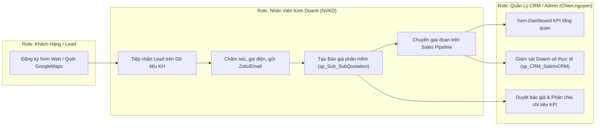

# HỒ SƠ ĐẶC TẢ PHÂN HỆ TRANG CHỦ CRM — PARADISE HRM

> **Hệ thống mục tiêu**: Paradise HRM (`https://paradisehrm.com/Tai3/#`)  
> **Tài khoản khảo sát**: `Chien.nguyen` (Quyền Quản trị viên / Trưởng bộ phận CRM)  
> **Thời gian cào & trích xuất**: 09:40:10 16/10/2026  
> **Tổng số menu khảo sát thực tế**: 36 menu con  
> **Phương pháp trích xuất**: `/ui-crawl-to-user-story` (Playwright Runtime DOM + JS Context + Network API Fingerprinting)

---

## BẢNG PHÂN RÃ CÁC EPIC CHÍNH TRONG PHÂN HỆ CRM

| Mã Epic | Tên Phân Hệ (Epic) | Phạm Vi Menu Thực Tế | Số US | Tài Liệu Chi Tiết |
| :--- | :--- | :--- | :---: | :--- |
| **CRM-EPIC-01** | **Tổng quan Vận hành CRM & KPI Analytics** | Tổng quan CRM (`MnuKPI001`), Theo dõi dịch vụ (`MnuKPI012`) | 3 | [`CRM-EPIC-01-Tong-Quan-CRM.md`](./CRM-EPIC-01-Tong-Quan-CRM.md) |
| **CRM-EPIC-02** | **Quản lý Khách hàng & Sales Pipeline** | Dữ liệu khách hàng (`MnuKPI003`), Sales Pipeline (`MnuKPI007`), Doanh số (`MnuKPI447`), Lead Marketing (`MnuKPI448`) | 4 | [`CRM-EPIC-02-Khach-Hang-Sales-Pipeline.md`](./CRM-EPIC-02-Khach-Hang-Sales-Pipeline.md) |
| **CRM-EPIC-03** | **Tương tác Khách hàng & Nhiệm vụ CRM** | Nhóm Nhiệm vụ: Zalo tự động (`MnuKPI045`), Email thủ công (`MnuKPI002`), Tin AI (`MnuKPI049`), Cuộc họp (`MnuKPI006`) | 3 | [`CRM-EPIC-03-Nhiem-Vu-Cham-Soc-Zalo-Email.md`](./CRM-EPIC-03-Nhiem-Vu-Cham-Soc-Zalo-Email.md) |
| **CRM-EPIC-04** | **Dữ liệu Tiềm năng & GoogleMaps** | Nhóm GoogleMaps: Thu thập dữ liệu (`MnuHRS036`), Lọc dữ liệu (`MnuHRS064`), Import bất thường (`MnuKPI015`) | 2 | [`CRM-EPIC-04-Du-Lieu-GoogleMaps.md`](./CRM-EPIC-04-Du-Lieu-GoogleMaps.md) |
| **CRM-EPIC-05** | **Quản lý Báo giá & Phân hệ Phần mềm** | Nhóm Báo giá: Báo giá phần mềm (`MnuCSM004`), Thêm/Sửa báo giá (`MnuCSM005`), Phân hệ (`MnuCSM003`, `MnuKPI446`) | 3 | [`CRM-EPIC-05-Bao-Gia-Phan-Mem.md`](./CRM-EPIC-05-Bao-Gia-Phan-Mem.md) |
| **CRM-EPIC-06** | **Quản lý Kho & Thiết lập Hệ thống CRM** | Nhóm Kho (`MnuKPI017`, `019`, `021`), Hỗ trợ (`MnuHRS32389`, `3237`), Thiết lập (`MnuKPI449`, `MnuTM037`, `MnuKPI016`...) | 3 | [`CRM-EPIC-06-Kho-Va-Thiet-Lap-CRM.md`](./CRM-EPIC-06-Kho-Va-Thiet-Lap-CRM.md) |

---

## MA TRẬN TRUY VẾT DỮ LIỆU ĐA VAI TRÒ (CROSS-ROLE DATA LINEAGE)

Qua cơ chế bóc tách dấu vân tay API (`Network Fingerprinting`), hệ thống phát hiện luồng chu chuyển dữ liệu giữa các vai trò:

