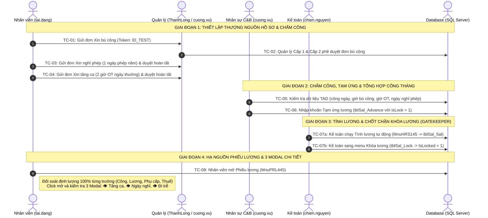

# KẾ HOẠCH KIỂM THỬ LIÊN HOÀN TOÀN DIỆN: PHÂN HỆ PHIẾU LƯƠNG & 12 MENU LIÊN ĐỚI
> **Dự án**: Paradise HRM (Hệ Thống Quản Trị Nhân Sự & Chấm Công - Tính Lương Doanh Nghiệp)  
> **Tài liệu**: Kế hoạch kiểm thử & Ma trận đối soát dữ liệu thượng nguồn (Master E2E Test Plan & Data Pipeline Matrix)  
> **Module mục tiêu**: Cổng thông tin nhân viên - Phiếu lương cá nhân (`sp_salaryslip_html` / `MnuPRL445`)  
> **Phiên bản tài liệu**: 1.0 - Ngày lập: 04/11/2026  

---

## 1. TỔNG QUAN VỀ KIẾN TRÚC DÒNG CHẢY DỮ LIỆU (DATA PIPELINE ARCHITECTURE)

Trong hệ thống Paradise HRM, **Phiếu Lương Cá Nhân (`sp_salaryslip_html` / `MnuPRL445`)** không phải là một màn hình nhập liệu hay bảng dữ liệu đứng độc lập, mà là **Điểm hội tụ cuối cùng (Final Downstream Convergence Point)** của toàn bộ hệ sinh thái HRM.

Mọi con số xuất hiện trên phiếu lương của nhân viên đều được tổng hợp và tính toán từ **ít nhất 12 màn hình menu khác nhau**, thuộc 4 phân hệ nền tảng:
1. **Phân hệ Hồ sơ & Thiết lập nhân sự (HR Administration)**
2. **Phân hệ Quản lý Thời gian & Chấm công (Time & Attendance - TAD)**
3. **Phân hệ Tiền lương, Phụ cấp & Khấu trừ (Payroll & Benefits - PRL)**
4. **Phân hệ Vận hành & Chốt chặn Lương (Payroll Operations & Gatekeeper Lock)**

```mermaid
flowchart TD
    subgraph HR["1. PHÂN HỆ HỒ SƠ & THIẾT LẬP NHÂN SỰ"]
        M1["Hồ sơ nhân sự (MnuHRS001)<br/><i>Mã NV, Họ tên, Ngày vào làm, Chức vụ</i>"]
        M2["Diễn biến lương (tblSalaryHistory)<br/><i>Lương cơ bản hợp đồng đóng bảo hiểm</i>"]
        M3["Đăng ký người phụ thuộc (tblSal_Tax)<br/><i>Giảm trừ gia cảnh (4.4tr/người)</i>"]
        M4["Thông tin Ngân hàng (tblMD_Bank)<br/><i>Số TK & Ngân hàng nhận lương</i>"]
    end

    subgraph TAD["2. PHÂN HỆ CHẤM CÔNG & QUẢN LÝ THỜI GIAN (TAD)"]
        M5["Tổng hợp công cả tháng (tblHasTA)<br/><i>Công chuẩn (23 ngày), Công thực tế</i>"]
        M6["Xin bù công (tblAttendanceConfirmRequest)<br/><i>Bù giờ quẹt thẻ, xóa phạt đi trễ</i>"]
        M7["Quản lý nghỉ phép (tblLvHistory)<br/><i>Nghỉ phép hưởng lương / Không lương</i>"]
        M8["Xác nhận tăng ca (tblSal_OT_Detail)<br/><i>Số giờ OT, Tiền lương tăng ca</i>"]
        M9["Đi trễ - Về sớm (tblInLateOutEarly)<br/><i>Phút vi phạm, khấu trừ công/tiền phạt</i>"]
    end

    subgraph PRL["3. PHÂN HỆ TIỀN LƯƠNG, PHỤ CẤP & KHẨU TRỪ (PRL)"]
        M10["Thiết lập phụ cấp (tblSal_Allowance)<br/><i>Ăn trưa, Xăng xe, Điện thoại, Trách nhiệm</i>"]
        M11["Thu nhập bất thường (tblPR_Adjustment)<br/><i>Thưởng nóng, KPI, Hoa hồng bán hàng</i>"]
        M12["Tạm ứng lương (tblSal_Advance)<br/><i>Khoản ứng trước trong tháng (isLock = 1)</i>"]
        M13["Trích nộp BHXH (tblSal_Insurance)<br/><i>Khấu trừ 10.5% (BHXH 8%, BHYT 1.5%, BHTN 1%)</i>"]
    end

    subgraph LOCK["4. MÀN HÌNH CHỐT CHẶN THEN CHỐT (GATEKEEPER)"]
        M14["🔒 Khóa lương / Mở khóa lương (sp_LockSalary_CheckStatus)<br/><i>Bảng tblSal_Lock: Điều kiện tiên quyết để hiển thị Phiếu lương</i>"]
    end

    HR --> PAYSLIP["🧾 MÀN HÌNH PHIẾU LƯƠNG NHÂN VIÊN<br/>(sp_salaryslip_html / MnuPRL445)"]
    TAD --> PAYSLIP
    PRL --> PAYSLIP
    LOCK -->|Cổng kiểm soát truy cập (Gatekeeper)| PAYSLIP
```

---

## 2. MA TRẬN ĐỐI SOÁT 12 MENU LIÊN ĐỚI TỪNG VÙNG DỮ LIỆU TRÊN PHIẾU LƯƠNG

Dưới đây là ma trận chi tiết giải phẫu nguồn dữ liệu của từng trường chỉ tiêu hiển thị trên giao diện Phiếu lương dựa theo mã nguồn Stored Procedure gốc `sp_PaySlipView` và `sp_salaryslip_html`:

| STT | Vùng Dữ Liệu Trên Phiếu Lương | Trường Dữ Liệu DOM UI | Bảng CSDL Nguồn | Menu Hệ Thống Trực Tiếp Nuôi Dữ Liệu Này | Ý Nghĩa Nghiệp Vụ & Ràng Buộc Kỹ Thuật |
| :---: | :--- | :--- | :--- | :--- | :--- |
| **1** | **Header Doanh Nghiệp** | `#psCompanyName`<br>`#psCompanyAddr` | `tblCompany` | **Cấu hình thông tin doanh nghiệp** | Lấy thông tin pháp nhân (Tên đầy đủ, Địa chỉ trụ sở chính) của công ty ký hợp đồng lao động. |
| **2** | **Thông Tin Nhân Viên** | `#psEmpID`<br>`#psFullName`<br>`#psHireDate`<br>`#psPosition` | `tblEmployee`<br>`tblPosition`<br>`tblDepartment` | **Quản lý Hồ sơ Nhân sự (`MnuHRS001`)** | Định danh nhân viên, phòng ban, chức vụ và ngày bắt đầu làm việc để tính thâm niên. |
| **3** | **Thông Tin Ngân Hàng** | *(Hiển thị khi in/xuất)* | `tblMD_Bank` | **Thông tin tài khoản ngân hàng nhân viên** | Tên ngân hàng (`mdb.BankName`) và số tài khoản nhận lương thực lĩnh qua ATM. |
| **4** | **Người Phụ Thuộc** | `#psDependents` | `tblSal_Tax`<br>`tblEmployee` | **Đăng ký người phụ thuộc / Giảm trừ gia cảnh** | Số lượng người phụ thuộc hợp pháp (`DependantNumber`). Mỗi người được giảm trừ gia cảnh `4,400,000 VNĐ/tháng`. |
| **5** | **I/ Ngày Công Chuẩn** | `#psStdDays` | `tblSal_Sal_Detail`<br>(Cột `StandardWDays`) | **Quy định ngày công chuẩn trong tháng** | Số ngày công quy định làm việc trong tháng (thường là 22, 23 hoặc 24 ngày tùy lịch làm việc doanh nghiệp). |
| **6** | **I/ Ngày Công Thực Tế** | `#psActDays` | `tblHasTA`<br>`tblSal_Sal_Detail` | **Tổng hợp công cả tháng (`MnuHRS226`)** | Tổng số ngày công nhân viên thực tế có mặt đi làm hợp lệ sau khi đã cộng bù công và nghỉ hưởng lương. |
| **7** | **I/ Tăng Ca (Overtime)** | `#psOTHours`<br>`#psOTSalary` | `tblSal_OT_Detail`<br>`tblOverTimeSetting` | **Xác nhận dữ liệu tăng ca & Đơn xin tăng ca** | Số giờ tăng ca (`OTHour`) và Tiền lương làm thêm giờ (`OTAmount`). Có icon con mắt 👁️ mở **Modal chi tiết tăng ca**. |
| **8** | **I/ Số Ngày Nghỉ** | `#psDaysOff` | `tblSal_PaidLeave_Detail`<br>`tblLvHistory` | **Quản lý nghỉ phép năm & Đơn xin nghỉ phép** | Số ngày nghỉ (`TotalLeave`) gồm nghỉ phép năm (hưởng 100% lương) và nghỉ không lương. Có icon 👁️ mở **Modal chi tiết ngày nghỉ**. |
| **9** | **I/ Đi Trễ - Về Sớm** | `#psLateEarly` | `tblInLateOutEarly`<br>`tblSal_IO` | **Xác nhận đi trễ - về sớm & Đơn xin bù công** | Quy đổi tổng số phút vi phạm thành ngày công (`IOMinutesDeduct / 60.0 / 8.0`). Có icon 👁️ mở **Modal chi tiết đi trễ**. Đơn xin bù công (TC-01) khi duyệt sẽ xóa vi phạm này! |
| **10** | **I/ Lương Cơ Bản** | `#psBasicSalary` | `tblSalaryHistory`<br>`tblSal_Sal_Detail` | **Diễn biến lương & Hợp đồng lao động** | Mức lương cơ bản thỏa thuận trên hợp đồng lao động làm căn cứ đóng BHXH và tính đơn giá lương ngày công. |
| **11** | **II/ Thu Nhập Khác (Phụ cấp)** | `#psTotalOther` | `tblSal_Allowance`<br>`tblAllowanceSetting` | **Thiết lập & Quản lý phụ cấp nhân viên** | Tổng các khoản trợ cấp cố định: phụ cấp ăn trưa, xăng xe, điện thoại, trách nhiệm theo chính sách công ty. |
| **12** | **II/ Thu Nhập Bất Thường** | `prAdjustment` | `tblPR_Adjustment`<br>`tblIrregularIncome` | **Thu nhập bất thường & Điều chỉnh lương** | Thưởng dự án, hoa hồng doanh số, thưởng hiệu quả công việc (KPI) phát sinh trong tháng (`IncomeKind = 1`). |
| **13** | **III/ Khấu Trừ Đi Trễ Về Sớm** | `tblSal_IO` | `tblSal_IO` | **Bảng phạt vi phạm thời gian làm việc** | Tiền phạt trừ trực tiếp vào thu nhập do đi làm muộn hoặc về sớm vượt mức cho phép (`InLateAmount + OutEarlyAmount`). |
| **14** | **III/ Khấu Trừ Bảo Hiểm** | `tblSal_Insurance` | `tblSal_Insurance` | **Quản lý trích nộp bảo hiểm xã hội (BHXH)** | Khấu trừ 10.5% vào lương nhân viên gồm: 8% BHXH + 1.5% BHYT + 1% BHTN theo mức lương đóng bảo hiểm. |
| **15** | **III/ Phí Công Đoàn** | `tblSal_Sal.EmpUnion` | `tblSal_Sal` | **Cấu hình trích nộp công đoàn** | Trích nộp đoàn phí công đoàn của người lao động (1% lương theo quy định Tổng liên đoàn lao động). |
| **16** | **III/ Tạm Ứng Lương** | `tblSal_Advance` | `tblSal_Advance`<br>*(Điều kiện `isLock = 1`)* | **Quản lý tạm ứng lương nhân viên** | Khoản tiền nhân viên đã làm đơn xin ứng trước trong tháng. **Bắt buộc phiếu tạm ứng phải được duyệt và khóa (`isLock=1`) mới trừ vào phiếu lương!** |
| **17** | **IV/ Thuế Thu Nhập Cá Nhân** | `#psSelfTax`<br>`#psDepTax`<br>`#psPIT` | `tblSal_Tax` | **Bảng tính thuế TNCN lũy tiến** | Giảm trừ bản thân (11,000,000 VNĐ), Giảm trừ gia cảnh (`4,400,000 VNĐ × NPT`), Thu nhập chịu thuế và Thuế TNCN khấu trừ. |
| **18** | **V/ Thực Lĩnh (Net Take Home)** | `#psNetSalary` | `tblSal_Sal`<br>(Cột `GrossTakeHome`) | **Lương nhân viên (`MnuHRS145`)** $\rightarrow$ **Chuyển lương ngân hàng (`sp_SalaryTransferByBank`)** | Số tiền thực nhận cuối cùng = Tổng thu nhập - Tổng các khoản khấu trừ - Thuế TNCN. Là số tiền công ty chuyển khoản qua ngân hàng. |

---

## 3. ĐIỂM NGHẼN THEN CHỐT CỰC KỲ DỄ BỎ SÓT: "KHÓA LƯƠNG" (`tblSal_Lock`)

Trong mã nguồn của thủ tục `sp_getSalSalSalarySlip` (thủ tục phụ trách nạp danh sách kỳ lương vào tab Lịch sử), hệ thống thiết lập điều kiện ràng buộc:

```sql
SELECT Month, Year, GrossTakeHome 
FROM tblSal_Sal ss 
WHERE ss.EmployeeID = @EmployeeID
  AND EXISTS (
      SELECT 1 FROM tblSal_Lock b 
      WHERE ss.EmployeeID = b.EmployeeID 
        AND ss.Month = b.Month 
        AND ss.Year = b.Year
  )
```

### 🚨 RỦI RO NGHIỆP VỤ NẾU BỎ SÓT:
1. **Dù Kế toán đã bấm "Tính lương tự động" tại menu Lương nhân viên (`MnuHRS145`)**, CSDL đã có bản ghi trong `tblSal_Sal`.
2. **Nhưng nếu Kế toán CHƯA SANG MENU Khóa lương (`sp_LockSalary_CheckStatus`) để bấm Khóa (Lock)**:
   - Tab **Lịch sử phiếu lương (`psHistory`)** của nhân viên sẽ báo: `Không có dữ liệu phiếu lương (No payslip data)`.
   - Giao diện Phiếu lương chính sẽ không tự động nạp kỳ lương mới nhất của tháng đó mà bị fallback về tháng cũ hoặc hiển thị giá trị rỗng!
3. **Ý nghĩa nghiệp vụ**: Doanh nghiệp chỉ cho phép nhân viên xem phiếu lương khi phòng Kế toán / C&B đã thẩm định xong và chính thức **"Khóa sổ kỳ lương"** nhằm tránh việc nhân viên khiếu nại số liệu đang trong quá trình điều chỉnh nháp.

---

## 4. BA TÍNH NĂNG TƯƠNG TÁC POPUP MODAL ẨN TRÊN PHIẾU LƯƠNG

Trên giao diện phiếu lương của Paradise HRM (`sp_salaryslip_html`), bên cạnh các ô hiển thị tóm tắt, còn có **3 nút icon con mắt 👁️ tương tác mở Modal popup chi tiết**:

```
[Phiếu lương chính]
   ├── [Nút 👁️ Giờ tăng ca]      ──► Mở Popup #psModalOvertime   ──► Render bảng chi tiết từ tblSal_OT_Detail
   ├── [Nút 👁️ Số ngày nghỉ]     ──► Mở Popup #psModalDaysoff    ──► Render bảng chi tiết từ tblSal_PaidLeave_Detail
   └── [Nút 👁️ Đi trễ - Về sớm]  ──► Mở Popup #psModalLateearly  ──► Render bảng chi tiết từ tblInLateOutEarly
```

1. **Modal Chi tiết Tăng ca (`#psModalOvertime`)**:
   - Hiển thị bảng chi tiết: `Ngày tăng ca (OTDate)`, `Từ giờ (OTFrom)`, `Đến giờ (OTTo)`, `Số giờ làm thêm (OTHour)`.
2. **Modal Chi tiết Ngày nghỉ (`#psModalDaysoff`)**:
   - Hiển thị bảng chi tiết: `Ngày nghỉ (LeaveDate)`, `Mã loại phép (LeaveCode)` (Phép năm, Nghỉ không lương, Nghỉ ốm...), `Số giờ nghỉ (LvAmount)`.
3. **Modal Chi tiết Đi trễ - Về sớm (`#psModalLateearly`)**:
   - Hiển thị bảng chi tiết: `Ngày vi phạm (IODate)`, `Giờ quẹt thực tế (IOStart)`, `Giờ quy định (IOEnd)`, `Số phút bị trừ (IOMinutesDeduct)`.

---

## 5. ĐỀ XUẤT KỊCH BẢN KIỂM THỬ E2E LIÊN HOÀN 8 BƯỚC (E2E MASTER TEST FLOW)

Để kiểm chứng toàn diện dòng chảy dữ liệu từ thượng nguồn đến hạ nguồn mà không bỏ sót bất kỳ mắt xích nào, chuỗi kịch bản kiểm thử E2E liên hoàn được hoạch định gồm 8 Test Cases tuần tự:



### Chi tiết mục tiêu từng Test Case:

* **TC-01: Khởi tạo dữ liệu vi phạm & gửi đơn Xin bù công (Role: `tai.dang`)**
  - Gắn Token duy nhất `[ID:${TOKEN}]`.
  - Mục tiêu trên Phiếu lương: Bù công thành công sẽ xóa phạt đi trễ về sớm và bảo toàn đủ 23 ngày công thực tế.
* **TC-02: Phê duyệt liên hoàn 2 cấp cho đơn Xin bù công (Role: `ThanhLong` & `cuong.vu`)**
  - Áp dụng **Luật Thép 9**: Kiểm tra avatar chuyển Xanh lá ("Đã duyệt"), nút Duyệt bị ẩn, CSDL `Approve_Status = 2`.
* **TC-03: Khởi tạo và duyệt đơn Xin nghỉ phép (Role: `tai.dang` & Quản lý)**
  - Đăng ký 1 ngày nghỉ phép năm.
  - Mục tiêu trên Phiếu lương: Trường `#psDaysOff` phải nhảy đúng số ngày nghỉ và Modal `#psModalDaysoff` hiển thị đúng dòng phép.
* **TC-04: Khởi tạo và duyệt đơn Xin tăng ca (Role: `tai.dang` & Quản lý)**
  - Đăng ký tăng ca 2 giờ ngày thường (hệ số 1.5).
  - Mục tiêu trên Phiếu lương: Trường `#psOTHours` nhảy đúng `2 giờ`, tiền OT được cộng vào `#psTotalIncome`, Modal `#psModalOvertime` có bản ghi.
* **TC-05: Kiểm tra bảng công TAD & Nhập khoản Tạm ứng lương (Role: `cuong.vu`)**
  - Kiểm tra bảng công ngày `MnuHRS046` và tổng hợp công tháng `MnuHRS226`.
  - Nhập 1 khoản tạm ứng lương `2,000,000 VNĐ` tại menu Tạm ứng lương và kích hoạt cờ `isLock = 1`.
* **TC-06: Kế toán chạy Tính toán Lương tự động (Role: `chien.nguyen`)**
  - Mở menu **Lương nhân viên (`MnuHRS145`)** $\rightarrow$ Bấm nút "Tính lương tự động".
  - Kiểm tra CSDL `tblSal_Sal`: Bản ghi lương của nhân viên `046` được sinh ra với đầy đủ các cột thu nhập và khấu trừ.
* **TC-07: MÀN HÌNH CHỐT CHẶN: Kế toán kích hoạt Khóa lương (Role: `chien.nguyen`)**
  - Mở menu **Khóa lương (`sp_LockSalary_CheckStatus`)**.
  - Bấm chọn kỳ lương tháng 10/2026 $\rightarrow$ Bấm nút "Khóa lương".
  - Kiểm tra CSDL `tblSal_Lock`: Tồn tại bản ghi khóa lương của nhân viên `046`.
* **TC-08: Nhân viên đối soát định lượng toàn diện Phiếu lương & 3 Modal (Role: `tai.dang`)**
  - Đăng nhập nhân viên `tai.dang` $\rightarrow$ Mở menu **Phiếu lương (`MnuPRL445`)**.
  - Kiểm tra Tab **Lịch sử phiếu lương (`psHistory`)**: Phải hiển thị dòng kỳ lương tháng 10/2026 kèm số tiền thực lĩnh.
  - Đối soát ma trận định lượng từng trường trên phiếu lương:
    1. Công chuẩn = 23 ngày
    2. Công thực tế = 23 ngày
    3. Giờ tăng ca = 2 giờ (khớp TC-04)
    4. Số ngày nghỉ = 1 ngày (khớp TC-03)
    5. Tạm ứng lương = 2,000,000 VNĐ (khớp TC-05)
    6. Thuế TNCN: Giảm trừ gia cảnh đúng theo số người phụ thuộc.
  - **Tương tác mở và kiểm tra 3 Modal popup**:
    * Click icon 👁️ Tăng ca $\rightarrow$ Modal `#psModalOvertime` hiện đúng 2 giờ OT.
    * Click icon 👁️ Ngày nghỉ $\rightarrow$ Modal `#psModalDaysoff` hiện đúng 1 ngày phép năm.
    * Click icon 👁️ Đi trễ $\rightarrow$ Modal `#psModalLateearly` phản ánh đúng biên bản quẹt thẻ.

---

## 6. TIÊU CHUẨN NGHIỆM THU & BỘ QUY TẮC CHỐNG FAKE PASS

Toàn bộ kịch bản kiểm thử xây dựng từ tài liệu này bắt buộc phải tuân thủ nghiêm ngặt **BỘ 9 LUẬT THÉP BẤT BIẾN** của dự án:
1. **Dynamic Exact Match**: Mọi dữ liệu tạo ra đều phải mang Token định danh duy nhất; so khớp thẻ Top 1.
2. **Dual-layer Verification**: Không tin tưởng tuyệt đối vào giao diện; 100% bước ghi/duyệt đều truy vấn trực tiếp CSDL SQL Server (Read-only).
3. **Luật Thép 9 (Kiểm soát Thành phần động)**: Không lấy thông báo Toast làm căn cứ pass; bắt buộc kiểm tra sự đổi màu của Avatar/Badge và việc ẩn các nút hành động.
4. **Context Locking Protocol**: Tự động khóa lại bản ghi mục tiêu sau khi thao tác, triệt tiêu hoàn toàn sai lệch do cơ chế tự nhảy đơn kế tiếp (Queue Auto-Advance) hoặc xóa trắng form (Form Reset).
5. **Field-by-Field Quantitative Reconciliation**: Bóc tách từng ô giá trị trên phiếu lương so khớp ma trận số học với CSDL, lệch bất kỳ trường nào đánh FAIL ngay lập tức.
