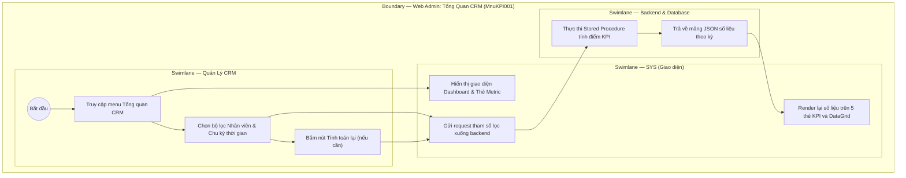

# USER STORY: CRM-US01 · XEM DASHBOARD TỔNG QUAN KPI CRM

* **Thuộc Epic**: [`CRM-EPIC-01: Tổng quan Vận hành CRM & KPI Analytics`](../../../epic/crm/CRM-EPIC-01-Tong-Quan-CRM.md)
* **Mã User Story**: `CRM-US01`
* **Mã Ứng Dụng (App ID)**: `MnuKPI001`
* **Actor chính**: Quản trị viên CRM / Trưởng phòng KD (`Chien.nguyen`)
* **API / Stored Procedure ghi nhận**: `sp_KPIListDataCollection`, `sp_CRM_SaleInCRM`

---

## 1. PRECONDITIONS & TRIGGER
* **Tiền điều kiện (Preconditions)**:
  - Người dùng đăng nhập thành công với tài khoản có quyền truy cập CRM.
  - Dữ liệu KPI đã được ghi nhận từ hoạt động của nhân viên trong kỳ làm việc.
* **Sự kiện kích hoạt (Trigger)**:
  - Người dùng bấm vào menu **"Tổng quan CRM"** (`MnuKPI001`) trên thanh điều hướng hoặc dock icon.

---

## 2. MAIN FLOW & BUSINESS RULES
1. Người dùng truy cập màn hình Tổng quan CRM.
2. SYS hiển thị thanh công cụ lọc và các thẻ Metric KPI thời gian thực của tuần hiện tại.
3. Người dùng chọn lọc theo **Chu kỳ** (`Tuần` / `Tháng`) hoặc chọn lọc theo **Nhân viên cụ thể**.
4. SYS tự động gửi request gọi Stored Procedure tính toán và cập nhật lại số liệu trên các thẻ KPI và bảng xếp hạng.
5. Người dùng có thể bấm nút **"Tính toán lại"** để hệ thống quét lại dữ liệu phát sinh mới nhất.

---

## 3. BẢNG ĐẶC TẢ FIELD-LEVEL 6 CỘT CHUẨN MỰC

| Field / control | Loại UI Control | State | Required | Conditional / dynamic | Source / validation |
| :--- | :--- | :--- | :--- | :--- | :--- |
| **Nhân viên** | `Dropdown / SelectBox` | `ENABLED` | `NO` | Hiển thị mặc định | Danh sách nhân viên lấy từ `sp_GetEmployeeList`. Mặc định: "Tìm kiếm hoặc chọn..." |
| **Xem theo** | `Dropdown / SelectBox` | `ENABLED` | `YES (*)` | Hiển thị mặc định | Danh mục cố định: `Tuần`, `Tháng`. Mặc định: `Tuần` |
| **Thời gian** | `DatePicker / DateBox` | `ENABLED` | `YES (*)` | Thay đổi theo "Xem theo" | Định dạng Week/Year (ví dụ `Week 42, 2026`). Cho phép click chọn tuần |
| **Nút "+ Thêm Lead"** | `Button (Primary Green)` | `ENABLED` | `NO` | Hiển thị mặc định | Bấm để mở Modal popup thêm nhanh khách hàng tiềm năng |
| **Nút "Tính toán lại"** | `Button (Cyan Action)` | `ENABLED` | `NO` | Hiển thị mặc định | Gọi API nạp lại toàn bộ số liệu thống kê tức thời |
| **Nút "Cài đặt KPI"** | `Button (Icon Gear)` | `ENABLED` | `NO` | Hiển thị mặc định | Mở modal cấu hình danh mục và ngưỡng KPI |
| **Thẻ "EMAIL THỦ CÔNG"** | `Metric Card` | `READONLY` | `NO` | Hiển thị mặc định | Số lượng email nhân viên đã gửi trong kỳ (Kèm % tăng trưởng so với kỳ trước) |
| **Thẻ "THU THẬP DỮ LIỆU"**| `Metric Card` | `READONLY` | `NO` | Hiển thị mặc định | Số lượng lead mới cào/nhập vào hệ thống |
| **Thẻ "CONTENT"** | `Metric Card` | `READONLY` | `NO` | Hiển thị mặc định | Số lượng nội dung tiếp thị đã xuất bản |
| **Thẻ "DEMO"** | `Metric Card` | `READONLY` | `NO` | Hiển thị mặc định | Số cuộc hẹn demo phần mềm thành công |
| **Thẻ "CẦN CHĂM SÓC"** | `Metric Card (Warning)`| `READONLY` | `NO` | Hiển thị mặc định | Số khách hàng quá 7 ngày chưa có tương tác |
| **Bảng xếp hạng KPI** | `DataGrid` | `READONLY` | `NO` | Hiển thị mặc định | Cột: STT, Mã NV, Tên NV, Tổng điểm, Xếp hạng, Chi tiết |

---

## 4. ALTERNATE & EXCEPTION FLOWS
* **AF-01: Thay đổi chu kỳ từ Tuần sang Tháng**: SYS tự động ẩn bộ chọn tuần và thay bằng Datepicker chọn tháng/năm, sau đó gọi API nạp lại toàn bộ thẻ KPI.
* **EF-01: Mất kết nối API / Timeout**: SYS hiển thị thông báo "Không thể nạp dữ liệu thống kê, vui lòng bấm Tính toán lại".

---

## 5. SƠ ĐỒ UML ACTIVITY DIAGRAM SWIMLANE

