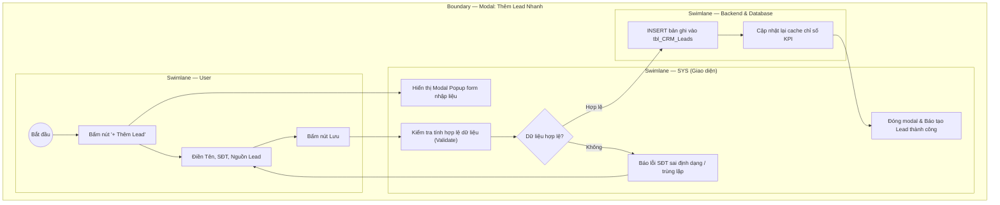

# USER STORY: CRM-US02 · THÊM LEAD NHANH TỪ DASHBOARD

* **Thuộc Epic**: [`CRM-EPIC-01: Tổng quan Vận hành CRM & KPI Analytics`](../../../epic/crm/CRM-EPIC-01-Tong-Quan-CRM.md)
* **Mã User Story**: `CRM-US02`
* **Mã Ứng Dụng (App ID)**: `MnuKPI001`
* **Actor chính**: Nhân viên kinh doanh / Quản lý CRM (`Chien.nguyen`)
* **API / Stored Procedure ghi nhận**: `sp_CRM_InsertLeadQuick`

---

## 1. PRECONDITIONS & TRIGGER
* **Tiền điều kiện (Preconditions)**: Người dùng đang ở màn hình Dashboard CRM.
* **Sự kiện kích hoạt (Trigger)**: Bấm nút **"+ Thêm Lead"** (Màu xanh lá) trên thanh công cụ.

---

## 2. MAIN FLOW & BUSINESS RULES
1. Người dùng bấm nút **"+ Thêm Lead"**.
2. SYS mở Modal popup "Thêm khách hàng tiềm năng mới".
3. Người dùng nhập: Tên khách hàng, Số điện thoại, Email, Nguồn lead, Nhu cầu.
4. Bấm nút **"Lưu thông tin"**.
5. SYS validate: Số điện thoại phải đúng định dạng 10 số và không trùng trong hệ thống.
6. Hệ thống lưu bản ghi mới và tự động cập nhật số lượng lên thẻ "THU THẬP DỮ LIỆU".

---

## 3. BẢNG ĐẶC TẢ FIELD-LEVEL 6 CỘT CHUẨN MỰC

| Field / control | Loại UI Control | State | Required | Conditional / dynamic | Source / validation |
| :--- | :--- | :--- | :--- | :--- | :--- |
| **Tên khách hàng / Công ty** | `TextBox` | `ENABLED` | `YES (*)` | Hiển thị mặc định | Tối đa 250 ký tự |
| **Số điện thoại** | `TextBox (Phone)` | `ENABLED` | `YES (*)` | Hiển thị mặc định | Regex: `^[0-9]{10,11}$`, Kiểm tra trùng lặp |
| **Email** | `TextBox (Email)` | `ENABLED` | `NO` | Hiển thị mặc định | Định dạng email chuẩn (`*@*.*`) |
| **Nguồn Lead** | `Dropdown` | `ENABLED` | `YES (*)` | Hiển thị mặc định | Danh mục: `Facebook`, `Google`, `Giới thiệu`, `Hotline` |
| **Nhu cầu / Sản phẩm** | `Dropdown` | `ENABLED` | `NO` | Nạp từ Danh mục sản phẩm | Nạp từ bảng sản phẩm phần mềm |
| **Ghi chú trao đổi** | `TextArea` | `ENABLED` | `NO` | Hiển thị mặc định | Tối đa 1000 ký tự |
| **Nút "Lưu"** | `Button (Primary)` | `ENABLED` | `NO` | Sáng khi form hợp lệ | Kích hoạt lưu dữ liệu vào CSDL |
| **Nút "Hủy / Đóng"** | `Button` | `ENABLED` | `NO` | Hiển thị mặc định | Đóng modal không lưu |

---

## 4. SƠ ĐỒ UML ACTIVITY DIAGRAM SWIMLANE

