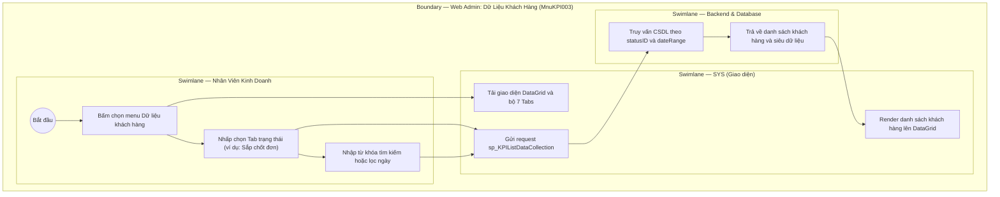

# USER STORY: CRM-US04 · QUẢN LÝ DỮ LIỆU KHÁCH HÀNG & BỘ LỌC 7 TRẠNG THÁI

* **Thuộc Epic**: [`CRM-EPIC-02: Quản lý Khách hàng & Sales Pipeline`](../../../epic/crm/CRM-EPIC-02-Khach-Hang-Sales-Pipeline.md)
* **Mã User Story**: `CRM-US04`
* **Mã Ứng Dụng (App ID)**: `MnuKPI003`
* **Actor chính**: Nhân viên kinh doanh / Trưởng bộ phận CRM
* **API / Stored Procedure ghi nhận**: `sp_KPIListDataCollection`

---

## 1. PRECONDITIONS & TRIGGER
* **Tiền điều kiện (Preconditions)**: Người dùng có quyền truy cập module Khách hàng CRM.
* **Sự kiện kích hoạt (Trigger)**: Bấm chọn menu **"Dữ liệu khách hàng"** (`MnuKPI003`) trên thanh bên.

---

## 2. MAIN FLOW & BUSINESS RULES
1. SYS hiển thị thanh lọc trạng thái gồm 7 tab:
   - `Lead` (Khách hàng tiềm năng mới tiếp nhận)
   - `Đã liên hệ` (Đã gọi điện/nhắn tin lần đầu)
   - `Đã demo & gửi báo giá` (Đang đánh giá giải pháp phần mềm)
   - `Cần chăm sóc` (Cần bám sát xử lý phản hồi)
   - `Sắp chốt đơn` (Đang đàm phán hợp đồng)
   - `Thành công` (Đã ký hợp đồng/mua dịch vụ)
   - `Thất bại` (Khách từ chối, lưu lý do hủy)
2. Người dùng nhấp vào từng tab, SYS gọi API `sp_KPIListDataCollection` kèm tham số trạng thái tương ứng để nạp danh sách khách hàng lên DataGrid.
3. Người dùng có thể lọc thêm theo **Thời gian tạo** (`Hôm nay`, `Tuần này`, `Tháng này`, `Xem tất cả ngày`) hoặc tìm kiếm theo từ khóa.

---

## 3. BẢNG ĐẶC TẢ FIELD-LEVEL 6 CỘT CHUẨN MỰC

| Field / control | Loại UI Control | State | Required | Conditional / dynamic | Source / validation |
| :--- | :--- | :--- | :--- | :--- | :--- |
| **Tabs trạng thái (7 tabs)**| `TabStrip / ButtonGroup`| `ENABLED` | `YES (*)` | Mặc định: Tab "Tất cả" hoặc "Lead" | Gồm: Lead, Đã liên hệ, Demo, Cần chăm sóc, Sắp chốt, Thành công, Thất bại |
| **Lọc thời gian** | `ButtonGroup` | `ENABLED` | `NO` | Hiển thị mặc định | Tùy chọn: `Hôm nay`, `Tuần này`, `Tháng này` |
| **Xem tất cả ngày** | `DatePicker` | `ENABLED` | `NO` | Tùy chọn chọn ngày cụ thể | Định dạng `YYYY-MM-DD` |
| **Tìm kiếm nội dung** | `TextBox (Search)` | `ENABLED` | `NO` | Hiển thị mặc định | Tìm kiếm theo Tên KH, Số điện thoại, Email, Tên công ty |
| **Xem của tôi** | `CheckBox` | `ENABLED` | `NO` | Mặc định: Checked (`on`) | Khi bật: chỉ hiển thị khách hàng được phân công cho user hiện tại |
| **Chọn cột hiển thị** | `Button / Dropdown` | `ENABLED` | `NO` | Hiển thị mặc định | Bật/tắt các cột dữ liệu trên DataGrid theo ý muốn |
| **Nút "+ Thêm mới"** | `Button (Primary)` | `ENABLED` | `NO` | Hiển thị trên thanh toolbar | Mở modal tạo mới hồ sơ khách hàng đầy đủ |
| **Nút "Import"** | `Button` | `ENABLED` | `NO` | Hiển thị mặc định | Nhập khẩu danh sách khách hàng từ file Excel |
| **Nút "Export"** | `Button` | `ENABLED` | `NO` | Hiển thị mặc định | Xuất toàn bộ danh sách đang hiển thị ra file Excel |
| **DataGrid Khách hàng** | `DataGrid` | `READONLY` | `NO` | Tự động phân trang | Các cột: STT, Mã KH, Tên KH, SĐT, Email, Tên công ty, Trạng thái, Người phụ trách, Thao tác |

---

## 4. SƠ ĐỒ UML ACTIVITY DIAGRAM SWIMLANE

