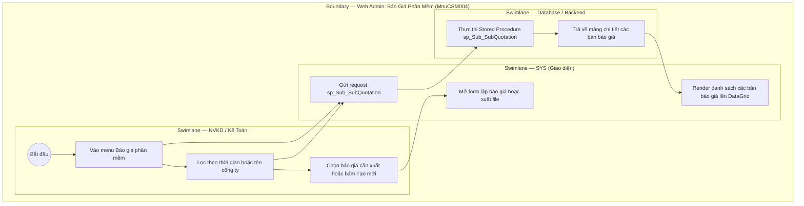

# USER STORY: CRM-US13 · DANH SÁCH BÁO GIÁ PHẦN MỀM

* **Thuộc Epic**: [`CRM-EPIC-05: Quản lý Báo giá & Phân hệ Phần mềm`](../../../epic/crm/CRM-EPIC-05-Bao-Gia-Phan-Mem.md)
* **Mã User Story**: `CRM-US13`
* **Mã Ứng Dụng (App ID)**: `MnuCSM004`
* **Actor chính**: Nhân viên kinh doanh / Kế toán bán hàng
* **API / Stored Procedure**: `sp_Sub_SubQuotation`

---

## 1. PRECONDITIONS & TRIGGER
* **Tiền điều kiện (Preconditions)**: Người dùng có quyền truy cập phân hệ Báo giá.
* **Sự kiện kích hoạt (Trigger)**: Bấm chọn menu **"Báo giá phần mềm"** (`MnuCSM004`) thuộc nhóm Báo giá.

---

## 2. MAIN FLOW & BUSINESS RULES
1. Người dùng bấm chọn menu "Báo giá phần mềm".
2. SYS kích hoạt gọi Stored Procedure `sp_Sub_SubQuotation` để tải danh sách các bản báo giá hiện có.
3. Hiển thị DataGrid với các cột: Số báo giá, Khách hàng/Công ty, Ngày báo giá, Tổng tiền trước thuế, VAT, Tổng tiền thanh toán, Trạng thái (Bản nháp, Đã gửi, Đã chốt).
4. Người dùng có thể bấm vào dòng báo giá để xem chi tiết, bấm nút **"Xuất báo giá"** hoặc bấm **"Tạo báo giá mới"**.

---

## 3. BẢNG ĐẶC TẢ FIELD-LEVEL 6 CỘT CHUẨN MỰC

| Field / control | Loại UI Control | State | Required | Conditional / dynamic | Source / validation |
| :--- | :--- | :--- | :--- | :--- | :--- |
| **Từ ngày - Đến ngày** | `DateRangeBox` | `ENABLED` | `NO` | Hiển thị mặc định | Lọc khoảng thời gian lập báo giá |
| **Khách hàng** | `Dropdown` | `ENABLED` | `NO` | Lọc theo công ty | Danh mục nạp từ danh sách công ty CRM |
| **Trạng thái báo giá** | `Dropdown` | `ENABLED` | `NO` | Hiển thị mặc định | Tùy chọn: `Tất cả`, `Bản nháp`, `Đã gửi KH`, `Đã ký hợp đồng` |
| **Nút "Tạo báo giá mới"**| `Button (Primary)` | `ENABLED` | `NO` | Hiển thị trên thanh toolbar | Điều hướng sang màn hình `MnuCSM005` để lập báo giá |
| **Nút "Xuất Excel"** | `Button` | `ENABLED` | `NO` | Hiển thị mặc định | Xuất file danh sách báo giá |
| **Nút "Xóa báo giá"** | `Button (Danger)` | `DISABLED` | `NO` | Chỉ sáng khi chọn 1 bản nháp | Hiển thị hộp thoại xác nhận xóa |
| **DataGrid Báo giá** | `DataGrid` | `READONLY` | `NO` | Nạp từ `sp_Sub_SubQuotation` | Cột: Số BG, Tên khách hàng, Ngày lập, Người lập, Tổng giá trị, Trạng thái |

---

## 4. SƠ ĐỒ UML ACTIVITY DIAGRAM SWIMLANE

