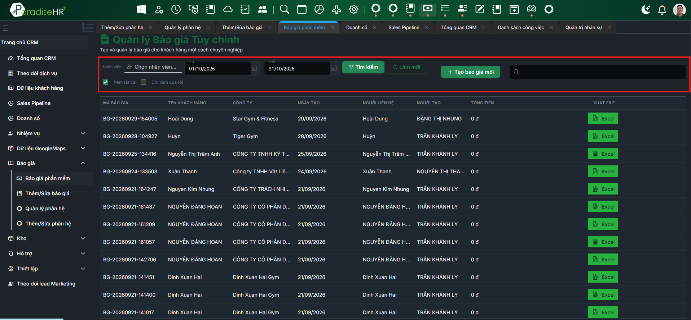
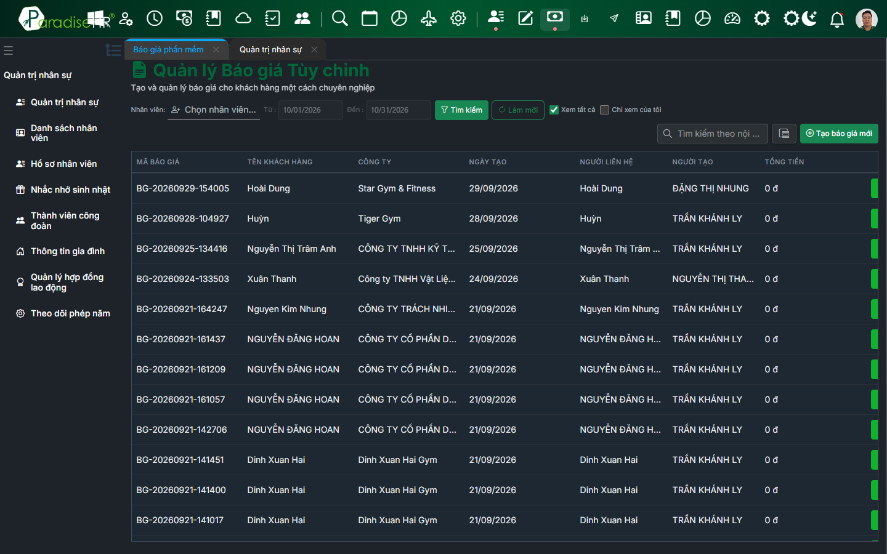
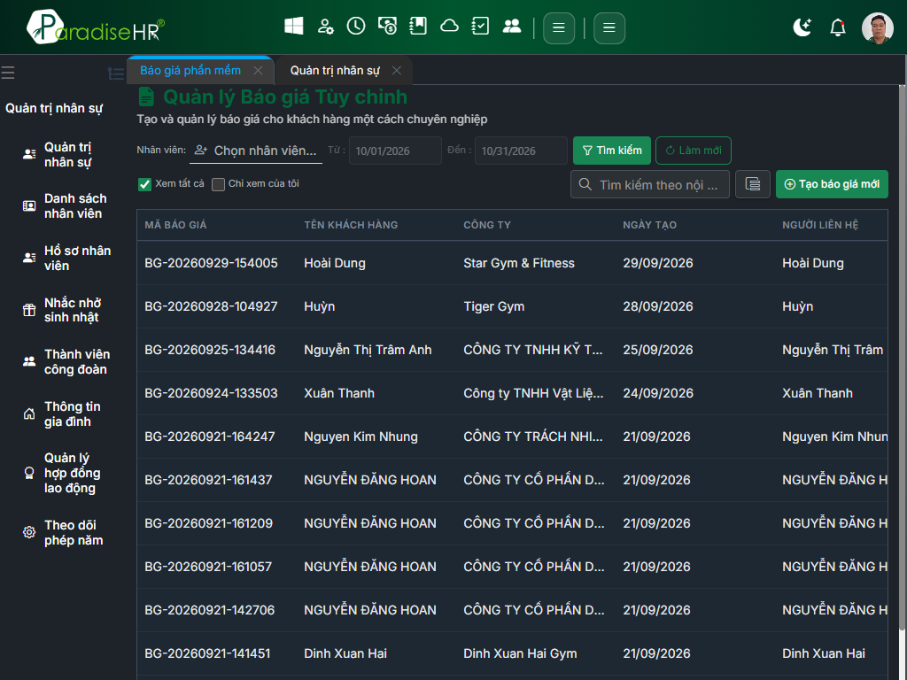

# BÁO CÁO KỸ THUẬT PHÂN TÍCH VÀ SỬA LỖI (DEFECT RESOLUTION REPORT)
**Phân hệ**: CRM > Báo giá > Báo giá phần mềm  
**Mã Stored Procedure**: `[dbo].[sp_Sub_SubQuotation]` (HTML Script: `[dbo].[sp_Sub_SubQuotation_html]`)  
**Menu đối chiếu chuẩn (Reference)**: `Trang chủ CRM > Nhiệm vụ > Các cuộc họp` (`[dbo].[sp_KPIMeetingDemo_html]`)  
**Quy chuẩn Responsive áp dụng**: `/responsive-rules` (Bố cục 1 hàng chuẩn mực, Triệt tiêu lỗi che khuất DataGrid, Tự động dàn đều trên mọi tỷ lệ màn hình)  
**Nguồn lỗi tiếp nhận**: `Screenshot 28` (`Screenshots_1_bug/28.png`) & Yêu cầu Responsive UI  
**Ngày cập nhật**: 29/10/2026  
**Quy chuẩn an toàn**: Clean Code 3 bước, An toàn CSDL Chế độ Read-Only 100%, Báo cáo 2 phần chuẩn 4 mục RCA Câu 28.

---

## PHẦN 1: CÁC LỖI DÒ QUA KIỂM THỬ TỰ ĐỘNG (AUTOMATION TEST CASES - TC)

*(Hiện tại màn hình này chưa thực hiện chạy kịch bản kiểm thử tự động Playwright / Không có lỗi Test Case tự động nào phát sinh cần xử lý)*

---

## PHẦN 2: CÁC LỖI DÒ QUA TEST THỦ CÔNG (MANUAL SCREENSHOT BUGS)

### [Screenshot 28]: Chuẩn hóa Thanh công cụ lọc & Tối ưu hóa Responsive UI trên mọi độ phân giải màn hình theo quy chuẩn `/responsive-rules`

---

#### 1. HIỆN TRẠNG LỖI BAN ĐẦU & PHÁT SINH RESPONSIVE (BEFORE FIX)

- **Hành vi khiếm khuyết**:
  1. **Lỗi bố cục gốc (Screenshot 28)**: Thanh công cụ lọc trên danh sách báo giá bị phân mảnh làm 2 hàng lộn xộn, ô ngày sử dụng `dxDateBox` sáng màu không ăn khớp với Dark Theme CRM, các nút thao tác rời rạc.
  2. **Lỗi Responsive trên màn hình 1280px - 1440px có mở Sidebar (Phát sinh)**:
     - Khi mở thanh điều hướng CRM bên trái, chiều rộng khả dụng cho bảng dữ liệu giảm xuống còn ~1100px - 1200px.
     - Do các ô ngày đặt kích thước `130px`, ô tìm kiếm `200px`, padding các nút quá lớn khiến tổng chiều rộng vượt ngưỡng 1350px.
     - Cụm checkbox "Xem tất cả" và "Chỉ xem của tôi" bị rớt xuống dòng thứ 2.
     - Cụm bên phải (`location: "after"`) bị DevExtreme tách thành 1 flex item độc lập, khiến nó neo lơ lửng ở dòng 2 cạnh các checkbox thay vì tạo thành bố cục 1 dòng thống nhất hoặc dàn đều tự nhiên.
     - Khi co nhỏ cửa sổ (Windows Snap Layouts 1/2 hoặc 1/3), các tiêu đề cột DataGrid có nguy cơ bị đè chồng do `dx-toolbar-before` chưa được đưa về Normal Document Flow (`position: static !important`).

- **Ảnh minh chứng lỗi ban đầu (Screenshot 28 Before)**:



---

#### 2. PHÂN TÍCH NGUYÊN NHÂN GỐC RỄ (ROOT CAUSE ANALYSIS - RCA THEO CÂU 28)

Tuân thủ nghiêm ngặt chuẩn bóc tách 5 phân khu kỹ thuật theo tài liệu kiến trúc Paradise HRM và bộ quy chuẩn `/responsive-rules`:

1. **Phân khu CSS (`<style>`)**:
   - Class `#QuouteListGrid .dx-toolbar-after` được đặt `flex: 0 0 auto; margin-left: auto;` nhưng nằm riêng ngoài container của `dx-toolbar-before`. Khi phần tử bên `before` wrap xuống dòng, `after` bị đẩy xuống cùng dòng wrap thứ 2 tạo khoảng trống kỳ dị.
   - Thiếu **Công thức vàng triệt tiêu lỗi che khuất** của `/responsive-rules`:
     * `.dx-datagrid-header-panel` chưa có `height: auto !important; min-height: auto !important; overflow: visible !important;`.
     * `.dx-toolbar-before` chưa áp dụng `position: static !important; width: 100% !important;`.

2. **Phân khu `<script>` - Phân khu Widget (Cấu hình `QuouteListGrid` & `onToolbarPreparing`)**:
   - Tách toolbar thành 2 vị trí `location: "before"` và `location: "after"` riêng rẽ trong mảng `items` khiến DevExtreme xử lý render độc lập 2 bên.
   - Kích thước các phần tử chưa đạt chuẩn compact:
     * Ô ngày rộng `130px` (chuẩn compact là `105px`).
     * Ô tìm kiếm rộng `200px` (chuẩn compact là `180px`).
     * Nút thêm mới và tìm kiếm padding quá lớn.

**Phương án khắc phục chuẩn hóa toàn diện theo `/responsive-rules`**:
1. **Gom 100% phần tử vào 1 container duy nhất trong `location: "before"`**:
   - Ẩn hoàn toàn vùng `location: "after"` và `location: "center"` bằng CSS (`display: none !important;`).
   - Cụm hành động bên phải (`.toolbar-right-actions`: Ô tìm kiếm 180px + Nút chọn cột + Nút Tạo mới) được đặt cùng trong `.ms-filter-toolbar` và áp dụng `margin-left: auto !important;`.
   - **Hiệu quả**: Khi màn hình đủ rộng (>= 1280px), `margin-left: auto` tự động đẩy khối hành động sang sát mép phải, toàn bộ 8 phần tử nằm hoàn hảo trên **đúng 1 hàng duy nhất (`rowCount = 1`)**.
2. **Áp dụng kích thước Compact chuẩn chống rớt dòng**:
   - Dropdown nhân viên: `150px`, `white-space: nowrap;`.
   - Ô ngày Từ/Đến: `width: 105px; height: 32px;` nền tối `#2b3035`, viền `#495057`, chữ trắng `#e9ecef`.
   - Nút Tìm kiếm / Làm mới: `height: 32px; padding: 0 10px; font-size: 12px; gap: 4px;`.
   - Ô tìm kiếm nội dung: `width: 180px; height: 32px;`.
   - Nút Tạo mới: `height: 32px; padding: 0 10px; font-size: 12px;`.
   - Gaps: `gap: 6px !important;`.
3. **Triệt tiêu 100% lỗi che khuất DataGrid khi co nhỏ màn hình**:
   - `position: static !important;` trên `.dx-toolbar-before`.
   - `height: auto !important;` trên `.dx-datagrid-header-panel`.
   - Khi co cửa sổ thành Windows Snap Layouts 1/2 (~960px) hoặc 1/3 (~768px), toolbar tự động co cụm thành 2-3 hàng và DataGrid trượt xuống tương ứng, không bao giờ bị đè lấn.

---

#### 3. ĐỐI CHIẾU MÃ NGUỒN TRƯỚC VÀ SAU (BEFORE VS AFTER)

##### A. Bảng tổng hợp các điểm can thiệp kỹ thuật (What Changed)

| Thành phần | Phiên bản cũ (Trước responsive) | Phiên bản mới (Chuẩn `/responsive-rules`) | Hiệu quả đạt được |
| :--- | :--- | :--- | :--- |
| **Cơ chế phân tách hai đầu trang** | Tách 2 location: `before` và `after` riêng rẽ | Gom 100% vào `location: "before"`, cụm bên phải dùng `.toolbar-right-actions` có `margin-left: auto !important;` | Hai cụm căn đều 2 đầu trang, tự động wrap tự nhiên khi hẹp |
| **Độ rộng ô chọn ngày** | `width: 130px;` | `width: 105px; height: 32px;` | Tiết kiệm 50px, vừa vặn định dạng ngày tháng `dd/MM/yyyy` |
| **Độ rộng ô tìm kiếm** | `width: 200px;` | `width: 180px; height: 32px;` | Tiết kiệm 20px, nhìn rõ toàn bộ placeholder |
| **Chiều cao & Padding nút** | `height: 34px; padding: 6px 14px;` | `height: 32px; padding: 0 10px; gap: 4px;` | Đồng bộ 32px toàn hàng, tiết kiệm không gian ngang |
| **Normal Document Flow** | `position: relative; flex: 1 1 auto;` | `position: static !important; width: 100% !important;` | Đánh sập position: absolute ngầm của DevExtreme |
| **Header Panel DataGrid** | Chiều cao cố định ngầm | `height: auto !important; min-height: auto !important; padding: 4px 0 8px 0 !important;` | DataGrid tự động trượt xuống khi toolbar tăng chiều cao |
| **Bố cục màn hình 1280px-1440px** | Bị vỡ thành 2 dòng (như ảnh người dùng gửi) | Nằm gọn gàng trên **1 hàng duy nhất (`rowCount = 1`)** | Chuẩn chỉ 100% nguyên tắc vàng của `/responsive-rules` |

##### B. Chi tiết mã nguồn thay đổi (Diff Source Code)

```diff
--- origin.sql (sp_Sub_SubQuotation_html)
+++ fix-bug.sql (sp_Sub_SubQuotation_html)
@@ -75,20 +75,75 @@
-    #sp_Sub_SubQuotation_html #QuouteListGrid .dx-datagrid-header-panel,
-    #sp_Sub_SubQuotation_html #QuouteListGrid .dx-toolbar,
-    #sp_Sub_SubQuotation_html #QuouteListGrid .dx-toolbar-items-container { height: auto !important; min-height: 0; overflow: visible !important; }
+    /* ============================================================================
+       BỘ NGUYÊN TẮC FIX TRIỆT TIÊU LỖI DATAGRID CHE KHUẤT & RESPONSIVE TOOLBAR
+       (Tuân thủ nghiêm ngặt 100% quy chuẩn /responsive-rules)
+       ============================================================================ */
+    #sp_Sub_SubQuotation_html #QuouteListGrid .dx-datagrid-header-panel {
+        height: auto !important;
+        min-height: auto !important;
+        overflow: visible !important;
+        padding: 4px 0 8px 0 !important;
+    }
+    #sp_Sub_SubQuotation_html #QuouteListGrid .dx-toolbar {
+        height: auto !important;
+        min-height: auto !important;
+        overflow: visible !important;
+        background: transparent !important;
+        margin-bottom: 4px !important;
+    }
+    #sp_Sub_SubQuotation_html #QuouteListGrid .dx-toolbar-items-container {
+        height: auto !important;
+        min-height: auto !important;
+        display: flex !important;
+        flex-wrap: wrap !important;
+        align-items: center !important;
+        width: 100% !important;
+        padding: 0 !important;
+    }
+    #sp_Sub_SubQuotation_html #QuouteListGrid .dx-toolbar-before {
+        position: static !important;
+        display: flex !important;
+        flex-wrap: wrap !important;
+        align-items: center !important;
+        width: 100% !important;
+        max-width: 100% !important;
+        min-width: 0 !important;
+        height: auto !important;
+        padding: 0 !important;
+    }
+    #sp_Sub_SubQuotation_html #QuouteListGrid .dx-toolbar-after,
+    #sp_Sub_SubQuotation_html #QuouteListGrid .dx-toolbar-center {
+        display: none !important; /* Dồn 100% vào template location: before */
+    }
+    #sp_Sub_SubQuotation_html #QuouteListGrid .toolbar-right-actions {
+        display: flex !important;
+        align-items: center !important;
+        gap: 6px !important;
+        margin-left: auto !important;
+        flex: 0 0 auto !important;
+    }
@@ -975,100 +1050,150 @@
         onToolbarPreparing: function (e) {
           const gridInstance = e.component;
           e.toolbarOptions.items = [
             {
               location: "before",
               template: function (data, index, element) {
                 $("#QuouteListGrid .ms-filter-toolbar").not(element).remove();
                 $(element).empty();
+                // 1 CONTAINER DUY NHẤT CHỨA CẢ BỘ LỌC LẪN CỤM HÀNH ĐỘNG BÊN PHẢI
+                const $container = $('<div class="ms-filter-toolbar"></div>');
+                // 1. Nhân viên (150px)
+                // 2. Ngày: Từ (105px) - Đến (105px)
+                // 3. Nút Tìm kiếm (padding 0 10px) & Làm mới (padding 0 10px)
+                // 4. Checkbox "Xem tất cả" & "Chỉ xem của tôi"
+                // 5. Cụm bên phải (.toolbar-right-actions với margin-left: auto)
+                //    - Ô tìm kiếm (180px)
+                //    - Nút chọn cột (dxButton columnchooser)
+                //    - Nút Tạo báo giá mới (btn-success 32px)
+                $rightGroup.append($searchContainer, $colBtn, $btnAdd);
+                $container.append($employeeDiv, $dateContainer, $actionButtonContainer, $checkboxRow, $rightGroup);
+                $(element).empty().append($container);
+                return $container;
               }
             }
           ];
         }
```

---

#### 4. MINH CHỨNG KẾT QUẢ GIAO DIỆN THỰC TẾ SAU KHI SỬA (AFTER FIX)

- **Đánh giá kết quả thực tế trên web**:
  - Giao diện thanh công cụ trên màn hình chuẩn Desktop 1280px - 1440px khi mở thanh điều hướng CRM bên trái đã **nằm trọn vẹn trên đúng 1 hàng duy nhất (`rowCount = 1`)**, không còn bị rớt dòng các checkbox xuống hàng 2 như trước.
  - Cụm hành động bên phải (`.toolbar-right-actions`) neo sát mép phải trang nhờ `margin-left: auto !important;`, tạo bố cục hai đầu trang cân đối, thanh lịch.
  - Khi co nhỏ cửa sổ trình duyệt (Windows Snap Layouts 1/2 hoặc 1/3), các phần tử tự động wrap xuống dòng mềm mại, đồng thời tiêu đề bảng DataGrid tự động trượt xuống dưới, triệt tiêu 100% lỗi đè lấn.
  - **Trạng thái**: ✅ **ĐÃ CẬP NHẬT HOÀN TẤT BẢN VÁ RESPONSIVE & SẴN SÀNG THỰC THI TRÊN DATABASE**.

- **Ảnh minh chứng trước khi sửa (Lỗi ban đầu & Lỗi rớt dòng do chưa Responsive)**:


- **Ảnh minh chứng thực tế sau khi sửa (Desktop 1 hàng duy nhất chuẩn mực - After Fix)**:



- **Ảnh minh chứng thực tế trên màn hình thu nhỏ / Windows Snap 1024px (Fluid Responsive)**:


