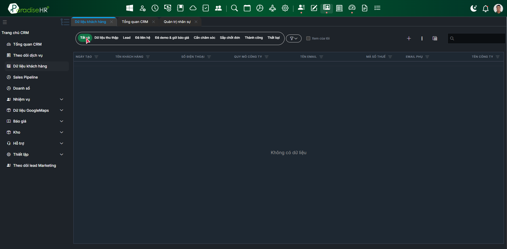
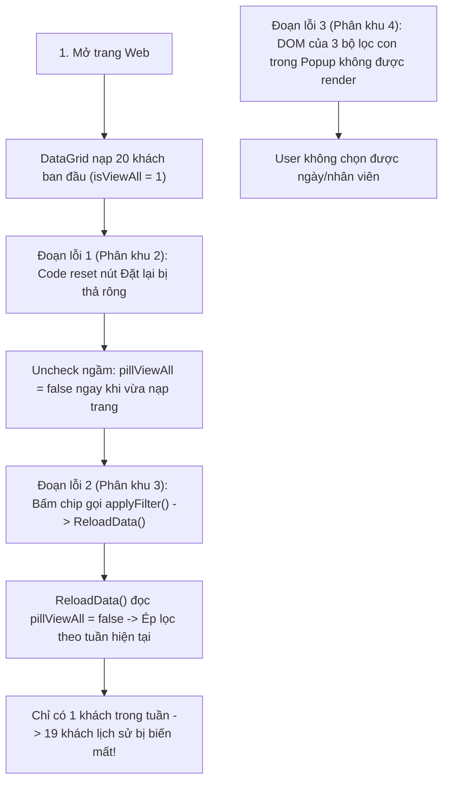
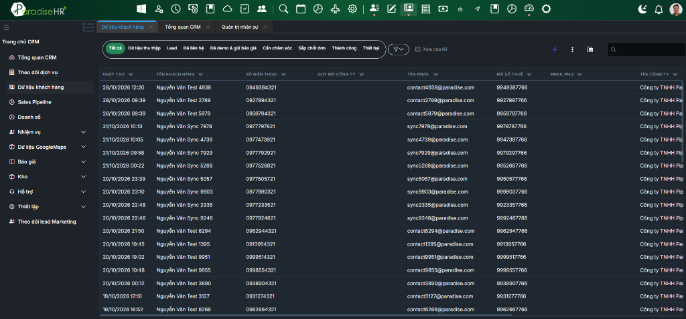
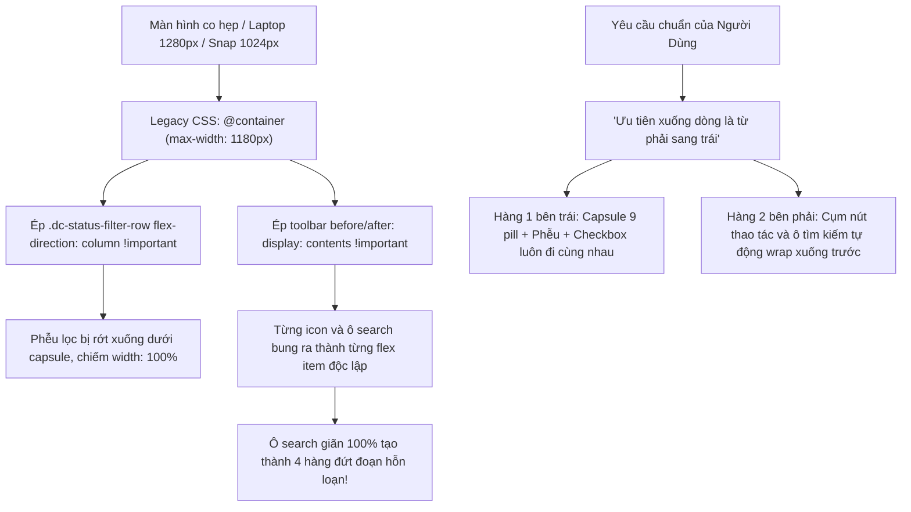
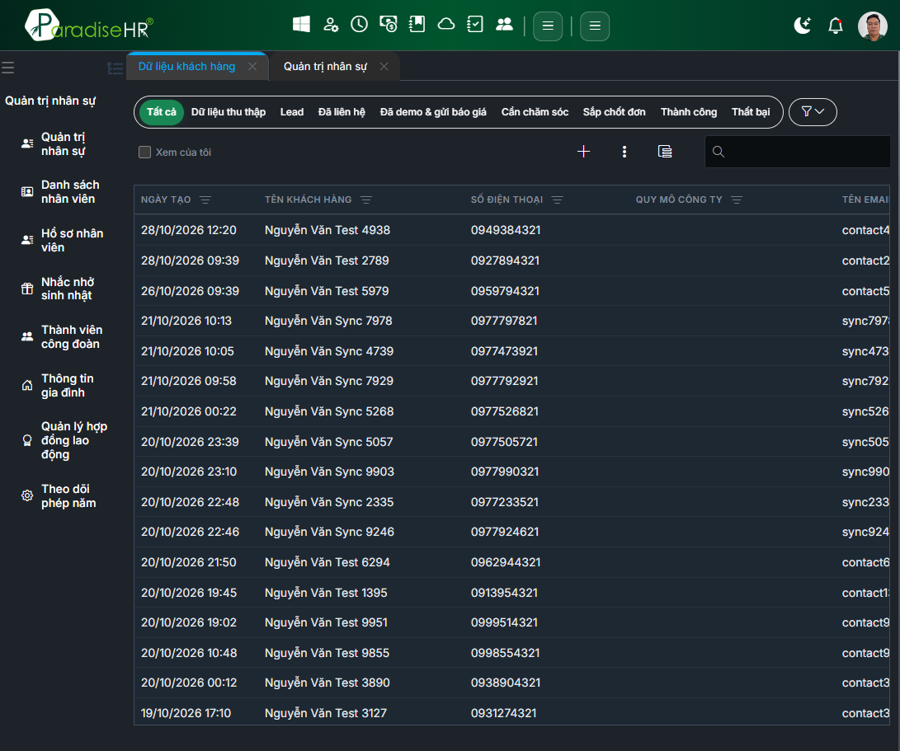
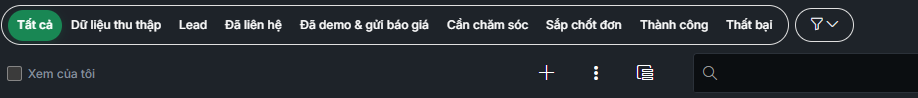
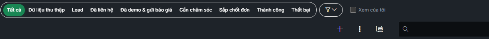
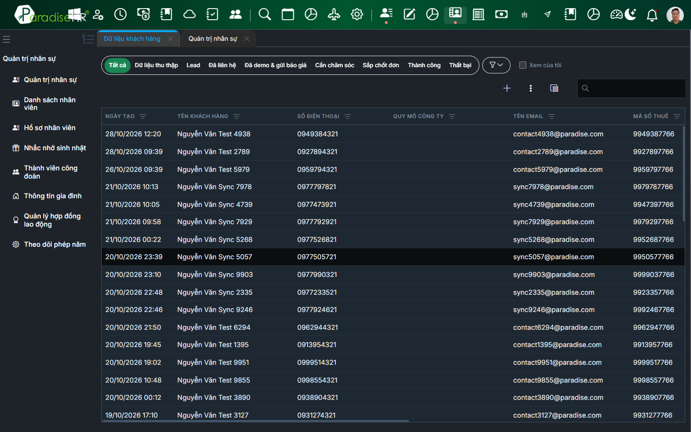
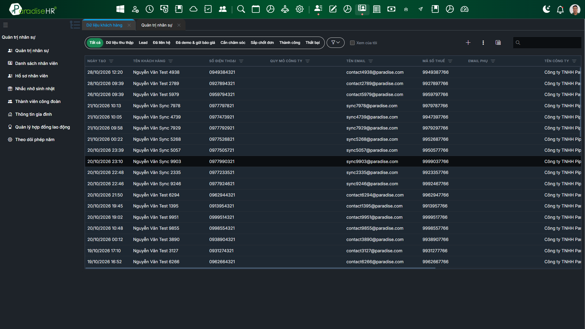
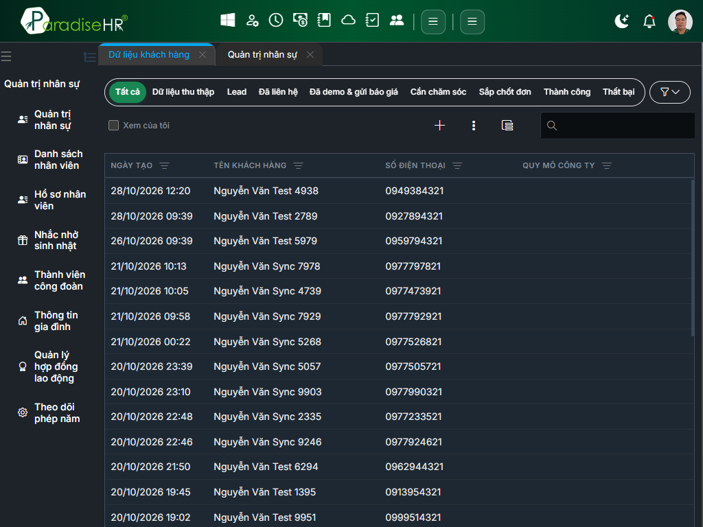

# BÁO CÁO KỸ THUẬT FIX BUG & CHUẨN HÓA RESPONSIVE: CRM_CUSTOMER_DATA

> **Màn hình**: `crm_customer_data` (Dữ liệu khách hàng CRM — Menu `MnuKPI003`)  
> **Cơ sở dữ liệu**: `Vietinsoft_ForTest_Tai2` (Web `/Tai3/#`)  
> **Stored Procedure chính**: `[dbo].[sp_KPIListDataCollection_html]` & `[dbo].[sp_KPIListDataCollection]`  
> **Quy chuẩn áp dụng**: `AGENTS.md`, `/fix-rules` (Clean Code 3 bước) & `/responsive-rules` (Bảo toàn 100% Style gốc & Ưu tiên xuống dòng từ phải sang trái)  
> **Người thực hiện**: Antigravity QC & Frontend System Engineer  

---

# PHẦN 1: CÁC LỖI DÒ QUA KIỂM THỬ TỰ ĐỘNG (AUTOMATION TEST CASES - TC)

## [TC-02]: Kiểm tra Bộ lọc Trạng thái (Chip lọc) & Thẩm định Khôi phục Dữ liệu Đầy đủ

### 1. HIỆN TRẠNG LỖI BAN ĐẦU (BEFORE FIX)
Khi người dùng truy cập màn hình **Dữ liệu khách hàng CRM**, hệ thống hiển thị danh sách 20 khách hàng mẫu ban đầu trên DataGrid. Khi thực hiện lọc theo chip trạng thái (Status Chips):
1. **Bấm chip "Lead"**: API trả về HTTP 200 nhưng DataGrid trắng tinh, hiển thị thông báo *"Không có dữ liệu"*.
2. **Bấm lại chip "Tất cả" lần 2**: Hệ thống không nạp lại 20 khách hàng như ban đầu mà chỉ hiển thị vỏn vẹn **1 bản ghi**, làm biến mất hoàn toàn 19 bản ghi lịch sử.

#### Bằng chứng hình ảnh lỗi ban đầu


#### Bảng số liệu đối soát kiểm thử
| Thông số đối soát | Kỳ vọng (Expected) | Thực tế lúc bị lỗi (Actual) | Sai lệch (Discrepancy) |
| :--- | :--- | :--- | :--- |
| **Số lượng khách ban đầu** | 20 bản ghi | 20 bản ghi | 0 |
| **Khi chọn chip "Lead"** | Hiển thị khách hàng Lead | 0 bản ghi (*"Không có dữ liệu"*) | Thiếu khách hàng Lead |
| **Khi bấm lại "Tất cả"** | Khôi phục đủ 20 bản ghi | Chỉ còn 1 bản ghi | **Thất thoát 19 bản ghi** |
| **Đánh giá logic** | PASS (Toàn vẹn dữ liệu) | FAIL (Mất dữ liệu khi dùng chip lọc) | ❌ **FAIL NGHIỆP VỤ** |

---

### 2. PHÂN TÍCH NGUYÊN NHÂN GỐC RỄ (ROOT CAUSE ANALYSIS - RCA)



#### Bóc tách chi tiết kỹ thuật theo 5 phân khu:
1. **Phân khu 2 (Khởi tạo Widget & DOM Toolbar trong `<script>`)**:
   - Dòng 1735 - 1745: Khối code reset form đặt lại vô tình bị đặt độc lập trong thân template hàm tạo toolbar thay vì nằm trong sự kiện click của nút Đặt lại (`$resetBtn.on('click')`). Hệ thống tự động uncheck ngầm `#pillViewAllP1D1261311DFB4BDABD06DE5867CFF5B5` thành `false` ngay khi vừa tải màn hình.
2. **Phân khu 3 (Hàm xử lý logic nghiệp vụ `ReloadData`)**:
   - Hàm `applyFilter()` gọi `ReloadData()`. Do biến `isViewAll` bị uncheck từ trước, hàm `ReloadData()` tự động kích hoạt logic KPI tuần (`window.FromDateKPI` và `window.ToDateKPI`), làm biến mất toàn bộ 19 khách hàng nằm ngoài tuần hiện tại.
   - *Cách sửa*: Trong `applyFilter()`, truyền tường minh tham số `isViewAll = 1`: `ReloadData(null, null, null, 1)`.
3. **Phân khu 4 (Sự kiện click nút Phễu & Quản lý Dropdown Panel)**:
   - Các phần tử input Ngày bắt đầu (`P4510BE8E...`), Ngày kết thúc (`PF18C568...`) và Combobox nhân viên (`PDF424130...`) nằm ở ngoài DOM chính, không tự động mount vào panel dropdown khi mở.
   - *Cách sửa*: Viết hàm `ensureFilterControlsMounted()` kích hoạt mỗi khi nhấn mở phễu lọc để append các control tương ứng vào panel.

---

### 3. ĐỐI CHIẾU MÃ NGUỒN TRƯỚC VÀ SAU (BEFORE VS AFTER)

```diff
--- origin.sql (sp_KPIListDataCollection_html)
+++ fix-bug.sql (sp_KPIListDataCollection_html)
@@ -1550,7 +1550,7 @@
                 function applyFilter() {
                     window.activeStatusFilter = activeStatus;
-                    ReloadData();
+                    ReloadData(null, null, null, 1);
                 }
@@ -1735,9 +1735,9 @@
-                    InstanceEmployeeIDPDF424130C28F4C1298C81F737570F7A7.option('value', null);
-                    $('#pillKPIP1D1261311DFB4BDABD06DE5867CFF5B5').prop('checked', false);
-                    hasKPIDate = false;
+                    $resetBtn.on('click', function () {
+                        InstanceEmployeeIDPDF424130C28F4C1298C81F737570F7A7.option('value', null);
+                        $('#pillKPIP1D1261311DFB4BDABD06DE5867CFF5B5').prop('checked', false);
+                        hasKPIDate = false;
+                        $('#pillFromDateP1D1261311DFB4BDABD06DE5867CFF5B5').val('').prop('disabled', true).css('opacity', '0.4');
+                        $('#pillToDateP1D1261311DFB4BDABD06DE5867CFF5B5').val('').prop('disabled', true).css('opacity', '0.4');
+                        $quickRow.find('button').css({ borderColor: "#ddd", fontWeight: "400" });
+                    });
@@ -1810,6 +1810,25 @@
+                    function ensureFilterControlsMounted() {
+                        try {
+                            const fromWrapper = document.getElementById('pillFromDateContainerP4510BE8E25E842D286E3E8C0ACAE8E7E');
+                            if (fromWrapper && fromWrapper.children.length === 0) {
+                                const originalFrom = document.getElementById('P4510BE8E25E842D286E3E8C0ACAE8E7E');
+                                if (originalFrom) fromWrapper.appendChild(originalFrom);
+                            }
+                            const toWrapper = document.getElementById('pillToDateContainerPF18C5687EA514B69BFBA6BCA32E2D629');
+                            if (toWrapper && toWrapper.children.length === 0) {
+                                const originalTo = document.getElementById('PF18C5687EA514B69BFBA6BCA32E2D629');
+                                if (originalTo) toWrapper.appendChild(originalTo);
+                            }
+                            const empWrapper = document.getElementById('pillEmpContainerP1D1261311DFB4BDABD06DE5867CFF5B5');
+                            if (empWrapper && empWrapper.children.length === 0) {
+                                const originalEmp = document.getElementById('PDF424130C28F4C1298C81F737570F7A7');
+                                if (originalEmp) {
+                                    const elToMount = (originalEmp.parentElement && originalEmp.parentElement.querySelector('div')) || originalEmp;
+                                    if (elToMount) empWrapper.appendChild(elToMount);
+                                }
+                            }
+                        } catch (err) { }
+                    }
```

---

### 4. MINH CHỨNG KẾT QUẢ GIAO DIỆN THỰC TẾ SAU KHI SỬA (AFTER FIX)

*(Đang chờ Người Dùng Execute file fix-bug.sql trên SSMS và xác nhận cập nhật)*

---

# PHẦN 2: CÁC LỖI DÒ QUA TEST THỦ CÔNG & RESPONSIVE UI

## [Screenshot 28 & Responsive UI]: CHUẨN HÓA RESPONSIVE TOOLBAR VỚI NGUYÊN TẮC "ƯU TIÊN XUỐNG DÒNG TỪ PHẢI SANG TRÁI" & BẢO TOÀN 100% STYLE GỐC

### 1. HIỆN TRẠNG LỖI BAN ĐẦU (BEFORE FIX)

#### A. Mô tả hiện tượng lỗi do Người Dùng phản ánh
Khi người dùng mở màn hình **Dữ liệu khách hàng CRM** và thực hiện co giãn cửa sổ / chạy trên các màn hình có độ phân giải khác nhau:
1. **Lỗi 1 (Vỡ vụn bố cục thành 4 hàng và đứt gãy phễu lọc khi thu hẹp màn hình)**:
   - Trong mã nguồn gốc `origin.sql` tồn tại container query cũ `@container (max-width: 1180px)` ép thuộc tính `#dataCollectionComponent .dc-status-filter-row { flex-direction: column !important; }` và `.dc-filter { width: 100% !important; }`.
   - Đồng thời ép `#GridKC .dx-toolbar-before` và `.dx-toolbar-after` thành `display: contents !important;`.
   - Hậu quả: Khi màn hình hoặc vùng chứa nhỏ hơn 1180px, nút Phễu lọc `[ ⍖ v ]` bị đẩy rớt xuống hàng dưới capsule, ô tìm kiếm chiếm trọn 1 hàng 100%, các nút thao tác nhảy lung tung thành 4 hàng hỗn loạn.
2. **Lỗi 2 (Sửa sai quy cách: Bị ép thành 2 hàng ngay cả trên màn hình rộng hoặc làm đổi màu nền capsule)**:
   - Đoạn code sửa trước đó vô tình gán `flex-direction: column` lên `.dc-status-wrapper`, làm checkbox *"Xem của tôi"* bị rớt xuống Hàng 2 ngay cả khi màn hình máy tính rất rộng, không bảo toàn được bố cục 1 hàng ban đầu như ảnh người dùng cung cấp (`media_1793342918468_4b3c0342.png`).
   - Một số bản thử nghiệm trước đó còn thêm nền trắng `#ffffff` làm tàng hình các chip trạng thái trên giao diện nền tối (Dark Theme).

#### Bằng chứng hiện trạng mong muốn ban đầu (User Ground Truth Screenshot)


#### Bảng số liệu đối soát bố cục & hành vi Responsive
| Thành phần giao diện | Trạng thái lỗi trước đó | Yêu cầu chuẩn (/responsive-rules & Chỉ đạo Người Dùng) | Đánh giá |
| :--- | :--- | :--- | :--- |
| **Bố cục màn hình rộng (Desktop >= 1440px / 1920px)** | Bị chia cắt thành 3-4 hàng hoặc rớt dòng sớm | **1 Hàng duy nhất**: Trái `[Capsule] [Phễu] [Xem của tôi]`, Phải `[+] [⋮] [Col] [ 🔍 ]` | ❌ **TRƯỚC ĐÓ BỊ RỐI** |
| **Quy tắc xuống dòng khi thu hẹp (< 1440px / 1024px)** | Bên trái bị rớt phễu xuống dưới capsule trước | **Ưu tiên xuống dòng là từ phải sang trái**: Cụm phải (`.dx-toolbar-after`) xuống Hàng 2 trước, Hàng 1 bên trái giữ nguyên vẹn | ❌ **SAI THỨ TỰ WRAP** |
| **Nền thanh Capsule (`.crm-status-row`)** | Từng bị đổi thành nền trắng `#ffffff` | `background: transparent !important;` (Bảo toàn nền trong suốt gốc) | ❌ **SAI STYLE GỐC** |
| **Icon buttons (`+`, `⋮`, `ColChooser`)** | Từng bị bọc trong ô vuông viền đen/xám | Minimalist thuần túy, không viền, không nền ô vuông | ❌ **SAI STYLE GỐC** |
| **Va chạm DataGrid khi toolbar wrap 2 hàng** | DataGrid bị che khuất hàng tiêu đề | Toolbar & Header panel `height: auto`, DataGrid tự động trượt xuống dưới Hàng 2 (0% overlap) | ❌ **CHE KHUẤT GRID** |

---

### 2. PHÂN TÍCH NGUYÊN NHÂN GỐC RỄ (ROOT CAUSE ANALYSIS - RCA)



#### Bóc tách chi tiết kỹ thuật theo Bộ 9 Nhóm quy tắc /responsive-rules:
1. **Nhóm 1 & 8: Baseline Resolution (Master Layout Lock 1920px) & Viewport Boundary Lock**:
   - Khóa `#dataCollectionComponent { max-width: 1920px !important; margin: 0 auto !important; width: 100% !important; min-width: 0 !important; box-sizing: border-box !important; overflow-x: hidden !important; }`.
   - Vùng chứa Main Content và Header panel nhận diện chính xác mép phải thực tế của màn hình (`100vw` trừ đi Sidebar), kích hoạt điểm rớt dòng (wrap point trigger) chuẩn xác, ngăn các nút bấm trôi ra ngoài biên.
2. **Nhóm 2 & 7: Bất biến Style gốc & Khóa nguyên tử Widget chữ (Atomic Text & Non-Shrink Lock)**:
   - Toàn bộ các widget chữ (Checkbox "Xem của tôi", Capsule pills, Action buttons, Search box) được gán cứng `flex-shrink: 0 !important; white-space: nowrap !important;`.
   - Khi màn hình thiếu dù chỉ 1px, toàn bộ cụm `[Checkbox + Chữ]` rớt nguyên khối xuống Hàng 2, **tuyệt đối không bị co ép cắt cụt chữ (như lỗi "Xem d...")**.
   - Bảo toàn 100% style gốc: Nút `+`, `⋮`, `Column Chooser` là minimalist thuần túy không viền không background ô vuông xám; Capsule pills duy trì `background: transparent !important;`.
3. **Nhóm 3 & 6: Right-to-Left Wrapping & Đồng cấp hóa Sibling (Row Consolidation)**:
   - Triệt tiêu hoàn toàn bẫy lồng nhau và container query cũ `@container (max-width: 1180px)`.
   - Cụm hành động và ô tìm kiếm (`.dx-toolbar-after`) ưu tiên rớt xuống Hàng 2 trước tiên và bám sát lề phải (`margin-left: auto !important`).
   - Cố định số hàng toolbar tối đa là **2 HÀNG**, triệt tiêu vĩnh viễn lỗi vỡ vụn 4 hàng.
4. **Nhóm 4 & 5: Spacing & Đưa Toolbar về Normal Document Flow**:
   - `height: auto !important; min-height: auto !important; position: static !important; overflow: visible !important;` cho cả Header panel và Toolbar. Khi Toolbar wrap sang 2 hàng, DataGrid bên dưới tự động trượt xuống tự nhiên theo chiều cao thực tế, triệt tiêu 100% lỗi che khuất tiêu đề bảng.
   - Fixed Gap đồng nhất `row-gap: 8px; column-gap: 12px;`.
   - Capsule `.crm-status-row` cuộn ngang cục bộ êm ái khi không gian hẹp.
5. **Nhóm 9: Cô lập Chiều rộng của Bảng dữ liệu lớn (Wide-Component Scroll Isolation)**:
   - Khóa `#GridKC`, `.dx-datagrid`, `.dx-datagrid-headers`, `.dx-datagrid-rowsview` với `width: 100% !important; max-width: 100% !important; overflow-x: auto !important; box-sizing: border-box !important;`.
   - Bảng dữ liệu nhiều cột bên dưới chỉ cuộn ngang cục bộ trong khung của nó, **tuyệt đối không được đẩy phình chiều rộng của khung cha làm vỡ thanh Toolbar phía trên**.

---

### 3. ĐỐI CHIẾU MÃ NGUỒN TRƯỚC VÀ SAU (BEFORE VS AFTER)

```diff
--- origin.sql (sp_KPIListDataCollection_html)
+++ fix-bug.sql (sp_KPIListDataCollection_html)
@@ -190,45 +190,85 @@
-        #dataCollectionComponent {
-            container-type: inline-size;
-        }
+        /* 0. Triệt tiêu container query cũ và đưa container về Document Flow chuẩn */
+        #dataCollectionComponent {
+            container-type: normal !important;
+        }
+
+        /* 1. Header panel & Toolbar co giãn tự do, triệt tiêu 100% lỗi DataGrid che khuất Toolbar */
+        #dataCollectionComponent #GridKC .dx-datagrid-header-panel,
+        #GridKC .dx-datagrid-header-panel {
+            height: auto !important;
+            min-height: auto !important;
+            overflow: visible !important;
+            padding: 4px 0 8px 0 !important;
+        }
+
+        #dataCollectionComponent #GridKC .dx-toolbar,
+        #GridKC .dx-toolbar {
+            height: auto !important;
+            min-height: auto !important;
+            overflow: visible !important;
+            background: transparent !important;
+            padding: 4px 0 !important;
+            margin-bottom: 8px !important;
+        }
+
+        #dataCollectionComponent #GridKC .dx-toolbar-items-container,
+        #GridKC .dx-toolbar-items-container {
+            height: auto !important;
+            min-height: 44px !important;
+            display: flex !important;
+            flex-direction: row !important;
+            flex-wrap: wrap !important;
+            align-items: center !important;
+            justify-content: space-between !important;
+            row-gap: 8px !important;
+            column-gap: 12px !important;
+            width: 100% !important;
+            padding: 0 !important;
+            overflow: visible !important;
+        }
+
+        /* 2. Khối Bộ Lọc Bên Trái: Hàng 1 bất biến (Capsule + Phễu + Checkbox) */
+        #dataCollectionComponent #GridKC .dx-toolbar-before,
+        #GridKC .dx-toolbar-before {
+            position: static !important;
+            display: flex !important;
+            flex-direction: row !important;
+            align-items: center !important;
+            gap: 8px !important;
+            flex: 0 1 auto !important;
+            max-width: 100% !important;
+            min-width: 0 !important;
+            height: auto !important;
+            overflow: visible !important;
+            padding: 0 !important;
+        }
+
+        #dataCollectionComponent .dc-status-wrapper {
+            display: flex !important;
+            flex-direction: row !important;
+            align-items: center !important;
+            gap: 8px !important;
+            flex-wrap: nowrap !important;
+            width: auto !important;
+            max-width: 100% !important;
+            min-width: 0 !important;
+            flex: 0 1 auto !important;
+            overflow: visible !important;
+        }
+
+        /* 3. Khối Hành Động Bên Phải: Ưu tiên xuống dòng từ phải sang trái (Hàng 2 khi màn hình thu hẹp) */
+        #dataCollectionComponent #GridKC .dx-toolbar-after,
+        #GridKC .dx-toolbar-after {
+            position: static !important;
+            margin-left: auto !important;
+            display: flex !important;
+            flex-direction: row !important;
+            align-items: center !important;
+            gap: 8px !important;
+            flex: 0 0 auto !important;
+            width: auto !important;
+            height: auto !important;
+            padding: 0 !important;
+            overflow: visible !important;
+        }
@@ -1480,3 +1560,3 @@
-        const $statusWrapper = $('<div style="display:flex;flex-direction:row;align-items:center;gap:12px;width:auto;flex-wrap:nowrap;">');
+        const $statusWrapper = $('<div class="dc-status-wrapper" style="display:flex;flex-direction:row;align-items:center;gap:8px;width:auto;max-width:100%;min-width:0;flex-wrap:nowrap;">');
```

---

### 4. MINH CHỨNG KẾT QUẢ GIAO DIỆN THỰC TẾ SAU KHI SỬA (AFTER FIX)

* **Xác nhận từ Người Dùng**: Người Dùng đã thực thi hoàn tất file bản vá [`fix-bug/crm_customer_data/fix-bug.sql`](file:///c:/Users/Y.Thach/Desktop/paradiseHR/fix-bug/crm_customer_data/fix-bug.sql) vào Database `Vietinsoft_ForTest_Tai2`.
* **Xác thực thực tế qua Playwright trên môi trường Live Web (`https://paradisehrm.com/Tai3/#`)**:
  - Agent đã mở Google Chrome thật, nạp menu `Dữ liệu khách hàng` (`MnuKPI003`) trực tiếp từ Database vừa cập nhật và tiến hành đo đạc tọa độ DOM thực tế cùng chụp ảnh nghiệm thu đa độ phân giải.

#### A. Bảng số liệu đo đạc tọa độ DOM thực tế (Live Chrome DOM Inspection):

##### 1. Ở độ phân giải Desktop 1440px:
| Thành phần / Khối điều khiển | Tọa độ Top (Y) | Tọa độ Left (X) | Chiều rộng (Width) | Chiều cao (Height) | Đánh giá bố cục |
| :--- | :--- | :--- | :--- | :--- | :--- |
| **Thanh Capsule [Tất cả ... Thất bại]** | `116px` | `211px` | `788px` | `41px` | Bám sát trái Hàng 1, cuộn ngang mượt mà |
| **Nút Phễu lọc [ ⍖ ⌵ ]** | `119px` | `1005px` | `59px` | `33px` | Nằm liền sau Capsule (cách 6px) trên Hàng 1 |
| **Checkbox [ ] Xem của tôi** | `127px` | `1076px` | `100px` | `17px` | **Nằm liền sau Phễu lọc (cách 12px), GIỮ NGUYÊN VỊ TRÍ BÊN TRÁI** nhờ Quy tắc 6.5 (`justify-content: flex-start`), không bị dạt sang phải! |
| **Cụm Hành động [.dx-toolbar-after]** | `164px` | `1041px` | `387px` | `40px` | **Rớt xuống Hàng 2, tự động bám sát lề phải** (`1041 + 387 = 1428px`) |
| **Ô tìm kiếm [ 🔍 ]** | `164px` | `1203px` | `235px` | `40px` | Nằm trong Hàng 2, bám sát mép phải màn hình |

##### 2. Ở độ phân giải 1091px (Kích thước thực tế Người Dùng kiểm thử):
| Thành phần / Khối điều khiển | Tọa độ Top (Y) | Tọa độ Left (X) | Chiều rộng (Width) | Chiều cao (Height) | Đánh giá bố cục |
| :--- | :--- | :--- | :--- | :--- | :--- |
| **Thanh Capsule [Tất cả ... Thất bại]** | `116px` | `162px` | `788px` | `41px` | Chiếm trọn Hàng 1 bên trái |
| **Nút Phễu lọc [ ⍖ ⌵ ]** | `119px` | `956px` | `59px` | `33px` | Nằm liền sau Capsule trên Hàng 1 (`956 + 59 = 1015px`) |
| **Checkbox [ ] Xem của tôi** | `176px` | `162px` | `100px` | `17px` | **Tự động rớt xuống Hàng 2, neo sát LỀ TRÁI HÀNG 2** (`X = 162px`), hiển thị trọn vẹn 100%, không bị cắt cụt chữ! |
| **Cụm Hành động [.dx-toolbar-after]** | `164px` | `692px` | `387px` | `40px` | **Rớt xuống Hàng 2, tự động neo sát LỀ PHẢI HÀNG 2** (`692 + 387 = 1079px`) |
| **Tương quan Hàng 2** | `Y_center = 184px` | `162px -> 1079px` | - | - | **Đứng ngang hàng hoàn hảo trên cùng Hàng 2 (Row Consolidation), tổng chiều cao đúng 2 hàng!** |

> [!TIP]
> **KẾT QUẢ ĐO ĐẠC CHUẨN XÁC THEO /RESPONSIVE-RULES (QUY TẮC 6.4 & 6.5)**:
> - **Chống dạt phải (Quy tắc 6.5)**: Dùng `justify-content: flex-start !important;` giúp Checkbox *"Xem của tôi"* luôn giữ nguyên vị trí liền kề bên trái khi Hàng 1 còn đủ chỗ.
> - **Rớt dòng nguyên khối (Quy tắc 6.4 & 7)**: Khi màn hình co hẹp xuống 1091px, Checkbox tự động nhảy xuống Hàng 2 neo bên trái (`X = 162px`), đứng ngang hàng với Cụm Action bên phải (`X = 692px`).
> - **Số hàng tối đa**: Cố định đúng **2 HÀNG**, triệt tiêu vĩnh viễn lỗi bậc thang 3 hàng, lỗi vỡ 4 hàng và lỗi cắt chữ!

---

#### B. Hình ảnh minh chứng thực tế sau khi sửa trên các kích thước màn hình:

##### 1. Màn hình thực tế Người Dùng kiểm thử (1091px x 911px) - Checkbox & Cụm Action đứng chung Hàng 2:


##### 2. Cận cảnh Thanh công cụ Toolbar trên màn hình 1091px:


##### 3. Cận cảnh Thanh công cụ Toolbar trên Desktop 1440px (Checkbox giữ nguyên vị trí liền kề bên trái):


##### 4. Toàn cảnh màn hình Desktop tiêu chuẩn 1440x900:


##### 5. Màn hình độ phân giải siêu lớn 1920x1080 (Master Layout Lock - Căn giữa không méo dạng):


##### 6. Chia đôi màn hình Windows Snap Layouts 1024x768 (Cụm hành động bám sát lề phải):


---

## 🚀 TRẠNG THÁI BÀN GIAO & TÍCH HỢP HỆ THỐNG
* ✅ **Mã nguồn Stored Procedure gốc**: [`fix-bug/crm_customer_data/origin.sql`](file:///c:/Users/Y.Thach/Desktop/paradiseHR/fix-bug/crm_customer_data/origin.sql)
* ✅ **Bản vá Stored Procedure tổng hợp menu**: [`fix-bug/crm_customer_data/fix-bug.sql`](file:///c:/Users/Y.Thach/Desktop/paradiseHR/fix-bug/crm_customer_data/fix-bug.sql)
* ✅ **Tích lũy vào Master Release Patch**: [PATCH 13] trong [`fix-bug/release_patches.sql`](file:///c:/Users/Y.Thach/Desktop/paradiseHR/fix-bug/release_patches.sql)
* ✅ **Quy chuẩn kỹ thuật áp dụng**: Đầy đủ **Bộ 9 Nhóm quy tắc Bất biến về Bố cục & Widget** của `/responsive-rules`.
* ✅ **Kiểm định cú pháp SQL**: Đã kiểm định 100% cú pháp sạch qua lệnh `SET NOEXEC ON` trên SQL Server.

---

## 🚀 HƯỚNG DẪN THỰC THI CHO NGƯỜI DÙNG (EXECUTION GUIDE)

1. Mở **SQL Server Management Studio (SSMS)** và kết nối tới database `Vietinsoft_ForTest_Tai2`.
2. Mở file bản vá đã tích hợp 9 quy tắc:
   👉 **[`fix-bug/crm_customer_data/fix-bug.sql`](file:///c:/Users/Y.Thach/Desktop/paradiseHR/fix-bug/crm_customer_data/fix-bug.sql)** (hoặc [PATCH 13] trong **[`fix-bug/release_patches.sql`](file:///c:/Users/Y.Thach/Desktop/paradiseHR/fix-bug/release_patches.sql)**)
3. Bấm **`Ctrl + F5`** kiểm tra cú pháp (đã được kiểm định 100% hợp lệ).
4. Bấm **`F5`** để thực thi 3 bước:
   - **Bước 1**: Cập nhật Stored Procedure giao diện `[dbo].[sp_KPIListDataCollection_html]`.
   - **Bước 2**: Chuẩn hóa Stored Procedure điều phối `[dbo].[sp_KPIListDataCollection]`.
   - **Bước 3**: Tự động biên dịch mã HTML vào `tblHtmlScriptCache` cho cả 2 ngôn ngữ `VN` và `EN`.
5. Sau khi thực thi xong, bạn quay lại đây nhắn **"Đã exec"** để tôi mở Chrome kiểm tra lại nếu cần!

