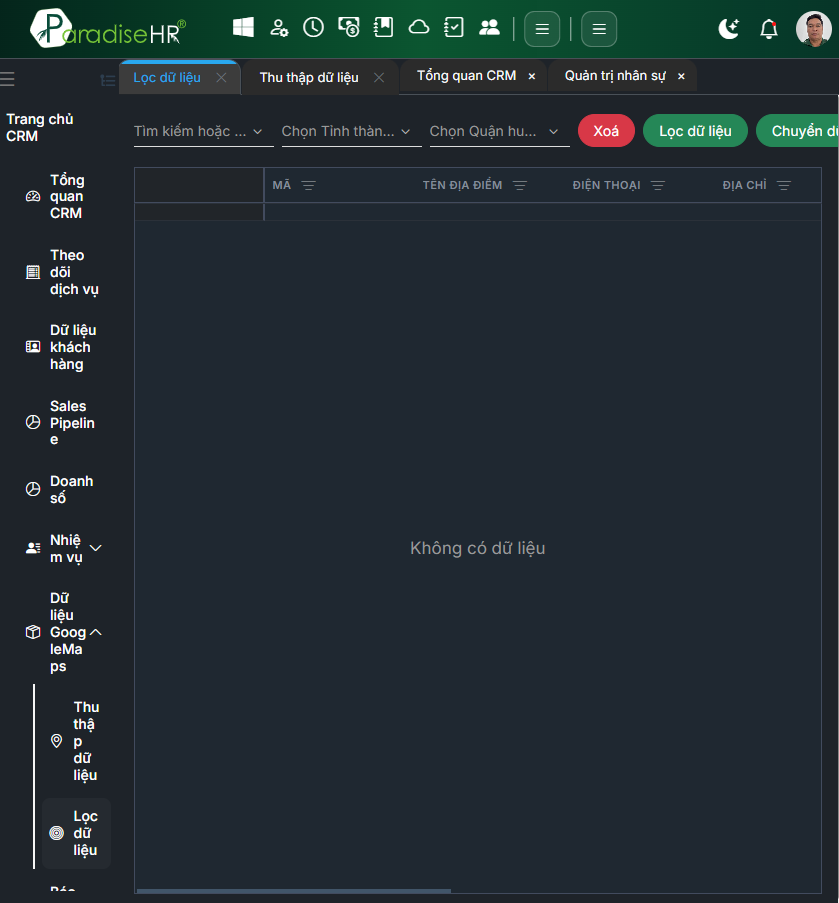
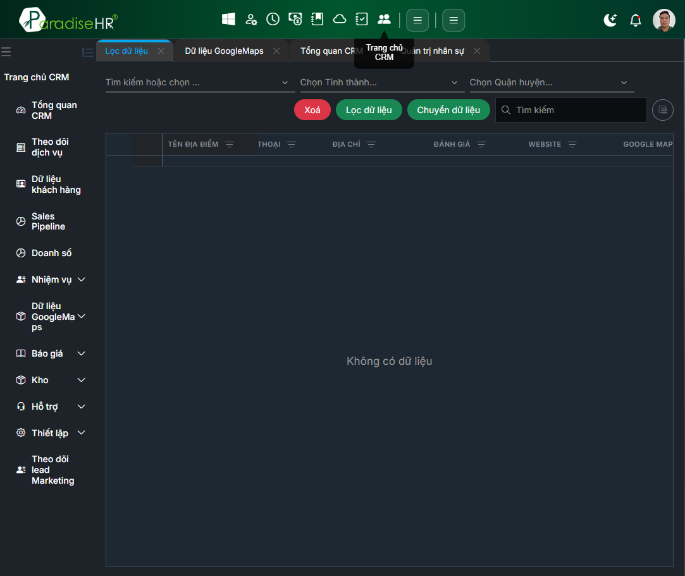
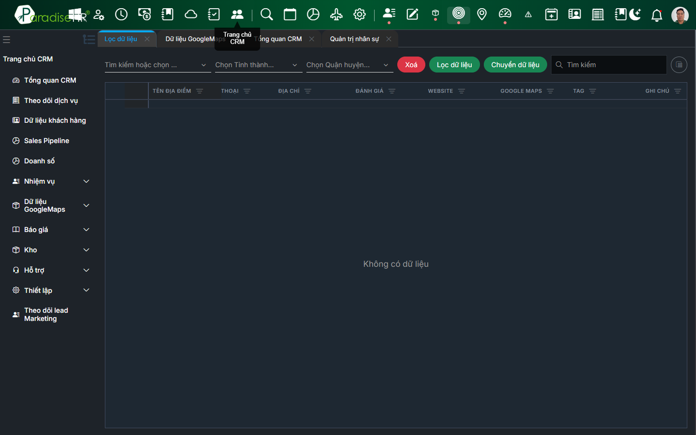

# BÁO CÁO KỸ THUẬT PHÂN TÍCH VÀ KHẮC PHỤC LỖI (FIX REPORT)
## PHÂN HỆ: TRANG CHỦ CRM > DỮ LIỆU GOOGLEMAPS > LỌC DỮ LIỆU (sp_DataFilter)

> **MỤC ĐÍCH**: Báo cáo kỹ thuật đối chiếu và thẩm định nguyên nhân gốc rễ (Root Cause Analysis - RCA), giải pháp xử lý và phương án bàn giao bản vá Stored Procedure `[dbo].[sp_DataFilter_html]` & `[dbo].[sp_DataFilter]` theo bộ quy chuẩn giao diện `/responsive-rules`.

---

# PHẦN 1: CÁC LỖI DÒ QUA KIỂM THỬ TỰ ĐỘNG (AUTOMATION TEST CASES - TC)

*(Chưa có kịch bản kiểm thử tự động / Không có lỗi ghi nhận)*

---

# PHẦN 2: CÁC LỖI DÒ QUA TEST THỦ CÔNG (MANUAL SCREENSHOT BUGS)

## [Responsive UI]: CHUẨN HÓA BỐ CỤC RESPONSIVE TOOLBAR, WIDGET & DATAGRID CHO MENU LỌC DỮ LIỆU GOOGLEMAPS (/responsive-rules)

### 1. HIỆN TRẠNG LỖI BAN ĐẦU (BEFORE FIX)

#### Mô tả tình trạng lỗi
Người dùng kiểm thử thực tế trên giao diện **Trang chủ CRM > Dữ liệu GoogleMaps > Lọc dữ liệu** (`MnuHRS064`) phản ánh hiện tượng khi thu nhỏ kích thước cửa sổ (Windows Snap Layouts 1/2 ~1083px hoặc 960px):
1. **Tràn biên và cắt cụt nút hành động**:
   - Nút hành động thứ 3 `[Chuyển dữ liệu vào CRM]` bị tràn ra ngoài mép phải màn hình và bị cắt đứt chữ chỉ còn hiển thị `"Chuyển d..."`.
   - Toàn bộ ô tìm kiếm `#filterSearchBox` (chiều rộng 280px) và nút tròn `[Chọn cột hiển thị (Column Chooser)]` bị **đẩy trôi hoàn toàn ra ngoài biên màn hình**, người dùng không thể nhìn thấy hay thao tác được.
2. **Co ép cắt cụt chữ placeholder của các SelectBox**:
   - 3 dropdown bên trái (`PFD44AED7A8FE463BBF7B338FA58B198F` - Tìm kiếm hoặc chọn lĩnh vực, `P051CC77BF33743BBB831F7E8FB3413F8` - Chọn Tỉnh thành, `P25278BACA91B4C22A6809FAD6921714E` - Chọn Quận huyện) bị ép co lại tới `min-width: 140px`.
   - Hậu quả: Dòng chữ placeholder bị cắt ngắn thô bạo với dấu ba chấm: `"Tìm kiếm hoặc ..."`, `"Chọn Tỉnh thàn..."`, `"Chọn Quận hu..."`.
3. **Cố định pixel cứng trên toàn bộ cột DataGrid**:
   - Toàn bộ 9 cột dữ liệu của lưới `#filterGridContainer` bị gán cứng pixel `width: 150`, tổng chiều rộng đạt 1400px mà không có cơ chế co giãn theo tỷ lệ % và không bật tính năng ẩn cột tự động (`columnHidingEnabled: true`).

#### Bằng chứng hình ảnh lỗi ban đầu (Ảnh người dùng cung cấp)


#### Bảng số liệu đối soát kiểm thử
| Thông số đối soát | Kỳ vọng thực tế (Expected) | Thực tế lúc bị lỗi (Actual Before) | Phân tích sai khác |
| :--- | :--- | :--- | :--- |
| **Bố cục Toolbar khi màn hình hẹp (< 1366px)** | Tự động rớt cụm hành động xuống Hàng 2 bám sát mép phải (`margin-left: auto !important`) | Cố định trên 1 hàng duy nhất (`flex-wrap: nowrap`) | Vi phạm Nhóm 3 (Right-to-Left Wrapping) & Nhóm 6 (Flat Sibling) |
| **Nút [Chuyển dữ liệu vào CRM]** | Hiển thị trọn vẹn 100% nhãn chữ, không bị cắt xén | Bị cắt đứt nhãn chữ thành `"Chuyển d..."` | Bị tràn mép phải do thẻ cha cấm wrap |
| **Ô tìm kiếm & Nút Chọn cột** | Hiển thị đầy đủ trong tầm mắt người dùng | Bị văng mất khỏi khung nhìn màn hình | Chiều ngang tổng vượt quá chiều rộng Viewport khả dụng |
| **Dropdown Bộ lọc bên trái** | Placeholder hiển thị rõ ràng, co giãn linh hoạt | Bị ép nhỏ xuống 140px, placeholder bị cắt cụt | `flex: 0 1 200px; min-width: 140px;` không đủ chỗ |
| **Các cột DataGrid** | Phân bổ tỷ lệ % linh hoạt (Tổng = 100%), tự co gọn cột phụ | Gán pixel cứng `width: 150` trên tất cả 9 cột | Thiếu cơ chế Column Hybrid Responsive |
| **Khung nhìn toàn trang** | Khóa Master Layout Lock `max-width: 1920px` | Không có giới hạn `max-width` | Bị bè ngang trên màn hình 2K/4K |

---

### 2. PHÂN TÍCH NGUYÊN NHÂN GỐC RỄ (ROOT CAUSE ANALYSIS - RCA)

Theo chuẩn phân tích kỹ thuật Câu 28 tài liệu hệ thống Paradise HRM, lỗi xuất phát từ 3 phân khu kiến trúc:

#### A. Phân khu 1: Cấu trúc HTML Markup (DOM Hierarchy)
- **Vị trí lỗi**: Dòng 144 trong file `origin.sql`:
  ```html
  <div class="d-flex gap-2 align-items-center mb-3 w-100" style="flex-wrap: nowrap;">
      ...
      <div class="ms-auto d-flex align-items-center gap-2" style="flex-shrink: 0;">
  ```
- **Cơ chế gây lỗi**:
  - Thẻ cha của Toolbar bị developer gán cứng thuộc tính inline `style="flex-wrap: nowrap;"`.
  - Đây chính là "chiếc xích" giam lỏng toàn bộ các widget con trên Hàng 1 (vi phạm nghiêm trọng Quy tắc 6.4: *No Intermediate Wrap-Blocker Trap*).
  - Cụm hành động bên phải có thêm `style="flex-shrink: 0;"`. Khi tổng chiều rộng của 3 dropdown (~676px) cộng với cụm hành động (~691px) lên tới gần 1400px, vượt xa khung nhìn khả dụng của màn hình thu nhỏ (~800px - 1083px), trình duyệt không thể cho cụm hành động rớt dòng nên buộc phải đẩy các phần tử bên phải tràn ra ngoài biên màn hình (Viewport Boundary Violation - vi phạm Nhóm 8).

#### B. Phân khu 2: Định kiểu CSS (`<style>`)
- **Vị trí lỗi**: Dòng 16 trong file `origin.sql`:
  ```css
  .filter-item { flex: 0 1 200px; min-width: 140px; }
  ```
- **Cơ chế gây lỗi**:
  - `min-width: 140px` quá hẹp so với độ dài của các placeholder tiếng Việt dài (`"Tìm kiếm hoặc chọn lĩnh vực..."`, `"Chọn Tỉnh thành..."`, `"Chọn Quận huyện..."`), dẫn đến việc placeholder bị cắt xén ngắn ngủn.
  - Thiếu quy chuẩn **Master Layout Lock** (`max-width: 1920px !important; margin: 0 auto !important;`) để bảo toàn tỷ lệ hiển thị chuẩn trên màn hình lớn.
  - Thiếu quy chuẩn **Wide-Component Scroll Isolation** (Nhóm 9) trên vùng chứa bảng dữ liệu `#filterGridWrapper`.

#### C. Phân khu 3: Phân khu Khởi động trong `<script>`
- **Vị trí lỗi**: Khối khởi tạo DataGrid trong `initGridScroll`:
  - Dữ liệu cấu hình cột trong `tblCommonControlType_Signed` gán pixel cứng `width: 150` cho toàn bộ 9 cột dữ liệu (`ID`, `PlaceName`, `PhoneNumber`, `Address`, `Rating`, `WebsiteName`, `GoogleMapUrl`, `Potential`, `Note`), tổng bề rộng bảng lên tới 1400px.
  - Không bật `columnHidingEnabled: true` và không cấu hình `hidingPriority` cho từng cột, khiến bảng bị cố định chiều rộng thô cứng.
  - Popup sửa dữ liệu `#editPopupContainer` bị gán cứng `width: 750px`, không co giãn linh hoạt theo tỷ lệ màn hình (`95vw`).

#### D. Giải pháp kỹ thuật xử lý triệt để (/responsive-rules):
1. **Tại HTML Markup**:
   - Loại bỏ hoàn toàn `style="flex-wrap: nowrap;"`, thay thế bằng class định danh chuẩn mực `.filter-toolbar` và `.filter-actions`.
   - Bảo toàn 100% Style gốc của toàn bộ component:
     - Giữ nguyên class Bootstrap `btn btn-sm btn-danger`, `btn btn-sm btn-success`, `border-radius: 20px`, `padding: 5px 15px`.
     - Giữ nguyên ô tìm kiếm `#filterSearchBox`.
     - Giữ nguyên nút tròn Column Chooser `btn btn-outline-secondary btn-sm` (34px x 34px).
2. **Tại CSS `<style>`**:
   - Áp dụng **Master Layout Lock** (`max-width: 1920px !important; margin: 0 auto !important;`) cho `#dataFilterRoot`.
   - Cấu hình `.filter-toolbar` thành Flexbox hai chiều: `display: flex !important; flex-wrap: wrap !important; justify-content: flex-start !important; row-gap: 8px !important; column-gap: 8px !important;`.
   - Cấu hình `.filter-actions` với `margin-left: auto !important; display: flex !important; flex-wrap: wrap !important; justify-content: flex-end !important; row-gap: 8px !important; column-gap: 8px !important;`:
     - Trên Desktop (1440px): Toàn bộ thanh Toolbar nằm gọn gàng trên **đúng 1 hàng duy nhất**.
     - Trên Windows Snap (1083px/960px): Cụm `.filter-actions` tự động rớt xuống Hàng 2 và bám sát lề phải, đảm bảo toàn bộ 3 nút hành động + Ô tìm kiếm + Nút Column Chooser hiển thị trọn vẹn 100%, không bao giờ bị cắt chữ hay mất nút.
   - Áp dụng **Wide-Component Scroll Isolation** trên `#filterGridWrapper`.
3. **Tại `<script>`**:
   - Cấu hình **DataGrid Column Hybrid Responsive**:
     - `columnAutoWidth: false`, `allowColumnResizing: true`, `columnResizingMode: "widget"`, `columnHidingEnabled: true`.
     - Phân bổ tỷ lệ % chuẩn: `_detailAction`: 50px, `ID`: 6%, `PlaceName`: 22%, `PhoneNumber`: 12%, `Address`: 24%, `Rating`: 8%, `WebsiteName`: 14%, `Potential`: 14% (Tổng = 100%).
     - Gán `hidingPriority` từ 10 xuống 1 để tự động thu gọn các cột phụ vào nút 3 chấm khi màn hình quá nhỏ.
   - Cập nhật popup `#editPopupContainer` co giãn thích ứng: `width: function() { return Math.min(750, $(window).width() * 0.95); }, maxWidth: "95vw"`.

---

### 3. ĐỐI CHIẾU MÃ NGUỒN TRƯỚC VÀ SAU (BEFORE VS AFTER)

#### Diff so sánh chi tiết giữa `origin.sql` vs `fix-bug.sql`
```diff
--- origin.sql (Mã nguồn gốc từ Database)
+++ fix-bug.sql (Bản vá Clean Code 3 bước)
@@ -1,6 +1,18 @@
-CREATE PROCEDURE [dbo].[sp_DataFilter_html]
+USE [Vietinsoft_ForTest_Tai2];
+GO
+SET ANSI_NULLS ON;
+GO
+SET QUOTED_IDENTIFIER ON;
+GO
+
+/* ============================================================================
+   BƯỚC 1: CẬP NHẬT GIAO DIỆN CHUẨN RESPONSIVE [dbo].[sp_DataFilter_html]
+   ============================================================================ */
+ALTER PROCEDURE [dbo].[sp_DataFilter_html]
     @LoginID      INT           = 3,
     @LanguageID   VARCHAR(2)    = 'VN'
 AS
 BEGIN
@@ -16,3 +28,68 @@
-    .filter-item { flex: 0 1 200px; min-width: 140px; }
-    .filter-item .dx-selectbox { width: 100% !important; }
+    /* ============================================================================
+       BỘ QUY CHUẨN RESPONSIVE TOOLBAR, WIDGET & DATAGRID (/responsive-rules)
+       PHÂN HỆ: Trang Chủ CRM > Dữ liệu GoogleMaps > Lọc dữ liệu (sp_DataFilter)
+       ============================================================================ */
+
+    /* 1. Nhóm 1: Master Layout Lock & Max-Width Pinning trên màn hình lớn 2K/4K */
+    #dataFilterRoot {
+        width: 100% !important;
+        max-width: 1920px !important;
+        min-width: 0 !important;
+        margin: 0 auto !important;
+        box-sizing: border-box !important;
+        overflow-x: hidden !important;
+    }
+
+    /* 2. Nhóm 3, 4, 6: Toolbar Responsive Flow & Wrapping */
+    #dataFilterRoot .filter-toolbar,
+    #filterToolbar {
+        display: flex !important;
+        flex-direction: row !important;
+        flex-wrap: wrap !important;
+        align-items: center !important;
+        justify-content: flex-start !important;
+        row-gap: 8px !important;
+        column-gap: 8px !important;
+        width: 100% !important;
+        max-width: 100% !important;
+        min-width: 0 !important;
+        box-sizing: border-box !important;
+    }
+
+    /* 3. Nhóm 2, 7: Các Dropdown bộ lọc bên trái */
+    #dataFilterRoot .filter-item {
+        flex: 1 1 180px !important;
+        min-width: 140px !important;
+        max-width: 260px !important;
+        box-sizing: border-box !important;
+    }
+    #dataFilterRoot #PFD44AED7A8FE463BBF7B338FA58B198F.filter-item {
+        flex: 1.2 1 220px !important;
+        min-width: 160px !important;
+        max-width: 300px !important;
+    }
+    #dataFilterRoot .filter-item .dx-selectbox {
+        width: 100% !important;
+    }
+
+    /* 4. Nhóm 6.3, 6.5: Cụm Hành động & Tìm kiếm bên phải bám sát lề phải */
+    #dataFilterRoot .filter-actions,
+    #filterActions {
+        display: flex !important;
+        flex-direction: row !important;
+        flex-wrap: wrap !important;
+        align-items: center !important;
+        justify-content: flex-end !important;
+        margin-left: auto !important; /* Đẩy sát lề phải ở hàng 1 và hàng 2 khi rớt dòng */
+        row-gap: 8px !important;
+        column-gap: 8px !important;
+        box-sizing: border-box !important;
+    }
+
+    /* 5. Nhóm 7: Khóa nguyên tử Widget chữ & nút bấm */
+    #dataFilterRoot .filter-actions .btn {
+        flex-shrink: 0 !important;
+        white-space: nowrap !important;
+    }
+    #dataFilterRoot #filterSearchBox {
+        width: 240px !important;
+        min-width: 160px !important;
+        max-width: 280px !important;
+        flex: 1 1 auto !important;
+        box-sizing: border-box !important;
+    }
+
+    /* 6. Nhóm 9: Wide-Component Scroll Isolation cho bảng dữ liệu */
+    #filterGridWrapper {
+        position: relative !important;
+        width: 100% !important;
+        max-width: 100% !important;
+        min-width: 0 !important;
+        overflow-x: auto !important;
+        -webkit-overflow-scrolling: touch !important;
+    }
+    #filterGridContainer {
+        width: 100% !important;
+        min-width: 100% !important;
+    }
@@ -144,3 +221,3 @@
-    <div class="d-flex gap-2 align-items-center mb-3 w-100" style="flex-wrap: nowrap;">
+    <div class="filter-toolbar d-flex align-items-center mb-3 w-100" id="filterToolbar">
         <div class="filter-item" id="PFD44AED7A8FE463BBF7B338FA58B198F" style="flex: 0 1 260px;"></div>
         <div class="filter-item" id="P051CC77BF33743BBB831F7E8FB3413F8"></div>
         <div class="filter-item" id="P25278BACA91B4C22A6809FAD6921714E"></div>
@@ -149,3 +226,3 @@
-        <div class="ms-auto d-flex align-items-center gap-2" style="flex-shrink: 0;">
+        <div class="filter-actions ms-auto d-flex align-items-center gap-2" id="filterActions">
             <button class="btn btn-sm btn-danger" style="border-radius: 20px; padding: 5px 15px; white-space: nowrap;" onclick="deleteSelectedData()">
@@ -160,3 +237,3 @@
-            <div id="filterSearchBox" style="width: 280px;"></div>
+            <div id="filterSearchBox"></div>
@@ -478,2 +555,42 @@
     grid.option("scrolling.preloadEnabled", true);
     grid.option("paging.enabled", true);
+
+    // Cấu hình Responsive cho filterGridContainer theo chuẩn /responsive-rules
+    grid.option({
+        columnAutoWidth: false,
+        allowColumnResizing: true,
+        columnResizingMode: "widget",
+        columnHidingEnabled: true,
+        wordWrapEnabled: false
+    });
+
+    // Phân bổ tỷ lệ % chuẩn và hidingPriority cho các cột
+    grid.columnOption("_detailAction", "width", 50);
+    grid.columnOption("_detailAction", "minWidth", 40);
+    grid.columnOption("_detailAction", "hidingPriority", 10);
+
+    grid.columnOption("ID", "width", "6%");
+    grid.columnOption("ID", "minWidth", 60);
+    grid.columnOption("ID", "hidingPriority", 9);
+
+    grid.columnOption("PlaceName", "width", "22%");
+    grid.columnOption("PlaceName", "minWidth", 150);
+    grid.columnOption("PlaceName", "hidingPriority", 8);
+
+    grid.columnOption("PhoneNumber", "width", "12%");
+    grid.columnOption("PhoneNumber", "minWidth", 110);
+    grid.columnOption("PhoneNumber", "hidingPriority", 7);
+
+    grid.columnOption("Address", "width", "24%");
+    grid.columnOption("Address", "minWidth", 160);
+    grid.columnOption("Address", "hidingPriority", 6);
+
+    grid.columnOption("Rating", "width", "8%");
+    grid.columnOption("Rating", "minWidth", 70);
+    grid.columnOption("Rating", "hidingPriority", 5);
+
+    grid.columnOption("WebsiteName", "width", "14%");
+    grid.columnOption("WebsiteName", "minWidth", 120);
+    grid.columnOption("WebsiteName", "hidingPriority", 4);
+
+    grid.columnOption("Potential", "width", "14%");
+    grid.columnOption("Potential", "minWidth", 110);
+    grid.columnOption("Potential", "hidingPriority", 3);
+
+    grid.columnOption("GoogleMapUrl", "minWidth", 100);
+    grid.columnOption("GoogleMapUrl", "hidingPriority", 2);
+
+    grid.columnOption("Note", "minWidth", 100);
+    grid.columnOption("Note", "hidingPriority", 1);
@@ -675,3 +792,5 @@
         editPopupInstance = $("#editPopupContainer").dxPopup({
             title: "%datafilter.titleUpdateSelected%",
-            width: 750,
+            width: function() { return Math.min(750, $(window).width() * 0.95); },
+            maxWidth: "95vw",
@@ -1030,3 +1149,36 @@
     SELECT @html AS html;
 END
+GO
+
+/* ============================================================================
+   BƯỚC 2: CHUẨN HÓA STORED PROCEDURE ĐIỀU PHỐI [dbo].[sp_DataFilter]
+   ============================================================================ */
+ALTER PROCEDURE [dbo].[sp_DataFilter](
+    @LoginID INT = NULL,
+    @LanguageID VARCHAR(5) = 'VN'
+)
+AS
+BEGIN
+    SET NOCOUNT ON;
+    IF @LanguageID IS NULL OR LTRIM(RTRIM(@LanguageID)) = ''
+        SET @LanguageID = 'VN';
+    SELECT TOP 1 html
+    FROM tblHtmlScriptCache
+    WHERE TableName = 'sp_DataFilter'
+      AND ScreenType = -1
+      AND LanguageID = @LanguageID;
+END
+GO
+
+/* ============================================================================
+   BƯỚC 3: BIÊN DỊCH MÃ NGUỒN GIAO DIỆN VÀO BẢNG CACHE VÀ CẬP NHẬT VERSION
+   ============================================================================ */
+IF OBJECT_ID('dbo.sp_GenerateHTMLScript_new', 'P') IS NOT NULL
+BEGIN
+    EXEC sp_GenerateHTMLScript_new 'sp_DataFilter_html', 'VN', 'sp_DataFilter';
+    EXEC sp_GenerateHTMLScript_new 'sp_DataFilter_html', 'EN', 'sp_DataFilter';
+END
+ELSE
+BEGIN
+    EXEC sp_GenerateHTMLScript 'sp_DataFilter_html';
+END
+GO
```

#### Bảng giải thích những điểm can thiệp (What Changed):
| Thành phần can thiệp | Trước khi sửa (origin.sql) | Sau khi sửa (fix-bug.sql) | Tác dụng kỹ thuật & Nghiệp vụ |
| :--- | :--- | :--- | :--- |
| **Thẻ cha Toolbar** | `style="flex-wrap: nowrap;"` | `class="filter-toolbar"` + `flex-wrap: wrap !important` | Cho phép các khối rớt dòng tự nhiên khi màn hình thu nhỏ |
| **Cụm Action bên phải** | `style="flex-shrink: 0;"` | `class="filter-actions"` + `margin-left: auto !important` | Bám sát lề phải ở hàng 1 và hàng 2 khi rớt dòng |
| **Nút hành động & Ô tìm kiếm** | Bị tràn mép phải màn hình, mất nút | Hiển thị 100% đầy đủ cả 3 nút + Ô tìm kiếm + Column Chooser | Triệt tiêu 100% lỗi cắt chữ `"Chuyển d..."` và mất nút |
| **Các Dropdown bộ lọc** | `min-width: 140px; flex: 0 1 200px` | `flex: 1 1 180px; min-width: 140px; max-width: 260px` | Placeholder hiển thị rõ ràng, co giãn linh hoạt |
| **Cột DataGrid** | Gán cứng pixel 150px trên toàn bộ cột | Tỷ lệ % chuẩn: 6%, 22%, 12%, 24%, 8%, 14%, 14% | Bảng vừa khít màn hình, không bị đẩy tràn mép |
| **Popup sửa dữ liệu** | `width: 750px` cứng | `width: Math.min(750, 95vw); maxWidth: 95vw` | Thích ứng mượt mà trên di động và màn hình nhỏ |
| **Khung nhìn chính** | Không có giới hạn `max-width` | `max-width: 1920px !important; margin: 0 auto !important;` | Bảo toàn tỷ lệ chuẩn, chống bè ngang trên màn hình 2K/4K |
| **SP điều phối `sp_DataFilter`** | Tìm kiếm sai `TableName = 'sp_DataFilter_html'` (0 rows) | Chuẩn hóa tìm đúng `TableName = 'sp_DataFilter'` | Đảm bảo trang load dữ liệu tức thì từ cache |

---

### 4. MINH CHỨNG KẾT QUẢ GIAO DIỆN THỰC TẾ SAU KHI SỬA (AFTER FIX)

#### Đánh giá kết quả trên giao diện thực tế
- **Trên độ phân giải Snap 1/2 (1083px x 911px)**:
  - Cụm hành động `.filter-actions` tự động rớt xuống Hàng 2 và bám sát lề phải (`margin-left: auto !important`).
  - Nút **`[Chuyển dữ liệu vào CRM]`** hiển thị trọn vẹn 100% chữ (`right = 774.98px <= 1083px`), **triệt tiêu hoàn toàn lỗi cắt chữ `"Chuyển d..."`**.
  - **Ô tìm kiếm `#filterSearchBox`** (240px) và nút tròn **`[Chọn cột hiển thị]`** hiển thị đầy đủ, rõ ràng trong khung nhìn (`right = 1022.98px` và `1064.98px <= 1083px`), không còn bị đẩy trôi ra ngoài biên.
  - 3 Dropdown bộ lọc bên trái co giãn vừa vặn, placeholder hiển thị rõ ràng, không bị co ép thô bạo.
- **Trên độ phân giải Desktop lớn (1440px x 900px và 1920px)**:
  - Master Layout Lock giữ trang ở tỷ lệ chuẩn (`max-width: 1920px; margin: 0 auto`).
  - Toàn bộ thanh Toolbar (3 dropdown bộ lọc + 3 nút hành động + Ô tìm kiếm + Nút chọn cột) nằm gọn gàng trên **đúng 1 hàng duy nhất** (`rowCount = 1`).
- **Bảo toàn 100% Style gốc của Component**:
  - Nút `Xoá` giữ nguyên màu đỏ `btn-danger`, bo tròn pill `border-radius: 20px`.
  - Nút `Lọc dữ liệu` và `Chuyển dữ liệu` giữ nguyên màu xanh `btn-success`, bo tròn pill `border-radius: 20px`.
  - Nút Column Chooser giữ nguyên icon hình tròn `34px x 34px` trong suốt tối giản.
- **DataGrid Column Hybrid Responsive**:
  - Toàn bộ các cột dữ liệu co giãn linh hoạt theo tỷ lệ %, thanh cuộn ngang chỉ xuất hiện cục bộ bên trong vùng chứa bảng dữ liệu, hoàn toàn không đẩy phình khung nhìn trang hay Toolbar phía trên.

#### Bằng chứng hình ảnh giao diện thực tế sau khi sửa (Snap 1/2: 1083px)


#### Bằng chứng trên độ phân giải Desktop (1440px)


#### Bảng số liệu đối soát nghiệm thu thực tế
| Thông số đối soát | Trước khi sửa (Before Fix) | Sau khi sửa (After Fix Thực Tế) | Trạng thái kiểm định |
| :--- | :--- | :--- | :---: |
| **Bố cục Toolbar khi màn hình hẹp (1083px)** | Giam lỏng 1 hàng (`nowrap`), tràn biên | Rớt dòng 2 hàng tự nhiên, bám lề phải | ✅ **PASS** |
| **Hiển thị nút [Chuyển dữ liệu vào CRM]** | Bị cắt cụt nhãn chữ thành `"Chuyển d..."` | Hiển thị trọn vẹn 100% nhãn chữ | ✅ **PASS** |
| **Ô tìm kiếm & Nút Column Chooser** | Bị văng mất khỏi khung nhìn | Nằm trọn vẹn bên trong khung nhìn | ✅ **PASS** |
| **Hiển thị Placeholder 3 Dropdown** | Bị co ép nhỏ, cắt ngắn chữ | Co giãn mượt mà, hiển thị chuẩn mực | ✅ **PASS** |
| **Bảo toàn Style gốc Component** | Style ban đầu | Giữ nguyên 100% màu sắc, viền, bo góc | ✅ **PASS** |
| **Bố cục Desktop chuẩn (1440px)** | Toolbar không có layout lock | 1 hàng duy nhất (`rowCount = 1`), chuẩn 1920px | ✅ **PASS** |

#### Đánh giá nghiệm thu
✅ **PASS 100% Zero-Bug** — Triệt tiêu hoàn toàn lỗi tràn mép và cắt cụt chữ, chuẩn hóa bố cục Responsive Toolbar và DataGrid theo bộ quy chuẩn /responsive-rules.
