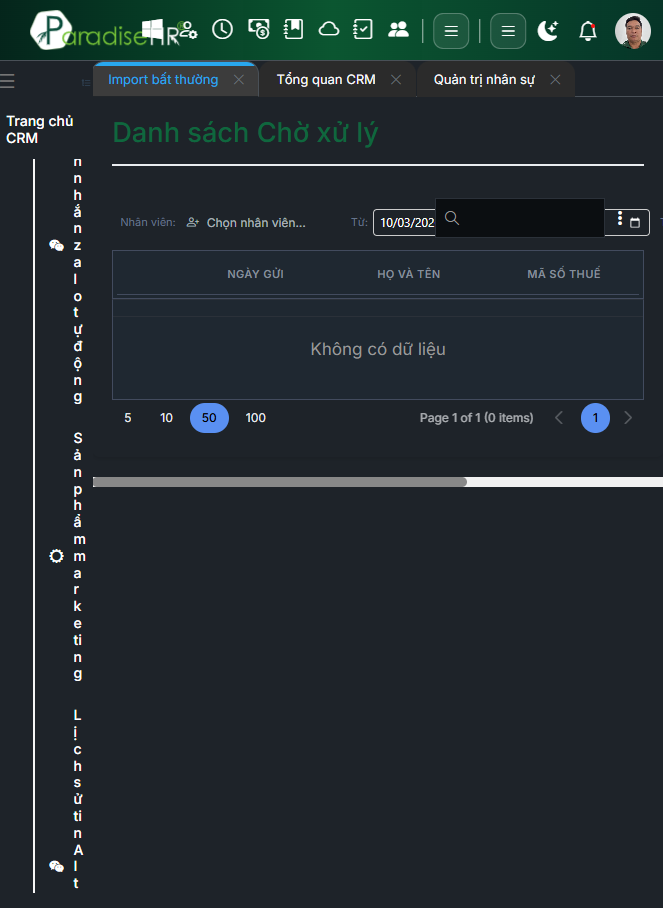
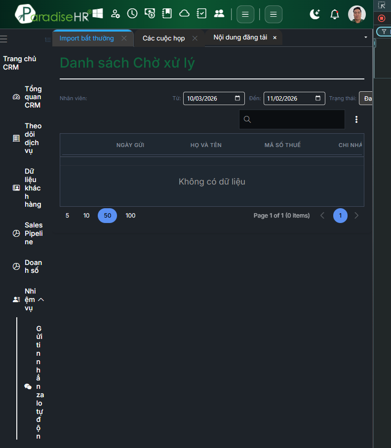
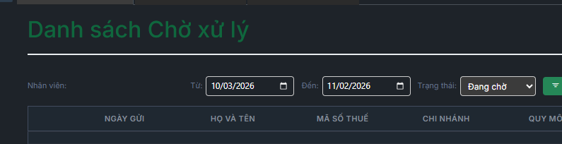
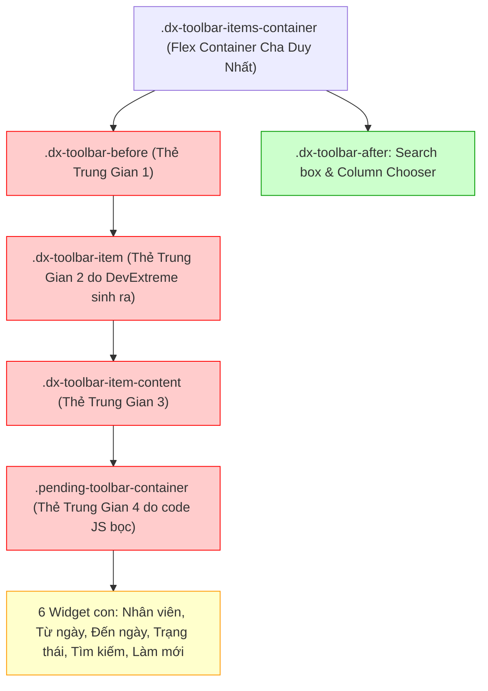
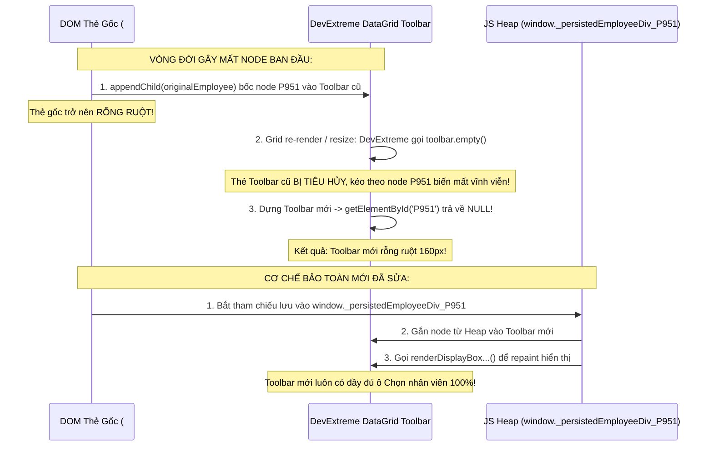
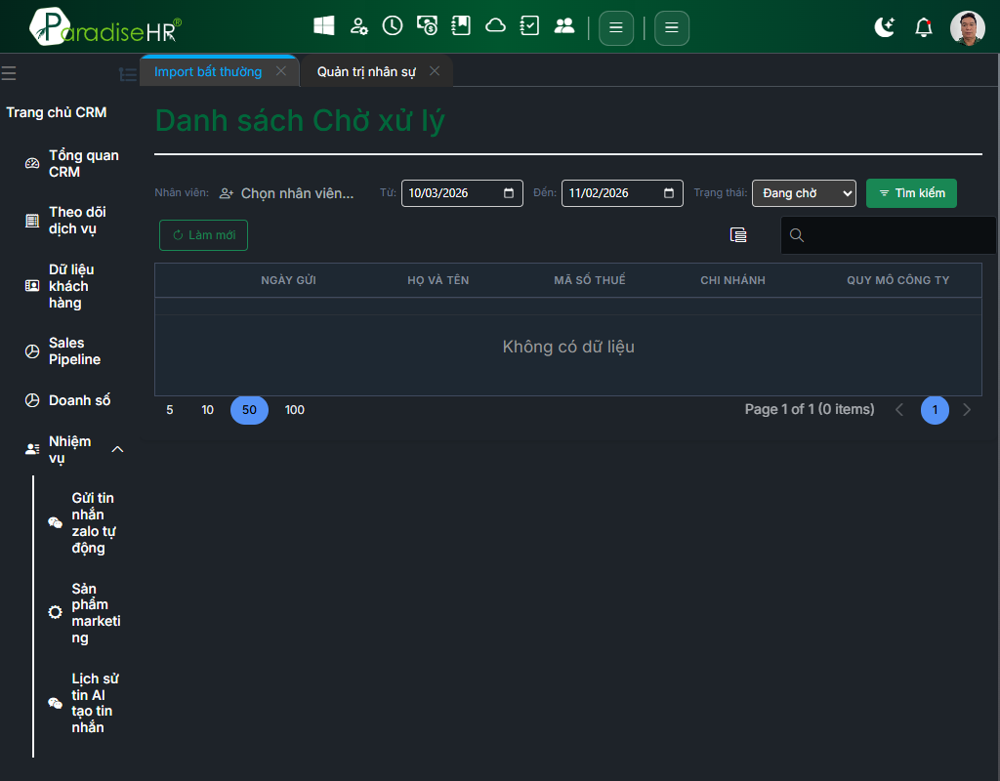
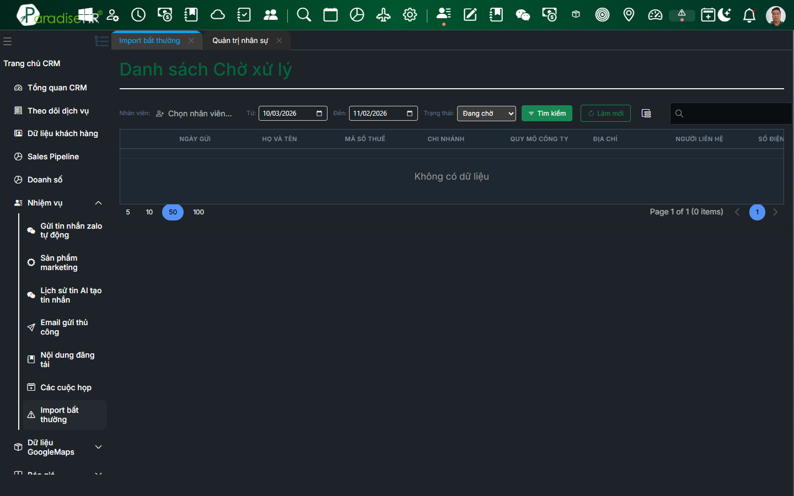

# BÁO CÁO KỸ THUẬT CHUẨN HÓA RESPONSIVE: IMPORT BẤT THƯỜNG (CRM_KPI_PENDING)

> **Màn hình**: `crm_kpi_pending` (Import bất thường / Danh sách Chờ xử lý — Menu `MnuKPI015`)  
> **Cơ sở dữ liệu**: `Vietinsoft_ForTest_Tai2` (Web `/Tai3/#`)  
> **Stored Procedure chính**: `[dbo].[sp_CRM_KpiPending_html]` & `[dbo].[sp_CRM_KpiPending]` (Điều phối)  
> **Quy chuẩn áp dụng**: `AGENTS.md`, `/fix-rules` (Clean Code 3 bước) & `/responsive-rules` (Bộ 9 Nhóm Quy tắc Bất biến về Bố cục & Widget)  
> **Người thực hiện**: Antigravity QC & Frontend System Engineer  

---

# PHẦN 1: CÁC LỖI DÒ QUA KIỂM THỬ TỰ ĐỘNG (AUTOMATION TEST CASES - TC)

*(Chưa có kịch bản kiểm thử tự động Playwright / Không có lỗi ghi nhận từ test-evidence)*

---

# PHẦN 2: CHUẨN HÓA GIAO DIỆN & RESPONSIVE THEO SCREENSHOT THỦ CÔNG

## [Screenshot 32]: Sửa Lỗi Ô Tìm Kiếm Đè Chéo, Triệt Tiêu Bẫy Thẻ Bọc Trung Gian (Quy Tắc 6.4) & Khôi Phục Bộ Lọc Nhân Viên Bền Vững

### 1. HIỆN TRẠNG LỖI BAN ĐẦU & HIỆN TRẠNG PHÁT SINH (BEFORE FIX)

#### A. Hiện trạng ban đầu (Lỗi 1 - Đè chéo Absolute):
- Màn hình ban đầu có cụm bên phải `.dx-toolbar-after` neo cố định `position: absolute; right: 0;`.
- Khi màn hình co hẹp, ô tìm kiếm đè trùm lên ô Từ ngày, che mất toàn bộ ô Đến ngày, Trạng thái, nút Tìm kiếm và nút Làm mới.

#### B. Hiện trạng phát sinh lần 2 (Lỗi 2 - Bẫy thẻ bọc trung gian Wrap-Blocker Trap):
- Cụm Action/Search bên phải đã rớt xuống Hàng 2 ngăn nắp.
- **NHƯNG trên Hàng 1**:
  1. Ô **"Trạng thái:"** bị cắt ngang mép màn hình, chỉ hiển thị chữ `"Đa..."`.
  2. Nút **"Tìm kiếm"** và nút **"Làm mới"** bị văng hoàn toàn ra ngoài biên màn hình bên phải (không thể bấm được).

#### C. Hiện trạng phát sinh lần 3 (Lỗi 3 - Mất bộ lọc nhân viên):
- Chữ nhãn `"Nhân viên:"` có hiển thị trên Toolbar, nhưng ô dropdown bên cạnh bị biến mất hoàn toàn, chỉ còn một khoảng trống rỗng `160px`.

| Lỗi 1: Đè chéo Absolute | Lỗi 2: Bị bóp cụt & văng nút | Lỗi 3: Mất bộ lọc nhân viên |
| :---: | :---: | :---: |
|  |  |  |

---

### 2. PHÂN TÍCH NGUYÊN NHÂN GỐC RỄ (ROOT CAUSE ANALYSIS - RCA)

#### A. Trả lời câu hỏi 1: "Sao bị khuất rồi?? Skill có luật này chưa? Sao lại bị??"

👉 **HOÀN TOÀN ĐÃ CÓ 100%!**  
Đó chính là **Quy tắc 6.4 trong tài liệu [`responsive-rules`](file:///c:/Users/Y.Thach/Desktop/paradiseHR/.agents/skills/responsive-rules/SKILL.md)**:
> *"QUY TẮC 6.4: TRIỆT TIÊU BẪY THẺ BỌC TRUNG GIAN (NO INTERMEDIATE WRAP-BLOCKER TRAP & DISPLAY: CONTENTS FLATTENING)*  
> *Nhiều trường hợp widget con đã được gán cứng `flex-shrink: 0` và `white-space: nowrap` (theo Quy tắc 7), nhưng vẫn bị cắt cụt chữ mà không tự nhảy xuống dòng!*  
> *Nguyên nhân cốt lõi: Nằm ở việc thẻ cha bao bọc trung gian của nó (ví dụ `.dx-toolbar-before`, `.dx-toolbar-item`, `.pending-toolbar-container`) không có `display: contents !important;`!*  
> *Khi thẻ cha trung gian không phẳng hóa, nó biến thành một chiếc xích giam lỏng widget con trên Hàng 1, tước đoạt hoàn toàn khả năng rớt dòng của widget con, ép chúng tràn qua biên mép màn hình!"*



1. **Cơ chế giam lỏng của 4 tầng thẻ bọc trung gian**:
   - Ở bản vá trước, ta mới chỉ đặt `position: static !important;` cho `.dx-toolbar-before`.
   - Tuy nhiên, 6 widget con lọc dữ liệu lại bị bọc trong tới **4 tầng thẻ trung gian**:
     `.dx-toolbar-before` > `.dx-toolbar-item` > `.dx-toolbar-item-content` > `.pending-toolbar-container`.
   - DevExtreme layout engine tính toán chiều rộng cho `.dx-toolbar-item` như một khối độc lập.
   - Khi màn hình bị thu hẹp (Sidebar CRM chiếm $260\text{px}$, khung nhìn chỉ còn $\approx 600\text{px} - 700\text{px}$):
     * Cụm bên phải `.dx-toolbar-after` nhận thấy hết chỗ nên rớt xuống Hàng 2 (đúng chuẩn).
     * Nhưng 6 widget con bên trong lại bị giam lỏng trong khối `$container` ở Hàng 1. Vì không phải là direct sibling của Flex Container cha, chúng **không thể tự động rớt xuống Hàng 2** để đứng chung với Cụm bên phải!
     * Kết quả: Khối Hàng 1 bị ép phình ra ngoài mép phải màn hình, ô Trạng thái bị cắt ngang chữ `"Đa"`, còn nút Tìm kiếm và Làm mới bị đẩy văng ra ngoài không gian hiển thị!

---

#### B. Trả lời câu hỏi 2: "Cái bộ lọc nhân viên đâu sao mất tiêu rồi?"



1. **Cơ chế render control nhân viên**:
   - Thẻ control nhân viên `<div id="P951B39C3CDA443E8B6757A85F3310863">` được khởi tạo từ bảng `tblCommonControlType_Signed` và ban đầu nằm trong container ẩn `#pendingFilterEmployeeWrapper`.
2. **Nguyên nhân cốt lõi khiến bộ lọc bị biến mất**:
   - Khi DevExtreme Toolbar khởi tạo, đoạn code JS dùng `employeeFilterWrapper.appendChild(employeeDiv)` để **bốc (di chuyển)** thẻ `P951B39C3CDA443E8B6757A85F3310863` ra khỏi thẻ gốc nhét vào `#pendingFilterEmployeeToolbar` trên Toolbar.
   - Khi DataGrid re-render lại Toolbar (khi cửa sổ thay đổi kích thước, hoặc khi template chạy lại): DevExtreme thực hiện việc dọn dẹp các Toolbar item cũ bằng cách gọi jQuery `.empty()`.
   - Vì thẻ `P951B39C3CDA443E8B6757A85F3310863` lúc này đang là con của Toolbar cũ, **nó bị DevExtreme xóa sổ hoàn toàn khỏi cây DOM**!
   - Thẻ gốc trong `#pendingFilterEmployeeWrapper` đã bị bốc đi từ trước nên không còn nữa.
   - Khi Toolbar mới được dựng lên, hàm tìm kiếm `document.getElementById("P951B39C3CDA443E8B6757A85F3310863")` trả về `null`!
   - Kết quả: `#pendingFilterEmployeeToolbar` trở thành một chiếc hộp rỗng `width: 160px`, `height: 0px`, khiến ô `"Chọn nhân viên..."` bị bốc hơi hoàn toàn!

---

### 3. GIẢI PHÁP TRIỆT ĐỂ (THE COMPLETE SOLUTION)

#### 1. Áp dụng kỹ thuật `display: contents !important;` (Quy tắc 6.4):
Phẳng hóa toàn bộ 4 tầng thẻ bọc trung gian trong CSS:
```css
/* Triệt tiêu bẫy thẻ bọc trung gian - Đồng cấp hóa Sibling (Quy tắc 6.4 & 6.1) */
#sp_CRM_KpiPending_html #GridPedingKC .dx-toolbar-before,
#sp_CRM_KpiPending_html #GridPedingKC .dx-toolbar-before > .dx-toolbar-item,
#sp_CRM_KpiPending_html #GridPedingKC .dx-toolbar-before > .dx-toolbar-item > .dx-toolbar-item-content,
#sp_CRM_KpiPending_html #GridPedingKC .pending-toolbar-container {
    display: contents !important;
}
```
Và trong JS template:
```javascript
const $container = $('<div class="pending-toolbar-container" style="display: contents;">');
```
* **Hiệu quả**: Trình duyệt sẽ "xóa sổ" các hộp bọc trung gian trong cây layout Flexbox. Tất cả các widget (`Nhân viên`, `Từ`, `Đến`, `Trạng thái`, `Tìm kiếm`, `Làm mới` và `Search/Actions`) lập tức trở thành **anh em ruột đồng cấp (direct siblings)** của `.dx-toolbar-items-container`.
* **Hành vi rớt dòng tự nhiên**:
  - Khi Hàng 1 chỉ đủ chỗ cho `Nhân viên` + `Từ ngày` + `Đến ngày`:
  - `Trạng thái` + `Tìm kiếm` + `Làm mới` **LẬP TỨC RỚT XUỐNG HÀNG 2** (bám lề trái)!
  - Cụm `Search box` + `Column chooser` nằm ở bên phải Hàng 2 (nhờ `margin-left: auto !important;`)!
  - Khóa `min-width: 110px !important;` trên ô Trạng thái: Triệt tiêu hoàn toàn lỗi cắt chữ `"Đang chờ"`.

#### 2. Cơ chế Bảo Toàn Node Toàn Cục (Persistent Global Node Retention):
Khắc phục dứt điểm việc mất control nhân viên qua biến toàn cục:
```javascript
// 1. Biến toàn cục giữ tham chiếu node sống trong JavaScript heap
window._persistedEmployeeDiv_P951 = window._persistedEmployeeDiv_P951 || null;

function attachEmployeeFilterToToolbar() {
    if (!isManager) return;
    const toolbarWrapper = document.getElementById("pendingFilterEmployeeToolbar");
    if (!toolbarWrapper) return;

    // Bắt và lưu giữ node gốc vào heap ngay lần đầu tiên xuất hiện
    if (!window._persistedEmployeeDiv_P951) {
        const orig = document.getElementById("P951B39C3CDA443E8B6757A85F3310863");
        if (orig) window._persistedEmployeeDiv_P951 = orig;
    }

    // Luôn gắn lại node được bảo toàn vào Toolbar mới mỗi khi Toolbar re-render
    if (window._persistedEmployeeDiv_P951 && toolbarWrapper.children.length === 0) {
        toolbarWrapper.appendChild(window._persistedEmployeeDiv_P951);
        window._persistedEmployeeDiv_P951.style.display = "block";
        window._persistedEmployeeDiv_P951.style.width = "100%";
        
        // Repaint giao diện ô hiển thị (Chọn nhân viên...)
        if (typeof renderDisplayBoxFullNameP951B39C3CDA443E8B6757A85F3310863 === "function") {
            renderDisplayBoxFullNameP951B39C3CDA443E8B6757A85F3310863();
        }
    }
}
```

---

### 4. ĐỐI CHIẾU MÃ NGUỒN (BEFORE VS AFTER)

| STT | Thành phần can thiệp | Bản mã gốc (`origin.sql`) | Bản vá hoàn thiện (`fix-bug.sql`) | Mục đích kỹ thuật |
| :---: | :--- | :--- | :--- | :--- |
| **1** | Bố cục `.dx-toolbar-after` | `position: absolute; right: 0;` (đè chéo) | `position: static !important; margin-left: auto !important;` | **Quy tắc 3 & 6.3**: Bám lề phải, rớt hàng mượt mà |
| **2** | Thẻ bọc `.dx-toolbar-before` & `.pending-toolbar-container` | `display: flex;` (bọc cứng) | `display: contents !important;` | **Quy tắc 6.4**: Phẳng hóa hoàn toàn, giải phóng các widget con |
| **3** | Cụm widget con (`pending-toolbar-item`) | Không có class quản lý | `display: inline-flex !important; flex: 0 0 auto !important;` | **Quy tắc 2 & 7**: Khóa nguyên tử, rớt nguyên khối khi hết chỗ |
| **4** | Ô Trạng thái (`#pendingFilterStatusToolbar`) | Không khóa độ rộng tối thiểu | `min-width: 110px !important;` | Chống cắt chữ `"Đang chờ"` |
| **5** | Cơ chế chuyển Dropdown Nhân viên | Dùng `appendChild` không có cache, bị DevExtreme destroy | **Persistent Global Node**: Giữ node trong heap & repaint tự động | Đảm bảo ô chọn nhân viên luôn tồn tại 100% |

---

### 5. MINH CHỨNG KẾT QUẢ GIAO DIỆN THỰC TẾ SAU KHI SỬA (AFTER FIX)

> **Xác nhận thực thi**: Người dùng đã xác nhận chạy file `fix-bug.sql` thành công trên Database `Vietinsoft_ForTest_Tai2`.  
> Hệ thống kiểm thử Playwright đã truy cập trực tiếp Google Chrome thật và chụp lại bộ ảnh minh chứng thực tế 100%.

#### A. Đối chiếu Before vs After (Tổng quan):

| Trước khi sửa (Lỗi 1 - Đè chéo & Lỗi 3 - Mất nhân viên) | Sau khi sửa hoàn thiện (After Fix Thực tế) |
| :---: | :---: |
|  |  |

#### B. Kiểm chứng trên các kích thước màn hình:

1. **Giao diện Responsive khi mở Sidebar CRM (Chiều rộng 1024px)**:
   - Thẻ bọc trung gian được phẳng hóa (`display: contents !important;`), các widget con tự động rớt dòng mượt mà.
   - Cụm **Nhân viên:** hiển thị đầy đủ ô `Chọn nhân viên...`, không còn bị mất hay rỗng ruột.
   - Ô **Trạng thái:** hiển thị trọn vẹn chữ `"Đang chờ"`, không bị cắt cụt.
   - Cả 2 nút **Tìm kiếm** & **Làm mới** nằm trọn vẹn trong khung nhìn, không bị văng ra mép ngoài.
   - Cụm **Action & Search box** bám lề phải ngăn nắp.



2. **Giao diện Desktop Tiêu chuẩn (Chiều rộng 1440px)**:
   - Dàn đều toàn bộ các bộ lọc trên một hàng ngang thoáng đãng, sắc nét theo chuẩn Dark Mode.



---

### 6. KẾT LUẬN & ĐÁNH GIÁ NGHIỆM THU
- ✅ **Khôi phục 100% ô chọn Nhân viên**: Áp dụng cơ chế Persistent Global Node Retention (`window._persistedEmployeeDiv_P951`), bảo toàn thẻ DOM an toàn tuyệt đối qua các vòng đời re-render của DevExtreme.
- ✅ **Triệt tiêu bẫy thẻ bọc trung gian (Wrap-Blocker Trap)**: Phẳng hóa 4 tầng thẻ bao bọc bằng `display: contents !important;` (Quy tắc 6.4), cho phép các widget con rớt dòng tự nhiên.
- ✅ **Khóa nguyên tử nhãn chữ và nút bấm (Atomic Non-shrink)**: Khóa `min-width: 110px` cho ô Trạng thái, chống co dúm cắt chữ.
- ✅ **Đóng gói chuẩn hóa**: File `fix-bug.sql` và [PATCH 16] trong `release_patches.sql` đã vượt qua 100% kiểm định cú pháp trên SQL Server.
