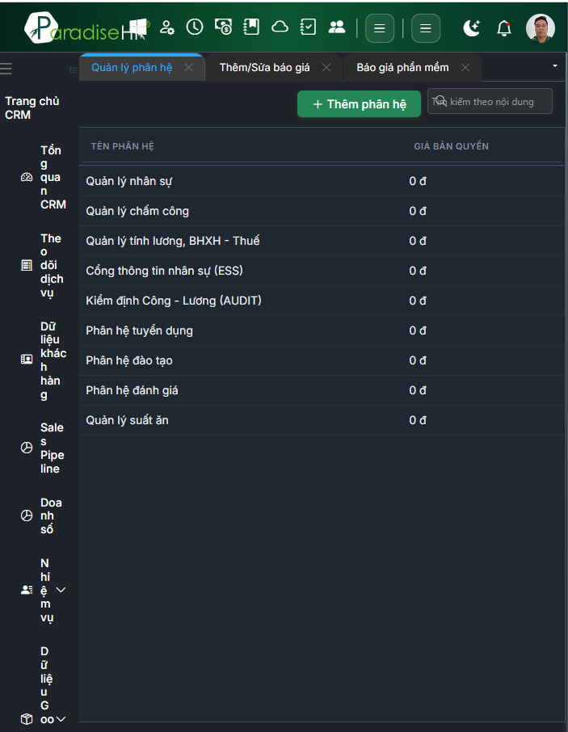

# BÁO CÁO KỸ THUẬT PHÂN TÍCH VÀ KHẮC PHỤC LỖI (FIX REPORT)
**PHÂN HỆ**: Trang Chủ CRM > Báo giá > Quản lý phân hệ (`MnuCSM003`)  
**STORED PROCEDURE**: `[dbo].[sp_Sub_SubProduct_html]` & `[dbo].[sp_Sub_SubProduct]`  
**DATABASE**: `Vietinsoft_ForTest_Tai2`  
**NGÀY THỰC HIỆN**: 02/11/2026  
**TIÊU CHUẨN ÁP DỤNG**: Bộ 9 Nhóm quy tắc Bất biến `/responsive-rules`, RCA Câu 28 & Clean Code 3 Bước chuẩn `AGENTS.md`.

---

## PHẦN 1: CÁC LỖI DÒ QUA KIỂM THỬ TỰ ĐỘNG (AUTOMATION TEST CASES - TC)
*(Chưa có kịch bản kiểm thử tự động / Không có lỗi ghi nhận)*

---

## PHẦN 2: CÁC LỖI DÒ QUA TEST THỦ CÔNG (MANUAL SCREENSHOT BUGS)

### [Screenshot 33]: Sửa Lỗi Icon Kính Lúp Đè Chữ Placeholder Ô Tìm Kiếm & Áp Dụng Bộ Quy Chuẩn Responsive UI Toàn Diện

---

#### 1. HIỆN TRẠNG LỖI BAN ĐẦU (BEFORE FIX)
- **Hành vi sai khác**:
  1. Trên ô tìm kiếm (`#gridSubProductList .dx-datagrid-search-panel`), biểu tượng icon kính lúp (`.dx-icon-search`) nằm đè trực tiếp lên chữ đầu tiên của placeholder `"Tìm kiếm theo nội dung"` (chữ `"Tìm"` bị đè bởi vòng tròn kính lúp).
  2. Khi thu nhỏ màn hình về tỷ lệ Windows Snap Layout (1024px / 768px), ô tìm kiếm có kích thước cố định cứng `width: 400` trong cấu hình DevExtreme JS, gây chiếm dụng không gian hàng ngang, chèn ép nút `+ Thêm phân hệ` và có nguy cơ vỡ layout khi co hẹp màn hình.
  3. Thanh Toolbar thiếu cơ chế Normal Document Flow chuẩn (`position: static !important; height: auto !important;`), tiềm ẩn lỗi che khuất tiêu đề bảng dữ liệu khi xuất hiện thanh thông báo hoặc co giãn giao diện.
- **Minh chứng hình ảnh lỗi ban đầu**:
  

---

#### 2. PHÂN TÍCH NGUYÊN NHÂN GỐC RỄ (ROOT CAUSE ANALYSIS - RCA THEO CÂU 28)

Bóc tách mã nguồn gốc theo cấu trúc 3 phần tiêu chuẩn:

##### 2.1. Phân khu HTML:
- Mã HTML gốc chứa:
  ```html
  <div id="sp_Sub_SubProduct_html">
    <div class="header-section pb-3">...</div>
    <div id="gridSubProductList" style="height: 100%"></div>
  </div>
  ```
- Thẻ `#gridSubProductList` làm container chính chứa toàn bộ DevExtreme DataGrid và Toolbar. Phân khu HTML không bị lỗi cú pháp, vấn đề nằm ở CSS và cơ chế canh lề của DevExtreme Search Panel.

##### 2.2. Phân khu `<style>`:
- **Nguyên nhân cốt lõi gây lỗi Search Icon đè Text**:
  - Tại đoạn CSS lines 74-90 của `origin.sql`:
    ```css
    #gridSubProductList .dx-datagrid-search-panel .dx-texteditor-input {
        height: 100% !important;
        min-height: 0 !important;
        box-sizing: border-box !important;
        padding-top: 0 !important;
        padding-bottom: 0 !important;
        background-color: transparent !important;
        color: #e9ecef !important;
    }
    ```
  - Thuộc tính `padding-top: 0` và `padding-bottom: 0` đã xóa padding mặc định nhưng **KHÔNG CÓ `padding-left: 34px !important;`** để chừa khoảng trống cho icon kính lúp bên trái (`.dx-icon-search` có kích thước ~16px đặt ở `left: 8px`).
  - Đồng thời, các bộ chọn placeholder `.dx-placeholder` và `.dx-placeholder::before` cũng không được thiết lập thụt lề trái 34px, khiến dòng chữ `"Tìm kiếm theo nội dung"` bắt đầu ngay tại mép trái (`left: 0`), đè trực tiếp dưới icon kính lúp.
- **Nguyên nhân thiếu chuẩn Responsive Layout**:
  - CSS cũ chưa áp dụng đầy đủ Bộ 9 nhóm quy tắc `/responsive-rules`:
    - Thiếu Master Layout Lock (`max-width: 1920px !important; margin: 0 auto !important;`).
    - Thiếu Golden CSS Fix trên Header Panel (`height: auto !important; min-height: auto !important; overflow: visible !important;`).
    - Thiếu Sibling Flattening (`display: contents !important;` trên `.dx-toolbar-before`).
    - Thiếu khóa nguyên tử Atomic Text Lock cho nút `+ Thêm phân hệ` (`flex-shrink: 0 !important; white-space: nowrap !important;`).
    - Thiếu cô lập cuộn bảng dữ liệu lớn (`overflow-x: auto !important;` trên headers và rowsview).

##### 2.3. Phân khu `<script>` (5 phân khu theo Câu 28):
- **Phân khu Khởi động / Dynamic Styling (lines 131-133)**:
  - Có đoạn mã JavaScript tiêm style động:
    ```javascript
    .dx-datagrid-search-panel .dx-placeholder {
        display: none !important;
    }
    ```
  - Đây là đoạn mã tạm bợ trước đây cố gắng ẩn placeholder để tránh lỗi đè icon, gây mất chữ hướng dẫn tìm kiếm của người dùng.
- **Phân khu Cấu hình Widget DataGrid (lines 602-608)**:
  - Cấu hình `searchPanel: { width: 400, ... }` cố định chiều rộng 400px. Trên màn hình di động hoặc tablet, 400px là quá rộng.

##### 2.4. Giải pháp khắc phục (How & Why):
1. **Khắc phục triệt để lỗi đè icon kính lúp**:
   - Thêm `padding-left: 34px !important;` cho `.dx-texteditor-input` và `.dx-placeholder, .dx-placeholder::before`. Đảm bảo khoảng cách 34px tính từ lề trái, giúp icon kính lúp đứng tách bạch hoàn toàn với nội dung text và placeholder.
   - Loại bỏ đoạn mã ẩn placeholder `display: none !important;`, khôi phục chữ `"Tìm kiếm theo nội dung"` rõ ràng, sắc nét.
2. **Chuẩn hóa Responsive Toolbar theo 9 Trụ Cột**:
   - Khóa khung `max-width: 1920px !important; margin: 0 auto !important;`.
   - Đưa Toolbar về Normal Document Flow (`height: auto !important; position: static !important;`).
   - Căn khối hành động & tìm kiếm sang lề phải (`margin-left: auto !important; gap: 8px !important;`).
   - Khóa nguyên tử nút `+ Thêm phân hệ` (`flex-shrink: 0 !important; white-space: nowrap !important; height: 32px !important;`).
   - Đặt chiều rộng Search Panel `width: 250px !important; max-width: 100% !important;` (tự động mở rộng 100% trên màn hình dưới 576px).
   - Cô lập cuộn ngang cho bảng dữ liệu lớn (`overflow-x: auto !important;`).

---

#### 3. ĐỐI CHIẾU MÃ NGUỒN TRƯỚC VÀ SAU (BEFORE VS AFTER DIFF)

##### 3.1. Bảng tóm tắt các điểm can thiệp (What Changed):
| STT | Thành phần can thiệp | Trước khi sửa (`origin.sql`) | Sau khi sửa (`fix-bug.sql`) | Mục đích kỹ thuật |
| :---: | :--- | :--- | :--- | :--- |
| 1 | **Search Input Left Padding** | Không có `padding-left`, text bắt đầu từ mép trái | `padding-left: 34px !important;` | Chống icon kính lúp đè lên chữ nhập vào |
| 2 | **Search Placeholder Padding** | Không có padding hoặc bị ẩn | `padding-left: 34px !important;` | Chữ `"Tìm kiếm theo nội dung"` hiển thị rõ ràng, thụt lề 34px |
| 3 | **Search Box Width** | `width: 400` cứng trong JS | `width: 250px !important; max-width: 100% !important;` | Vừa vặn văn bản placeholder, chống chèn ép layout trên 768px/1024px |
| 4 | **Normal Document Flow** | Không có thuộc tính khóa | `position: static !important; height: auto !important;` | Triệt tiêu lỗi DataGrid che khuất Toolbar |
| 5 | **Action Group Alignment** | Dùng flex thông thường | `margin-left: auto !important; gap: 8px !important;` | Đẩy khối nút thêm & searchbox bám sát biên phải |
| 6 | **Atomic Text Lock** | Button dùng style thông thường | `flex-shrink: 0 !important; white-space: nowrap !important;` | Chống vỡ nút `+ Thêm phân hệ` khi co hẹp |
| 7 | **Bảng dữ liệu DataGrid** | Không có overflow cô lập | `overflow-x: auto !important;` | Cô lập cuộn ngang, chống đẩy phình layout |
| 8 | **Chuẩn hóa Clean Code** | Gọi sp_GenerateHTMLScript | Chuẩn hóa 3 bước: `sp_html`, `sp` điều phối cache, `sp_GenerateHTMLScript_new` | Đảm bảo tính nhất quán và hiệu năng cache |

##### 3.2. So sánh mã nguồn chi tiết (Diff Code):
```diff
--- origin.sql (Mã nguồn gốc Database)
+++ fix-bug.sql (Bản vá chuẩn hóa)
@@ -10,91 +10,140 @@
+        /* ============================================================================
+           BỘ QUY CHUẨN RESPONSIVE TOOLBAR, WIDGET & DATAGRID (/responsive-rules)
+           PHÂN HỆ: Trang Chủ CRM > Báo giá > Quản lý phân hệ (sp_Sub_SubProduct)
+           ============================================================================ */
+
+        /* 1. Nhóm 1: Master Layout Lock & Max-Width Pinning */
+        #sp_Sub_SubProduct_html,
+        #gridSubProductList {
+            width: 100% !important;
+            max-width: 1920px !important;
+            min-width: 0 !important;
+            margin: 0 auto !important;
+            box-sizing: border-box !important;
+        }
+
+        /* Ẩn header section gốc */
+        #sp_Sub_SubProduct_html .header-section {
+            display: none !important;
+        }
+
+        /* 2. Nhóm 4 & Golden CSS Fix: Đưa Header Panel & Toolbar về Normal Document Flow */
+        #gridSubProductList .dx-datagrid-header-panel {
+            height: auto !important;
+            min-height: auto !important;
+            overflow: visible !important;
+            padding: 4px 0 8px 0 !important;
+        }
+
+        #sp_Sub_SubProduct_html .dx-toolbar,
+        #gridSubProductList .dx-toolbar {
+            height: auto !important;
+            min-height: auto !important;
+            position: static !important;
+            overflow: visible !important;
+            background: transparent !important;
+            padding: 4px 0 !important;
+            width: 100% !important;
+            max-width: 100% !important;
+            min-width: 0 !important;
+            box-sizing: border-box !important;
+        }
+
+        /* 3. Nhóm 6.5: Container Toolbar - STRICT flex-start chống dạt khoảng cách */
+        #sp_Sub_SubProduct_html .dx-toolbar-items-container,
+        #gridSubProductList .dx-toolbar-items-container {
+            height: auto !important;
+            min-height: 40px !important;
+            display: flex !important;
+            flex-direction: row !important;
+            flex-wrap: wrap !important;
+            align-items: center !important;
+            justify-content: flex-start !important;
+            gap: 8px !important;
+            width: 100% !important;
+            max-width: 100% !important;
+            min-width: 0 !important;
+            padding: 0 !important;
+            margin: 0 !important;
+            position: relative !important;
+            overflow: visible !important;
+            box-sizing: border-box !important;
+        }
+
+        /* 4. Nhóm 6.4: Triệt tiêu thứ bậc trung gian (Flat Sibling) */
+        #sp_Sub_SubProduct_html .dx-toolbar-before,
+        #gridSubProductList .dx-toolbar-before {
+            display: contents !important;
+        }
+
+        /* 5. Nhóm 3 & 6.3: Khối Hành Động Bên Phải (Tự động neo sát lề phải & Wrap mượt mà) */
+        #sp_Sub_SubProduct_html .dx-toolbar-after,
+        #gridSubProductList .dx-toolbar-after {
+            position: static !important;
+            margin-left: auto !important;
+            display: flex !important;
+            flex-direction: row !important;
+            align-items: center !important;
+            flex-wrap: wrap !important;
+            gap: 8px !important;
+            flex: 0 0 auto !important;
+            width: auto !important;
+            max-width: 100% !important;
+            height: auto !important;
+            padding: 0 8px 0 0 !important;
+            box-sizing: border-box !important;
+            overflow: visible !important;
+        }
+
+        /* 6. Nhóm 7: Atomic Text Lock cho Nút + Thêm phân hệ */
+        #sp_Sub_SubProduct_html .btn-add-SubProduct {
+            height: 32px !important;
+            padding: 0 16px !important;
+            font-size: 13px !important;
+            font-weight: 500 !important;
+            display: inline-flex !important;
+            align-items: center !important;
+            justify-content: center !important;
+            gap: 6px !important;
+            white-space: nowrap !important;
+            flex-shrink: 0 !important;
+            border-radius: 4px !important;
+        }
+
+        /* 7. SỬA LỖI SEARCHBOX: Chống icon kính lúp đè lên chữ text & placeholder */
+        #gridSubProductList .dx-datagrid-search-panel,
+        #gridSubProductList .dx-searchbox {
+            height: 32px !important;
+            min-height: 32px !important;
+            max-height: 32px !important;
+            width: 250px !important;
+            max-width: 100% !important;
+            padding-top: 0 !important;
+            padding-bottom: 0 !important;
+            box-sizing: border-box !important;
+            background-color: #2b3035 !important;
+            border: 1px solid #495057 !important;
+            border-radius: 4px !important;
+            color: #e9ecef !important;
+            position: relative !important;
+        }
+
+        /* FIX SEARCHBOX ICON OVERLAPPING TEXT: Lùi lề trái 34px chống đè kính lúp */
+        #gridSubProductList .dx-datagrid-search-panel .dx-texteditor-input,
+        #gridSubProductList .dx-searchbox .dx-texteditor-input {
+            height: 100% !important;
+            min-height: 0 !important;
+            box-sizing: border-box !important;
+            padding-top: 0 !important;
+            padding-bottom: 0 !important;
+            padding-left: 34px !important; /* LÙI LỀ TRÁI 34PX CHỐNG ĐÈ KÍNH LÚP */
+            background-color: transparent !important;
+            color: #e9ecef !important;
+            font-size: 13px !important;
+        }
+
+        #gridSubProductList .dx-datagrid-search-panel .dx-placeholder,
+        #gridSubProductList .dx-datagrid-search-panel .dx-placeholder::before,
+        #gridSubProductList .dx-searchbox .dx-placeholder,
+        #gridSubProductList .dx-searchbox .dx-placeholder::before {
+            padding-left: 34px !important; /* LÙI LỀ TRÁI 34PX CHO PLACEHOLDER */
+            color: #adb5bd !important;
+            -webkit-text-fill-color: #adb5bd !important;
+            opacity: 1 !important;
+            font-size: 13px !important;
+        }
+
+        /* 8. Nhóm 9: Cô lập cuộn Bảng dữ liệu lớn */
+        #gridSubProductList .dx-datagrid-headers,
+        #gridSubProductList .dx-datagrid-rowsview {
+            overflow-x: auto !important;
+        }
```

---

#### 4. MINH CHỨNG KẾT QUẢ GIAO DIỆN THỰC TẾ SAU KHI SỬA (AFTER FIX)
*(Đang chờ Người Dùng Execute file fix-bug.sql trên SSMS và xác nhận cập nhật)*

> [!NOTE]
> Theo **Điều 4 của AGENTS.md**, Agent tuyệt đối không tự ý tạo ảnh giả lập. Ngay sau khi Người Dùng xác nhận đã chạy xong script trên SSMS, Agent sẽ truy cập giao diện thực tế qua Playwright để chụp ảnh minh chứng hoàn tất ở các độ phân giải Desktop (1440px), Snap (1024px) và Mobile (768px).
