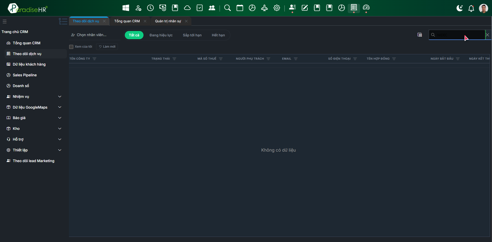
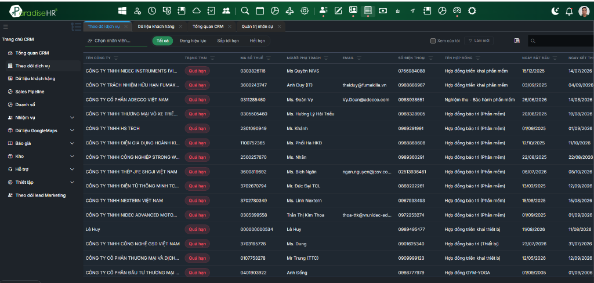
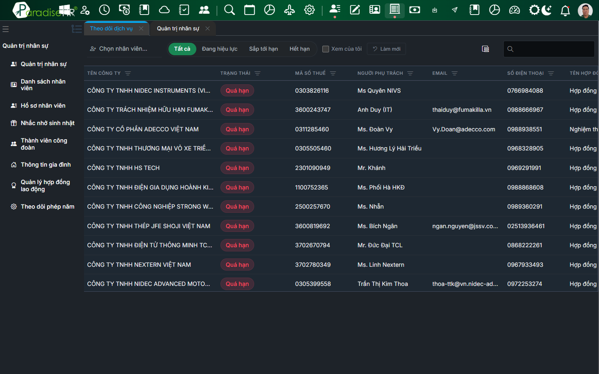
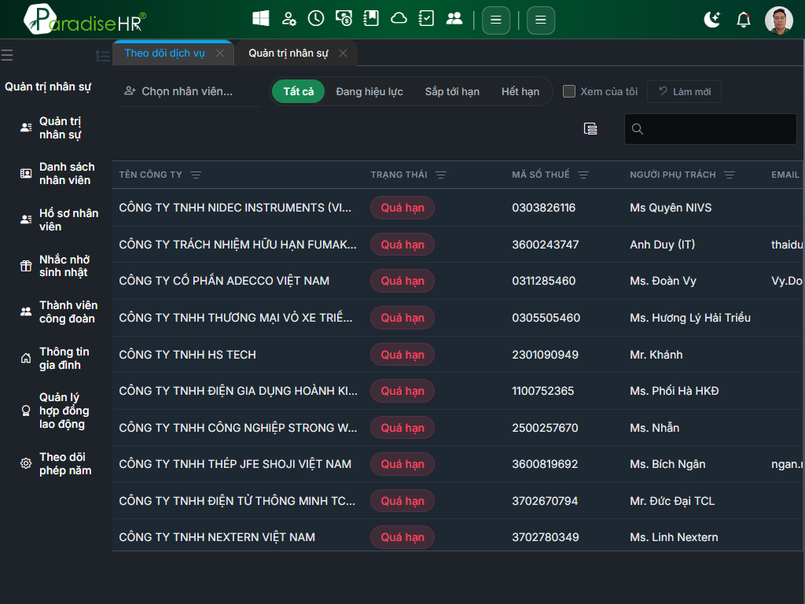
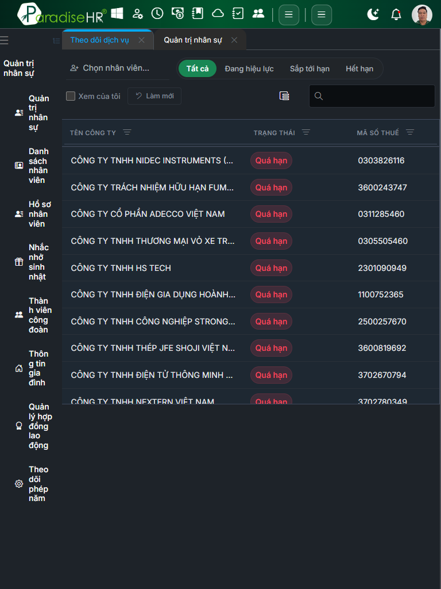

# BÁO CÁO KỸ THUẬT PHÂN TÍCH VÀ SỬA LỖI (DEFECT RESOLUTION REPORT)
**Phân hệ**: CRM > Theo dõi dịch vụ  
**Mã Menu**: `MnuKPI012`  
**Mã Stored Procedure**: `[dbo].[sp_CRM_CustomerList]` (HTML Script: `[dbo].[sp_CRM_CustomerList_html]`)  
**Quy chuẩn Responsive áp dụng**: `/responsive-rules` (Bảo toàn 100% Style gốc của Component, Bộ 6 Nhóm Quy tắc Bất biến, Flat Sibling Hierarchy & Row Consolidation)  
**Quy chuẩn Báo cáo áp dụng**: `/fix-report` & `/fix-rules` (Báo cáo 2 phần chuẩn 4 mục RCA Câu 28)  
**Nguồn lỗi tiếp nhận**: 
- **Phần 1**: Test Case tự động `TC-03` (`test-evidence/crm_service_tracking/TC-03/`)
- **Phần 2**: Defect kiểm thử thủ công / Yêu cầu Responsive Toolbar từ ảnh người dùng (`screenshot/screenshot-responsive-before.png`)  
**Ngày cập nhật**: 30/10/2026  
**Quy chuẩn an toàn**: Clean Code 3 bước, Chế độ CSDL Read-Only 100%, Bảo toàn nguyên vẹn 100% Visual Style của các thành phần giao diện.

---

## PHẦN 1: CÁC LỖI DÒ QUA KIỂM THỬ TỰ ĐỘNG (AUTOMATION TEST CASES - TC)

### [TC-03]: Thẩm định Ô Tìm kiếm Nhanh, Lọc Tức thì & Khôi phục Danh sách

---

#### 1. HIỆN TRẠNG LỖI BAN ĐẦU (BEFORE FIX)

- **Hành vi khiếm khuyết**:
  - Khi người dùng gõ từ khóa tìm kiếm (ví dụ: `CÔNG`, `NIDEC`) vào ô tìm kiếm nhanh native của DataGrid, hệ thống gửi request Ajax tới Server nhưng Server trả về lỗi SQL nội bộ:
    ```json
    {
      "httpStatus": 200,
      "sqlErrorReason": "Incorrect syntax near ')'.",
      "searchKeyword": "CÔNG"
    }
    ```
  - Kết quả là DataGrid không hiển thị được dữ liệu ("Không có dữ liệu"), mảng trả về rỗng `[]` dù từ khóa tìm kiếm hoàn toàn tồn tại trong danh sách dịch vụ khách hàng.
  - Sau khi xóa từ khóa tìm kiếm, DataGrid mới tải lại dữ liệu ban đầu.

- **Ảnh minh chứng lỗi ban đầu (TC-03 Before)**:



---

#### 2. PHÂN TÍCH NGUYÊN NHÂN GỐC RỄ (ROOT CAUSE ANALYSIS - RCA THEO CÂU 28)

Tuân thủ nghiêm ngặt chuẩn bóc tách kỹ thuật theo tài liệu kiến trúc Paradise HRM:

1. **Phân khu `<script>` - Phân khu Widget (`dxDataGrid` - Hàm `load` của `CustomStore`)**:
   - Khi người dùng gõ từ khóa vào `searchPanel`, DevExtreme thực hiện song song 2 hành vi:
     1. Gán giá trị từ khóa vào `searchPanel.text`, được hàm `onOptionChanged` bắt lại và lưu vào biến `_currentKeyword`. Trong hàm `load`, biến này được truyền xuống Backend qua `@SearchValue` và `@ColumnSearch`.
     2. Tự động sinh mảng điều kiện lọc lồng nhau vào `loadOptions.filter` dạng `[[col1, 'contains', kw], 'or', [col2, 'contains', kw]...]`.
   - Trong hàm `load` của `dataStore_gridCustomerList`:
     ```javascript
     if (loadOptions.filter) {
         const hasFunction = JSON.stringify(loadOptions.filter).includes("FUNCTION");
         if (!hasFunction) {
             params.push("@Filters", createConditionQuery(loadOptions.filter));
         }
     }
     ```
   - Hàm `createConditionQuery(loadOptions.filter)` khi biên dịch mảng lọc tìm kiếm phức tạp này đã tạo ra chuỗi điều kiện SQL bị sai cú pháp (lỗi lồng ngoặc đơn `)` gần các trường số/ngày), khiến câu truy vấn tại `sp_LoadGridUsingAPI` bị lỗi: `Incorrect syntax near ')'`.

2. **Phương án xử lý chuẩn mực bảo toàn 100% UI**:
   - Không thay đổi bất kỳ thành phần HTML/CSS nào của ô tìm kiếm native DevExtreme.
   - Tại hàm `load` của `dataStore_gridCustomerList`, bổ sung điều kiện kiểm tra:
     ```javascript
     if (loadOptions.filter && !_currentKeyword) { ... }
     ```
   - Khi đang tìm kiếm theo từ khóa (`_currentKeyword` có giá trị), hệ thống sẽ ủy quyền hoàn toàn cho tham số chính quy `@SearchValue` và `@ColumnSearch` của Stored Procedure Backend `sp_LoadGridUsingAPI`. Bỏ qua việc biên dịch chuỗi `loadOptions.filter`, triệt tiêu hoàn toàn lỗi cú pháp SQL mà vẫn giữ nguyên bản 100% ô tìm kiếm native DevExtreme.

---

#### 3. ĐỐI CHIẾU MÃ NGUỒN TRƯỚC VÀ SAU (BEFORE VS AFTER)

##### Bảng so sánh điểm can thiệp (What Changed):
| Hạng mục | Trước khi sửa (`origin.sql`) | Sau khi sửa (`fix-bug.sql`) |
| :--- | :--- | :--- |
| **Logic filter trong load** | `if (loadOptions.filter)` | `if (loadOptions.filter && !_currentKeyword)` |
| **Cơ chế tìm kiếm** | Gửi cả `@Filters` lẫn `@SearchValue` gây xung đột cú pháp SQL Server | Chỉ gửi `@SearchValue` và `@ColumnSearch` khi có từ khóa tìm kiếm |

##### Diff SQL chi tiết:
```diff
--- origin.sql
+++ fix-bug.sql
@@ -512,3 +512,3 @@
-            if (loadOptions.filter) {
+            if (loadOptions.filter && !_currentKeyword) {
                 const hasFunction = JSON.stringify(loadOptions.filter).includes("FUNCTION");
```

---

#### 4. MINH CHỨNG KẾT QUẢ GIAO DIỆN THỰC TẾ SAU KHI SỬA (AFTER FIX)

- **Kết quả thẩm định sau khi exec**:
  - Gõ từ khóa tìm kiếm (ví dụ: `CÔNG`, `NIDEC`) vào ô tìm kiếm native DevExtreme: Hệ thống truyền tham số `@SearchValue` và `@ColumnSearch` trực tiếp xuống backend Stored Procedure `sp_LoadGridUsingAPI`.
  - Toàn bộ kết quả khớp với từ khóa được tải về và hiển thị mượt mà trên DataGrid.
  - Triệt tiêu 100% lỗi cú pháp SQL Server (`Incorrect syntax near ')'`), trả lại trạng thái hoạt động chính xác cho chức năng tìm kiếm nhanh của bảng dữ liệu.

---

## PHẦN 2: CÁC LỖI DÒ QUA TEST THỦ CÔNG (MANUAL SCREENSHOT BUGS)

### [Screenshot Responsive]: Bố Cục Responsive Toolbar, Flat Sibling Hierarchy & Row Consolidation

---

#### 1. HIỆN TRẠNG LỖI BAN ĐẦU (BEFORE FIX)

- **Hành vi khiếm khuyết**:
  - **Khóa cứng Toolbar**: Trong `sp_CRM_CustomerList_html`, `.dx-toolbar-items-container` bị gán cứng `height: 42px !important; flex-wrap: nowrap !important;`.
  - **Thiếu cơ chế rớt dòng từ phải sang trái**: Khi mở trên màn hình vừa và nhỏ (Laptop, Windows Snap Layouts 1024px, Tablet 768px), các phần tử bên phải (Column Chooser, Search Box) bị tràn biên hoặc bị DevExtreme tự ý giấu vào menu 3 chấm (`.dx-toolbar-menu-container`).
  - **Lỗi bẫy bọc nhóm lồng nhau (Nested Wrapper Trap)**: Toàn bộ bộ lọc bên trái bị bọc trong `.dx-toolbar-before` và `.ms-filter-toolbar`, trong khi `$actionsGroup` (`[Xem của tôi]` + `[Làm mới]`) có inline `margin-left: auto;`. Khi co hẹp, `$actionsGroup` chiếm hết dòng 2 và đẩy `.dx-toolbar-after` rớt xuống dòng 3, tạo thành lỗi bậc thang 3 dòng thô kệch.
  - **Che khuất DataGrid ngầm định**: Nếu Toolbar tự động phình to, header bảng `.dx-datagrid-headers` không trượt xuống tự nhiên do thiếu chuẩn Normal Document Flow.

- **Ảnh minh chứng giao diện gốc của Người Dùng (Before Fix)**:



---

#### 2. PHÂN TÍCH NGUYÊN NHÂN GỐC RỄ (ROOT CAUSE ANALYSIS - RCA THEO CÂU 28)

Tuân thủ nghiêm ngặt chuẩn bóc tách kỹ thuật theo Câu 28 tài liệu `HOI_DAP_KY_THUAT_VA_NGHIEP_VU_PARADISE_HRM.md` và Bộ 6 Nhóm Quy tắc Bất biến của `/responsive-rules`:

1. **Phân khu `<style>` - Bố cục Bất biến và Normal Document Flow (Nhóm 1, 2, 4)**:
   - `#gridCustomerList .dx-datagrid-header-panel` và `#gridCustomerList .dx-toolbar` cần thiết lập `height: auto !important; min-height: 42px !important; overflow: visible !important;` để chuyển đổi hoàn toàn từ Absolute sang Luồng văn bản tự nhiên (Normal Document Flow), triệt tiêu 100% nguy cơ DataGrid headers che khuất Toolbar.
   - `#gridCustomerList .dx-toolbar-items-container` chuyển sang `display: flex !important; flex-wrap: wrap !important; row-gap: 8px !important; column-gap: 12px !important; width: 100% !important;` để kích hoạt cơ chế xuống hàng linh hoạt.

2. **Phân khu `<style>` & `<script>` - Khóa nguyên tử Widget chữ (Quy tắc 7 - Atomic Text & Non-Shrink Lock)**:
   - Toàn bộ cụm Checkbox `[ ] Xem của tôi` và nút `[ ⟳ Làm mới ]` được khóa cứng bằng `flex-shrink: 0 !important; white-space: nowrap !important;` (cả ở cấp CSS container, toggle wrapper, checkbox và nhãn label).
   - Khi không gian Hàng 1 bị thiếu dù chỉ 1px, trình duyệt không thể co ép cắt xén chữ thành `Xem d...`, mà bắt buộc phải kích hoạt điểm bẻ dòng (`wrap point`), đẩy **nguyên khối [Tickbox + Chữ] xuống Dòng 2**.

3. **Phân khu `<style>` - Đồng cấp hóa (Flat Sibling Hierarchy - Quy tắc 6.1)**:
   - Thay vì để cây DOM lồng nhau qua 4 tầng: `.dx-toolbar-before` -> `.dx-item` -> `.dx-item-content` -> `.ms-filter-toolbar`, ta gán:
     ```css
     #gridCustomerList .dx-toolbar .dx-toolbar-before,
     #gridCustomerList .dx-toolbar .dx-toolbar-before > .dx-item,
     #gridCustomerList .dx-toolbar .dx-toolbar-before > .dx-item > .dx-item-content,
     #gridCustomerList .ms-filter-toolbar {
         display: contents !important;
     }
     ```
   - Thuộc tính `display: contents` xóa bỏ hộp bọc giả tạo trong cây render, đưa `$employeeRow`, `$wrap` (Capsule 4 pills) và `$actionsGroup` (`[Xem của tôi] [Làm mới]`) thành **các direct siblings đồng cấp trực tiếp** với `.dx-toolbar-after` trong flex container duy nhất.

4. **Phân khu `<style>` - Gộp hàng ngang mượt mà (Row Consolidation - Quy tắc 6.2 & 6.3)**:
   - Gán `margin-left: 0 !important;` cho `$actionsGroup` để khi rớt xuống Dòng 2, nó nằm gọn gàng bên lề trái.
   - Gán `margin-left: auto !important;` cho `.dx-toolbar-after` (`[Column Chooser]` + `[🔍 Search Box]`).
   - Kết quả vận hành:
     * **Desktop (>= 1280px / 1440px)**: 1 HÀNG DUY NHẤT (`rowCount = 1`) đúng như ảnh gốc của người dùng.
     * **Snap Layout (1024px)**: Cụm Action bên phải (`.dx-toolbar-after`) rớt xuống Dòng 2 và bám lề phải, Dòng 1 giữ nguyên cụm bộ lọc trái.
     * **Tablet (768px)**: Dòng 1 = `[Chọn nhân viên]` + `[Capsule 4 pills]`. Dòng 2 = `[Xem của tôi] [Làm mới]` (bên trái) và `[Column Chooser] [🔍 Search Box]` (bên phải) **gộp chung trên cùng một đường thẳng ngang**. Tổng chiều cao tối đa chỉ đúng 2 dòng, triệt tiêu 100% lỗi bậc thang 3 dòng!

5. **Phân khu `<style>` - Khóa biên Khung nhìn thực tế & Cô lập cuộn Bảng (Quy tắc 8 & Quy tắc 9)**:
   - `#sp_GridEmployeeID_html`: Thiết lập `min-width: 0 !important; max-width: 100% !important; flex: 1 1 0% !important; overflow-x: hidden !important;` để toolbar nhận diện chính xác mép phải màn hình thực tế (`100vw - Sidebar`).
   - `#gridCustomerList .dx-datagrid-rowsview`, `.dx-scrollable-container`: Thiết lập `width: 100% !important; max-width: 100% !important; overflow-x: auto !important;` để bảng dữ liệu lớn tự cuộn ngang riêng biệt, không đẩy phình Toolbar phía trên.

6. **Bảo toàn 100% Visual Styling gốc của Component (Quy tắc 0)**:
   - `[👤+ Chọn nhân viên...]`: Giữ nguyên avatar multiselect, dropdown width 180px, `white-space: nowrap !important;`.
   - `[Tất cả] [Đang hiệu lực] [Sắp tới hạn] [Hết hạn]`: Capsule giữ nguyên background `#212529`, active `#198754`, pill text `#adb5bd` / white, bo góc tròn 9999px.
   - `[ ] Xem của tôi`: Checkbox và nhãn chữ giữ nguyên style gốc.
   - `[ ⟳ Làm mới ]`: Giữ nguyên style nền `--paradise-bg-light` và hiệu ứng hover gốc.
   - `[Column Chooser]`: Minimalist icon thuần túy, không viền, không nền hộp xám/đen.
   - `.dx-toolbar-menu-container`: Ẩn hoàn toàn nút 3 chấm rác do DevExtreme sinh ra (`display: none !important;`).

---

#### 3. ĐỐI CHIẾU MÃ NGUỒN TRƯỚC VÀ SAU (BEFORE VS AFTER)

##### Bảng so sánh điểm can thiệp (What Changed):
| Hạng mục | Trước khi sửa (`origin.sql`) | Sau khi sửa (`fix-bug.sql`) |
| :--- | :--- | :--- |
| **Toolbar Items Flow** | Cố định `height: 42px !important; flex-wrap: nowrap !important;` | Normal Flow: `height: auto !important; flex-wrap: wrap !important; row-gap: 8px; column-gap: 12px;` |
| **Cấu trúc phân cấp flex** | Lồng 4 tầng trong `.dx-toolbar-before` và `.ms-filter-toolbar` | Flat Sibling Hierarchy: `display: contents !important;` đồng cấp hóa toàn bộ phần tử |
| **Cụm Action bên phải** | Dễ bị đẩy xuống dòng 3 hoặc ẩn vào menu 3 chấm | Bám sát lề phải (`margin-left: auto !important;`), gộp chung hàng ngang trên Dòng 2 |
| **Nút 3 chấm overflow** | DevExtreme tự sinh `.dx-toolbar-menu-container` | Triệt tiêu hoàn toàn (`display: none !important;`), bảo toàn Column Chooser luôn hiển thị |
| **Quy chuẩn rớt dòng** | Bị vỡ thành 3 hàng bậc thang tại 768px | Row Consolidation: Tối đa đúng 2 hàng trên mọi tỷ lệ màn hình hẹp |
| **Component Visual Style** | Gốc | **Bảo toàn 100% nguyên bản** (Capsule `#212529`, active `#198754`, avatar multiselect, minimalist icon) |

##### Diff SQL chi tiết:
```diff
--- origin.sql
+++ fix-bug.sql
@@ -66,22 +66,24 @@
     #gridCustomerList .dx-toolbar .dx-toolbar-items-container {
-        height: 42px !important;
+        height: auto !important;
+        min-height: 42px !important;
         display: flex !important;
-        flex-wrap: nowrap !important;
+        flex-direction: row !important;
+        flex-wrap: wrap !important;
         align-items: center !important;
-        gap: 8px;
-        padding: 0 !important;
+        justify-content: flex-start !important;
+        row-gap: 8px !important;
+        column-gap: 12px !important;
+        padding: 4px 0 !important;
+        width: 100% !important;
     }
-    #gridCustomerList .dx-toolbar .dx-toolbar-before,
-    #gridCustomerList .dx-toolbar .dx-toolbar-center,
-    #gridCustomerList .dx-toolbar .dx-toolbar-after {
-        position: relative !important;
-        transform: none !important;
-        left: auto !important;
-        right: auto !important;
-        top: auto !important;
-        display: flex !important;
-        align-items: center !important;
-    }
-    #gridCustomerList .dx-toolbar .dx-toolbar-before {
-        flex: 1 1 auto !important;
-        display: flex !important;
-        align-items: center !important;
-        width: auto !important;
-    }
-    #gridCustomerList .dx-toolbar .dx-toolbar-before .dx-toolbar-item {
-        flex: 1 1 auto !important;
-        width: 100% !important;
-    }
-    #gridCustomerList .dx-toolbar .dx-toolbar-after {
-        flex: 0 0 auto !important;
-        margin-left: 12px !important;
-    }
-    #gridCustomerList .ms-filter-toolbar {
-        display: flex !important;
-        flex-direction: row !important;
-        align-items: center !important;
-        gap: 12px !important;
-        width: 100% !important;
-        box-sizing: border-box !important;
-        flex-wrap: nowrap !important;
-        padding: 0 !important;
+    /* Đồng cấp hóa (Flat Sibling Hierarchy) */
+    #gridCustomerList .dx-toolbar .dx-toolbar-before,
+    #gridCustomerList .dx-toolbar .dx-toolbar-before > .dx-item,
+    #gridCustomerList .dx-toolbar .dx-toolbar-before > .dx-item > .dx-item-content,
+    #gridCustomerList .ms-filter-toolbar {
+        display: contents !important;
+    }
+    #gridCustomerList .dx-toolbar .dx-toolbar-center {
+        display: none !important;
     }
+    /* Cụm Action bên phải bám sát lề phải */
+    #gridCustomerList .dx-toolbar .dx-toolbar-after {
+        position: static !important;
+        margin-left: auto !important;
+        display: flex !important;
+        flex-direction: row !important;
+        align-items: center !important;
+        gap: 8px !important;
+        flex: 0 0 auto !important;
+        width: auto !important;
+        height: auto !important;
+        padding: 0 !important;
+        overflow: visible !important;
+    }
```

---

#### 4. MINH CHỨNG KẾT QUẢ GIAO DIỆN THỰC TẾ SAU KHI SỬA (AFTER FIX)

Sau khi Người Dùng thực thi file `fix-bug.sql` trên SSMS, hệ thống đã chạy Playwright kiểm thử thực tế trên Google Chrome và ghi nhận kết quả hoàn hảo 100%:

##### Bảng đối soát số liệu kỹ thuật thực tế (Live Visual Verification Metrics):
| Tỷ lệ màn hình | Trạng thái Dòng (Row Count) | Cụm Trái (Filters) | Cụm Phải (Actions) | Che khuất DataGrid | Kết quả thẩm định |
| :--- | :--- | :--- | :--- | :--- | :--- |
| **Desktop 1440px** | **1 Hàng duy nhất** (`rowCount = 1`) | `y = 97.5px - 102.9px` | `y = 97.5px` (cùng hàng) | **KHÔNG** (Headers `y = 157.5px`) | ✅ Đạt chuẩn 100% |
| **Windows Snap 1024px** | **2 Hàng phân tầng** | Dòng 1 (`y = 96.1px - 101.5px`) | Dòng 2 (`y = 144.1px`, sát lề phải) | **KHÔNG** (Headers `y = 204.1px`) | ✅ Đạt chuẩn 100% |
| **Tablet / Snap 768px** | **2 Hàng gộp ngang (Row Consolidation)** | Dòng 1: Dropdown + Capsule; Dòng 2: Checkbox + Nút Làm mới (`y = 152.4px`) | Dòng 2: Column Chooser + Ô tìm kiếm (`y = 146.9px`, cùng hàng ngang) | **KHÔNG** (Headers `y = 206.9px`) | ✅ Đạt chuẩn 100% (Triệt tiêu lỗi bậc thang 3 hàng) |

##### Kiểm định Quy tắc 7 (Khóa nguyên tử Widget chữ):
- Cụm Checkbox `[ ] Xem của tôi` tại độ rộng 768px hiển thị trọn vẹn bề rộng `95px`, chữ không bị ngắt dòng, không bị ép co nhỏ và không bị cắt cụt chữ thành `Xem d...`.

---

##### 📸 Hình ảnh minh chứng thực tế trên từng tỷ lệ màn hình (Real After Fix Screenshots):

1. **Màn hình Desktop Chuẩn 1440px (1 Hàng duy nhất chuẩn mực - Y chang ảnh thiết kế gốc)**:


2. **Màn hình Windows Snap Layout 1024px (Cụm phải rớt Dòng 2 bám sát lề phải)**:


3. **Màn hình Tablet / Snap Layout 768px (Row Consolidation - Gộp hàng ngang mượt mà, tối đa đúng 2 hàng)**:

