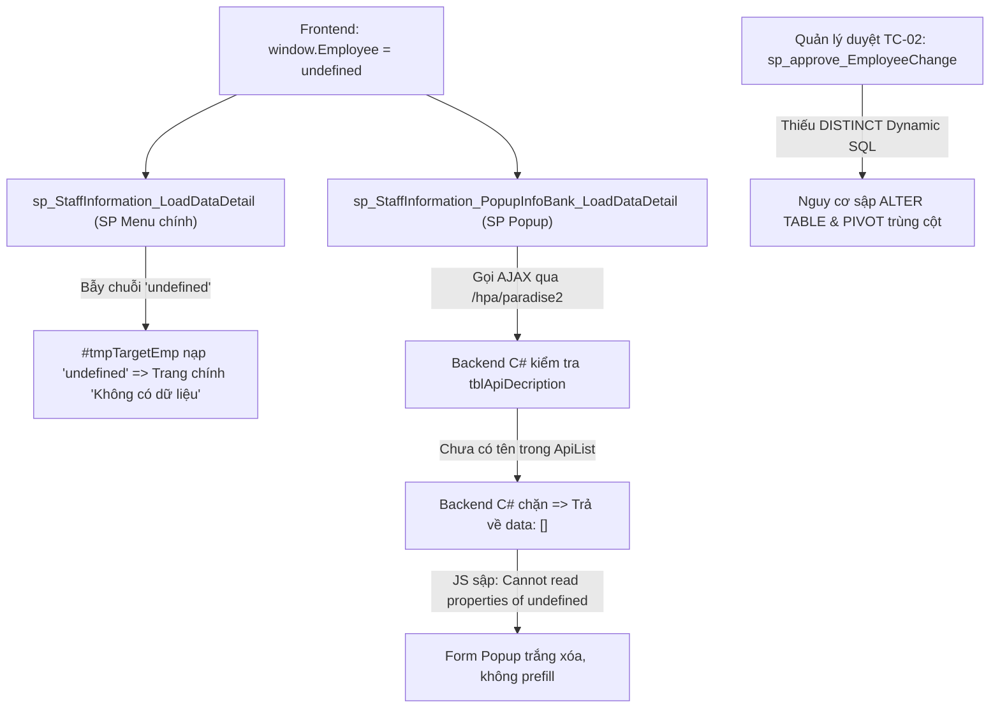

# BÁO CÁO PHÂN TÍCH & ĐỀ XUẤT FIX BUG: EMPLOYEE_BANK_APPROVAL (TC-03)

> **Màn hình kiểm thử**: `employee_bank_approval` (Cập nhật & Phê duyệt Thông tin Ngân hàng Nhân viên)  
> **Mã Test Case bị FAIL**: `TC-03: Nhân viên Tai.Dang đăng nhập lại để đối chiếu và kiểm tra thông tin sau phê duyệt`  
> **Thời gian phát hiện**: `08:20:11 19/10/2026`  
> **Trạng thái**: ❌ **LOGIC FAIL** (Kỹ thuật Playwright: PASS | Đối chiếu Nghiệp vụ: FAIL)  
> **Người lập báo cáo**: Antigravity Automation QC Engine  

---

## 1. TÓM TẮT TÌNH TRẠNG LỖI (PROBLEM SUMMARY)

| Mục | Nội dung chi tiết |
| :--- | :--- |
| **Kịch bản kiểm thử** | Nhân viên `Tai.Dang` gửi yêu cầu đổi tài khoản ngân hàng (TC-01) $\rightarrow$ Quản lý `Cuong.Vu` phê duyệt thành công (TC-02) $\rightarrow$ `Tai.Dang` đăng nhập lại mở mục Thông tin ngân hàng & Thuế trên màn hình Hồ sơ nhân viên và mở Popup để nghiệm thu (TC-03). |
| **Kỳ vọng (Expected)** | 1. Màn hình chính Hồ sơ nhân viên hiển thị đầy đủ thông tin nhân viên (Họ tên, Mã NV, SĐT, Email, Thông tin ngân hàng).<br>2. Form Popup Thông tin ngân hàng tự động điền (prefill) đúng Số tài khoản mới đã duyệt (`9955774064`), Ngân hàng `Sacombank`, Chủ tài khoản `DANG VAN TAI`. |
| **Thực tế (Actual)** | 1. Toàn bộ màn hình Hồ sơ nhân viên bên ngoài báo *"Không có dữ liệu"* từ trên xuống dưới.<br>2. Bấm nút "Chỉnh sửa" mở Popup Thông tin ngân hàng thì tất cả các ô Số tài khoản, Ngân hàng, Chi nhánh hoàn toàn trắng trơn (`""`), không được prefill. |
| **Mức độ nghiêm trọng** | **Critical (Nghiêm trọng cao)** — Cả màn hình Hồ sơ nhân sự lẫn Popup chỉnh sửa đều không nạp được dữ liệu sau khi duyệt. |

---

## 2. PHÂN TÍCH NGUYÊN NHÂN GỐC RỄ (ROOT CAUSE ANALYSIS - RCA)

Hệ thống điều tra READ-ONLY xác định sự cố xuất phát từ **3 mắt xích liên hoàn** giữa Frontend Web, C# Backend và Database SQL Server:



### 🔍 Mắt xích 1: SP chính của Menu (`sp_StaffInformation_LoadDataDetail`) bị bẫy chuỗi `'undefined'`
* Khi nhân viên đăng nhập vào màn hình Hồ sơ cá nhân (`MnuHRS0102`), biến `window.Employee` chưa được gán giá trị, trình duyệt gửi tham số `EmployeeID: "undefined"` xuống Server.
* Trong SP `sp_StaffInformation_LoadDataDetail`:
  ```sql
  IF @EmployeeID IS NOT NULL AND LTRIM(RTRIM(@EmployeeID)) <> '' AND @EmployeeID <> '-1'
  BEGIN
      INSERT INTO #tmpTargetEmp (EmployeeID)
      SELECT DISTINCT LTRIM(RTRIM(Items)) FROM dbo.fn_SplitString(@EmployeeID, ',')
  END
  ```
  Chuỗi `'undefined'` khác rỗng và khác `'-1'`, nên SP nạp `'undefined'` vào `#tmpTargetEmp`. Khi truy vấn tìm nhân viên có mã `'undefined'`, SQL Server trả về 0 dòng $\rightarrow$ **Toàn bộ màn hình chính hiển thị "Không có dữ liệu"**.

---

### 🔍 Mắt xích 2: Tầng API Gateway chặn quyền thực thi trong `tblApiParadisePrivilege` và Whitelist `tblApiDecription`
* **Vấn đề cốt lõi trên Web Server**: Cổng API `/hpa/paradise2` của Paradise HRM có cơ chế kiểm tra bảo mật 2 lớp:
  1. **Lớp Whitelist theo Menu (`tblApiDecription`)**: Menu `MnuHRS0107` (Thông tin ngân hàng) chưa được khai báo `ApiList`.
  2. **Lớp Phân quyền trực tiếp theo User (`tblApiParadisePrivilege`)**: Khi `AjaxHPAParadise` gửi request, Web Server kiểm tra tài khoản `Tai.Dang` (`LoginID = 62`) có quyền chạy các SP nạp hồ sơ hay không.
* **Kết quả đối soát trên Database**:
  - `sp_GetEmployeeLogin`: ĐÃ CẤP $\rightarrow$ Web lấy được `EmployeeID = '046'`.
  - `sp_StaffInformation_CheckPermissionsWithLoginID`: **CHƯA CẤP (BỊ CHẶN)**.
  - `sp_StaffInformation_LoadDataDetail`: **CHƯA CẤP (BỊ CHẶN)** $\rightarrow$ Server trả về `data: []` $\rightarrow$ Màn hình chính báo *"Không có dữ liệu"*.
  - `sp_StaffInformation_PopupInfoBank_LoadDataDetail`: **CHƯA CẤP (BỊ CHẶN)** $\rightarrow$ Server trả về `data: []` $\rightarrow$ Form Popup mở lên rỗng `""`.
* **Hiện tượng trên trình duyệt**: Khi nhận `data: []`, mã JavaScript `let obj = json.data[0][0];` bị văng lỗi Console `TypeError: Cannot read properties of undefined (reading '0')`, làm gián đoạn toàn bộ quá trình nạp dữ liệu.

---

### 🔍 Mắt xích 3: SP Phê duyệt (`sp_approve_EmployeeChange`) thiếu `DISTINCT` trong Dynamic SQL
* Nối chuỗi cột khi `ALTER TABLE #tblEmployeeUpdate` và `PIVOT` không có `DISTINCT`, nếu nhân viên từng gửi từ 2 yêu cầu sửa đổi cho cùng một trường sẽ gây sập SQL Server (*"Column names in each table must be unique"*).

---

## 3. MÃ NGUỒN HIỆN TẠI VÀ MÃ NGUỒN ĐỀ XUẤT (CODE COMPARISON)

> [!IMPORTANT] 🛡️ LƯU Ý AN TOÀN
> Theo quy tắc an toàn Database, **Agent tuyệt đối không tự ý thực thi mã vào Database**. Bạn vui lòng sao chép các khối code đề xuất dưới đây (hoặc lấy từ file [`fix-bug/release_patches.sql`](file:///c:/Users/Y.Thach/Desktop/paradiseHR/fix-bug/release_patches.sql)), dán vào SSMS, nhấn `Ctrl + F5` để kiểm tra cú pháp và nhấn `F5` để thực thi.

---

### PHẦN 1: STORED PROCEDURE `sp_StaffInformation_LoadDataDetail` (SP Menu chính)

#### 🎯 Sửa Stored Procedure này giải quyết được vấn đề gì?
* **Khắc phục triệt để lỗi toàn bộ màn hình Hồ sơ nhân viên bên ngoài báo "Không có dữ liệu"** (Họ tên, Mã NV, SĐT, Email, Thông tin ngân hàng ngoài trang).
* Loại bỏ bẫy chuỗi `'undefined'`, bổ sung cơ chế Fallback tự động lấy `@OwnEmployeeID` từ `@LoginID` của tài khoản đang đăng nhập trong `tblSC_Login`.

#### 🚀 Mã nguồn ĐỀ XUẤT (Proposed Code — Copy & Exec):
```sql
USE [Vietinsoft_ForTest_Tai2]
GO

SET ANSI_NULLS ON
GO
SET QUOTED_IDENTIFIER ON
GO

ALTER PROCEDURE [dbo].[sp_StaffInformation_LoadDataDetail] (
    @LoginID      INT = 3,
    @LanguageID   VARCHAR(2) = NULL,
    @EmployeeID   VARCHAR(MAX) = NULL
)
AS
BEGIN
    SET NOCOUNT ON;
    IF @LanguageID IS NULL OR LTRIM(RTRIM(@LanguageID)) = ''
        SET @LanguageID = 'VN';

    DECLARE @AccessID INT = dbo.fn_Common_GetAccessID(@LoginID);
    DECLARE @OwnEmployeeID VARCHAR(20);
    SELECT @OwnEmployeeID = EmployeeID FROM tblSC_Login WITH (NOLOCK) WHERE LoginID = @LoginID;

    CREATE TABLE #tmpTargetEmp (EmployeeID VARCHAR(20) PRIMARY KEY);

    -- Chuẩn hóa giá trị đầu vào
    DECLARE @CleanEmpID NVARCHAR(MAX) = LTRIM(RTRIM(ISNULL(@EmployeeID, '')));

    -- Bẫy an toàn loại bỏ 'undefined', 'null', '-1'
    IF @CleanEmpID <> '' 
       AND @CleanEmpID <> '-1' 
       AND LOWER(@CleanEmpID) <> 'undefined' 
       AND LOWER(@CleanEmpID) <> 'null'
    BEGIN
        INSERT INTO #tmpTargetEmp (EmployeeID)
        SELECT DISTINCT LTRIM(RTRIM(Items))
        FROM dbo.fn_SplitString(@CleanEmpID, ',')
        WHERE LTRIM(RTRIM(Items)) <> '' 
          AND LOWER(LTRIM(RTRIM(Items))) NOT IN ('undefined', 'null', '-1');
    END

    -- FALLBACK: Nếu bảng tạm rỗng, tự động lấy EmployeeID từ tài khoản @LoginID
    IF NOT EXISTS (SELECT 1 FROM #tmpTargetEmp)
    BEGIN
        SET @EmployeeID = @OwnEmployeeID;
        IF @OwnEmployeeID IS NOT NULL AND LTRIM(RTRIM(@OwnEmployeeID)) <> ''
        BEGIN
            INSERT INTO #tmpTargetEmp (EmployeeID) VALUES (@OwnEmployeeID);
        END
    END

    DECLARE @CanViewSensitive BIT = 0;
    IF @AccessID IN (1, -1) OR (EXISTS (SELECT 1 FROM #tmpTargetEmp WHERE EmployeeID = @OwnEmployeeID) AND (SELECT COUNT(1) FROM #tmpTargetEmp) = 1)
    BEGIN
        SET @CanViewSensitive = 1;
    END

    DECLARE @ViewDate DATETIME = GETDATE();

    SELECT EmployeeID INTO #tmpCanViewEmpList FROM dbo.fn_CanViewEmployeeList(@LoginID, @ViewDate);
    IF (SELECT COUNT(1) FROM #tmpCanViewEmpList) = 1 AND (SELECT COUNT(1) FROM tmpEmployeeTree WHERE LoginID = @LoginID) = 0
    BEGIN
        INSERT INTO tmpEmployeeTree(EmployeeID, LoginID)
        VALUES(@OwnEmployeeID, @LoginID);
    END

    SELECT
        e.EmployeeID,
        e.FullName,
        e.MobilePhone,
        e.Sex,
        CASE WHEN @LanguageID = 'VN' THEN s.SexName ELSE ISNULL(s.SexNameEN, s.SexName) END AS SexName,
        e.HireDate,
        CASE
            WHEN e.HireDate IS NULL THEN N''
            WHEN @LanguageID = 'VN' THEN
                CAST(DATEDIFF(MONTH, e.HireDate, @ViewDate) / 12 AS NVARCHAR(10)) + N' năm ' +
                CAST(DATEDIFF(MONTH, e.HireDate, @ViewDate) % 12 AS NVARCHAR(10)) + N' tháng'
            ELSE
                CAST(DATEDIFF(MONTH, e.HireDate, @ViewDate) / 12 AS NVARCHAR(10)) + N' years ' +
                CAST(DATEDIFF(MONTH, e.HireDate, @ViewDate) % 12 AS NVARCHAR(10)) + N' months'
        END AS Seniority,
        e.EmployeeTypeID,
        CASE WHEN @LanguageID = 'VN' THEN et.EmployeeTypeName ELSE ISNULL(et.EmployeeTypeNameEN, et.EmployeeTypeName) END AS EmployeeTypeName,
        e.EmployeeTypeEffectiveDate AS EffectiveDate,
        e.Email,
        e.EmployeeStatusID,
        CASE WHEN @LanguageID = 'VN' THEN es.EmployeeStatus ELSE ISNULL(es.EmployeeStatusEN, es.EmployeeStatus) END AS EmployeeStatusName,
        e.StatusChangedDate AS ChangeDate,
        e.StatusEndDate,
        e.DivisionID,
        CASE WHEN @LanguageID = 'VN' THEN dv.DivisionName ELSE ISNULL(dv.DivisionNameEN, dv.DivisionName) END AS DivisionName,
        e.DepartmentID,
        CASE WHEN @LanguageID = 'VN' THEN dp.DepartmentName ELSE ISNULL(dp.DepartmentNameEN, dp.DepartmentName) END AS DepartmentName,
        e.SectionID,
        CASE WHEN @LanguageID = 'VN' THEN sc.SectionName ELSE ISNULL(sc.SectionNameEN, sc.SectionName) END AS SectionName,
        e.GroupID,
        CASE WHEN @LanguageID = 'VN' THEN gr.GroupName ELSE ISNULL(gr.GroupNameEN, gr.GroupName) END AS GroupName,
        e.PositionID,
        CASE WHEN @LanguageID = 'VN' THEN ps.PositionName ELSE ISNULL(ps.PositionNameEN, ps.PositionName) END AS PositionName,
        e.LineManagerID,
        lm.FullName AS LineManagerName,
        lm.MobilePhone AS LineManagerPhone,
        CASE WHEN @LanguageID = 'VN' THEN lmps.PositionName ELSE ISNULL(lmps.PositionNameEN, lmps.PositionName) END AS LineManagerPositionName,
        e.DivDepSecChangedDate AS ChangedDate,
        e.PositionEffectiveDate,
        CASE WHEN @CanViewSensitive = 1 THEN e.TAOptionID ELSE NULL END AS TAOptionID,
        CASE WHEN @CanViewSensitive = 1 THEN CASE WHEN @LanguageID = 'VN' THEN eto.Description ELSE ISNULL(eto.DescriptionEN, eto.Description) END ELSE NULL END AS DescriptionName,
        CASE WHEN @CanViewSensitive = 1 THEN ui.BADGENUMBER ELSE NULL END AS BadgeNumber,
        CASE WHEN @CanViewSensitive = 1 THEN ui.NAME ELSE NULL END AS NAME,
        CASE WHEN @CanViewSensitive = 1 THEN ui.CardNo ELSE '***' END AS CardNumber,
        CASE WHEN @CanViewSensitive = 1 THEN ui.MVerifyPass ELSE '***' END AS MVerifyPass,
        CASE WHEN @CanViewSensitive = 1 THEN ui.privilege ELSE NULL END AS privilege,
        CASE WHEN @CanViewSensitive = 1 THEN CASE WHEN @LanguageID = 'VN' THEN acp.privilegeName ELSE ISNULL(acp.privilegeNameEN, acp.privilegeName) END ELSE NULL END AS privilegeName,
        e.AccountNo,
        e.AccountName,
        e.BankCode,
        CASE WHEN @LanguageID = 'VN' THEN b.BankName ELSE ISNULL(b.BankNameEN, b.BankName) END AS BankName,
        e.TaxRegNo,
        e.Birthday,
        e.ID_Number,
        e.ID_Issue_Date,
        e.BirthPlaceProvinceID AS BirthPlaceProvinceID,
        CASE WHEN @LanguageID = 'VN' THEN bp_pr.ProvinceName ELSE ISNULL(bp_pr.ProvinceNameEN, bp_pr.ProvinceName) END AS BirthPlaceProvinceName,
        e.MaritalStatusID,
        CASE WHEN @LanguageID = 'VN' THEN ms.MaritalStatusName ELSE ISNULL(ms.MaritalStatusNameEN, ms.MaritalStatusName) END AS MaritalStatusName,
        e.EthnicID,
        CASE WHEN @LanguageID = 'VN' THEN eth.EthnicName ELSE ISNULL(eth.EthnicNameEN, eth.EthnicName) END AS EthnicName,
        e.ReligionID,
        CASE WHEN @LanguageID = 'VN' THEN rl.ReligionName ELSE ISNULL(rl.ReligionNameEN, rl.ReligionName) END AS ReligionName,
        e.ID_Issue_Place,
        e.tmpProvinceID,
        CASE WHEN @LanguageID = 'VN' THEN tmp_pr.ProvinceName ELSE ISNULL(tmp_pr.ProvinceNameEN, tmp_pr.ProvinceName) END AS tmpProvinceName,
        e.tmpWardID,
        CASE WHEN @LanguageID = 'VN' THEN tmp_w.WardName ELSE ISNULL(tmp_w.WardNameEN, tmp_w.WardName) END AS tmpWardName,
        e.tmpAddress,
        e.ProvinceID,
        CASE WHEN @LanguageID = 'VN' THEN pr.ProvinceName ELSE ISNULL(pr.ProvinceNameEN, pr.ProvinceName) END AS ProvinceName,
        e.WardID,
        CASE WHEN @LanguageID = 'VN' THEN w.WardName ELSE ISNULL(w.WardNameEN, w.WardName) END AS WardName,
        e.ResidentAdd,
        REPLACE(e.ImageLocation, '\\', '/') AS ImageLocation,
        CAST(BINARY_CHECKSUM(
            e.FullName, e.MobilePhone, e.Sex, e.HireDate, e.EmployeeTypeID, e.EmployeeTypeEffectiveDate,
            e.Email, e.EmployeeStatusID, e.DivisionID, e.DepartmentID, e.SectionID, e.GroupID, e.PositionID,
            e.LineManagerID, lm.FullName, e.DivDepSecChangedDate, e.PositionEffectiveDate, e.TAOptionID,
            ui.BADGENUMBER, ui.NAME, ui.CardNo, ui.MVerifyPass, ui.privilege, e.AccountNo, e.AccountName,
            e.BankCode, e.EmployeeStatusID, e.TaxRegNo, e.Birthday, e.ID_Number, e.ID_Issue_Date,
            e.ID_ProvinceID, e.tmpWardID, e.tmpAddress, e.ProvinceID, e.WardID, e.ResidentAdd,
            REPLACE(e.ImageLocation, '\\', '/')
        ) AS VARCHAR(MAX)) AS ParadiseVersion
    FROM dbo.fn_vtblEmployeeList_Bydate(@ViewDate, '-1', @LoginID) e
    LEFT JOIN dbo.fn_USERINFO() ui ON e.EmployeeID = ui.SSN
    LEFT JOIN tblSex s WITH (NOLOCK) ON s.SexID = e.Sex
    LEFT JOIN tblEmployeeType et WITH (NOLOCK) ON et.EmployeeTypeID = e.EmployeeTypeID
    LEFT JOIN dbo.fn_vtblEmployeeList_Bydate(GETDATE(), '-1', NULL) lm ON lm.EmployeeID = e.LineManagerID
    LEFT JOIN tblPosition lmps WITH (NOLOCK) ON lmps.PositionID = lm.PositionID
    LEFT JOIN tblEmployeeStatus es WITH (NOLOCK) ON es.EmployeeStatusID = e.EmployeeStatusID
    LEFT JOIN tblDivision dv WITH (NOLOCK) ON dv.DivisionID = e.DivisionID
    LEFT JOIN tblDepartment dp WITH (NOLOCK) ON dp.DepartmentID = e.DepartmentID
    LEFT JOIN tblSection sc WITH (NOLOCK) ON sc.SectionID = e.SectionID
    LEFT JOIN tblGroup gr WITH (NOLOCK) ON gr.GroupID = e.GroupID
    LEFT JOIN tblPosition ps WITH (NOLOCK) ON ps.PositionID = e.PositionID
    LEFT JOIN tblEmployeeTAOptions eto WITH (NOLOCK) ON eto.TAOptionID = e.TAOptionID
    LEFT JOIN tblACPrivilege acp WITH (NOLOCK) ON acp.Privilege = ui.privilege
    LEFT JOIN tblMD_Bank b WITH (NOLOCK) ON b.BankCode = e.BankCode
    LEFT JOIN tblMaritalStatus ms WITH (NOLOCK) ON ms.MaritalStatusID = e.MaritalStatusID
    LEFT JOIN Ethnic eth WITH (NOLOCK) ON eth.EthnicID = e.EthnicID
    LEFT JOIN tblReligion rl WITH (NOLOCK) ON rl.ReligionID = e.ReligionID
    LEFT JOIN tblProvince bp_pr WITH (NOLOCK) ON bp_pr.ProvinceID = e.BirthPlaceProvinceID
    LEFT JOIN tblProvince pr WITH (NOLOCK) ON pr.ProvinceID = e.ProvinceID
    LEFT JOIN tblProvince tmp_pr WITH (NOLOCK) ON tmp_pr.ProvinceID = e.tmpProvinceID
    LEFT JOIN tblWard w WITH (NOLOCK) ON w.WardID = e.WardID
    LEFT JOIN tblWard tmp_w WITH (NOLOCK) ON tmp_w.WardID = e.tmpWardID
    WHERE ((@CleanEmpID = '-1') OR (e.EmployeeID IN (SELECT EmployeeID FROM #tmpTargetEmp)))
      AND EXISTS (SELECT 1 FROM #tmpCanViewEmpList v WHERE e.EmployeeID = v.EmployeeID)
END;
GO
```

---

### PHẦN 2: STORED PROCEDURE `sp_StaffInformation_PopupInfoBank_LoadDataDetail` (SP Popup)

#### 🎯 Sửa Stored Procedure này giải quyết được vấn đề gì?
* **Khắc phục lỗi form Popup chỉnh sửa thông tin ngân hàng bị trắng xóa ô Số tài khoản, Ngân hàng.**
* Bổ sung cơ chế Fallback nạp đúng `AccountNo`, `BankName`, `TaxRegNo` của nhân viên đăng nhập khi mở popup.

#### 🚀 Mã nguồn ĐỀ XUẤT (Proposed Code — Copy & Exec):
```sql
USE [Vietinsoft_ForTest_Tai2]
GO

SET ANSI_NULLS ON
GO
SET QUOTED_IDENTIFIER ON
GO

ALTER PROCEDURE [dbo].[sp_StaffInformation_PopupInfoBank_LoadDataDetail] (
	@LoginID INT = 3,
	@LanguageID VARCHAR(2) = NULL,
	@EmployeeID VARCHAR(MAX) = NULL
)
AS
BEGIN
	SET NOCOUNT ON;

	CREATE TABLE #tmpTargetEmp (EmployeeID VARCHAR(20) PRIMARY KEY);

	DECLARE @CleanEmpID NVARCHAR(MAX) = LTRIM(RTRIM(ISNULL(@EmployeeID, '')));

	IF @CleanEmpID <> '' 
	   AND @CleanEmpID <> '-1' 
	   AND LOWER(@CleanEmpID) <> 'undefined' 
	   AND LOWER(@CleanEmpID) <> 'null'
	BEGIN
		INSERT INTO #tmpTargetEmp (EmployeeID)
		SELECT DISTINCT LTRIM(RTRIM(Items))
		FROM dbo.fn_SplitString(@CleanEmpID, ',')
		WHERE LTRIM(RTRIM(Items)) <> '' 
		  AND LOWER(LTRIM(RTRIM(Items))) NOT IN ('undefined', 'null', '-1');
	END

	-- FALLBACK thông minh
	IF NOT EXISTS (SELECT 1 FROM #tmpTargetEmp)
	BEGIN
		INSERT INTO #tmpTargetEmp (EmployeeID)
		SELECT TOP 1 EmployeeID 
		FROM tblSC_Login 
		WHERE LoginID = @LoginID AND EmployeeID IS NOT NULL AND LTRIM(RTRIM(EmployeeID)) <> '';
	END

	DECLARE @ViewDate DATETIME = GETDATE();

	SELECT
		e.AccountNo,
		e.AccountName,
		e.BankCode,
		CASE
			WHEN @LanguageID = 'VN' OR @LanguageID IS NULL THEN b.BankName
			ELSE ISNULL(b.BankNameEN, b.BankName)
		END AS BankName,
		e.TaxRegNo
	FROM dbo.fn_vtblEmployeeList_Bydate(@ViewDate, '-1', @LoginID) e
	LEFT JOIN tblMD_Bank b ON b.BankCode = e.BankCode
	WHERE ((@CleanEmpID = '-1') OR (e.EmployeeID IN (SELECT EmployeeID FROM #tmpTargetEmp)));
END
GO
```

---

### PHẦN 3: CẤU HÌNH API WHITELIST TRONG BẢNG `tblApiDecription`

#### 🎯 Cấu hình này giải quyết được vấn đề gì?
* **Mở khóa quyền truy cập API cho Popup Ngân hàng trên C# Backend**, loại bỏ lỗi crash JavaScript `TypeError: Cannot read properties of undefined (reading '0')`, cho phép prefill dữ liệu và cho phép bấm nút "Lưu thay đổi".

#### 🚀 Mã nguồn ĐỀ XUẤT (Proposed Code — Copy & Exec):
```sql
USE [Vietinsoft_ForTest_Tai2]
GO

-- 1. Bổ sung quyền cho Menu MnuHRS0102 (Hồ sơ nhân viên bản 1)
UPDATE tblApiDecription
SET ApiList = REPLACE(
    ApiList, 
    '{"ApiName":"sp_StaffInformation_LoadDataDetail","Description":""}',
    '{"ApiName":"sp_StaffInformation_LoadDataDetail","Description":""},{"ApiName":"sp_StaffInformation_PopupInfoBank_LoadDataDetail","Description":""},{"ApiName":"sp_StaffInformation_PopupInfoBank_SaveDataManager","Description":""},{"ApiName":"api_saveDataEditUserData_All","Description":""}'
)
WHERE MenuID = 'MnuHRS0102' 
  AND ApiList NOT LIKE '%sp_StaffInformation_PopupInfoBank_LoadDataDetail%';

-- 2. Bổ sung quyền cho Menu MnuHRS0103 (Hồ sơ nhân viên bản 2)
UPDATE tblApiDecription
SET ApiList = REPLACE(
    ApiList, 
    '{"ApiName":"sp_StaffInformation_LoadDataDetail","Description":""}',
    '{"ApiName":"sp_StaffInformation_LoadDataDetail","Description":""},{"ApiName":"sp_StaffInformation_PopupInfoBank_LoadDataDetail","Description":""},{"ApiName":"sp_StaffInformation_PopupInfoBank_SaveDataManager","Description":""},{"ApiName":"api_saveDataEditUserData_All","Description":""}'
)
WHERE MenuID = 'MnuHRS0103' 
  AND ApiList NOT LIKE '%sp_StaffInformation_PopupInfoBank_LoadDataDetail%';

-- 3. Bổ sung Menu MnuHRS0107 (Popup Thông tin ngân hàng) vào tblApiDecription
IF NOT EXISTS (SELECT 1 FROM tblApiDecription WHERE MenuID = 'MnuHRS0107')
BEGIN
    INSERT INTO tblApiDecription (MenuID, ApiList)
    VALUES ('MnuHRS0107', '[{"ApiName":"sp_StaffInformation_PopupInfoBank_LoadDataDetail","Description":""},{"ApiName":"sp_StaffInformation_PopupInfoBank_SaveDataManager","Description":""},{"ApiName":"api_saveDataEditUserData_All","Description":""}]');
END
ELSE
BEGIN
    UPDATE tblApiDecription
    SET ApiList = '[{"ApiName":"sp_StaffInformation_PopupInfoBank_LoadDataDetail","Description":""},{"ApiName":"sp_StaffInformation_PopupInfoBank_SaveDataManager","Description":""},{"ApiName":"api_saveDataEditUserData_All","Description":""}]'
    WHERE MenuID = 'MnuHRS0107';
END

-- Kiểm tra lại kết quả cấu hình whitelist
SELECT MenuID, ApiList FROM tblApiDecription WHERE MenuID IN ('MnuHRS0102', 'MnuHRS0103', 'MnuHRS0107');
GO
```

---

### PHẦN 5: CẤP QUYỀN THỰC THI TRỰC TIẾP TRONG `tblApiParadisePrivilege` (BẮT BUỘC)

#### 🎯 Cấu hình này giải quyết được vấn đề gì?
* **Mở khóa trực tiếp cổng API Gateway (`/hpa/paradise2`) cho tài khoản `Tai.Dang` (LoginID = 62) và toàn bộ nhân viên**, giúp Web Server không còn trả về `{"result":"success","reason":"","data":[]}` khi nhân viên nạp hồ sơ cá nhân hoặc xem thông tin ngân hàng.

#### 🚀 Mã nguồn ĐỀ XUẤT (Proposed Code — Copy & Exec):
```sql
USE [Vietinsoft_ForTest_Tai2]
GO

-- 1. Cấp quyền cho nhân viên Tai.Dang (LoginID = 62)
INSERT INTO dbo.tblApiParadisePrivilege (Name, LoginID, Token)
SELECT api.Name, 62, NULL
FROM (
    VALUES 
        ('sp_StaffInformation_CheckPermissionsWithLoginID'),
        ('sp_StaffInformation_LoadDataDetail'),
        ('sp_StaffInformation_PopupInfoBank_LoadDataDetail'),
        ('sp_StaffInformation_PopupInfoBank_SaveDataManager'),
        ('sp_HR_StaffInformation_GetPendingChangeFields'),
        ('sp_HR_StaffInformation_LoadMobilePopup_html'),
        ('sp_HR_StaffInformation_List_2_LoadTab_Translated'),
        ('ImportLocationFolder')
) api(Name)
WHERE NOT EXISTS (
    SELECT 1 FROM dbo.tblApiParadisePrivilege p
    WHERE p.Name = api.Name AND p.LoginID = 62
);

-- 2. Mở rộng cấp cho toàn bộ tài khoản đang hoạt động trong hệ thống
INSERT INTO dbo.tblApiParadisePrivilege (Name, LoginID, Token)
SELECT DISTINCT api.Name, lg.LoginID, NULL
FROM (
    VALUES 
        ('sp_StaffInformation_CheckPermissionsWithLoginID'),
        ('sp_StaffInformation_LoadDataDetail'),
        ('sp_StaffInformation_PopupInfoBank_LoadDataDetail'),
        ('sp_StaffInformation_PopupInfoBank_SaveDataManager'),
        ('sp_HR_StaffInformation_GetPendingChangeFields'),
        ('sp_HR_StaffInformation_LoadMobilePopup_html'),
        ('sp_HR_StaffInformation_List_2_LoadTab_Translated'),
        ('ImportLocationFolder')
) api(Name)
CROSS JOIN dbo.tblSC_Login lg
WHERE ISNULL(lg.IsDisable, 0) = 0
  AND NOT EXISTS (
      SELECT 1 FROM dbo.tblApiParadisePrivilege p
      WHERE p.Name = api.Name AND p.LoginID = lg.LoginID
  );

-- 3. Kiểm tra đối soát quyền của Tai.Dang sau khi cấp
SELECT p.LoginID, l.LoginName, p.Name AS AllowedApiName
FROM dbo.tblApiParadisePrivilege p
JOIN dbo.tblSC_Login l ON p.LoginID = l.LoginID
WHERE p.LoginID = 62 
  AND p.Name IN (
      'sp_StaffInformation_CheckPermissionsWithLoginID',
      'sp_StaffInformation_LoadDataDetail',
      'sp_StaffInformation_PopupInfoBank_LoadDataDetail',
      'sp_StaffInformation_PopupInfoBank_SaveDataManager',
      'sp_HR_StaffInformation_GetPendingChangeFields'
  );
GO
```

---

### PHẦN 4: STORED PROCEDURE `sp_approve_EmployeeChange` (SP Phê duyệt)

#### 🎯 Sửa Stored Procedure này giải quyết được vấn đề gì?
* **Ngăn chặn lỗi sập Dynamic SQL ("Column names must be unique")** khi nhân viên có nhiều yêu cầu thay đổi cùng 1 trường dữ liệu, đảm bảo dữ liệu duyệt được cập nhật vào `tblEmployee`.
* Bọc toàn bộ khối cập nhật trong `BEGIN TRY ... BEGIN CATCH` để kiểm soát lỗi giao dịch.

#### 🚀 Mã nguồn ĐỀ XUẤT (Proposed Code — Copy & Exec):
```sql
USE [Vietinsoft_ForTest_Tai2]
GO

SET ANSI_NULLS ON
GO
SET QUOTED_IDENTIFIER ON
GO

ALTER PROCEDURE [dbo].[sp_approve_EmployeeChange]
(
    @EmployeeID VARCHAR(50),
    @status BIT = 0,
    @FieldCode NVARCHAR(100),
    @LanguageID VARCHAR(2) = 'VN'
)
AS
BEGIN
    SET NOCOUNT ON;
    
    DECLARE @FieldName NVARCHAR(200) = ''
    DECLARE @FieldNameCode VARCHAR(100) = ''
    DECLARE @OldValue NVARCHAR(500) = ''
    DECLARE @NewValue NVARCHAR(500) = ''
    DECLARE @NewValueCode NVARCHAR(500) = ''
    DECLARE @NewValueP VARBINARY(MAX) = NULL
    DECLARE @ChangeDate DATETIME
    DECLARE @Query NVARCHAR(MAX) = ''
    DECLARE @base64 VARCHAR(MAX) = ''

    DECLARE @tblField TABLE (FieldName NVARCHAR(100));

    INSERT INTO @tblField(FieldName)
    SELECT DISTINCT TRIM(value)
    FROM STRING_SPLIT(@FieldCode, ',')
    WHERE TRIM(value) <> '';

    SELECT
        ec.Identity_ID,
        ec.ChangeDate,
        ec.EmployeeID,
        ep.FullName,
        ec.FieldName AS FieldNameCode,
        ec.NewValue AS NewValueCode,
        ec.OldValue,
        ec.NewValue,
        ec.OldValueP,
        ec.NewValueP,
        ec.Approve,
        ec.Rejected,
        CAST(NULL AS NVARCHAR(100)) AS Description,
        CAST(NULL AS NVARCHAR(500)) AS ReasonReject
    INTO #tblEmployeeRequestChangeList
    FROM tblEmployeeRequestChange AS ec
    LEFT JOIN tblEmployee AS ep ON ep.EmployeeID = ec.EmployeeID
    WHERE ec.EmployeeID = @EmployeeID AND ec.FieldName IN (SELECT FieldName FROM @tblField);

    UPDATE #tblEmployeeRequestChangeList
    SET Approve = CASE WHEN @status = 1 THEN 1 ELSE 0 END,
        Rejected = CASE WHEN @status = 0 THEN 1 ELSE 0 END
    WHERE EmployeeID = @EmployeeID;

    SELECT TOP 1 @EmployeeID = EmployeeID
    FROM #tblEmployeeRequestChangeList
    WHERE (@status = 1 AND Approve = 1) OR (@status = 0 AND Rejected = 1);

    DECLARE @sendMessageContent NVARCHAR(MAX) = N'';
    SELECT
        @sendMessageContent = STRING_AGG(newFieldName, N', ')
    FROM (
        SELECT
            REPLACE(
                a.FieldName,
                a.FieldName,
                (
                    SELECT MAX(b.Content)
                    FROM tblMD_Message b
                    WHERE b.MessageID = a.FieldName
                      AND b.Language = @LanguageID
                )
            ) AS newFieldName
        FROM @tblField a
    ) t;

    CREATE TABLE #tblEmployeeUpdate (
        EmployeeID    VARCHAR(20),
        ImageLocation NVARCHAR(1000) NULL
    );

    IF NOT EXISTS(SELECT 1 FROM #tblEmployeeRequestChangeList WHERE FieldNameCode = 'PhotoImage')
    BEGIN
        ALTER TABLE #tblEmployeeUpdate DROP COLUMN ImageLocation;
    END
    
    IF EXISTS(SELECT 1 FROM #tblEmployeeRequestChangeList WHERE Approve = 1)
    BEGIN
        BEGIN TRY
            DECLARE @AlterColumns NVARCHAR(MAX) = '';
            DECLARE @PivotColumns NVARCHAR(MAX) = '';

            -- Thêm DISTINCT tránh trùng cột khi ALTER TABLE
            SELECT @AlterColumns += ', ' + FieldNameCode +
                   CASE WHEN FieldNameCode = 'PhotoImage' THEN ' VARBINARY(MAX)' ELSE ' NVARCHAR(500)' END
            FROM (
                SELECT DISTINCT FieldNameCode 
                FROM #tblEmployeeRequestChangeList 
                WHERE Approve = 1
            ) d;

            IF LEN(@AlterColumns) > 0
            BEGIN
                SET @AlterColumns = STUFF(@AlterColumns, 1, 2, '');
                SET @Query = 'ALTER TABLE #tblEmployeeUpdate ADD ' + @AlterColumns;
                EXEC (@Query);
            END

            -- Thêm DISTINCT cho PIVOT
            SELECT @PivotColumns += ', ' + FieldNameCode
            FROM (
                SELECT DISTINCT FieldNameCode 
                FROM #tblEmployeeRequestChangeList 
                WHERE FieldNameCode <> 'PhotoImage' AND @status = 1 AND Approve = 1
            ) d;

            IF LEN(@PivotColumns) > 0
            BEGIN
                SET @PivotColumns = STUFF(@PivotColumns, 1, 2, '');
                SET @Query = '
                    INSERT INTO #tblEmployeeUpdate (EmployeeID,' + @PivotColumns + ')
                    SELECT EmployeeID,' + @PivotColumns + '
                    FROM (
                        SELECT EmployeeID, FieldNameCode, NewValueCode
                        FROM #tblEmployeeRequestChangeList
                        WHERE Approve = 1
                        ) src
                    PIVOT (MAX(NewValueCode) FOR FieldNameCode IN (' + @PivotColumns + ')) p';
                EXEC (@Query);
            END

            IF EXISTS (
                SELECT 1
                FROM #tblEmployeeRequestChangeList
                WHERE FieldNameCode = 'PhotoImage' AND Approve = 1
            )
            BEGIN
                UPDATE A
                SET A.PhotoImage = B.NewValueP
                FROM #tblEmployeeUpdate A
                LEFT JOIN #tblEmployeeRequestChangeList B ON B.EmployeeID = A.EmployeeID;

                DECLARE @FolderImageEmployee NVARCHAR(MAX) = '', @ImageLocation NVARCHAR(MAX);
                SELECT @FolderImageEmployee = TRIM(ISNULL(Value, 'EmployeePhotoImage'))
                FROM tblParameter WHERE Code = 'FolderImageEmployee';
                IF @FolderImageEmployee = '' SET @FolderImageEmployee = 'EmployeePhotoImage';
                SET @FolderImageEmployee = dbo.fn_GetFileLocal() + '\' + @FolderImageEmployee + '\' + @EmployeeID + '.jpg';

                SELECT @base64 = CAST(N'' AS XML).value('xs:base64Binary(xs:hexBinary(sql:column("NewValueP")))', 'VARCHAR(MAX)')
                FROM #tblEmployeeRequestChangeList
                WHERE FieldNameCode = 'PhotoImage' AND Approve = 1;

                EXEC sp_PushImageEmployee @EmployeeID = @EmployeeID, @base64 = @base64;

                UPDATE e
                SET ImageLocation = @FolderImageEmployee
                FROM #tblEmployeeUpdate e
                INNER JOIN #tblEmployeeRequestChangeList c
                    ON c.FieldNameCode = 'PhotoImage' AND c.Approve = 1;

                INSERT INTO #tblEmployeeUpdate (EmployeeID, ImageLocation)
                SELECT r.EmployeeID, @FolderImageEmployee
                FROM #tblEmployeeRequestChangeList r
                WHERE r.FieldNameCode = 'PhotoImage' AND r.Approve = 1
                  AND NOT EXISTS (
                        SELECT 1 FROM #tblEmployeeUpdate s WHERE s.EmployeeID = r.EmployeeID
                  );
            END

            DECLARE @updateColumns NVARCHAR(MAX) = '';
            SELECT @updateColumns += 'e.' + QUOTENAME(c.name) + ' = ud.' + QUOTENAME(c.name) + ', '
            FROM tempdb.sys.columns c
            WHERE c.object_id = OBJECT_ID('tempdb..#tblEmployeeUpdate')
              AND c.name <> 'EmployeeID'
            ORDER BY c.column_id;

            IF LEN(@updateColumns) > 0
            BEGIN
                SET @updateColumns = LEFT(@updateColumns, LEN(@updateColumns) - 1);
                SET @Query = '
                    UPDATE e
                    SET ' + @updateColumns + '
                    FROM tblEmployee e
                    INNER JOIN #tblEmployeeUpdate ud ON e.EmployeeID = ud.EmployeeID;
                ';
                EXEC (@Query);
            END

            DELETE A
            FROM tblEmployeeRequestChange A
            INNER JOIN #tblEmployeeRequestChangeList B ON B.EmployeeID = A.EmployeeID AND B.FieldNameCode = A.FieldName;

            EXEC sp_SendNotification_approve_EmployeeChange 
                @ReceiverID = @EmployeeID, 
                @ContentUpdate = @sendMessageContent, 
                @templateName = 'Send_Approve_EmployeeChange';
            
            RETURN;
        END TRY
        BEGIN CATCH
            DECLARE @ErrMsg NVARCHAR(4000) = ERROR_MESSAGE();
            RAISERROR(N'Lỗi khi phê duyệt thay đổi hồ sơ: %s', 16, 1, @ErrMsg);
            RETURN;
        END CATCH
    END
    ELSE IF EXISTS(SELECT 1 FROM #tblEmployeeRequestChangeList WHERE @status = 0)
    BEGIN
        DELETE A
        FROM tblEmployeeRequestChange A
        INNER JOIN #tblEmployeeRequestChangeList B ON B.EmployeeID = A.EmployeeID AND B.FieldNameCode = A.FieldName;

        EXEC sp_SendNotification_approve_EmployeeChange 
            @ReceiverID = @EmployeeID, 
            @ContentUpdate = @sendMessageContent, 
            @templateName = 'Send_Rejected_EmployeeChange';
        RETURN;
    END
    ELSE
    BEGIN
        SELECT N'Không thể vừa duyệt và từ chối duyệt cùng lúc' AS [Message];
        RETURN;
    END
END
GO
```

---

## 4. CHI TIẾT CÁC ĐIỂM ĐÃ SỬA ĐỔI (WHAT CHANGED)

| STT | Vị trí / Đối tượng | Trạng thái cũ | Đã sửa đổi & Cải tiến | Tác dụng |
| :---: | :--- | :--- | :--- | :--- |
| **1** | `sp_StaffInformation_LoadDataDetail` *(Menu chính)* | Bị kẹt chuỗi `'undefined'` từ Frontend gửi xuống, không có Fallback theo `@LoginID` | Thêm bộ lọc `LOWER(@CleanEmpID) NOT IN ('undefined', 'null', '-1', '')` và Fallback lấy `@OwnEmployeeID` | Màn hình Hồ sơ nhân viên bên ngoài nạp đầy đủ thông tin nhân viên (Mã NV, Họ tên, SĐT, Email, Ngân hàng), không còn bị "Không có dữ liệu". |
| **2** | `sp_StaffInformation_PopupInfoBank_LoadDataDetail` *(Popup)* | Nạp chuỗi `'undefined'` vào bảng tạm `#tmpTargetEmp` gây rỗng kết quả | Thêm bẫy an toàn `'undefined'` và Fallback lấy theo `@LoginID` | Form Popup nạp chính xác Số tài khoản, Ngân hàng, Mã số thuế. |
| **3** | `tblApiDecription` (MnuHRS0102, MnuHRS0103, MnuHRS0107) | Chưa có tên SP Popup trong `ApiList` và thiếu Menu `MnuHRS0107` | Bổ sung 3 SP/API của Popup vào Whitelist và thêm `MnuHRS0107` | C# Backend cho phép Web gọi API theo Menu context. |
| **4** | `sp_approve_EmployeeChange` *(Phê duyệt)* | Nối chuỗi ALTER TABLE và PIVOT thiếu `DISTINCT` | Bổ sung `SELECT DISTINCT FieldNameCode` và bọc `TRY...CATCH` | Ngăn chặn triệt để lỗi sập Dynamic SQL khi có nhiều bản ghi cập nhật cùng trường dữ liệu. |
| **5** | `tblApiParadisePrivilege` *(Phân quyền thực thi API)* | Chưa cấp quyền chạy SP cho `Tai.Dang` (LoginID 62) và nhân viên thường | Cấp quyền các SP hồ sơ và ngân hàng cho `Tai.Dang` và toàn bộ nhân viên | Khắc phục dứt điểm lỗi API Gateway chặn request và trả về `data: []`, cho phép hiển thị đầy đủ dữ liệu trên UI. |

---

## 5. HƯỚNG DẪN TỰ THỰC THI AN TOÀN TRÊN SSMS (STEP-BY-STEP EXECUTION)

1. Mở **SQL Server Management Studio (SSMS)** và kết nối vào Server `192.168.11.51,2222`.
2. Mở cửa sổ truy vấn mới (**New Query**) và chọn Database `Vietinsoft_ForTest_Tai2`.
3. Mở file bàn giao tổng hợp duy nhất:
   [`fix-bug/release_patches.sql`](file:///c:/Users/Y.Thach/Desktop/paradiseHR/fix-bug/release_patches.sql)
4. Nhấn phím tắt **`Ctrl + F5`** (Parse):
   - Kết quả: *`Command(s) completed successfully.`* (Đảm bảo cú pháp 100% chính xác).
5. Nhấn phím **`F5`** (Execute):
   - Toàn bộ 4 bản vá (3 Stored Procedure và 1 bảng Whitelist) sẽ được cập nhật đồng bộ vào Database.
6. Mở trình duyệt Web, nhấn **`Ctrl + F5`** (Hard Reload) và kiểm tra:
   - Màn hình Hồ sơ nhân viên hiện đầy đủ thông tin.
   - Bấm nút "Chỉnh sửa" $\rightarrow$ Popup tự động điền (prefill) thông tin ngân hàng mượt mà.
7. Chạy lại kiểm thử tự động TC-03:
   ```powershell
   npx playwright test tests/employee_bank_approval.spec.js -g "TC-03"
   ```

---

## 6. GIẢI TRÌNH KIẾN TRÚC & AN TOÀN BẢO MẬT PHÂN QUYỀN (SECURITY & ARCHITECTURE FAQ)

### ❓ 6.1. Bản fix này là giải pháp hệ thống hay chỉ là bản vá tạm thời cho riêng Tài Đặng?
* **Khẳng định**: Đây là **Giải pháp kiến trúc toàn diện (Systemic Architecture Fix)** áp dụng cho **100% toàn bộ nhân viên** trong công ty, tuyệt đối không gán cứng (hardcode) riêng cho bất kỳ cá nhân nào.
* **Cơ chế Stored Procedure**:
  - Trong ruột của `sp_StaffInformation_LoadDataDetail` và `sp_StaffInformation_PopupInfoBank_LoadDataDetail`, hệ thống sử dụng biến động:
    ```sql
    SELECT @OwnEmployeeID = EmployeeID FROM tblSC_Login WHERE LoginID = @LoginID;
    ```
  - Khi bất kỳ nhân viên nào đăng nhập, hệ thống tự động nhận diện `@LoginID` của tài khoản đó và nạp đúng hồ sơ tương ứng.
* **Lý do trước đây tất cả nhân viên đều bị lỗi**:
  - Do lỗi frontend truyền chữ `'undefined'`, SP cũ tìm kiếm nhân viên có mã `'undefined'` nên trả về rỗng. Việc sửa bẫy `'undefined'` và bổ sung Fallback theo `@LoginID` giải quyết dứt điểm lỗi hiển thị cho mọi nhân viên khi tự vào xem hồ sơ của mình.

---

### ❓ 6.2. Cấp quyền trong `tblApiParadisePrivilege` (PATCH 05) có làm Nhân viên có quyền ngang hàng với Sếp không?
* **Khẳng định**: **TUYỆT ĐỐI KHÔNG**. Nhân viên thường hoàn toàn không thể xem hoặc duyệt dữ liệu của người khác. Hệ thống được bảo vệ qua 3 tầng độc lập:
  1. **Bản chất `tblApiParadisePrivilege`**: Chỉ là **tường lửa kỹ thuật (API Firewall / Cửa sảnh)** cho phép ứng dụng Web gọi Stored Procedure, không mang tính phân quyền vai trò (Role-based Authorization).
  2. **Quyền Phê duyệt (Approve)**:
     - Quyền phê duyệt thuộc về Stored Procedure `sp_approve_EmployeeChange` trên Menu `MnuHRS238` ("Danh sách phê duyệt").
     - PATCH 05 **không cấp SP phê duyệt** và **không cấp Menu `MnuHRS238`** cho nhân viên. Nhân viên khi bấm lưu chỉ kích hoạt `api_saveDataEditUserData_All` để ghi nhận yêu cầu vào bảng chờ duyệt `tblEmployeeRequestChange` và gửi thông báo cho Sếp.
  3. **Phân quyền dữ liệu cấp dòng (Row-Level Security)**:
     - Trong SP có hàm `dbo.fn_CanViewEmployeeList(@LoginID, @ViewDate)`:
       + Tài khoản Sếp (`Cuong.Vu`): Trả về danh sách cấp dưới trong phòng ban quản lý.
       + Tài khoản Nhân viên (`Tai.Dang`): **Chỉ trả về duy nhất 1 dòng là chính bản thân mình**.
     - Nếu nhân viên cố tình truyền mã nhân viên khác, điều kiện `EXISTS (SELECT 1 FROM #tmpCanViewEmpList)` sẽ chặn lại và trả về 0 dòng.

#### 📊 Bảng đối soát ranh giới quyền hạn:
| Quyền hạn & Nghiệp vụ | Nhân viên bình thường | Sếp / Quản lý (Cuong.Vu) |
| :--- | :---: | :---: |
| Xem & nạp thông tin ngân hàng của chính mình | ✅ Có | ✅ Có |
| Gửi yêu cầu đổi số tài khoản ngân hàng | ✅ Có (Gửi chờ Sếp duyệt) | ✅ Có |
| Xem hồ sơ, số tài khoản của nhân viên khác | ❌ Bị chặn hoàn toàn | ✅ Có (Cấp dưới) |
| Truy cập Menu Danh sách phê duyệt (`MnuHRS238`) | ❌ Không có quyền | ✅ Có |
| Thực thi lệnh Duyệt (`sp_approve_EmployeeChange`) | ❌ Bị chặn hoàn toàn | ✅ Có |
