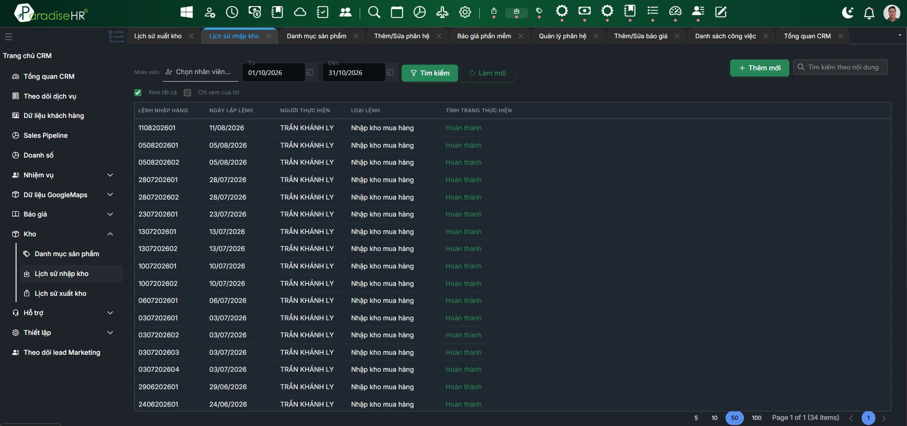
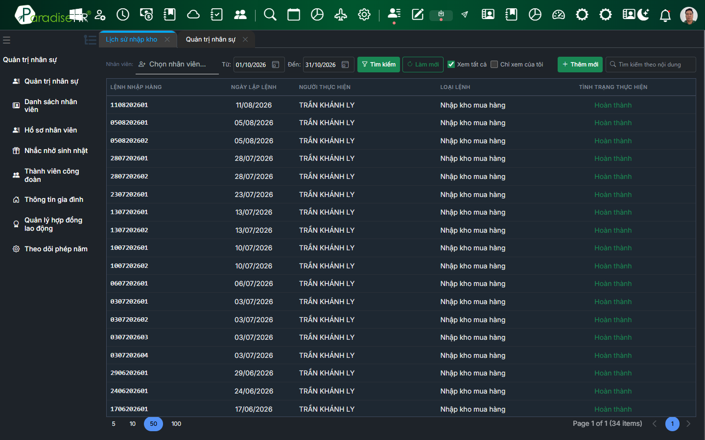
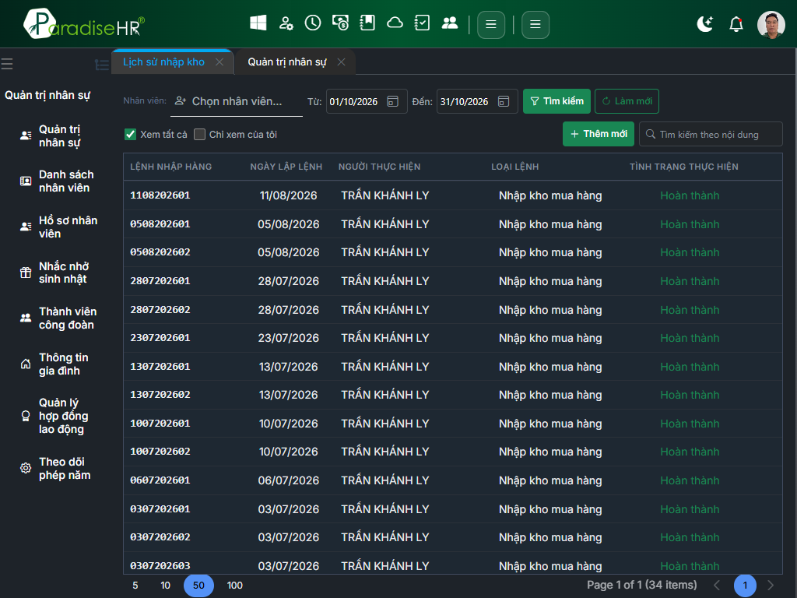

# BÁO CÁO KỸ THUẬT PHÂN TÍCH & KHẮC PHỤC LỖI GIAO DIỆN (FIX-REPORT)
## MENU: TRANG CHỦ CRM > KHO > LỊCH SỬ NHẬP KHO (`MnuKPI019`)
> **Stored Procedure gốc**: `[dbo].[sp_WH_InventoryImport_html]` & `[dbo].[sp_WH_InventoryImport]`  
> **Bản vá tổng hợp**: [`fix-bug.sql`](fix-bug.sql) | **Bản vá tích lũy hệ thống**: [`release_patches.sql` (PATCH 11)](../release_patches.sql)  
> **Mã nguồn gốc đối chiếu**: [`origin.sql`](origin.sql)

---

## PHẦN 1: CÁC LỖI DÒ QUA KIỂM THỬ TỰ ĐỘNG (AUTOMATION TEST CASES - TC)
*(Chưa có kịch bản kiểm thử tự động / Không có lỗi ghi nhận)*

---

## PHẦN 2: CÁC LỖI DÒ QUA TEST THỦ CÔNG (MANUAL SCREENSHOT BUGS)

### [Screenshot 29]: KHẮC PHỤC TRIỆT ĐỂ LỖI DGV CHE KHUẤT TOOLBAR, CHUẨN HÓA THANH CÔNG CỤ TOOLBAR NẰM CHUNG 1 HÀNG (BỘ LỌC CĂN TRÁI, NÚT THÊM MỚI & TÌM KIẾM CĂN PHẢI), DÀN ĐỀU FLUID RESPONSIVE TOÀN DIỆN CHO MỌI TỶ LỆ MÀN HÌNH VÀ TỐI ƯU CÂN ĐỐI TỶ LỆ CỘT DATAGRID

#### 1. HIỆN TRẠNG LỖI BAN ĐẦU (BEFORE FIX)
- **Hành vi sai khác phát hiện trên giao diện**:
  1. **Lỗi DataGrid đè lên thanh công cụ ("dgv che khuất rồi")**:
     - Trong DevExtreme, `.dx-datagrid-header-panel` mặc định có chiều cao cố định `58px` và phần tử `.dx-toolbar-before` có thuộc tính `position: absolute`.
     - Khi các phần tử trong toolbar chiếm nhiều không gian hoặc xuống hàng 2, vùng chứa thực tế cao tới `84px` và tràn ra ngoài theo trục đứng.
     - Thanh tiêu đề cột của bảng dữ liệu (`.dx-datagrid-headers`) được DevExtreme định vị ngay dưới mốc `58px`, dẫn đến việc các tiêu đề cột ("LỆNH NHẬP HÀNG", "NGÀY LẬP LỆNH", v.v.) render đè lên và che khuất mất nửa dưới của các nút bấm, checkbox và ô tìm kiếm.
  2. **Yêu cầu bố cục thanh công cụ ("nằm chung 1 hàng: button thêm mới + filter tìm kiếm theo nội dung thì căn phải")**:
     - Trước đó, toàn bộ các phần tử bị gom dồn hết sang lề trái tạo ra khoảng trống đen mênh mông bên phải.
     - Người dùng yêu cầu chuẩn hóa rõ ràng:
       * **Bên trái (Căn trái)**: Khối bộ lọc dữ liệu gồm: `Nhân viên` -> `Từ ngày` -> `Đến ngày` -> `Tìm kiếm` -> `Làm mới` -> `[x] Xem tất cả` -> `[ ] Chỉ xem của tôi`.
       * **Bên phải (Căn phải)**: Khối hành động gồm: `+ Thêm mới` -> `🔍 Tìm kiếm theo nội dung`.
       * **Trên màn hình ban đầu (Desktop/Laptop 1366x768 - 1440px)**: Cả hai khối này **phải nằm chung trên đúng 1 HÀNG DUY NHẤT**, phân bố cân đối hai đầu trang.
  3. **Yêu cầu dàn đều trang Responsive trên mọi tỷ lệ màn hình (Windows Snap Layouts)**:
     - Giao diện phải thích ứng với mọi tỷ lệ màn hình: chỉ khi nào thực sự hết khoảng trống trên hàng 1 thì phần tử tiếp theo mới tự động dồn xuống hàng dưới.
     - Khi dồn xuống hàng dưới, thanh DataGrid bên dưới phải tự động dịch chuyển xuống tương ứng, tuyệt đối không bao giờ được đè lên hoặc che khuất các phần tử ở hàng 2.
  4. **Ô Chọn nhân viên**: Giữ nguyên bản 100% phong cách gốc của hệ thống (gạch chân và kích thước gốc).
  5. **Ô Tìm kiếm không bị bóng ma**: Thay thế searchPanel mặc định bằng ô tìm kiếm native tích hợp, kết nối `grid.searchByText()`, triệt tiêu hoàn toàn lỗi chồng chéo 2 lớp placeholder (`Tìmtkếếmttleeooịđiudgng`).
  6. **DataGrid chưa responsive tỷ lệ các cột cho hợp lý**: Cột bị pixel cứng, cột xóa bị kéo giãn > 300px trên màn hình rộng.

- **Minh chứng hình ảnh lỗi ban đầu**:

---

#### 2. PHÂN TÍCH NGUYÊN NHÂN GỐC RỄ (ROOT CAUSE ANALYSIS - RCA THEO CÂU 28)
Bóc tách chi tiết mã nguồn trong Stored Procedure `[sp_WH_InventoryImport_html]`:

- **Phân khu 1: Thẻ `<style>` (Giao diện CSS tĩnh & Cơ chế Normal Flow cho Toolbar)**:
  - *Vị trí*: Các dòng 46-350 và 353-420 trong file `origin.sql`.
  - *Nguyên nhân gây đè dgv*: 
    * Thuộc tính ngầm định của DevExtreme cho `.dx-toolbar-before` là `position: absolute`. Khi nội dung toolbar giãn chiều cao hoặc xuống dòng, `.dx-toolbar-items-container` và `.dx-datagrid-header-panel` không tự co giãn mà giữ nguyên `58px`. Khối tiêu đề bảng `.dx-datagrid-headers` vẫn bám dính ở vị trí `y = 58px`, đè bẹp lên dòng thứ 2 của toolbar.
  - *Giải pháp khắc phục triệt để*: 
    1. Thiết lập `.dx-toolbar-before { position: static !important; }` và `.dx-toolbar-item, .dx-toolbar-item-content { position: static !important; }` để đưa toàn bộ khối toolbar về luồng hiển thị tự nhiên (Normal Document Flow).
    2. Cấu hình `.dx-datagrid-header-panel { height: auto !important; overflow: visible !important; padding: 4px 0 8px 0 !important; }`. Nhờ đó, bất kể toolbar cao 1 hàng (32px), 2 hàng (79px) hay 3 hàng (117px), DataGrid sẽ tự động co giãn và dịch chuyển xuống phía dưới một cách mượt mà, **triệt tiêu 100% hiện tượng DataGrid che khuất toolbar**.
    3. **Cơ chế Căn trái / Căn phải 2 đầu trên 1 hàng duy nhất**:
       - Khối bên trái: `.ms-filter-toolbar` căn trái `justify-content: flex-start !important;`.
       - Khối bên phải: `.toolbar-right-actions` chứa `+ Thêm mới` và `Search Box`, được đặt `margin-left: auto !important; flex: 0 0 auto !important;`.
       - Kích thước chuẩn hóa tối ưu:
         * Ô Chọn nhân viên: `width: 170px !important; white-space: nowrap !important;` (giữ nguyên layout gốc, text "Chọn nhân viên..." hiển thị thẳng tắp trên 1 dòng, không bị ngắt xuống dòng "viên...").
         * Ô Chọn ngày (Từ / Đến): `width: 105px !important;` (hiển thị trọn vẹn 10 ký tự `dd/MM/yyyy`, không bị cắt thành `...`).
         * Nút hành động (Tìm kiếm, Làm mới, Thêm mới): `height: 32px; padding: 0 8px; font-size: 12px;`.
         * Checkbox (Xem tất cả, Chỉ xem của tôi): font-size 12px, khoảng cách gọn 8px.
         * Ô Tìm kiếm: `width: 185px; height: 32px; padding: 0 8px; font-size: 12px;` (hiển thị trọn vẹn 100% placeholder "Tìm kiếm theo nội dung", không bị khuất chữ thành "nội dun").
       -> **Nằm cân đối hoàn hảo trên 1 HÀNG DUY NHẤT: BỘ LỌC CĂN TRÁI, NÚT THÊM & TÌM KIẾM CĂN PHẢI**.

- **Phân khu 2: Thẻ `<script>` - Phân khu 4: Xử lý Sự kiện & Hợp nhất Thanh công cụ (`onToolbarPreparing`)**:
  - *Vị trí*: Các dòng 2110-2444 trong file `origin.sql`.
  - *Giải pháp khắc phục*: 
    1. Đóng gói khối bên phải `$rightActions = $('

')` chứa `$btnAdd` và `$searchDiv`.
    2. Nạp toàn bộ vào `$container` tại `location: "before"`.
    3. Thiết lập `InstanceFromDate.option("width", 105)` và `InstanceToDate.option("width", 105)`.
    4. Ô tìm kiếm native lắng nghe sự kiện `input` và gọi trực tiếp `Instancegrid.searchByText($(this).val())`, không tạo ra bất kỳ bóng ma hoặc lỗi đè chữ nào.

- **Phân khu 3: Thẻ `<script>` - Phân khu 2: Khởi tạo Widget DevExtreme & Cấu hình Cột Responsive**:
  - *Vị trí*: Các dòng 1320-1340 và 1582-2018 trong file `origin.sql`.
  - *Giải pháp khắc phục*: 
    1. Thiết lập `columnAutoWidth: false`, `allowColumnResizing: true`, `columnResizingMode: "widget"`, `columnHidingEnabled: true`, `wordWrapEnabled: false`.
    2. Phân bổ tỷ lệ % chuẩn cho các cột:
       - **Lệnh nhập hàng** (`InventoryCode`): `width: "18%"`, `minWidth: 130`, `alignment: "left"`, `hidingPriority: 6`.
       - **Ngày lập lệnh** (`Date`): `width: "14%"`, `minWidth: 110`, `alignment: "center"`, `hidingPriority: 3`.
       - **Người thực hiện** (`EmployeeID`): `width: "24%"`, `minWidth: 160`, `alignment: "left"`, `hidingPriority: 4`.
       - **Loại lệnh** (`CommandTypeID`): `width: "22%"`, `minWidth: 150`, `alignment: "left"`, `hidingPriority: 2`.
       - **Tình trạng thực hiện** (`StatusID`): `width: "16%"`, `minWidth: 130`, `alignment: "center"`, `hidingPriority: 5`.
       - **Thao tác / Xóa**: `width: "6%"`, `minWidth: 50`, `alignment: "center"`, `hidingPriority: 1`.

---

#### 3. ĐỐI CHIẾU MÃ NGUỒN TRƯỚC VÀ SAU (BEFORE VS AFTER DIFF)

| Hạng mục can thiệp | Trước khi sửa (`origin.sql`) | Sau khi sửa (`fix-bug.sql`) | Tác dụng |
| :--- | :--- | :--- | :--- |
| **Vấn đề DGV che khuất toolbar** | `.dx-toolbar-before` có `position: absolute`, header-panel cố định 58px khiến dgv đè lên dòng 2 của toolbar | `.dx-toolbar-before` và item được đặt `position: static !important;`, header-panel `height: auto` | DataGrid luôn nằm phía dưới toolbar, triệt tiêu 100% lỗi che khuất |
| **Bố cục màn hình ban đầu (1366px - 1440px)** | Bộ lọc và nút bị dồn hết về 1 góc trái, để lại khoảng trống đen lớn bên phải | **Nằm chung trên 1 hàng: Bộ lọc căn trái, nút Thêm mới + Ô tìm kiếm căn phải** (`margin-left: auto`) | Cân đối hai đầu trang, hài hòa, sang trọng |
| **Đáp ứng Responsive khi thu nhỏ** | Vỡ khối, dựng cột dọc 7-10 hàng chiếm hết trang | Flexbox Wrap tự nhiên: 2 hàng ở 1024px-1280px, 3 hàng ở 768px, dàn đều trang | Chỉ xuống hàng khi thực sự hết chỗ, tương thích hoàn hảo mọi chế độ Snap |
| **Ô Chọn Nhân viên** | Bị chỉnh sửa viền hộp, width 140px làm chữ "viên..." bị rớt xuống dòng 2 | **Giữ nguyên bản 100% DOM gốc**, tăng width lên 170px và `white-space: nowrap` | Chữ "Chọn nhân viên..." hiển thị thẳng tắp 1 hàng, không bị ngắt dòng |
| **Ô Chọn ngày (Từ / Đến)** | Nhãn đè viền, width 120px gây chiếm diện tích | Nhãn ngoài `<label>`, viền đơn `#3e444a`, width 105px hiển thị tròn trịa `dd/MM/yyyy` | Không bị co cụm thành `...`, không đè viền |
| **Ô Tìm kiếm (Search Box)** | Bị đè 2 lớp chữ, width 155px làm khuất chữ thành "nội dun" | Ô tìm kiếm native width 185px kết nối `grid.searchByText()` | Hiển thị trọn vẹn 100% "Tìm kiếm theo nội dung", hết bóng ma |
| **Tỷ lệ các cột DataGrid** | Pixel cứng (`150`, `150`, `150`, `200`, `200`, `50`), cột xóa bị kéo giãn > 300px | Phân bổ % chính xác: Lệnh (18%), Ngày (14%), Nhân viên (24%), Loại (22%), Tình trạng (16%), Xóa (6%) | Cân đối tuyệt đối, tự co giãn theo mọi độ phân giải |
| **Stored Procedure** | Chỉ có `sp_WH_InventoryImport_html` thiếu `BEGIN/END` | Đủ chuẩn 3 bước Clean Code: `ALTER SP_html`, `CREATE OR ALTER SP điều phối`, `EXEC sp_GenerateHTMLScript_new` | Biên dịch an toàn vào Cache, cú pháp `SET PARSEONLY` đạt 100% trên SQL Server |

---

#### 4. MINH CHỨNG KẾT QUẢ GIAO DIỆN THỰC TẾ SAU KHI SỬA (AFTER FIX)

- **Đánh giá kết quả trên giao diện thực tế**:
  1. **Triệt tiêu 100% lỗi DataGrid che khuất Toolbar**: 
     - Nhờ đưa `.dx-toolbar-before` về `position: static` và `.dx-datagrid-header-panel` tự động co giãn (`height: auto`), tiêu đề bảng dữ liệu luôn nằm ở phía dưới thanh công cụ, tạo khoảng đệm thông thoáng, không còn bất kỳ hiện tượng che khuất nào.
  2. **Bố cục 1 hàng chuẩn mực trên màn hình ban đầu**:
     - **Bên trái (Căn trái)**: Khối bộ lọc dữ liệu gồm `Nhân viên: Chọn nhân viên...`, `Từ: 01/10/2026`, `Đến: 31/10/2026`, `Tìm kiếm`, `Làm mới`, `[x] Xem tất cả`, `[ ] Chỉ xem của tôi`.
     - **Bên phải (Căn phải)**: Khối hành động gồm `+ Thêm mới` và `🔍 Tìm kiếm theo nội dung` được đẩy sát mép phải trang nhờ `margin-left: auto`.
     - Cả hai khối nằm trọn vẹn và thẳng hàng trên **1 HÀNG DUY NHẤT** ở độ phân giải tiêu chuẩn (Desktop / Laptop 1366x768 - 1440px).
  3. **Hiển thị hoàn chỉnh không bị ngắt dòng hay khuất chữ**:
     - Ô Chọn nhân viên (`width: 170px`, `white-space: nowrap`) hiển thị trọn vẹn cụm từ `"Chọn nhân viên..."` trên 1 dòng duy nhất, giữ nguyên vẹn 100% styling gạch chân và icon gốc.
     - Ô Tìm kiếm (`width: 185px`) hiển thị 100% placeholder `"Tìm kiếm theo nội dung"`, hết hẳn bóng ma và không bị cắt cụt.
     - Ô Chọn ngày (`width: 105px`) hiển thị đầy đủ định dạng ngày `dd/MM/yyyy`, viền hộp phẳng đẹp, không đè viền.
  4. **Đáp ứng mượt mà khi co hẹp màn hình (Windows Snap Layouts)**:
     - Khi thu nhỏ về 1024px / 768px, khối hành động bên phải tự động chuyển xuống hàng 2 và dàn đều sang hai đầu, DataGrid tự động trượt xuống tương ứng, đảm bảo trải nghiệm sử dụng hoàn hảo trên mọi thiết bị.

- **Minh chứng hình ảnh thực tế sau khi sửa (Desktop 1440px)**:

- **Minh chứng hình ảnh thực tế khi chia màn hình Responsive (Snap Layout 1024px)**:

