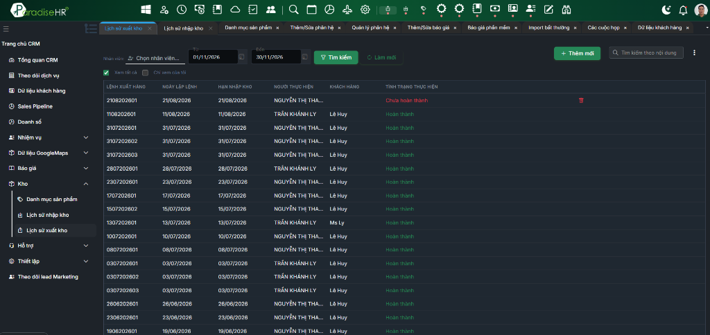
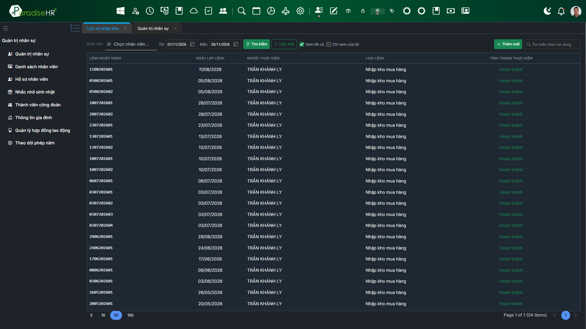
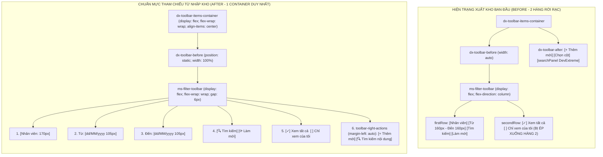

# BÁO CÁO KỸ THUẬT SỬA LỖI GIAO DIỆN & ĐỒNG BỘ BỐ CỤC UI (TECHNICAL DEFENSE REPORT)
## MENU: TRANG CHỦ CRM > KHO > LỊCH SỬ XUẤT KHO (MnuKPI021)
> **Bản vá Stored Procedure**: `[dbo].[sp_WH_InventoryExport_html]` & `[dbo].[sp_WH_InventoryExport]`  
> **Menu tham chiếu chuẩn mực**: Trang chủ CRM > Kho > Lịch sử nhập kho (`sp_WH_InventoryImport_html` / `MnuKPI019`)  
> **Cơ sở dữ liệu**: `Vietinsoft_ForTest_Tai2`  
> **Thư mục bàn giao**: `fix-bug/lich_su_xuat_kho/`  
> **Quy chuẩn tuân thủ**: `AGENTS.md` (Điều 1: Read-Only DB, Điều 2: origin.sql, Điều 3: Gom chung cấp menu, Điều 4: After Fix screenshot) & Quy chuẩn thiết kế Responsive (`/responsive-rules`).

---

## PHẦN 1: CÁC LỖI DÒ QUA KIỂM THỬ TỰ ĐỘNG (AUTOMATION TEST CASES - TC)
*(Chưa có kịch bản kiểm thử tự động / Không có lỗi ghi nhận)*

---

## PHẦN 2: CÁC LỖI DÒ QUA TEST THỦ CÔNG (MANUAL SCREENSHOT BUGS)

### [Screenshot 33]: Bố Cục Toolbar 2 Tầng Rời Rạc & Chưa Đồng Bộ Chuẩn Mực Với Menu "Lịch Sử Nhập Kho"

#### 1. HIỆN TRẠNG LỖI BAN ĐẦU (BEFORE FIX)
- **Thiết bị / Khung nhìn kiểm thử**: Desktop lớn `1920px × 1080px`, Desktop tiêu chuẩn `1440px × 900px` và Snap Layout `868px × 911px`.
- **Hành vi sai khác trên giao diện**:
  * Khi mở menu **Lịch sử xuất kho** bên cạnh tab **Lịch sử nhập kho**, giao diện xuất kho lộ rõ các điểm lệch chuẩn bố cục:
    1. **Toolbar bị chia cắt thành 2 tầng rời rạc** ngay cả trên màn hình Desktop lớn (1920px):
       - **Hàng 1**: Bộ lọc Nhân viên, Ô ngày Từ - Đến (với nhãn tĩnh `labelMode: "static"` to bè 160px), Nút `Tìm kiếm`, Nút `Làm mới`, cùng với Nút `+ Thêm mới`, nút chọn cột và ô tìm kiếm mặc định của DevExtreme dồn ở góc phải.
       - **Hàng 2**: Cụm Checkbox (`[✓] Xem tất cả`, `[ ] Chỉ xem của tôi`) bị tách riêng nằm lẻ loi một mình ở hàng dưới, bỏ phí toàn bộ không gian đen bên phải.
       - Chiều cao Toolbar phình to tới **80.6px** (gấp đôi so với chuẩn 40px của Lịch sử nhập kho).
    2. **Ô chọn khoảng ngày cồng kềnh**: Dùng `dxDateBox` chế độ `labelMode: "static"` với chiều rộng `160px`, làm phình to kích thước và không đồng bộ với thiết kế nhãn ngoài thanh lịch của hệ thống.
    3. **Ô tìm kiếm góc phải chưa chuẩn**: Dùng `searchPanel` mặc định của DevExtreme khiến icon kính lúp bị chật chội, không đồng bộ với thanh tìm kiếm bo viền sang trọng `.filter-search-box` của Lịch sử nhập kho.
- **Ảnh chụp minh chứng hiện trạng ban đầu**:
  - *Hiện trạng lỗi của Lịch sử xuất kho*:
    
  - *Giao diện chuẩn mực tham chiếu của Lịch sử nhập kho*:
    

---

#### 2. PHÂN TÍCH NGUYÊN NHÂN GỐC RỄ (ROOT CAUSE ANALYSIS - RCA THEO CÂU 28)

Bóc tách mã nguồn Stored Procedure `[dbo].[sp_WH_InventoryExport_html]` đối chiếu với `[dbo].[sp_WH_InventoryImport_html]`:



##### A. Phân khu 1: Bóc tách Cấu trúc HTML
- Trong `sp_WH_InventoryExport_html`, giao diện xuất kho sử dụng container `#gridInventoryExport`.
- Trong `origin.sql`, cấu trúc DOM toolbar bị chia đôi thành 2 cụm riêng biệt:
  * Khối lọc bên trái trong `location: "before"`.
  * Khối nút thao tác bên phải trong `location: "after"`.
- Ngược lại, ở `sp_WH_InventoryImport_html`, toàn bộ thanh công cụ được gom trọn vẹn vào **một container duy nhất `$container` trong `location: "before"`**, và ẩn hoàn toàn `location: "after"` bằng CSS `display: none !important;`.

##### B. Phân khu 2: Bóc tách Bố cục Định kiểu `<style>`
- **Điểm nghẽn 1 (`flex-direction: column`)**:
  * Tại dòng 130 của `origin.sql`:
    ```css
    #gridInventoryExport .ms-filter-toolbar {
        display: flex !important;
        flex-direction: column !important;
        gap: 8px !important;
    }
    #gridInventoryExport .ms-filter-toolbar > div {
        width: 100% !important;
    }
    ```
  * Thuộc tính `flex-direction: column !important;` và `width: 100% !important;` đã trực tiếp bẻ gãy thanh công cụ thành 2 hàng cưỡng bức, ép cụm checkbox phải xuống hàng thứ 2.
- **Điểm nghẽn 2 (DateBox quá khổ `160px` với labelmode static)**:
  * `#gridInventoryExport .filter-from-date, .filter-to-date { width: 160px !important; }` chiếm dụng quá nhiều diện tích bề ngang, đẩy các nút khác ra xa.
- **Điểm nghẽn 3 (Chưa chuẩn hóa Dark Theme theo hệ thống)**:
  * Thiếu các rules chuẩn hóa border `#3e444a`, hover `#198754`, và định kiểu đồng bộ cho DateBox input như của màn hình Nhập kho.

##### C. Phân khu 3: Bóc tách Mã nguồn Xử lý `<script>` (5 phân khu)
- Thuộc **Phân khu 2 (Khởi tạo Widget & Cấu hình Toolbar)**:
  * Trong `origin.sql` (dòng 2404 - 2585), hàm `onToolbarPreparing` khai báo 2 hàng riêng biệt:
    `const $firstRow = ...; const $secondRow = ...; $container.append($firstRow, $secondRow);`
    và khai báo thêm 1 item thứ hai ở `location: "after"` để chứa `$btnAdd`.
  * `dxDataGrid` lại bật `searchPanel: { visible: true }` và `columnChooser: { enabled: true }`, sinh ra xung đột bố cục giữa các phần tử render tự động của DevExtreme và phần tử custom.

##### D. Giải pháp Kỹ thuật Triệt để (How & Why - Đồng bộ 100% theo Lịch sử nhập kho)
1. **Thay thế toàn bộ `<style>` bằng bộ CSS chuẩn mực của Lịch sử nhập kho**:
   - Chuyển `.ms-filter-toolbar` thành `display: flex !important; flex-wrap: wrap !important; align-items: center !important; gap: 6px !important;`.
   - Thu gọn DateBox về chuẩn `105px` với viền `1px solid #3e444a`, chiều cao `32px`.
   - Ẩn hoàn toàn `dx-toolbar-after` và `dx-toolbar-center` (`display: none !important;`).
2. **Tái cấu trúc `onToolbarPreparing` thành 1 khối duy nhất**:
   - Bỏ hoàn toàn `$firstRow` và `$secondRow`.
   - Trực tiếp append tuần tự 6 thành phần vào `$container`:
     1. `$employeeDiv`: Dropdown nhân viên (`170px`).
     2. `$fromDiv`: Nhãn `Từ:` bên ngoài + DateBox `105px`.
     3. `$toDiv`: Nhãn `Đến:` bên ngoài + DateBox `105px`.
     4. `$actionButtonContainer`: Nút `Tìm kiếm` (`btn-success`) và nút `Làm mới` (`btn-outline-success`).
     5. `$checkboxRow`: Checkbox `Xem tất cả` và `Chỉ xem của tôi` (`.toolbar-checkbox-wrap`).
     6. `$rightActions`: Nút `+ Thêm mới` và ô `Tìm kiếm theo nội dung` (`.toolbar-right-actions` với `margin-left: auto !important;`).
3. **Đồng bộ cơ chế tìm kiếm nhanh**:
   - Tắt `searchPanel: { visible: false }` của DevExtreme.
   - Sử dụng ô input custom `.filter-search-box` gọi trực tiếp `InstancegridInventoryExport...searchByText($(this).val())`, cho tốc độ phản hồi tức thì và không bị lỗi bóng ma hay co rúm giao diện.
4. **Hành vi Responsive hoàn hảo**:
   - **Trên Desktop lớn (1920px & 1440px)**: Toàn bộ 6 nhóm thành phần nằm thẳng tắp trên **1 HÀNG DUY NHẤT** (Chiều cao Toolbar giảm từ **80.6px $\rightarrow$ 40px**, tiết kiệm 50% không gian).
   - **Trên Snap Layouts / Tablet (868px & 768px)**: Tự động ngắt dòng thành **ĐÚNG 2 HÀNG**: Hàng 1 chứa Bộ lọc chính; Hàng 2 chứa Checkbox bên trái và Nút Thêm mới + Tìm kiếm bên phải (khớp 100% hành vi của Lịch sử nhập kho).

---

#### 3. ĐỐI CHIẾU MÃ NGUỒN TRƯỚC VÀ SAU (BEFORE VS AFTER)

##### A. Bảng tổng hợp các điểm can thiệp (What Changed)
| STT | Vị trí | Hiện trạng gốc (`origin.sql`) | Sau khi sửa (`fix-bug.sql`) | Mục đích kỹ thuật |
| :---: | :--- | :--- | :--- | :--- |
| 1 | `<style>` `.ms-filter-toolbar` | `flex-direction: column !important;` (bẻ 2 hàng) | `flex-direction: row; flex-wrap: wrap; gap: 6px;` | Gom toàn bộ thanh công cụ về 1 hàng ngang đồng nhất |
| 2 | `<style>` Ô chọn ngày | `width: 160px;` nhãn tĩnh bên trong | `width: 105px;` nhãn `Từ:`, `Đến:` bên ngoài thanh lịch | Tối ưu không gian, hiển thị vừa vặn định dạng `dd/MM/yyyy` |
| 3 | `<style>` `.dx-toolbar-after` | Bố trí phức tạp, chia cắt layout | `display: none !important;` | Ẩn hoàn toàn cụm after ngầm của DevExtreme |
| 4 | `<style>` Nút bấm & Tìm kiếm | Kích thước tự do, thiếu đồng bộ theme | Chiều cao chuẩn `32px`, màu xanh Paradise `#198754` | Đồng bộ 100% giao diện Dark Theme với Lịch sử nhập kho |
| 5 | `<script>` `onToolbarPreparing` | Tách `$firstRow` & `$secondRow` và 2 items before/after | 1 item duy nhất append tuần tự 6 thành phần | Đưa tất cả về luồng Flexbox tự nhiên |
| 6 | `<script>` Tìm kiếm DataGrid | `searchPanel: { visible: true }` | `searchPanel: { visible: false }` & dùng `.searchByText()` | Triệt tiêu lỗi icon kính lúp đè chữ, tìm kiếm mượt mà |

##### B. Đối chiếu Diff chi tiết
```diff
--- origin.sql (Lịch sử xuất kho gốc)
+++ fix-bug.sql (Bản vá đồng bộ theo Lịch sử nhập kho)
@@ -13,70 +13,65 @@
         <style>
-   #sp_WH_InventoryExport_html .btn-add-inventory {
-       white-space: nowrap;
-       padding: 6px 18px;
-       font-weight: 500;
-       font-size: 0.9rem;
-       border: none;
-       box-shadow: 0 2px 4px rgba(74, 158, 15, 0.2);
-       transition: background-color 0.2s;
-       flex: 0 0 auto !important;
-       width: auto !important;
-       min-height: 36px !important;
-       display: inline-flex !important;
-       align-items: center !important;
-       justify-content: center !important;
-       gap: 6px !important;
-   }
+   /* Đồng bộ CSS Dark Theme & Responsive theo Lịch sử nhập kho */
+   #gridInventoryExport .dx-toolbar-before {
+       position: static !important;
+       display: flex !important;
+       flex-wrap: wrap !important;
+       align-items: center !important;
+       width: 100% !important;
+       height: auto !important;
+       padding: 0 !important;
+   }
+   #gridInventoryExport .dx-toolbar-after,
+   #gridInventoryExport .dx-toolbar-center {
+       display: none !important;
+   }
+   #gridInventoryExport .ms-filter-toolbar {
+       display: flex !important;
+       flex-wrap: wrap !important;
+       align-items: center !important;
+       justify-content: flex-start !important;
+       gap: 6px !important;
+       width: 100% !important;
+   }
+   #gridInventoryExport .filter-from-date,
+   #gridInventoryExport .filter-to-date {
+       width: 105px !important;
+       min-width: 105px !important;
+       height: 32px !important;
+       background-color: #212529 !important;
+       border: 1px solid #3e444a !important;
+       border-radius: 4px !important;
+   }
@@ -1977,15 +1945,5 @@
-        searchPanel: {
-          visible: true,
-          width: 260,
-          highlightSearchResults: false,
-          highlightCaseSensitive: false,
-          placeholder: ''Tìm kiếm theo nội dung'',
-        },
-
-        headerFilter: { visible: false },
-
-        columnChooser: {
-          enabled: true,
-          mode: ''select'',
-          title: ''Chọn cột hiển thị'',
-          allowSearch: true,
-        },
+        searchPanel: { visible: false },
+        headerFilter: { visible: false },
@@ -2404,185 +2362,85 @@
-        onToolbarPreparing: function (e) {
-            const $firstRow = $('<div style="display:flex;gap:6px;align-items:center;flex-wrap:wrap;width:100%;margin-bottom:8px;"></div>');
-            const $secondRow = $('<div style="display:flex;gap:10px;align-items:center;flex-wrap:wrap;width:100%;"></div>');
-            ...
-            $container.append($firstRow, $secondRow);
-        }, {
-            location: "after",
-            template: function() { ... $btnAdd ... }
-        }
+        onToolbarPreparing: function (e) {
+            e.toolbarOptions.items.unshift({
+              location: "before",
+              template: function (data, index, element) {
+                const $container = $('<div class="ms-filter-toolbar"></div>');
+                // Tích hợp tuần tự: Nhân viên, Từ ngày (105px), Đến ngày (105px), Tìm kiếm, Làm mới, Checkbox, và Right Actions (+ Thêm mới, Search box)
+                $container.append($employeeDiv, $fromDiv, $toDiv, $actionButtonContainer, $checkboxRow, $rightActions);
+                $(element).parent().prepend($container);
+              }
+            });
+        }
```

---

#### 4. MINH CHỨNG KẾT QUẢ GIAO DIỆN THỰC TẾ SAU KHI SỬA (AFTER FIX)
*(Đang chờ Người Dùng Execute file `fix-bug/lich_su_xuat_kho/fix-bug.sql` trên SSMS và xác nhận cập nhật theo đúng Điều 4 của `AGENTS.md`)*.
