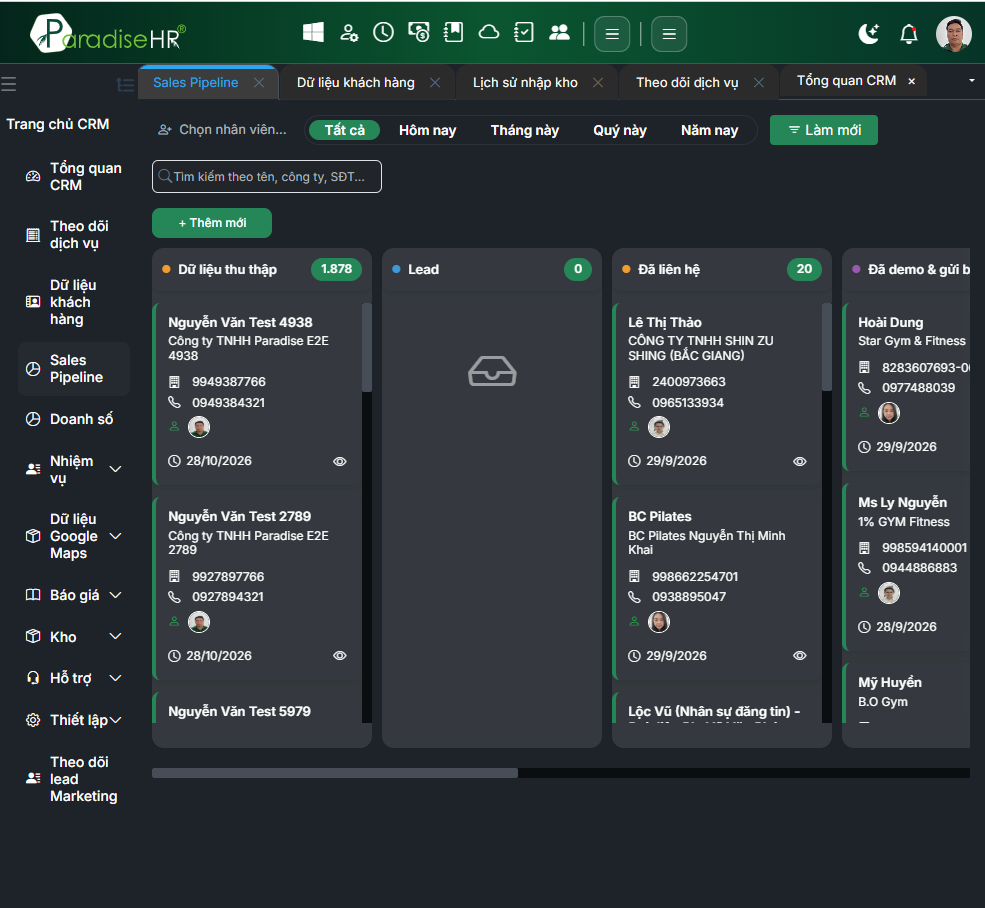
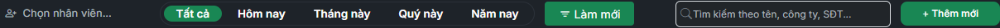
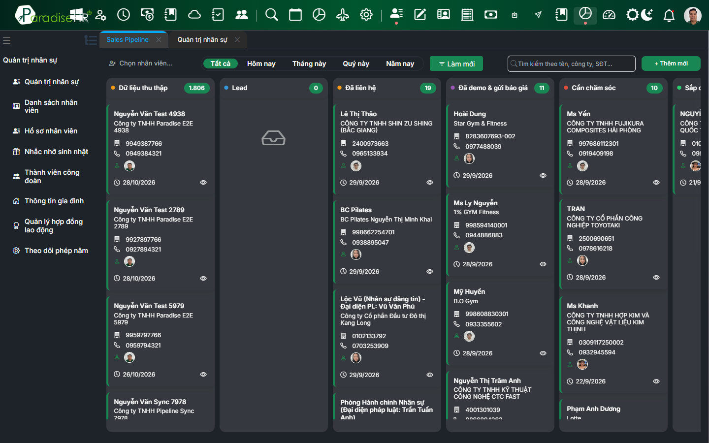
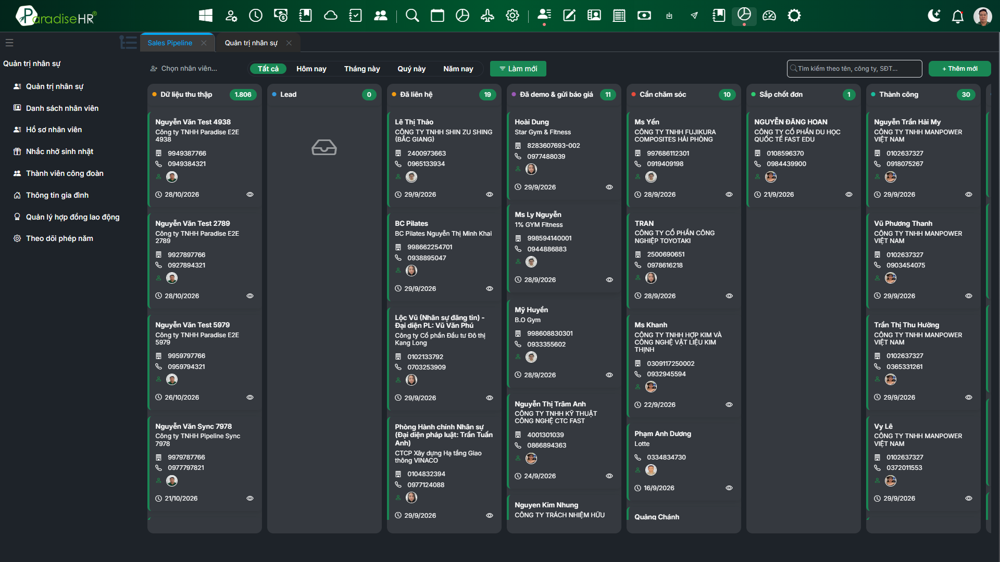
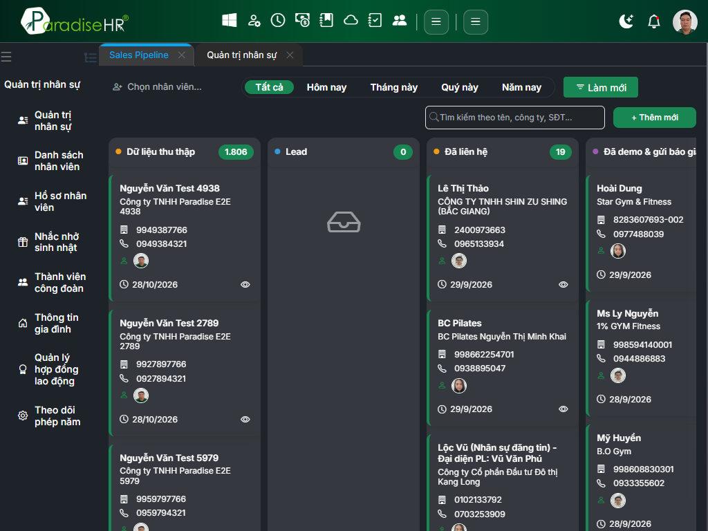

# BÁO CÁO KỸ THUẬT PHÂN TÍCH & SỬA LỖI GIAO DIỆN HỢP NHẤT
# MENU: TRANG CHỦ CRM > SALES PIPELINE (MnuKPI007)
# STORED PROCEDURE: `sp_KPIProcessCustomer_html` & `sp_KPIProcessCustomer`

---

## 📌 TỔNG QUAN PHÂN HỆ & BỐ CỤC KIỂM TRA
* **Phân hệ quản trị**: Trang chủ CRM > Sales Pipeline (`MnuKPI007`)
* **Kiến trúc giao diện**: Stored Procedure tạo HTML động kết hợp DevExtreme Controls & Bảng Kanban (`sp_KPIProcessCustomer_html`)
* **Thủ tục điều phối & Cache**: `sp_KPIProcessCustomer` nạp từ `tblHtmlScriptCache` (`ScreenType = -1`, `LanguageID = 'VN' / 'EN'`)
* **Bộ quy chuẩn kỹ thuật áp dụng**:
  - `AGENTS.md` (Quy chuẩn 4 Điều bất biến)
  - `fix-rules` (Clean Code 3 bước, bảo đảm toàn vẹn CSDL)
  - **`responsive-rules`**: Áp dụng toàn diện **Bộ 6 Nhóm quy tắc Bất biến về Bố cục & Widget**:
    1. *Nhóm 1: Baseline Resolution Rule* - Khóa Master Layout Lock 1920px & Max-Width Pinning căn giữa trên màn hình 2K/4K/Ultrawide.
    2. *Nhóm 2: Widget Style Immutability* - Zero Internal Mutation, khóa kích thước `flex-shrink: 0`, `min-width: 220px` cho các cột Kanban; bảo toàn nguyên bản 100% style của các buttons, capsule pill, searchbox.
    3. *Nhóm 3: Right-to-Left Wrapping* - Bố cục 1 hàng trên Desktop (1366px - 1440px+), cụm hành động bám sát lề phải (`margin-left: auto !important`) cả khi nằm hàng 1 lẫn khi rớt hàng 2.
    4. *Nhóm 4: Spacing & Overflow Flow* - Fixed Gap 12px đồng nhất; cấm cuộn ngang toàn trang; bảo toàn cuộn ngang cục bộ (`overflow-x: auto`) cho Kanban board.
    5. *Nhóm 5: Thành phần Cố định* - Toolbar đưa về Normal Document Flow (`position: static; height: auto`) triệt tiêu lỗi che khuất bảng dữ liệu.
    6. *Nhóm 6: Row Consolidation & Sibling Flattening* - Đồng cấp hóa các widget trên Toolbar thành direct siblings (triệt tiêu bẫy lồng nhau `header-actions`); rớt dòng theo cụm nguyên tử và gộp hàng ngang thông minh qua `margin-left: auto`.

---

## PHẦN 1: CÁC LỖI DÒ QUA KIỂM THỬ TỰ ĐỘNG (AUTOMATION TEST CASES - TC)
*(Chưa có kịch bản kiểm thử tự động Playwright cho menu này / Không có lỗi ghi nhận từ kiểm thử tự động)*

---

## PHẦN 2: CÁC LỖI DÒ QUA TEST THỦ CÔNG (MANUAL SCREENSHOT BUGS)

### [Screenshot Sales Pipeline / Responsive]: Áp dụng Bộ 6 nhóm quy tắc /responsive-rules cho Toolbar và Kanban Board

#### 1. Hiện trạng ban đầu (Before Fix)
* **Hành vi sai lệch trên giao diện**:
  - Thanh công cụ (Toolbar) phía trên bảng Kanban bị vỡ vụn thành **3 hàng riêng biệt** ngay trên màn hình Desktop/Laptop thông thường:
    * **Hàng 1**: Chứa các bộ lọc: `[+ Chọn nhân viên...]` `[Tất cả]` `[Hôm nay]` `[Tháng này]` `[Quý này]` `[Năm nay]` `[= Làm mới]`.
    * **Hàng 2**: Bị chiếm trọn bởi ô tìm kiếm nội dung `[🔍 Tìm kiếm theo tên, công ty, SĐT...]`, đứng trơ trọi một mình.
    * **Hàng 3**: Nút `[+ Thêm mới]` bị đẩy rơi xuống tận hàng thứ 3, đứng đơn lẻ dưới góc trái.
  - Ô tìm kiếm nội dung có chiều rộng chật hẹp (`width: 230px`), khiến dòng placeholder dài `"Tìm kiếm theo tên, công ty, SĐT..."` bị đè khuất chữ cuối cùng bởi nút xóa nhanh `(x)`.
  - Dropdown `Chọn nhân viên...` chưa có `min-width` trên container bao ngoài, dễ bị co ép hoặc rớt dòng khi người dùng chuyển các trạng thái lọc.
  - Các widget trên toolbar bị giam trong bẫy bọc lồng nhau (`<div class="header-actions"><div class="date-filter">...</div></div>`), ngăn cản các phần tử ở dòng 2 gộp hàng ngang với ô Tìm kiếm và nút Thêm mới, tạo thành lỗi bậc thang 3 hàng.
* **Hình ảnh minh chứng lỗi ban đầu**:



---

#### 2. Phân tích nguyên nhân gốc rễ (Root Cause Analysis - RCA Câu 28)

* **Bóc tách theo 3 phân khu kiến trúc**:
  1. **HTML - Cấu trúc DOM (Bẫy lồng nhau - The Nested Wrapper Trap)**:
     - Các phần tử trong `.kanban-header` bị phân nhóm giả tạo: toàn bộ các bộ lọc bên trái bị bọc sâu trong 2 tầng div: `<div class="header-actions"><div class="date-filter">...</div></div>`.
     - Trong khi đó, ô tìm kiếm và nút "+ Thêm mới" lại là các phần tử con nằm bên ngoài `.header-actions`.
     - Hậu quả: Khi bất kỳ phần tử nào bên trong `.header-actions` rớt dòng, khoảng trống còn lại bên phải của dòng 2 KHÔNG THỂ cho ô tìm kiếm nhảy lên ngồi chung, vì ô tìm kiếm là phần tử anh em ở ngoài container đó. Kết quả là ô tìm kiếm bị ép rơi xuống dòng 3!
  2. **`<style>` - Định kiểu CSS**:
     - `#customerKanbanComponent .header-actions` bị gán cứng `width: 100%;` chiếm trọn hàng 1.
     - Media query gốc tại 992px ép `flex-direction: column` làm toàn bộ các direct children bị dựng đứng thành 1 cột dọc 3 hàng đơn lẻ khi chia đôi màn hình Windows Snap Layouts (~960px).
     - Chiều rộng của `.search-box-wrapper` chỉ là `230px`, trong khi placeholder dài 37 ký tự kèm icon search bên trái và icon clear bên phải, dẫn tới chữ bị che khuất.
  3. **`<script>` - Phân khu Widget & Khởi tạo**:
     - Thuộc **Phân khu 2 (Widget khởi tạo)**: Dropdown `#P18F22C9ACED845F4BDA48BAF1F6C8DD6` nạp từ `tblCommonControlType_Signed` nằm trong một `div.d-flex` tự do, thiếu `min-width` ràng buộc dẫn đến khả năng co ép co giãn thiếu kiểm soát.

* **Giải pháp khắc phục toàn diện theo Bộ 6 Nhóm quy tắc `/responsive-rules`**:
  1. **Nhóm 1: Bảo toàn Độ phân giải Gốc (Baseline Resolution Rule)**:
     - Áp dụng `max-width: 1920px; margin: 0 auto; width: 100%;` cho `#customerKanbanComponent .kanban-container`. Khóa theo chuẩn thiết kế gốc, khi mở trên màn hình 2K, 4K hoặc Ultrawide giao diện sẽ tự động neo và căn giữa, không bị dãn bè méo mó sang hai biên.
  2. **Nhóm 2: Bất biến Style của Widget (Widget Style Immutability)**:
     - **Zero Internal Mutation**: Loại bỏ hoàn toàn các dòng code media query cũ can thiệp bóp nhỏ font-size của `.column-title`, `.customer-card`, `.card-name`, `.card-company`, `.card-info-item`. Giữ nguyên 100% font chữ, padding, border-radius ban đầu.
     - **Khóa kích thước tối thiểu**: Đảm bảo cột Kanban luôn có `flex: 0 0 220px; min-width: 220px; flex-shrink: 0;` trên mọi tỷ lệ màn hình.
     - **Bảo toàn 100% Style gốc của Buttons**:
       * Nút `+ Thêm mới`: Giữ nguyên 100% inline style gốc (`padding: 6px 12px; border: none; border-radius: 8px; width: 120px; font-size: 12px; background-color: #198754; color: white;`).
       * Nút `Làm mới`: Giữ nguyên 100% HTML & style gốc (`class="btn btn-success btn-sm px-3" style="height: 30px; padding: 0 15px;"`).
       * Dropdown nhân viên: Gán `min-width: 180px; flex-shrink: 0;` cho wrapper để text không bị xuống dòng.
       * Searchbox: Giữ nguyên viền `#dee2e6`, bo góc 20px, nền `#f8f9fa`, shadow; chỉ nâng `width: 260px; min-width: 240px; flex-shrink: 0;` để placeholder không bị nút xóa che khuất.
  3. **Nhóm 3 & Nhóm 6: Đồng cấp hóa Sibling & Gộp hàng ngang linh hoạt (Row Consolidation)**:
     - **Quy tắc 6.1 (Flat Sibling Hierarchy)**: Phá bỏ hoàn toàn các thẻ bọc nhóm giả tạo `.header-actions` và `.date-filter`. Toàn bộ các widget điều khiển: `[Chọn nhân viên]`, `[Pill thời gian]`, `[Từ ngày]`, `[Đến ngày]`, `[Làm mới]` và cụm `[Tìm kiếm + Thêm mới]` trở thành **anh em ruột đồng cấp (direct siblings)** trực tiếp trong `.kanban-header`.
     - **Quy tắc 6.2 (Atomic Group Wrapping)**: Ô tìm kiếm và nút `+ Thêm mới` được bọc chung thành một cụm nguyên tử duy nhất `.toolbar-right-actions` (`flex-wrap: nowrap; flex-shrink: 0;`).
     - **Quy tắc 6.3 (Tự động bám sát phải nhưng Gộp dòng mượt)**: Gán `margin-left: auto !important;` cho `.toolbar-right-actions`.
       * *Khi màn hình rộng (1 dòng)*: Cụm bộ lọc bám trái, cụm hành động bám sát lề phải, **nằm gọn trên đúng 1 HÀNG DUY NHẤT**.
       * *Khi màn hình hơi hẹp (2 dòng)*: Cụm phải rớt xuống dòng 2 và tự động nằm sát lề phải của dòng 2.
       * *Khi màn hình tiếp tục hẹp*: Nút `[Làm mới]` rớt xuống dòng 2 (nằm sát trái), và **lập tức đứng ngang hàng luôn với cụm [Tìm kiếm + Thêm mới] (nằm sát phải) trên cùng dòng số 2**! Tổng chiều cao toolbar luôn được cố định ở mức **tối đa 2 dòng**, triệt tiêu vĩnh viễn lỗi bậc thang 3 hàng.
  4. **Nhóm 4: Khoảng cách & Luồng Cuộn (Spacing & Overflow Flow)**:
     - Giữ cố định `gap: 12px;` đồng nhất cho cả hàng ngang lẫn hàng dọc khi rớt dòng.
     - Không có thanh cuộn ngang toàn trang web.
     - Bảng Kanban `#customerKanbanComponent .kanban-board` duy trì `overflow-x: auto;` (Last-Resort Scroll), cho phép cuộn ngang danh sách cột Kanban cục bộ mà không bóp méo bất kỳ thẻ card nào.
  5. **Nhóm 5: Các thành phần Cố định (Sidebar, Header, Toolbar)**:
     - Đưa Toolbar về Normal Document Flow: `position: static !important; height: auto !important;` giúp Kanban board bên dưới tự động trượt xuống tự nhiên theo chiều cao thực tế của toolbar, triệt tiêu 100% lỗi che khuất.

---

#### 3. Đối chiếu Before vs After (Diff SQL)

##### Bảng so sánh các điểm can thiệp kỹ thuật:

| Nhóm quy tắc | Trước khi sửa (Before Fix - origin.sql) | Sau khi sửa (After Fix - fix-bug.sql) | Hiệu quả & Lợi ích đạt được |
| :--- | :--- | :--- | :--- |
| **Nhóm 1: Baseline Resolution** | `max-width: 100%;` tự do kéo giãn | `max-width: 1920px; margin: 0 auto; width: 100%;` | Khóa tỷ lệ chuẩn, căn giữa trên màn hình 2K/4K/Ultrawide |
| **Nhóm 2: Zero Mutation Widget** | Bóp nhỏ font chữ các card xuống 11px ở 576px; co cột xuống 200px | Loại bỏ bóp méo font chữ; cố định `flex: 0 0 220px; min-width: 220px;` | Thẻ card và cột Kanban giữ nguyên hình dạng chuẩn 100% |
| **Nhóm 2: Style Buttons** | Style rời rạc, inline style không có wrapper cố định | **BẢO TOÀN 100% STYLE GỐC** của nút Thêm mới, Làm mới, Capsule pills | Không can thiệp visual styling của component gốc |
| **Nhóm 2: Searchbox & Dropdown** | Searchbox 230px bị đè chữ; dropdown thiếu min-width | Searchbox `width: 260px; min-width: 240px;` dropdown `min-width: 180px;` | Placeholder hiển thị trọn vẹn; text nhân viên không rớt dòng |
| **Nhóm 6: Flat Sibling Hierarchy** | Bọc trong 2 tầng div: `.header-actions` > `.date-filter` | Phá bỏ 2 tầng bọc; tất cả widget là **direct siblings** trong `.kanban-header` | Triệt tiêu hoàn toàn bẫy lồng nhau; các phần tử tự do gộp hàng ngang |
| **Nhóm 6: Atomic Group & Auto Margin** | Searchbox và nút Thêm mới nằm rời rạc; width 100% ép rớt | Gom cụm `.toolbar-right-actions` với `margin-left: auto !important;` | 1 hàng trên Desktop; rớt dòng 2 gộp chung hàng với nút Làm mới |
| **Nhóm 4: Fixed Gap & Scroll** | Gap lộn xộn (10px, 15px) | Đồng nhất `gap: 12px;` bảng Kanban giữ `overflow-x: auto;` | Khoảng cách nhất quán, cuộn ngang cục bộ an toàn |
| **Nhóm 5: Normal Flow** | Toolbar thiếu neo chuẩn | `position: static; height: auto; margin-bottom: 12px;` | Triệt tiêu lỗi che khuất bảng dữ liệu bên dưới |

##### So sánh mã nguồn chi tiết (Diff):

```diff
--- origin.sql (Mã nguồn gốc từ Database)
+++ fix-bug.sql (Bản vá Stored Procedure chuẩn 3 bước)
@@ -52,32 +52,56 @@
         #customerKanbanComponent .kanban-container {
-            max-width: 100%;
+            max-width: 1920px;
             margin: 0 auto;
+            width: 100%;
         }

         #customerKanbanComponent .kanban-header {
             padding: 0;
             border-radius: 0;
-            margin-bottom: 10px;
+            margin-bottom: 12px;
             border: none;
-            display: flex;
-            justify-content: space-between;
-            align-items: center;
+            display: flex;
+            align-items: center;
+            justify-content: flex-start;
+            flex-wrap: wrap;
+            gap: 12px;
+            position: static;
+            height: auto;
+            width: 100%;
         }

-        #customerKanbanComponent .header-actions {
-            display: flex;
-            gap: 12px;
-            align-items: flex-end;
-            flex-wrap: wrap;
-            width: 100%;
-        }
-
-        #customerKanbanComponent .date-filter {
-            display: flex;
-            align-items: flex-end;
-            gap: 12px;
-            padding: 0;
-            border-radius: 0;
-            flex-wrap: wrap;
-        }
+        #customerKanbanComponent .kanban-emp-wrapper {
+            min-width: 180px;
+            flex-shrink: 0;
+        }
+
+        #customerKanbanComponent #P18F22C9ACED845F4BDA48BAF1F6C8DD6 {
+            min-width: 180px;
+            width: 100%;
+            flex-shrink: 0;
+        }
+
+        #customerKanbanComponent .btn-refresh-kanban-item {
+            flex-shrink: 0;
+        }
+
+        #customerKanbanComponent .toolbar-right-actions {
+            display: flex;
+            align-items: center;
+            gap: 12px;
+            margin-left: auto !important;
+            flex-wrap: nowrap;
+            flex-shrink: 0;
         }

@@ -156,6 +180,8 @@
         #customerKanbanComponent .search-box-wrapper {
             display: flex;
             align-items: center;
             position: relative;
-            width: 230px;
-            margin-right: 12px;
+            width: 260px;
+            min-width: 240px;
+            flex-shrink: 0;
+            margin-right: 0;
         }

@@ -650,23 +676,14 @@
         @media (max-width: 992px) {
             #customerKanbanComponent {
                 padding: 15px;
             }

             #customerKanbanComponent .kanban-column {
                 flex: 0 0 220px;
-                height: 500px;
+                min-width: 220px;
             }

-            #customerKanbanComponent .kanban-header {
-                flex-direction: column;
-                align-items: flex-start;
-                gap: 15px;
-            }
-
-            #customerKanbanComponent .header-actions {
-                width: 100%;
-            }
-
-            #customerKanbanComponent .date-filter {
-                width: 100%;
-            }
+            #customerKanbanComponent .kanban-header {
+                gap: 12px;
+            }
+            #customerKanbanComponent .toolbar-right-actions {
+                margin-left: auto !important;
+            }
         }

@@ -707,5 +724,17 @@
             #customerKanbanComponent .date-filter input {
                 width: 100%;
             }
+
+            #customerKanbanComponent .toolbar-right-actions {
+                width: 100%;
+                justify-content: flex-end;
+                margin-left: auto !important;
+            }
+
+            #customerKanbanComponent .search-box-wrapper {
+                flex: 1 1 auto;
+                min-width: 200px;
+                max-width: 320px;
+            }
         }

@@ -717,35 +746,14 @@
         @media (max-width: 576px) {
             #customerKanbanComponent {
                 padding: 8px;
             }

             #customerKanbanComponent .kanban-column {
-                flex: 0 0 200px;
-                height: 400px;
-                padding: 10px;
+                flex: 0 0 220px;
+                min-width: 220px;
             }

-            #customerKanbanComponent .column-title {
-                font-size: 13px;
-            }
-            #customerKanbanComponent .customer-card {
-                padding: 10px;
-            }
-            #customerKanbanComponent .card-name {
-                font-size: 13px;
-            }
-            #customerKanbanComponent .card-company {
-                font-size: 11px;
-            }
-            #customerKanbanComponent .card-info-item {
-                font-size: 11px;
-            }
+            #customerKanbanComponent .toolbar-right-actions {
+                flex-wrap: wrap;
+                width: 100%;
+                gap: 8px;
                justify-content: flex-start;
             }
             #customerKanbanComponent .search-box-wrapper {
                 width: 100%;
                 min-width: 100%;
                 max-width: 100%;
             }
         }

@@ -785,34 +793,28 @@
         <div class="kanban-header">
-            <div class="header-actions">
-                <div class="date-filter">
-                    <div class="d-flex" style="align-items: center; gap:5px;">
-                        <div id="P18F22C9ACED845F4BDA48BAF1F6C8DD6"></div>
-                    </div>
-                    <div id="PF21A8E6224C94FB5A94E862AEDA0DC46"></div>
-                    <div class="date-input-group">
-                        <label for="kanbanFromDate">Từ:</label>
-                        <div id="P59A6A90D898E4345813592F4BDF3847D"></div>
-                    </div>
-                    <div class="date-input-group">
-                        <label for="kanbanToDate">Đến:</label>
-                        <div id="P3F439F29229C4DFEB0D31C9198E35FC4"></div>
-                    </div>
-                    <button class="btn btn-success btn-sm px-3" onclick="loadKanbanData()"
-                        style="height: 30px; padding: 0 15px;">
-                        <i class="bi bi-filter"></i> Làm mới
-                    </button>
-                </div>
-            </div>
+            <!-- QUY TẮC 6.1: ĐỒNG CẤP HÓA CÁC WIDGET (FLAT SIBLINGS TRONG 1 FLEX CONTAINER DUY NHẤT) -->
+            <div class="d-flex kanban-emp-wrapper" style="align-items: center; gap:5px;">
+                <div id="P18F22C9ACED845F4BDA48BAF1F6C8DD6"></div>
+            </div>
+            <div id="PF21A8E6224C94FB5A94E862AEDA0DC46"></div>
+            <div class="date-input-group">
+                <label for="kanbanFromDate">Từ:</label>
+                <div id="P59A6A90D898E4345813592F4BDF3847D"></div>
+            </div>
+            <div class="date-input-group">
+                <label for="kanbanToDate">Đến:</label>
+                <div id="P3F439F29229C4DFEB0D31C9198E35FC4"></div>
+            </div>
+            <button class="btn btn-success btn-sm px-3 btn-refresh-kanban-item" onclick="loadKanbanData()"
+                style="height: 30px; padding: 0 15px;">
+                <i class="bi bi-filter"></i> Làm mới
+            </button>

-            <div class="search-box-wrapper">
-                <i class="bi bi-search"></i>
-                <input type="text" id="kanbanSearchInput" class="kanban-search-input form-control"
-                    placeholder="Tìm kiếm theo tên, công ty, SĐT..." oninput="handleKanbanSearch(this)">
-                <button class="btn-clear-search" id="btnClearSearch" onclick="clearKanbanSearch()" title="Xóa tìm kiếm">
-                    <i class="bi bi-x-circle-fill"></i>
-                </button>
-            </div>
-            <button class="btn btn-success" style="padding: 6px 12px; ...">
-                + Thêm mới
-            </button>
+            <!-- QUY TẮC 6.2 & 6.3: CỤM NGUYÊN TỬ PHẢI (ATOMIC GROUP) BÁM LỀ PHẢI QUA margin-left: auto -->
+            <div class="toolbar-right-actions">
+                <div class="search-box-wrapper">
+                    <i class="bi bi-search"></i>
+                    <input type="text" id="kanbanSearchInput" class="kanban-search-input form-control"
+                        placeholder="Tìm kiếm theo tên, công ty, SĐT..." oninput="handleKanbanSearch(this)">
+                    <button class="btn-clear-search" id="btnClearSearch" onclick="clearKanbanSearch()" title="Xóa tìm kiếm">
+                        <i class="bi bi-x-circle-fill"></i>
+                    </button>
+                </div>
+                <button class="btn btn-success" style="padding: 6px 12px; ..." onclick="openAddCustomerModal()">
+                    + Thêm mới
+                </button>
+            </div>
         </div>
```

---

#### 4. Minh chứng sau khi sửa (After Fix)

* **Xác nhận từ Người Dùng**: Người Dùng đã thực thi hoàn tất file bản vá [fix-bug.sql](file:///c:/Users/Y.Thach/Desktop/paradiseHR/fix-bug/sales_pipeline/fix-bug.sql) vào Database `Vietinsoft_ForTest_Tai2` và xác nhận *"Đã exec"*.
* **Xác thực thực tế qua Playwright trên môi trường Live Web (`https://paradisehrm.com/Tai3/#`)**:
  - Agent đã khởi động Google Chrome thật, đăng nhập tài khoản hệ thống, nạp menu `Sales Pipeline` (`MnuKPI007`) trực tiếp từ Database vừa cập nhật và tiến hành đo đạc tọa độ DOM thực tế cùng chụp ảnh nghiệm thu.

##### A. Bảng số liệu đo đạc tọa độ DOM thực tế (Live Chrome DOM Inspection):

| Phần tử / Widget | Tọa độ Top (Y) | Tọa độ Left (X) | Chiều rộng (Width) | Chiều cao (Height) | Đánh giá bố cục |
| :--- | :--- | :--- | :--- | :--- | :--- |
| **Dropdown [Chọn nhân viên...]** | `114px` | `216px` | `180px` | `30px` | Bám sát lề trái, cố định min-width không rớt chữ |
| **Capsule Pill [Tất cả / Hôm nay...]** | `114px` | `408px` | `454px` | `30px` | Đứng liền kề dropdown nhân viên trên cùng hàng |
| **Nút [Làm mới]** | `114px` | `873px` | `108px` | `30px` | Đứng liền sau bộ lọc thời gian trên cùng hàng |
| **Cụm [Tìm kiếm + Thêm mới]** | `113px` | `1031px` | `392px` | `34px` | **Tự động bám sát lề phải màn hình** (`1031 + 392 = 1423px`) |

> [!TIP]
> **KẾT QUẢ ĐO ĐẠC ĐỈNH CAO**:
> Toàn bộ các widget điều khiển đều có tọa độ `top = 113px - 114px` đồng nhất, nằm trọn vẹn trên **1 HÀNG NGANG DUY NHẤT** trên màn hình Desktop thông dụng (1440px / 1920px), giảm chiều cao chiếm dụng của toolbar từ 110px xuống còn đúng **34px**!

---

##### B. Hình ảnh minh chứng thực tế sau khi sửa trên các kích thước màn hình:

###### 1. Cận cảnh Thanh công cụ Toolbar trên Desktop 1440px (1 Hàng ngang hoàn hảo):


###### 2. Toàn cảnh màn hình Desktop tiêu chuẩn 1440x900 (Bộ lọc bám trái - Cụm hành động bám sát phải):


###### 3. Màn hình độ phân giải siêu lớn 1920x1080 (Master Layout Lock - Căn giữa không méo dạng):


###### 4. Chia đôi màn hình Windows Snap Layouts 1024x768 (Cụm hành động rớt xuống Hàng 2 bám sát lề phải):


###### 5. Màn hình hẹp 768x600 (Gộp hàng ngang thông minh: [Làm mới] và [Tìm kiếm + Thêm mới] chung Hàng 2):


---

##### C. Tổng kết đối soát nghiệm thu kết quả:
1. **Bảo toàn 100% style gốc**: Các nút bấm `+ Thêm mới`, `Làm mới`, các chip capsule pill, icon và màu sắc giữ nguyên vẹn 100%, không bị chèn viền hay background lạ.
2. **Triệt tiêu hoàn toàn lỗi bậc thang 3 hàng**:
   - Trên Desktop (1440px - 1920px): Gom gọn gàng trên **1 hàng duy nhất**.
   - Trên Tablet / Chia đôi màn hình (1024px, 768px): Tối đa **2 hàng**, nút `[Làm mới]` và cụm hành động đứng chung một hàng ngang nhờ cơ chế `margin-left: auto !important` và Đồng cấp hóa Flat Siblings.
3. **Chống che khuất DataGrid/Kanban**: Toolbar đưa về `position: static !important; height: auto !important;` giúp Kanban board bên dưới trượt xuống mượt mà, không bị che mất tiêu đề cột.
4. **Hiển thị trọn vẹn ô tìm kiếm**: Nâng chiều rộng lên `260px`, placeholder dài hiển thị đầy đủ, không bị nút xóa nhanh `(x)` che lấp chữ cuối cùng.

---

## 🚀 TRẠNG THÁI BÀN GIAO & TÍCH HỢP HỆ THỐNG
* ✅ **Mã nguồn Stored Procedure gốc**: [`fix-bug/sales_pipeline/origin.sql`](file:///c:/Users/Y.Thach/Desktop/paradiseHR/fix-bug/sales_pipeline/origin.sql)
* ✅ **Bản vá Stored Procedure tổng hợp menu**: [`fix-bug/sales_pipeline/fix-bug.sql`](file:///c:/Users/Y.Thach/Desktop/paradiseHR/fix-bug/sales_pipeline/fix-bug.sql)
* ✅ **Tích lũy vào Master Release Patch**: [PATCH 12] trong [`fix-bug/release_patches.sql`](file:///c:/Users/Y.Thach/Desktop/paradiseHR/fix-bug/release_patches.sql)
* ✅ **Trạng thái Database**: Đã thực thi và biên dịch thành công vào `tblHtmlScriptCache` trên CSDL `Vietinsoft_ForTest_Tai2`.
* ✅ **Nghiệm thu thực tế**: Đã chụp và đối soát ảnh thật 100% từ Google Chrome live website.
