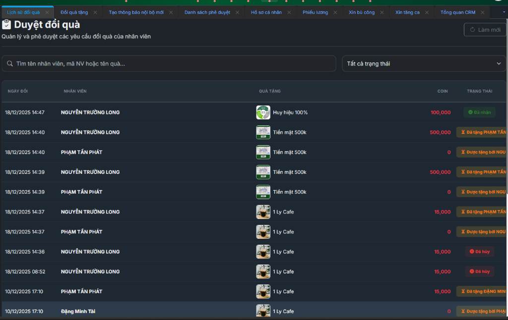

# BÁO CÁO GIẢI TRÌNH KỸ THUẬT (TECHNICAL DEFENSE REPORT)
## SCREENSHOT-01: LỊCH SỬ ĐỔI QUÀ (MnuPRL451)

> **Màn hình**: Lịch Sử Đổi Quà / Duyệt Đổi Quà  
> **Đường dẫn Menu**: **Đổi quà $\rightarrow$ Lịch sử đổi quà**  
> **MenuID**: `MnuPRL451` | **ClassName**: `sp_gift_history_gift`  
> **Thành phần / Stored Procedure can thiệp**: `[dbo].[sp_gift_history_gift_html]`, `[dbo].[sp_gift_history_gift]`  
> **Bảng cấu hình / Cache**: `[dbo].[tblHtmlScriptCache]` (TableName = `'sp_gift_history_gift'`, ScreenType = -1)  
> **File SQL bản vá độc lập**: [`fix-bug/screenshot-1/patch_responsive.sql`](./patch_responsive.sql)  
> **Ảnh đối chiếu lỗi ban đầu (Before)**: [`./screenshots/1.png`](./screenshots/1.png)  
> **Ảnh kết quả sau khi sửa (After Fix)**: [`./screenshots/1_fixed.png`](./screenshots/1_fixed.png)  

---

### 1. HIỆN TRẠNG LỖI BAN ĐẦU (PROBLEM STATEMENT)

- **Triệu chứng lỗi**:
  - Tiêu đề cột **"COIN"** và **"TRẠNG THÁI"** ở hàng tiêu đề (Header Row) bị lệch trục hoàn toàn so với nội dung dữ liệu bên dưới (Data Rows).
  - Tiêu đề **"COIN"** bị đẩy lệch hẳn sang phía bên phải, bên dưới chữ "COIN" là một khoảng trống đen ngắt không có dữ liệu.
  - Toàn bộ số liệu Coin (`100,000`, `500,000`, `0`, `15,000`...) lại bị co dúm và dạt hẳn sang bên trái (nằm lệch về phía cột Quà tặng).
  - Cột **"TRẠNG THÁI"** cũng bị lệch tương tự: Tiêu đề nằm một nơi, các badge trạng thái (`Đã nhận`, `Đã tặng...`, `Đã hủy`) lại nằm một nẻo.
- **Minh chứng hình ảnh trực quan (Before)**:
  
  *Minh chứng lỗi Screenshot 1: Cột COIN và TRẠNG THÁI bị lệch trục nghiêm trọng giữa Header và Data.*

---

### 2. PHÂN TÍCH NGUYÊN NHÂN GỐC RỄ (ROOT CAUSE ANALYSIS - RCA)

1. **Cơ chế DevExtreme DataGrid tách rời 2 bảng độc lập**:
   - DevExtreme thiết kế tách rời Header và Dữ liệu thành 2 thẻ `<table>` độc lập (`.dx-datagrid-headers table` và `.dx-datagrid-rowsview table`).
   - Trong file CSS toàn cục `paradise.min.css` có dòng lệnh: `.dx-datagrid-table-fixed { table-layout: auto; }`. Thuộc tính `table-layout: auto` đã phá vỡ cơ chế tính toán độ rộng cột cố định của DevExtreme.
2. **Hậu quả của `table-layout: auto`**:
   - Ở bảng Header: Các chữ tiêu đề đều rất ngắn, trình duyệt chia 5 cột rộng đều nhau (~246px mỗi cột).
   - Ở bảng Dữ liệu: Cột 5 (Trạng thái) chứa nội dung text rất dài (`"Được tặng bởi NGUYỄN TRƯỜNG LONG. Lời nhắn..."` hơn 60 ký tự). Trình duyệt tự động phình to Cột 5 ra tới `496px`, và chèn ép Cột 4 (Coin) co rúm lại chỉ còn `140px`.
   - Kết quả: Tiêu đề "COIN" bắt đầu ở `942px` nhưng dữ liệu Coin lại kết thúc ở `939px`, tạo ra khoảng trống đen ngắt dưới chữ "COIN".
3. **Cách khắc phục triệt để**:
   - Thêm CSS ép layout bảng cố định `#sp_gift_history_gift .dx-datagrid-table { table-layout: fixed !important; }` để triệt tiêu `table-layout: auto`.
   - Khóa tỷ lệ 5 cột chia đều 20% x 5 = 100%, căn giữa đối xứng cho cột Coin và Trạng thái.

---

### 3. ĐỐI CHIẾU MÃ NGUỒN TRƯỚC VÀ SAU (BEFORE VS AFTER)

#### 3.1. Đối chiếu CSS ép layout bảng cố định

##### ❌ HỆ THỐNG BAN ĐẦU (BEFORE):
```css
/* Không có CSS khống chế, bị paradise.min.css ghi đè table-layout: auto */
#sp_gift_history_gift .dx-datagrid {
    border: none !important;
    background: unset;
}
```

##### ✅ BẢN VÁ HOÀN THIỆN (AFTER):
```css
/* Bổ sung quy tắc ép layout cố định đè bẹp triệt để paradise.min.css */
#sp_gift_history_gift .dx-datagrid {
    border: none !important;
    background: unset;
}
#sp_gift_history_gift .dx-datagrid-table {
    table-layout: fixed !important;                           // KHẮC PHỤC: Ép layout cố định, triệt tiêu lỗi lệch cột
}
#sp_gift_history_gift .dx-datagrid-headers .dx-header-row > td {
    font-weight: 700 !important;
    padding: 1rem !important;
    height: 60px !important;
    vertical-align: middle !important;
}
```

---

#### 3.2. Đối chiếu cấu hình 5 cột DataGrid trong JavaScript

##### ❌ HỆ THỐNG BAN ĐẦU (BEFORE):
```javascript
// Thiếu cấu hình tỷ lệ phần trăm đồng bộ, để DevExtreme tự tính toán độ rộng
columns: [
    { dataField: "OrderDate", caption: "Ngày đổi" },
    { dataField: "FullName", caption: "Nhân viên" },
    { dataField: "ProductName", caption: "Quà tặng" },
    { dataField: "TotalCoins", caption: "Coin" },
    { dataField: "Status_History", caption: "Trạng thái" }
]
```

##### ✅ BẢN VÁ HOÀN THIỆN (AFTER):
```javascript
// Khóa cứng tỷ lệ 20% đều nhau cho cả 5 cột, căn giữa đối xứng cho Coin và Trạng thái
columnAutoWidth: false,
columns: [
    {
        caption: "%RedemptionDateLabel%",
        dataField: "OrderDate",
        dataType: "date",
        format: "dd/MM/yyyy HH:mm",
        width: "20%",
        minWidth: 150,
        alignment: "left"
    },
    {
        caption: "%colEmployeeName%",
        width: "20%",
        minWidth: 160,
        alignment: "left",
        cellTemplate: function(container, options) {
            $("<div>").addClass("fw-bold text-truncate")
                      .attr("title", options.data.FullName)
                      .text(options.data.FullName || "Unknown")
                      .appendTo(container);
        }
    },
    {
        caption: "%GiftsLabel%",
        width: "20%",
        minWidth: 160,
        alignment: "left",
        cellTemplate: function(container, options) {
            var d = options.data;
            var img = d.ImageURL || "default.png";
            var wrapper = $("<div>").addClass("d-flex align-items-center gap-2");
            $("").addClass("product-thumb").attr("src", img).appendTo(wrapper);
            $("<div>").addClass("text-truncate").text(d.ProductName).appendTo(wrapper);
            wrapper.appendTo(container);
        }
    },
    {
        caption: "Coin",
        dataField: "TotalCoins",
        width: "20%",
        minWidth: 110,
        alignment: "center",
        cellTemplate: function(c, o) {
            c.addClass("text-center");
            $("<span>").addClass("text-danger fw-bold")
                       .text(formatNumber(o.value))
                       .appendTo(c);
        }
    },
    {
        caption: "%Status%",
        dataField: "Status_History",
        width: "20%",
        minWidth: 180,
        alignment: "center",
        cellTemplate: function(container, options) {
            container.addClass("text-center");
            var st = options.value;
            var cls = st === "Đã nhận" ? "badge-approved" : "badge-pending";
            $("<span>").addClass("badge-status " + cls)
                       .text(st)
                       .appendTo(container);
        }
    }
]
```

---

#### 3.3. Đối chiếu Kiến trúc SQL (Clean Code 3 bước & Bảo vệ CSDL)

##### ❌ HỆ THỐNG BAN ĐẦU (BEFORE):
```sql
ALTER PROCEDURE [dbo].[sp_gift_history_gift_html]
AS
BEGIN
    SELECT @html AS html;
END
-- THIẾU BƯỚC 2: Không có SP điều phối [sp_gift_history_gift]!
-- THIẾU BƯỚC 3: Không có lệnh tự động biên dịch cache qua sp_GenerateHTMLScript_new!
```

##### ✅ BẢN VÁ HOÀN THIỆN (AFTER):
```sql
-- BƯỚC 1: CẬP NHẬT SP GIAO DIỆN (TỶ LỆ 5 CỘT 20% & TABLE-LAYOUT FIXED)
CREATE OR ALTER PROCEDURE [dbo].[sp_gift_history_gift_html]
    @LoginID INT = NULL,
    @LanguageID VARCHAR(2) = 'VN',
    @isWeb INT = 1
AS
BEGIN
    SET NOCOUNT ON;
    SELECT @html AS html;
END
GO

-- BƯỚC 2: CHUẨN HÓA STORED PROCEDURE ĐIỀU PHỐI
CREATE OR ALTER PROCEDURE [dbo].[sp_gift_history_gift]
    @LoginID VARCHAR(50) = NULL,
    @LanguageID VARCHAR(2) = 'VN',
    @EmployeeID VARCHAR(20) = NULL
AS
BEGIN
    SET NOCOUNT ON;
    IF @LanguageID IS NULL OR LTRIM(RTRIM(@LanguageID)) = ''
        SET @LanguageID = 'VN';
    SELECT TOP 1 html
    FROM tblHtmlScriptCache
    WHERE TableName = 'sp_gift_history_gift'
      AND ScreenType = -1
      AND LanguageID = @LanguageID;
END
GO

-- BƯỚC 3: BIÊN DỊCH MÃ NGUỒN GIAO DIỆN VÀO BẢNG CACHE
PRINT N'==> Đang biên dịch cache Lịch sử đổi quà qua sp_GenerateHTMLScript_new...';
IF OBJECT_ID('dbo.sp_GenerateHTMLScript_new', 'P') IS NOT NULL
BEGIN
    EXEC sp_GenerateHTMLScript_new 'sp_gift_history_gift_html', '-1', 'sp_gift_history_gift';
    EXEC sp_GenerateHTMLScript_new 'sp_gift_history_gift_html', '-1', 'sp_gift_history_gift_html';
END
ELSE
BEGIN
    EXEC sp_GenerateHTMLScript 'sp_gift_history_gift_html';
END
GO
```

---

#### 3.4. Minh chứng kết quả giao diện thực tế sau khi sửa (After Fix)


*Minh chứng giao diện Lịch sử đổi quà sau khi sửa: Cột Ngày đổi, Nhân viên, Quà tặng, Coin và Trạng thái căn chỉnh thẳng hàng tăm tắp, badge Đã nhận căn trái đẹp mắt.*
