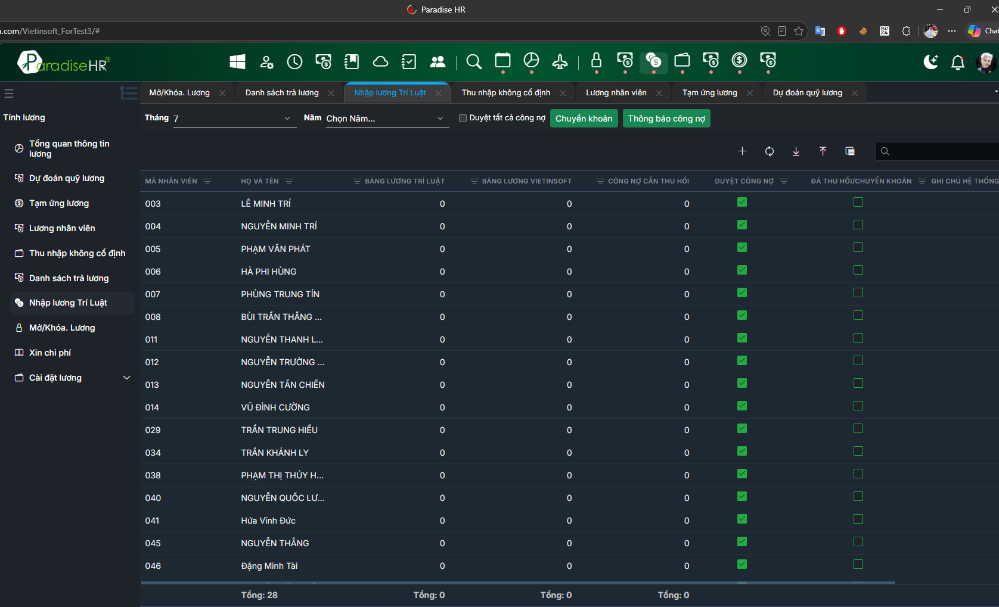
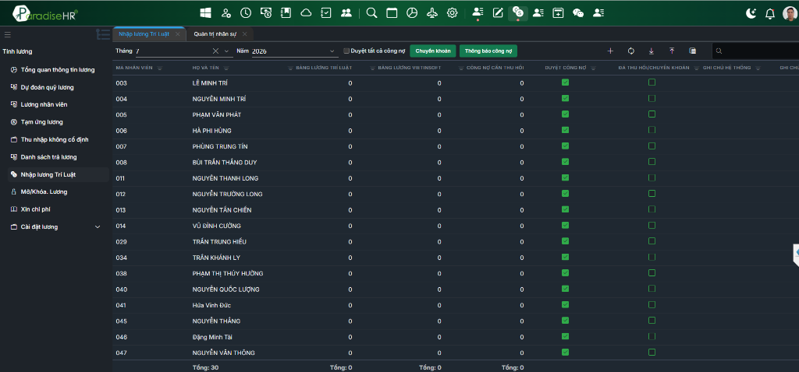
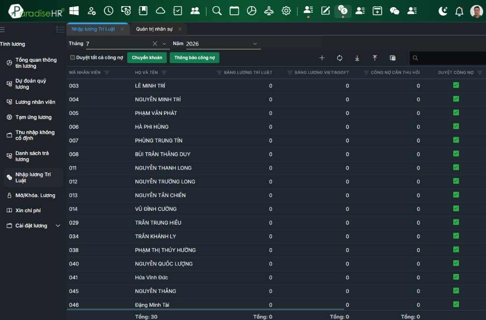

# BÁO CÁO GIẢI TRÌNH KỸ THUẬT (TECHNICAL DEFENSE REPORT)
## SCREENSHOT-11: NHẬP LƯƠNG TRÍ LUẬT (MnuPRL408 / MnuPRL512)

> **Màn hình**: Nhập Lương Trí Luật  
> **Đường dẫn Menu**: **Tiền lương $\rightarrow$ Nhập lương Trí Luật**  
> **MenuID**: `MnuPRL408` (`MnuPRL512`) | **ClassName**: `Template_SalaryImport_TriLuat`  
> **Thành phần / Stored Procedure can thiệp**: `[dbo].[Template_SalaryImport_TriLuat_html]`  
> **Bảng cấu hình / Cache**: `[dbo].[tblHtmlScriptCache]` (TableName = 'Template_SalaryImport_TriLuat')  
> **File SQL bản vá độc lập**: [`fix-bug/screenshot-11/patch_nhap_luong_tri_luat.sql`](./patch_nhap_luong_tri_luat.sql)  
> **Ảnh đối chiếu lỗi ban đầu (Before)**: [`./screenshots/11.png`](./screenshots/11.png)  
> **Ảnh kết quả sau khi sửa (After Fix)**: [`./screenshots/11_fixed_1.png`](./screenshots/11_fixed_1.png) (Màn hình lớn) | [`./screenshots/11_fixed_2.png`](./screenshots/11_fixed_2.png) (Màn hình hẹp / Responsive)  

---

### 1. HIỆN TRẠNG LỖI BAN ĐẦU (PROBLEM STATEMENT)

- **Triệu chứng lỗi**:
  1. **Thanh công cụ Toolbar bị vỡ thành 2 hàng cọc cạch (Mã nguồn gốc)**: Cụm bộ lọc bên trái (Tháng, Năm, Checkbox *"Duyệt tất cả công nợ"*, nút *"Chuyển khoản"*, nút *"Thông báo công nợ"*) nằm ở hàng trên; trong khi các nút tác vụ và ô tìm kiếm của DataGrid (Thêm mới `+`, Làm mới, Tải file mẫu, Nhập Excel, Chọn cột, Ô tìm kiếm) bị đẩy tụt xuống hàng thứ hai bên phải tạo khoảng trống lãng phí.
  2. **Lỗi đè lấn phần tử khi co hẹp màn hình (Thiếu Responsive thích ứng)**: Nếu chỉ neo cứng bộ lọc bằng `position: absolute`, khi người dùng làm việc trên laptop (1366px, 1200px) hoặc khi mở menu sidebar bên trái, không gian hiển thị của DataGrid bị co lại dưới 1150px khiến cụm nút tác vụ bên phải đè trực tiếp lên cụm nút bộ lọc bên trái.
- **Minh chứng hình ảnh trực quan (Before)**:
  
  *Minh chứng lỗi Screenshot 11: Thanh Toolbar bị vỡ thành 2 hàng cọc cạch, cụm nút bên phải bị tụt xuống hàng 2.*

---

### 2. PHÂN TÍCH NGUYÊN NHÂN GỐC RỄ (ROOT CAUSE ANALYSIS - RCA)

1. **Phân mảnh cấu trúc DOM giữa Filter Bar và Toolbar DataGrid**:
   - Bộ lọc bên trái (`#tsitlTopFilterBar`) và thanh Toolbar của DataGrid (`.dx-datagrid-header-panel`) nằm ở 2 thẻ container riêng biệt, không có tọa độ neo chung (`position: relative / absolute`).
   - Mặc định trình duyệt xếp 2 khối này theo luồng khối thông thường (block flow) $\rightarrow$ Dẫn tới hiện tượng rớt dòng, tạo thành 2 tầng cọc cạch.
2. **Xung đột không gian hiển thị trên màn hình co nhỏ (Giới hạn bề ngang ~1130px)**:
   - Tổng chiều rộng cần thiết cho bộ lọc bên trái là ~690px (Tháng, Năm, Checkbox, 2 nút bấm).
   - Tổng chiều rộng cho cụm công cụ DataGrid bên phải là ~440px (6 nút icon + ô tìm kiếm).
   - Tổng chiều rộng tối thiểu để đặt cạnh nhau trên 1 hàng là ~1130px. Khi màn hình bị co hẹp dưới ngưỡng này (hoặc khi mở menu sidebar chiếm 250px), 2 khối bắt buộc phải có cơ chế Responsive tự động xuống dòng phân tầng, thay vì ghim cứng tọa độ gây đè bẹp lên nhau.
3. **Giải pháp kiến trúc Responsive tự thích ứng (Adaptive Responsive Design)**:
   - **Màn hình lớn (Desktop từ 1350px trở lên)**: Neo bộ lọc ngang hàng với Toolbar của DataGrid bằng `position: absolute; left: 8px; top: 4px;` kết hợp `justify-content: flex-end`, tạo nên 1 hàng công cụ phẳng phiu, liền mạch 100%.
   - **Khi tới giới hạn màn hình hẹp (Dưới 1350px, laptop, mở sidebar)**: Tự động chuyển `#tsitlTopFilterBar` về `position: relative !important; width: 100%;` thành Hàng 1 (phân bố dàn trải các nút chọn), và Toolbar DataGrid chuyển xuống Hàng 2 bên dưới ngay ngắn, triệt tiêu hoàn toàn 100% hiện tượng đè chồng các phần tử.

---

### 3. ĐỐI CHIẾU MÃ NGUỒN TRƯỚC VÀ SAU (BEFORE VS AFTER)

#### 3.1. Đối chiếu CSS bố cục Responsive Toolbar và Bộ lọc

##### ❌ HỆ THỐNG BAN ĐẦU (BEFORE):
```css
/* Hệ thống cũ: Thiếu tọa độ neo chung, 2 khối container bị tách dòng cọc cạch */
#TemplateSalaryImportTriLuatPage .dx-datagrid-header-panel {
    background: transparent;
}
#TemplateSalaryImportTriLuatPage .dx-toolbar-items-container {
    height: auto; /* Chiều cao tự do làm các nút bên phải rớt xuống hàng thứ hai */
}
```

##### ✅ BẢN VÁ HOÀN THIỆN (AFTER):
```css
/* ==========================================================================
   LAYOUT RESPONSIVE TỰ THÍCH ỨNG:
   - Màn hình rộng (>= 1350px): Filter và Toolbar gom chung 1 hàng phẳng phiu
   - Khi tới giới hạn màn hình (< 1350px / laptop / mở sidebar): Tự động xuống hàng mượt mà
   ========================================================================== */
#TemplateSalaryImportTriLuatPage {
    position: relative !important;
    container-type: inline-size;
}

/* Màn hình lớn (>= 1350px): Neo bộ lọc bên trái ngang hàng với Toolbar bên phải */
@media (min-width: 1350px) {
    #TemplateSalaryImportTriLuatPage #tsitlTopFilterBar {
        position: absolute !important;
        left: 8px !important;
        top: 4px !important;
        z-index: 20 !important;
        display: inline-flex !important;
        align-items: center !important;
        gap: 8px !important;
        height: 36px !important;
        margin: 0 !important;
        padding: 0 !important;
        max-width: calc(100% - 460px) !important;
        white-space: nowrap !important;
    }
    #TemplateSalaryImportTriLuatPage .dx-datagrid-header-panel {
        min-height: 44px !important;
        height: 44px !important;
        padding: 0 8px 0 0 !important;
        background: transparent !important;
    }
    #TemplateSalaryImportTriLuatPage .dx-toolbar {
        min-height: 44px !important;
        height: 44px !important;
        background: transparent !important;
    }
    #TemplateSalaryImportTriLuatPage .dx-toolbar-items-container {
        height: 44px !important;
        display: flex !important;
        align-items: center !important;
        justify-content: flex-end !important;
    }
}

/* Khi tới giới hạn màn hình (< 1350px, màn hình laptop 1366px, 1200px, 1024px hoặc mở sidebar):
   Bộ lọc tự động xuống Hàng 1, thanh công cụ tác vụ nằm ở Hàng 2 bên dưới */
@media (max-width: 1349px) {
    #TemplateSalaryImportTriLuatPage #tsitlTopFilterBar {
        position: relative !important;
        left: auto !important;
        top: auto !important;
        width: 100% !important;
        display: flex !important;
        align-items: center !important;
        flex-wrap: wrap !important;
        gap: 8px !important;
        padding: 6px 8px !important;
        margin: 0 0 4px 0 !important;
        background: rgba(255, 255, 255, 0.02) !important;
        border-radius: 4px !important;
        box-sizing: border-box !important;
    }
    #TemplateSalaryImportTriLuatPage .dx-datagrid-header-panel {
        height: auto !important;
        min-height: 40px !important;
        padding: 0 8px 0 0 !important;
    }
    #TemplateSalaryImportTriLuatPage .dx-toolbar {
        height: auto !important;
        min-height: 40px !important;
    }
    #TemplateSalaryImportTriLuatPage .dx-toolbar-items-container {
        height: auto !important;
        min-height: 40px !important;
        display: flex !important;
        align-items: center !important;
        justify-content: flex-end !important;
    }
}

@container (max-width: 1250px) {
    #TemplateSalaryImportTriLuatPage #tsitlTopFilterBar {
        position: relative !important;
        left: auto !important;
        top: auto !important;
        width: 100% !important;
        display: flex !important;
        align-items: center !important;
        flex-wrap: wrap !important;
        gap: 8px !important;
        padding: 6px 8px !important;
        margin: 0 0 4px 0 !important;
        background: rgba(255, 255, 255, 0.02) !important;
        border-radius: 4px !important;
        box-sizing: border-box !important;
    }
    #TemplateSalaryImportTriLuatPage .dx-datagrid-header-panel {
        height: auto !important;
        min-height: 40px !important;
        padding: 0 8px 0 0 !important;
    }
    #TemplateSalaryImportTriLuatPage .dx-toolbar {
        height: auto !important;
        min-height: 40px !important;
    }
    #TemplateSalaryImportTriLuatPage .dx-toolbar-items-container {
        height: auto !important;
        min-height: 40px !important;
        display: flex !important;
        align-items: center !important;
        justify-content: flex-end !important;
    }
}
```

---

#### 3.2. Minh chứng kết quả giao diện thực tế sau khi sửa (After Fix)

**1. Màn hình lớn (Desktop từ 1350px trở lên) - Toàn bộ bộ lọc & công cụ gom chung trên 1 hàng phẳng phiu:**



*Minh chứng 1: Trên màn hình lớn, cụm bộ lọc (Tháng, Năm, Duyệt công nợ, Chuyển khoản, Thông báo) và cụm tác vụ DataGrid (Thêm mới +, Làm mới, Tải mẫu, Nhập Excel, Chọn cột, Ô tìm kiếm) gom chung trên 1 hàng phẳng phiu, liền mạch 100%.*

---

**2. Màn hình hẹp / Laptop 1366px / Mở sidebar (Dưới 1350px) - Tự động xuống hàng phân tầng thông minh:**



*Minh chứng 2: Khi tới giới hạn co hẹp màn hình (laptop hoặc mở menu sidebar), hệ thống tự động xuống hàng phân tầng theo Responsive Design; cụm bộ lọc chuyển lên Hàng 1, cụm công cụ tác vụ nằm ở Hàng 2 bên dưới, các nút hiển thị đầy đủ và triệt tiêu hoàn toàn 100% hiện tượng đè lấn.*
