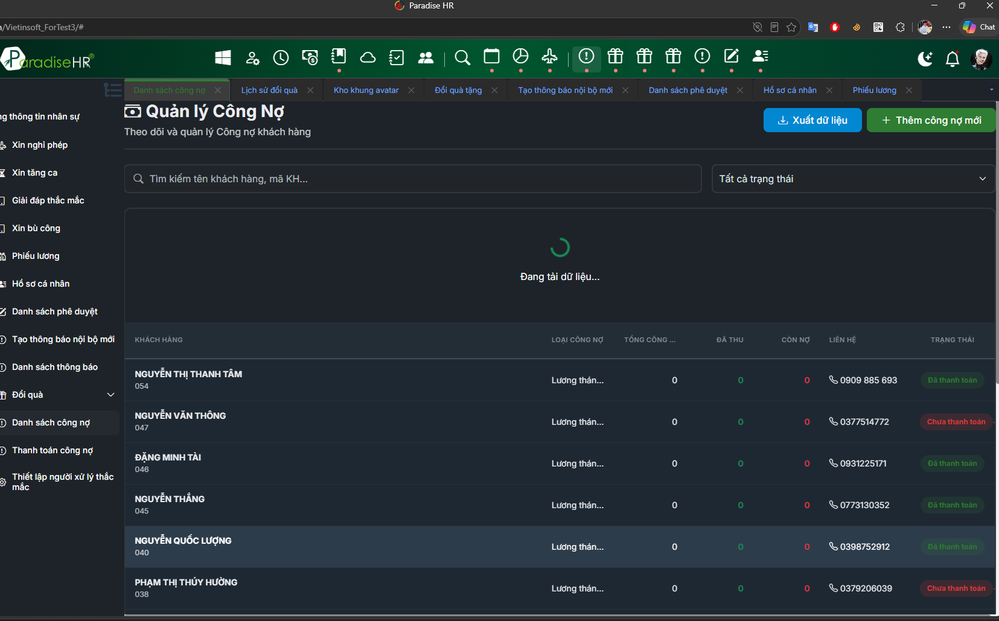
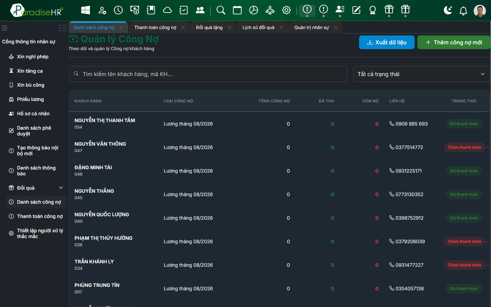

# BÁO CÁO GIẢI TRÌNH KỸ THUẬT (TECHNICAL DEFENSE REPORT)
## SCREENSHOT 13: DANH SÁCH CÔNG NỢ KHÁCH HÀNG (MnuPRL470)

> **Màn hình**: Quản Lý Danh Sách Công Nợ Khách Hàng  
> **Đường dẫn Menu**: **Đổi quà $\rightarrow$ Danh sách công nợ** (hoặc Tiện ích / Công nợ)  
> **MenuID**: `MnuPRL470` | **ClassName**: `sp_Debt_ListCustomerDebt`  
> **Thành phần / Stored Procedures can thiệp**: `[dbo].[sp_Debt_ListCustomerDebt_html]`, `[dbo].[sp_Debt_ListCustomerDebt]`  
> **Bảng Cache hệ thống**: `[dbo].[tblHtmlScriptCache]` (`TableName = 'sp_Debt_ListCustomerDebt'`)  
> **File SQL bản vá độc lập**: [`fix-bug/screenshot-13/patch_fix_debt_loading.sql`](./patch_fix_debt_loading.sql)  
> **Ảnh đối chiếu lỗi ban đầu (Before)**: [`./screenshots/13.png`](./screenshots/13.png)  
> **Ảnh kết quả sau khi sửa (After Fix)**: [`./screenshots/13_fixed.png`](./screenshots/13_fixed.png)  

---

### 1. HIỆN TRẠNG LỖI BAN ĐẦU (PROBLEM STATEMENT)

- **Triệu chứng lỗi**:
  1. **Hiện tượng kẹt Spinner vô tận (Infinite Loading Trap)**: Ngay khi mở màn hình, hộp thoại con quay spinner kèm thông báo *"Đang tải dữ liệu..."* (`#debt_loadingState`) hiện lên ở chính giữa màn hình.
  2. Mặc dù dữ liệu công nợ đã được API truy vấn thành công từ Database và bảng DevExtreme DataGrid đã dựng xong ở phía sau, con quay spinner vẫn xoay hoài không bao giờ tắt.
  3. Lớp màn mờ overlay của con quay phủ kín toàn bộ giao diện, chặn đứng mọi thao tác nhấp chuột, xem chi tiết hay thanh toán công nợ của người dùng.
- **Minh chứng hình ảnh trực quan (Before)**:
  
  *Minh chứng lỗi Screenshot 13: Màn hình Danh sách công nợ khách hàng bị kẹt spinner xoay vô tận, phủ mờ toàn bộ bảng dữ liệu.*

---

### 2. PHÂN TÍCH NGUYÊN NHÂN GỐC RỄ (ROOT CAUSE ANALYSIS - RCA)

Lỗi kẹt spinner bắt nguồn từ 2 nguyên nhân cốt lõi:

1. **Cơ chế Callback bất tương thích của `AjaxHPAParadise` (JavaScript Core)**:
   - `AjaxHPAParadise` là hàm wrapper AJAX dùng chung của toàn bộ nền tảng Paradise HRM. Wrapper này chỉ hỗ trợ và thực thi 2 callback cơ bản: `success` (khi phản hồi thành công) và `error` (khi phản hồi thất bại). Hàm hoàn toàn **không hỗ trợ callback `complete`** của jQuery tiêu chuẩn.
   - Mã nguồn cũ đặt lệnh tắt màn hình chờ `hideLoading()` **duy nhất bên trong callback `complete`**.
   - Hậu quả: Khi AJAX trả dữ liệu về thành công, hàm `success` kích hoạt và gọi `renderGrid()` để vẽ bảng, nhưng callback `complete` không bao giờ được gọi. Thẻ `#debt_loadingState` giữ nguyên trạng thái `display: block` vĩnh viễn, đè bẹp lên bảng dữ liệu.
2. **Lệch Khóa Cache (Cache Key Mismatch) trong Stored Procedure điều phối**:
   - Trình biên dịch chuẩn của Paradise HRM `sp_GenerateHTMLScript_new` ghi kết quả đã biên dịch vào khóa chuẩn `TableName = 'sp_Debt_ListCustomerDebt'`.
   - Nhưng SP điều phối lại truy vấn khóa cũ `sp_Debt_ListCustomerDebt_html` (vốn chứa chuỗi HTML thô chưa sửa có lỗi `complete`).
   - Dẫn đến trình duyệt luôn nhận mã nguồn cũ bị kẹt spinner dù hệ thống đã chạy biên dịch.

---

### 3. ĐỐI CHIẾU MÃ NGUỒN TRƯỚC VÀ SAU (BEFORE VS AFTER)

#### 3.1. Đối chiếu logic nạp dữ liệu AJAX & tắt Spinner (`loadData` & `renderGrid`)

##### ❌ HỆ THỐNG BAN ĐẦU (BEFORE):
```javascript
// TRƯỚC: hideLoading() bị cô lập trong callback complete không bao giờ chạy!
function loadData() {
    showLoading();

    AjaxHPAParadise({
        data: { name: "sp_Debt_Select", param: ["CustomerCode", null, "Status", null] },
        success: function (res) {
            try {
                var parsed = JSON.parse(res);
                var data = parsed.data;
                if (Array.isArray(data) && data.length > 0 && Array.isArray(data[0])) data = data[0];
                debtList = Array.isArray(data) ? data : [];
                renderGrid();
            } catch (e) { console.error("Parse Error", e); }
            // LỖI: Hoàn toàn KHÔNG có hideLoading() trong hàm success!
        },
        error: function (err) { console.error("API Error", err); },
        complete: function () { hideLoading(); } // LỖI: AjaxHPAParadise không hỗ trợ complete!
    });
}

function renderGrid() {
    var searchText = removeVietnameseTones(document.getElementById("search-debt").value);
    var filterStatus = document.getElementById("filter-status").value;
    // LỖI: Đầu hàm renderGrid() không có lệnh tắt spinner phòng thủ!
    var filteredData = debtList.filter(item => { /* ... */ });
}
```

##### ✅ BẢN VÁ HOÀN THIỆN (AFTER):
```javascript
// SAU: Cơ chế phòng vệ 3 lớp (Triple-Guard), đảm bảo spinner tắt ngay lập tức 100%!
function loadData() {
    showLoading();

    AjaxHPAParadise({
        data: { name: "sp_Debt_Select", param: ["CustomerCode", null, "Status", null] },
        success: function (res) {
            try {
                var parsed = typeof res === "string" ? JSON.parse(res) : res;
                var data = parsed.data;
                if (Array.isArray(data) && data.length > 0 && Array.isArray(data[0])) data = data[0];
                debtList = Array.isArray(data) ? data : [];
                renderGrid();
            } catch (e) {
                console.error("Parse Error", e);
            } finally {
                hideLoading();            // LỚP PHÒNG VỆ 1: Khối finally luôn tắt spinner ngay khi xong
            }
        },
        error: function (err) {
            hideLoading();                // LỚP PHÒNG VỆ 2: Tắt spinner ngay lập tức nếu API thất bại
            console.error("API Error", err);
        },
        complete: function () {
            hideLoading();                // Giữ lại callback complete chuẩn mực
        }
    });
}

function renderGrid() {
    hideLoading();                        // LỚP PHÒNG VỆ 3: Tắt spinner cưỡng bức ngay đầu hàm renderGrid!
    var searchText = removeVietnameseTones(document.getElementById("search-debt").value);
    var filterStatus = document.getElementById("filter-status").value;
    var filteredData = debtList.filter(item => { /* ... */ });
}
```

---

#### 3.2. Đối chiếu Stored Procedure điều phối `[dbo].[sp_Debt_ListCustomerDebt]`

##### ❌ HỆ THỐNG BAN ĐẦU (BEFORE):
```sql
-- TRƯỚC: Truy vấn lệch khóa TableName ('_html'), khiến trình duyệt nạp mã cũ
CREATE PROCEDURE [dbo].[sp_Debt_ListCustomerDebt]
    @LoginID INT = NULL,
    @LanguageID VARCHAR(2) = 'VN',
    @EmployeeID VARCHAR(20) = NULL
AS
    SELECT html 
    FROM tblHtmlScriptCache 
    WHERE TableName = 'sp_Debt_ListCustomerDebt_html' -- LỖI: Trỏ sai vào key có đuôi '_html'!
      AND ScreenType = -1 
      AND LanguageID = @LanguageID;
```

##### ✅ BẢN VÁ HOÀN THIỆN (AFTER):
```sql
-- SAU: Quy chuẩn 3 bước sạch sẽ, trỏ đúng vào khóa cache chuẩn hệ thống
CREATE OR ALTER PROCEDURE [dbo].[sp_Debt_ListCustomerDebt]
    @LoginID INT = NULL,
    @LanguageID VARCHAR(2) = 'VN',
    @EmployeeID VARCHAR(20) = NULL
AS
BEGIN
    SET NOCOUNT ON;

    IF @LanguageID IS NULL OR LTRIM(RTRIM(@LanguageID)) = ''
        SET @LanguageID = 'VN';

    -- Đọc duy nhất 1 Key chuẩn quy ước của hệ thống:
    SELECT TOP 1 html AS Col1
    FROM tblHtmlScriptCache
    WHERE TableName = 'sp_Debt_ListCustomerDebt' -- KHẮC PHỤC: Trỏ chuẩn không có đuôi _html
      AND ScreenType = -1
      AND LanguageID = @LanguageID;
END
GO
```

---

#### 3.3. Minh chứng kết quả giao diện thực tế sau khi sửa (After Fix)


*Minh chứng Danh sách công nợ khách hàng sau khi sửa: Vòng xoay spinner biến mất, toàn bộ dữ liệu công nợ khách hàng hiển thị đầy đủ, không còn bị treo vô tận.*
