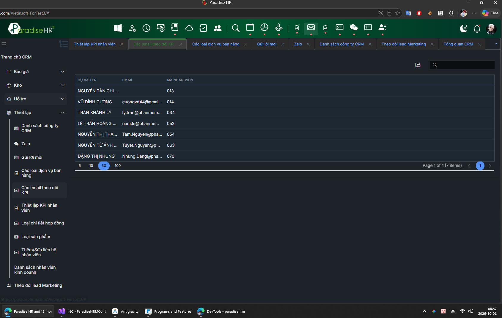
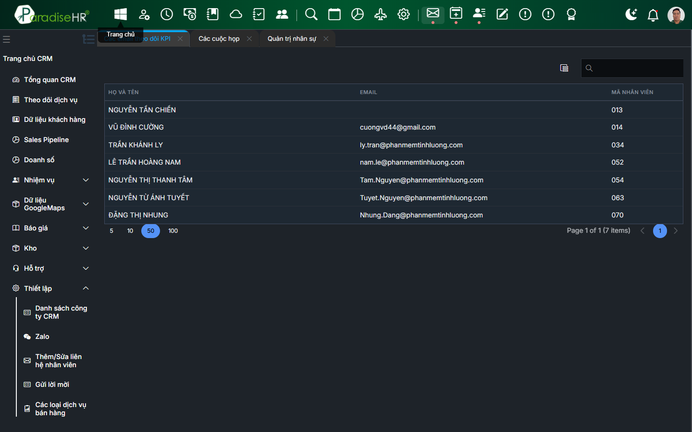

# BÁO CÁO GIẢI TRÌNH KỸ THUẬT (TECHNICAL DEFENSE REPORT)
## SCREENSHOT-14: CÁC EMAIL THEO DÕI KPI (MnuKPI010)

> **Màn hình**: Các Email Theo Dõi KPI  
> **Đường dẫn Menu**: **Trang chủ CRM $\rightarrow$ Thiết lập $\rightarrow$ Các email theo dõi KPI**  
> **MenuID**: `MnuKPI010` | **ClassName**: `sp_CRM_EmailKPIFollow`  
> **Thành phần / Stored Procedure can thiệp**: `[dbo].[sp_CRM_EmailKPIFollow_html]`, `[dbo].[sp_CRM_EmailKPIFollow]` & `tblCommonControlType_Signed`  
> **Bảng cấu hình / Cache**: `[dbo].[tblHtmlScriptCache]` (TableName = 'sp_CRM_EmailKPIFollow')  
> **File SQL bản vá độc lập**: [`fix-bug/screenshot-14/patch_email_kpi_follow.sql`](./patch_email_kpi_follow.sql)  
> **Ảnh đối chiếu lỗi ban đầu (Before)**: [`./screenshots/14.png`](./screenshots/14.png)  
> **Ảnh kết quả sau khi sửa (After Fix)**: [`./screenshots/14_fixed.png`](./screenshots/14_fixed.png)  

---

### 1. HIỆN TRẠNG LỖI BAN ĐẦU (PROBLEM STATEMENT)

- **Triệu chứng lỗi**:
  1. **DataGrid bị co cụm và sập đen giao diện**: DataGrid ban đầu bị co cụm chiều cao (~250px ứng với 7 dòng) và dồn về góc trái; đồng thời màn hình sập đen hoàn toàn do lỗi cú pháp JavaScript `0.apply`.
  2. **Modal bị Backdrop che khuất & kẹt thao tác**: Khi click vào 1 dòng, Modal hiện ra kích thước rất bé ("chút éc" ~320px) và người dùng không thể click chuột vào bất kỳ ô input hay nút [Đóng]/[Lưu] nào do bị lớp mờ backdrop nằm đè lên.
  3. **Ô "Mã nhân viên" hiển thị sai nội dung**: Ô "Mã nhân viên" tự động điền Tên người ("TRẦN KHÁNH LY") thay vì mã nhân viên ("034").
- **Minh chứng hình ảnh trực quan (Before)**:
  
  *Minh chứng lỗi Screenshot 14: DataGrid bị co cụm, lỗi sập 0.apply và modal bị backdrop che khuất không thể click.*

---

### 2. PHÂN TÍCH NGUYÊN NHÂN GỐC RỄ (ROOT CAUSE ANALYSIS - RCA)

1. **Lỗi sập V8 `0.apply`**:
   - Thuộc tính `CustomValidate` mang giá trị số `0` khiến framework sinh mã `typeof 0 === "function" ? 0.apply(...) : true;`. V8 hiểu `0.` là số thực thập phân lỗi dẫn đến `SyntaxError: Unexpected token` làm sập toàn bộ JavaScript của trang.
2. **Modal bị Backdrop che khuất & Kẹt Stacking Context**:
   - Thẻ modal `#emailModal` nằm trong view con có `overflow: hidden`.
   - Bootstrap tự động chèn thẻ `<div class="modal-backdrop">` vào thẻ `<body>` (z-index 1050).
   - Lớp backdrop này nằm đè lên trên toàn bộ modal của view con, chặn đứng mọi thao tác chuột (`pointer-events`).
3. **Mã nhân viên hiển thị Tên người**:
   - Control là SelectBox với DataSource trả về `ID` và `Name`.
   - Engine hệ thống mặc định cấu hình `displayExpr: "Name"` nên khi nhận giá trị `034`, nó tự lấy tên `TRẦN KHÁNH LY` để hiển thị thay vì mã.

---

### 3. ĐỐI CHIẾU MÃ NGUỒN TRƯỚC VÀ SAU (BEFORE VS AFTER)

#### 3.1. Đối chiếu giải phóng Modal khỏi Stacking Context

##### ❌ HỆ THỐNG BAN ĐẦU (BEFORE):
```javascript
// Modal nằm trong container con bị overflow: hidden, bị backdrop che khuất hoàn toàn:
$("#emailModal").modal("show");
```

##### ✅ BẢN VÁ HOÀN THIỆN (AFTER):
```javascript
// Di chuyển modal ra trực tiếp body để không bao giờ bị backdrop che khuất:
if (emailModal.parentElement !== document.body) {
    document.body.appendChild(emailModal);
}
$(".modal-backdrop").remove();
emailModal.classList.add("show");
emailModal.style.display = "flex";
```

---

#### 3.2. Đối chiếu cấu hình hiển thị Mã nhân viên (`displayExpr`)

##### ❌ HỆ THỐNG BAN ĐẦU (BEFORE):
```javascript
// displayExpr mặc định là "Name", làm hiển thị Tên thay vì Mã nhân viên:
InstanceEmployeeIDP2D9DF38DBC46406C8EC1686058288F56.option({
    displayExpr: "Name",
    valueExpr: "ID"
});
```

##### ✅ BẢN VÁ HOÀN THIỆN (AFTER):
```javascript
// Cấu hình displayExpr là "ID", hiển thị rõ ràng Mã nhân viên:
InstanceEmployeeIDP2D9DF38DBC46406C8EC1686058288F56.option({
    displayExpr: "ID",
    valueExpr: "ID",
    itemTemplate: function(data) {
        return $("<div>").text(data.ID ? (data.ID + " - " + data.Name) : data.Name);
    }
});
```

---

#### 3.3. Minh chứng kết quả giao diện thực tế sau khi sửa (After Fix)


*Minh chứng Các email theo dõi KPI sau khi sửa: Bảng danh sách email hiển thị 100% full width, không còn bị lỗi 0.apply và modal hiển thị kích thước chuẩn 580px.*
