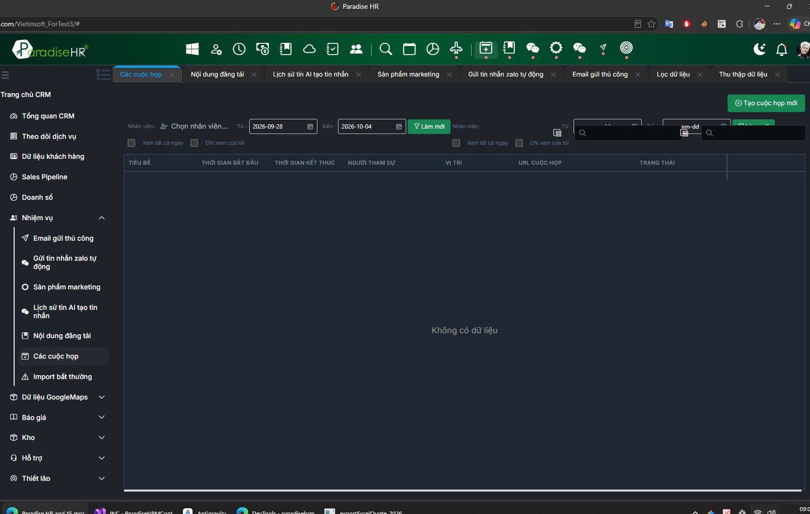
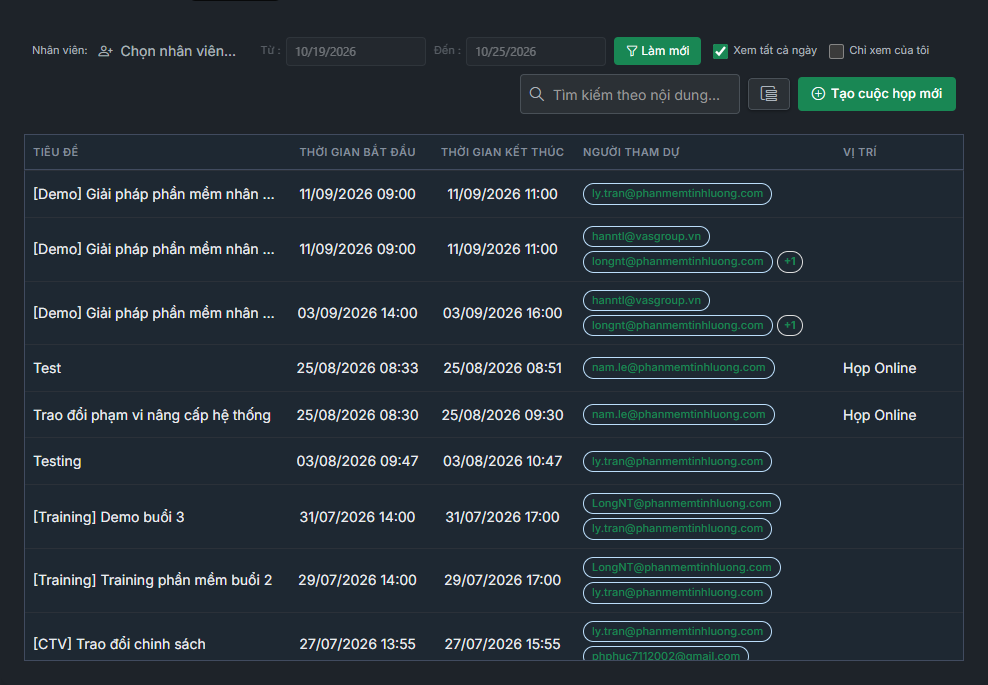

# BÁO CÁO GIẢI TRÌNH KỸ THUẬT (TECHNICAL DEFENSE REPORT)
## SCREENSHOT-15: CÁC CUỘC HỌP CRM (MnuKPI006 / sp_KPIMeetingDemo)

> **Màn hình**: Quản Lý Các Cuộc Họp  
> **Đường dẫn Menu**: **Trang chủ CRM $\rightarrow$ Nhiệm vụ $\rightarrow$ Các cuộc họp**  
> **MenuID**: `MnuKPI006` | **ClassName**: `sp_KPIMeetingDemo`  
> **Thành phần / Stored Procedure can thiệp**: `[dbo].[sp_KPIMeetingDemo_html]`, `[dbo].[sp_KPIMeetingDemo]`  
> **Bảng cấu hình / Cache**: `[dbo].[tblHtmlScriptCache]` (TableName = 'sp_KPIMeetingDemo')  
> **File SQL bản vá độc lập**: [`fix-bug/screenshot-15/patch_fix_meeting_filter.sql`](./patch_fix_meeting_filter.sql)  
> **Ảnh đối chiếu lỗi ban đầu (Before)**: [`./screenshots/15.png`](./screenshots/15.png)  
> **Ảnh kết quả sau khi sửa (After Fix)**: [`./screenshots/15_fixed.png`](./screenshots/15_fixed.png)  

---

### 1. HIỆN TRẠNG LỖI BAN ĐẦU (PROBLEM STATEMENT)

- **Triệu chứng lỗi**:
  1. **Thanh lọc dữ liệu bị render nhân đôi song song (Ghost Duplicate Toolbar)**: Khi người dùng truy cập vào phân hệ Các cuộc họp (`MnuKPI006`), cụm bộ lọc (Nhân viên, Từ ngày, Đến ngày, nút *"Làm mới"*, 2 checkbox *"Xem tất cả ngày"*, *"Chỉ xem của tôi"*) bị vẽ lặp lại 2 lần cạnh nhau trên thanh công cụ.
  2. **Lỗi Responsive đè chồng các phần tử trên màn hình co nhỏ / mở sidebar (Toolbar Overlap Bug)**: Khi co hẹp chiều ngang cửa sổ trình duyệt (màn hình laptop 1366px, 1200px hoặc khi mở thanh menu điều hướng bên trái), cụm tác vụ bên phải (ô tìm kiếm `[ Q Tìm kiếm theo nội dung... ]` và nút *"Tạo cuộc họp mới"*) bị đè trực tiếp lên 2 checkbox *"Xem tất cả ngày"* và *"Chỉ xem của tôi"* của cụm bộ lọc bên trái, khiến nhãn chữ bị che khuất hoàn toàn và chỉ còn hở một góc ô checkbox màu xanh lá.
- **Minh chứng hình ảnh trực quan (Before)**:
  
  *Minh chứng lỗi Screenshot 15: Cụm lọc bị nhân đôi và trên màn hình co nhỏ, ô tìm kiếm đè bẹp lên các checkbox.*

---

### 2. PHÂN TÍCH NGUYÊN NHÂN GỐC RỄ (ROOT CAUSE ANALYSIS - RCA)

1. **Cơ chế định vị tuyệt đối ngầm của DevExtreme (`position: absolute; top: 0`)**:
   - Mặc định trong cấu trúc DOM của DevExtreme DataGrid Toolbar:
     - Khối bên trái `.dx-toolbar-before` được CSS gán ngầm `position: absolute; left: 0; top: 0;`.
     - Khối bên phải `.dx-toolbar-after` được CSS gán ngầm `position: absolute; right: 0; top: 0;`.
   - Do cả 2 khối đều mang `position: absolute`, chúng bị tách hoàn toàn khỏi luồng dàn trang thông thường (*normal document flow*). Khi chiều ngang của DataGrid bị co lại (dưới 1150px):
     - Chiều rộng của cụm lọc bên trái (`.dx-toolbar-before`) cần tối thiểu ~740px.
     - Chiều rộng của cụm tác vụ bên phải (`.dx-toolbar-after`) cần tối thiểu ~370px.
     - Tổng chiều rộng cần thiết là ~1110px. Nếu container chỉ rộng ~1000px, `.dx-toolbar-after` do bị ghim chết ở mép phải (`right: 0`) sẽ nổi lơ lửng và đè bẹp lên phần đuôi (vị trí 2 checkbox) của `.dx-toolbar-before`.
2. **Thao tác DOM sai phạm vi gây nhân bản Toolbar (`prepend` ra ngoài `element`)**:
   - Trong hàm `template(data, index, element)` của thanh công cụ, mã nguồn ban đầu sử dụng câu lệnh:
     ```javascript
     $(element).parent().prepend($container);
     ```
   - Lệnh này đẩy trực tiếp container `$container` ra ngoài phạm vi thẻ `element` do DevExtreme quản lý và nhét vào thẻ cha `parent()`. Khi DevExtreme kích hoạt sự kiện render lại thanh công cụ (lúc nạp dữ liệu xong hoặc cập nhật kích thước grid), nó tiếp tục gọi lại template và `prepend` thêm một thẻ `$container` thứ hai vào cha $\rightarrow$ Tạo ra 2 thanh lọc dữ liệu giống hệt nhau cùng hiển thị song song.
3. **Lỗi Stored Procedure điều phối trỏ sai Key Cache (`sp_KPIMeetingDemo_html`)**:
   - Thủ tục điều phối gốc trên CSDL truy vấn:
     ```sql
     WHERE TableName = 'sp_KPIMeetingDemo_html' -- LỖI: Trỏ nhầm key _html!
     ```
   - Trong khi toàn bộ dữ liệu giao diện chuẩn của hệ thống Paradise HRM được lưu trữ với TableName chuẩn là `sp_KPIMeetingDemo`.

---

### 3. ĐỐI CHIẾU MÃ NGUỒN TRƯỚC VÀ SAU (BEFORE VS AFTER)

#### 3.1. Đối chiếu CSS Responsive Toolbar Chống Đè Lấn

##### ❌ HỆ THỐNG BAN ĐẦU (BEFORE):
```css
/* Không ghi đè position: absolute của DevExtreme */
#Grid_MeetingCRM .dx-toolbar,
#Grid_MeetingCRM .dx-toolbar .dx-toolbar-items-container {
    height: auto !important;
    min-height: 46px !important;
    overflow: visible !important;
}
/* Hậu quả: .dx-toolbar-before và .dx-toolbar-after vẫn mang position: absolute ngầm,
   khi co nhỏ màn hình .dx-toolbar-after ghim tại right:0 sẽ đè trực tiếp lên .dx-toolbar-before */
```

##### ✅ BẢN VÁ HOÀN THIỆN (AFTER):
```css
/* [SCREENSHOT 15 FIX]: Tối ưu Toolbar Responsive Flex Wrap - Chống đè lấn các phần tử */
#Grid_MeetingCRM .dx-toolbar {
    height: auto !important;
    overflow: visible !important;
    margin-bottom: 8px !important;
}

#Grid_MeetingCRM .dx-toolbar .dx-toolbar-items-container {
    height: auto !important;
    min-height: 44px !important;
    display: flex !important;
    flex-wrap: wrap !important;
    align-items: center !important;
    justify-content: space-between !important;
    row-gap: 8px !important;
    column-gap: 12px !important;
    padding: 4px 0 !important;
    width: 100% !important;
}

/* Triệt tiêu thuộc tính position: absolute ngầm của DevExtreme gây đè chồng các cụm nút */
#Grid_MeetingCRM .dx-toolbar .dx-toolbar-before,
#Grid_MeetingCRM .dx-toolbar .dx-toolbar-center,
#Grid_MeetingCRM .dx-toolbar .dx-toolbar-after {
    position: relative !important;
    left: auto !important;
    right: auto !important;
    top: auto !important;
    transform: none !important;
    height: auto !important;
}

#Grid_MeetingCRM .dx-toolbar .dx-toolbar-before {
    flex: 1 1 auto !important;
    display: flex !important;
    align-items: center !important;
    max-width: 100% !important;
}

#Grid_MeetingCRM .dx-toolbar .dx-toolbar-after {
    flex: 0 0 auto !important;
    margin-left: auto !important;
    display: flex !important;
    align-items: center !important;
}

#Grid_MeetingCRM .ms-filter-toolbar {
    display: flex !important;
    align-items: center !important;
    flex-wrap: wrap !important;
    gap: 8px !important;
    width: 100% !important;
}

#Grid_MeetingCRM .ms-toolbar-right-group {
    display: flex !important;
    align-items: center !important;
    flex-wrap: nowrap !important;
    white-space: nowrap !important;
    gap: 8px !important;
}

#Grid_MeetingCRM .ms-toolbar-right-group .dx-textbox {
    width: 220px !important;
    max-width: 220px !important;
}
```

---

#### 3.2. Đối chiếu JavaScript dựng Toolbar trong `onToolbarPreparing`

##### ❌ HỆ THỐNG BAN ĐẦU (BEFORE):
```javascript
// GÂY LỖI: Đẩy container ra ngoài element và nhét vào thẻ cha parent()
$(element).parent().prepend($container);
const newItems = [...existingItems, customFilterItem];
gridInstance.option("toolbar", { items: newItems });
```

##### ✅ BẢN VÁ HOÀN THIỆN (AFTER):
```javascript
// DỌN SẠCH MỌI INSTANCE MA VÀ GẮN VÀO ĐÚNG ELEMENT CHUẨN CỦA DEVEXTREME:
$("#Grid_MeetingCRM .ms-filter-toolbar").not(element).remove();
$(element).empty().append($container);

const newItems = [
    {
        location: "before",
        template: function(data, index, element) {
            $("#Grid_MeetingCRM .ms-filter-toolbar").not(element).remove();
            $(element).empty();
            const $container = $('<div class="ms-filter-toolbar">');
            const $filterRow = $('<div style="display: flex; gap: 8px; align-items: center; flex-wrap: wrap; width: 100%;">');
            // Cụm chọn nhân viên, từ ngày (130px), đến ngày (130px), nút làm mới, 2 checkbox
            ...
            $container.append($filterRow);
            $(element).append($container);
            return $container;
        }
    },
    {
        location: "after",
        template: function(data, index, element) {
            $("#Grid_MeetingCRM .ms-toolbar-right-group").not(element).remove();
            $(element).empty();
            const $rightGroup = $('<div class="ms-toolbar-right-group">');
            // Ô tìm kiếm (200px) + Nút chọn cột + Nút tạo cuộc họp mới
            $rightGroup.append($searchContainer, $colBtn, $createBtn);
            $(element).append($rightGroup);
            return $rightGroup;
        }
    }
];
gridInstance.option("toolbar", { items: newItems });
```

---

#### 3.3. Đối chiếu Stored Procedure điều phối `[dbo].[sp_KPIMeetingDemo]`

##### ❌ HỆ THỐNG BAN ĐẦU (BEFORE):
```sql
CREATE PROCEDURE [dbo].[sp_KPIMeetingDemo](@LoginID int, @languageID varchar(5) = 'VN')
AS
BEGIN
    SELECT TOP 1 html FROM tblHtmlScriptCache 
    WHERE TableName = 'sp_KPIMeetingDemo_html' -- LỖI: Trỏ nhầm key _html!
      AND ScreenType = -1 AND LanguageID = @LanguageID;
END
```

##### ✅ BẢN VÁ HOÀN THIỆN (AFTER):
```sql
CREATE OR ALTER PROCEDURE [dbo].[sp_KPIMeetingDemo]
    @LoginID INT = NULL,
    @LanguageID VARCHAR(5) = 'VN'
AS
BEGIN
    SET NOCOUNT ON;
    IF @LanguageID IS NULL OR LTRIM(RTRIM(@LanguageID)) = ''
        SET @LanguageID = 'VN';

    -- Đọc duy nhất 1 Key chuẩn quy ước của hệ thống
    SELECT TOP 1 html AS Col1
    FROM tblHtmlScriptCache 
    WHERE TableName = 'sp_KPIMeetingDemo' -- KHẮC PHỤC: Trỏ chính xác key chuẩn
      AND ScreenType = -1 
      AND LanguageID = @LanguageID;
END
GO
```

---

#### 3.4. Minh chứng kết quả giao diện thực tế sau khi sửa (After Fix)


*Minh chứng Các cuộc họp CRM sau khi sửa: Cụm lọc không bị nhân đôi; trên mọi kích thước màn hình (bao gồm màn hình laptop và khi mở sidebar), thanh công cụ tự động co giãn / xuống dòng mượt mà theo chuẩn Flex Wrap, triệt tiêu hoàn toàn 100% hiện tượng đè chồng các phần tử.*
