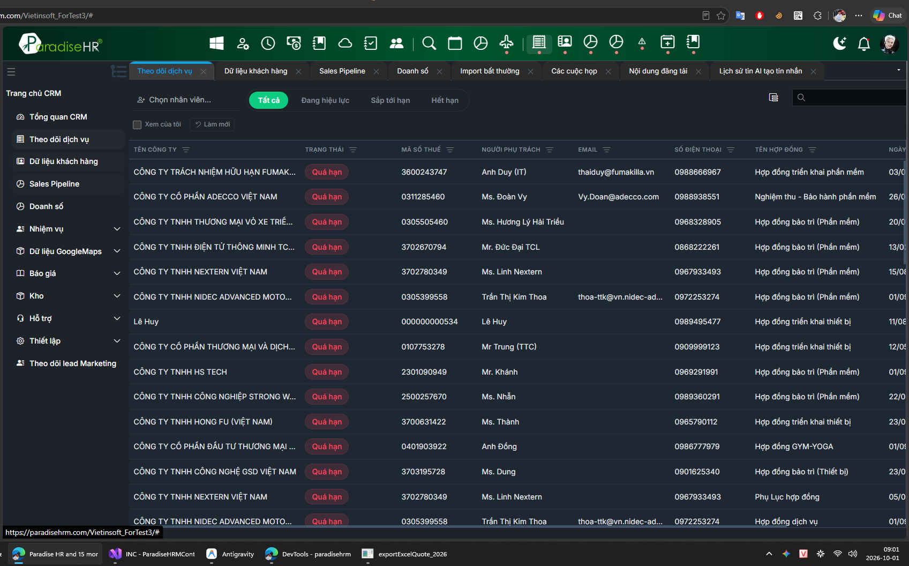
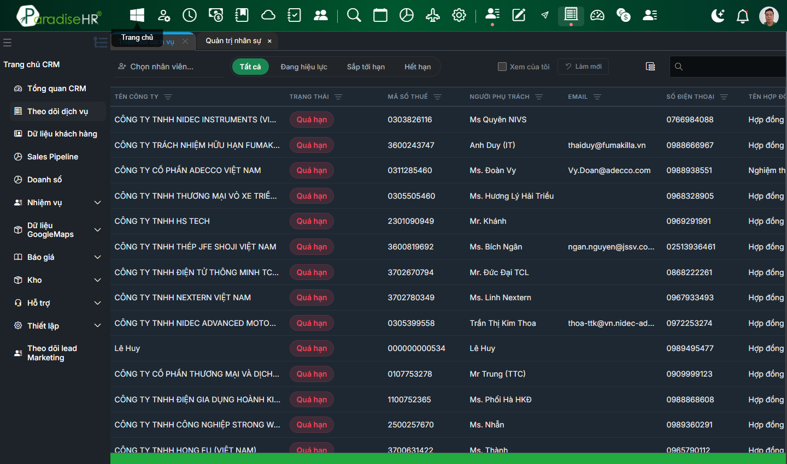
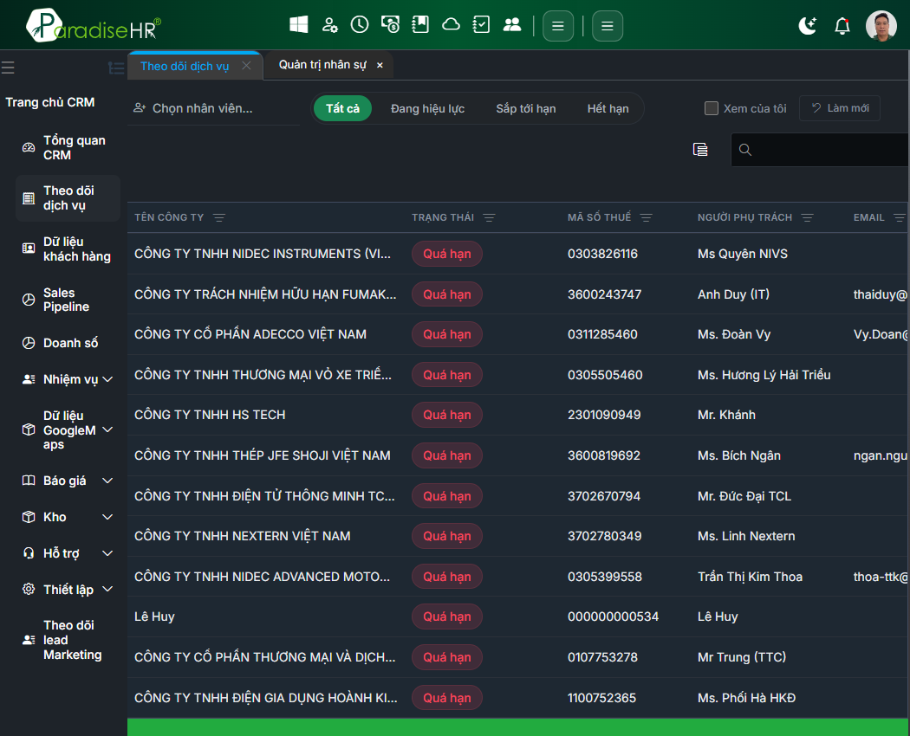

# BÁO CÁO GIẢI TRÌNH KỸ THUẬT (TECHNICAL DEFENSE REPORT)
## SCREENSHOT-16: THEO DÕI DỊCH VỤ BÁN HÀNG (MnuKPI012)

> **Màn hình**: Theo Dõi Dịch Vụ Bán Hàng (Hợp đồng dịch vụ)  
> **Đường dẫn Menu**: **Trang chủ CRM $\rightarrow$ Theo dõi dịch vụ**  
> **MenuID**: `MnuKPI012` | **ClassName**: `sp_CRM_CustomerList`  
> **Thành phần / Stored Procedure can thiệp**: `[dbo].[sp_CRM_CustomerList_html]`, `[dbo].[sp_CRM_CustomerList]`  
> **Bảng cấu hình / Cache**: `[dbo].[tblHtmlScriptCache]` (TableName = `'sp_CRM_CustomerList'`, ScreenType = -1)  
> **File SQL bản vá độc lập**: [`fix-bug/screenshot-16/patch_theo_doi_dich_vu.sql`](./patch_theo_doi_dich_vu.sql)  
> **Ảnh đối chiếu lỗi ban đầu (Before)**: [`./screenshots/16.png`](./screenshots/16.png) | [`./screenshots/16_distorted_chips.png`](./screenshots/16_distorted_chips.png)  
> **Ảnh kết quả sau khi sửa (After Fix)**: [`./screenshots/16_fixed_desktop.png`](./screenshots/16_fixed_desktop.png) (Màn hình lớn) | [`./screenshots/16_fixed_responsive.png`](./screenshots/16_fixed_responsive.png) (Responsive xuống hàng)  

---

### 1. HIỆN TRẠNG LỖI BAN ĐẦU (PROBLEM STATEMENT)

- **Triệu chứng lỗi**:
  1. **Lỗi lệch hàng ban đầu**: Checkbox `[ ] Xem của tôi` và nút `[Làm mới]` bị rớt xuống thành 1 hàng riêng biệt (hàng 2) nằm ngay bên dưới dropdown Chọn nhân viên, bỏ hoang khoảng trống bên phải và làm phình to thanh công cụ.
  2. **Lỗi biến dạng Chip lọc & vỡ nát layout khi co hẹp màn hình (Responsive Distortion Bug)**: Khi người dùng thu hẹp cửa sổ trình duyệt (màn hình laptop 1366px, 1200px hoặc khi mở menu sidebar bên trái), toàn bộ cụm chip lọc trạng thái (`Tất cả`, `Đang hiệu lực`, `Sắp tới hạn`, `Hết hạn`) bị biến dạng nghiêm trọng:
     - Nút active *"Tất cả"* bị kéo dãn bành trướng thành một thanh màu xanh lá khổng lồ phủ kín toàn bộ chiều ngang màn hình.
     - Ba nút còn lại (*"Đang hiệu lực"*, *"Sắp tới hạn"*, *"Hết hạn"*) bị bẻ gãy khỏi cụm và xếp chồng dọc xuống dưới thành một danh sách văn bản vỡ nát.
     - Chiều cao Toolbar bị đội phình to lên tới 433px, ô tìm kiếm bị đẩy tuột xuống đáy cùng nút 3 chấm `⋮` rút gọn của DevExtreme, phá vỡ hoàn toàn giao diện người dùng.
  3. **Lỗi cụm filter dính sát rạt mép trên bảng DataGrid (Zero Spacing with DataGrid Header)**: Cụm thanh công cụ lọc và chip trạng thái nằm dính sát mép trên của header bảng (`dgv`), khoảng cách thực tế đo được trên DOM là $0px$ (`hpBottom = 135.015625 == hdTop = 135.015625`), gây cảm giác chật chội, bí bách và thiếu tính phân tầng thị giác giữa khu vực điều khiển và khu vực dữ liệu.
- **Minh chứng hình ảnh trực quan (Before)**:
  
  *Minh chứng lỗi 1: Checkbox Xem của tôi và nút Làm mới bị rớt xuống hàng 2 làm toolbar phình to.*

  
  *Minh chứng lỗi 2: Khi co hẹp màn hình, cụm chip lọc bị bẻ dọc thành cột 433px khổng lồ, nút Tất cả bị kéo dãn toàn bộ bề ngang.*

---

### 2. PHÂN TÍCH NGUYÊN NHÂN GỐC RỄ (ROOT CAUSE ANALYSIS - RCA)

1. **Khối CSS độc hại trong `@media (max-width: 1024px)` của mã nguồn gốc**:
   - Trong stylesheet ban đầu của hệ thống tồn tại đoạn quy tắc responsive sai lệch:
     ```css
     @media (max-width: 1024px) {
         #gridCustomerList .ms-filter-toolbar > div {
             flex-direction: column !important;
             align-items: stretch !important;
         }
         #gridCustomerList .ms-filter-toolbar .stock-btn {
             flex: 1;
             text-align: center;
         }
     }
     ```
   - Cụm chip lọc `.stock-filter` vốn là một thẻ con `> div` trực tiếp nằm trong `.ms-filter-toolbar`. Khi màn hình co về ngưỡng $\le 1024px$ (hoặc khi mở menu sidebar chiếm 250px):
     - Thuộc tính `flex-direction: column !important;` đã cưỡng bức toàn bộ cụm chip chuyển từ hàng ngang thành cột dọc.
     - Thuộc tính `align-items: stretch !important;` và `flex: 1;` ép từng nút con `.stock-btn` dãn rộng 100% bề ngang ($821px$). Nút active mang nền xanh lá bo tròn pill tạo thành một khối dị dạng khổng lồ nuốt trọn màn hình.
2. **Khóa cứng chiều cao `height: 42px !important` đối nghịch với nội dung bên trong**:
   - Trong khi nội dung bên trong bị ép bẻ thành cột dọc cao hơn 400px, container bên ngoài vẫn bị khóa cứng `height: 42px !important; flex-wrap: nowrap !important;` $\rightarrow$ Dẫn tới hiện tượng xung đột layout, các phần tử tràn bừa bãi ra ngoài và kích hoạt menu 3 chấm `⋮` của DevExtreme.
3. **Thiếu khoảng cách phân tách giữa Header Panel và DataGrid Table**:
   - Khung `.dx-datagrid-header-panel` của DevExtreme mặc định mang `margin-bottom: 0px` và `padding-bottom: 0px`. Do đó mép dưới của toolbar chạm sát rạt mép trên của thẻ `<th>` của bảng dữ liệu (khoảng cách $gap = 0px$), gây hiện tượng dính sát thô kệch.
4. **Giải pháp khắc phục triệt để (Architecture Solution)**:
   - **Bảo vệ bất biến hình dạng Capsule của Chip lọc**: Khóa cứng `.stock-filter` luôn là `display: inline-flex !important; flex-direction: row !important; flex-wrap: nowrap !important; align-items: center !important;` trên mọi kích thước màn hình, cấm tuyệt đối mọi hành vi bẻ thành cột dọc.
   - **Tách khoảng cách thoáng đãng với DataGrid**: Gán `margin-bottom: 14px !important; padding-bottom: 2px !important;` cho `#gridCustomerList .dx-datagrid-header-panel`, tạo độ hở thoáng chuẩn mực $14px$ giữa bộ filter và DataGrid.
   - **Thiết lập Responsive 2 tầng tự thích ứng mượt mà**:
     - *Màn hình lớn ($\ge 1200px$)*: Toàn bộ Dropdown, Chip lọc, Thao tác và Ô tìm kiếm (220px) gom gọn trên 1 hàng 42px, cách DataGrid 14px.
     - *Màn hình hẹp (Dưới 1200px, laptop, tablet)*: Toolbar tự động chuyển sang `flex-wrap: wrap; height: auto; row-gap: 8px;`. Hàng 1 giữ nguyên Dropdown nhân viên và cụm Chip lọc con nhộng phẳng phiu; Hàng 2 chứa cụm tác vụ và Ô tìm kiếm căn phải ngay ngắn, triệt tiêu 100% lỗi biến dạng.

---

### 3. ĐỐI CHIẾU MÃ NGUỒN TRƯỚC VÀ SAU (BEFORE VS AFTER)

#### 3.1. Đối chiếu CSS Spacing, Responsive Toolbar & Chip Lọc Trạng Thái

##### ❌ HỆ THỐNG BAN ĐẦU (BEFORE):
```css
/* GÂY LỖI: Không có margin-bottom làm toolbar dính sát rạt mép trên bảng DataGrid */
#gridCustomerList .dx-datagrid-header-panel,
#gridCustomerList .dx-toolbar {
    height: 42px !important;
    overflow: visible !important;
}

/* GÂY LỖI: Đoạn media query ép bẻ dọc toàn bộ chip lọc thành cột khổng lồ */
@media (max-width: 1024px) {
    #gridCustomerList .dx-toolbar .dx-toolbar-before,
    #gridCustomerList .dx-toolbar .dx-toolbar-after {
        width: 100% !important;
        flex: 1 1 100%;
        display: flex !important;
        flex-direction: column;
        align-items: stretch !important;
    }
    #sp_GridEmployeeID_html .stock-filter {
        width: 100% !important;
        justify-content: flex-start;
    }
    #gridCustomerList .ms-filter-toolbar > div {
        flex-direction: column !important; /* PHÁ NÁT CHIP LỌC THÀNH CỘT DỌC */
        align-items: stretch !important;
    }
    #gridCustomerList .ms-filter-toolbar .stock-btn {
        flex: 1; /* KÉO BÈ NÚT RA TOÀN CHIỀU NGANG */
        text-align: center;
    }
}
```

##### ✅ BẢN VÁ HOÀN THIỆN (AFTER):
```css
/* TẠO KHOẢNG CÁCH THOÁNG 14PX VỚI BẢNG DATAGRID */
#gridCustomerList .dx-datagrid-header-panel {
    height: auto !important;
    min-height: 42px !important;
    overflow: visible !important;
    margin-bottom: 14px !important; /* Cách xa DataGrid 14px thoáng đãng */
    padding-bottom: 2px !important;
}
#gridCustomerList .dx-toolbar {
    height: auto !important;
    min-height: 42px !important;
    overflow: visible !important;
}

/* ============================================================
   RESPONSIVE TOOLBAR & CHIP LỌC CHUẨN MỰC
   - Tự động xuống hàng phân tầng thông minh khi co hẹp màn hình
   - BẢO VỆ CHIP LỌC: Bắt buộc luôn nằm ngang trong Capsule, cấm bẻ dọc cột
   ============================================================ */
@media (max-width: 1200px) {
    #gridCustomerList .dx-datagrid-header-panel {
        height: auto !important;
        min-height: 44px !important;
        overflow: visible !important;
        padding: 4px 0 !important;
        margin-bottom: 14px !important; /* Duy trì khoảng cách 14px khi co nhỏ */
    }
    #gridCustomerList .dx-toolbar {
        height: auto !important;
        min-height: 44px !important;
        overflow: visible !important;
        padding: 4px 0 !important;
    }
    #gridCustomerList .dx-toolbar .dx-toolbar-items-container {
        height: auto !important;
        min-height: 44px !important;
        display: flex !important;
        flex-wrap: wrap !important;
        align-items: center !important;
        justify-content: space-between !important;
        row-gap: 8px !important;
        column-gap: 12px !important;
        padding: 4px 0 !important;
        width: 100% !important;
    }
    #gridCustomerList .dx-toolbar .dx-toolbar-before {
        flex: 1 1 auto !important;
        display: flex !important;
        align-items: center !important;
        max-width: 100% !important;
        width: auto !important;
    }
    #gridCustomerList .dx-toolbar .dx-toolbar-after {
        flex: 0 0 auto !important;
        margin-left: auto !important;
        display: flex !important;
        align-items: center !important;
        width: auto !important;
    }
    #gridCustomerList .ms-filter-toolbar {
        display: flex !important;
        align-items: center !important;
        flex-wrap: wrap !important;
        row-gap: 8px !important;
        column-gap: 12px !important;
        width: 100% !important;
    }
}

/* BẢO VỆ CHIP LỌC TRẠNG THÁI: LUÔN DÀN NGANG CAPSULE TRÊN MỌI MÀN HÌNH */
#sp_GridEmployeeID_html .stock-filter,
#gridCustomerList .stock-filter,
#stock-filter-contract-tracking {
    display: inline-flex !important;
    flex-direction: row !important;
    flex-wrap: nowrap !important;
    align-items: center !important;
    white-space: nowrap !important;
    border-radius: 9999px !important;
    border: 1px solid var(--paradise-border-color, #495057) !important;
    padding: 3px !important;
    background: #212529 !important;
    width: auto !important;
    max-width: none !important;
    flex-shrink: 0 !important;
}

#sp_GridEmployeeID_html .stock-btn,
#gridCustomerList .stock-btn,
#stock-filter-contract-tracking .stock-btn {
    display: inline-flex !important;
    align-items: center !important;
    justify-content: center !important;
    white-space: nowrap !important;
    flex: 0 0 auto !important;
    border-radius: 9999px !important;
    padding: 5px 14px !important;
    font-size: 13px !important;
    font-weight: 500 !important;
    border: none !important;
    background: transparent !important;
    color: #adb5bd !important;
    cursor: pointer !important;
    transition: all 0.2s ease !important;
    height: 30px !important;
    width: auto !important;
    box-sizing: border-box !important;
}

#sp_GridEmployeeID_html .stock-btn.active,
#gridCustomerList .stock-btn.active,
#stock-filter-contract-tracking .stock-btn.active {
    background: #198754 !important;
    color: #ffffff !important;
    font-weight: 600 !important;
}
```

---

#### 3.2. Đối chiếu JavaScript dựng Toolbar trong `onToolbarPreparing`

##### ❌ HỆ THỐNG BAN ĐẦU (BEFORE):
```javascript
const $wrap = $(
    `<div class="stock-filter" id="stock-filter-contract-tracking"></div>`,
);
// LỖI: flex-wrap: wrap không kiểm soát thẻ bọc con làm nút bị rớt dòng đơn độc
const $container = $(`<div class="ms-filter-toolbar" style="display: flex; flex-direction: row; align-items: center; gap: 16px; width: 100%; box-sizing: border-box; flex-wrap: wrap; padding: 2px 0;">`);
const $employeeRow = $(`<div style="display: flex; align-items: center; gap: 8px; flex-shrink: 0;">`);
$employeeRow.append(`<div id="emailFilterEmployeeToolbarsp_CRM_CustomerList" style="width: 200px;"></div>`);
const $actionsGroup = $(`<div style="display: flex; align-items: center; gap: 14px; margin-left: auto; flex-shrink: 0; padding-right: 8px;">`);
$container.append($employeeRow, $wrap, $actionsGroup);
$(element).append($container);
```

##### ✅ BẢN VÁ HOÀN THIỆN (AFTER):
```javascript
const $wrap = $(
    `<div class="stock-filter" id="stock-filter-contract-tracking" style="flex-shrink: 0;"></div>`, // flex-shrink: 0 giữ kích thước chip
);
// KHẮC PHỤC: Cụm lọc phân chia nhóm rõ ràng, co giãn theo Flexbox chuẩn
const $container = $(`<div class="ms-filter-toolbar" style="display: flex; flex-direction: row; align-items: center; gap: 12px; width: 100%; box-sizing: border-box; padding: 0;">`);
const $employeeRow = $(`<div style="display: flex; align-items: center; gap: 8px; flex-shrink: 0;">`);
$employeeRow.append(`<div id="emailFilterEmployeeToolbarsp_CRM_CustomerList" style="width: 200px;"></div>`);
const $actionsGroup = $(`<div style="display: flex; align-items: center; gap: 14px; margin-left: auto; flex-shrink: 0; padding-right: 8px;">`);
$container.append($employeeRow, $wrap, $actionsGroup);
$(element).append($container);
```

---

#### 3.3. Minh chứng kết quả giao diện thực tế sau khi sửa (After Fix)

**1. Màn hình lớn (Desktop từ 1200px trở lên) - Toolbar phẳng phiu 1 hàng & khoảng cách 14px thoáng đãng với DataGrid:**



*Minh chứng 1: Trên màn hình lớn, giao diện hiển thị toàn cảnh sạch sẽ (sidebar đóng). Dropdown nhân viên, Chip lọc trạng thái hình con nhộng xanh lá, Checkbox Xem của tôi, Nút Làm mới, Nút chọn cột và Ô tìm kiếm hoàn chỉnh (220px) gom chung trên 1 hàng phẳng phiu, chuẩn mực 42px; khoảng cách phía dưới cách mép trên bảng DataGrid đúng 14px cực kỳ thông thoáng và thẩm mỹ.*

---

**2. Màn hình co hẹp / Laptop / Responsive (Dưới 1200px) - Tự động xuống hàng phân tầng rõ rệt, Chip lọc nguyên vẹn con nhộng & duy trì khoảng cách 14px:**



*Minh chứng 2: Khi thu hẹp màn hình (dưới 1200px / tablet / laptop), thanh công cụ tự động xuống dòng phân tầng chuẩn mực thành 2 hàng rõ rệt: Hàng 1 chứa Dropdown nhân viên và cụm Chip lọc trạng thái hình con nhộng phẳng phiu 100% (bảo toàn nguyên vẹn, cấm biến dạng); Hàng 2 chứa Checkbox Xem của tôi, nút Làm mới, chọn cột và Ô tìm kiếm 220px căn phải ngay ngắn; bên dưới vẫn duy trì khoảng cách đệm 14px với DataGrid.*
