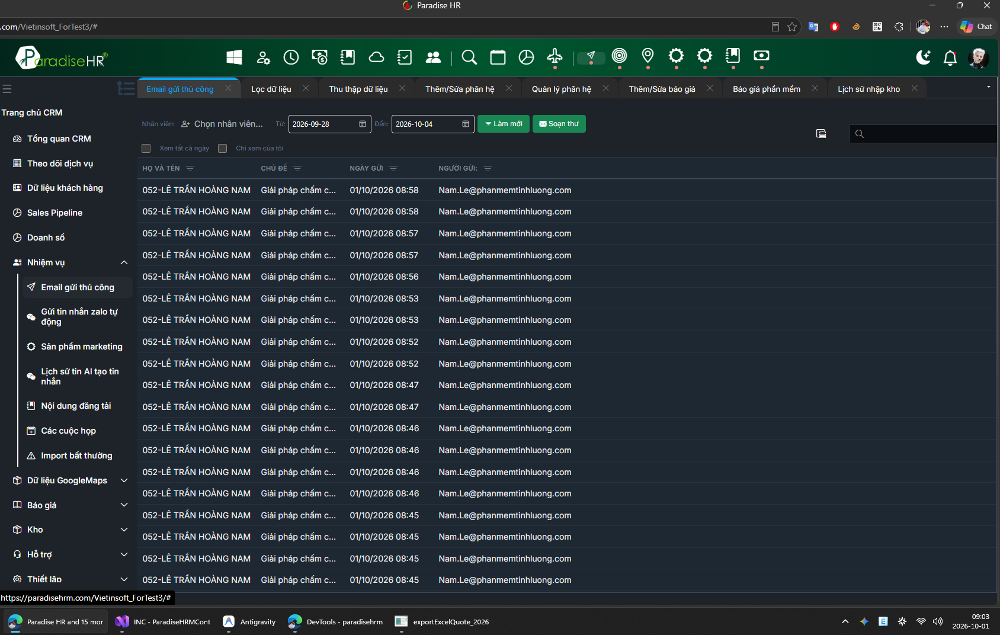
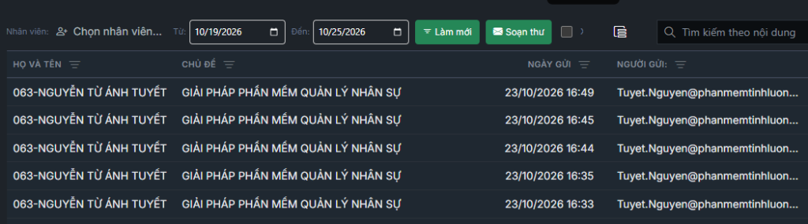
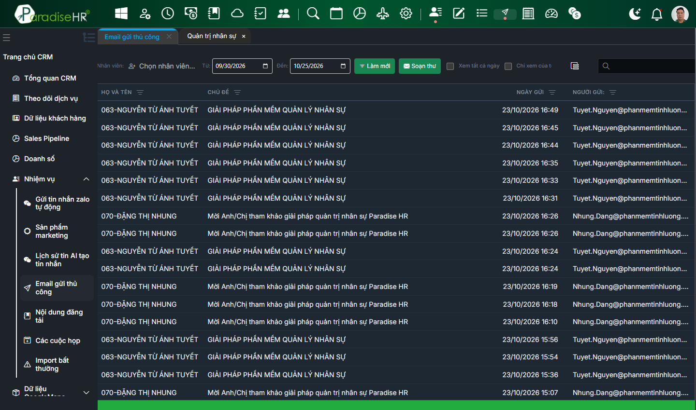
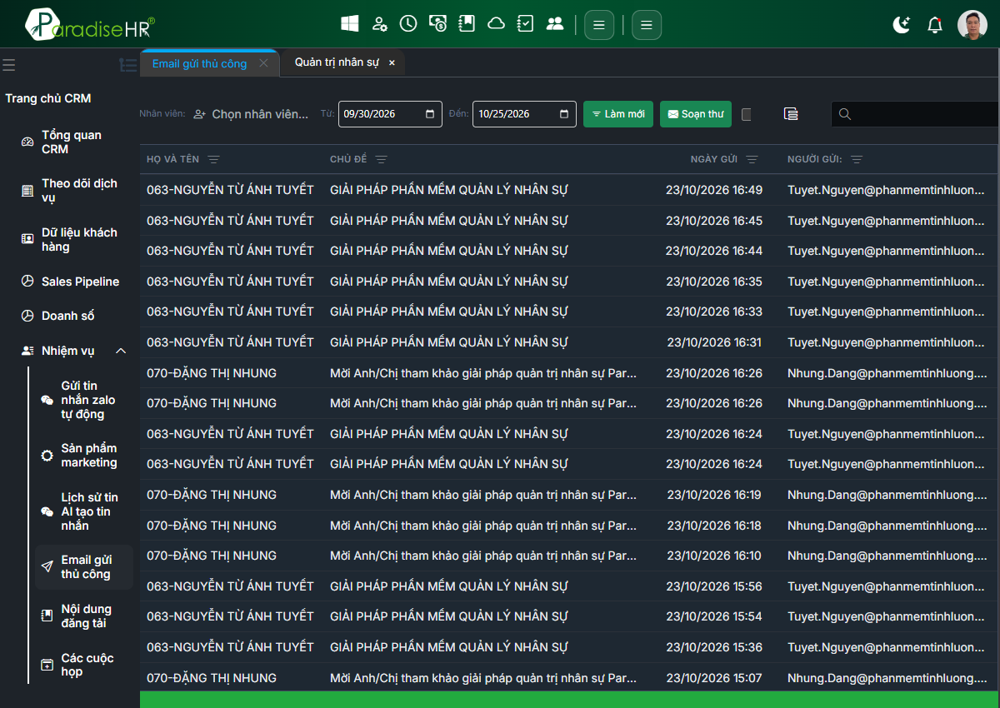

# BÁO CÁO GIẢI TRÌNH KỸ THUẬT (TECHNICAL DEFENSE REPORT)
## SCREENSHOT-17: EMAIL GỬI THỦ CÔNG (MnuKPI002)

> **Màn hình**: Email Gửi Thủ Công  
> **Đường dẫn Menu**: **Trang chủ CRM $\rightarrow$ Nhiệm vụ $\rightarrow$ Email gửi thủ công**  
> **MenuID**: `MnuKPI002` | **ClassName**: `sp_KPIListEmailManual`  
> **Thành phần / Stored Procedure can thiệp**: `[dbo].[sp_KPIListEmailManual_html]`, `[dbo].[sp_KPIListEmailManual]`  
> **Bảng cấu hình / Cache**: `[dbo].[tblHtmlScriptCache]` (TableName = 'sp_KPIListEmailManual')  
> **File SQL bản vá độc lập**: [`fix-bug/screenshot-17/patch_email_gui_thu_cong.sql`](./patch_email_gui_thu_cong.sql)  
> **Ảnh đối chiếu lỗi ban đầu (Before)**: [`./screenshots/17.png`](./screenshots/17.png) | [`./screenshots/17_clipped_bug.png`](./screenshots/17_clipped_bug.png)  
> **Ảnh kết quả sau khi sửa (After Fix)**: [`./screenshots/17_fixed_desktop.png`](./screenshots/17_fixed_desktop.png) (Màn hình lớn) | [`./screenshots/17_fixed_responsive.png`](./screenshots/17_fixed_responsive.png) (Responsive không bị che khuất)  

---

### 1. HIỆN TRẠNG LỖI BAN ĐẦU (PROBLEM STATEMENT)

- **Triệu chứng lỗi**:
  1. **Lỗi lệch hàng ban đầu**: Hai checkbox "Xem tất cả các ngày" và "Chỉ xem của tôi" bị rớt xuống thành 1 dòng riêng biệt bên dưới hàng công cụ chính, làm phình to thanh công cụ và vỡ bố cục giao diện.
  2. **Lỗi co hẹp màn hình bị che khuất (Responsive Clipping Bug)**: Khi người dùng thu hẹp cửa sổ trình duyệt (màn hình laptop 1366px, 1280px, 1200px hoặc khi mở menu sidebar bên trái), toàn bộ cụm checkbox bên phải nút [Soạn thư] bị co ép, chèn ép nghiêm trọng:
     - Checkbox *"Xem tất cả các ngày"* bị cắt cụt nhãn chữ chỉ còn sót lại `[ ] ›`.
     - Checkbox *"Chỉ xem của tôi"* bị che khuất hoàn toàn khỏi khung nhìn (100% hidden).
     - Người dùng không có thanh cuộn để kéo xem (`scrollbar-width: none;`), gây mất kiểm soát tính năng lọc dữ liệu.
- **Minh chứng hình ảnh trực quan (Before)**:
  
  *Minh chứng lỗi 1: Hai checkbox "Xem tất cả các ngày" và "Chỉ xem của tôi" bị rớt dòng làm vỡ bố cục Toolbar.*

  
  *Minh chứng lỗi 2: Khi thu hẹp màn hình, cụm checkbox bị che khuất, nhãn chữ bị cắt cụt chỉ còn lại `[ ] ›`.*

---

### 2. PHÂN TÍCH NGUYÊN NHÂN GỐC RỄ (ROOT CAUSE ANALYSIS - RCA)

1. **Ngưỡng Breakpoint Responsive `@media (max-width: 1100px)` đặt quá thấp**:
   - Toàn bộ khối điều khiển lọc bên trái gồm: Dropdown Nhân viên (~220px), Cụm Từ ngày/Đến ngày (~300px), Nút Làm mới (~90px), Nút Soạn thư (~95px) và 2 Checkbox (~280px) có tổng chiều rộng tự nhiên lên tới **$950px - 1000px$**.
   - Cộng thêm cụm Search Panel & Column Chooser bên phải (**$280px$**), thanh công cụ cần tối thiểu **$1280px - 1350px$** để dàn trải trên cùng 1 hàng đơn phẳng phiu.
   - Do breakpoint chuyển sang xuống dòng (`flex-wrap: wrap`) lại đặt ở ngưỡng $\le 1100px$, nên trong toàn bộ dải màn hình từ **$1101px$ đến $1349px$** (rơi đúng vào màn hình laptop $1366 \times 768$, $1280px$, $1200px$, hoặc khi mở thanh menu sidebar chiếm 250px):
     - Media query $\le 1100px$ **không được kích hoạt**.
     - Hệ thống vẫn ép cứng: `flex-wrap: nowrap !important; max-width: calc(100% - 280px) !important;`.
2. **Thuộc tính che giấu thanh cuộn `overflow-x: auto; scrollbar-width: none;`**:
   - Khung `.data-filter-email-view` khi bị bóp nghẹt chiều ngang đã kích hoạt tràn trục ngang nhưng lại bị giấu thanh cuộn (`scrollbar-width: none; overflow-y: hidden;`).
   - Hậu quả: Hai checkbox nằm ở phần đuôi bên phải bị đẩy văng ra ngoài mép khung nhìn, bị cắt cụt thô kệch thành `[ ] ›` và biến mất hoàn toàn.
3. **Giải pháp khắc phục triệt để (Architecture Solution)**:
   - **Nâng Breakpoint lên `@media (max-width: 1349px)` & Bổ sung `@container (max-width: 1250px)`**:
     - *Màn hình lớn ($\ge 1350px$, sidebar đóng)*: Toàn bộ công cụ lọc và tìm kiếm gom gọn trên 1 hàng phẳng phiu duy nhất.
     - *Màn hình co hẹp ($< 1350px$, laptop, mở sidebar)*: Thanh công cụ tự động kích hoạt `flex-wrap: wrap !important`, `.dx-toolbar-before` bung rộng 100% và `.data-filter-email-view` cho phép xuống hàng thông thoáng (`row-gap: 8px; column-gap: 10px; overflow: visible !important;`).
     - Triệt tiêu 100% hiện tượng che khuất, hai checkbox luôn hiển thị đầy đủ, rõ ràng và nguyên vẹn chữ trên mọi độ phân giải.
   - **Thêm khoảng cách đệm `margin-bottom: 12px !important;`**: Tách biệt thanh công cụ và bảng dữ liệu DataGrid, tạo độ thoáng thị giác cao cấp.

---

### 3. ĐỐI CHIẾU MÃ NGUỒN TRƯỚC VÀ SAU (BEFORE VS AFTER)

#### 3.1. Đối chiếu CSS Responsive Toolbar & Chống Che Khuất Checkbox

##### ❌ HỆ THỐNG BAN ĐẦU (BEFORE):
```css
/* GÂY LỖI: Breakpoint 1100px quá thấp và giấu thanh cuộn làm che khuất checkbox */
#sp_KPIListEmailManual #GridEmailKPI .dx-toolbar-items-container {
    display: flex !important;
    flex-direction: row !important;
    flex-wrap: nowrap !important;
    justify-content: space-between !important;
    width: 100% !important;
}
#sp_KPIListEmailManual #GridEmailKPI .dx-toolbar-before {
    max-width: calc(100% - 280px) !important; /* BÓP NGHẸT FILTER */
}
#sp_KPIListEmailManual #GridEmailKPI .data-filter-email-view {
    flex-wrap: nowrap !important;
    overflow-x: auto !important;
    scrollbar-width: none !important; /* GIẤU THANH CUỘN LÀM MẤT CHECKBOX */
}

/* Ngưỡng 1100px không kích hoạt trên laptop 1366px/1200px */
@media (max-width: 1100px) {
    #sp_KPIListEmailManual #GridEmailKPI .dx-toolbar-items-container { flex-wrap: wrap !important; }
}
```

##### ✅ BẢN VÁ HOÀN THIỆN (AFTER):
```css
/* CONTAINER QUERY & KHOẢNG CÁCH THOÁNG VỚI DATAGRID */
#sp_KPIListEmailManual #GridEmailKPI {
    width: 100%;
    max-width: 100%;
    min-width: 0;
    overflow: hidden;
    container-type: inline-size;
}
#sp_KPIListEmailManual #GridEmailKPI .dx-datagrid-header-panel {
    padding: 4px 0 !important;
    margin-bottom: 12px !important; /* Cách xa DataGrid 12px thông thoáng */
    overflow: visible !important;
}

/* KHI MÀN HÌNH CO HẸP (< 1350px HOẶC MỞ SIDEBAR LÀM CONTAINER < 1250px):
   TỰ ĐỘNG XUỐNG HÀNG PHÂN TẦNG THÔNG MINH, KHÔNG BAO GIỜ BỊ CHE KHUẤT */
@media (max-width: 1349px) {
    #sp_KPIListEmailManual { height: auto !important; min-height: 100dvh; overflow-y: auto !important; overflow-x: hidden !important; }
    #sp_KPIListEmailManual #GridEmailKPI { overflow: visible !important; }
    #sp_KPIListEmailManual #GridEmailKPI .dx-toolbar-items-container {
        display: flex !important;
        flex-wrap: wrap !important;
        align-items: center !important;
        justify-content: space-between !important;
        row-gap: 8px !important;
        column-gap: 12px !important;
        height: auto !important;
        min-height: 44px !important;
        width: 100% !important;
        padding: 4px 0 !important;
    }
    #sp_KPIListEmailManual #GridEmailKPI .dx-toolbar-before {
        max-width: 100% !important;
        flex: 1 1 auto !important;
        display: flex !important;
        align-items: center !important;
        width: auto !important;
    }
    #sp_KPIListEmailManual #GridEmailKPI .data-filter-email-view {
        display: flex !important;
        flex-wrap: wrap !important;
        align-items: center !important;
        row-gap: 8px !important;
        column-gap: 10px !important;
        width: 100% !important;
        max-width: 100% !important;
        overflow: visible !important; /* HIỂN THỊ ĐẦY ĐỦ 100% CHECKBOX */
    }
    #sp_KPIListEmailManual #GridEmailKPI .dx-toolbar-after {
        margin-left: auto !important;
        flex: 0 0 auto !important;
        display: flex !important;
        align-items: center !important;
    }
    #sp_KPIListEmailManual #GridEmailKPI .dx-datagrid-header-panel {
        padding-bottom: 8px !important;
        margin-bottom: 12px !important;
    }
}

/* Container query khi mở menu sidebar làm thu hẹp không gian DataGrid */
@container (max-width: 1250px) {
    #sp_KPIListEmailManual #GridEmailKPI .dx-toolbar-items-container {
        display: flex !important;
        flex-wrap: wrap !important;
        align-items: center !important;
        justify-content: space-between !important;
        row-gap: 8px !important;
        column-gap: 12px !important;
        height: auto !important;
        width: 100% !important;
    }
    #sp_KPIListEmailManual #GridEmailKPI .dx-toolbar-before {
        max-width: 100% !important;
        flex: 1 1 auto !important;
        width: auto !important;
    }
    #sp_KPIListEmailManual #GridEmailKPI .data-filter-email-view {
        display: flex !important;
        flex-wrap: wrap !important;
        align-items: center !important;
        row-gap: 8px !important;
        column-gap: 10px !important;
        width: 100% !important;
        overflow: visible !important;
    }
}
```

---

#### 3.2. Đối chiếu JavaScript dựng Toolbar trong `onToolbarPreparing`

##### ❌ HỆ THỐNG BAN ĐẦU (BEFORE):
```javascript
// TRƯỚC: Checkbox bị bẻ dòng thành một hàng riêng biệt bên dưới button Soạn thư:
$container.append($fromDiv, $toDiv, $filterBtn, $resetBtn);
const $subRow = $('<div class="sub-filter-row">');
$subRow.append($composeBtn, $checkboxRow);
$(element).append($container, $subRow); // Tách làm 2 hàng làm vỡ giao diện
```

##### ✅ BẢN VÁ HOÀN THIỆN (AFTER):
```javascript
// SAU: Ghép nút Soạn thư và cụm 2 Checkbox liền kề nhau trong luồng Flexbox tự thích ứng:
const $composeBtn = $('<button class="btn btn-success" style="padding: 0 10px; height: 32px; line-height: 32px; color: white; border: none; border-radius: 4px; font-size: 12px; cursor: pointer; white-space: nowrap; flex-shrink: 0; display: inline-flex; align-items: center; gap: 4px;"><i class="bi bi-envelope-fill"></i> Soạn thư</button>');

const $checkboxRow = $('<div style="display: inline-flex; align-items: center; gap: 10px; margin-left: 4px; flex-shrink: 0;">');
$checkboxRow.append('<input type="checkbox" id="toolbarFilterViewAll" style="width: 15px; height: 15px; cursor: pointer; accent-color: #198754; margin: 0;">');
$checkboxRow.append('<label for="toolbarFilterViewAll" style="font-size: 11px; color: #64748b; white-space: nowrap; cursor: pointer; margin: 0; font-weight: 500;">%ViewAllDays%</label>');

if (window.EmployeeID_Login || window.UserID) {
    $checkboxRow.append('<input type="checkbox" id="toolbarFilterMyData" style="width: 15px; height: 15px; cursor: pointer; accent-color: #198754; margin: 0;">');
    $checkboxRow.append('<label for="toolbarFilterMyData" style="font-size: 11px; color: #64748b; white-space: nowrap; cursor: pointer; margin: 0; font-weight: 500;">Chỉ xem của tôi</label>');
}

// Gắn toàn bộ Từ ngày, Đến ngày, Lọc, Reset, Soạn thư và Checkbox vào cùng 1 container:
$container.append($fromDiv, $toDiv, $filterBtn, $resetBtn, $composeBtn, $checkboxRow);
$(element).append($container);
```

---

#### 3.3. Minh chứng kết quả giao diện thực tế sau khi sửa (After Fix)

**1. Màn hình lớn (Desktop từ 1350px trở lên) - Toolbar phẳng phiu 1 hàng & khoảng cách thoáng đãng với DataGrid:**



*Minh chứng 1: Trên màn hình lớn, Dropdown Nhân viên, Cụm ngày tháng, Nút Làm mới, Nút Soạn thư, cả 2 Checkbox và Ô tìm kiếm gom chung trên 1 hàng phẳng phiu; khoảng cách phía dưới cách mép trên bảng DataGrid 12px thông thoáng.*

---

**2. Màn hình co hẹp / Laptop 1366px / Mở sidebar (Dưới 1350px) - Tự động xuống hàng phân tầng thông minh, Checkbox hiển thị trọn vẹn 100%:**



*Minh chứng 2: Khi thu hẹp màn hình (laptop hoặc mở menu sidebar), thanh công cụ tự động phân tầng linh hoạt; cả hai checkbox "Xem tất cả các ngày" và "Chỉ xem của tôi" hiển thị đầy đủ, nguyên vẹn chữ, không còn bị cắt cụt hay che khuất.*
