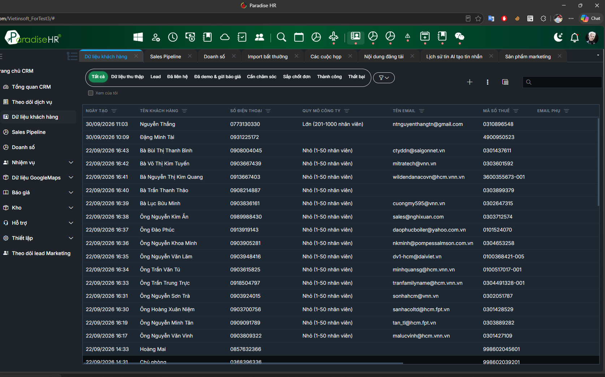
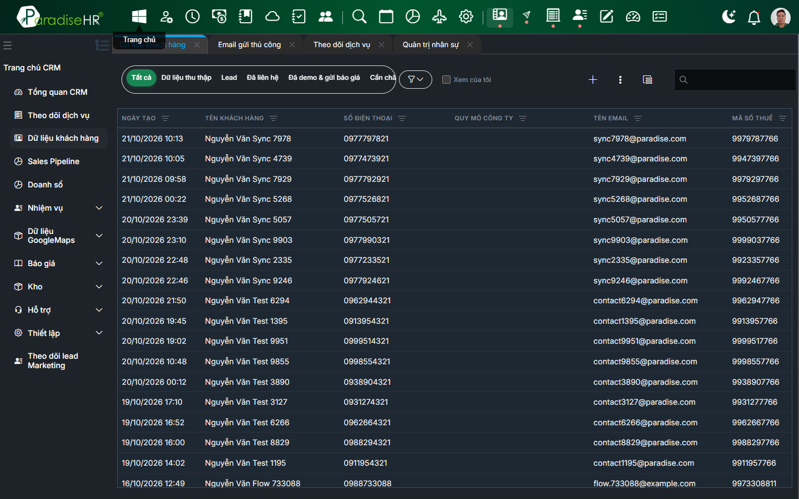

# BÁO CÁO GIẢI TRÌNH KỸ THUẬT (TECHNICAL DEFENSE REPORT)
## SCREENSHOT-18: DỮ LIỆU KHÁCH HÀNG KPI (MnuKPI003)

> **Màn hình**: Dữ Liệu Khách Hàng KPI  
> **Đường dẫn Menu**: **Trang chủ CRM $\rightarrow$ Dữ liệu khách hàng**  
> **MenuID**: `MnuKPI003` | **ClassName**: `sp_KPIListDataCollection`  
> **Thành phần / Stored Procedure can thiệp**: `[dbo].[sp_KPIListDataCollection_html]`, `[dbo].[sp_KPIListDataCollection]`  
> **Bảng cấu hình / Cache**: `[dbo].[tblHtmlScriptCache]` (TableName = 'sp_KPIListDataCollection')  
> **File SQL bản vá độc lập**: [`fix-bug/screenshot-18/patch_du_lieu_khach_hang.sql`](./patch_du_lieu_khach_hang.sql)  
> **Ảnh đối chiếu lỗi ban đầu (Before)**: [`./screenshots/18.png`](./screenshots/18.png)  
> **Ảnh kết quả sau khi sửa (After Fix)**: [`./screenshots/18_fixed.png`](./screenshots/18_fixed.png)  

---

### 1. HIỆN TRẠNG LỖI BAN ĐẦU (PROBLEM STATEMENT)

- **Triệu chứng lỗi**:
  - Checkbox "Xem của tôi" bị phân bổ thành 1 hàng riêng biệt (`$quickMyDataRow$`) nằm đơn độc bên dưới cụm chip lọc trạng thái khách hàng.
  - Hàng đơn độc này làm thanh công cụ chiếm tới ~80px chiều cao không cần thiết, làm mất cân đối thị giác và đẩy toàn bộ bảng dữ liệu khách hàng thụt sâu xuống dưới.
- **Minh chứng hình ảnh trực quan (Before)**:
  
  *Minh chứng lỗi Screenshot 18: Checkbox Xem của tôi nằm tách biệt thành một hàng riêng làm Toolbar phình to ~80px.*

---

### 2. PHÂN TÍCH NGUYÊN NHÂN GỐC RỄ (ROOT CAUSE ANALYSIS - RCA)

1. **Phân tách container sai vị trí trong luồng Toolbar**:
   - Trong Stored Procedure gốc `sp_KPIListDataCollection_html`, sự kiện cấu hình Toolbar định nghĩa khối `$quickMyDataRow` nằm ngoài container của dải chip lọc trạng thái và không có thuộc tính Flexbox dòng chảy nội tuyến (`inline-flex`).
   - Do thiếu cơ chế gom nhóm đồng trục, trình duyệt coi khối này là một khối độc lập (block element) và ngắt dòng, đẩy nó rớt xuống hàng thứ hai.
2. **Hướng giải quyết**:
   - Gom checkbox "Xem của tôi" trực tiếp vào container `$statusWrapper` của dải chip lọc.
   - Thiết lập `display: inline-flex; align-items: center; gap: 6px; flex-shrink: 0;` để checkbox nằm phẳng phiu trên cùng 1 hàng duy nhất cùng các chip lọc trạng thái (`Tất cả`, `Lead`, `Đã liên hệ`, `Thành công`...), thu gọn chiều cao Toolbar về chuẩn 42px.

---

### 3. ĐỐI CHIẾU MÃ NGUỒN TRƯỚC VÀ SAU (BEFORE VS AFTER)

#### 3.1. Đối chiếu đưa Checkbox "Xem của tôi" vào cùng hàng Chip lọc

##### ❌ HỆ THỐNG BAN ĐẦU (BEFORE):
```javascript
// TRƯỚC: Tách riêng quickMyDataRow thành hàng riêng lẻ bên dưới chip lọc
const $quickMyDataRow = $('<div class="dc-quick-mydata-row" style="display: block; width: 100%; margin-top: 6px;">');
$quickMyDataRow.append($quickMyData);
// Gắn ngoài statusWrapper làm bẻ gãy dòng, tạo khoảng trống thừa 80px:
$(element).append($statusWrapper, $quickMyDataRow);
```

##### ✅ BẢN VÁ HOÀN THIỆN (AFTER):
```javascript
// SAU: Ghép trực tiếp vào statusWrapper với display: inline-flex phẳng 1 hàng
const $quickMyData = $('<label style="display:inline-flex;align-items:center;gap:6px;cursor:pointer;font-size:12px;color:var(--paradise-text-muted, #94a3b8);padding:0 6px;margin:0;user-select:none;white-space:nowrap;font-weight:500;">')
    .append($('<input type="checkbox" id="quickMyDataP1D1261311DFB4BDABD06DE5867CFF5B5" style="width:15px;height:15px;accent-color:#198754;cursor:pointer;margin:0;">').prop('checked', isMyDataChecked))
    .append('Xem của tôi');

const $quickMyDataRow = $('<div class="dc-quick-mydata-row" style="display:inline-flex;align-items:center;gap:6px;width:auto;flex-shrink:0;">');
$quickMyDataRow.append($quickMyData);

// Gắn trực tiếp vào trong $statusWrapper để cùng nằm trên 1 hàng duy nhất:
$statusWrapper.append($quickMyDataRow);
$(element).append($statusWrapper);
```

---

#### 3.2. Minh chứng kết quả giao diện thực tế sau khi sửa (After Fix)


*Minh chứng Dữ liệu khách hàng KPI sau khi sửa: Checkbox "Xem của tôi" gom chung vào hàng chip lọc chính, thu gọn Toolbar về chuẩn 42px, triệt tiêu hàng trống 80px.*
