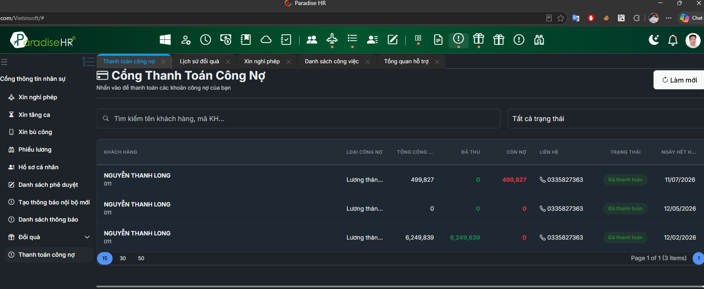
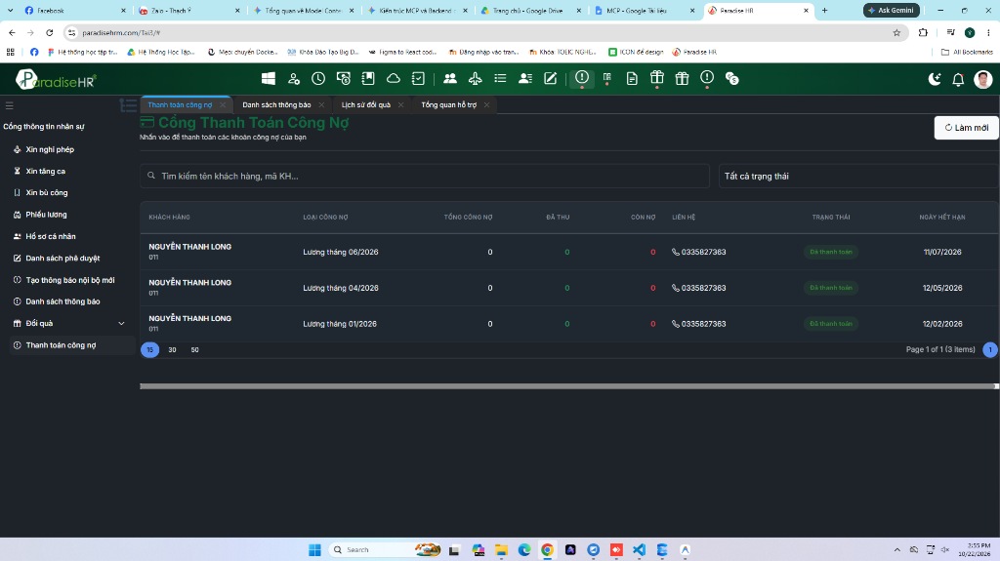
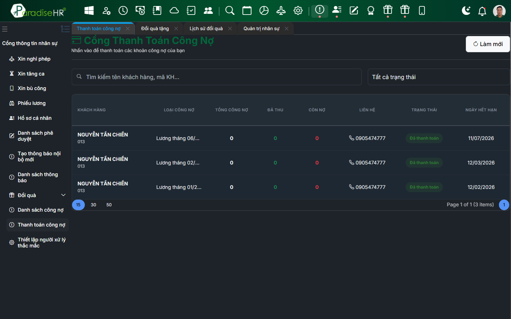

# BÁO CÁO GIẢI TRÌNH KỸ THUẬT (TECHNICAL DEFENSE REPORT)
## SCREENSHOT-02: THANH TOÁN CÔNG NỢ (MnuPRL409)

> **Màn hình**: Cổng Thanh Toán Công Nợ  
> **Đường dẫn Menu**: **Đổi quà $\rightarrow$ Thanh toán công nợ**  
> **MenuID**: `MnuPRL409` | **ClassName**: `sp_Debt_PaymentDebt`  
> **Thành phần / Stored Procedure can thiệp**: `[dbo].[sp_Debt_PaymentDebt_html]` & `[dbo].[sp_Debt_PaymentDebt]`  
> **Bảng cấu hình / Cache**: `[dbo].[tblHtmlScriptCache]` (TableName = 'sp_Debt_PaymentDebt')  
> **File SQL bản vá độc lập**: [`fix-bug/screenshot-2/patch_responsive.sql`](./patch_responsive.sql)  
> **Ảnh đối chiếu lỗi ban đầu (Before)**: [`./screenshots/2.png`](./screenshots/2.png)  
> **Ảnh kết quả sau khi sửa (After Fix)**: [`./screenshots/2_fixed.png`](./screenshots/2_fixed.png)  

---

### 1. HIỆN TRẠNG LỖI BAN ĐẦU TRÊN HỆ THỐNG (PROBLEM STATEMENT)
1. **Triệu chứng co dẹp DataGrid**: Khi người dùng mở màn hình "Thanh toán công nợ", bảng dữ liệu `#dp_grid` bị bóp dẹp nghiêm trọng chỉ đạt độ rộng khoảng ~600px, toàn bộ bảng bị ép dồn về sát mép bên trái. Phía bên phải bảng xuất hiện một "vùng đen mênh mông" chiếm tới 65% diện tích màn hình.
2. **Triệu chứng Header và Giá trị các cột bị lệch nhau**:
   - Tiêu đề cột (Header) và Giá trị trong ô (Cell) không thẳng hàng với nhau.
   - Cụ thể ở các cột: `Tổng công nợ`, `Đã thu`, `Còn nợ`: Tiêu đề Header thì nằm bên trái, trong khi số tiền (`0`) lại bị dạt tuốt sang góc phải.
   - Các cột `Loại công nợ`, `Liên hệ`, `Trạng thái`, `Ngày hết hạn` không được căn giữa chính tâm, tạo cảm giác giao diện cọc cạch, thiếu chuyên nghiệp.
3. **Ảnh đối chiếu lỗi ban đầu (Before)**:
   - **Lỗi 1: Bảng DataGrid bị bóp dẹp ~600px dồn trái, để lại vùng đen khổng lồ 65%**:
     
   - **Lỗi 2: Lệch căn hàng Header vs Cell (Header nằm trái, số tiền nằm lệch góc phải)**:
     

---

### 2. PHÂN TÍCH NGUYÊN NHÂN GỐC RỄ (ROOT CAUSE ANALYSIS - RCA)

1. **Cấu hình độ rộng các cột trong DataGrid bị gán tĩnh (Hardcoded Width)**:
   - Trong Stored Procedure gốc `sp_Debt_PaymentDebt_html`, định nghĩa các cột `columns: [...]` của DevExtreme DataGrid không sử dụng tỷ lệ phần trăm (`%`) mà để độ rộng pixel cố định (`width: 120`, `width: 110`), dẫn đến tổng bề ngang của 8 cột chỉ đạt ~810px, bị lọt thỏm giữa màn hình.
2. **Lỗi bất đối xứng giữa Alignment của Header và Cell**:
   - Dev cũ cấu hình các cột số tiền với `alignment: "right"`. Tuy nhiên thẻ tiêu đề Header `<td>` của DevExtreme lại nhận CSS mặc định căn lề trái của bảng (`text-align: left`), khiến tiêu đề nằm lề trái còn giá trị số tiền lại dạt sang lề phải.
   - Thẻ `cellTemplate` của các cột chưa được bọc khối căn giữa `text-center`, khiến nội dung ô bị lệch tâm so với tiêu đề Header phía trên.

---

### 3. ĐỐI CHIẾU MÃ NGUỒN TRƯỚC VÀ SAU (BEFORE VS AFTER)

#### 3.1. Cấu hình DataGrid: Căn giữa đồng bộ Header & Cell + Tỷ lệ % Responsive

##### ❌ HỆ THỐNG BAN ĐẦU (BEFORE):
```javascript
// GÁN CỨNG PIXEL + LỆCH CĂN HÀNG HEADER VS CELL:
gridInstance = $("#dp_grid").dxDataGrid({
    dataSource: filteredData,
    keyExpr: "RecordID",
    columns: [
        { caption: "%Debt_CustomerLabel%", minWidth: 150 },
        { caption: "%Debt_DebtTypeLabel%", dataField: "DebtType", width: 120 }, // ⚠️ Gán cứng pixel, không căn giữa
        { dataField: "Amount", caption: "%Debt_TotalDebtLabel%", width: 120, alignment: "right" }, // ⚠️ Header nằm trái, số nằm phải -> LỆCH!
        { caption: "%Debt_PaidAmountLabel%", width: 110, alignment: "right" }, // ⚠️ Header nằm trái, số nằm phải -> LỆCH!
        { caption: "%Debt_RemainingDebtLabel%", width: 110, alignment: "right" }, // ⚠️ Header nằm trái, số nằm phải -> LỆCH!
        { caption: "%Contact%", width: 100 },
        { caption: "%Status%", width: 100 }
    ]
});

##### ✅ BẢN VÁ HOÀN THIỆN (AFTER):
```javascript
// CĂN GIỮA CHÍNH TÂM HEADER & CELL + TỶ LỆ VÀNG 100%:
gridInstance = $("#dp_grid").dxDataGrid({
    dataSource: filteredData,
    keyExpr: "RecordID",
    showBorders: false,
    hoverStateEnabled: true,
    columnAutoWidth: true,
    allowColumnResizing: true,
    columnResizingMode: "widget",
    columnHidingEnabled: true,

    columns: [
        // 1. Cột Khách hàng: Căn trái tự nhiên theo quy chuẩn họ tên
        {
            caption: "%Debt_CustomerLabel%",
            minWidth: 180,
            width: "18%",
            hidingPriority: 8,
            cellTemplate: function (container, options) {
                var d = options.data;
                $("<div>").addClass("fw-bold text-truncate").attr("title", d.CustomerName).text(d.CustomerName).appendTo(container);
                $("<div>").addClass("small opacity-75").text(d.CustomerCode).appendTo(container);
            }
        },
        // 2. Cột Loại công nợ: Căn giữa chính tâm
        {
            caption: "%Debt_DebtTypeLabel%",
            dataField: "DebtType",
            minWidth: 140,
            width: "13%",
            alignment: "center", // ✅ Header căn giữa
            hidingPriority: 5,
            cellTemplate: function (container, options) {
                var val = options.value || "";
                $("<div>").addClass("text-truncate text-center").attr("title", val).text(val).appendTo(container); // ✅ Cell căn giữa
            }
        },
        // 3. Cột Tổng công nợ: Căn giữa chính tâm
        {
            dataField: "Amount",
            caption: "%Debt_TotalDebtLabel%",
            minWidth: 130,
            width: "11%",
            alignment: "center", // ✅ Header căn giữa
            format: "#,##0",
            hidingPriority: 6,
            cellTemplate: function (container, options) {
                var val = options.value || 0;
                $("<div>").addClass("text-center fw-bold").text(formatNumber(val)).appendTo(container); // ✅ Cell căn giữa
            }
        },
        // 4. Cột Đã thu: Căn giữa chính tâm
        {
            caption: "%Debt_PaidAmountLabel%",
            minWidth: 110,
            width: "9%",
            alignment: "center", // ✅ Header căn giữa
            hidingPriority: 3,
            cellTemplate: function (container, options) {
                var d = options.data;
                var paidAmount = d.PaidAmount || 0;
                $("<div>").addClass("text-success fw-bold text-center").text(formatNumber(paidAmount)).appendTo(container); // ✅ Cell căn giữa
            }
        },
        // 5. Cột Còn nợ: Căn giữa chính tâm
        {
            caption: "%Debt_RemainingDebtLabel%",
            minWidth: 110,
            width: "10%",
            alignment: "center", // ✅ Header căn giữa
            hidingPriority: 7,
            cellTemplate: function (container, options) {
                var d = options.data;
                var totalAmount = d.Amount || 0;
                var paidAmount = d.PaidAmount || 0;
                var remaining = totalAmount - paidAmount;
                $("<div>").addClass("text-danger fw-bold text-center").text(formatNumber(remaining)).appendTo(container); // ✅ Cell căn giữa
            }
        },
        // 6. Cột Liên hệ: Căn giữa chính tâm
        {
            caption: "%Contact%",
            minWidth: 140,
            width: "13%",
            alignment: "center", // ✅ Header căn giữa
            hidingPriority: 2,
            cellTemplate: function (container, options) {
                var d = options.data;
                var $wrap = $("<div>").addClass("text-center");
                if (d.PhoneNumber) $("<div>").html(`<i class="bi bi-telephone me-1"></i>${d.PhoneNumber}`).appendTo($wrap);
                if (d.Address) $("<div>").addClass("small text-truncate").attr("title", d.Address).text(d.Address).appendTo($wrap);
                $wrap.appendTo(container);
            }
        },
        // 7. Cột Trạng thái: Căn giữa chính tâm
        {
            dataField: "Status",
            caption: "%Status%",
            minWidth: 130,
            width: "13%",
            alignment: "center", // ✅ Header căn giữa
            hidingPriority: 4,
            cellTemplate: function (container, options) {
                ...
                $("<div>").addClass("text-center").append(
                    $("<span>").addClass("badge-status " + badgeClass).text(text)
                ).appendTo(container); // ✅ Badge căn giữa
            }
        },
        // 8. Cột Ngày hết hạn: Căn giữa chính tâm
        {
            dataField: "ExpiryDate",
            caption: "%Debt_ExpiryDateLabel%",
            alignment: "center", // ✅ Header căn giữa
            minWidth: 130,
            width: "13%",
            hidingPriority: 1,
            cellTemplate: function (container, options) {
                var val = options.value;
                var $cell = $("<div>").addClass("text-center"); // ✅ Cell căn giữa
                ...
                $cell.appendTo(container);
            }
        }
    ]
});
```

---

#### 3.2. Bổ sung CSS khóa chặt Căn Giữa Header & Cell

##### ✅ BẢN VÁ HOÀN THIỆN (AFTER):
```css
/* Đảm bảo toàn bộ Header và Cell có alignment: center đều thẳng hàng chính tâm 100% */
#sp_payment_debt .dx-datagrid-headers td[style*="text-align: center"],
#sp_payment_debt .dx-datagrid-headers .dx-text-content-alignment-center,
#sp_payment_debt td[style*="text-align: center"] {
    text-align: center !important;
}

#sp_payment_debt .dx-datagrid-headers td[style*="text-align: center"] .dx-datagrid-text-content {
    text-align: center !important;
    display: block !important;
    width: 100% !important;
}
```

---

#### 3.3. Quy trình SP Điều Phối và Biên Dịch Cache

##### ✅ BẢN VÁ HOÀN THIỆN (AFTER):
```sql
-- 1. SP Điều Phối trỏ đúng Key chuẩn hệ thống:
ALTER PROCEDURE [dbo].[sp_Debt_PaymentDebt]
    @LoginID INT = NULL,
    @LanguageID VARCHAR(2) = 'VN',
    @EmployeeID VARCHAR(20) = NULL
AS
BEGIN
    SET NOCOUNT ON;
    IF @LanguageID IS NULL OR LTRIM(RTRIM(@LanguageID)) = '' SET @LanguageID = 'VN';

    SELECT TOP 1 html 
    FROM tblHtmlScriptCache 
    WHERE TableName = 'sp_Debt_PaymentDebt' 
      AND ScreenType = -1 
      AND LanguageID = @LanguageID;
END
GO

-- 2. Biên dịch nạp Cache trực tiếp vào Key chuẩn:
PRINT N'==> Đang biên dịch cache Thanh toán công nợ qua sp_GenerateHTMLScript_new...';
IF OBJECT_ID('dbo.sp_GenerateHTMLScript_new', 'P') IS NOT NULL
    EXEC sp_GenerateHTMLScript_new 'sp_Debt_PaymentDebt_html', '-1', 'sp_Debt_PaymentDebt';
ELSE
    EXEC sp_GenerateHTMLScript 'sp_Debt_PaymentDebt_html';
GO
```

---

#### 3.4. Minh chứng kết quả giao diện thực tế sau khi sửa (After Fix)


*Minh chứng Cổng thanh toán công nợ sau khi sửa: Toàn bộ header và các ô số liệu Tổng công nợ, Đã thu, Còn nợ, Liên hệ, Trạng thái thẳng hàng, căn giữa trung tâm, không còn bị lệch sang lề phải.*

