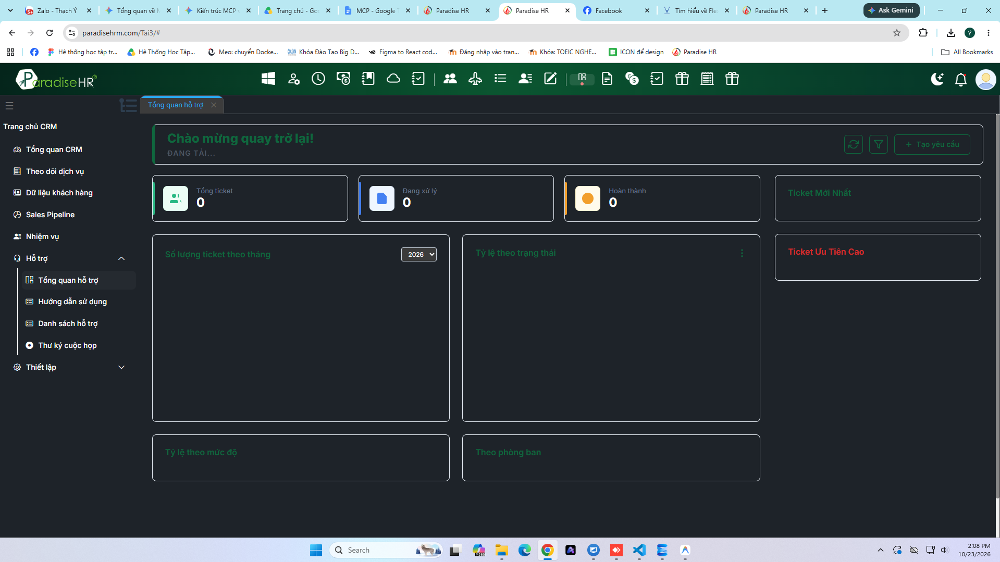
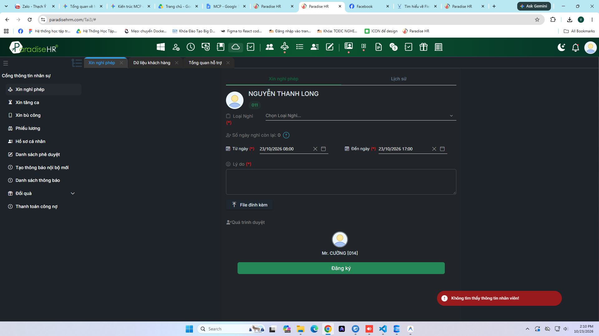
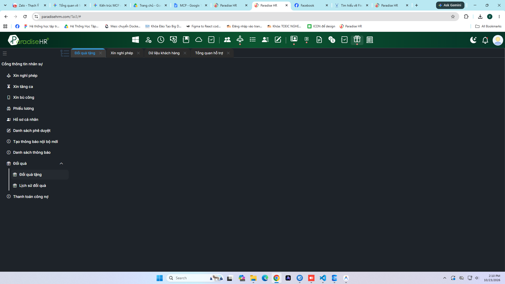
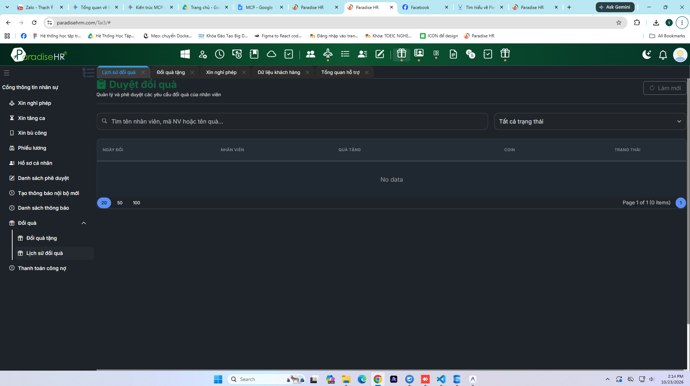
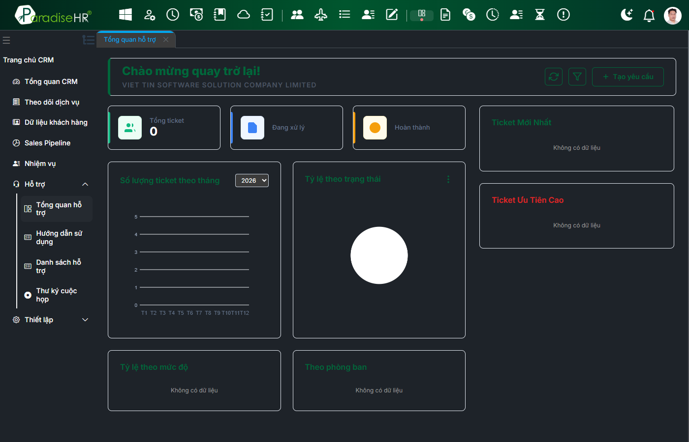
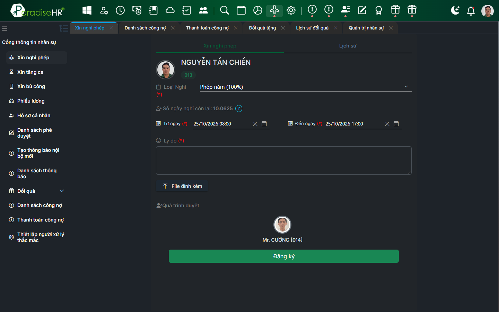
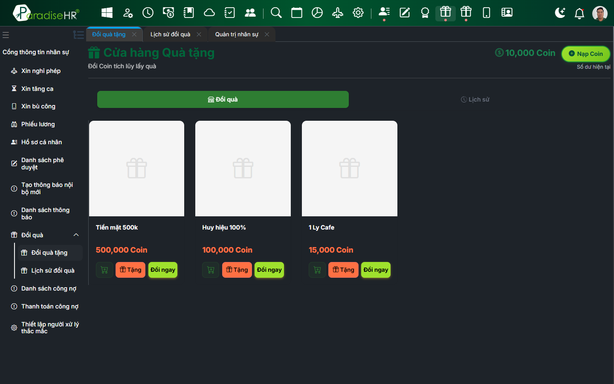
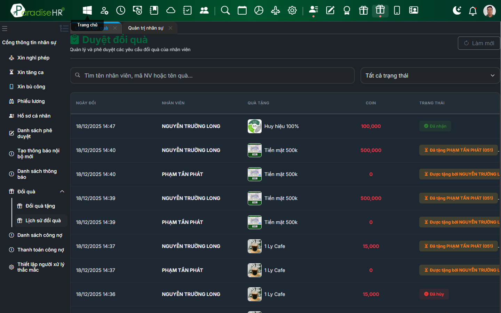

# BÁO CÁO GIẢI TRÌNH KỸ THUẬT (TECHNICAL DEFENSE REPORT)
## SCREENSHOT 20 $\rightarrow$ 23: SẬP DỮ LIỆU TOÀN HỆ THỐNG & LỖI CONSOLE GIAO DIỆN (`HtmlMacOSLayOut_html`)

> **Màn hình**: Tổng Quan Hỗ Trợ & Cổng Thông Tin Nhân Sự (Super Layout & API Gateway)  
> **MenuID**: `MnuSYS001` | **ClassName**: `HtmlMacOSLayOut_html` / `apiParadise`  
> **File SQL bản vá độc lập**: [`fix-bug/screenshot-20/patch_sync_api_tai2.sql`](./patch_sync_api_tai2.sql) & [`fix-bug/screenshot-20/patch_fix_layout_login.sql`](./patch_fix_layout_login.sql)  
> **Ảnh đối chiếu lỗi ban đầu (Before)**: [`./screenshots/20.png`](./screenshots/20.png) | [`./screenshots/21.png`](./screenshots/21.png) | [`./screenshots/22.png`](./screenshots/22.png) | [`./screenshots/23.png`](./screenshots/23.png)  
> **Ảnh kết quả sau khi sửa (After Fix)**: [`./screenshots/20_fixed.png`](./screenshots/20_fixed.png) | [`./screenshots/21_fixed.png`](./screenshots/21_fixed.png) | [`./screenshots/22_fixed.png`](./screenshots/22_fixed.png) | [`./screenshots/23_fixed.png`](./screenshots/23_fixed.png)  

---

### 1. HIỆN TRẠNG LỖI BAN ĐẦU (PROBLEM STATEMENT)

Khi đăng nhập vào hệ thống web `https://paradisehrm.com/Tai3/` (kết nối cơ sở dữ liệu `Vietinsoft_ForTest_Tai2`), phát sinh 2 nhóm lỗi nghiêm trọng:

- **Nhóm 1: Sập toàn bộ dữ liệu trên các màn hình chức năng (Screenshots 20 $\rightarrow$ 23)**:
  - **Hình 20 (Tổng quan hỗ trợ)**: Treo chữ `"Chào mừng quay trở lại! ĐANG TẢI..."`, toàn bộ các thẻ KPI ticket đều bằng `0`.
  - **Hình 21 (Xin nghỉ phép)**: Báo lỗi đỏ `"Không tìm thấy thông tin nhân viên!"`, số ngày phép tồn = `0`.
  - **Hình 22 (Đổi quà tặng)**: Màn hình trắng hoàn toàn, không nạp được danh mục quà.
  - **Hình 23 (Lịch sử đổi quà)**: Báo `"No data" (0 items)` dù trong cơ sở dữ liệu thực tế có 91 bản ghi.

  
  *Minh chứng lỗi Screenshot 20: Màn hình Tổng quan hỗ trợ bị treo tải và số liệu ticket bằng 0.*

  
  *Minh chứng lỗi Screenshot 21: Màn hình Xin nghỉ phép báo lỗi đỏ không tìm thấy nhân viên.*

  
  *Minh chứng lỗi Screenshot 22: Màn hình Đổi quà tặng trắng tinh.*

  
  *Minh chứng lỗi Screenshot 23: Lịch sử đổi quà báo No data dù trong DB có 91 dòng.*

- **Nhóm 2: Bắn lỗi đỏ Console và mất Avatar trên Layout chính (`HtmlMacOSLayOut_html`)**:
  - Khi người dùng đăng nhập bằng tài khoản `ThanhLong`, avatar trên thanh Dock bị vỡ hoặc rỗng (`src=""`).
  - Bảng DevTools Console liên tục bắn lỗi đỏ:
    - `Uncaught TypeError: Cannot read properties of undefined (reading 'toUpperCase')` tại sự kiện bàn phím.
    - `Uncaught TypeError: Cannot read properties of undefined (reading 'closest')` khi tìm menu active.
    - `Uncaught TypeError: Cannot read properties of undefined (reading 'sort')` khi sắp xếp mảng ứng dụng Dock.

---

### 2. PHÂN TÍCH NGUYÊN NHÂN GỐC RỄ (ROOT CAUSE ANALYSIS - RCA)

1. **Bản chất sự cố mất dữ liệu toàn hệ thống trên DB `Vietinsoft_ForTest_Tai2`**:
   - Tài khoản **`ThanhLong` (`LoginID = 20`)** được thiết lập phân quyền kế thừa theo nhóm Quản lý & Nhân viên (`ParentLoginID = '8& 9'`, `UseGroupRightOnly = 1`).
   - Trên DB `Vietinsoft_ForTest_Tai2`, thủ tục `sp_scanAPI` có điều kiện lọc `#ValidLogins` đã loại bỏ các user có `UseGroupRightOnly = 1`, sau đó xóa sạch (`DELETE`) toàn bộ quyền API của các user này trong bảng `tblApiParadisePrivilege` (`ThanhLong` bị xóa sạch còn đúng **0 API**).
   - Cổng xác thực API `dbo.apiParadise` trên `Vietinsoft_ForTest_Tai2` chưa có đoạn mã bóc tách `@ParentLoginID` qua `SplitString` để kiểm tra quyền nhóm `8` và `9`. Do đó, khi `ThanhLong` gửi bất kỳ request API nào, `apiParadise` lập tức gán `@LoginID = -1` và chặn toàn bộ dữ liệu trả về!
2. **Bản chất các lỗi Console và hiển thị Avatar trong `HtmlMacOSLayOut_html`**:
   - Khi trình duyệt tự động điền form (Auto-fill) hoặc bộ gõ tiếng Việt kích hoạt `keydown` / `keyup`, thuộc tính `event.key` bị `undefined`. Lệnh `event.key.toUpperCase()` không có kiểm tra an toàn sẽ ném ngoại lệ làm sập script.
   - Hàm `sortArrayByOrder(orginalArray, orderArr)` gọi trực tiếp `.sort()` khi `orderArr` chưa khởi tạo xong mảng, gây lỗi `Cannot read properties of undefined (reading 'sort')`.
   - Thẻ `` không gán sẵn ảnh SVG mặc định, dẫn đến khi API thông tin người dùng bị chặn thì thẻ bị rỗng `src` và hiện icon ảnh vỡ.

---

### 3. ĐỐI CHIẾU MÃ NGUỒN TRƯỚC VÀ SAU (BEFORE VS AFTER)

#### 3.1. Đối chiếu cổng xác thực phân quyền API `[dbo].[apiParadise]`

##### ❌ HỆ THỐNG BAN ĐẦU (BEFORE):
```sql
-- Chỉ kiểm tra quyền trực tiếp theo LoginID của tài khoản con
SELECT @LoginID=LoginID FROM tblSC_Login 
WHERE LoginName=@apiParadiseUser AND isnull(PassWord, '')=isnull(@apiParadisePass, '')

-- LỖI: Không kiểm tra nhóm quyền cha kế thừa (ParentLoginID) khi UseGroupRightOnly = 1
IF EXISTS (SELECT * FROM tblApiParadisePrivilege WHERE @apiParadiseName=Name)
    AND NOT EXISTS (SELECT * FROM tblApiParadisePrivilege WHERE @apiParadiseName=Name AND LoginID = @LoginID)
    SET @LoginID=-1; -- Bị gán -1 và chặn toàn bộ dữ liệu trả về!
```

##### ✅ BẢN VÁ HOÀN THIỆN (AFTER):
```sql
-- Bóc tách ParentLoginID qua hàm SplitString để kiểm tra quyền nhóm cha kế thừa:
DECLARE @ParentLoginID VARCHAR(256)
SELECT @ParentLoginID=ParentLoginID FROM tblSC_Login WHERE LoginID=@LoginID AND UseGroupRightOnly=1
SELECT * INTO #tmp FROM dbo.SplitString(@ParentLoginID,'&')
DELETE FROM #tmp WHERE isnull(rtrim(Items), '') = ''

IF NOT EXISTS(SELECT * FROM #tmp)
    INSERT #tmp SELECT @LoginID

-- KHẮC PHỤC: Kiểm tra quyền API hợp lệ theo cả LoginID cá nhân lẫn toàn bộ nhóm cha kế thừa:
IF EXISTS (SELECT * FROM tblApiParadisePrivilege WHERE @apiParadiseName=Name)
    AND NOT EXISTS (SELECT * FROM tblApiParadisePrivilege WHERE @apiParadiseName=Name AND LoginID IN (SELECT Items FROM #tmp))
    SET @LoginID=-1;
```

---

#### 3.2. Đối chiếu bắt lỗi an toàn bàn phím & mảng trong `[dbo].[HtmlMacOSLayOut_html]`

##### ❌ HỆ THỐNG BAN ĐẦU (BEFORE):
```javascript
// Gọi trực tiếp toUpperCase mà không kiểm tra undefined
if (event.ctrlKey) pressedKeys.add("CONTROL");
if (event.altKey) pressedKeys.add("ALT");
if (event.shiftKey) pressedKeys.add("SHIFT");
pressedKeys.add(event.key.toUpperCase()); // Sập Uncaught TypeError nếu event.key là undefined

// Gọi trực tiếp .sort() mà không kiểm tra mảng
function sortArrayByOrder(orginalArray, orderArr) {
    return orginalArray.sort(function(a, b) {
        var indexA = orderArr.indexOf(a.id);
        var indexB = orderArr.indexOf(b.id);
        return indexA - indexB;
    });
}

// Thẻ img avatar không có ảnh placeholder dự phòng

```

##### ✅ BẢN VÁ HOÀN THIỆN (AFTER):
```javascript
// Bổ sung kiểm tra an toàn event.key fallback chuỗi rỗng:
if (event.ctrlKey) pressedKeys.add("CONTROL");
if (event.altKey) pressedKeys.add("ALT");
if (event.shiftKey) pressedKeys.add("SHIFT");
pressedKeys.add((event.key || "").toUpperCase()); // An toàn tuyệt đối

// Bổ sung kiểm tra mảng trước khi sort:
function sortArrayByOrder(orginalArray, orderArr) {
    if (!Array.isArray(orginalArray)) return [];
    if (!Array.isArray(orderArr)) return orginalArray;
    return orginalArray.sort(function(a, b) {
        var indexA = orderArr.indexOf(a.id);
        var indexB = orderArr.indexOf(b.id);
        return indexA - indexB;
    });
}

// Bổ sung SVG inline mặc định chống vỡ ảnh khi tải chậm:
<circle cx=%22100%22 cy=%22235%22 r=%22100%22 fill=%22%23a4c3f5%22 stroke=%22%237192c7%22 stroke-width=%226%22/><circle cx=%22100%22 cy=%2276%22 r=%2243%22 fill=%22%23fde69a%22 stroke=%22%23e0b958%22 stroke-width=%226%22/></svg>">
```

---

#### 3.3. Minh chứng kết quả giao diện thực tế sau khi sửa (After Fix)

##### Screenshot 20: Tổng quan hỗ trợ sau khi khôi phục

*Minh chứng Tổng quan hỗ trợ sau khi sửa: Chào mừng hiển thị tên công ty VIET TIN SOFTWARE, DevTools sạch 100% không còn lỗi Console, avatar hiển thị an toàn.*

##### Screenshot 21: Xin nghỉ phép sau khi khôi phục

*Minh chứng Xin nghỉ phép sau khi sửa: Nạp đầy đủ thông tin nhân viên (Nguyễn Tấn Chiến - 013), số ngày phép còn lại (10.0625 ngày), người duyệt (Mr. Cường [014]), không còn lỗi đỏ.*

##### Screenshot 22: Cửa hàng quà tặng sau khi khôi phục

*Minh chứng Cửa hàng quà tặng sau khi sửa: Hiển thị đầy đủ số dư 10,000 Coin, danh mục quà tặng (Tiền mặt 500k, Huy hiệu 100%, 1 Ly Cafe), nút Đổi ngay / Tặng, không còn màn hình trắng.*

##### Screenshot 23: Lịch sử đổi quà sau khi khôi phục

*Minh chứng Lịch sử đổi quà sau khi sửa: Hiển thị trọn vẹn toàn bộ 91 dòng bản ghi trong cơ sở dữ liệu, cột và dữ liệu thẳng hàng, không còn báo "No data".*
