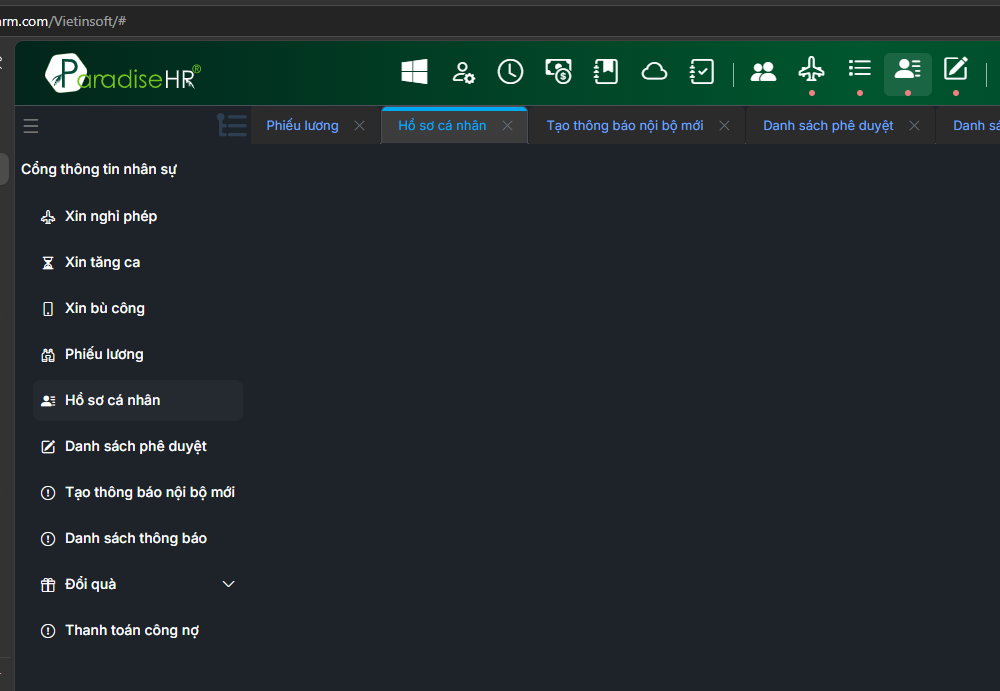
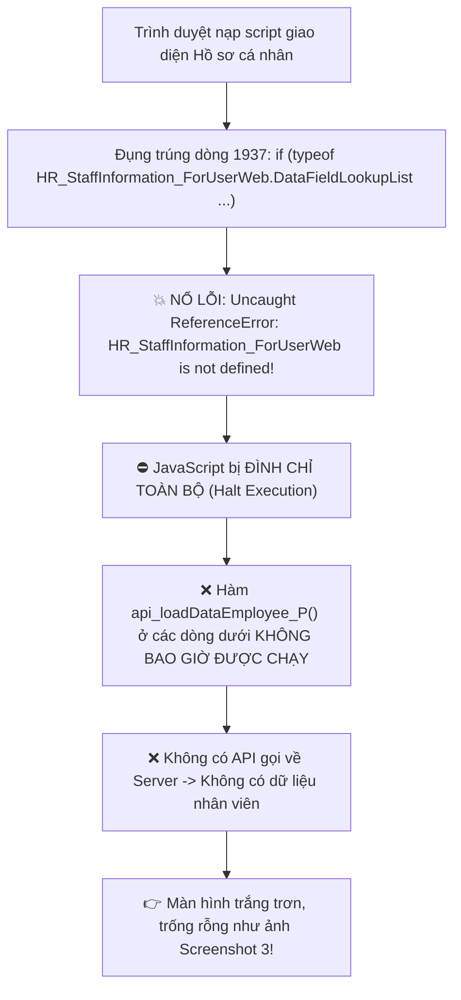
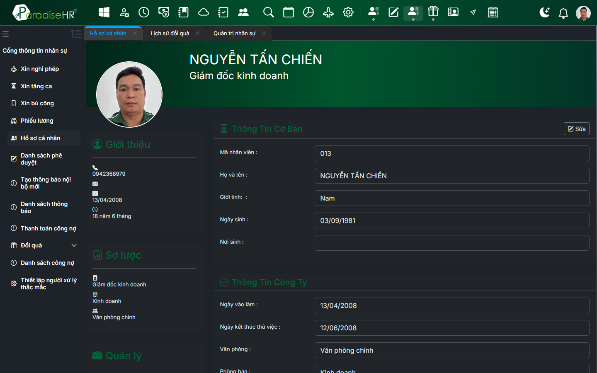

# BÁO CÁO GIẢI TRÌNH KỸ THUẬT (TECHNICAL DEFENSE REPORT)
## SCREENSHOT-03: HỒ SƠ CÁ NHÂN (MnuHRS0102 / MnuSCR004)

> **Màn hình**: Hồ Sơ Cá Nhân  
> **Đường dẫn Menu**: **Cổng thông tin nhân sự $\rightarrow$ Hồ sơ cá nhân**  
> **MenuID**: `MnuHRS0102` (`MnuSCR004`) | **ClassName**: `HR_StaffInformation_ForUserWeb`  
> **Thành phần / Stored Procedure can thiệp**: `[dbo].[HR_StaffInformation_ForUserWeb_Beta]` & `[dbo].[HR_StaffInformation_ForUserWeb]`  
> **Bảng cấu hình / Cache**: `[dbo].[tblHtmlScriptCache]` (TableName = 'HR_StaffInformation_ForUserWeb')  
> **File SQL bản vá độc lập**: [`fix-bug/screenshot-3/patch_hoso_canhan.sql`](./patch_hoso_canhan.sql)  
> **Ảnh đối chiếu lỗi ban đầu (Before)**: [`./screenshots/3.png`](./screenshots/3.png)  
> **Ảnh kết quả sau khi sửa (After Fix)**: [`./screenshots/3_fixed.png`](./screenshots/3_fixed.png)  

---

### 1. HIỆN TRẠNG LỖI BAN ĐẦU TRÊN HỆ THỐNG (PROBLEM STATEMENT)
* **Triệu chứng lỗi thực tế (Hình "3")**: Khi người dùng nhấn vào menu **Hồ sơ cá nhân**, màn hình bị trống trơn, **chẳng thấy thông tin gì hiển thị** (toàn bộ khung làm việc màu đen/trắng rỗng, không có dữ liệu nhân viên).
- **Minh chứng hình ảnh trực quan (Before)**:
  
* **Tác động**: Nhân viên không thể xem hay kiểm tra thông tin hồ sơ cá nhân của mình trên cổng Portal.

---

### 2. PHÂN TÍCH NGUYÊN NHÂN GỐC RỄ (ROOT CAUSE ANALYSIS - RCA)

Lỗi bắt nguồn từ một lỗi cú pháp nghiêm trọng (**Fatal JavaScript Error**) ngay tại thời điểm vừa nạp script giao diện:

#### 2.1. Ảo tưởng tai hại của người viết code cũ (Sai lầm kinh điển giữa `typeof A` và `typeof A.B`)
Tại dòng 1937 trong mã nguồn gốc (`HR_StaffInformation_ForUserWeb_Beta`):
```javascript
if (typeof HR_StaffInformation_ForUserWeb.DataFieldLookupList === "undefined")
    HR_StaffInformation_ForUserWeb.DataFieldLookupList = [];
```
* **Lập trình viên nghĩ rằng**: Dùng từ khóa `typeof` thì sẽ luôn an toàn và không bao giờ bị văng lỗi.
* **Nhưng thực tế cơ chế JavaScript chạy như sau**:
  1. Nếu kiểm tra **biến đơn**: `typeof A === "undefined"` $\rightarrow$ Trình duyệt chạy bình thường và trả về chuỗi `"undefined"` kể cả khi biến `A` chưa khai báo.
  2. Nhưng khi kiểm tra **thuộc tính lồng**: `typeof A.B` $\rightarrow$ Trình duyệt **bắt buộc phải tìm thấy đối tượng `A` trước** thì mới có thể truy cập vào thuộc tính `.B`.
  3. Tại thời điểm nạp trang, biến `HR_StaffInformation_ForUserWeb` **chưa hề được khai báo hay khởi tạo** ở bất kỳ đâu trên phạm vi toàn cục (`window`).
  4. Trình duyệt vừa đọc tới `HR_StaffInformation_ForUserWeb.` là **LẬP TỨC NỔ TUNG LỖI FATAL**:
     ```
     Uncaught ReferenceError: HR_StaffInformation_ForUserWeb is not defined
     ```

#### 2.2. Hiệu ứng Domino làm sập toàn bộ luồng nạp dữ liệu:
JavaScript trên trình duyệt là ngôn ngữ thực thi đơn luồng (single-thread). Khi gặp lỗi `Uncaught ReferenceError` ở cấp độ khởi tạo mà không có `try...catch`:
1. Trình duyệt **đình chỉ ngay lập tức toàn bộ luồng thực thi JavaScript** của màn hình.
2. Hàm gọi API nạp hồ sơ nhân viên `api_loadDataEmployee_P(EmployeeID)` (nằm ở dòng 1947 ngay bên dưới) **bị phong sát hoàn toàn, không bao giờ được chạy tới**.
3. Không có request AJAX nào được gửi về máy chủ $\rightarrow$ Không có dữ liệu nhân viên trả về $\rightarrow$ **Giao diện rơi vào tình trạng chết đứng, trống trơn "chẳng thấy gì" như trên Hình 3!**



---

### 3. ĐỐI CHIẾU MÃ NGUỒN TRƯỚC VÀ SAU (BEFORE VS AFTER)

#### 3.1. Sửa lỗi Crash JavaScript trong `HR_StaffInformation_ForUserWeb_Beta`

##### ❌ HỆ THỐNG BAN ĐẦU (BEFORE):
```javascript
// Biến chưa khai báo mà đã truy cập thuộc tính -> Bị Crash JavaScript, đứng hình toàn bộ trang:
if (typeof HR_StaffInformation_ForUserWeb.DataFieldLookupList === "undefined")
    HR_StaffInformation_ForUserWeb.DataFieldLookupList = [];

// Hàm nạp dữ liệu phía dưới KHÔNG BAO GIỜ được gọi tới:
async function api_loadDataEmployee_P(EmployeeID) { ... }
```

##### ✅ BẢN VÁ HOÀN THIỆN (AFTER):
```javascript
// 1. Khởi tạo an toàn đối tượng toàn cục trên window chống lỗi ReferenceError:
window.HR_StaffInformation_ForUserWeb = window.HR_StaffInformation_ForUserWeb || {};

// 2. Tạo bí danh viết tắt (Local Alias) cho mã nguồn ngắn gọn, tối ưu tốc độ:
var HR_StaffInformation_ForUserWeb = window.HR_StaffInformation_ForUserWeb;

// 3. Khởi tạo an toàn các danh mục con chống undefined:
HR_StaffInformation_ForUserWeb.DataFieldLookupList = HR_StaffInformation_ForUserWeb.DataFieldLookupList || [];
HR_StaffInformation_ForUserWeb.comboBox = HR_StaffInformation_ForUserWeb.comboBox || {};
HR_StaffInformation_ForUserWeb.comboBoxDataSchema = HR_StaffInformation_ForUserWeb.comboBoxDataSchema || {};
HR_StaffInformation_ForUserWeb.EmployeeDataRequestChangeList = HR_StaffInformation_ForUserWeb.EmployeeDataRequestChangeList || [];

// Luồng JS thông suốt 100%, hàm api_loadDataEmployee_P() được thực thi và nạp dữ liệu đầy đủ!
async function api_loadDataEmployee_P(EmployeeID) {
    showLoadingByClassOrID("#EmployeeProfile_P", "%lblLoadingEmployeeData%", "Black", "Black");
    await AjaxHPAParadiseAsync({ ... });
}
```

---

#### 3.2. Chuẩn Hóa SP Điều Phối và Biên Dịch Cache

##### ❌ HỆ THỐNG BAN ĐẦU (BEFORE):
```sql
-- Hệ thống chưa chuẩn hóa SP điều phối đọc đúng tblHtmlScriptCache
```

##### ✅ BẢN VÁ HOÀN THIỆN (AFTER):
```sql
CREATE OR ALTER PROCEDURE [dbo].[HR_StaffInformation_ForUserWeb]
(
  @LoginID int = 3,
  @LanguageID varchar(20) = 'VN',
  @EmployeeID varchar(20) = '-1',
  @isWeb int = 1
)
AS
BEGIN
    SET NOCOUNT ON;
    IF @LanguageID IS NULL OR LTRIM(RTRIM(@LanguageID)) = '' SET @LanguageID = 'VN';

    -- Đọc chuẩn xác duy nhất Key chuẩn theo quy ước toàn hệ thống Paradise HRM
    SELECT TOP 1 html AS Col1 
    FROM tblHtmlScriptCache 
    WHERE TableName = 'HR_StaffInformation_ForUserWeb' 
      AND LanguageID = @LanguageID 
      AND ScreenType = -1;
END;
GO

PRINT N'==> Đang biên dịch cache Hồ sơ cá nhân qua sp_GenerateHTMLScript_new...';
IF OBJECT_ID('dbo.sp_GenerateHTMLScript_new', 'P') IS NOT NULL
BEGIN
    EXEC dbo.sp_GenerateHTMLScript_new 'HR_StaffInformation_ForUserWeb_Beta', '-1', 'HR_StaffInformation_ForUserWeb';
    EXEC dbo.sp_GenerateHTMLScript_new 'HR_StaffInformation_ForUserWeb_Beta', '-1', 'HR_StaffInformation_ForUserWeb_Beta';
END
ELSE
BEGIN
    EXEC dbo.sp_GenerateHTMLScript 'HR_StaffInformation_ForUserWeb_Beta';
END
GO
```

---

#### 3.3. Minh chứng kết quả giao diện thực tế sau khi sửa (After Fix)


*Minh chứng giao diện Hồ sơ cá nhân sau khi sửa: Màn hình nạp đầy đủ ảnh đại diện, họ và tên (Nguyễn Tấn Chiến), chức danh (Giám đốc kinh doanh), thông tin cơ bản và thông tin công ty, không còn bị màn hình đen trống trơn ban đầu.*
