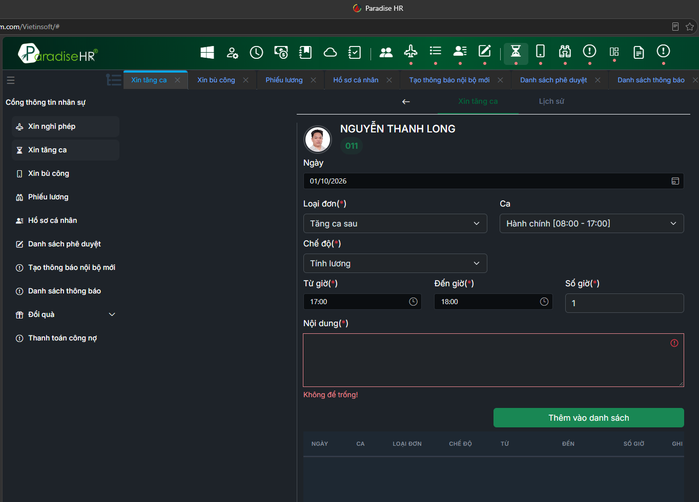
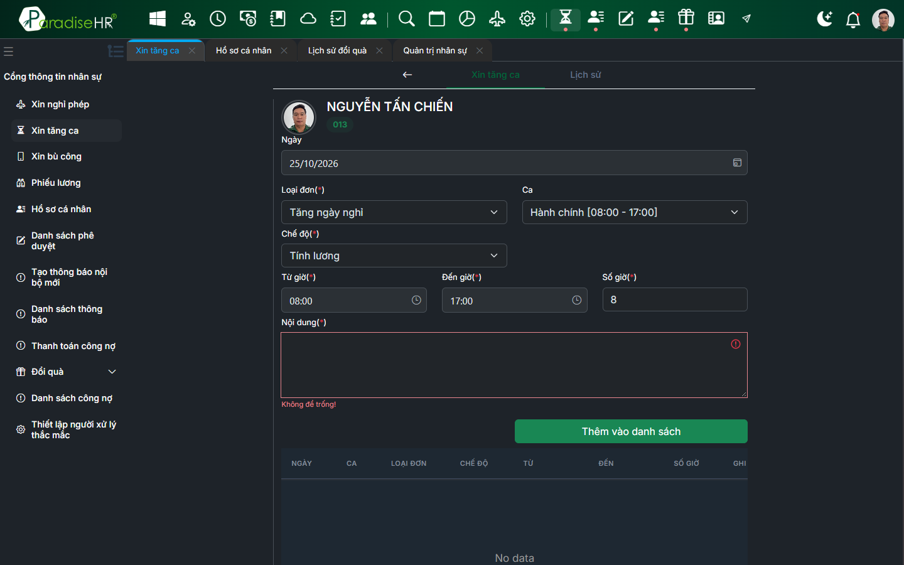

# BÁO CÁO GIẢI TRÌNH KỸ THUẬT (TECHNICAL DEFENSE REPORT)
## SCREENSHOT-04: ĐỒNG BỘ MÀU NỀN CÁC CONTROL NGÀY VÀ GIỜ TRÊN FORM XIN TĂNG CA (MnuWPT316)

> **Màn hình**: Đăng Ký Xin Tăng Ca  
> **Đường dẫn Menu**: **Cổng thông tin nhân sự $\rightarrow$ Đăng ký xin tăng ca**  
> **MenuID**: `MnuWPT316` (hoặc `MnuPRL103`) | **ClassName**: `sp_Overtime_Assignment`  
> **Thành phần / Stored Procedure can thiệp**: `[dbo].[sp_Overtime_Assignment_html]`, `[dbo].[sp_Overtime_Assignment]`  
> **Bảng cấu hình / Cache**: `[dbo].[tblHtmlScriptCache]` (`TableName = 'sp_Overtime_Assignment'`)  
> **File SQL bản vá độc lập**: [`fix-bug/screenshot-4/patch_tang_ca.sql`](./patch_tang_ca.sql)  
> **Ảnh đối chiếu lỗi ban đầu (Before)**: [`./screenshots/4.png`](./screenshots/4.png)  
> **Ảnh kết quả sau khi sửa (After Fix)**: [`./screenshots/4_fixed.png`](./screenshots/4_fixed.png)  

---

### 1. HIỆN TRẠNG LỖI BAN ĐẦU (PROBLEM STATEMENT)

- **Triệu chứng lỗi**:
  - Trên form "Xin tăng ca", 3 ô điều khiển nhập liệu:
    1. **Ngày** (id: `#qlrl-dxOTFromDate`)
    2. **Từ giờ** (id: `#qlrl-OTFrom`)
    3. **Đến giờ** (id: `#qlrl-OTTo`)
    đang hiển thị màu nền **đen tuyền (`#000000`)**.
  - Trong khi đó, toàn bộ các ô nhập liệu còn lại trên form (*Loại đơn*, *Ca*, *Chế độ*, *Số giờ*, *Nội dung*) hiển thị nền xám ghi `#2b3035` với viền `#495057`.
  - Sự tương phản cọc cạch giữa 3 ô nền đen `#000000` và các ô xung quanh nền xám `#2b3035` làm form bị lệch tông màu, gây mất thẩm mỹ giao diện nghiêm trọng.
- **Minh chứng hình ảnh trực quan (Before)**:
  
  *Minh chứng lỗi Screenshot 4: Ba ô Ngày, Từ giờ, Đến giờ mang màu nền đen tuyền cọc cạch so với các ô xám ghi xung quanh.*

---

### 2. PHÂN TÍCH NGUYÊN NHÂN GỐC RỄ (ROOT CAUSE ANALYSIS - RCA)

1. **Lệch công nghệ hiển thị giữa Bootstrap Controls và DevExtreme Widget**:
   - Các trường *Loại đơn*, *Ca*, *Chế độ*, *Số giờ*, *Nội dung* là các thẻ HTML tiêu chuẩn của Bootstrap (`<select class="form-select">`, `<input class="form-control">`, `<textarea class="form-control">`). Các thẻ này tự động thừa hưởng bộ CSS Dark Theme chung của hệ thống với màu nền xám ghi `#2b3035` và viền xám `#495057`.
   - Trong khi đó, 3 trường *Ngày*, *Từ giờ*, *Đến giờ* được khởi tạo bằng component của thư viện DevExtreme (`dxDateBox`).
2. **Thiếu Scoped CSS trong Stored Procedure sinh giao diện gốc (`sp_Overtime_Assignment_html`)**:
   - Trong Stored Procedure gốc của hệ thống ban đầu, khối `<style>` chỉ định nghĩa độ rộng layout `max-width: 768px` và kiểu tab `.menu-tabs`, hoàn toàn không có bất kỳ đoạn Scoped CSS nào dành cho component DevExtreme `.dx-datebox`.
   - Do thiếu CSS định dạng màu nền và viền, widget DevExtreme tự nạp stylesheet mặc định của nó trên nền tối, dẫn đến việc hiển thị màu đen tuyền `#000000`.

---

### 3. ĐỐI CHIẾU MÃ NGUỒN TRƯỚC VÀ SAU (BEFORE VS AFTER)

#### 3.1. Đối chiếu Scoped CSS định kiểu cho dxDateBox

##### ❌ HỆ THỐNG BAN ĐẦU (BEFORE):
```css
/* Khối style kết thúc đột ngột, hoàn toàn thiếu CSS cho dxDateBox */
     #sp_Overtime_Assignment .menu-tab.active {
        color: #00673b;
        border-bottom-color: #00673b;
    }

</style>
<!-- Hậu quả: 3 widget dxDateBox (Ngày, Từ giờ, Đến giờ) mang nền đen tuyền #000000 -->
```

##### ✅ BẢN VÁ HOÀN THIỆN (AFTER):
```css
  /* 1. Ép màu nền xám ghi #2b3035, viền #495057, bo góc 0.375rem cho cả 3 ô Ngày, Từ giờ, Đến giờ */
  #sp_Overtime_Assignment #qlrl-dxOTFromDate,
  #sp_Overtime_Assignment #qlrl-OTFrom,
  #sp_Overtime_Assignment #qlrl-OTTo,
  #sp_Overtime_Assignment .dx-datebox.dx-texteditor,
  #sp_Overtime_Assignment .dx-datebox.dx-editor-outlined {
      background-color: #2b3035 !important;
      border: 1px solid #495057 !important;
      color: #e9ecef !important;
      border-radius: 0.375rem !important;
      min-height: 38px !important;
  }

  /* 2. Ô nhập text bên trong: Nền trong suốt, chữ màu sáng #e9ecef */
  #sp_Overtime_Assignment .dx-datebox .dx-texteditor-input {
      background-color: transparent !important;
      color: #e9ecef !important;
      font-size: 0.95rem !important;
      padding: 6px 12px !important;
  }

  /* 3. Nút & Icon lịch / đồng hồ: Nền trong suốt, icon màu xám sáng #adb5bd */
  #sp_Overtime_Assignment .dx-datebox .dx-dropdowneditor-button,
  #sp_Overtime_Assignment .dx-datebox .dx-button-content {
      background-color: transparent !important;
      border: none !important;
  }
  #sp_Overtime_Assignment .dx-datebox .dx-dropdowneditor-icon,
  #sp_Overtime_Assignment .dx-datebox .dx-icon-event,
  #sp_Overtime_Assignment .dx-datebox .dx-icon-clock,
  #sp_Overtime_Assignment .dx-datebox .dx-icon {
      color: #adb5bd !important;
      font-size: 1.1rem !important;
  }

  /* 4. Hiệu ứng Focus Ring chuẩn Bootstrap Dark (xanh lục #237b58) */
  #sp_Overtime_Assignment .dx-datebox.dx-state-focused,
  #sp_Overtime_Assignment .dx-datebox.dx-state-focused.dx-editor-outlined {
      background-color: #2b3035 !important;
      border-color: #237b58 !important;
      box-shadow: 0 0 0 0.25rem rgba(35, 123, 88, 0.25) !important;
      outline: 0 !important;
  }

  /* 5. Đồng bộ Popup chọn Lịch và Giờ sang nền Dark #212529 */
  .dx-dropdowneditor-overlay .dx-popup-content {
      background-color: #212529 !important;
      color: #e9ecef !important;
      border: 1px solid #495057 !important;
      border-radius: 6px !important;
  }
  .dx-calendar {
      background-color: #212529 !important;
      color: #e9ecef !important;
  }
  .dx-calendar-cell.dx-calendar-selected-date {
      background-color: #198754 !important;
      color: #ffffff !important;
  }
```

---

#### 3.2. Minh chứng kết quả giao diện thực tế sau khi sửa (After Fix)


*Minh chứng giao diện Form Xin tăng ca sau khi sửa: Cả 3 ô Ngày, Từ giờ và Đến giờ đã được đồng bộ màu nền xám ghi (#2b3035) ăn khớp 100% với giao diện Dark theme của hệ thống, không còn bị 3 ô nền đen xì lạc tông.*
