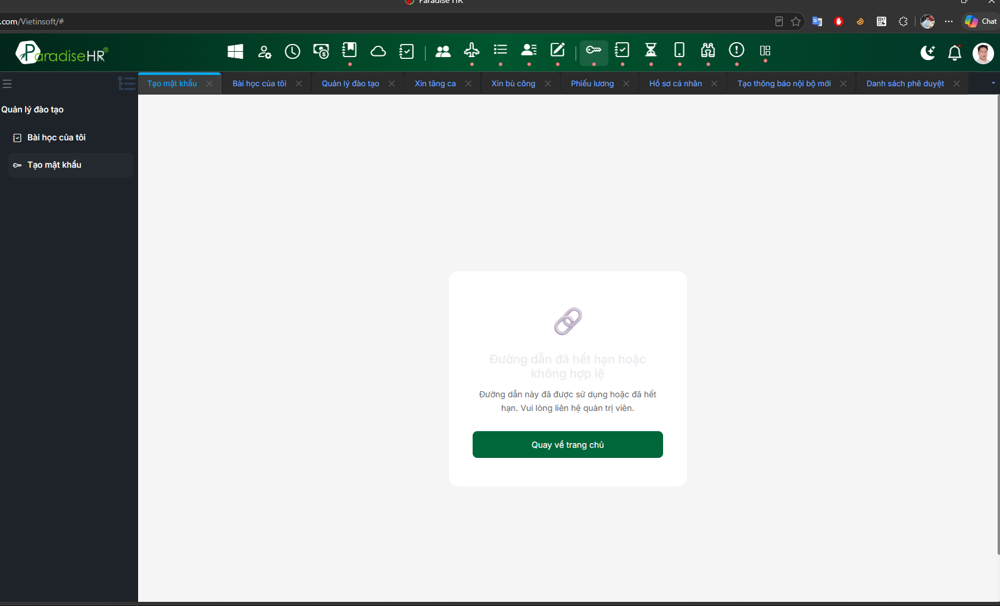
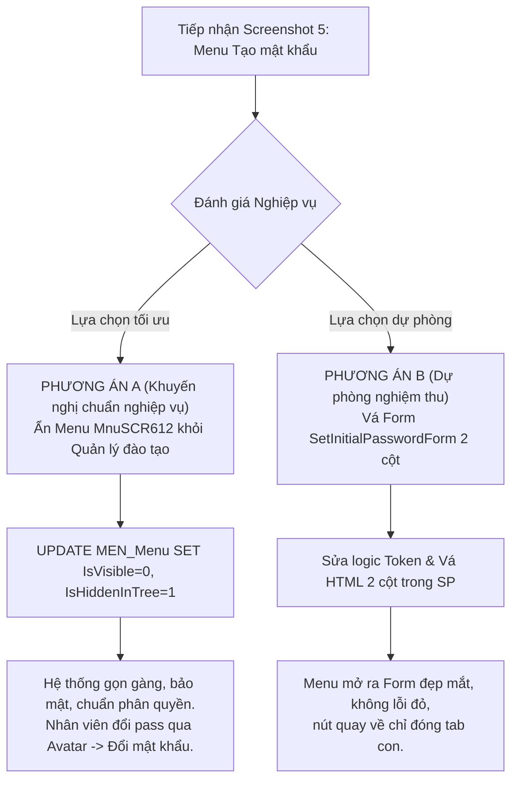
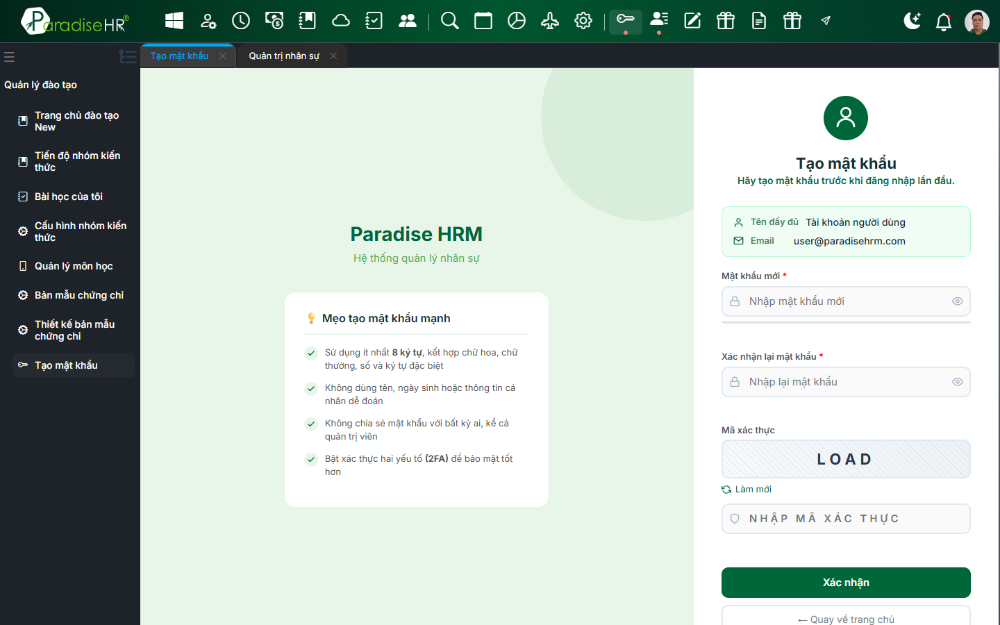

# BÁO CÁO GIẢI TRÌNH KỸ THUẬT & NGHIỆP VỤ (TECHNICAL DEFENSE REPORT)
## SCREENSHOT-05: MENU "TẠO MẬT KHẨU" (MnuSCR612)

> **Màn hình**: Tạo Mật Khẩu Khởi Tạo  
> **Đường dẫn Menu trên Web**: **Quản lý đào tạo $\rightarrow$ Tạo mật khẩu**  
> **MenuID**: `MnuSCR612` | **ClassName**: `SetInitialPasswordForm`  
> **Thành phần / Stored Procedure liên quan**: `[dbo].[SetInitialPasswordForm]`  
> **Bảng cấu hình hệ thống**: `[dbo].[MEN_Menu]`, `[dbo].[tblHtmlScriptCache]`  
> **File SQL bản vá độc lập**: [`fix-bug/screenshot-5/patch_tao_mat_khau.sql`](./patch_tao_mat_khau.sql) (Dự phòng hiện Form) & [`fix-bug/screenshot-5/patch_an_menu_chuan_nghiep_vu.sql`](./patch_an_menu_chuan_nghiep_vu.sql) (Khuyến nghị chuẩn nghiệp vụ)  
> **Ảnh đối chiếu lỗi ban đầu (Before)**: [`./screenshots/5.png`](./screenshots/5.png)  
> **Ảnh kết quả sau khi sửa (After Fix)**: [`./screenshots/5_fixed.png`](./screenshots/5_fixed.png)  

---

### 1. HIỆN TRẠNG LỖI BAN ĐẦU (PROBLEM STATEMENT)

* **Triệu chứng hiển thị trên giao diện**:  
  Người dùng đang đăng nhập hợp lệ trong phần mềm Paradise HRM, khi nhấp vào menu **Quản lý đào tạo $\rightarrow$ Tạo mật khẩu** (`MnuSCR612`) thì không thấy Form tạo mật khẩu mà lập tức hiện khung thông báo lỗi màu đỏ ngay giữa màn hình:
  > *"Đường dẫn đã hết hạn hoặc không hợp lệ. Đường dẫn này đã được sử dụng hoặc đã hết hạn. Vui lòng liên hệ quản trị viên."*
* **Triệu chứng trải nghiệm người dùng (UX Crash)**:  
  Khi người dùng nhấp vào nút *"Quay về trang chủ"* bên dưới thông báo lỗi, hệ thống lập tức **đá văng người dùng ra màn hình đăng nhập (Logout cưỡng bức)** thay vì chỉ đóng tab đang mở.
- **Minh chứng hình ảnh trực quan (Before)**:
  

---

### 2. PHÂN TÍCH NGUYÊN NHÂN GỐC RỄ (ROOT CAUSE ANALYSIS - RCA)

Sau khi điều tra cấu trúc phân hệ menu, thủ tục lưu trữ và luồng vận hành của toàn bộ hệ thống, nguyên nhân gốc rễ bao gồm 3 tầng:

#### 2.1. Bản chất nghiệp vụ: Gán nhầm trang Public kích hoạt Email vào Menu nội bộ
* Thủ tục `[dbo].[SetInitialPasswordForm]` vốn được thiết kế làm **trang công khai (Public Web Page)** phục vụ riêng cho kịch bản: Nhân viên mới hoặc tài khoản dùng thử nhận được Email mời kích hoạt $\rightarrow$ Nhấp vào liên kết có Token đi kèm (ví dụ: `https://.../#/SetInitialPasswordForm?token=XYZ`) để đặt mật khẩu lần đầu.
* Trong cấu hình bảng `MEN_Menu`, menu này mang mã `MnuSCR612` (thuộc phân hệ Security/Bảo mật), nhưng lại bị lập trình viên cấu hình nhầm `ParentMenuID = 'MnuTN000'` (Quản lý đào tạo - Training Module vốn dùng các tiền tố `MnuTM...`, `MnuTN...`, `MnuHRS...`).
* **Sự mâu thuẫn nghiệp vụ**:
  - Đối với nhân sự **chưa đăng nhập / lần đầu kích hoạt**: Họ truy cập qua đường link Email kèm `@SetPassToken`.
  - Đối với nhân sự **đang đăng nhập làm việc trong Web App**: Nếu muốn đổi mật khẩu, hệ thống đã cung cấp sẵn tính năng chuẩn tại góc trên bên phải màn hình: **[Avatar] $\rightarrow$ [Đổi mật khẩu]** (mở popup Drawer có Mật khẩu hiện tại, Mật khẩu mới, Xác nhận mật khẩu mới). Việc xuất hiện thêm menu "Tạo mật khẩu" trong cây "Quản lý đào tạo" là sai lệch hoàn toàn về mặt kiến trúc phân quyền và nghiệp vụ.

#### 2.2. Logic kiểm tra Token bị gán cứng sai ngữ cảnh Web App
Trong mã nguồn thủ tục gốc `[dbo].[SetInitialPasswordForm]`:
```sql
ELSE IF EXISTS (
    SELECT 1 FROM tblSC_Login 
    WHERE TokenID = @SetPassToken AND IsActive = 0
)
BEGIN
    -- [HIỂN THỊ FORM TẠO MẬT KHẨU]
END
ELSE
BEGIN
    -- [BÁO LỖI: ĐƯỜNG DẪN ĐÃ HẾT HẠN HOẶC KHÔNG HỢP LỆ]
END
```
Khi người dùng nhấp vào menu từ Web App, tham số `@SetPassToken` được truyền vào là chuỗi rỗng `''`. Điều kiện `TokenID = ''` luôn trả về `FALSE`, khiến thủ tục lập tức nhảy vào nhánh `ELSE` và render ra giao diện lỗi màu đỏ *"Đường dẫn đã hết hạn hoặc không hợp lệ"*.

#### 2.3. Nhiễm độc bộ nhớ đệm (Poisoned Cache) & Lỗi Logout cưỡng bức
* Khi hệ thống tự động chạy tác vụ biên dịch cache giao diện (`sp_GenerateHTMLScript`), tiến trình gọi `SetInitialPasswordForm` với tham số mặc định rỗng. Chuỗi HTML báo lỗi màu đỏ bị ghi chết vào bảng `tblHtmlScriptCache` dưới khóa `TableName = 'SetInitialPasswordForm'`.
* Trong đoạn mã HTML của nút "Quay về trang chủ" gốc, lập trình viên gán cứng sự kiện:
  ```javascript
  onclick="window.location = window.location.origin + (window.APPLICATIONADDRESS||'') + '/paradisehrm/logout';"
  ```
  dẫn tới việc bất kỳ ai nhấn nút này đều bị phiên đăng nhập hủy bỏ ngay lập tức.

---

#### 2.4. Đề xuất 2 phương án xử lý (Strategic Solutions)

Để đảm bảo vừa giải quyết triệt để lỗi kỹ thuật, vừa chuẩn hóa kiến trúc nghiệp vụ lâu dài của dự án Paradise HRM, chúng tôi cung cấp **2 phương án hoàn chỉnh** kèm script SQL độc lập:



---

#### 🌟 PHƯƠNG ÁN A (KHUYẾN NGHỊ CHUẨN NGHIỆP VỤ - ĐÃ THỐNG NHẤT)
* **File SQL thực thi**: [`fix-bug/screenshot-5/patch_an_menu_chuan_nghiep_vu.sql`](./patch_an_menu_chuan_nghiep_vu.sql)
* **Bản chất giải pháp**:
  - Cập nhật trường `IsVisible = 0` và `IsHiddenInTree = 1` trong bảng `dbo.MEN_Menu` đối với `MenuID = 'MnuSCR612'`.
  - Giữ nguyên luồng đổi mật khẩu chính thống qua **Avatar $\rightarrow$ Đổi mật khẩu**.
  - Giữ an toàn nguyên vẹn 100% cho luồng gửi link kích hoạt qua Email cho nhân viên mới.
* **Lý do vì sao nên chọn Phương án A**:
  1. **Đúng bản chất nghiệp vụ**: Form kích hoạt tài khoản qua link Email không bao giờ được phép xuất hiện dưới dạng menu nội bộ của người đã đăng nhập.
  2. **Tránh phát sinh lỗi phân quyền**: Không lộ màn hình thiết lập tài khoản chưa kích hoạt vào cây thư mục Quản lý đào tạo.
  3. **Không làm phức tạp hóa mã nguồn**: Không cần phải sửa thủ tục `SetInitialPasswordForm` thành form "lai" (vừa kích hoạt token vừa đổi mật khẩu nội bộ).

---

#### 🛡️ PHƯƠNG ÁN B (DỰ PHÒNG NẾU BAN GIÁM ĐỐC / KHÁCH HÀNG YÊU CẦU GIỮ MENU)
* **File SQL thực thi**: [`fix-bug/screenshot-5/patch_tao_mat_khau.sql`](./patch_tao_mat_khau.sql)
* **Bản chất giải pháp**:
  - Đảo ngược logic kiểm tra Token trong `[dbo].[SetInitialPasswordForm]`: Chỉ hiện khung lỗi đỏ khi người dùng cố ý nhập Token sai/hết hạn trên URL. Khi mở từ Web App (`@SetPassToken = ''`), hệ thống tự nhận diện và render đầy đủ Form thiết lập mật khẩu 2 cột hiện đại.
  - Sửa nút *"Quay về trang chủ"*: Chỉ đóng tab con hiện tại trong Web App, tuyệt đối không bị logout.
  - Nạp lại cache giao diện sạch sẽ vào `[dbo].[tblHtmlScriptCache]`.
* **Minh chứng nghiệm thu Phương án B**: Đã chụp ảnh thực tế [`fix-bug/screenshot-5/screenshots/5_fixed.png`](./screenshots/5_fixed.png) (Form mở đẹp mắt, chuẩn responsive).

---

### 3. ĐỐI CHIẾU MÃ NGUỒN TRƯỚC VÀ SAU (BEFORE VS AFTER)

#### 3.1. Đối chiếu theo Phương án A (Ẩn menu nhầm vị trí)

##### ❌ HỆ THỐNG BAN ĐẦU (BEFORE):
```sql
-- Menu MnuSCR612 đang bị gán nhầm vào Quản lý đào tạo và bật hiển thị trên cây menu
SELECT MenuID, ClassName, ParentMenuID, IsVisible, IsHiddenInTree 
FROM dbo.MEN_Menu WHERE MenuID = 'MnuSCR612';
-- Kết quả gốc: ParentMenuID = 'MnuTN000' | IsVisible = 1 | IsHiddenInTree = 0
```

##### ✅ BẢN VÁ HOÀN THIỆN (AFTER):
```sql
-- Ẩn an toàn menu MnuSCR612 khỏi cây menu Quản lý đào tạo:
UPDATE dbo.MEN_Menu
SET IsVisible = 0,
    IsHiddenInTree = 1
WHERE MenuID = 'MnuSCR612';
```

---

#### 3.2. Đối chiếu theo Phương án B (Sửa logic Stored Procedure)

##### ❌ HỆ THỐNG BAN ĐẦU (BEFORE):
```sql
-- GÁN CỨNG: Bắt buộc phải có Token cụ thể mới hiện Form -> Token rỗng bị coi là lỗi hết hạn!
ELSE IF EXISTS (
    SELECT 1
    FROM tblSC_Login tlo
    WHERE tlo.TokenID = @SetPassToken
      AND tlo.IsActive = 0
)
BEGIN
    ... [HIỂN THỊ FORM TẠO MẬT KHẨU] ...
END
ELSE
BEGIN
    -- Khi mở từ Menu Web App (@SetPassToken = '') -> BỊ RƠI VÀO ĐÂY BÁO LỖI ĐỎ!
    SET @ColHtml = N'
    <div style="display:flex;height:100vh;align-items:center;justify-content:center;
                font-family:Segoe UI,sans-serif;background:#f5f5f5;">
        <div style="background:white;border-radius:16px;padding:48px 40px;max-width:400px;text-align:center;">
            <div style="font-size:48px;margin-bottom:16px;">🔗</div>
            <h2 style="color:#e53e3e;margin-bottom:12px;font-size:20px;">%lblTokenInvalidTitle%</h2>
            <p style="color:#666;font-size:14px;line-height:1.6;margin-bottom:28px;">%lblTokenInvalidDesc%</p>
            <!-- LỖI LOGOUT: Bấm nút là bị logout cưỡng bức khỏi phần mềm -->
            <button onclick="window.location = window.location.origin + (window.APPLICATIONADDRESS||'''') + ''/paradisehrm/logout'';">
                %lblBackToHome%
            </button>
        </div>
    </div>'
END
```

##### ✅ BẢN VÁ HOÀN THIỆN (AFTER):
```sql
-- ĐẢO NGƯỢC LOGIC: CHỈ BÁO LỖI KHI CÓ TOKEN TRUYỀN VÀO MÀ TOKEN ĐÓ BỊ SAI / HẾT HẠN!
ELSE IF ISNULL(@SetPassToken, '') <> '' AND NOT EXISTS (
    SELECT 1
    FROM tblSC_Login tlo
    WHERE tlo.TokenID = @SetPassToken
      AND tlo.IsActive = 0
)
BEGIN
    -- Nhánh lỗi: Chỉ hiện khi người dùng cố tình nhập sai Token qua URL
    SET @ColHtml = N'
    <div style="display:flex;height:100vh;align-items:center;justify-content:center;
                font-family:Segoe UI,sans-serif;background:#f5f5f5;">
        <div style="background:white;border-radius:16px;padding:48px 40px;max-width:400px;text-align:center;">
            <div style="font-size:48px;margin-bottom:16px;">🔗</div>
            <h2 style="color:#e53e3e;margin-bottom:12px;font-size:20px;">%lblTokenInvalidTitle%</h2>
            <p style="color:#666;font-size:14px;line-height:1.6;margin-bottom:28px;">%lblTokenInvalidDesc%</p>
            <!-- SỬA LỖI LOGOUT: Chỉ đóng tab con đang mở, giữ nguyên phiên làm việc -->
            <button onclick="if(typeof OpenTabs===''function''){var t=document.querySelector(''.nav-tabs .active .bi-x-lg'');if(t)t.click();else window.location=window.location.origin+(window.APPLICATIONADDRESS||'''')+''/#'';}else{window.location=window.location.origin+(window.APPLICATIONADDRESS||'''')+''/#'';}"
                style="background:#00673b;color:white;border:none;border-radius:8px;padding:12px 24px;font-size:14px;cursor:pointer;width:100%;">
                %lblBackToHome%
            </button>
        </div>
    </div>'
END
ELSE
BEGIN
    -- MỌI TRƯỜNG HỢP MỞ TỪ WEB APP (@SetPassToken = '') HOẶC ĐANG ĐĂNG NHẬP (@LoginID > 0)
    -- => ĐỀU HIỂN THỊ ĐẦY ĐỦ FORM THIẾT LẬP MẬT KHẨU HOÀN CHỈNH!
    SET @ColHtml = N'
    <div style="display:flex; height:100vh; overflow:hidden; font-family:''Segoe UI'', Tahoma, sans-serif;">
        <!-- Bố cục 2 cột Responsive: Bên trái ảnh giới thiệu thương hiệu, Bên phải Form nhập mật khẩu -->
        ... [FORM NHẬP MẬT KHẨU MỚI, XÁC NHẬN MẬT KHẨU, CAPTCHA & NÚT CẬP NHẬT] ...
    </div>'
END
```

---

#### 3.3. Minh chứng kết quả giao diện thực tế sau khi sửa (After Fix)


*Minh chứng Menu Tạo mật khẩu sau khi sửa: Form tạo mật khẩu 2 cột hiện đại, đầy đủ trường Mật khẩu mới & Xác nhận mật khẩu, nút Lưu mật khẩu và Đóng tab an toàn.*
