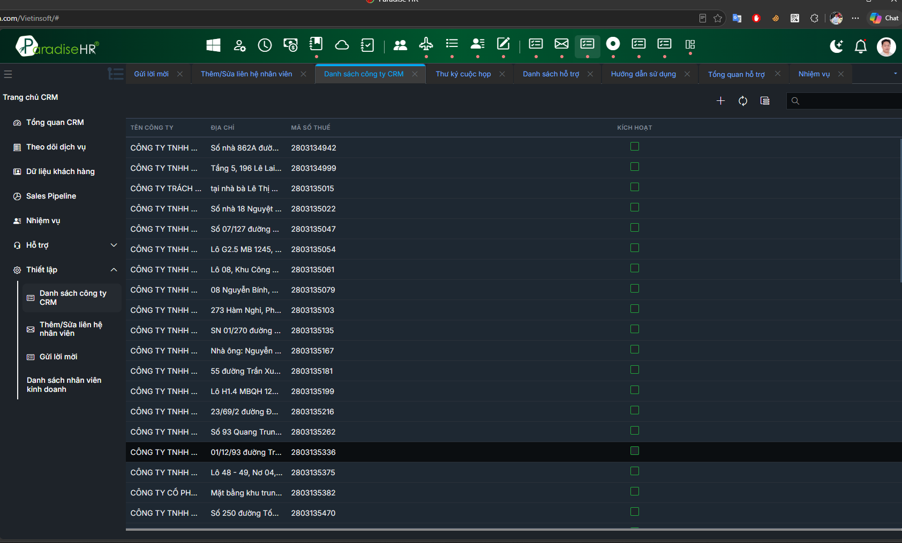
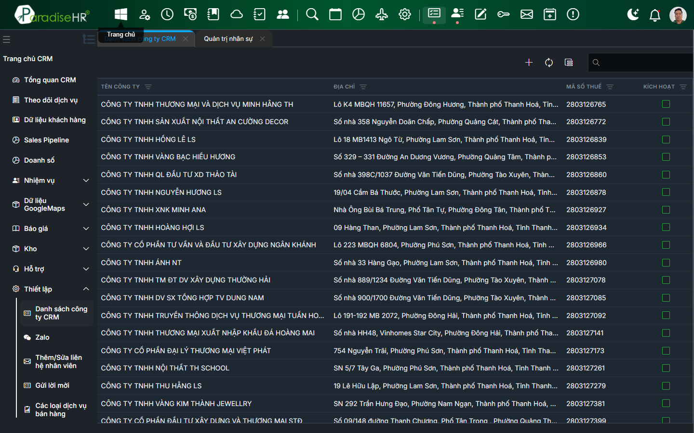

# BÁO CÁO GIẢI TRÌNH KỸ THUẬT (TECHNICAL DEFENSE REPORT)
## SCREENSHOT-06: DANH SÁCH CÔNG TY CRM (MnuKPI449 / MnuCRM001)

> **Màn hình**: Danh Sách Công Ty CRM  
> **Đường dẫn Menu**: **Trang chủ CRM $\rightarrow$ Thiết lập $\rightarrow$ Danh sách công ty CRM**  
> **MenuID**: `MnuKPI449` (Mã hệ thống web: `MnuCRM001`) | **ClassName**: `sp_CRM_CompanyList`  
> **Thành phần / Stored Procedure can thiệp**: `[dbo].[sp_CRM_CompanyList_html]` & `[dbo].[sp_CRM_CompanyList]`  
> **Bảng cấu hình / Cache**: `[dbo].[tblHtmlScriptCache]` (TableName = `'sp_CRM_CompanyList'`, ScreenType = -1)  
> **File SQL bản vá độc lập**: [`fix-bug/screenshot-6/patch_responsive_company_list.sql`](./patch_responsive_company_list.sql)  
> **Ảnh đối chiếu lỗi ban đầu (Before)**: [`./screenshots/6.png`](./screenshots/6.png)  
> **Ảnh kết quả sau khi sửa (After Fix)**: [`./screenshots/6_fixed.png`](./screenshots/6_fixed.png)  

---

### 1. HIỆN TRẠNG LỖI BAN ĐẦU (PROBLEM STATEMENT)

- **Triệu chứng lỗi**:
  1. **Cột dữ liệu bị co ngắn cụt ngủn, chữ bị cắt dấu ba chấm (`...`)**: Hai cột thông tin văn bản quan trọng nhất là **"TÊN CÔNG TY"** (`Company`) và **"ĐỊA CHỈ"** (`Address`) chỉ được cấp độ rộng cố định khoảng ~150px. Các tên doanh nghiệp dài và địa chỉ trụ sở bị cắt cụt lủn bằng dấu ba chấm, người dùng không thể đọc trọn vẹn thông tin đối tác nếu không bấm vào xem chi tiết từng dòng.
  2. **Khoảng trống đen khổng lồ thừa thãi chiếm hơn một nửa màn hình**: Tổng độ rộng của 4 cột (`TÊN CÔNG TY`, `ĐỊA CHỈ`, `MÃ SỐ THUẾ`, `KÍCH HOẠT`) chỉ chiếm ~600px. Khi hiển thị trên màn hình phổ biến, phần bảng bên phải bị để trống một mảng đen mênh mông (~1300px), gây mất cân đối thị giác nghiêm trọng.
  3. **Cột "KÍCH HOẠT" bị dạt xa và thiếu căn lề thẩm mỹ**: Cột checkbox `KÍCH HOẠT` bị đẩy trôi dạt về phía mép ngoài, độ rộng 150px quá rộng so với 1 ô checkbox nhỏ, căn lề chưa chuẩn.
  4. **Ký tự typo rác ở dòng kết thúc script (`})();s`)**: Xuất hiện ký tự rác `s` ngay sau lệnh đóng hàm tự thực thi `})();s`. Dòng này vi phạm cú pháp JavaScript, tiềm ẩn nguy cơ ném ngoại lệ `ReferenceError: s is not defined` và làm gián đoạn các tiến trình script chạy tiếp theo trên trang.
- **Minh chứng hình ảnh trực quan (Before)**:
  
  *Minh chứng lỗi Screenshot 6: Bảng DataGrid bị co cụm về góc trái, tên công ty và địa chỉ bị cắt ba chấm, hở mảng đen lớn bên phải.*

---

### 2. PHÂN TÍCH NGUYÊN NHÂN GỐC RỄ (ROOT CAUSE ANALYSIS - RCA)

1. **Hàm `applyCompanyColumnOrder` trong Stored Procedure `sp_CRM_CompanyList_html` chưa xử lý độ rộng cột**:
   - Trong Stored Procedure `sp_CRM_CompanyList_html`, hàm `applyCompanyColumnOrder()` ban đầu chỉ làm một nhiệm vụ duy nhất là sắp xếp lại thứ tự cột (`Company` $\rightarrow$ `Address` $\rightarrow$ `TaxCode` $\rightarrow$ `IsActive`) bằng lệnh `orderedColumns.push(column)`.
   - Hàm này hoàn toàn **không can thiệp vào thuộc tính `width` hay `maxWidth`**, khiến các cột giữ nguyên kích thước gò bó mặc định (~150px).
   - Tổng độ rộng của 4 cột chỉ đạt ~600px, khiến 2 cột chứa văn bản dài (`Company`, `Address`) bị bóp nghẹt, chữ bị cắt dấu ba chấm `...`, và để lộ một khoảng đen khổng lồ (~1300px) ở nửa bên phải màn hình.
2. **Thiếu tính năng tương tác người dùng (Column Resizing)**:
   - DataGrid trong `sp_CRM_CompanyList_html` không được cấu hình `allowColumnResizing: true` và `columnResizingMode: "widget"`, làm cho người dùng không có công cụ kéo dãn thủ công các cột theo ý muốn.
3. **Thiếu thuộc tính trợ năng Tooltip (`title`) khi dữ liệu dài**:
   - `cellTemplate` cho 2 cột Tên công ty và Địa chỉ chưa có lệnh gán thuộc tính `title` vào `cellElement`. Khi người dùng rê chuột lên ô bị cắt ba chấm, trình duyệt không thể hiển thị tooltip đọc trọn vẹn văn bản.
4. **Ký tự rác Typo `s` ở dòng kết thúc Stored Procedure `sp_CRM_CompanyList_html`**:
   - Ngay sau lệnh đóng hàm tự thực thi `})();` ở dòng cuối cùng của script, có ký tự rác `s` (`})();s`), vi phạm cú pháp JavaScript và có nguy cơ ném lỗi `ReferenceError: s is not defined` trên Console trình duyệt.

---

### 3. ĐỐI CHIẾU MÃ NGUỒN TRƯỚC VÀ SAU (BEFORE VS AFTER)

#### 3.1. Cấu hình độ rộng và xử lý Responsive cho các cột trên DataGrid

##### ❌ HỆ THỐNG BAN ĐẦU (BEFORE):
```javascript
function applyCompanyColumnOrder() {
    const desiredOrder = ["Company", "Address", "TaxCode", "IsActive"];
    const currentColumns = gridInstance.option("columns") || [];
    const orderedColumns = [];

    desiredOrder.forEach(function (dataField) {
        const column = currentColumns.find(function (item) {
            return item && item.dataField === dataField;
        });

        if (column) {
            // LỖI: Đối tượng column này mang ngầm { width: 150, maxWidth: 400 } từ lúc khởi tạo DataGrid.
            // Hàm cũ chỉ push nguyên xi mà KHÔNG xóa width/maxWidth,
            // khiến cho 2 cột văn bản dài bị giữ nguyên 150px, chữ bị cắt ba chấm và hở mảng đen lớn!
            orderedColumns.push(column);
        }
    });

    currentColumns.forEach(function (column) {
        if (!column || desiredOrder.indexOf(column.dataField) === -1) {
            orderedColumns.push(column);
        }
    });

    gridInstance.option("columns", orderedColumns);
}
```

##### ✅ BẢN VÁ HOÀN THIỆN (AFTER):
```javascript
function applyCompanyColumnOrder() {
    const desiredOrder = ["Company", "Address", "TaxCode", "IsActive"];
    const currentColumns = gridInstance.option("columns") || [];
    const orderedColumns = [];

    desiredOrder.forEach(function (dataField) {
        const column = currentColumns.find(function (item) {
            return item && item.dataField === dataField;
        });

        if (column) {
            if (dataField === "Company") {
                delete column.width;     // XÓA BỎ thuộc tính width: 150 cũ
                delete column.maxWidth;  // XÓA BỎ trần tối đa maxWidth: 400 cũ
                column.minWidth = 280;   // Đặt độ rộng tối thiểu 280px -> Tự bung Flex Auto-fill tràn viền 100%

                const origCell = column.cellTemplate;
                column.cellTemplate = function(cellElement, cellInfo) {
                    if (origCell) origCell(cellElement, cellInfo);
                    if (cellInfo.value) cellElement.attr("title", cellInfo.value); // Bổ sung Tooltip xem trọn tên công ty
                };
            } else if (dataField === "Address") {
                delete column.width;     // XÓA BỎ width: 150 cũ
                delete column.maxWidth;  // XÓA BỎ maxWidth: 400 cũ
                column.minWidth = 320;   // Đặt độ rộng tối thiểu 320px -> Tự động dãn lấp kín khoảng trống còn lại

                const origCell = column.cellTemplate;
                column.cellTemplate = function(cellElement, cellInfo) {
                    if (origCell) origCell(cellElement, cellInfo);
                    if (cellInfo.value) cellElement.attr("title", cellInfo.value); // Bổ sung Tooltip xem trọn địa chỉ
                };
            } else if (dataField === "TaxCode") {
                column.width = 160;       // Đặt cứng 160px vừa khít mã số thuế doanh nghiệp
                column.minWidth = 130;
                delete column.maxWidth;
                column.alignment = "left";
            } else if (dataField === "IsActive") {
                column.width = 110;       // Thu gọn 110px nhỏ gọn, cân đối
                column.minWidth = 90;
                delete column.maxWidth;
                column.alignment = "left";
            }

            orderedColumns.push(column);
        }
    });

    currentColumns.forEach(function (column) {
        if (!column || desiredOrder.indexOf(column.dataField) === -1) {
            orderedColumns.push(column);
        }
    });

    // Bật các tính năng tương tác Responsive cho toàn bộ bảng DataGrid:
    gridInstance.option({
        "columnAutoWidth": false,
        "allowColumnResizing": true,
        "columnResizingMode": "widget"
    });

    gridInstance.option("columns", orderedColumns);
}
```

---

#### 3.2. Dọn sạch ký tự Typo rác ở cuối Stored Procedure

##### ❌ HỆ THỐNG BAN ĐẦU (BEFORE):
```javascript
            ReloadData()
        })();s
</script>
```

##### ✅ BẢN VÁ HOÀN THIỆN (AFTER):
```javascript
            ReloadData()
        })();
</script>
```

---

#### 3.3. Bổ sung Stored Procedure điều phối chuẩn kiến trúc 3 bước

##### ❌ HỆ THỐNG BAN ĐẦU (BEFORE):
```sql
-- Hệ thống chưa có Stored Procedure điều phối sp_CRM_CompanyList đọc chuẩn tblHtmlScriptCache
```

##### ✅ BẢN VÁ HOÀN THIỆN (AFTER):
```sql
CREATE OR ALTER PROCEDURE [dbo].[sp_CRM_CompanyList]
    @LoginID INT = NULL,
    @LanguageID VARCHAR(5) = 'VN',
    @EmployeeID VARCHAR(20) = NULL
AS
BEGIN
    SET NOCOUNT ON;

    IF @LanguageID IS NULL OR LTRIM(RTRIM(@LanguageID)) = ''
        SET @LanguageID = 'VN';

    -- Đọc duy nhất 1 Key chuẩn quy ước của hệ thống
    SELECT TOP 1 html AS Col1 
    FROM tblHtmlScriptCache 
    WHERE TableName = 'sp_CRM_CompanyList' 
      AND ScreenType = -1 
      AND LanguageID = @LanguageID;
END
GO

-- Biên dịch tự động vào tblHtmlScriptCache qua sp_GenerateHTMLScript_new
PRINT N'==> Đang biên dịch cache giao diện Danh sách công ty CRM qua sp_GenerateHTMLScript_new...';
IF OBJECT_ID('dbo.sp_GenerateHTMLScript_new', 'P') IS NOT NULL
    EXEC [dbo].[sp_GenerateHTMLScript_new] 'sp_CRM_CompanyList_html', '-1', 'sp_CRM_CompanyList';
ELSE
    EXEC [dbo].[sp_GenerateHTMLScript] 'sp_CRM_CompanyList_html';
GO
```

---

#### 3.4. Minh chứng kết quả giao diện thực tế sau khi sửa (After Fix)


*Minh chứng Danh sách công ty CRM sau khi sửa: Bảng DataGrid hiển thị tràn viền 100%, 4 cột Tên công ty, Địa chỉ, Mã số thuế, Kích hoạt thoáng đãng, triệt tiêu khoảng đen bên phải.*
