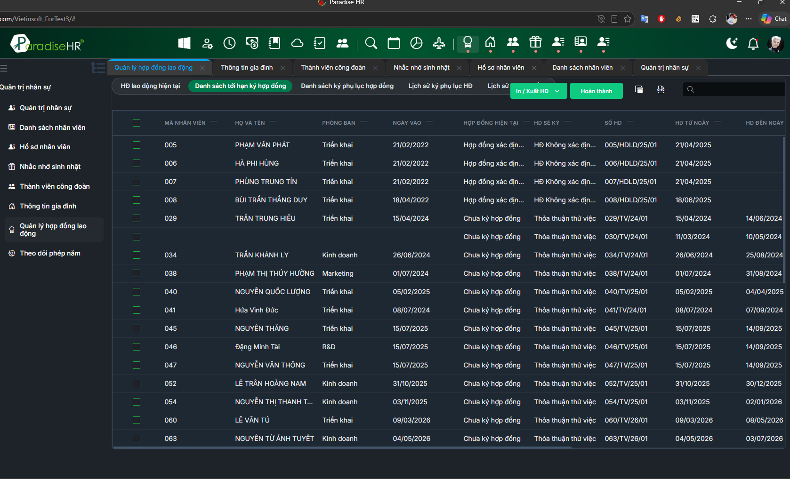
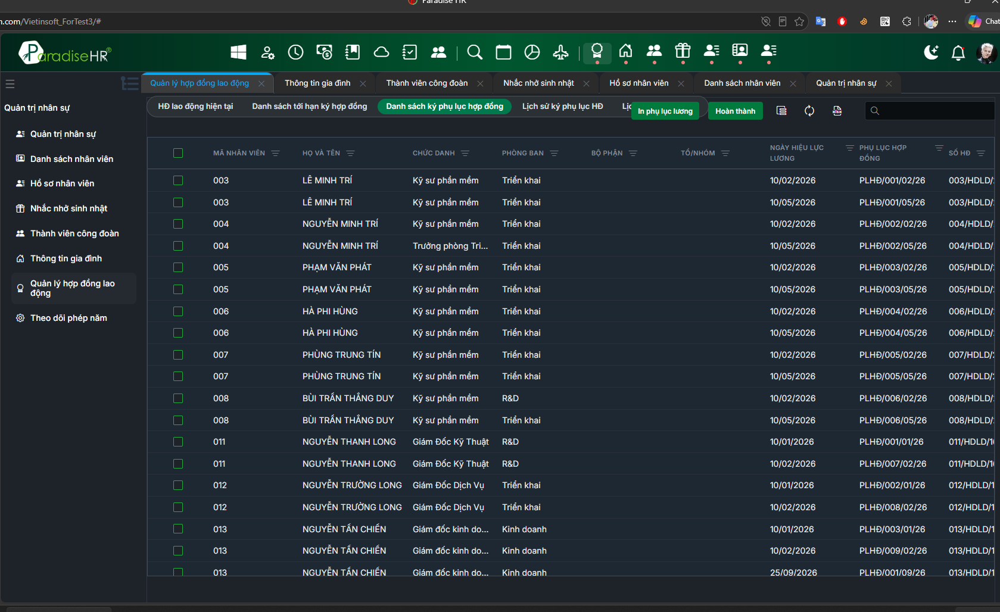
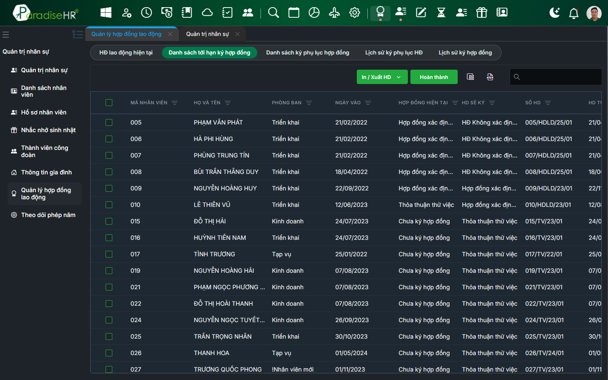
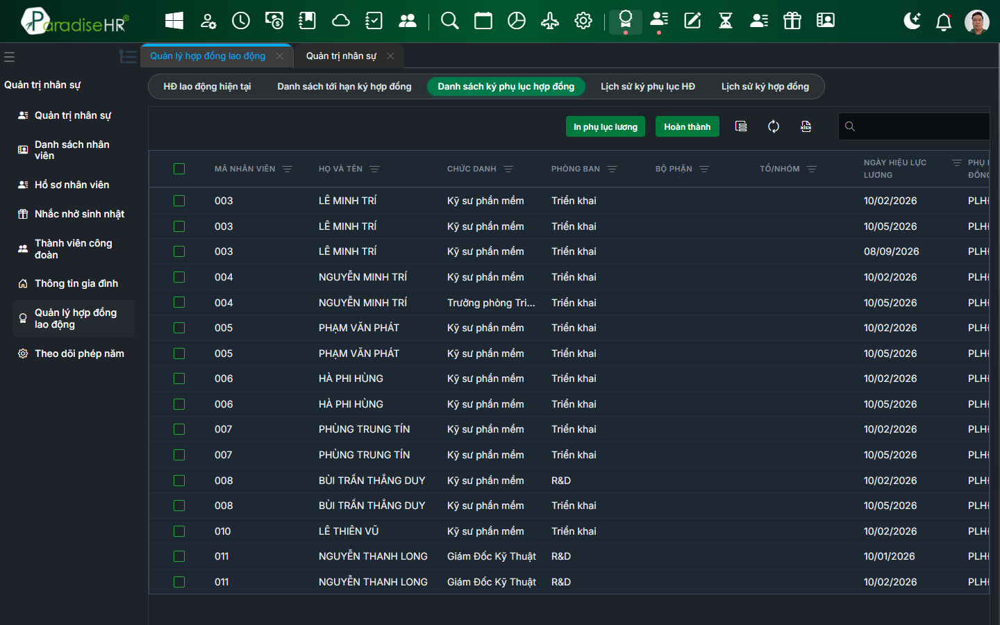

# BÁO CÁO GIẢI TRÌNH KỸ THUẬT (TECHNICAL DEFENSE REPORT)
## SCREENSHOT 8 & SCREENSHOT 9: QUẢN LÝ HỢP ĐỒNG LAO ĐỘNG (MnuHRS151)

> **Màn hình**: Quản Lý Hợp Đồng Lao Động  
> **Đường dẫn Menu**: **Quản trị nhân sự $\rightarrow$ Quản lý hợp đồng lao động**  
> **MenuID**: `MnuHRS151` | **ClassName**: `LabourContract`  
> **File SQL bản vá độc lập**: [`fix-bug/screenshot-8/patch_hop_dong_lao_dong.sql`](./patch_hop_dong_lao_dong.sql)  
> **Ảnh đối chiếu lỗi ban đầu (Before)**: [`./screenshots/8.png`](./screenshots/8.png) | [`./screenshots/9.png`](./screenshots/9.png)  
> **Ảnh kết quả sau khi sửa (After Fix)**: [`./screenshots/8_fixed.png`](./screenshots/8_fixed.png) | [`./screenshots/9_fixed.png`](./screenshots/9_fixed.png)  

---

### 1. HIỆN TRẠNG LỖI BAN ĐẦU (PROBLEM STATEMENT)

- **Triệu chứng lỗi**:
  1. **Lỗi trên Tab 2 ("Danh sách tới hạn ký hợp đồng" - Screenshot 8)**: Khi người dùng bấm sang Tab 2, cụm nút Toolbar bên phải của bảng dữ liệu (gồm nút `[In / Xuất HĐ ˅]`, nút `[Hoàn thành]`, icon `[Excel]`, và ô tìm kiếm `[Search...]`) bị trôi nổi lên trên cùng, đè bẹp trực tiếp lên Tab 4 ("Lịch sử ký phụ lục HĐ") và Tab 5 ("Lịch sử ký hợp đồng"). Tab 4 và Tab 5 bị che khuất hoàn toàn, người dùng không thể nhìn thấy tiêu đề tab và không thể nhấp chuột để chuyển tab.
  2. **Lỗi trên Tab 3 ("Danh sách ký phụ lục hợp đồng" - Screenshot 9)**: Khi người dùng bấm sang Tab 3, cụm nút Toolbar bên phải (gồm nút `[In phụ lục lương]`, nút `[Hoàn thành]`, và ô tìm kiếm `[Search...]`) tiếp tục bị trôi nổi lên trên cùng, đè thẳng lên Tab 4 và Tab 5 với triệu chứng y hệt Tab 2. Người dùng bị kẹt tại Tab 3, mất quyền tương tác với Tab 4 và Tab 5.
- **Minh chứng hình ảnh trực quan (Before)**:
  
  *Minh chứng lỗi Screenshot 8: Cụm nút tác vụ Toolbar đè bẹp lên Tab 4 và Tab 5 trên màn hình Quản lý hợp đồng lao động.*
  
  *Minh chứng lỗi Screenshot 9: Triệu chứng đè tab tiếp tục xảy ra khi bấm sang Tab 3 Danh sách ký phụ lục hợp đồng.*

---

### 2. PHÂN TÍCH NGUYÊN NHÂN GỐC RỄ (ROOT CAUSE ANALYSIS - RCA)

Hiện tượng nút đè lên chip lọc bắt nguồn từ sự kết hợp của các yếu tố kỹ thuật trong CSS ban đầu:

1. **Bản chất của `position: absolute` (Mất diện tích vật lý)**:
   - Cả thanh chip lọc (`#labourContractSegmentBar`) và cụm nút Toolbar (`.dx-toolbar-after`) đều bị gán `position: absolute`.
   - Vì thanh chip lọc chiếm $0\text{px}$ chiều cao vật lý trong luồng tài liệu tự nhiên, thẻ bọc bảng DataGrid bên dưới (`#lazyLoadContainer`) tự động trôi tuột lên đỉnh màn hình (tọa độ $Y = 0$), nằm ngay đằng sau và cùng hàng với thanh chip lọc.
2. **Mốc tọa độ và thông số `top: -10px`**:
   - Khi CSS cũ gán `top: -10px` cho `.dx-toolbar-after`, cụm nút bị kéo giật ngược lên trên $10\text{px}$ so với mép trên của bảng DataGrid.
   - Việc kéo ngược này đưa cụm nút rơi trúng vào cùng độ cao trục $Oy$ với thanh chip lọc ($Y \approx 4\text{px}$).
3. **Tổng chiều ngang vượt quá màn hình và va chạm `z-index`**:
   - Thanh 5 chip lọc chiếm $\sim 850\text{px}$, cụm nút bên phải chiếm thêm $\sim 550\text{px}$. Tổng bề ngang cần thiết là $\sim 1400\text{px}$.
   - Khi màn hình hiển thị có bề ngang hẹp hơn $1400\text{px}$, cụm nút bên phải va chạm với các chip bên trái. Do cụm nút có `z-index: 21` cao hơn chip lọc (`z-index: 20`), nó đè bẹp trực tiếp lên trên Tab 4 và Tab 5.
4. **Giải pháp kiến trúc 2 Hàng độc lập (Two-row Layout)**:
   - Chuyển `#labourContractSegmentBar` sang `position: relative !important; margin-bottom: 10px !important;` giúp thanh chip lọc có diện tích vật lý thực tế ở Hàng 1, đẩy toàn bộ bảng và Toolbar xuống Hàng 2 độc lập.
   - Chuyển `.dx-toolbar-after` sang `position: relative !important; top: auto !important; margin-left: auto !important;` để các nút nằm ngay ngắn ở mép phải của Hàng 2.

---

### 3. ĐỐI CHIẾU MÃ NGUỒN TRƯỚC VÀ SAU (BEFORE VS AFTER)

#### 3.1. Đối chiếu CSS bố cục giao diện trong `[dbo].[LabourContract_html]`

##### ❌ HỆ THỐNG BAN ĐẦU (BEFORE):
```css
/* TRƯỚC: Ép chung 1 hàng bằng position: absolute, gây đè lên Tab 4 và Tab 5 */
#labourContractSegmentPage {
    width: 100%;
    padding: 6px 10px;
    box-sizing: border-box;
    position: relative;
}

#labourContractSegmentBar {
    position: absolute;                   // LỖI GỐC: Vị trí tuyệt đối chiếm 0px chiều cao
    top: 4px;
    left: 10px;
    z-index: 20;                          // z-index thấp hơn nút Toolbar (20 < 21)
    display: inline-flex;
    align-items: center;
    gap: 4px;
    padding: 4px;
    border: 1px solid var(--bs-border-color, rgba(255, 255, 255, 0.15));
    border-radius: 999px;
    background: var(--bs-tertiary-bg, rgba(255, 255, 255, 0.06));
    max-width: calc(100% - 450px);
    overflow-x: auto;
    overflow-y: hidden;
    white-space: nowrap;
}

#lazyLoadContainer .dx-toolbar {
    background: transparent !important;
    min-height: 44px !important;
    height: 44px !important;
    margin-bottom: 6px !important;
    padding: 0 !important;
    position: relative !important;
}

#lazyLoadContainer .dx-toolbar-after {
    position: absolute !important;        // LỖI: Nhấc bổng cụm nút ra khỏi dòng hiển thị tự nhiên
    right: 0px !important;
    top: -10px !important;                // LỖI: Kéo ngược lên trên 10px, đè thẳng lên thanh 5 Tab!
    z-index: 21 !important;               // LỖI: z-index cao hơn che khuất Tab 4 & 5
    display: inline-flex !important;
    align-items: center !important;
    gap: 6px !important;
}
```

##### ✅ BẢN VÁ HOÀN THIỆN (AFTER):
```css
/* SAU: Phân tách rõ ràng kiến trúc 2 Hàng (Two-row Layout) triệt tiêu hoàn toàn lỗi chồng đè */
#labourContractSegmentPage {
    width: 100%;
    padding: 8px 12px;
    box-sizing: border-box;
}

/* HÀNG 1: THANH 5 TABS ĐỘC LẬP Ở TRÊN CÙNG (CÁCH ĐÁY 10PX) */
#labourContractSegmentBar {
    position: relative !important;        // GIẢI PHÁP: Chuyển sang relative, đứng vững ở hàng trên cùng
    display: inline-flex !important;
    align-items: center !important;
    gap: 6px !important;
    padding: 4px 6px !important;
    border: 1px solid var(--bs-border-color, rgba(255, 255, 255, 0.15)) !important;
    border-radius: 999px !important;
    background: var(--bs-tertiary-bg, rgba(255, 255, 255, 0.06)) !important;
    max-width: 100% !important;
    overflow-x: auto !important;
    overflow-y: hidden !important;
    white-space: nowrap !important;
    margin-bottom: 10px !important;       // GIẢI PHÁP: Đẩy toàn bộ Hàng 2 xuống dưới
    scrollbar-width: thin !important;
}

/* HÀNG 2: THANH TOOLBAR CỦA TẤT CẢ CÁC TAB CĂN LỆCH BÊN PHẢI (NẰM DƯỚI HÀNG TABS) */
#lazyLoadContainer .dx-toolbar {
    background: transparent !important;
    min-height: 40px !important;
    height: auto !important;
    margin-bottom: 6px !important;
    padding: 0 !important;
    position: relative !important;        // Nằm đúng luồng tài liệu tự nhiên
    width: 100% !important;
}

#lazyLoadContainer .dx-toolbar-items-container {
    display: flex !important;
    align-items: center !important;
    justify-content: flex-end !important; // Dồn toàn bộ nút về mép PHẢI ngoài cùng
    width: 100% !important;
    height: 100% !important;
    position: relative !important;
}

#lazyLoadContainer .dx-toolbar-before {
    display: none !important;
}

#lazyLoadContainer .dx-toolbar-after {
    display: inline-flex !important;
    align-items: center !important;
    justify-content: flex-end !important;
    position: relative !important;        // GIẢI PHÁP: Chuyển sang relative, loại bỏ top: -10px
    margin-left: auto !important;
    right: 0 !important;
    top: auto !important;                 // GIẢI PHÁP: Hủy bỏ top âm
    gap: 6px !important;
    z-index: 2 !important;
}
```

---

#### 3.2. Đối chiếu logic nạp Tab con trong `[dbo].[LabourContract_html]`

##### ❌ HỆ THỐNG BAN ĐẦU (BEFORE):
```javascript
function selectTab(tableName){
    $(".labour-seg-btn").removeClass("active");
    $(".labour-seg-btn[data-id='" + tableName + "']").addClass("active");
    var c = $("#lazyLoadContainer").html("<div>Đang tải...</div>");
    ajaxSP("ssGetConfigMobileHTMLLayout", [
        "TableName", tableName,
        "LanguageID", window.LanguageID,
        "LoginID", window.LoginID,
        "TypeLayout", 0,
        "IsWeb", true
    ], function(res){
        var h = res && res.data && res.data[0] && res.data[0][0];
        c.empty().append(h.Html);          // Nạp HTML mà không xử lý vị trí các nút
    });
}
```

##### ✅ BẢN VÁ HOÀN THIỆN (AFTER):
```javascript
function selectTab(tableName){
    $(".labour-seg-btn").removeClass("active");
    $(".labour-seg-btn[data-id='" + tableName + "']").addClass("active");
    var c = $("#lazyLoadContainer").html("<div style=\"padding:12px;color:#006b45;font-weight:600\">" + (isEN ? "Loading data..." : "Đang tải dữ liệu...") + "</div>");
    ajaxSP("ssGetConfigMobileHTMLLayout", [
        "TableName", tableName,
        "LanguageID", window.LanguageID || "VN",
        "LoginID", window.LoginID || 3,
        "TypeLayout", window.TypeLayout || 0,
        "IsWeb", true
    ], function(res){
        try{
            var j = typeof res === "string" ? JSON.parse(res) : res;
            var h = j && j.data && j.data[0] && j.data[0][0];
            c.empty().append((h && (h.Html || h.html)) || "<div style=\"padding:12px;color:#999\">" + (isEN ? "No data to display" : "Không có dữ liệu để hiển thị") + "</div>");
        }catch(e){ c.html("<div style=\"padding:12px;color:red\">" + e.message + "</div>"); }
    }, function(){ c.html("<div style=\"padding:12px;color:red\">" + (isEN ? "Data loading error." : "Lỗi tải dữ liệu.") + "</div>"); });
}
```

---

#### 3.3. Minh chứng kết quả giao diện thực tế sau khi sửa (After Fix)

##### Tab 2: Danh sách tới hạn ký hợp đồng (Screenshot 8)

*Minh chứng Tab 2 (Danh sách tới hạn ký hợp đồng) sau khi sửa: Cụm 5 chip lọc nằm riêng biệt trên Hàng 1, cụm nút In/Xuất/Hoàn thành/Làm mới/Tìm kiếm nằm riêng biệt trên Hàng 2 bên phải, không còn đè lên Tab 4 và Tab 5.*

##### Tab 3: Danh sách ký phụ lục hợp đồng (Screenshot 9)

*Minh chứng Tab 3 (Danh sách ký phụ lục hợp đồng) sau khi sửa: Thanh 5 chip lọc và cụm nút In phụ lục lương/Hoàn thành/Tìm kiếm phân tách 2 hàng độc lập, thao tác chuyển tab mượt mà.*
