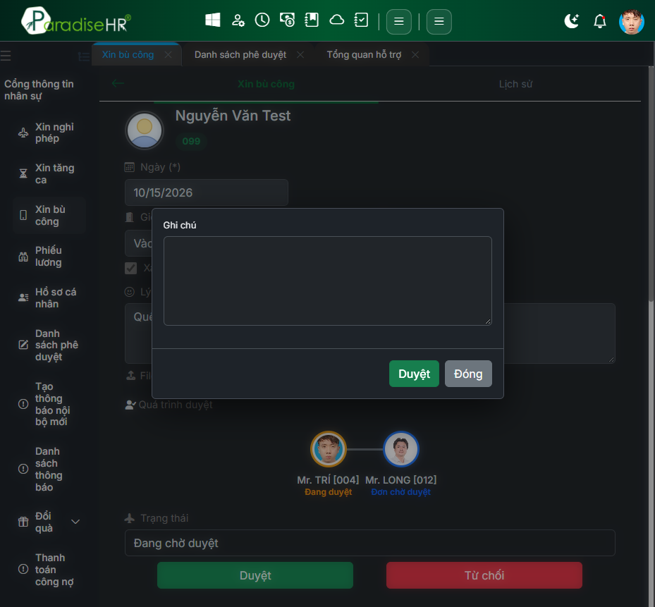
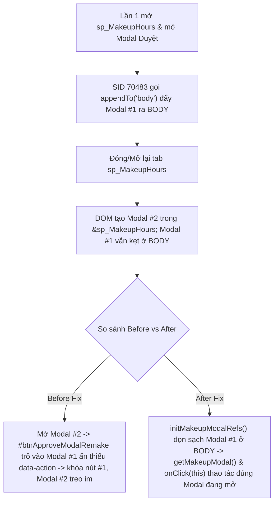

# BÁO CÁO KỸ THUẬT PHÂN TÍCH & SỬA LỖI (TECHNICAL FIX REPORT)

- **Menu / Màn hình**: Xin bù công (`MnuHRS033` / `sp_MakeupHours`)
- **Stored Procedure giao diện**: `[dbo].[sp_MakeupHours_html]`
- **Stored Procedure điều phối**: `[dbo].[sp_MakeupHours]`
- **Database đối soát**: `Vietinsoft_ForTest_Tai2` (`192.168.11.51,2222`) — chế độ **Read-Only**
- **Ngày lập báo cáo**: `2026-11-12`
- **Mã nguồn gốc (Before)**: [origin.sql](origin.sql)
- **Bản vá tổng hợp (After)**: [fix-bug.sql](fix-bug.sql)

---

# PHẦN 1: CÁC LỖI DÒ QUA KIỂM THỬ TỰ ĐỘNG (AUTOMATION TEST CASES - TC)

*(Chưa có kịch bản kiểm thử tự động / Không có lỗi ghi nhận từ bộ Playwright cho màn hình `sp_MakeupHours`)*

---

# PHẦN 2: CÁC LỖI DÒ QUA TEST THỦ CÔNG / TRACE RUNTIME (MANUAL SCREENSHOT BUGS)

## [Trace-20261112T090845 / Manual Repro]: Bấm nút "Duyệt" trên Modal bị treo im lặng và các lỗi dây chuyền trên hệ thống Modal Duyệt / Từ chối / Hủy đơn

### 1. HIỆN TRẠNG LỖI BAN ĐẦU (BEFORE FIX)

- **Mô tả hành vi sai khác**:
  - Người dùng (tài khoản quản lý `tri.nguyen`, `UserID = 13`) mở màn hình **Xin bù công** (`sp_MakeupHours`) từ **Danh sách phê duyệt**, đóng rồi mở lại qua các đơn khác nhau (ví dụ xem đơn xin hủy ngày `14/10` của nhân viên `099`, đóng modal, quay lại mở đơn ngày `15/10` — `IdentityID = 01A1CDBC-4DB2-778F-BAB1-E3738C458A83`).
  - Khi bấm nút **Phê duyệt** (`.btnApprove`), `#modalApproveAttendanceRequest` mở lên bình thường với nút `#btnApproveModalRemake` hiển thị nhãn `Duyệt`.
  - Tuy nhiên, khi bấm nút `Duyệt` trong modal, giao diện **đứng yên hoàn toàn (treo im lặng)**: không có spinner chạy trên nút đang nhìn thấy, modal không đóng, và **không có bất kỳ request `sp_ApproveAttendanceRequest` nào được gửi về server**.
- **Số liệu kiểm chứng hiện trường qua Chrome DevTools MCP (`pageId: 1` trên `https://paradisehrm.com/Tai3/`)**:
  - `document.querySelectorAll('#modalApproveAttendanceRequest').length === 2` (cả 2 đều nằm trực tiếp dưới `BODY`, `inScope: false`):
    - **Modal `idx = 0` (Modal mồ côi ẩn từ phiên tab cũ)**: `isShown: false`, `btnDisabled: true`, `dataAction: null`, `btnHtml: "Duyệt <i class=\"fa fa-spinner fa-spin\"></i>"`.
    - **Modal `idx = 1` (Modal người dùng đang thấy & bấm)**: `isShown: true`, `btnDisabled: false`, `dataAction: "approve"`, `btnHtml: "Duyệt"`.
  - `document.querySelectorAll('#modalRejectAttendanceRequest').length === 2`: 1 bản trong `#sp_MakeupHours` và 1 bản mồ côi dưới `BODY`; cả hai đều mang `textarea` có lỗi typo `id="remake "` (dư khoảng trắng cuối).
  - Bảng Network của DevTools ghi nhận **0 request** gọi `sp_ApproveAttendanceRequest`.
  - Console trình duyệt ghi nhận cảnh báo accessibility khi đóng modal: `Blocked aria-hidden on an element because its descendant retained focus` trên `#modalApproveAttendanceRequest` và `#modalRejectAttendanceRequest`.



---

### 2. PHÂN TÍCH NGUYÊN NHÂN GỐC RỄ (ROOT CAUSE ANALYSIS - RCA CÂU 28)

Theo cấu trúc phân khu mã nguồn **Câu 28** (`HTML` / `<style>` / `5 phân khu <script>`):

#### a) Tầng HTML (`origin.sql` dòng 789–836)
1. **Không truyền ngữ cảnh nút bấm `this` vào `onClick` (dòng 799, 815, 831)**:
   - `#btnApproveModalRemake`, `#btnRejectModalRemake`, `#btnCancelModalRemake` gọi hàm không tham số (`HandleApproveAttendanceRequest()`, `HandleRejectAttendanceRequest()`, `HandleCancelAttendanceRequest()`), buộc JS phải truy vấn lại theo selector ID toàn cục (`$("#btnApproveModalRemake")`, `document.getElementById(...)`).
2. **Typo `id="remake "` dư dấu cách (dòng 811)**:
   - `<textarea class="form-control" id="remake " ...>` trong `#modalRejectAttendanceRequest` không khớp với `$("#remake").val("")` (không có dấu cách) trong `HideModalRemake()`.

#### b) Tầng CSS (`<style>`, `origin.sql` dòng 14–700)
- Không phát hiện lỗi CSS gây che khuất hay khóa sự kiện click; giữ nguyên vẹn phần `<style>`.

#### c) Tầng `<script>` — Bóc tách theo 5 phân khu

| Phân khu Câu 28 | Vị trí trong `origin.sql` | Nguyên nhân gốc rễ | Cách sửa & Lý do |
| :--- | :--- | :--- | :--- |
| **1. Biến toàn cục** | Dòng `840–846` | Chỉ khai báo `Current_IdentityID = ""`, không quản lý danh sách ID modal hay tham chiếu phần tử DOM gốc của phiên tab hiện tại. | Khai báo `MAKEUP_MODAL_IDS` (`modalApproveAttendanceRequest`, `modalRejectAttendanceRequest`, `modalCancelAttendanceRequest`, `filePreviewModal`) và `makeupModalRefs = {}` để giữ trực tiếp tham chiếu DOM của phiên tab đang mở, bất chấp modal bị di chuyển ra `<body>`. |
| **2. Widget DevExtreme** | Dòng `849+` | Không liên quan đến lỗi modal. | Giữ nguyên vẹn. |
| **3. Hàm xử lý** | Dòng `1119`, `1811–2130` | **(1) Rò rỉ Modal mồ côi & đảo ngược thứ tự DOM**: Framework chung (`SID 70483`) chạy `$(modal).appendTo("body")` khi mở modal. Khi đóng/mở lại tab (`deleteTab`), modal cũ ở `<body>` không bị xóa, tạo ra nhiều phần tử trùng ID (`idx=0` ẩn ở `<body>`, `idx=1` mới). Mọi selector toàn cục (`$("#btnApproveModalRemake")`, `document.getElementById("ghiChuNguoiDuyet2")`) luôn bám nhầm vào `idx=0` (ẩn, thiếu `data-action`, textarea rỗng).<br>**(2) Khóa nút trước khi kiểm tra `data-action`**: Trong `HandleApproveAttendanceRequest` (dòng 1973–1981) và `HandleRejectAttendanceRequest` (dòng 1987–1995), lệnh `$btn.prop("disabled", true).append('<i class="fa fa-spinner fa-spin">')` chạy **trước** `if (!dataaction) return;`, khiến nút `idx=0` bị khóa vĩnh viễn và treo spinner ẩn.<br>**(3) `HideModalRemake()` dùng `else if` dây chuyền** (dòng 1816–1824): Khi `#btnApproveModalRemake` có `btn-success`/`btn-danger`, nhánh `else if` bỏ qua bước gỡ class trên `#btnRejectModalRemake`.<br>**(4) Race condition `.modal('hide')` của Bootstrap 5**: Nếu AJAX phản hồi nhanh khi modal đang fade-in (`_isTransitioning = true`), Bootstrap 5 bỏ qua `$modal.modal('hide')` dẫn đến kẹt modal mở.<br>**(5) Đọc nhầm Textarea khi Duyệt/Từ chối Hủy**: `ApproveCancelAttendanceRequest` (dòng 2072) và `RejectCancelAttendanceRequest` (dòng 2103) đọc `ghiChuNguoiDuyet2` (của modal Duyệt thường đang ẩn) thay vì textarea trong `#modalRejectAttendanceRequest`, làm mất ghi chú người duyệt.<br>**(6) Thiếu mở khóa nút khi AJAX lỗi** ở 4/5 hàm (`RejectAttendanceRequest`, `SentCancelAttendanceRequest`, `ApproveCancelAttendanceRequest`, `RejectCancelAttendanceRequest`) và thiếu kiểm tra `data && data.length > 0` ở `checkApprovalPermission`. | - Bổ sung `cleanupStaleMakeupHoursModals()`, `initMakeupModalRefs()`, `getMakeupModal(id)` dọn sạch modal mồ côi ở `<body>` khi khởi tạo lại tab và truy vấn nút/textarea tương đối theo `$modal.find(...)`.<br>- Tách helper dùng chung `resetModalConfirmButton`, `restoreModalConfirmButton`, `openMakeupActionModal`, `getModalNoteValue`, `refreshPendingAfterDecision`, `hideModalSafely` (tự động `blur()` focus tránh cảnh báo `aria-hidden`, và lắng nghe `shown.bs.modal` nếu `_isTransitioning` đang bật).<br>- Truyền `btnEl` (`this`) từ HTML để xác định đúng `$modal = $(btnEl).closest(".modal")` và `$btn = $(btnEl)`.<br>- Kiểm tra `if (!dataaction) return;` **trước** khi disable và gắn spinner.<br>- Sửa `ApproveCancelAttendanceRequest` & `RejectCancelAttendanceRequest` đọc qua `getModalNoteValue($targetModal, ["remake", "ghiChuNguoiDuyet2"])`.<br>- Bổ sung `restoreModalConfirmButton($targetBtn)` trong cả 5 nhánh `error` và kiểm tra `data && data.length > 0`. |
| **4. Sự kiện (Events)** | Dòng `1592–1602`, `1850–1877`, `2016–2021` | **(1)** `checkApprovalPermission` gán `data-action` qua selector toàn cục `$("#btnApproveModalRemake")`, gán nhầm vào modal mồ côi `idx=0` trong khi người dùng mở modal `idx=1`.<br>**(2)** `checkCancelPermission` (dòng 2017–2019) gán sự kiện & `data-action` vào ID không tồn tại `#btnActionModalRemake` (đổi nhầm màu xanh `btn-success` `%IsApproval%`) thay vì `#btnCancelModalRemake`.<br>**(3)** Listener `#filePreviewModal` chưa scope theo `#sp_MakeupHours`. | - Chuyển toàn bộ `.btnApprove` / `.btnReject` / `.btnDestroy` sang dùng `openMakeupActionModal(...)` tác động trực tiếp lên modal đang tham chiếu.<br>- Sửa `checkCancelPermission` dùng `#btnCancelModalRemake` (`btn btn-danger`, `%confirm%`).<br>- Scope listener `#filePreviewModal` theo `#sp_MakeupHours`. |
| **5. Khởi động (Init)** | Dòng `2139–2144`, `2203` | `initMakeupHours()` chạy ngay cuối `<script>` nhưng chưa dọn các modal mồ côi còn sót ở `<body>` từ lượt mở màn hình trước. | Gọi `initMakeupModalRefs()` ngay dòng đầu của `initMakeupHours()`. |

#### d) Sơ đồ cơ chế gây treo nút Duyệt (Before) & luồng khắc phục (After)



---

### 3. ĐỐI CHIẾU MÃ NGUỒN TRƯỚC VÀ SAU (BEFORE VS AFTER)

#### Bảng tóm tắt các điểm can thiệp trong `fix-bug.sql`

| Thành phần | Trước khi sửa (`origin.sql`) | Sau khi sửa (`fix-bug.sql`) | Mục đích |
| :--- | :--- | :--- | :--- |
| **Bước 1 — HTML Modals** | `onClick="Handle*AttendanceRequest()"`, `id="remake "` | `onClick="Handle*AttendanceRequest(this)"`, `id="remake"` | Truyền nút đang click thực tế; khôi phục ID `#remake`. |
| **Bước 1 — Modal Registry** | Không có | `cleanupStaleMakeupHoursModals()`, `initMakeupModalRefs()`, `getMakeupModal()` | Triệt tiêu rò rỉ modal mồ côi dưới `<body>` khi mở lại tab. |
| **Bước 1 — Action Modals** | Selector ID toàn cục, `disabled` trước `if (!dataaction)`, `else if` lỗi ở `HideModalRemake` | Helper dùng chung (`openMakeupActionModal`, `resetModalConfirmButton`, `hideModalSafely`, `getModalNoteValue`, `refreshPendingAfterDecision`) | Đúng ngữ cảnh modal, chống treo spinner, xử lý xong fade-in mới hide, mở khóa nút khi AJAX lỗi. |
| **Bước 1 — Cancel Flow** | Đọc nhầm `ghiChuNguoiDuyet2`; gán nhầm `#btnActionModalRemake` | Đọc `#modalRejectAttendanceRequest` (`#remake`); sửa đúng `#btnCancelModalRemake` | Bảo toàn ghi chú duyệt/từ chối hủy và nút xác nhận hủy đơn. |
| **Bước 2 — `sp_MakeupHours`** | 4 tham số (`@IdentityID`, `@LoginID`, `@LanguageID`, `@isWeb`) + gọi `sp_Initialization_ApprovalLine_Leave` | Giữ nguyên chữ ký 4 tham số + logic khởi tạo dòng duyệt; chuẩn hóa fallback `@LanguageID = 'VN'` & `TOP 1 html` | Không làm gãy caller truyền 4 tham số và vẫn đọc đúng cache `sp_MakeupHours`. |
| **Bước 3 — Cache Compile** | N/A | `sp_GenerateHTMLScript_new 'sp_MakeupHours_html', 'VN'/'EN', 'sp_MakeupHours'` | Biên dịch bản vá sạch vào `tblHtmlScriptCache` cho cả 2 ngôn ngữ `VN`/`EN`. |

#### Chi tiết Diff Before vs After (trích từ `origin.sql` vs `fix-bug.sql`)

```diff
--- a/origin.sql
+++ b/fix-bug.sql
@@ -1,2 +1,19 @@
-CREATE PROCEDURE [dbo].[sp_MakeupHours_html]
+USE [Vietinsoft_ForTest_Tai2];
+GO
+...
+ALTER PROCEDURE [dbo].[sp_MakeupHours_html]
```

```diff
@@ HTML Modals (origin.sql dòng 799, 811, 815, 831 vs fix-bug.sql dòng 816, 828, 832, 848) @@
-		                <button type="button" class="btn" onClick="HandleApproveAttendanceRequest()" id="btnApproveModalRemake">%Approved%</button>
+		                <button type="button" class="btn" onClick="HandleApproveAttendanceRequest(this)" id="btnApproveModalRemake">%Approved%</button>
...
-							<textarea class="form-control" id="remake " rows="3" style="height: 127px"></textarea>
+							<textarea class="form-control" id="remake" rows="3" style="height: 127px"></textarea>
...
-		                <button type="button" class="btn" onClick="HandleRejectAttendanceRequest()" id="btnRejectModalRemake">%Approved%</button>
+		                <button type="button" class="btn" onClick="HandleRejectAttendanceRequest(this)" id="btnRejectModalRemake">%Approved%</button>
...
-		                <button type="button" class="btn btn-danger" onClick="HandleCancelAttendanceRequest()" id="btnCancelModalRemake">%confirm%</button>
+		                <button type="button" class="btn btn-danger" onClick="HandleCancelAttendanceRequest(this)" id="btnCancelModalRemake">%confirm%</button>
```

```diff
@@ Phân khu 1 & 3 — Dọn modal mồ côi & Helper dùng chung (fix-bug.sql dòng 864-917, 1882-2246) @@
+var MAKEUP_MODAL_IDS = [
+	"modalApproveAttendanceRequest",
+	"modalRejectAttendanceRequest",
+	"modalCancelAttendanceRequest",
+	"filePreviewModal"
+];
+var makeupModalRefs = {};
+
+function cleanupStaleMakeupHoursModals() {
+	MAKEUP_MODAL_IDS.forEach(function (id) {
+		var selector = "#sp_MakeupHours [id=''" + id + "'']";
+		var inScope = document.querySelector(selector);
+		if (!inScope) return;
+		document.querySelectorAll("[id=''" + id + "'']").forEach(function (el) {
+			if (!el.closest("#sp_MakeupHours") && el.parentElement === document.body) {
+				try {
+					if (window.bootstrap && bootstrap.Modal) {
+						var inst = bootstrap.Modal.getInstance(el);
+						if (inst) inst.dispose();
+					}
+				} catch (e) {}
+				el.remove();
+			}
+		});
+	});
+	if ($(".modal.show").length === 0) {
+		$(".modal-backdrop").remove();
+		$("body").removeClass("modal-open").css({ overflow: "", paddingRight: "" });
+	}
+}
...
-	function HandleApproveAttendanceRequest() {
-		const $btn = $("#btnApproveModalRemake");
-		if ($btn.prop("disabled")) return; // Ngăn click nếu đã đang xử lý
-		$btn.prop("disabled", true).append('' <i class="fa fa-spinner fa-spin"></i>'');
-		var dataaction = $btn.attr("data-action");
-		if (!dataaction) return;
+	function HandleApproveAttendanceRequest(btnEl) {
+		var $modal = btnEl ? $(btnEl).closest(".modal") : getMakeupModal("modalApproveAttendanceRequest");
+		if (!$modal.length) $modal = getMakeupModal("modalApproveAttendanceRequest");
+		var $btn = btnEl ? $(btnEl) : $modal.find("#btnApproveModalRemake");
+		if ($btn.prop("disabled")) return;
+		var dataaction = $btn.attr("data-action");
+		if (!dataaction) return; // Kiểm tra data-action trước khi khóa nút và gắn spinner
+		$btn.prop("disabled", true).append('' <i class="fa fa-spinner fa-spin"></i>'');
```

```diff
@@ Bước 2 & Bước 3 cuối file fix-bug.sql (dòng 2334-2376) @@
+ALTER PROCEDURE [dbo].[sp_MakeupHours]
+	@IdentityID varchar(36) = '',
+	@LoginID int = 3,
+	@LanguageID varchar(2) = 'VN',
+	@isWeb int = 2
+AS
+BEGIN
+	SET NOCOUNT ON;
+
+	IF @LanguageID IS NULL OR LTRIM(RTRIM(@LanguageID)) = ''
+		SET @LanguageID = 'VN';
+
+	DECLARE @CurrentDate datetime = GETDATE();
+	EXEC sp_Initialization_ApprovalLine_Leave @ViewDate = @CurrentDate, @EmployeeID = '-1', @LoginID = NULL;
+
+	SELECT TOP 1 html
+	FROM tblHtmlScriptCache
+	WHERE TableName = 'sp_MakeupHours'
+	  AND ScreenType = -1
+	  AND LanguageID = @LanguageID;
+END
+GO
+
+IF OBJECT_ID('dbo.sp_GenerateHTMLScript_new', 'P') IS NOT NULL
+BEGIN
+    EXEC sp_GenerateHTMLScript_new 'sp_MakeupHours_html', 'VN', 'sp_MakeupHours';
+    EXEC sp_GenerateHTMLScript_new 'sp_MakeupHours_html', 'EN', 'sp_MakeupHours';
+END
```

*(Chi tiết đầy đủ xem tại [fix-bug.sql](fix-bug.sql) đối chiếu 1-1 với [origin.sql](origin.sql)).*

---

### 4. MINH CHỨNG KẾT QUẢ GIAO DIỆN THỰC TẾ SAU KHI SỬA (AFTER FIX)

*(Đang chờ Người Dùng Execute file fix-bug.sql trên SSMS và xác nhận cập nhật)*

> **Ghi chú kiểm chứng kỹ thuật trước khi bàn giao (Live Hot-Patch Dry-Run trên Chrome DevTools MCP — Read-Only DB, đã chặn ghi vào Database)**:
> - **Kiểm tra tĩnh file [fix-bug.sql](fix-bug.sql)**:
>   - `SQL single-quote escaping check: PASSED` (khớp toàn bộ dấu nháy đơn trong `@html`).
>   - `JavaScript syntax check (new Function): PASSED (script len=52594)`.
> - **Thử nghiệm Hot-Patch trực tiếp trên phiên Chrome đang bị lỗi (`pageId: 1`, `tri.nguyen`, `Current_IdentityID = 01A1CDBC-4DB2-778F-BAB1-E3738C458A83`, stub `AjaxHPAParadise` để giữ nguyên 100% dữ liệu test trong DB)**:
>   1. `initMakeupModalRefs()` dọn modal mồ côi `#modalRejectAttendanceRequest` từ `2` xuống `1` và sửa `id="remake "` thành `id="remake"` (`fixedRemakeId: true`).
>   2. Dù cố tình giữ nguyên modal Duyệt mồ côi bị treo ở `BODY` (`idx=0`), bấm nút `Duyệt` trên modal đang hiển thị (`idx=1`) vẫn kích hoạt đúng `sp_ApproveAttendanceRequest` với `Remark = "Duyet don 15/10 hot-patch"`.
>   3. Gọi `HandleApproveAttendanceRequest` khi thiếu `data-action` không làm khóa nút hay treo spinner (`stuckDisabledOrSpin: false`).
>   4. Luồng Duyệt Hủy (`#modalRejectAttendanceRequest`) đọc đúng textarea `#remake` gửi `Remark = "Dong y cho huy don 14/10"`; nhánh `error` của `RejectCancelAttendanceRequest` tự động mở khóa nút & xóa spinner (`disabled: false`, `hasSpinner: false`).
>   5. Luồng Xin Hủy (`#modalCancelAttendanceRequest`) chặn gửi khi `#NoteCancel` rỗng (báo lỗi `"Vui lòng nhập lý do hủy đơn"` + viền `1px solid red`), và gửi đúng `Reason` khi đã nhập.
>   6. Tình huống bấm xác nhận nhanh ngay lúc modal đang fade-in (`hideModalSafely`): sau `800ms`, toàn bộ modal và backdrop đóng sạch (`shownModalsAfter800ms: 0`, `backdropsAfter800ms: 0`, `bodyModalOpenClass: false`, `consoleAriaFocusClean: true`), Console không phát sinh lỗi runtime hay cảnh báo focus mới.
