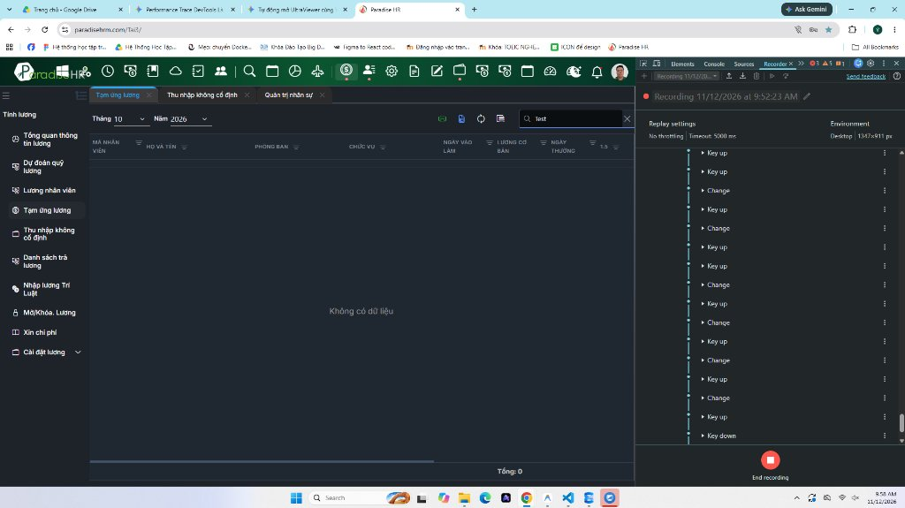
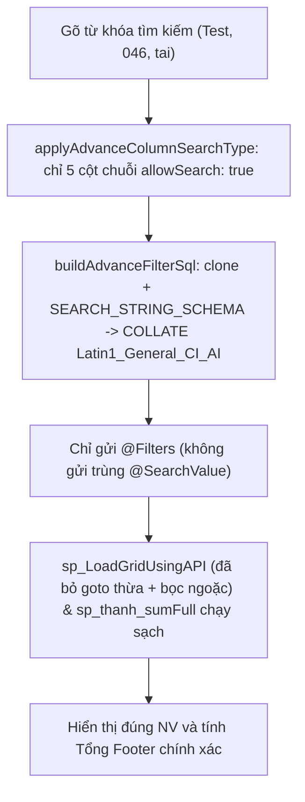
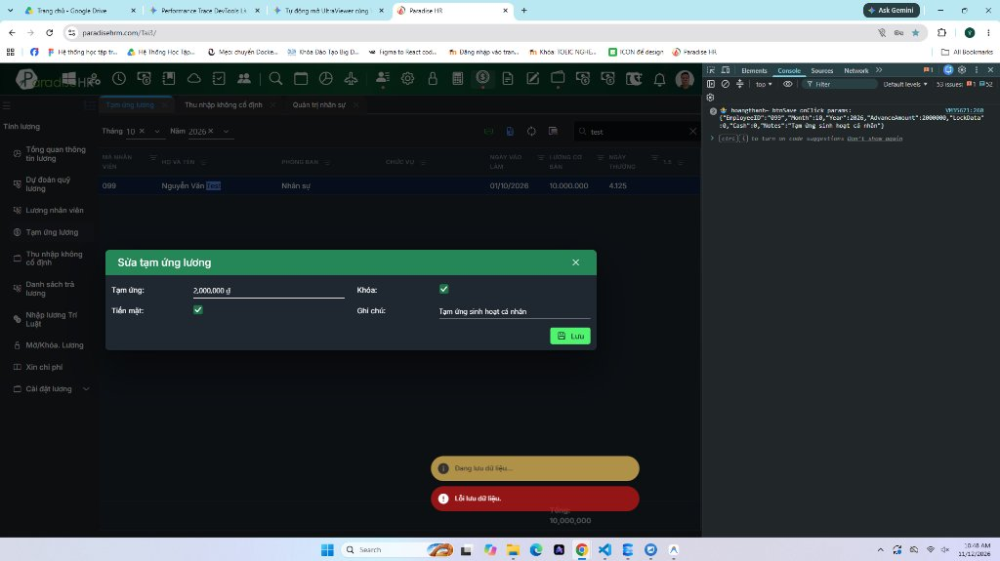
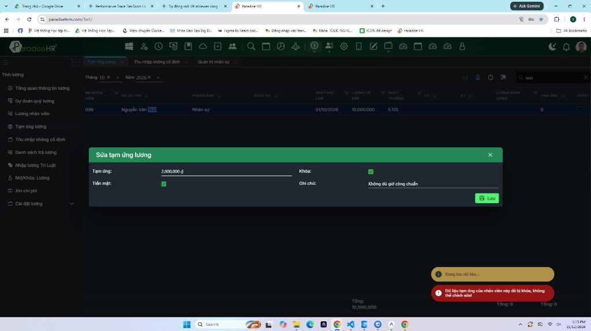
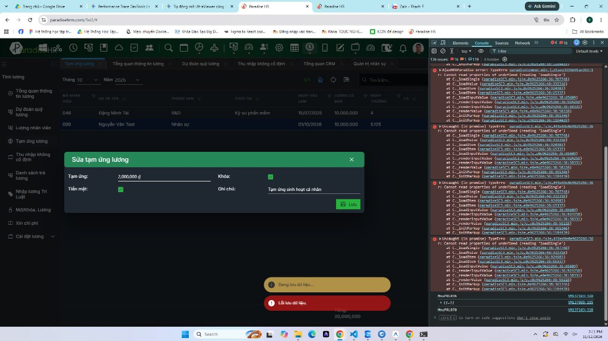
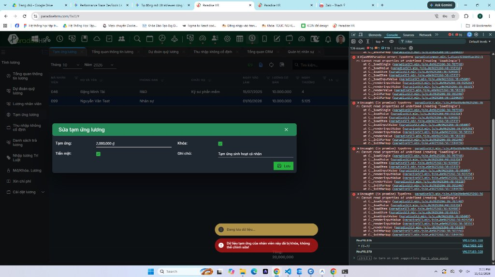

# BÁO CÁO KỸ THUẬT TỔNG HỢP FIX BUG: TẠM ỨNG LƯƠNG (`SAL_Advance_Process`)

> **Màn hình**: Tạm ứng lương (`MenuID: MnuPRL070`, `ClassName: SAL_Advance_Process`) & Popup **Sửa tạm ứng lương** (`sp_SAL_Advance_Process_Edit`)  
> **Cơ sở dữ liệu**: `Vietinsoft_ForTest_Tai2` (Web `https://paradisehrm.com/Tai3/`)  
> **Stored Procedures đã kiểm tra & tích hợp vào 1 bản vá duy nhất**:
> 1. `[dbo].[SAL_Advance_Process_html]` (biên dịch cache `SAL_Advance_Process`)
> 2. `[dbo].[sp_LoadGridUsingAPI]` (SP phân trang/lọc dùng chung)
> 3. `[dbo].[sp_SAL_Advance_Process_Edit_html]` (biên dịch cache `sp_SAL_Advance_Process_Edit`)
> 4. `[dbo].[sp_SAL_Advance_Process_Edit]` (SP điều phối đọc cache `sp_SAL_Advance_Process_Edit`)
> 5. `[dbo].[sp_SAL_Advance_Update]` (SP lưu cập nhật bảng `tblSal_Advance`)  
> **Ngày tạo bản vá**: `2026-11-12`

---

# PHẦN 1: CÁC LỖI DÒ QUA KIỂM THỬ TỰ ĐỘNG (AUTOMATION TEST CASES)

*(Chưa có kịch bản kiểm thử tự động / Không có lỗi ghi nhận từ Playwright)*

---

# PHẦN 2: CÁC LỖI DÒ QUA TEST THỦ CÔNG (MANUAL SCREENSHOT BUGS)

## [Manual Bug #1 - 2026-11-12]: Ô tìm kiếm (SearchBox) trên menu Tạm ứng lương không lọc theo tên / mã nhân viên, hiển thị "Không có dữ liệu"

### 1. HIỆN TRẠNG LỖI BAN ĐẦU (BEFORE FIX)
- **Mô tả triệu chứng**:
  Khi mở menu **Tính lương -> Tạm ứng lương** (`Tháng 10`, `Năm 2026`), lưới `#GridSAL_Advance_Process` hiển thị bình thường 2 nhân viên (`046 - Đặng Minh Tài`, `099 - Nguyễn Văn Test`). Khi gõ `"Test"` (hoặc tên/mã NV) vào ô tìm kiếm (`Search in the data grid`), toàn bộ lưới biến mất và hiển thị **"Không có dữ liệu"**, dòng chân trang về **`Tổng: 0`**.
  Ngoài ra khi vừa mở tab, `checkExist` vừa gán `dataSource: dataStore_` trong `ConfigureGrid()` (tự trigger load lần 1) vừa gọi thêm `ReloadData()` ngay sau đó gây 2 request `sp_LoadGridUsingAPI` song song làm `SAL_Advance_Process` va chạm khóa chính `PK_tblSal_Advance` (`Violation of PRIMARY KEY constraint 'PK_tblSal_Advance'... (10, 2026, 099)`).
- **Bảng đối soát thực tế trên Network / Runtime (Chrome DevTools MCP)**:

| Hạng mục kiểm tra | Trạng thái trước khi sửa (Before Fix) | Kết quả kỳ vọng (Expected) |
| :--- | :--- | :--- |
| Nhập `"Test"` vào SearchBox | Lưới hiển thị **"Không có dữ liệu"** (0 dòng) | Lọc đúng 1 dòng: `099 - Nguyễn Văn Test` |
| Response `sp_LoadGridUsingAPI` (`POST /Tai3/hpa/paradise2`) | `{"result":"error","reason":"Incorrect syntax near ')'."}` | `{"result":"success"}` kèm dòng nhân viên khớp từ khóa |
| Response `sp_thanh_sumFull_SAL_Advance_Process` (3 cột tiền) | `{"result":"error","reason":"Error converting data type nvarchar to float."}` | `{"result":"success"}` với `BasicSalary: 10,000,000`, `AdvanceAmount: 0`, `ActualSalary: 0` |
| Mở tab Tạm ứng lương | Gọi `sp_LoadGridUsingAPI` 2 lần song song gây `PK_tblSal_Advance` | Chỉ load 1 lần duy nhất từ `ConfigureGrid()` |

- **Minh chứng ảnh gốc**:
  

### 2. PHÂN TÍCH NGUYÊN NHÂN GỐC RỄ (ROOT CAUSE ANALYSIS - RCA Câu 28)
1. **`<script>` Phân khu 2 & Phân khu 3 trong `[dbo].[SAL_Advance_Process_html]`**:
   - **Thiếu `dataType` và `allowSearch: false` trên cột số/boolean/ngày**: `BasicSalary`, `AttDays`, `OT150H`, `OT195H`, `ActualSalary`, `AdvanceAmount` chưa được khai báo `dataType: "number"`. Do `OT150H`, `OT195H`, `ActualSalary` đang `NULL` ở Tháng `10/2026`, DevExtreme để `dataType: undefined` (`defaultFilterOperation: "="`) và sinh biểu thức `["OT150H","=","Test"]`, `["OT195H","=","Test"]`, `["ActualSalary","=","Test"]` -> `createConditionQuery` dịch thành `OT150H= N'Test'...` -> `sp_thanh_sumFull_SAL_Advance_Process` crash **`"Error converting data type nvarchar to float."`**.
   - **Gửi trùng lặp cả `@SearchValue` lẫn `@Filters`**: `CustomStore.load` và `fn_thanh_sumFull_SAL_Advance_Process` vừa gửi `_currentKeyword` qua `@SearchValue`, vừa gửi `createConditionQuery(loadOptions.filter)` qua `@Filters` mà không truyền `schema` (`System.String`), nên vừa không có `COLLATE Latin1_General_CI_AI` cho tìm không dấu vừa kích hoạt nhánh bug của `sp_LoadGridUsingAPI`.
   - **Gọi đúp load lúc khởi tạo & thiếu `_summaryCache` reset qua global reload**: `checkExist` gọi `ConfigureGrid()` rồi gọi ngay `ReloadData()` song song, và chưa expose hàm reload để modal Sửa reset `_summaryCache` sau khi lưu.
2. **Tầng Database `[dbo].[sp_LoadGridUsingAPI]`**:
   - Trong `ConditionSearch:`, khi `@Filters <> ''` có lệnh `set @Condition += N' and '`, nhưng ngay bên dưới lại đặt nhầm **`goto ConditionEnd`** nhảy bỏ qua nhãn `ConditionFilters:`, tạo SQL cụt `;WITH NumberedCTE AS (... WHERE (...) and )` gây lỗi **`"Incorrect syntax near ')'."`**.

- **Cách sửa**:
  - Thêm `applyAdvanceColumnSearchType(col)` trong `ConfigureGrid()` & `customizeColumns`: đặt `dataType: "number"; allowSearch: false` cho 6 cột số, `allowSearch: false` cho `Cash`/`LockData`/`HireDate`, `dataType: "string"; allowSearch: true` cho 5 cột chuỗi (`EmployeeID`, `FullName`, `DepartmentID`, `SectionName`, `Notes`).
  - Thêm `buildAdvanceFilterSql(filterExpr)` (clone cây filter tránh mutate + truyền `SEARCH_STRING_SCHEMA` có `System.String`), chỉ gửi `@Filters` khi `filterSql` không rỗng, bỏ gọi `ReloadData()` thừa ngay sau `ConfigureGrid()`, kiểm tra `json.result === "error"`, và export `window.ReloadSAL_Advance_Process = ReloadData`.
  - Trong `sp_LoadGridUsingAPI`, bỏ `goto ConditionEnd` thừa trước `ConditionFilters:`, kiểm tra `@Condition <> N' WHERE '` và bọc ngoặc đơn `(...)`.



### 3. ĐỐI CHIẾU MÃ NGUỒN TRƯỚC VÀ SAU (BEFORE VS AFTER)
```diff
--- origin.sql ([dbo].[SAL_Advance_Process_html])
+++ fix-bug.sql ([dbo].[SAL_Advance_Process_html])
+            const SEARCH_STRING_SCHEMA = [ ... ];
+            function buildAdvanceFilterSql(filterExpr) { ... }
+            function applyAdvanceColumnSearchType(col) { ... }
-                            filterStr = createConditionQuery(filterExpr);
+                            filterStr = buildAdvanceFilterSql(filterExpr);
-                                "SearchValue", _currentKeyword || "",
+                                "SearchValue", filterStr ? "" : (_currentKeyword || ""),
...
                       ConfigureGrid();
-                      ReloadData();
+                      // ConfigureGrid() gán dataSource đã tự load 1 lần, bỏ ReloadData() tránh đụng PK_tblSal_Advance
```

```diff
--- origin.sql ([dbo].[sp_LoadGridUsingAPI])
+++ fix-bug.sql ([dbo].[sp_LoadGridUsingAPI])
-    if(@Filters<>'')
-        set @Condition += N' and '
+    if(@Filters<>'')
+    begin
+        if (@Condition <> N' WHERE ')
+            set @Condition += N' and '
+    end
     else
         goto ConditionEnd
-    goto ConditionEnd
     ConditionFilters:
-    set @Condition += @Filters
+    set @Condition += N'(' + @Filters + N')'
```

### 4. MINH CHỨNG KẾT QUẢ GIAO DIỆN THỰC TẾ SAU KHI SỬA (AFTER FIX)
*(Đang chờ Người Dùng Execute file fix-bug.sql trên SSMS và xác nhận cập nhật — đã thử nghiệm JS hot-patch thành công trước đó với `"Test"`, `"046"`, `"tai"`)*

---

## [Manual Bug #2 - 2026-11-12]: Nhấn nút Lưu trong modal Sửa tạm ứng lương báo "Lỗi lưu dữ liệu.", không lưu DB và log `LockData: 0, Cash: 0`

### 1. HIỆN TRẠNG LỖI BAN ĐẦU (BEFORE FIX)
- **Mô tả triệu chứng**:
  Khi double-click nhân viên `099 - Nguyễn Văn Test` để mở modal **Sửa tạm ứng lương**, nhập `Tạm ứng: 2,000,000 đ`, tích cả 2 ô **Khóa** và **Tiền mặt**, nhập `Ghi chú: "Tạm ứng sinh hoạt cá nhân"` rồi nhấn **Lưu**:
  1. Console in `btnSave onClick params: {"EmployeeID":"099","Month":10,"Year":2026,"AdvanceAmount":2000000,"LockData":0,"Cash":0,"Notes":"Tạm ứng sinh hoạt cá nhân"}` — cả `LockData` và `Cash` đều gửi **`0`** dù trên UI cả 2 ô đều đã tích xanh.
  2. Màn hình hiện toast vàng `"Đang lưu dữ liệu..."` kèm toast đỏ **`"Lỗi lưu dữ liệu."`**, hoặc khi đổi sang trả rỗng `{"result":"success","reason":"","data":[]}` lại báo giả `"Lưu thành công!"` trong khi `tblSal_Advance` và `tblSC_EZLog` không hề có thay đổi.
- **Bảng đối soát thực tế trên Network / DOM / DB (Chrome DevTools MCP)**:

| Thành phần kiểm tra | Hiện trạng trước khi sửa (Before Fix) | Kết quả kỳ vọng (Expected) |
| :--- | :--- | :--- |
| Tên SP gọi khi nhấn **Lưu** | `"sp_SAL_Advance_Update_API"` (**không tồn tại** trong DB) | `"sp_SAL_Advance_Update"` (SP thật trong DB) |
| Trạng thái 2 checkbox `Khóa` & `Tiền mặt` | UI hiện SVG tích xanh nhưng `dxCheckBox.option("value") === false` (`aria-checked="false"`) -> `LockData: 0, Cash: 0` | `dxCheckBox` sở hữu toàn bộ DOM/sự kiện, tích ô nào thì `.option("value") === true` (`1`) đúng thực tế |
| Kiểm tra response JSON trong `#btnSaveAdvance` | Không check `response.result === "error"` và không check `!updateRow`; lỗi chuỗi từ `reload()` rơi vào `"Lỗi lưu dữ liệu."` | Báo đúng `response.reason`, chặn Fake Success khi `data` rỗng, giữ lại `window.ReloadSAL_Advance_Process()` refresh cả dòng lẫn Tổng |
| Cập nhật `IsLock` trong `sp_SAL_Advance_Update` | Gán cứng `IsLock = 1` ở dòng 35 | Cập nhật đúng `IsLock = ISNULL(@LockData, 0)` |
| SP điều phối `sp_SAL_Advance_Process_Edit` | Đọc `TableName = 'sp_SAL_Advance_Process_Edit_html'` (lệch với `sp_GenerateHTMLScript_new`) | Chuẩn hóa đọc `TableName = 'sp_SAL_Advance_Process_Edit'` |

- **Minh chứng ảnh gốc**:
  

### 2. PHÂN TÍCH NGUYÊN NHÂN GỐC RỄ (ROOT CAUSE ANALYSIS - RCA Câu 28)
1. **`<script>` Phân khu 2 (Khởi tạo Widget) trong `[dbo].[sp_SAL_Advance_Process_Edit_html]`**:
   - `tblCommonControlType_Signed` của 2 UID `P03965EDAFBF54FA0B84BED320C664F4A` (`LockData`) và `PC11CD073FA774AC8BCBF9E7EFDE5E981` (`Cash`) chạy `window.hpaControlEngine.initCheckBoxManual(cfg)`, gắn event `$container.on("click", ...)` tự lật biến cục bộ `currentValue` và ghi đè DOM thành icon `<svg>` xanh.
   - Ngay sau đó, SP lại khởi tạo đè thêm `$("...").dxCheckBox({ value: false, ... })` lên cùng 2 thẻ `<div>` mà không hủy handler `.off("click")` và DOM của `initCheckBoxManual`. Khi người dùng click, handler của `initCheckBoxManual` vẽ tích xanh vào `<div>`, nhưng `dxCheckBox` (lưu tại `window["InstanceLockData..."]` và `window["InstanceCash..."]`) vẫn giữ `value = false` (`0`).
2. **`<script>` Phân khu 4 (Sự kiện `#btnSaveAdvance.onClick`) trong `[dbo].[sp_SAL_Advance_Process_Edit_html]`**:
   - Gọi sai tên SP `"sp_SAL_Advance_Update_API"` (trong khi DB chỉ có `[dbo].[sp_SAL_Advance_Update]`).
   - Không bắt `response.result === "error"` và `!response?.data?.[0]?.[0]`. Đồng thời khi `await grid.getDataSource().reload()` hoặc backend reject bằng chuỗi string (như `PK_tblSal_Advance` ở `SAL_Advance_Process`), `err.message` bị `undefined` nên khối `catch(err)` rơi vào fallback `"Lỗi lưu dữ liệu."`.
   - Fallback Tháng/Năm đang tìm `#Month`/`#Year` trong khi SelectBox của trang dùng ID `#P13431133E9D6489CA60B01DD1C17F1F2` và `#P9F624C1BFF0846AA98AB688E66478E84`.
   - Khi reload sau lưu, chỉ gọi `grid.getDataSource().reload()` mà không reset `_summaryCache` của màn hình cha.
3. **Tầng Database `[dbo].[sp_SAL_Advance_Update]` & `[dbo].[sp_SAL_Advance_Process_Edit]`**:
   - `sp_SAL_Advance_Update` dòng 35 gán cứng `IsLock = 1` thay vì `IsLock = ISNULL(@LockData, 0)`.
   - `sp_SAL_Advance_Process_Edit` trỏ sai key `TableName = 'sp_SAL_Advance_Process_Edit_html'`.

- **Cách sửa**:
  - Dispose (nếu có), `.off("click").empty()` trên `#P03965EDAFBF54FA0B84BED320C664F4A` và `#PC11CD073FA774AC8BCBF9E7EFDE5E981` trước khi khởi tạo `dxCheckBox`.
  - Đổi tên SP thành `"sp_SAL_Advance_Update"`, kiểm tra đầy đủ `response.result === "error"`, `!updateRow`, `updateRow.Success`, gọi `window.ReloadSAL_Advance_Process()`, và chuẩn hóa Bước 1D + Bước 2 + Bước 3 trong `fix-bug.sql`.

### 3. ĐỐI CHIẾU MÃ NGUỒN TRƯỚC VÀ SAU (BEFORE VS AFTER)
```diff
--- origin.sql ([dbo].[sp_SAL_Advance_Process_Edit_html])
+++ fix-bug.sql ([dbo].[sp_SAL_Advance_Process_Edit_html])
+             const $lockCheckboxEl = $("#P03965EDAFBF54FA0B84BED320C664F4A");
+             try { if ($lockCheckboxEl.data("dxCheckBox")) $lockCheckboxEl.dxCheckBox("dispose"); } catch(e) {}
+             $lockCheckboxEl.off("click").empty();
+             const $cashCheckboxEl = $("#PC11CD073FA774AC8BCBF9E7EFDE5E981");
+             try { if ($cashCheckboxEl.data("dxCheckBox")) $cashCheckboxEl.dxCheckBox("dispose"); } catch(e) {}
+             $cashCheckboxEl.off("click").empty();
...
-                            name: "sp_SAL_Advance_Update_API",
+                            name: "sp_SAL_Advance_Update",
...
+                        if (!response || response.result === "error") { throw new Error(...); }
+                        let updateRow = Array.isArray(response?.data?.[0]) ? response.data[0][0] : null;
+                        if (!updateRow) { throw new Error(...); }
+                        if (updateRow.Success === false || updateRow.Success === 0) { throw new Error(...); }
```

```diff
--- origin.sql ([dbo].[sp_SAL_Advance_Update])
+++ fix-bug.sql ([dbo].[sp_SAL_Advance_Update])
-        IsLock = 1,
-        Cash = @Cash,
-        BankAmt = CASE WHEN @Cash = 1 THEN 0 ELSE @AdvanceAmount END,
-        Notes = CASE WHEN ISNULL(@Notes, '') <> '' THEN @Notes ELSE Notes END
+        IsLock = ISNULL(@LockData, 0),
+        Cash = ISNULL(@Cash, 0),
+        BankAmt = CASE WHEN ISNULL(@Cash, 0) = 1 THEN 0 ELSE @AdvanceAmount END,
+        Notes = CASE WHEN @Notes IS NOT NULL THEN @Notes ELSE Notes END
```

### 4. MINH CHỨNG KẾT QUẢ GIAO DIỆN THỰC TẾ SAU KHI SỬA (AFTER FIX)
*(Đang chờ Người Dùng Execute file fix-bug.sql trên SSMS và xác nhận cập nhật — đã kiểm chứng live checkbox hot-patch trên Chrome DevTools MCP: click **Khóa** chuyển cả `Khóa` và `Tiền mặt` sang `checked` và `.option("value") === true`)*

---

## [Manual Bug #3 - 2026-11-12]: Lưu xong khi đang lọc SearchBox (`"test"`) nhưng lưới vẫn hiển thị dữ liệu cũ (`TẠM ỨNG: 0`, `DUYỆT: [ ]`), mở lại modal bấm Lưu báo `"Dữ liệu tạm ứng của nhân viên này đã bị khóa, không thể chỉnh sửa!"`

### 1. HIỆN TRẠNG LỖI BAN ĐẦU (BEFORE FIX)
- **Mô tả triệu chứng**:
  1. Người dùng tìm kiếm `"test"` ở SearchBox, mở modal **Sửa tạm ứng lương** của nhân viên `099 - Nguyễn Văn Test` (Tháng 10/2026), nhập `2,000,000 đ`, tích **Khóa** + **Tiền mặt**, nhập `Ghi chú: Tạm ứng sinh hoạt cá nhân` và bấm **Lưu**.
  2. Nhật ký `dbo.tblSC_EZLog` lúc `2026-11-12 13:13:47` xác nhận `sp_SAL_Advance_Update` đã lưu thành công (`Tạm ứng: 2000000.00, Khóa: 1, Tiền mặt: 1, Ghi chú: Tạm ứng sinh hoạt cá nhân`).
  3. Tuy nhiên trên lưới phía sau vẫn hiển thị dữ liệu cũ (`TẠM ỨNG: 0`, `DUYỆT: [ ]`). Khi double-click mở lại modal vẫn thấy ghi chú cũ `"Không đủ giờ công chuẩn"`, cho phép nhập lại và khi bấm **Lưu** (được ghi lại trong [Trace-20261112T131426.json](file:///c:/Users/Y.Thach/Desktop/paradiseHR/Trace-20261112T131426.json)) thì server trả lỗi đỏ: **`"Dữ liệu tạm ứng của nhân viên này đã bị khóa, không thể chỉnh sửa!"`**.
- **Bảng đối soát thực tế trên Trace / Database**:

| Hạng mục kiểm tra | Hiện trạng trước khi sửa (Before Fix) | Kết quả kỳ vọng (Expected) |
| :--- | :--- | :--- |
| Lịch sử DB (`tblSC_EZLog`) | `13:13:47` đã `UpdateAdvance` thành công (`Khóa: 1`, `2,000,000`) | Sau khi lưu thành công, UI đồng bộ đúng dữ liệu DB |
| `ReloadSAL_Advance_Process()` khi SearchBox có `"test"` (`@Filters <> ''`) | `sp_LoadGridUsingAPI` bỏ qua `SAL_Advance_Process`, đọc bảng tạm `##SAL_Advance_Process22VN` cũ (`0`, `LockData: 0`) | Ép làm mới bảng tạm (`@ForceRefresh = 1` + xóa cache bảng tạm trong `sp_SAL_Advance_Update`) để lưới hiện ngay `2,000,000` & `DUYỆT: [x]` |
| Đóng popup & chống double-click nút Lưu | Nếu bấm Lưu lại liên tiếp vẫn gửi nhiều request `POST /Tai3/hpa/paradise2` song song | Khóa nút tạm thời khi đang gửi request (`_isSaving`), fallback `window.activePopupInstance` khi đóng popup |

- **Minh chứng ảnh gốc**:
  

### 2. PHÂN TÍCH NGUYÊN NHÂN GỐC RỄ (ROOT CAUSE ANALYSIS - RCA Câu 28)
1. **Tầng Database `[dbo].[sp_LoadGridUsingAPI]` & `[dbo].[sp_SAL_Advance_Update]`**:
   - `sp_LoadGridUsingAPI` chỉ chạy lại SP nguồn (`SAL_Advance_Process`) khi:
     `object_Id(@TableDataName) is null or (@RequireTotalCount=1 and @Filters='')`
   - Khi ô SearchBox đang có `"test"`, `SAL_Advance_Process_html` truyền `@Filters <> ''`. Vì bảng tạm toàn cục `##SAL_Advance_Process22VN` đã tồn tại sẵn trong `tempdb`, điều kiện trên trả về `FALSE`.
   - Hệ quả: `ReloadSAL_Advance_Process()` (hoặc đổi Tháng/Năm, bấm Refresh khi đang search) đều đọc lại dữ liệu **cache cũ** trong `##SAL_Advance_Process22VN` (`AdvanceAmount = 0`, `LockData = 0`, `Notes = N'Không đủ giờ công chuẩn'`).
   - Khi mở lại modal từ dòng lưới cũ, `obj.LockData` là `false` nên modal không cảnh báo khóa; đến lúc bấm **Lưu**, `sp_SAL_Advance_Update` kiểm tra bảng thật `dbo.tblSal_Advance` (đang có `IsLock = 1`) nên ném `RAISERROR(N'Dữ liệu tạm ứng của nhân viên này đã bị khóa, không thể chỉnh sửa!', 16, 1)`.
2. **`<script>` Phân khu 1, 3, 4 trong `[dbo].[SAL_Advance_Process_html]` & `[dbo].[sp_SAL_Advance_Process_Edit_html]`**:
   - `SAL_Advance_Process_html` chưa truyền cờ ép làm mới bảng tạm khi gọi `ReloadData()` hoặc khi đổi `Month`/`Year`.
   - `sp_SAL_Advance_Process_Edit_html` chưa khóa nút Lưu trong lúc chờ `AjaxHPAParadiseAsync` (`_isSaving`) và chưa có fallback `window.activePopupInstance` khi tìm instance popup để đóng.

- **Cách sửa**:
  - **Trong `sp_LoadGridUsingAPI`**: Bổ sung tham số tùy chọn `@ForceRefresh bit = 0` (tương thích ngược 100% với mọi màn hình khác), sửa điều kiện `getData:` thành `if object_Id(@TableDataName) is null or (@RequireTotalCount=1 and @Filters='') or @ForceRefresh=1`.
  - **Trong `SAL_Advance_Process_html`**: Thêm `_forceRefresh` và `_lastProcParam`; bật `_forceRefresh = true` trong `ReloadData()` và tự gửi `"@ForceRefresh", 1` khi `ReloadData()` hoặc đổi Tháng/Năm (`_lastProcParam !== procParam`).
  - **Trong `sp_SAL_Advance_Update`**: Sau khi `UPDATE dbo.tblSal_Advance` thành công, xóa bảng tạm cache `##SAL_Advance_Process<LoginID>VN` / `EN` (nếu có) để mọi lần tải lại ngay sau đó đều đọc dữ liệu mới nhất từ DB.
  - **Trong `sp_SAL_Advance_Process_Edit_html`**: Thêm helper `getEditPopupInstance()` có fallback `window.activePopupInstance`, và cờ `_isSaving` + disable nút `#btnSaveAdvance` trong lúc đang lưu để chống bấm đúp.

### 3. ĐỐI CHIẾU MÃ NGUỒN TRƯỚC VÀ SAU (BEFORE VS AFTER)
```diff
--- before ([dbo].[sp_LoadGridUsingAPI])
+++ after ([dbo].[sp_LoadGridUsingAPI])
+    @GroupBy           nVarchar(max) ='', --
+    @value             sql_Variant   =null,
+    @ForceRefresh      bit           =0
...
     if object_Id(@TableDataName) is null
-       or(@RequireTotalCount=1 and @Filters='')begin
+       or(@RequireTotalCount=1 and @Filters='')
+       or @ForceRefresh=1 begin
```

```diff
--- before ([dbo].[SAL_Advance_Process_html])
+++ after ([dbo].[SAL_Advance_Process_html])
+            let _forceRefresh = false;
+            let _lastProcParam = "";
...
+                    if (_forceRefresh || (_lastProcParam && _lastProcParam !== procParam)) {
+                        params.push("@ForceRefresh", 1);
+                    }
+                    _forceRefresh = false;
+                    _lastProcParam = procParam;
...
               function ReloadData() {
                   _summaryCache = {};
+                  _forceRefresh = true;
```

```diff
--- before ([dbo].[sp_SAL_Advance_Update])
+++ after ([dbo].[sp_SAL_Advance_Update])
+    DECLARE @tmpTableVN NVARCHAR(256) = N'##SAL_Advance_Process' + CAST(@LoginID AS NVARCHAR(20)) + N'VN';
+    DECLARE @tmpTableEN NVARCHAR(256) = N'##SAL_Advance_Process' + CAST(@LoginID AS NVARCHAR(20)) + N'EN';
+    IF OBJECT_ID(N'tempdb..' + @tmpTableVN) IS NOT NULL EXEC(N'DROP TABLE ' + @tmpTableVN);
+    IF OBJECT_ID(N'tempdb..' + @tmpTableEN) IS NOT NULL EXEC(N'DROP TABLE ' + @tmpTableEN);
```

### 4. MINH CHỨNG KẾT QUẢ GIAO DIỆN THỰC TẾ SAU KHI SỬA (AFTER FIX)
*(Đang chờ Người Dùng Execute file fix-bug.sql trên SSMS và xác nhận cập nhật)*

---

## [Manual Bug #4 - 2026-11-12]: Sau khi mở/nhập menu `Thu nhập không cố định`, sang `Tạm ứng lương` bấm Lưu báo `"Lỗi lưu dữ liệu."` (nhưng đã lưu `IsLock = 1` vào DB), bấm Lưu lại báo đã bị khóa

### 1. HIỆN TRẠNG LỖI BAN ĐẦU (BEFORE FIX)
- **Mô tả triệu chứng**:
  1. Nếu chỉ mở riêng menu **Tạm ứng lương** thì bấm Lưu bình thường.
  2. Nhưng nếu mở/nhập dữ liệu ở menu **Thu nhập không cố định** (`MnuPRL036` / `sp_Adjustment`, `sp_EditAdjustment`) trước rồi mới chuyển sang **Tạm ứng lương** (`MnuPRL070`) để sửa cho nhân viên `099` (`2,000,000 đ`, tích **Khóa** + **Tiền mặt**):
     - Lần bấm **Lưu** thứ nhất (`14:11:31`): DB `tblSC_EZLog` đã ghi nhận `UpdateAdvance` thành công (`IsLock = 1`), nhưng popup vẫn mở và UI hiện toast đỏ **`"Lỗi lưu dữ liệu."`**.
     - Lần bấm **Lưu** thứ hai (ngay sau đó): vì DB đã bị khóa ở lần 1 nhưng popup không đóng, server báo **`"Dữ liệu tạm ứng của nhân viên này đã bị khóa, không thể chỉnh sửa!"`**.
- **Bảng đối soát thực tế trên Chrome DevTools MCP & DB**:

| Hạng mục kiểm tra | Hiện trạng trước khi sửa (Before Fix) | Kết quả kỳ vọng (Expected) |
| :--- | :--- | :--- |
| Các phần tử `.dx-popup` trong DOM sau khi mở `Thu nhập không cố định` | Xuất hiện thêm 2 phần tử `dx-overlay dx-popup dx-popover` (của `dxPopover`/`dxSelectBox` bên tab `Thu nhập không cố định`, không có `dxPopup` instance) | Lọc chính xác `:not(.dx-popover)` và kiểm tra `$p.data("dxPopup")` trước khi gọi `.dxPopup("instance")` |
| Gọi `$(".dx-popup").map(function() { return $(this).dxPopup("instance"); })` | Throw ngoại lệ **`undefined`** ngay tại phần tử `.dx-popover` đầu tiên -> nhảy vào `catch(err)` rơi vào fallback `"Lỗi lưu dữ liệu."` và bỏ qua `popup.hide()` | Trả về đúng instance popup của `Sửa tạm ứng lương`, đóng popup mượt mà, không throw |
| Lỗi `ReloadSAL_Advance_Process()` sau khi `sp_SAL_Advance_Update` đã commit | Nằm chung `try { ... }` với save nên nếu reload lỗi sẽ báo nhầm `"Lỗi lưu dữ liệu."` | Tách `try/catch` riêng cho phần reload sau khi đã lưu thành công DB |
| Khởi tạo `SelectBox` Tháng/Năm trong `SAL_Advance_Process_html` | Gán `value` và `onValueChanged` cùng lúc khiến `SAL_Advance_Process` kích hoạt nhiều lần lúc mở tab (`PK_tblSal_Advance`) | Gán `onValueChanged: null`, set `value` trước rồi mới đăng ký `onValueChanged` (kiểm tra `e.value !== e.previousValue`) |

- **Minh chứng ảnh gốc**:
  - Lần bấm 1 (`2:11 PM` - DB đã lưu `14:11:31` nhưng UI báo `"Lỗi lưu dữ liệu."` và giữ modal):
    
  - Lần bấm 2 (`2:11 PM` - báo đã khóa do lần 1 đã ghi `IsLock = 1`):
    

### 2. PHÂN TÍCH NGUYÊN NHÂN GỐC RỄ (ROOT CAUSE ANALYSIS - RCA Câu 28)
1. **`<script>` Phân khu 3 (`getEditPopupInstance`) trong `[dbo].[sp_SAL_Advance_Process_Edit_html]`**:
   - Khi menu **Thu nhập không cố định** (`sp_Adjustment` / `sp_EditAdjustment`) được mở trong cùng phiên làm việc (SPA tab), các widget DevExtreme của menu đó sinh ra phần tử `.dx-overlay.dx-popup.dx-popover` trong DOM (`document.body`).
   - Khi hàm `getEditPopupInstance()` chạy `$(".dx-popup").map(function() { return $(this).dxPopup("instance"); })`, jQuery quét trúng thẻ `.dx-popover` đứng trước trong DOM. Trong DevExtreme, gọi `.dxPopup("instance")` trên thẻ `.dx-popover` (chỉ có instance `dxPopover`, không có `dxPopup`) sẽ ném ra ngoại lệ `undefined`!
   - Vì dòng `let popup = getEditPopupInstance();` nằm ngay sau `sp_SAL_Advance_Update` trong cùng khối `try { ... } catch (err)`, nên sau khi DB đã lưu & khóa thành công ở SQL (`14:11:31`), JS lập tức văng `err === undefined` -> nhảy vào `catch (err)` và hiển thị chuỗi fallback **`"Lỗi lưu dữ liệu."`**, đồng thời `popup.hide()` không được thực thi. Khi bấm Lưu tiếp lần nữa, DB kiểm tra `IsLock = 1` đã lưu ở lần 1 nên báo đã bị khóa.
2. **`<script>` Phân khu 4 (`#btnSaveAdvance.onClick`) & `[dbo].[SAL_Advance_Process_html]` (Phân khu 2)**:
   - Phần `await window.ReloadSAL_Advance_Process()` dùng chung `catch (err)` với bước lưu DB.
   - SelectBox Tháng/Năm trong `SAL_Advance_Process_html` gắn `value` cùng lúc với `onValueChanged`, kích hoạt gọi `SAL_Advance_Process` lặp lại lúc mount (gây nhiều log `AdvanceSalary` song song).

- **Cách sửa**:
  - Cập nhật `getEditPopupInstance()` bọc `try/catch`, dùng selector `.dx-popup:not(.dx-popover)` và kiểm tra `$p.data("dxPopup")` trước khi gọi `$p.dxPopup("instance")`. *(Đã test live bằng `evaluate_script` trên trình duyệt khi có sẵn 2 `.dx-popover` của `Thu nhập không cố định`: tìm đúng popup `found: true` và đóng sạch `nowVisible: false`)*.
  - Tách `try/catch` riêng cho `ReloadSAL_Advance_Process()` sau khi `sp_SAL_Advance_Update` đã thành công.
  - Khởi tạo SelectBox Tháng/Năm với `onValueChanged: null`, set `value` trước rồi mới gán `onValueChanged` (có kiểm tra `e.value !== e.previousValue`).

### 3. ĐỐI CHIẾU MÃ NGUỒN TRƯỚC VÀ SAU (BEFORE VS AFTER)
```diff
--- before ([dbo].[sp_SAL_Advance_Process_Edit_html])
+++ after ([dbo].[sp_SAL_Advance_Process_Edit_html])
             let getEditPopupInstance = () => {
-                let popup = $(".dx-popup").map(function() {
-                    return $(this).dxPopup("instance");
-                }).get().find(function(instance) {
-                    return instance && $(instance.content()).find("#sp_SAL_Advance_Process_Edit_html").length;
-                });
+                try {
+                    let popups = $(".dx-popup:not(.dx-popover)").get();
+                    for (let i = 0; i < popups.length; i++) {
+                        let $p = $(popups[i]);
+                        if ($p.data("dxPopup")) {
+                            let inst = $p.dxPopup("instance");
+                            if (inst && $(inst.content()).find("#sp_SAL_Advance_Process_Edit_html").length) {
+                                return inst;
+                            }
+                        }
+                    }
+                    if (window.activePopupInstance && $(window.activePopupInstance.content()).find("#sp_SAL_Advance_Process_Edit_html").length) {
+                        return window.activePopupInstance;
+                    }
+                } catch (e) {}
+                return null;
             };
```

### 4. MINH CHỨNG KẾT QUẢ GIAO DIỆN THỰC TẾ SAU KHI SỬA (AFTER FIX)
*(Đang chờ Người Dùng Execute file fix-bug.sql trên SSMS và xác nhận cập nhật — đã kiểm chứng logic `getEditPopupInstance().hide()` thành công trực tiếp trên Chrome DevTools MCP khi tab `Thu nhập không cố định` và `sp_EditAdjustment` đang mở kèm 2 `.dx-popover` trong DOM)*
