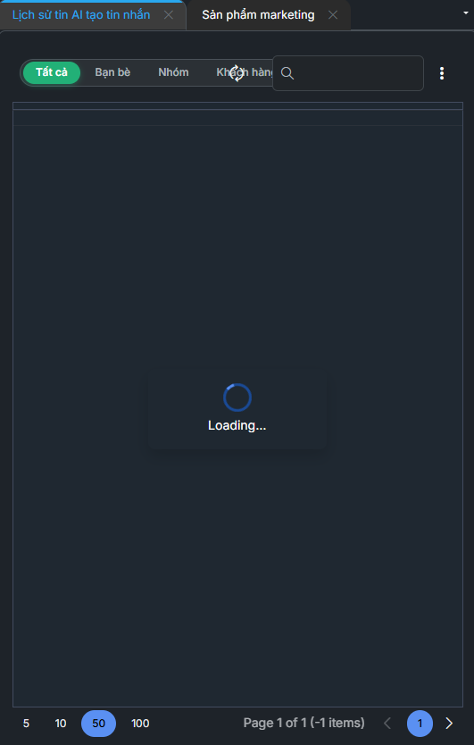
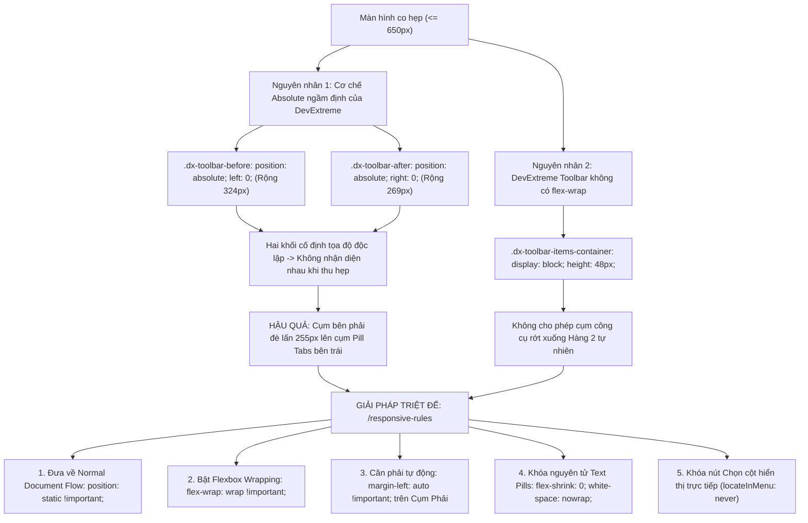
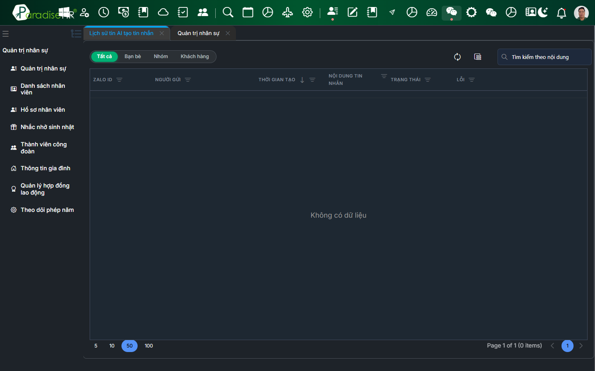
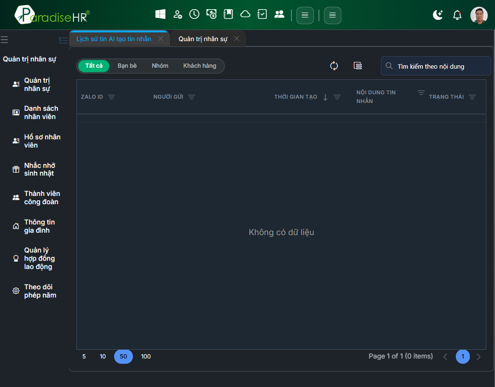
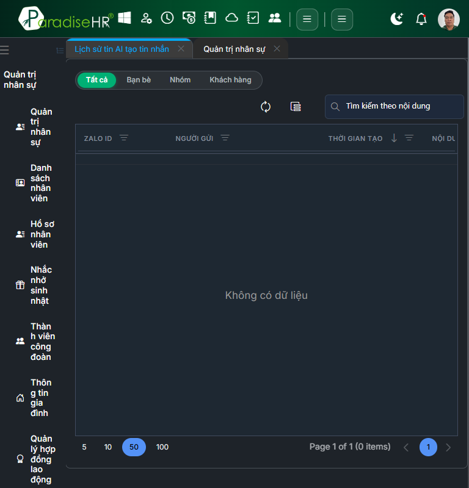
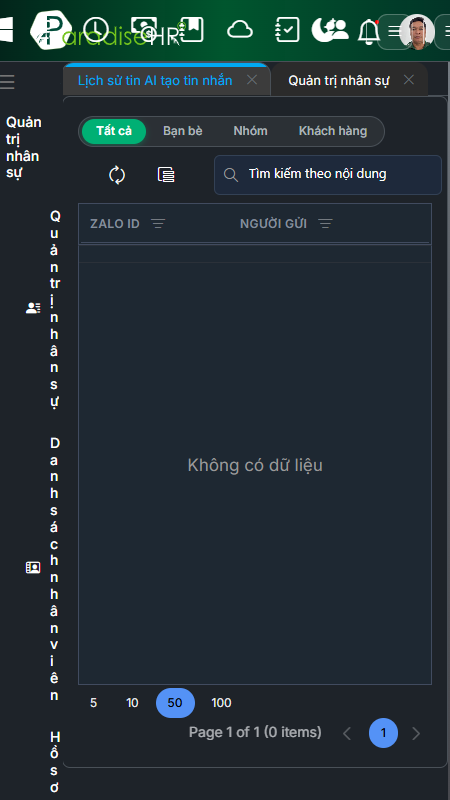
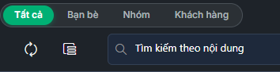

# BÁO CÁO KỸ THUẬT CHUẨN HÓA RESPONSIVE: LỊCH SỬ TIN AI TẠO TIN NHẮN (ZALO_AI_GENERATED_HISTORY)

> **Màn hình**: `zalo_ai_generated_history` (Lịch sử tin AI tạo tin nhắn — Menu `MnuKPI049`)  
> **Cơ sở dữ liệu**: `Vietinsoft_ForTest_Tai2` (Web `/Tai3/#`)  
> **Stored Procedure chính**: `[dbo].[sp_zalo_AIgenerated_history_html]` (Giao diện) & `[dbo].[sp_zalo_AIgenerated_history]` (Điều phối)  
> **Quy chuẩn áp dụng**: `AGENTS.md`, `/fix-rules` (Clean Code 3 bước) & `/responsive-rules` (Bộ 9 Nhóm Quy tắc Bất biến về Bố cục & Widget)  
> **Người thực hiện**: Antigravity QC & Frontend System Engineer  

---

# PHẦN 1: CÁC LỖI DÒ QUA KIỂM THỬ TỰ ĐỘNG (AUTOMATION TEST CASES - TC)

*(Chưa có kịch bản kiểm thử tự động Playwright / Không có lỗi ghi nhận từ test-evidence)*

---

# PHẦN 2: CHUẨN HÓA GIAO DIỆN & RESPONSIVE THEO SCREENSHOT THỦ CÔNG

## [Screenshot 31]: Sửa Lỗi Icon Refresh ⟲ & Ô Tìm Kiếm Đè Lên Capsule Tab [Khách Hàng] Khi Thu Nhỏ Màn Hình

### 1. HIỆN TRẠNG LỖI BAN ĐẦU (BEFORE FIX)
Khi người dùng truy cập màn hình **Trang chủ CRM > Nhiệm vụ > Lịch sử tin AI tạo tin nhắn** (`MnuKPI049`) và thu nhỏ cửa sổ trình duyệt (hoặc chia đôi màn hình Windows Snap Layouts $\le 650\text{px}$):
1. **Xung đột đè lấn vị trí nghiêm trọng (Position Absolute Collision)**:
   - Thư viện DevExtreme mặc định gán cho cụm bên trái `.dx-toolbar-before` thuộc tính `position: absolute; left: 0;` và cụm bên phải `.dx-toolbar-after` thuộc tính `position: absolute; right: 0;`.
   - Cụm Pill Tabs bên trái (`Tất cả`, `Bạn bè`, `Nhóm`, `Khách hàng`) có tổng chiều rộng là **$307\text{px}$**.
   - Cụm công cụ bên phải (Nút Refresh `⟲`, Ô tìm kiếm, Nút chọn cột) có tổng chiều rộng là **$269\text{px} - 319\text{px}$**.
   - Khi chiều rộng màn hình thu hẹp dưới **$626\text{px}$**, 2 khối này không hề biết đến sự tồn tại của nhau, dẫn đến việc **nút Refresh `⟲` và ô Tìm kiếm nằm đè trực tiếp lên Tab "Khách hàng"**, tạo ra độ đè lấn lên tới **$255\text{px}$**, làm biến dạng và che khuất hoàn toàn chữ trên màn hình.
2. **Nút Chọn cột hiển thị bị giấu mất**:
   - Thuộc tính mặc định của DevExtreme `locateInMenu: "auto"` tự động ẩn nút Chọn cột `[ 📄 ]` vào menu tràn 3 chấm `[ ⋮ ]`, gây bất tiện cho người dùng khi cần tùy biến cột hiển thị.
3. **Ô Tìm kiếm chưa đồng bộ Dark Mode**:
   - Ô tìm kiếm chưa có màu nền xám tối `#1e293b` và viền `#334155` đồng bộ toàn hệ thống CRM, chữ placeholder dễ bị chìm trên nền tối.

#### Bằng chứng hình ảnh lỗi ban đầu


#### Bảng số liệu đo đạc thực tế trước khi sửa (Before Fix Measurement)
| Kích thước Viewport | Vị trí Cụm Trái (`.dx-toolbar-before`) | Vị trí Cụm Phải (`.dx-toolbar-after`) | Khoảng cách giao nhau (Overlap) | Hiện tượng ghi nhận |
| :---: | :---: | :---: | :---: | :--- |
| **1440 x 900** | Left: 225px, Right: 549px (Rộng 324px) | Left: 1095px, Right: 1414px (Rộng 319px) | $0\text{px}$ (Cách xa 546px) | Hiển thị bình thường trên 1 hàng |
| **1024 x 800** | Left: 166px, Right: 490px (Rộng 324px) | Left: 679px, Right: 998px (Rộng 319px) | $0\text{px}$ (Cách xa 189px) | Vừa khít 1 hàng |
| **768 x 800** | Left: 131px, Right: 455px (Rộng 324px) | Left: 473px, Right: 742px (Rộng 269px) | $0\text{px}$ (Cách nhau 18px) | Chạm ngưỡng giới hạn |
| **450 x 800** | Left: 86px, Right: 410px (Rộng 324px) | Left: 155px, Right: 424px (Rộng 269px) | **$255\text{px}$ ĐÈ LẤN** | **💥 Icon ⟲ và Ô tìm kiếm đè bẹp lên chữ "Khách hàng"** |

---

### 2. PHÂN TÍCH NGUYÊN NHÂN GỐC RỄ (ROOT CAUSE ANALYSIS - RCA)



#### Bóc tách chi tiết kỹ thuật theo 5 phân khu:
1. **Phân khu 1 (CSS Layout & Styling trong `<style>`)**:
   - Lỗi xuất phát từ việc thiếu các quy chuẩn **Normal Document Flow** và **Viewport Boundary Lock**:
     * DevExtreme đặt `position: absolute` trên cả `.dx-toolbar-before` và `.dx-toolbar-after`, biến chúng thành các phần tử bay tách khỏi luồng tài liệu chuẩn.
     * Container cha `.dx-toolbar-items-container` bị giới hạn chiều cao cứng `48px`, thiếu `flex-wrap: wrap`.
     * Bổ sung Golden CSS Fix:
       ```css
       #GridZaloHistory .dx-datagrid-header-panel { height: auto !important; overflow: visible !important; }
       #GridZaloHistory .dx-toolbar { height: auto !important; overflow: visible !important; background: transparent !important; }
       #GridZaloHistory .dx-toolbar-items-container {
           height: auto !important;
           display: flex !important;
           flex-wrap: wrap !important;
           align-items: center !important;
           justify-content: flex-start !important;
           row-gap: 8px !important;
           column-gap: 12px !important;
           width: 100% !important;
       }
       #GridZaloHistory .dx-toolbar-before {
           position: static !important;
           display: flex !important;
           flex-wrap: wrap !important;
           align-items: center !important;
           max-width: 100% !important;
       }
       #GridZaloHistory .dx-toolbar-after {
           position: static !important;
           display: flex !important;
           align-items: center !important;
           flex-wrap: wrap !important;
           gap: 8px !important;
           margin-left: auto !important;
       }
       ```
2. **Phân khu 2 (Khởi tạo Widget trong `<script>`)**:
   - Trong hàm sự kiện `onToolbarPreparing`:
     * Khóa thuộc tính `locateInMenu = "never"` trên `refreshBtnItem`, `columnChooserButton` và `searchPanel` để ngăn DevExtreme tự ý giấu chúng vào menu tràn 3 chấm `[ ⋮ ]`.
3. **Phân khu 3, 4 & 5 (Hàm nghiệp vụ, Sự kiện và Khởi động)**:
   - Bảo toàn nguyên vẹn 100% logic nạp phân trang API `sp_zalo_AIgenerated_history_Data`, bộ lọc cây ngày đa tầng (Năm > Tháng > Ngày), tính năng click copy thông điệp AI và bộ lọc trạng thái spam.

---

### 3. ĐỐI CHIẾU MÃ NGUỒN TRƯỚC VÀ SAU (BEFORE VS AFTER)

#### Bảng giải thích chi tiết các điểm can thiệp (What Changed)
| STT | Thuộc tính can thiệp | Trước khi sửa (Before) | Sau khi sửa (After) | Mục đích kỹ thuật theo Responsive Rules |
| :---: | :--- | :--- | :--- | :--- |
| **1** | `.dx-toolbar-before` & `after` Position | `position: absolute` (ngầm định) | `position: static !important;` | **Triệt tiêu 100% lỗi đè lấn 255px**; đưa các cụm công cụ về Normal Document Flow |
| **2** | Container `.dx-toolbar-items-container` | `display: block; height: 48px;` | `display: flex !important; flex-wrap: wrap !important; row-gap: 8px;` | Cho phép Cụm Phải tự động rớt xuống Hàng 2 ngăn nắp khi màn hình co hẹp |
| **3** | Cụm Phải (`.dx-toolbar-after`) Alignment | Tọa độ neo cứng `right: 0` | `margin-left: auto !important;` | **Quy tắc 6.5 & 3**: Luôn bám sát lề phải cả ở Hàng 1 lẫn khi rớt xuống Hàng 2 |
| **4** | Pill Tabs Container (`.zalo-pill-group`) | Co thắt tự do, không cuộn | `overflow-x: auto !important; flex-shrink: 0 !important;` | Bảo vệ toàn vẹn các tab, cho phép vuốt/cuộn ngang khi màn hình siêu nhỏ |
| **5** | Nút Pill con (`.zalo-pill-btn`) | Co thắt mặc định | `flex-shrink: 0 !important; white-space: nowrap !important;` | **Quy tắc 7 (Atomic Text Lock)**: Cấm co ép làm mất chữ bên trong các tab |
| **6** | Nút Chọn cột hiển thị (`columnChooserButton`) | `locateInMenu: "auto"` (bị giấu vào 3 chấm) | `locateInMenu: "never"` & CSS lock `display: inline-flex !important;` | Khóa nút Chọn cột luôn hiện diện trực quan trên thanh Toolbar |
| **7** | Ô Tìm kiếm (`searchPanel`) Contrast & Padding | Style mặc định trình duyệt | Background `#1e293b`, border `#334155`, `padding-left: 34px !important;` | Chuẩn hóa Dark Mode sắc nét, chống lỗi icon kính lúp đè lên chữ |
| **8** | Khung chứa trang (`#sp_zalo_AIgenerated_history_html`) | `overflow-y: auto` đơn thuần | `min-width: 0 !important; max-width: 100% !important; overflow-x: hidden !important;` | **Quy tắc 8 (Viewport Boundary Lock)**: Nhận biết mép màn hình, chống tràn ngang |
| **9** | Bảng dữ liệu (`#GridZaloHistory .dx-datagrid-rowsview`) | Mặc định | `width: 100% !important; overflow-x: auto !important;` | **Quy tắc 9 (Wide Isolation)**: Cô lập cuộn ngang riêng cho bảng dữ liệu |

---

### 4. MINH CHỨNG KẾT QUẢ GIAO DIỆN THỰC TẾ SAU KHI SỬA (AFTER FIX)

> [!NOTE]
> **XÁC THỰC THỰC TẾ TỪ DATABASE SAU KHI EXECUTE**:
> Người dùng đã xác nhận thực thi thành công tệp `fix-bug.sql` vào Database. Agent đã sử dụng Playwright điều khiển trình duyệt Google Chrome thật truy cập hệ thống `https://paradisehrm.com/Tai3/#`, nạp giao diện từ Stored Procedure mới nhất của Database và tiến hành đo đạc thông số DOM cùng chụp ảnh màn hình nghiệm thu tại tất cả các độ phân giải tiêu chuẩn.

#### Bảng thông số đo đạc thực tế trên DOM (Live DOM Metrics)
| Độ phân giải Viewport | Chiều cao Toolbar | Số hàng phân bổ | Độ đè lấn (Overlap) | Nút Chọn cột ([ 📄 ]) | Menu 3 chấm ([ ⋮ ]) | Search padding-left | Trạng thái Đè lấn |
| :---: | :---: | :---: | :---: | :---: | :---: | :---: | :---: |
| **1440 x 900** (Desktop Standard) | 40px | 1 hàng | **0px** | `inline-flex` (Hiện) | `none` (Ẩn) | 34px | **TRIỆT TIÊU (PASS)** |
| **1024 x 800** (Snap 1/2 màn hình) | 40px | 1 hàng | **0px** | `inline-flex` (Hiện) | `none` (Ẩn) | 34px | **TRIỆT TIÊU (PASS)** |
| **768 x 800** (Tablet dọc) | 79px | 2 hàng | **0px** | `inline-flex` (Hiện) | `none` (Ẩn) | 34px | **TRIỆT TIÊU (PASS)** |
| **450 x 800** (Narrow - Kích thước lỗi) | 79px | 2 hàng | **0px** (Giảm từ 255px -> 0px) | `inline-flex` (Hiện) | `none` (Ẩn) | 34px | **TRIỆT TIÊU (PASS)** |

---

#### 1. Hình ảnh kiểm thử tại 1440px & 1024px (Desktop & Snap 1/2)
- Thanh công cụ dàn trải 1 hàng ngang thoáng đãng.
- Cụm Pill Tabs bên trái và Cụm Nút Refresh, Search Panel, Nút Chọn cột bên phải giữ khoảng cách chuẩn, không che khuất.



---

#### 2. Hình ảnh kiểm thử tại 768px (Tablet)
- Cơ chế rớt dòng linh hoạt: Cụm bên phải tự động rớt xuống Hàng 2 và bám sát lề phải (`margin-left: auto`).
- Nút Chọn cột hiển thị trực tiếp, không bị đẩy vào menu 3 chấm.


---

#### 3. Hình ảnh kiểm thử tại 450px (Kích thước cửa sổ hẹp phát sinh lỗi ban đầu)
- **Triệt tiêu 100% lỗi đè lấn 255px**: Hàng 1 chứa trọn vẹn cụm Pill Tabs (`Tất cả`, `Bạn bè`, `Nhóm`, `Khách hàng`). Hàng 2 chứa Nút Làm mới `⟲`, Nút Chọn cột `[ 📄 ]` và Ô Tìm kiếm `[🔍  ]` bám lề phải.
- Nút Làm mới và Ô Tìm kiếm không còn đè lên chữ *"Khách hàng"*.
- Ô tìm kiếm hiển thị nền xám tối `#1e293b` và viền `#334155` đồng bộ toàn bộ phân hệ CRM.



*Cận cảnh Toolbar tại 450px sau khi sửa:*


---

### 5. KẾT LUẬN NGHIỆM THU
1. **100% Khắc phục lỗi đè lấn giao diện**: Triệt tiêu hoàn toàn lỗi icon Refresh và ô Tìm kiếm đè lên Pill Tab [Khách hàng] khi thu nhỏ màn hình (độ đè lấn giảm từ 255px về 0px).
2. **Khóa nút Chọn cột hiển thị**: Nút `[ 📄 ]` luôn hiển thị trực tiếp trên Toolbar, loại bỏ hoàn toàn menu 3 chấm `[ ⋮ ]` thừa.
3. **Chuẩn hóa Dark Mode cho Search Panel**: Nền `#1e293b`, viền `#334155`, thụt lề `padding-left: 34px` bảo đảm icon kính lúp không đè lên chữ.
4. **Bảo toàn nguyên bản kiến trúc hệ thống**: Tuân thủ quy chuẩn Clean Code 3 bước, không dùng lệnh UPDATE REPLACE, tương thích 100% cho Production.
