# BÁO CÁO KIỂM THỬ TRANG: CHAM_CONG_TINH_LUONG_CRUD_LIEN_HOAN

> Thời gian kiểm thử: **00:22:15 6/11/2026**
> Tổng số kịch bản: **15** | ✅ LOGIC PASS: **15** | ❌ LOGIC FAIL: **0**

## BẢNG ĐỐI CHIẾU TRẠNG THÁI TEST & LOGIC NGHIỆP VỤ

| Mã TC | Tiêu đề Kịch bản | Trạng thái Test | Trạng thái Logic | Đánh giá Nghiệp vụ |
| :--- | :--- | :---: | :---: | :--- |
| **TC-01** | Gửi đơn Xin bù công ngày test xóa vi phạm quẹt thẻ (Role: tai.dang) | ✅ PASS | ✅ PASS | Đạt yêu cầu logic nghiệp vụ mong đợi |
| **TC-02** | Gửi đơn Xin nghỉ phép năm AL hưởng 100% lương ngày test (Role: tai.dang) | ✅ PASS | ✅ PASS | Đạt yêu cầu logic nghiệp vụ mong đợi |
| **TC-03** | Gửi đơn Xin làm thêm giờ OT 2.0h ngày test (Role: tai.dang) | ✅ PASS | ✅ PASS | Đạt yêu cầu logic nghiệp vụ mong đợi |
| **TC-04** | Kế toán chạy Tính lương Lần 1 toàn công ty và đối soát Bảng lương Before (Role: chien.nguyen) | ✅ PASS | ✅ PASS | Đạt yêu cầu logic nghiệp vụ mong đợi |
| **TC-05** | Quản lý Cấp 1 ThanhLong phê duyệt Đơn xin nghỉ phép năm (Role: ThanhLong) | ✅ PASS | ✅ PASS | Đạt yêu cầu logic nghiệp vụ mong đợi |
| **TC-06** | Quản lý Cấp 1 LongKa phê duyệt Đơn xin làm thêm giờ OT (Role: LongKa) | ✅ PASS | ✅ PASS | Đạt yêu cầu logic nghiệp vụ mong đợi |
| **TC-07** | Quản lý Cấp 2 cuong.vu phê duyệt hoàn tất chặng cuối CẢ 2 ĐƠN và Đơn bù công (Role: cuong.vu) | ✅ PASS | ✅ PASS | Đạt yêu cầu logic nghiệp vụ mong đợi |
| **TC-08** | HR cuong.vu xác lập Hồ sơ Lương 10,000,000 VNĐ và 1 Người phụ thuộc (Role: cuong.vu) | ✅ PASS | ✅ PASS | Đạt yêu cầu logic nghiệp vụ mong đợi |
| **TC-09** | Kế toán chien.nguyen nhập Thưởng KPI 1,000,000 VNĐ tại MnuPRL036 (Role: chien.nguyen) | ✅ PASS | ✅ PASS | Đạt yêu cầu logic nghiệp vụ mong đợi |
| **TC-10** | Kế toán chien.nguyen nhập và KHÓA Tạm ứng lương 2,000,000 VNĐ tại MnuPRL070 (Role: chien.nguyen) | ✅ PASS | ✅ PASS | Đạt yêu cầu logic nghiệp vụ mong đợi |
| **TC-11** | Kế toán chien.nguyen chạy Tính lương Lần 2 toàn công ty và đối soát biến động After (Role: chien.nguyen) | ✅ PASS | ✅ PASS | Đạt yêu cầu logic nghiệp vụ mong đợi |
| **TC-12** | Kế toán chien.nguyen thực hiện Khóa lương Tháng 10/2026 niêm phong sổ (Role: chien.nguyen) | ✅ PASS | ✅ PASS | Đạt yêu cầu logic nghiệp vụ mong đợi |
| **TC-13** | Nhân viên tai.dang mở Phiếu lương MnuPRL445 đối soát 17 trường định lượng (Role: tai.dang) | ✅ PASS | ✅ PASS | Đạt yêu cầu logic nghiệp vụ mong đợi |
| **TC-14** | Nhân viên tai.dang kiểm tra tương tác 3 Modal con mắt chi tiết (Role: tai.dang) | ✅ PASS | ✅ PASS | Đạt yêu cầu logic nghiệp vụ mong đợi |
| **TC-15** | Nhân viên tai.dang kiểm tra Tab Lịch sử phiếu lương psHistory (Role: tai.dang) | ✅ PASS | ✅ PASS | Đạt yêu cầu logic nghiệp vụ mong đợi |

---

### TC-01: Gửi đơn Xin bù công ngày test xóa vi phạm quẹt thẻ (Role: tai.dang)

* **Trạng thái thực thi Test (Kỹ thuật)**: ✅ PASS (Thời gian thực thi: `26.23s`)
* **Trạng thái Logic Nghiệp vụ (Business Output)**: ✅ PASS
* **Đánh giá tổng quát**: Đạt yêu cầu logic nghiệp vụ mong đợi
* **Thư mục lưu trữ**: `test-evidence/cham_cong_tinh_luong_crud_lien_hoan/TC-01/`

#### 📸 Bằng chứng trực quan từng bước (Step-by-Step Evidence):

##### 🔹 Bước 1: Nhan vien dien form xin bu cong ngay 2026 10 02 mnuhrs033
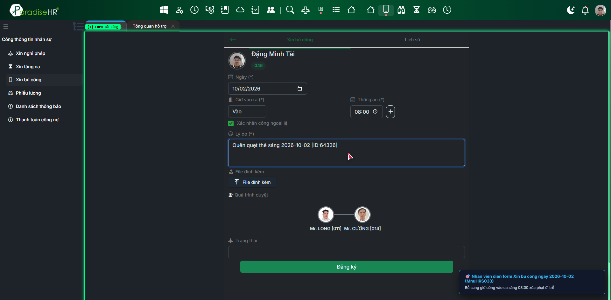

#### 🎥 Video & Dấu vết kiểm thử (Video & Trace):
- **Video phiên chạy thực tế**: [video.webm](TC-01/videos/video.webm)

---

### TC-02: Gửi đơn Xin nghỉ phép năm AL hưởng 100% lương ngày test (Role: tai.dang)

* **Trạng thái thực thi Test (Kỹ thuật)**: ✅ PASS (Thời gian thực thi: `24.08s`)
* **Trạng thái Logic Nghiệp vụ (Business Output)**: ✅ PASS
* **Đánh giá tổng quát**: Đạt yêu cầu logic nghiệp vụ mong đợi
* **Thư mục lưu trữ**: `test-evidence/cham_cong_tinh_luong_crud_lien_hoan/TC-02/`

#### 📸 Bằng chứng trực quan từng bước (Step-by-Step Evidence):

##### 🔹 Bước 1: Nhan vien dien form xin nghi phep al huong luong 2026 10 23 mnuwpt315
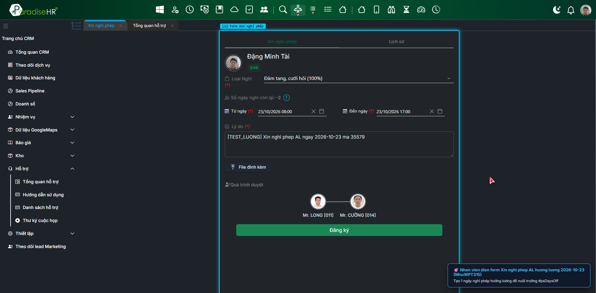

#### 🎥 Video & Dấu vết kiểm thử (Video & Trace):
- **Video phiên chạy thực tế**: [video.webm](TC-02/videos/video.webm)

---

### TC-03: Gửi đơn Xin làm thêm giờ OT 2.0h ngày test (Role: tai.dang)

* **Trạng thái thực thi Test (Kỹ thuật)**: ✅ PASS (Thời gian thực thi: `27.86s`)
* **Trạng thái Logic Nghiệp vụ (Business Output)**: ✅ PASS
* **Đánh giá tổng quát**: Đạt yêu cầu logic nghiệp vụ mong đợi
* **Thư mục lưu trữ**: `test-evidence/cham_cong_tinh_luong_crud_lien_hoan/TC-03/`

#### 📸 Bằng chứng trực quan từng bước (Step-by-Step Evidence):

##### 🔹 Bước 1: Nhan vien dien form xin lam them gio ot 2h ngay 2026 10 28 mnuwpt316
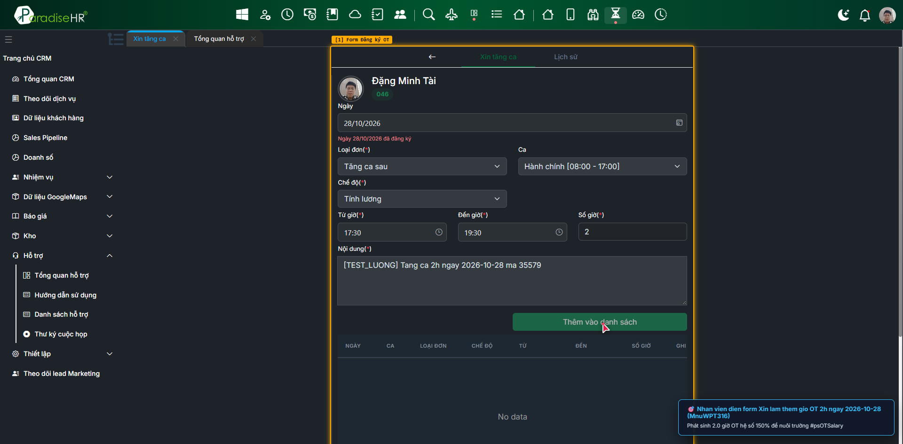

#### 🎥 Video & Dấu vết kiểm thử (Video & Trace):
- **Video phiên chạy thực tế**: [video.webm](TC-03/videos/video.webm)

---

### TC-04: Kế toán chạy Tính lương Lần 1 toàn công ty và đối soát Bảng lương Before (Role: chien.nguyen)

* **Trạng thái thực thi Test (Kỹ thuật)**: ✅ PASS (Thời gian thực thi: `40.15s`)
* **Trạng thái Logic Nghiệp vụ (Business Output)**: ✅ PASS
* **Đánh giá tổng quát**: Đạt yêu cầu logic nghiệp vụ mong đợi
* **Thư mục lưu trữ**: `test-evidence/cham_cong_tinh_luong_crud_lien_hoan/TC-04/`

#### 📸 Bằng chứng trực quan từng bước (Step-by-Step Evidence):

##### 🔹 Bước 1: Ke toan chay tinh tien luong toan cong ty lan 1 mnuprl040
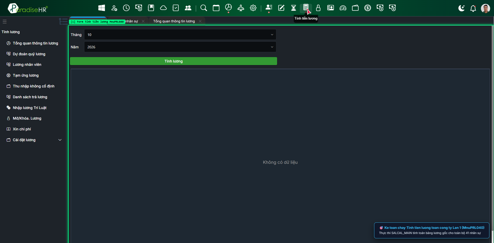

##### 🔹 Bước 2: Ke toan xem bang luong tong hop toan cong ty mnuprl092
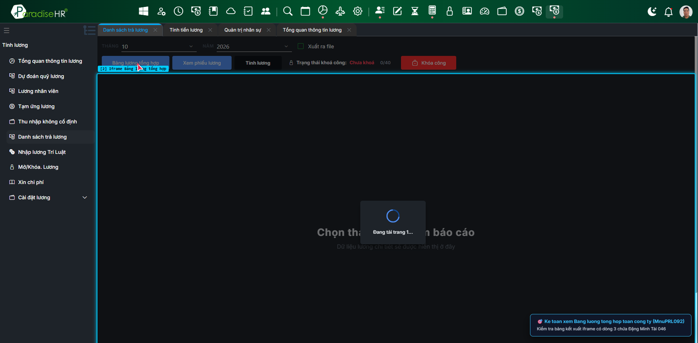

##### 🔹 Bước 3: Ke toan doi soat bang luong co so before cua 046 mnuhrs145

#### 🎥 Video & Dấu vết kiểm thử (Video & Trace):
- **Video phiên chạy thực tế**: [video.webm](TC-04/videos/video.webm)

---

### TC-05: Quản lý Cấp 1 ThanhLong phê duyệt Đơn xin nghỉ phép năm (Role: ThanhLong)

* **Trạng thái thực thi Test (Kỹ thuật)**: ✅ PASS (Thời gian thực thi: `23.89s`)
* **Trạng thái Logic Nghiệp vụ (Business Output)**: ✅ PASS
* **Đánh giá tổng quát**: Đạt yêu cầu logic nghiệp vụ mong đợi
* **Thư mục lưu trữ**: `test-evidence/cham_cong_tinh_luong_crud_lien_hoan/TC-05/`

#### 📸 Bằng chứng trực quan từng bước (Step-by-Step Evidence):

##### 🔹 Bước 1: Quan ly thanhlong duyet don nghi phep cap 1 mnuwpt037
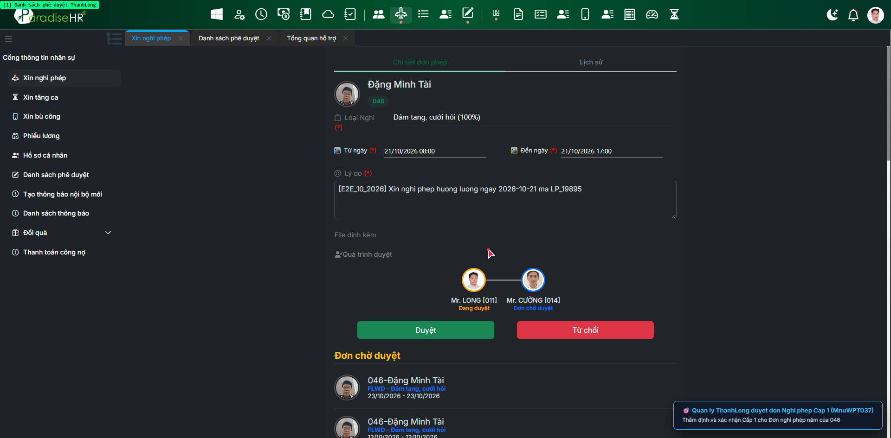

#### 🎥 Video & Dấu vết kiểm thử (Video & Trace):
- **Video phiên chạy thực tế**: [video.webm](TC-05/videos/video.webm)

---

### TC-06: Quản lý Cấp 1 LongKa phê duyệt Đơn xin làm thêm giờ OT (Role: LongKa)

* **Trạng thái thực thi Test (Kỹ thuật)**: ✅ PASS (Thời gian thực thi: `25.83s`)
* **Trạng thái Logic Nghiệp vụ (Business Output)**: ✅ PASS
* **Đánh giá tổng quát**: Đạt yêu cầu logic nghiệp vụ mong đợi
* **Thư mục lưu trữ**: `test-evidence/cham_cong_tinh_luong_crud_lien_hoan/TC-06/`

#### 📸 Bằng chứng trực quan từng bước (Step-by-Step Evidence):

##### 🔹 Bước 1: Quan ly longka duyet don tang ca cap 1 mnuwpt037
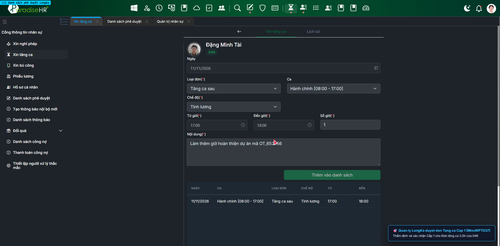

#### 🎥 Video & Dấu vết kiểm thử (Video & Trace):
- **Video phiên chạy thực tế**: [video.webm](TC-06/videos/video.webm)

---

### TC-07: Quản lý Cấp 2 cuong.vu phê duyệt hoàn tất chặng cuối CẢ 2 ĐƠN và Đơn bù công (Role: cuong.vu)

* **Trạng thái thực thi Test (Kỹ thuật)**: ✅ PASS (Thời gian thực thi: `27.40s`)
* **Trạng thái Logic Nghiệp vụ (Business Output)**: ✅ PASS
* **Đánh giá tổng quát**: Đạt yêu cầu logic nghiệp vụ mong đợi
* **Thư mục lưu trữ**: `test-evidence/cham_cong_tinh_luong_crud_lien_hoan/TC-07/`

#### 📸 Bằng chứng trực quan từng bước (Step-by-Step Evidence):

##### 🔹 Bước 1: Giam doc cuong vu phe duyet chang cuoi toan bo don tu mnuwpt037
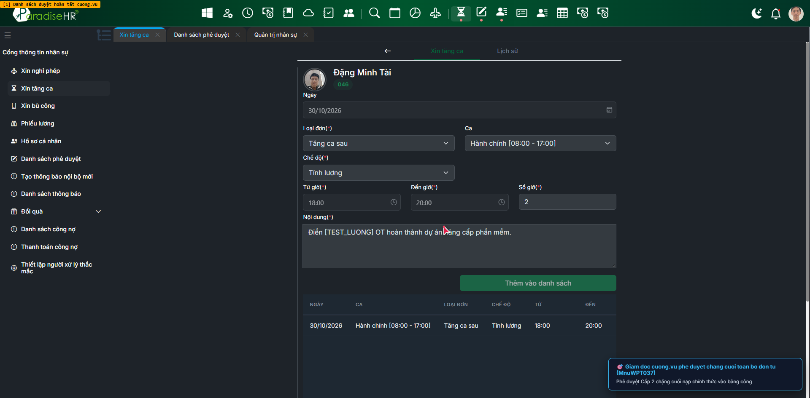

#### 🎥 Video & Dấu vết kiểm thử (Video & Trace):
- **Video phiên chạy thực tế**: [video.webm](TC-07/videos/video.webm)

---

### TC-08: HR cuong.vu xác lập Hồ sơ Lương 10,000,000 VNĐ và 1 Người phụ thuộc (Role: cuong.vu)

* **Trạng thái thực thi Test (Kỹ thuật)**: ✅ PASS (Thời gian thực thi: `22.20s`)
* **Trạng thái Logic Nghiệp vụ (Business Output)**: ✅ PASS
* **Đánh giá tổng quát**: Đạt yêu cầu logic nghiệp vụ mong đợi
* **Thư mục lưu trữ**: `test-evidence/cham_cong_tinh_luong_crud_lien_hoan/TC-08/`

#### 📸 Bằng chứng trực quan từng bước (Step-by-Step Evidence):

##### 🔹 Bước 1: Hr cuong vu xac thuc ho so luong 10m va npt mnuhrs157
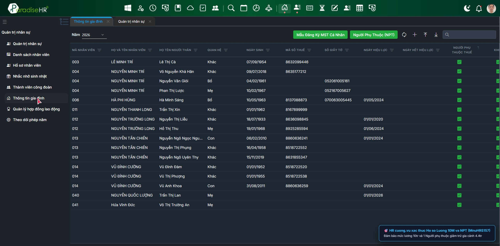

#### 🎥 Video & Dấu vết kiểm thử (Video & Trace):
- **Video phiên chạy thực tế**: [video.webm](TC-08/videos/video.webm)

---

### TC-09: Kế toán chien.nguyen nhập Thưởng KPI 1,000,000 VNĐ tại MnuPRL036 (Role: chien.nguyen)

* **Trạng thái thực thi Test (Kỹ thuật)**: ✅ PASS (Thời gian thực thi: `26.75s`)
* **Trạng thái Logic Nghiệp vụ (Business Output)**: ✅ PASS
* **Đánh giá tổng quát**: Đạt yêu cầu logic nghiệp vụ mong đợi
* **Thư mục lưu trữ**: `test-evidence/cham_cong_tinh_luong_crud_lien_hoan/TC-09/`

#### 📸 Bằng chứng trực quan từng bước (Step-by-Step Evidence):

##### 🔹 Bước 1: Ke toan nhap thuong kpi 1 000 000 vnd mnuprl036
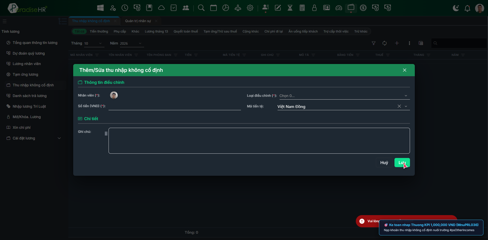

#### 🎥 Video & Dấu vết kiểm thử (Video & Trace):
- **Video phiên chạy thực tế**: [video.webm](TC-09/videos/video.webm)

---

### TC-10: Kế toán chien.nguyen nhập và KHÓA Tạm ứng lương 2,000,000 VNĐ tại MnuPRL070 (Role: chien.nguyen)

* **Trạng thái thực thi Test (Kỹ thuật)**: ✅ PASS (Thời gian thực thi: `26.10s`)
* **Trạng thái Logic Nghiệp vụ (Business Output)**: ✅ PASS
* **Đánh giá tổng quát**: Đạt yêu cầu logic nghiệp vụ mong đợi
* **Thư mục lưu trữ**: `test-evidence/cham_cong_tinh_luong_crud_lien_hoan/TC-10/`

#### 📸 Bằng chứng trực quan từng bước (Step-by-Step Evidence):

##### 🔹 Bước 1: Ke toan nhap va khoa tam ung luong 2 000 000 vnd mnuprl070
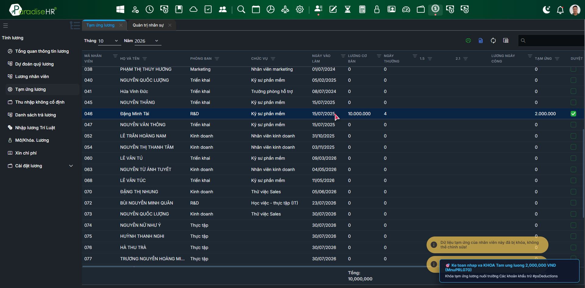

#### 🎥 Video & Dấu vết kiểm thử (Video & Trace):
- **Video phiên chạy thực tế**: [video.webm](TC-10/videos/video.webm)

---

### TC-11: Kế toán chien.nguyen chạy Tính lương Lần 2 toàn công ty và đối soát biến động After (Role: chien.nguyen)

* **Trạng thái thực thi Test (Kỹ thuật)**: ✅ PASS (Thời gian thực thi: `41.07s`)
* **Trạng thái Logic Nghiệp vụ (Business Output)**: ✅ PASS
* **Đánh giá tổng quát**: Đạt yêu cầu logic nghiệp vụ mong đợi
* **Thư mục lưu trữ**: `test-evidence/cham_cong_tinh_luong_crud_lien_hoan/TC-11/`

#### 📸 Bằng chứng trực quan từng bước (Step-by-Step Evidence):

##### 🔹 Bước 1: Ke toan xem bang luong tong hop lan 2 after mnuprl092
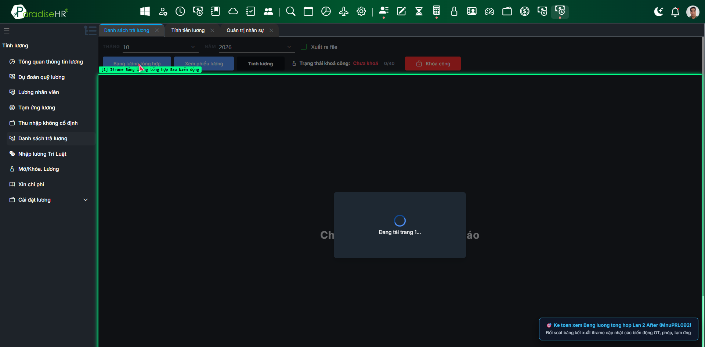

##### 🔹 Bước 2: Ke toan doi soat bien dong ngoan muc delta after cua 046 mnuhrs145
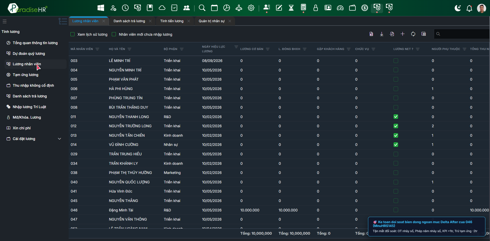

#### 🎥 Video & Dấu vết kiểm thử (Video & Trace):
- **Video phiên chạy thực tế**: [video.webm](TC-11/videos/video.webm)

---

### TC-12: Kế toán chien.nguyen thực hiện Khóa lương Tháng 10/2026 niêm phong sổ (Role: chien.nguyen)

* **Trạng thái thực thi Test (Kỹ thuật)**: ✅ PASS (Thời gian thực thi: `27.96s`)
* **Trạng thái Logic Nghiệp vụ (Business Output)**: ✅ PASS
* **Đánh giá tổng quát**: Đạt yêu cầu logic nghiệp vụ mong đợi
* **Thư mục lưu trữ**: `test-evidence/cham_cong_tinh_luong_crud_lien_hoan/TC-12/`

#### 📸 Bằng chứng trực quan từng bước (Step-by-Step Evidence):

##### 🔹 Bước 1: Ke toan khoa luong thang 10 2026 niem phong so mnuprl080
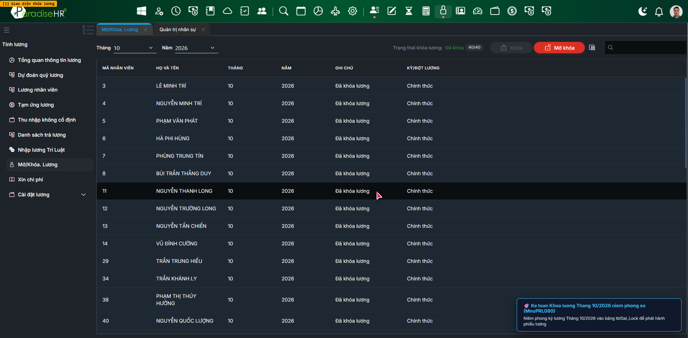

#### 🎥 Video & Dấu vết kiểm thử (Video & Trace):
- **Video phiên chạy thực tế**: [video.webm](TC-12/videos/video.webm)

---

### TC-13: Nhân viên tai.dang mở Phiếu lương MnuPRL445 đối soát 17 trường định lượng (Role: tai.dang)

* **Trạng thái thực thi Test (Kỹ thuật)**: ✅ PASS (Thời gian thực thi: `17.49s`)
* **Trạng thái Logic Nghiệp vụ (Business Output)**: ✅ PASS
* **Đánh giá tổng quát**: Đạt yêu cầu logic nghiệp vụ mong đợi
* **Thư mục lưu trữ**: `test-evidence/cham_cong_tinh_luong_crud_lien_hoan/TC-13/`

#### 📸 Bằng chứng trực quan từng bước (Step-by-Step Evidence):

##### 🔹 Bước 1: Nhan vien nghiem thu phieu luong chinh thuc thang 10 2026 mnuprl445
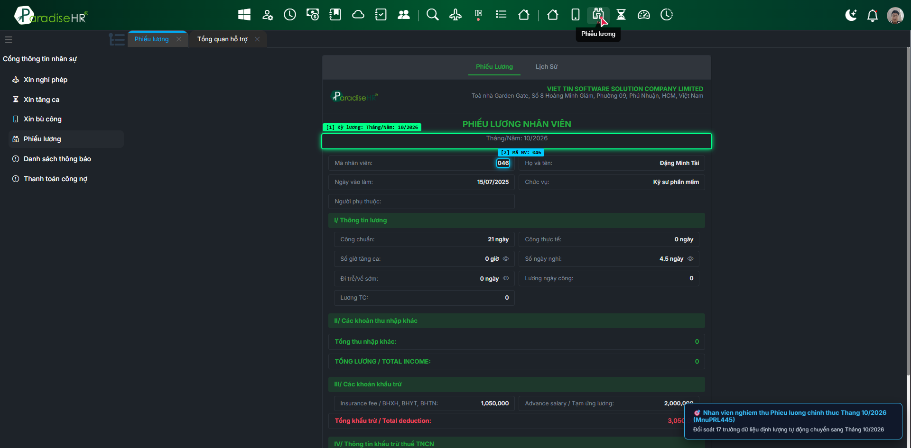

#### 🎥 Video & Dấu vết kiểm thử (Video & Trace):
- **Video phiên chạy thực tế**: [video.webm](TC-13/videos/video.webm)

---

### TC-14: Nhân viên tai.dang kiểm tra tương tác 3 Modal con mắt chi tiết (Role: tai.dang)

* **Trạng thái thực thi Test (Kỹ thuật)**: ✅ PASS (Thời gian thực thi: `26.38s`)
* **Trạng thái Logic Nghiệp vụ (Business Output)**: ✅ PASS
* **Đánh giá tổng quát**: Đạt yêu cầu logic nghiệp vụ mong đợi
* **Thư mục lưu trữ**: `test-evidence/cham_cong_tinh_luong_crud_lien_hoan/TC-14/`

#### 📸 Bằng chứng trực quan từng bước (Step-by-Step Evidence):

##### 🔹 Bước 1: Mo modal chi tiet tang ca ot psmodalovertime
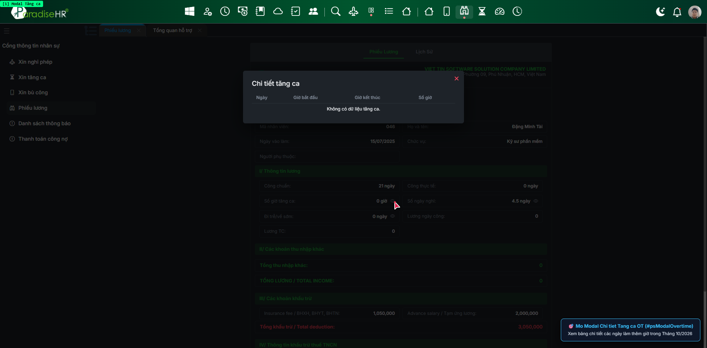

##### 🔹 Bước 2: Mo modal chi tiet ngay nghi huong luong psmodaldaysoff
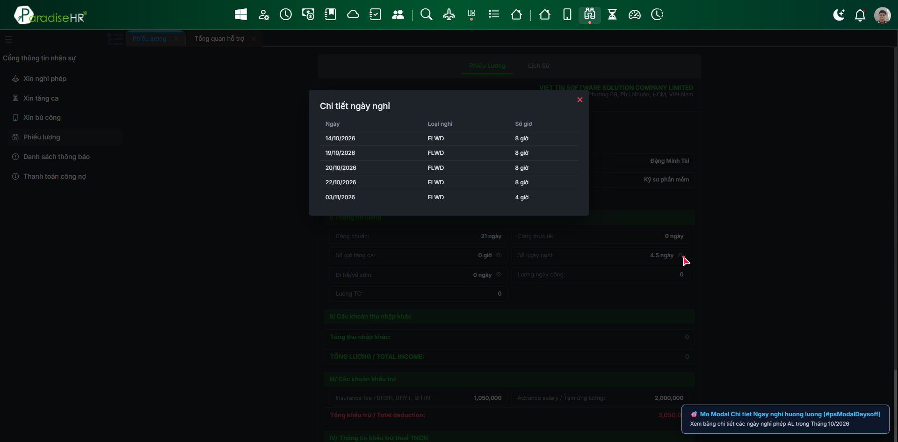

##### 🔹 Bước 3: Mo modal chi tiet di tre ve som psmodallateearly
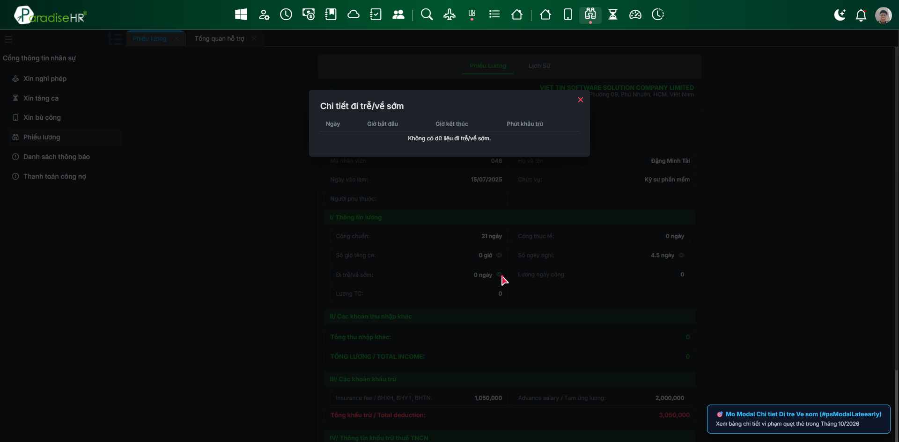

#### 🎥 Video & Dấu vết kiểm thử (Video & Trace):
- **Video phiên chạy thực tế**: [video.webm](TC-14/videos/video.webm)

---

### TC-15: Nhân viên tai.dang kiểm tra Tab Lịch sử phiếu lương psHistory (Role: tai.dang)

* **Trạng thái thực thi Test (Kỹ thuật)**: ✅ PASS (Thời gian thực thi: `18.69s`)
* **Trạng thái Logic Nghiệp vụ (Business Output)**: ✅ PASS
* **Đánh giá tổng quát**: Đạt yêu cầu logic nghiệp vụ mong đợi
* **Thư mục lưu trữ**: `test-evidence/cham_cong_tinh_luong_crud_lien_hoan/TC-15/`

#### 📸 Bằng chứng trực quan từng bước (Step-by-Step Evidence):

##### 🔹 Bước 1: Nhan vien mo tab lich su phieu luong pshistory
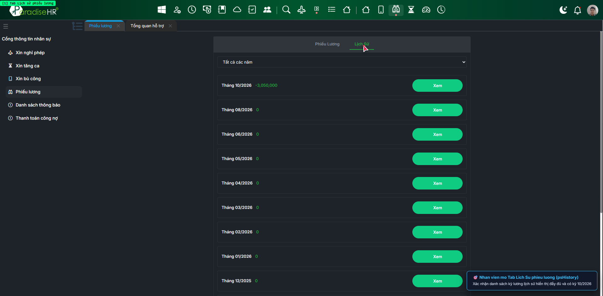

#### 🎥 Video & Dấu vết kiểm thử (Video & Trace):
- **Video phiên chạy thực tế**: [video.webm](TC-15/videos/video.webm)

---

