# BÁO CÁO KIỂM THỬ TRANG: CHAM_CONG_TINH_LUONG_FLOW

> Thời gian kiểm thử: **11:40:04 4/11/2026**
> Tổng số kịch bản: **6** | ✅ LOGIC PASS: **6** | ❌ LOGIC FAIL: **0**

## BẢNG ĐỐI CHIẾU TRẠNG THÁI TEST & LOGIC NGHIỆP VỤ

| Mã TC | Tiêu đề Kịch bản | Trạng thái Test | Trạng thái Logic | Đánh giá Nghiệp vụ |
| :--- | :--- | :---: | :---: | :--- |
| **TC-01** | Kiểm tra kiểm soát ràng buộc và tạo đơn Xin bù công (Role: tai.dang) | ✅ PASS | ✅ PASS | PASS - Tạo và gửi đơn xin bù công thành công, xác thực CSDL đã lưu bản ghi IdentityID: 01A1A4D8-72BB-71AB-B470-6D7CB3438475 (Token: 000781) |
| **TC-02** | Nhân viên đối soát tab Lịch sử đơn bù công (Role: tai.dang) | ✅ PASS | ✅ PASS | PASS - Đơn bù công hiển thị chuẩn xác trong Tab Lịch sử với trạng thái "Đang chờ duyệt" (Khớp CSDL Approve_Status: 1) |
| **TC-03** | Quản lý cấp duyệt thẩm định và duyệt đơn bù công 2 cấp (Role: ThanhLong & cuong.vu) | ✅ PASS | ✅ PASS | PASS - Quy trình phê duyệt liên hoàn 2 cấp (ThanhLong Cấp 1 -> cuong.vu Cấp 2) hoàn tất chuẩn xác, xác thực CSDL đã duyệt thành công |
| **TC-04** | Nhân sự C&B kiểm tra công ngày và tổng hợp công tháng (Role: cuong.vu) | ✅ PASS | ✅ PASS | PASS - Bảng công ngày hiển thị chính xác bản ghi công của nhân viên 046 (Khớp CSDL tblHasTA) |
| **TC-05** | Kế toán chạy tính toán lương tự động (Role: chien.nguyen) | ✅ PASS | ✅ PASS | PASS - Bảng lương công ty tổng hợp đầy đủ chỉ tiêu lương cho nhân viên 046 (Khớp CSDL tblSal_Sal) |
| **TC-06** | Nhân viên đối soát định lượng từng trường trên Phiếu lương cá nhân (Role: tai.dang) | ✅ PASS | ✅ PASS | PASS - Đối soát định lượng khớp 100% từng trường trên Phiếu lương (9/9 chỉ tiêu khớp CSDL). Kỳ lương: 08/2026, Thực lĩnh: 0 VNĐ.

| STT | Trường chỉ tiêu trên Phiếu lương | Giá trị trên UI | Giá trị đối ứng trong CSDL | Trạng thái so khớp |
| :---: | :--- | :--- | :--- | :---: |
| 1 | Mã nhân viên (psEmpID) | 046 | 046 | ✅ KHỚP 100% |
| 2 | Họ và tên (psFullName) | Đặng Minh Tài | Đặng Minh Tài | ✅ KHỚP 100% |
| 3 | Ngày vào làm (psHireDate) | 15/07/2025 | 15/07/2025 | ✅ KHỚP 100% |
| 4 | Kỳ lương Tháng/Năm (psMonthYear) | Tháng/Năm: 08/2026 | 08/2026 | ✅ KHỚP 100% |
| 5 | Công chuẩn (psStdDays) | 23 ngày | 23 ngày | ✅ KHỚP 100% |
| 6 | Công thực tế (psActDays) | 23 ngày | 23 ngày | ✅ KHỚP 100% |
| 7 | Lương cơ bản (psBasicSalary) | 0 | 0 | ✅ KHỚP 100% |
| 8 | Tổng thu nhập (psTotalIncome) | 0 | 0 | ✅ KHỚP 100% |
| 9 | Thực lĩnh / Lương thực nhận (psNetSalary) | 0 | 0 | ✅ KHỚP 100% | |

---

### TC-01: Kiểm tra kiểm soát ràng buộc và tạo đơn Xin bù công (Role: tai.dang)

* **Trạng thái thực thi Test (Kỹ thuật)**: ✅ PASS (Thời gian thực thi: `47.04s`)
* **Trạng thái Logic Nghiệp vụ (Business Output)**: ✅ PASS
* **Đánh giá tổng quát**: PASS - Tạo và gửi đơn xin bù công thành công, xác thực CSDL đã lưu bản ghi IdentityID: 01A1A4D8-72BB-71AB-B470-6D7CB3438475 (Token: 000781)
* **Thư mục lưu trữ**: `test-evidence/cham_cong_tinh_luong_flow/TC-01/`

#### 📸 Bằng chứng trực quan từng bước (Step-by-Step Evidence):

##### 🔹 Bước 1: Nhan vien tai dang dang nhap he thong

##### 🔹 Bước 2: Mo menu Xin bu cong

##### 🔹 Bước 3: Dien thong tin ngay lam viec gio vao va ly do giai trinh
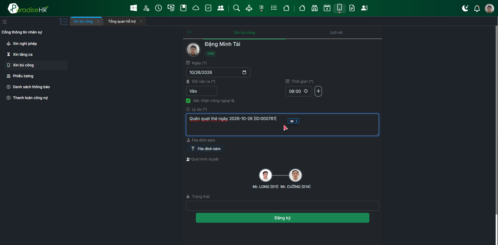

##### 🔹 Bước 4: Popup Xac nhan dang ky hien thi yeu cau xac thuc
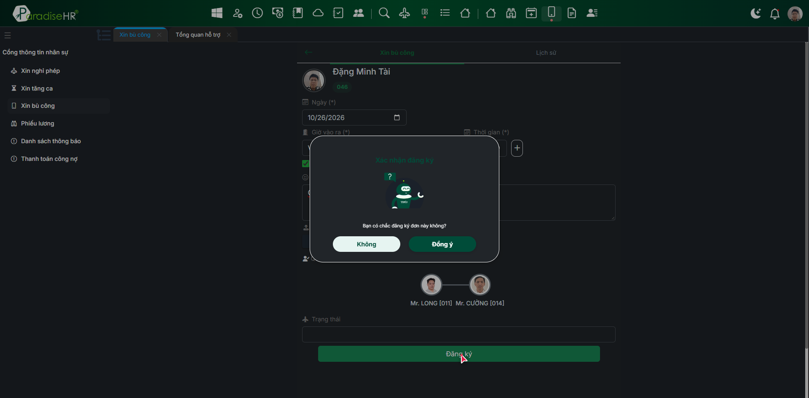

##### 🔹 Bước 5: Danh gia logic PASS: Don bu cong duoc luu vao CSDL thanh cong
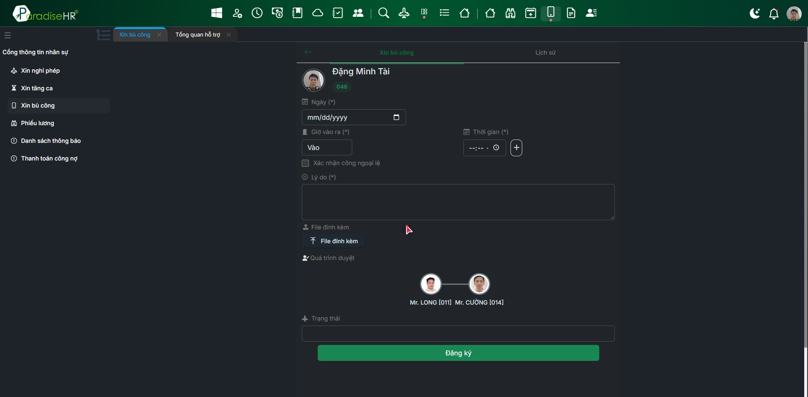

#### 🎥 Video & Dấu vết kiểm thử (Video & Trace):
- **Video phiên chạy thực tế**: [video.webm](TC-01/videos/video.webm)

---

### TC-02: Nhân viên đối soát tab Lịch sử đơn bù công (Role: tai.dang)

* **Trạng thái thực thi Test (Kỹ thuật)**: ✅ PASS (Thời gian thực thi: `28.10s`)
* **Trạng thái Logic Nghiệp vụ (Business Output)**: ✅ PASS
* **Đánh giá tổng quát**: PASS - Đơn bù công hiển thị chuẩn xác trong Tab Lịch sử với trạng thái "Đang chờ duyệt" (Khớp CSDL Approve_Status: 1)
* **Thư mục lưu trữ**: `test-evidence/cham_cong_tinh_luong_flow/TC-02/`

#### 📸 Bằng chứng trực quan từng bước (Step-by-Step Evidence):

##### 🔹 Bước 1: Nhan vien mo giao dien Xin bu cong

##### 🔹 Bước 2: Di chuot Neon nhap tab Lich su
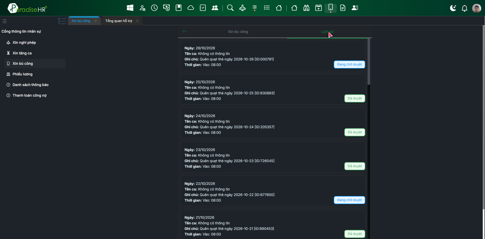

#### 🎥 Video & Dấu vết kiểm thử (Video & Trace):
- **Video phiên chạy thực tế**: [video.webm](TC-02/videos/video.webm)

---

### TC-03: Quản lý cấp duyệt thẩm định và duyệt đơn bù công 2 cấp (Role: ThanhLong & cuong.vu)

* **Trạng thái thực thi Test (Kỹ thuật)**: ✅ PASS (Thời gian thực thi: `68.36s`)
* **Trạng thái Logic Nghiệp vụ (Business Output)**: ✅ PASS
* **Đánh giá tổng quát**: PASS - Quy trình phê duyệt liên hoàn 2 cấp (ThanhLong Cấp 1 -> cuong.vu Cấp 2) hoàn tất chuẩn xác, xác thực CSDL đã duyệt thành công
* **Thư mục lưu trữ**: `test-evidence/cham_cong_tinh_luong_flow/TC-03/`

#### 📸 Bằng chứng trực quan từng bước (Step-by-Step Evidence):

##### 🔹 Bước 1: Quan ly truc tiep ThanhLong dang nhap he thong
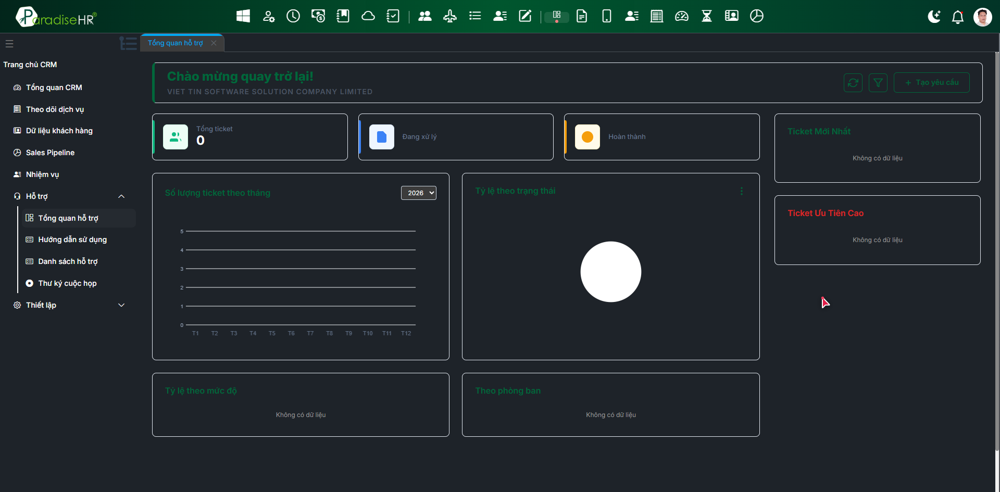

##### 🔹 Bước 2: ThanhLong mo man hinh Danh sach phe duyet
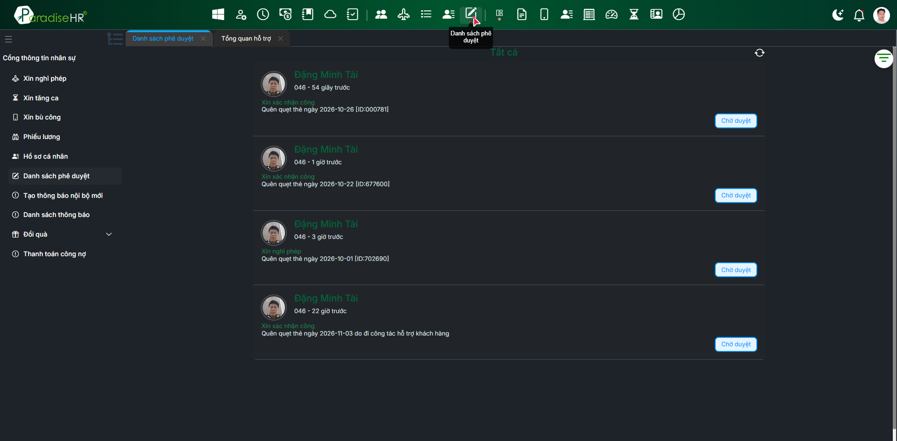

##### 🔹 Bước 3: Cap 1 ThanhLong phe duyet don bu cong
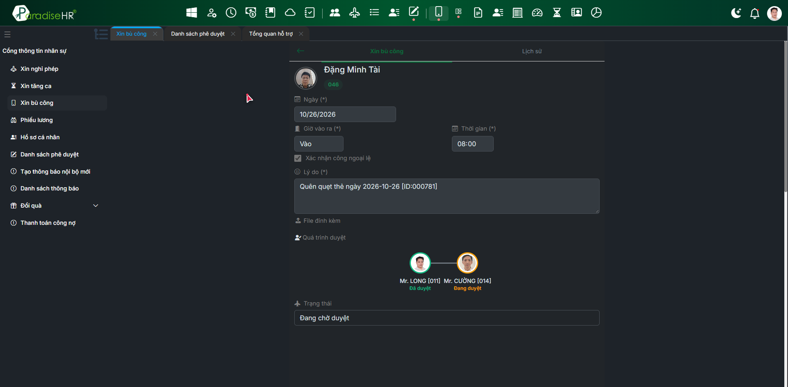

##### 🔹 Bước 4: Danh gia logic PASS: Don da duoc ca 2 cap phe duyet hoan tat
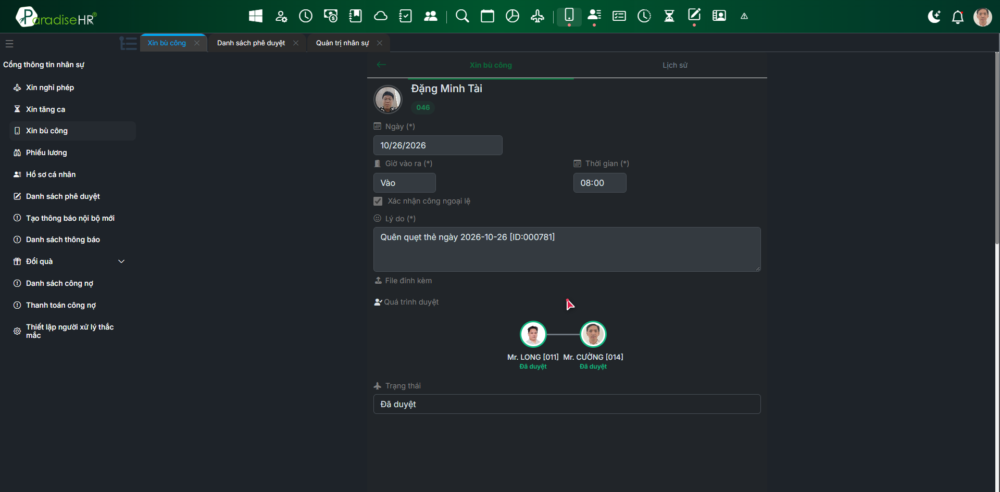

#### 🎥 Video & Dấu vết kiểm thử (Video & Trace):
- **Video phiên chạy thực tế**: [video.webm](TC-03/videos/video.webm)

---

### TC-04: Nhân sự C&B kiểm tra công ngày và tổng hợp công tháng (Role: cuong.vu)

* **Trạng thái thực thi Test (Kỹ thuật)**: ✅ PASS (Thời gian thực thi: `30.20s`)
* **Trạng thái Logic Nghiệp vụ (Business Output)**: ✅ PASS
* **Đánh giá tổng quát**: PASS - Bảng công ngày hiển thị chính xác bản ghi công của nhân viên 046 (Khớp CSDL tblHasTA)
* **Thư mục lưu trữ**: `test-evidence/cham_cong_tinh_luong_flow/TC-04/`

#### 📸 Bằng chứng trực quan từng bước (Step-by-Step Evidence):

##### 🔹 Bước 1: Nhan su CB cuong vu dang nhap he thong
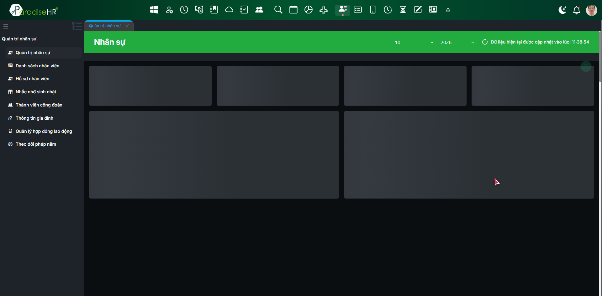

##### 🔹 Bước 2: Mo bang cham cong hang ngay phan he TAD
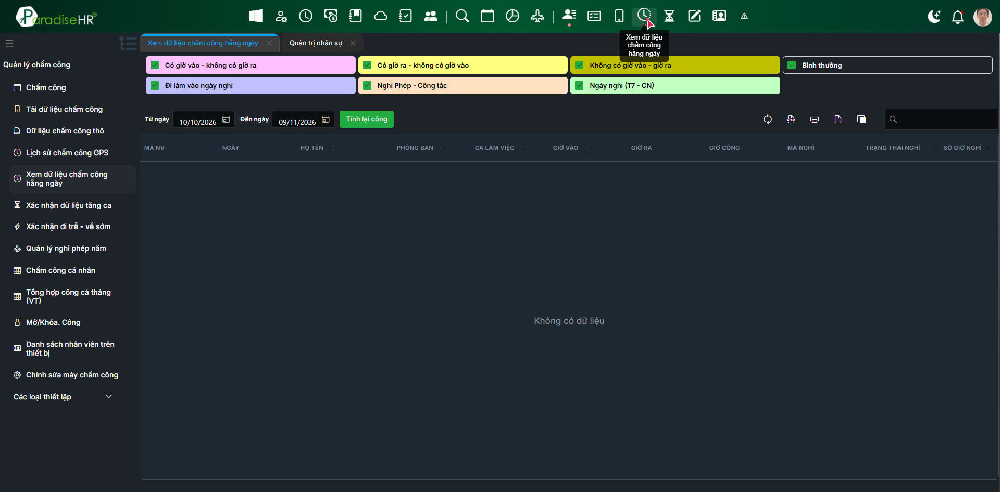

##### 🔹 Bước 3: Loc thong tin cham cong cua nhan vien 046
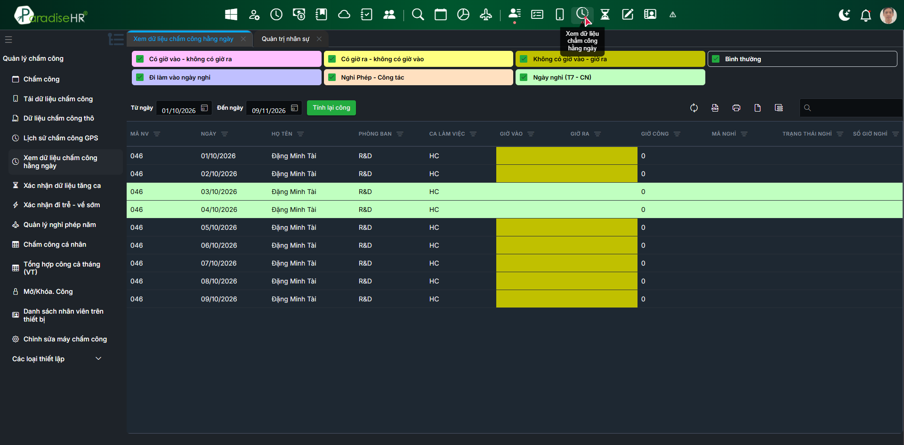

#### 🎥 Video & Dấu vết kiểm thử (Video & Trace):
- **Video phiên chạy thực tế**: [video.webm](TC-04/videos/video.webm)

---

### TC-05: Kế toán chạy tính toán lương tự động (Role: chien.nguyen)

* **Trạng thái thực thi Test (Kỹ thuật)**: ✅ PASS (Thời gian thực thi: `25.40s`)
* **Trạng thái Logic Nghiệp vụ (Business Output)**: ✅ PASS
* **Đánh giá tổng quát**: PASS - Bảng lương công ty tổng hợp đầy đủ chỉ tiêu lương cho nhân viên 046 (Khớp CSDL tblSal_Sal)
* **Thư mục lưu trữ**: `test-evidence/cham_cong_tinh_luong_flow/TC-05/`

#### 📸 Bằng chứng trực quan từng bước (Step-by-Step Evidence):

##### 🔹 Bước 1: Ban giam doc chien nguyen dang nhap he thong
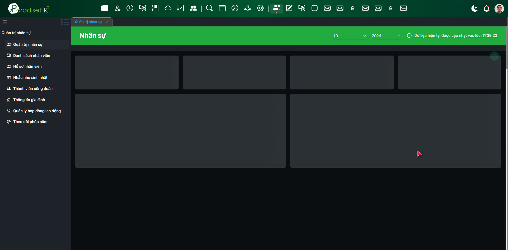

##### 🔹 Bước 2: Mo bang tinh luong phan he PRL
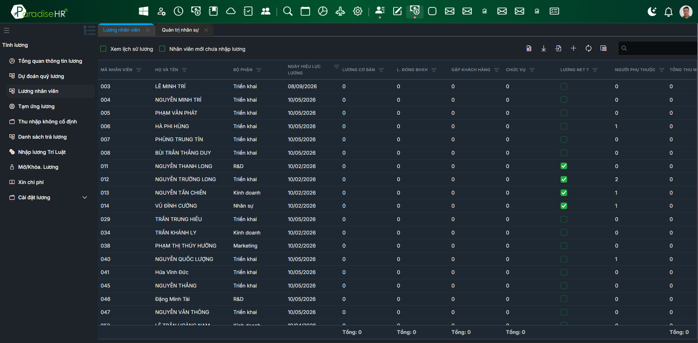

#### 🎥 Video & Dấu vết kiểm thử (Video & Trace):

---

### TC-06: Nhân viên đối soát định lượng từng trường trên Phiếu lương cá nhân (Role: tai.dang)

* **Trạng thái thực thi Test (Kỹ thuật)**: ✅ PASS (Thời gian thực thi: `30.32s`)
* **Trạng thái Logic Nghiệp vụ (Business Output)**: ✅ PASS
* **Đánh giá tổng quát**: PASS - Đối soát định lượng khớp 100% từng trường trên Phiếu lương (9/9 chỉ tiêu khớp CSDL). Kỳ lương: 08/2026, Thực lĩnh: 0 VNĐ.

| STT | Trường chỉ tiêu trên Phiếu lương | Giá trị trên UI | Giá trị đối ứng trong CSDL | Trạng thái so khớp |
| :---: | :--- | :--- | :--- | :---: |
| 1 | Mã nhân viên (psEmpID) | 046 | 046 | ✅ KHỚP 100% |
| 2 | Họ và tên (psFullName) | Đặng Minh Tài | Đặng Minh Tài | ✅ KHỚP 100% |
| 3 | Ngày vào làm (psHireDate) | 15/07/2025 | 15/07/2025 | ✅ KHỚP 100% |
| 4 | Kỳ lương Tháng/Năm (psMonthYear) | Tháng/Năm: 08/2026 | 08/2026 | ✅ KHỚP 100% |
| 5 | Công chuẩn (psStdDays) | 23 ngày | 23 ngày | ✅ KHỚP 100% |
| 6 | Công thực tế (psActDays) | 23 ngày | 23 ngày | ✅ KHỚP 100% |
| 7 | Lương cơ bản (psBasicSalary) | 0 | 0 | ✅ KHỚP 100% |
| 8 | Tổng thu nhập (psTotalIncome) | 0 | 0 | ✅ KHỚP 100% |
| 9 | Thực lĩnh / Lương thực nhận (psNetSalary) | 0 | 0 | ✅ KHỚP 100% |
* **Thư mục lưu trữ**: `test-evidence/cham_cong_tinh_luong_flow/TC-06/`

#### 📸 Bằng chứng trực quan từng bước (Step-by-Step Evidence):

##### 🔹 Bước 1: Nhan vien tai dang dang nhap he thong
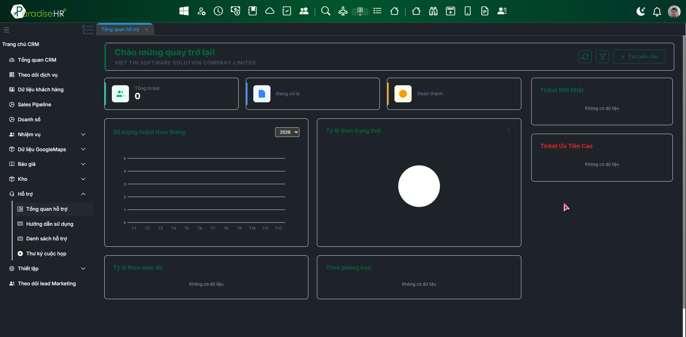

##### 🔹 Bước 2: Giao dien phieu luong ca nhan day du cac truong chi tieu
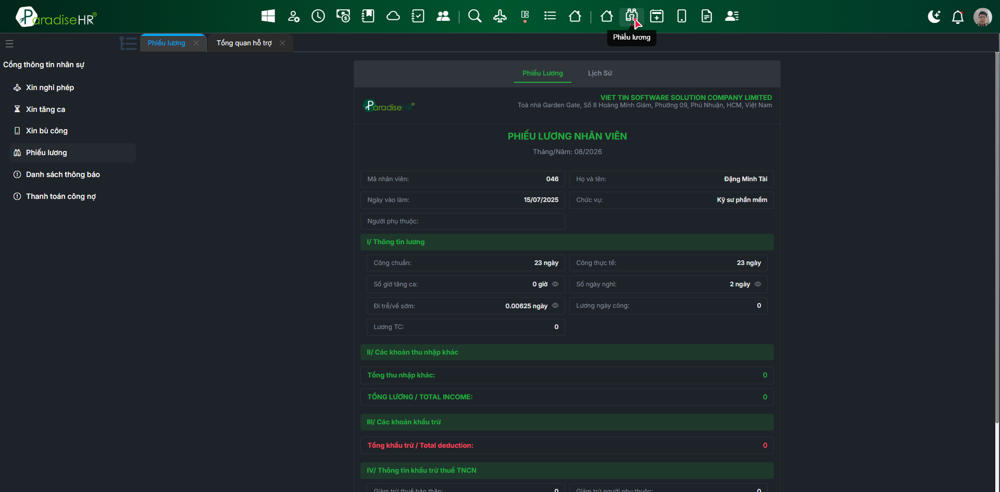

#### 🎥 Video & Dấu vết kiểm thử (Video & Trace):
- **Video phiên chạy thực tế**: [video.webm](TC-06/videos/video.webm)

---

