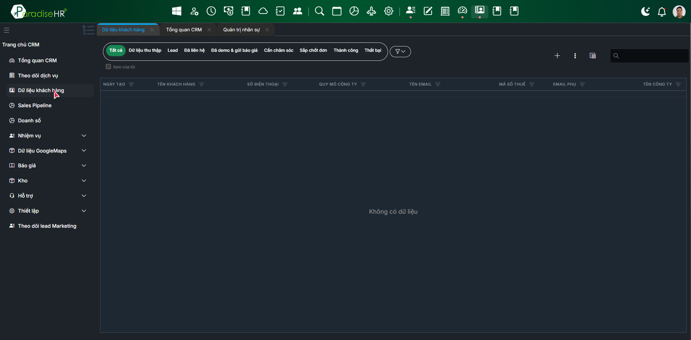
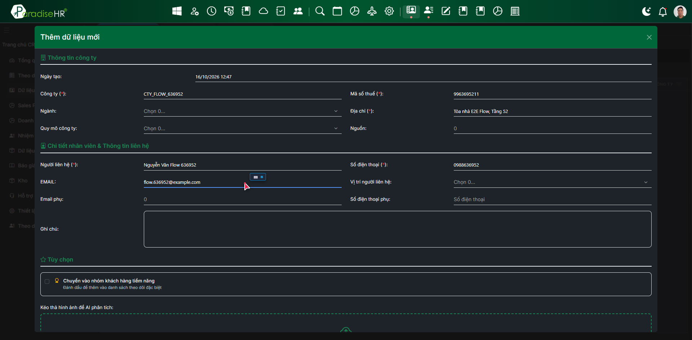
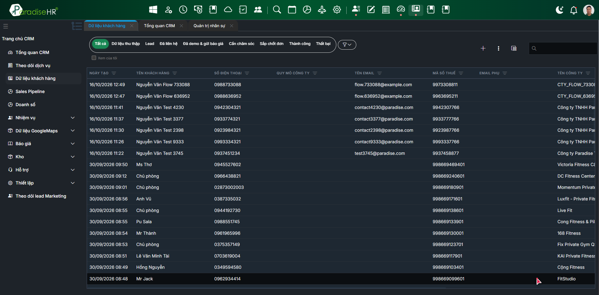
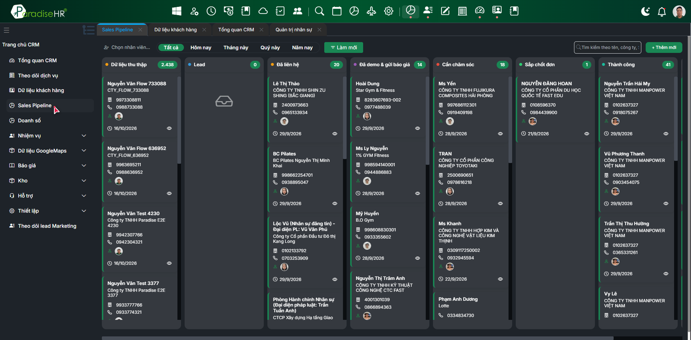
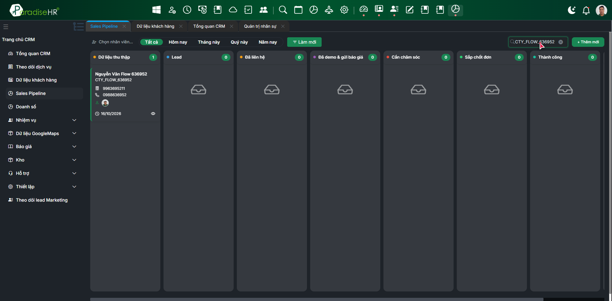
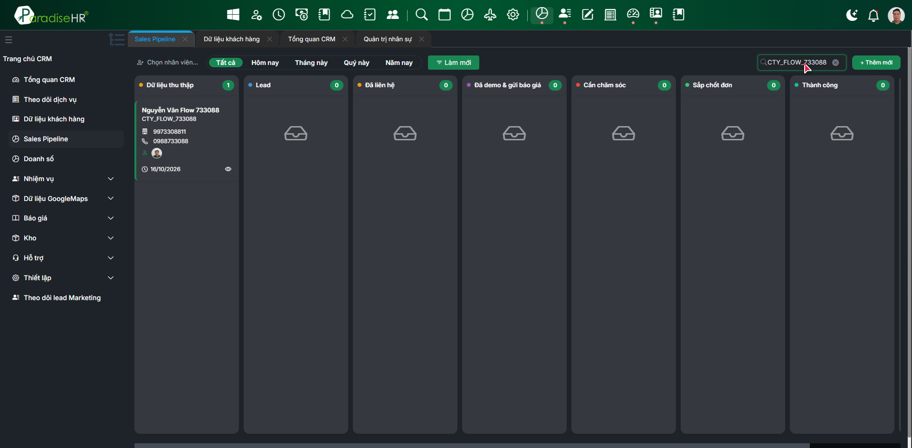
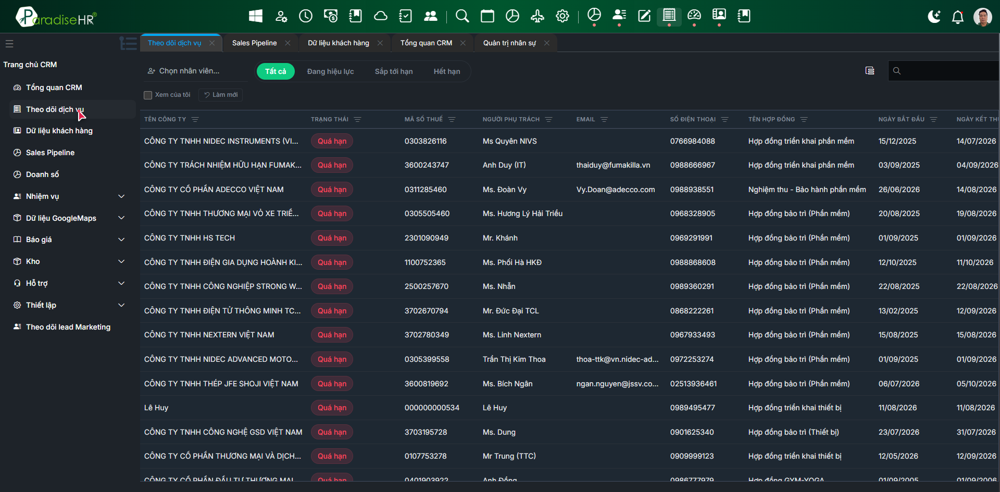
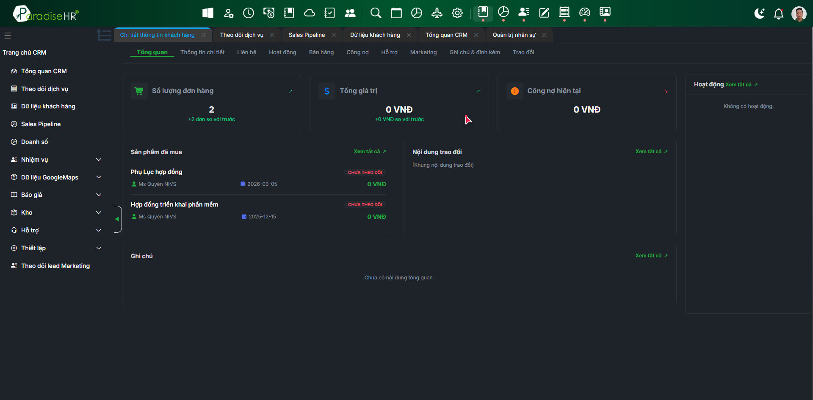
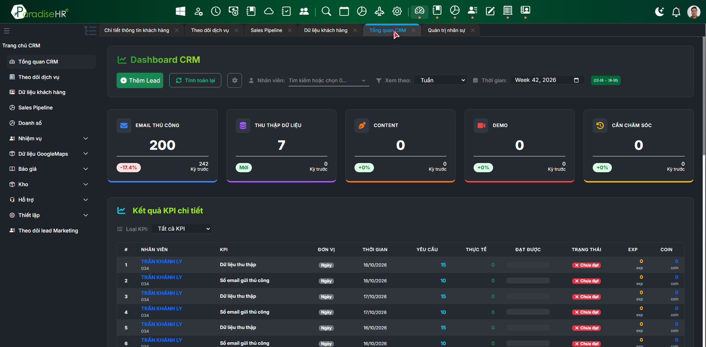
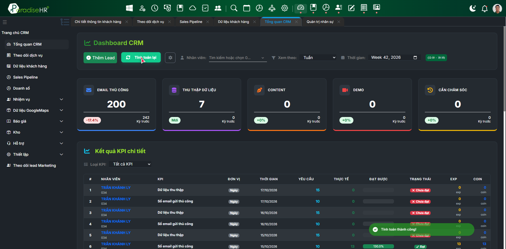

# BÁO CÁO KIỂM THỬ TRANG: CRM_BUSINESS_FLOW

> Thời gian kiểm thử: **11:11:11 19/10/2026**
> Tổng số kịch bản: **1** | ✅ LOGIC PASS: **1** | ❌ LOGIC FAIL: **0**

## BẢNG ĐỐI CHIẾU TRẠNG THÁI TEST & LOGIC NGHIỆP VỤ

| Mã TC | Tiêu đề Kịch bản | Trạng thái Test | Trạng thái Logic | Đánh giá Nghiệp vụ |
| :--- | :--- | :---: | :---: | :--- |
| **FLOW-01** | FLOW-01: Luồng Nghiệp Vụ Khép Kín: Dữ Liệu Khách Hàng -> Sales Pipeline -> Theo Dõi Dịch Vụ -> Tổng Quan CRM | ✅ PASS | ✅ PASS | PASS - Luồng nghiệp vụ khép kín xuyên suốt 4 menu CRM (Khách hàng -> Pipeline -> Dịch vụ -> Tổng quan) thực thi trơn tru, dữ liệu đồng bộ hoàn hảo |

---

### FLOW-01: FLOW-01: Luồng Nghiệp Vụ Khép Kín: Dữ Liệu Khách Hàng -> Sales Pipeline -> Theo Dõi Dịch Vụ -> Tổng Quan CRM

* **Trạng thái thực thi Test (Kỹ thuật)**: ✅ PASS (Thời gian thực thi: `84.47s`)
* **Trạng thái Logic Nghiệp vụ (Business Output)**: ✅ PASS
* **Đánh giá tổng quát**: PASS - Luồng nghiệp vụ khép kín xuyên suốt 4 menu CRM (Khách hàng -> Pipeline -> Dịch vụ -> Tổng quan) thực thi trơn tru, dữ liệu đồng bộ hoàn hảo
* **Thư mục lưu trữ**: `test-evidence/crm_business_flow/FLOW-01/`

#### 📸 Bằng chứng trực quan từng bước (Step-by-Step Evidence):

##### 🔹 Bước 1: Mở menu Dữ liệu khách hàng chuẩn bị tạo thực thể nguồn

##### 🔹 Bước 2: Điền thông tin khách hàng nguồn: CTY_FLOW

##### 🔹 Bước 2: Điền thông tin khách hàng nguồn: CTY_FLOW

##### 🔹 Bước 3: Lưu khách hàng thành công và bắt gói phản hồi máy chủ

##### 🔹 Bước 4: Điều hướng sang menu Sales Pipeline để kiểm chứng đồng bộ

##### 🔹 Bước 5: Tìm kiếm khách hàng trên Sales Pipeline

##### 🔹 Bước 5: Tìm kiếm khách hàng trên Sales Pipeline

##### 🔹 Bước 6: Điều hướng sang menu Theo dõi dịch vụ kiểm tra dữ liệu

##### 🔹 Bước 7: Thẩm định danh mục dịch vụ hoạt động ổn định và nhất quán

##### 🔹 Bước 8: Khép kín luồng tại màn hình Tổng quan CRM

##### 🔹 Bước 9: Bấm nút Tính toán lại và hoàn tất đồng bộ toàn phân hệ CRM

##### 🔹 Bước 10: Nghiệm thu toàn diện luồng nghiệp vụ khép kín xuyên suốt 4 menu CRM

#### 🎥 Video & Dấu vết kiểm thử (Video & Trace):
- **Video phiên chạy thực tế**: [video.webm](FLOW-01/videos/video.webm)
- **Playwright Trace**: [trace.zip](FLOW-01/traces/trace.zip) *(Mở bằng: `npx playwright show-trace test-evidence/crm_business_flow/FLOW-01/traces/trace.zip`)*

---

