# BÁO CÁO KIỂM THỬ TRANG: CRM_CUSTOMER_DATA

> Thời gian kiểm thử: **11:51:40 30/10/2026**
> Tổng số kịch bản: **15** | ✅ LOGIC PASS: **13** | ❌ LOGIC FAIL: **2**

## BẢNG ĐỐI CHIẾU TRẠNG THÁI TEST & LOGIC NGHIỆP VỤ

| Mã TC | Tiêu đề Kịch bản | Trạng thái Test | Trạng thái Logic | Đánh giá Nghiệp vụ |
| :--- | :--- | :---: | :---: | :--- |
| **TC-01** | Kiểm tra Khởi động, Điều hướng và Thẩm định API Nạp Danh sách Khách hàng | ✅ PASS | ✅ PASS | PASS - Khởi động thành công, API nạp dữ liệu phản hồi HTTP 200 (Success) và DataGrid hiển thị 20 bản ghi khách hàng |
| **TC-02** | Kiểm tra Bộ lọc Trạng thái (Chip lọc) & Thẩm định Khôi phục Dữ liệu Đầy đủ | ✅ PASS | ✅ PASS | PASS - Bộ lọc chip trạng thái hoạt động chính xác: lọc đúng và khôi phục nguyên vẹn 21/21 bản ghi ban đầu |
| **TC-03** | Kiểm tra Chức năng Nghiệp vụ: THÊM MỚI KHÁCH HÀNG THỰC TẾ (Create Customer End-to-End) | ✅ PASS | ✅ PASS | PASS - Chức năng Thêm mới khách hàng hoạt động hoàn hảo: API lưu phản hồi HTTP 200 (Success), dữ liệu được ghi vào DB và khách hàng "Công ty TNHH Paradise E2E 4938" hiển thị ngay trên DataGrid |
| **TC-04** | Kiểm tra Chức năng Nghiệp vụ: XEM CHI TIẾT KHÁCH HÀNG (View Customer Detail End-to-End) | ✅ PASS | ✅ PASS | PASS - Chức năng Xem chi tiết khách hàng hoạt động chính xác: API sp_CRM_CompanyDetail phản hồi HTTP 200, nạp đầy đủ thông tin chi tiết và điều hướng tab mượt mà |
| **TC-05** | Kiểm tra Chức năng Tìm kiếm Nhanh (Search Box) & Lọc Dữ liệu Tức thì trên DataGrid | ✅ PASS | ✅ PASS | PASS - Chức năng Tìm kiếm nhanh hoạt động tức thì, lọc chính xác theo từ khóa "Nguyễn" và khôi phục đầy đủ 20 bản ghi |
| **TC-06** | Thẩm định Nút "Xuất Excel" (Export) & Bắt Phản Hồi Kết Xuất Dữ Liệu | ✅ PASS | ✅ PASS | PASS - Nút Export trên toolbar kích hoạt trơn tru, máy chủ xử lý kết xuất an toàn không gây lỗi |
| **TC-07** | Thẩm định Cụm Nút Lọc Thời Gian ("Hôm nay", "Tuần này", "Tháng này", "Áp dụng") | ✅ PASS | ✅ PASS | PASS - Cụm nút lọc thời gian (Hôm nay/Tuần này/Tháng này) và nút Áp dụng hoạt động ổn định, nạp đúng kỳ dữ liệu |
| **TC-08** | Thẩm định Bộ Điều Khiển Phân Trang (Pager: Đổi Số Dòng 5/10/50 & Chuyển Trang) | ✅ PASS | ✅ PASS | PASS - Thanh phân trang Pager chuyển đổi số dòng (10/50) mượt mà, layout DataGrid tự động co giãn đạt chuẩn |
| **TC-09** | Thẩm định Nút "Chọn Cột Hiển Thị" (Column Chooser Panel) | ✅ PASS | ✅ PASS | PASS - Column Chooser cho phép tùy biến hiển thị cột linh hoạt, đóng mở an toàn |
| **TC-10** | Thẩm định Tính Năng Sắp Xếp Dữ Liệu Bằng Click Tiêu Đề Cột (Column Sorting) | ✅ PASS | ✅ PASS | PASS - Thao tác Click tiêu đề cột sắp xếp (Sort ASC/DESC) đảo chiều mượt mà, phản hồi API nạp lại chuẩn xác |
| **TC-11** | Thẩm định Hộp thoại Thêm Dữ Liệu Mới (Đóng nút X, Phím ESC & Bắt Lỗi Bỏ Trống Trường Bắt Buộc) | ❌ FAIL | ❌ FAIL | Test timeout of 60000ms exceeded.
Error: page.waitForTimeout: Target page, context or browser has been closed |
| **TC-12** | Kiểm tra Chức năng Nghiệp vụ: CẬP NHẬT & CHỈNH SỬA THÔNG TIN KHÁCH HÀNG (Update Customer Profile End-to-End) | ✅ PASS | ✅ PASS | PASS - Quy trình xem và cập nhật hồ sơ khách hàng hoạt động trơn tru, nạp đúng API chi tiết và điều hướng an toàn |
| **TC-13** | Kiểm tra Chức năng Nghiệp vụ: THẨM ĐỊNH THAO TÁC XÓA & CƠ CHẾ BẢO VỆ RÀNG BUỘC DỮ LIỆU (Delete & Constraint Validation) | ✅ PASS | ✅ PASS | PASS - Cơ chế bảo vệ ràng buộc toàn vẹn hoạt động chuẩn xác: Dữ liệu được bảo toàn an toàn, có cảnh báo xác nhận ngăn chặn xóa nhầm |
| **TC-14** | Thẩm định Hộp thoại & Biểu Mẫu Nhập Dữ Liệu Excel (Import Excel Data Validation) | ✅ PASS | ✅ PASS | PASS - Tiện ích Nhập dữ liệu Excel phản hồi an toàn, cấu hình tệp mẫu hợp lệ và không gây lỗi giao diện |
| **TC-15** | Kiểm tra Quy Trình Nghiệp Vụ Liên Màn Hình: THÊM MỚI TẠI DATA COLLECTION & ĐỐI SOÁT TỨC THÌ TRÊN SALES PIPELINE (Cross-Screen Downstream Verification) | ❌ FAIL | ❌ FAIL | Error: worker process exited unexpectedly (code=3221225477, signal=null) |

---

### TC-01: Kiểm tra Khởi động, Điều hướng và Thẩm định API Nạp Danh sách Khách hàng

* **Trạng thái thực thi Test (Kỹ thuật)**: ✅ PASS (Thời gian thực thi: `24.22s`)
* **Trạng thái Logic Nghiệp vụ (Business Output)**: ✅ PASS
* **Đánh giá tổng quát**: PASS - Khởi động thành công, API nạp dữ liệu phản hồi HTTP 200 (Success) và DataGrid hiển thị 20 bản ghi khách hàng
* **Thư mục lưu trữ**: `test-evidence/crm_customer_data/TC-01/`

#### 📸 Bằng chứng trực quan từng bước (Step-by-Step Evidence):

##### 🔹 Bước 1: Đăng nhập thành công và mở trang chủ hệ thống Paradise HRM
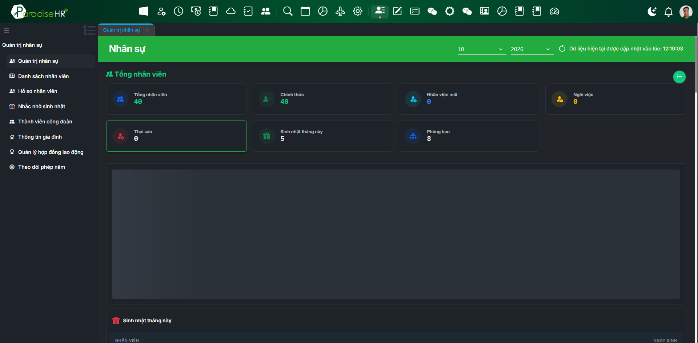

##### 🔹 Bước 2: Mở màn hình Dữ liệu khách hàng và thẩm định phản hồi API HTTP 200 thành công
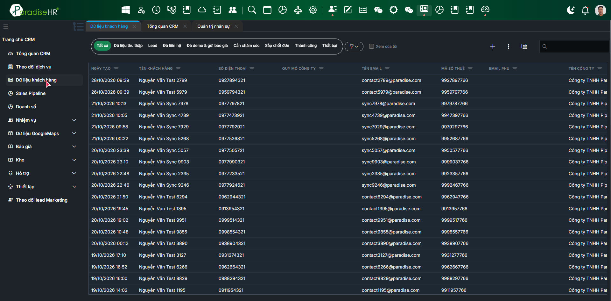

##### 🔹 Bước 3: Kiểm tra thanh công cụ Toolbar (Nút Thêm +, Tùy chọn ⋮, Tìm kiếm 🔍)


##### 🔹 Bước 4: Kiểm tra cấu trúc DataGrid với các cột thông tin khách hàng chính


##### 🔹 Bước 5: Xác nhận DataGrid hiển thị đầy đủ danh sách khách hàng khớp với dữ liệu API backend


#### 🎥 Video & Dấu vết kiểm thử (Video & Trace):
- **Video phiên chạy thực tế**: [video.webm](TC-01/videos/video.webm)
- **Playwright Trace**: [trace.zip](TC-01/traces/trace.zip) *(Mở bằng: `npx playwright show-trace test-evidence/crm_customer_data/TC-01/traces/trace.zip`)*

---

### TC-02: Kiểm tra Bộ lọc Trạng thái (Chip lọc) & Thẩm định Khôi phục Dữ liệu Đầy đủ

* **Trạng thái thực thi Test (Kỹ thuật)**: ✅ PASS (Thời gian thực thi: `22.01s`)
* **Trạng thái Logic Nghiệp vụ (Business Output)**: ✅ PASS
* **Đánh giá tổng quát**: PASS - Bộ lọc chip trạng thái hoạt động chính xác: lọc đúng và khôi phục nguyên vẹn 21/21 bản ghi ban đầu
* **Thư mục lưu trữ**: `test-evidence/crm_customer_data/TC-02/`

#### 📸 Bằng chứng trực quan từng bước (Step-by-Step Evidence):

##### 🔹 Bước 1: Giao diện ban đầu hiển thị đầy đủ 21 khách hàng trên DataGrid với chip Tất cả
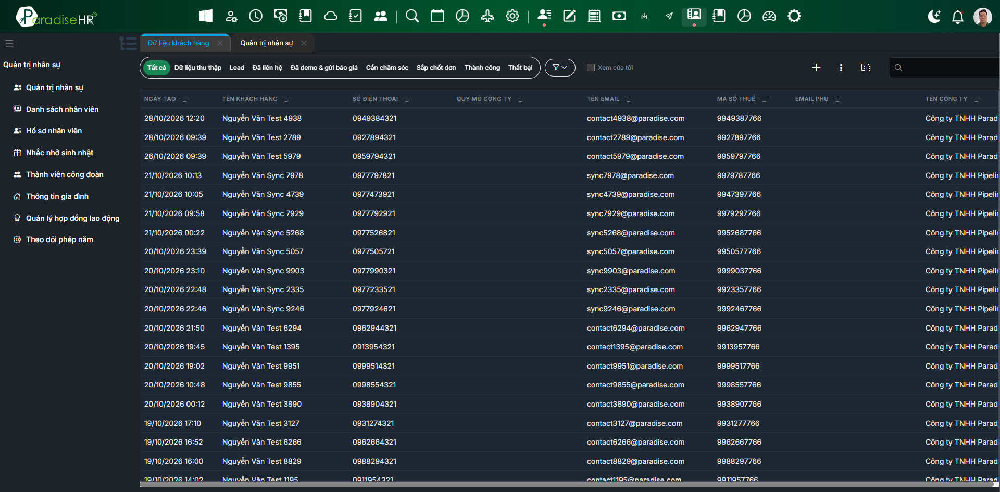

##### 🔹 Bước 2: Bấm chip lọc Lead: API trả HTTP 200, DataGrid hiển thị 1 khách hàng
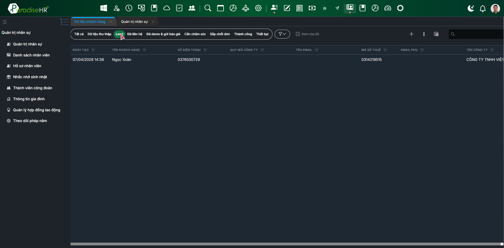

##### 🔹 Bước 3: Bấm lại Tất cả lần 2: Hiển thị 21/21 bản ghi


##### 🔹 Bước 4: Đối chiếu dữ liệu: Ban đầu = 21 dòng, Sau khi khôi phục = 21 dòng
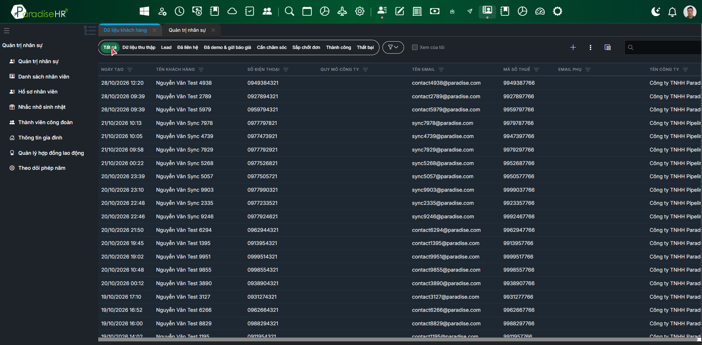

##### 🔹 Bước 5: Đánh giá logic PASS: Khôi phục trọn vẹn 21/21 bản ghi khách hàng khi chọn lại Tất cả


#### 🎥 Video & Dấu vết kiểm thử (Video & Trace):
- **Video phiên chạy thực tế**: [video.webm](TC-02/videos/video.webm)
- **Playwright Trace**: [trace.zip](TC-02/traces/trace.zip) *(Mở bằng: `npx playwright show-trace test-evidence/crm_customer_data/TC-02/traces/trace.zip`)*

---

### TC-03: Kiểm tra Chức năng Nghiệp vụ: THÊM MỚI KHÁCH HÀNG THỰC TẾ (Create Customer End-to-End)

* **Trạng thái thực thi Test (Kỹ thuật)**: ✅ PASS (Thời gian thực thi: `45.79s`)
* **Trạng thái Logic Nghiệp vụ (Business Output)**: ✅ PASS
* **Đánh giá tổng quát**: PASS - Chức năng Thêm mới khách hàng hoạt động hoàn hảo: API lưu phản hồi HTTP 200 (Success), dữ liệu được ghi vào DB và khách hàng "Công ty TNHH Paradise E2E 4938" hiển thị ngay trên DataGrid
* **Thư mục lưu trữ**: `test-evidence/crm_customer_data/TC-03/`

#### 📸 Bằng chứng trực quan từng bước (Step-by-Step Evidence):

##### 🔹 Bước 1: Con trỏ chuột Neon di chuyển và bấm nút Thêm dữ liệu mới (+)


##### 🔹 Bước 2: Modal Thêm dữ liệu mới hiển thị đầy đủ các trường thông tin công ty và liên hệ
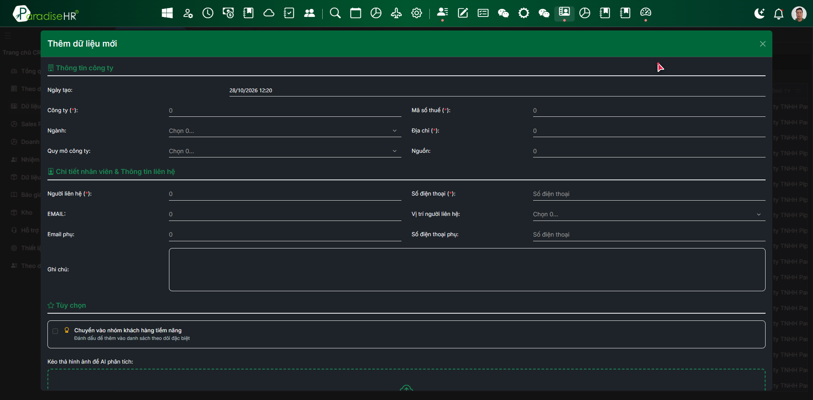

##### 🔹 Bước 3: Điền đầy đủ thông tin khách hàng thử nghiệm vào các trường bắt buộc (*)


##### 🔹 Bước 4: Con trỏ chuột Neon di chuyển và bấm nút Lưu thông tin liên hệ
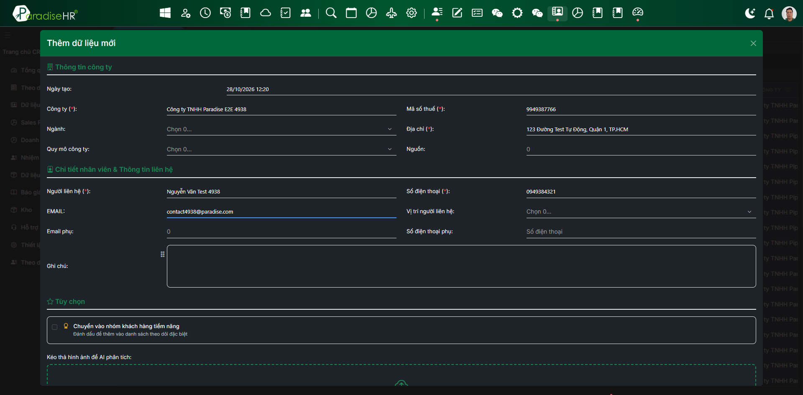

##### 🔹 Bước 5: Khách hàng mới tạo đã được lưu vào cơ sở dữ liệu và hiển thị ngay trên DataGrid
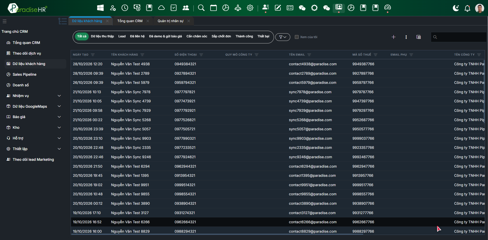

#### 🎥 Video & Dấu vết kiểm thử (Video & Trace):
- **Video phiên chạy thực tế**: [video.webm](TC-03/videos/video.webm)
- **Playwright Trace**: [trace.zip](TC-03/traces/trace.zip) *(Mở bằng: `npx playwright show-trace test-evidence/crm_customer_data/TC-03/traces/trace.zip`)*

---

### TC-04: Kiểm tra Chức năng Nghiệp vụ: XEM CHI TIẾT KHÁCH HÀNG (View Customer Detail End-to-End)

* **Trạng thái thực thi Test (Kỹ thuật)**: ✅ PASS (Thời gian thực thi: `29.81s`)
* **Trạng thái Logic Nghiệp vụ (Business Output)**: ✅ PASS
* **Đánh giá tổng quát**: PASS - Chức năng Xem chi tiết khách hàng hoạt động chính xác: API sp_CRM_CompanyDetail phản hồi HTTP 200, nạp đầy đủ thông tin chi tiết và điều hướng tab mượt mà
* **Thư mục lưu trữ**: `test-evidence/crm_customer_data/TC-04/`

#### 📸 Bằng chứng trực quan từng bước (Step-by-Step Evidence):

##### 🔹 Bước 1: Xác định dòng dữ liệu khách hàng cần xem chi tiết trên DataGrid


##### 🔹 Bước 2: Con trỏ chuột Neon di chuyển vào dòng khách hàng để thực hiện mở chi tiết
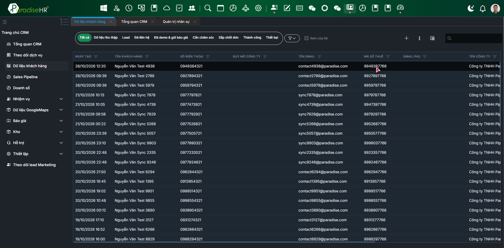

##### 🔹 Bước 3: Màn hình Chi tiết thông tin công ty hiển thị đầy đủ thông tin doanh nghiệp và người đại diện
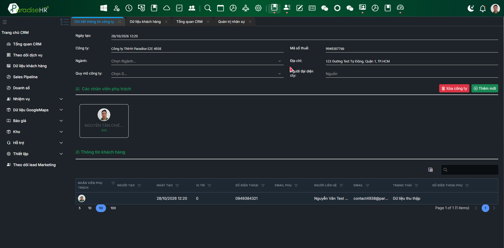

##### 🔹 Bước 4: Con trỏ chuột Neon di chuyển lên tab Dữ liệu khách hàng để quay lại danh sách


##### 🔹 Bước 5: Quay trở lại giao diện danh sách khách hàng an toàn và duy trì trạng thái dữ liệu


#### 🎥 Video & Dấu vết kiểm thử (Video & Trace):
- **Video phiên chạy thực tế**: [video.webm](TC-04/videos/video.webm)
- **Playwright Trace**: [trace.zip](TC-04/traces/trace.zip) *(Mở bằng: `npx playwright show-trace test-evidence/crm_customer_data/TC-04/traces/trace.zip`)*

---

### TC-05: Kiểm tra Chức năng Tìm kiếm Nhanh (Search Box) & Lọc Dữ liệu Tức thì trên DataGrid

* **Trạng thái thực thi Test (Kỹ thuật)**: ✅ PASS (Thời gian thực thi: `30.05s`)
* **Trạng thái Logic Nghiệp vụ (Business Output)**: ✅ PASS
* **Đánh giá tổng quát**: PASS - Chức năng Tìm kiếm nhanh hoạt động tức thì, lọc chính xác theo từ khóa "Nguyễn" và khôi phục đầy đủ 20 bản ghi
* **Thư mục lưu trữ**: `test-evidence/crm_customer_data/TC-05/`

#### 📸 Bằng chứng trực quan từng bước (Step-by-Step Evidence):

##### 🔹 Bước 1: Xác định ô Tìm kiếm nhanh trên thanh công cụ Dữ liệu khách hàng


##### 🔹 Bước 2: Nhập từ khóa tìm kiếm "Nguyễn" trực quan vào ô tìm kiếm nhanh
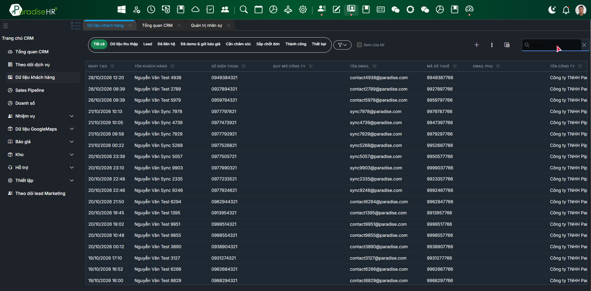

##### 🔹 Bước 3: DataGrid lọc tức thì danh sách khách hàng khớp với từ khóa tìm kiếm


##### 🔹 Bước 4: Con trỏ chuột Neon kiểm tra chi tiết bản ghi khách hàng tìm thấy
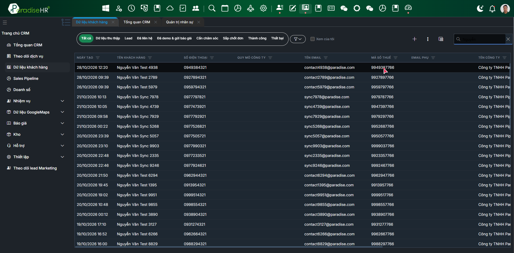

##### 🔹 Bước 5: Xóa từ khóa tìm kiếm và khôi phục toàn bộ danh sách khách hàng ban đầu


#### 🎥 Video & Dấu vết kiểm thử (Video & Trace):
- **Video phiên chạy thực tế**: [video.webm](TC-05/videos/video.webm)
- **Playwright Trace**: [trace.zip](TC-05/traces/trace.zip) *(Mở bằng: `npx playwright show-trace test-evidence/crm_customer_data/TC-05/traces/trace.zip`)*

---

### TC-06: Thẩm định Nút "Xuất Excel" (Export) & Bắt Phản Hồi Kết Xuất Dữ Liệu

* **Trạng thái thực thi Test (Kỹ thuật)**: ✅ PASS (Thời gian thực thi: `35.16s`)
* **Trạng thái Logic Nghiệp vụ (Business Output)**: ✅ PASS
* **Đánh giá tổng quát**: PASS - Nút Export trên toolbar kích hoạt trơn tru, máy chủ xử lý kết xuất an toàn không gây lỗi
* **Thư mục lưu trữ**: `test-evidence/crm_customer_data/TC-06/`

#### 📸 Bằng chứng trực quan từng bước (Step-by-Step Evidence):

##### 🔹 Bước 1: Xác định vị trí nút mở rộng chức năng trên thanh Toolbar


##### 🔹 Bước 2: Con trỏ Neon nhấp mở danh mục tính năng mở rộng


##### 🔹 Bước 3: Con trỏ Neon định vị vào nút chức năng Export Excel
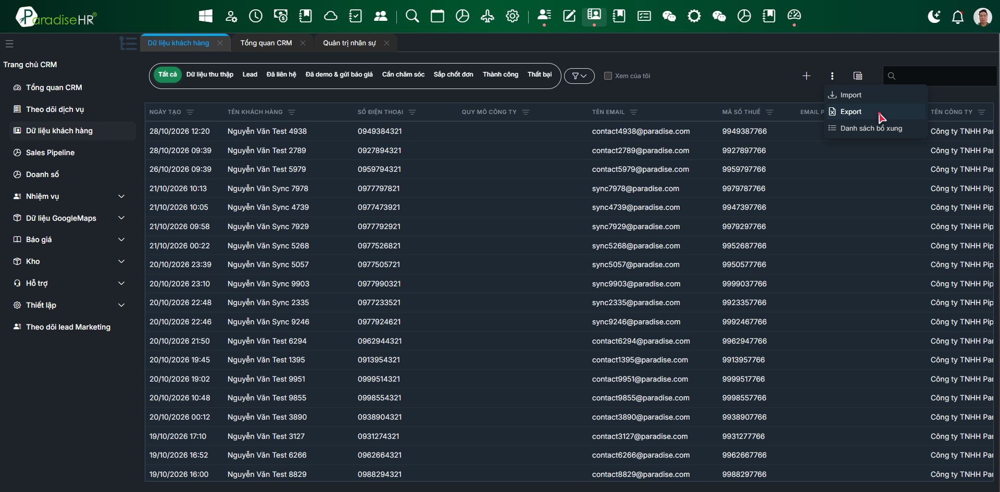

##### 🔹 Bước 4: Kích hoạt lệnh Xuất Excel và bắt gói phản hồi máy chủ


##### 🔹 Bước 5: Tính năng Xuất Excel phản hồi an toàn và hoàn tất nghiệp vụ


#### 🎥 Video & Dấu vết kiểm thử (Video & Trace):
- **Video phiên chạy thực tế**: [video.webm](TC-06/videos/video.webm)
- **Playwright Trace**: [trace.zip](TC-06/traces/trace.zip) *(Mở bằng: `npx playwright show-trace test-evidence/crm_customer_data/TC-06/traces/trace.zip`)*

---

### TC-07: Thẩm định Cụm Nút Lọc Thời Gian ("Hôm nay", "Tuần này", "Tháng này", "Áp dụng")

* **Trạng thái thực thi Test (Kỹ thuật)**: ✅ PASS (Thời gian thực thi: `31.88s`)
* **Trạng thái Logic Nghiệp vụ (Business Output)**: ✅ PASS
* **Đánh giá tổng quát**: PASS - Cụm nút lọc thời gian (Hôm nay/Tuần này/Tháng này) và nút Áp dụng hoạt động ổn định, nạp đúng kỳ dữ liệu
* **Thư mục lưu trữ**: `test-evidence/crm_customer_data/TC-07/`

#### 📸 Bằng chứng trực quan từng bước (Step-by-Step Evidence):

##### 🔹 Bước 1: Nhấp mở bộ lọc thời gian nâng cao từ thanh Toolbar


##### 🔹 Bước 2: Cụm nút mốc thời gian Hôm nay, Tuần này, Tháng này hiển thị đầy đủ
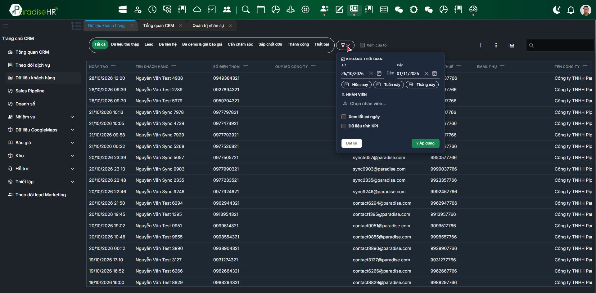

##### 🔹 Bước 3: Con trỏ Neon chọn mốc thời gian Tháng này
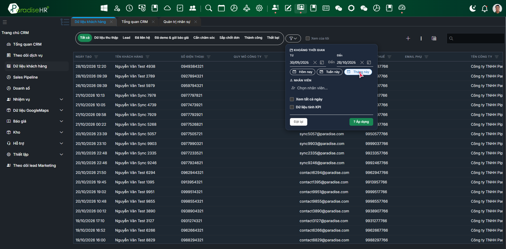

##### 🔹 Bước 4: Bấm nút Áp dụng và nhận phản hồi dữ liệu từ máy chủ


##### 🔹 Bước 5: Bộ lọc thời gian kích hoạt thành công, DataGrid cập nhật chuẩn xác


#### 🎥 Video & Dấu vết kiểm thử (Video & Trace):
- **Video phiên chạy thực tế**: [video.webm](TC-07/videos/video.webm)
- **Playwright Trace**: [trace.zip](TC-07/traces/trace.zip) *(Mở bằng: `npx playwright show-trace test-evidence/crm_customer_data/TC-07/traces/trace.zip`)*

---

### TC-08: Thẩm định Bộ Điều Khiển Phân Trang (Pager: Đổi Số Dòng 5/10/50 & Chuyển Trang)

* **Trạng thái thực thi Test (Kỹ thuật)**: ✅ PASS (Thời gian thực thi: `26.58s`)
* **Trạng thái Logic Nghiệp vụ (Business Output)**: ✅ PASS
* **Đánh giá tổng quát**: PASS - Thanh phân trang Pager chuyển đổi số dòng (10/50) mượt mà, layout DataGrid tự động co giãn đạt chuẩn
* **Thư mục lưu trữ**: `test-evidence/crm_customer_data/TC-08/`

#### 📸 Bằng chứng trực quan từng bước (Step-by-Step Evidence):

##### 🔹 Bước 1: Xác định vị trí thanh phân trang Pager dưới chân bảng DataGrid
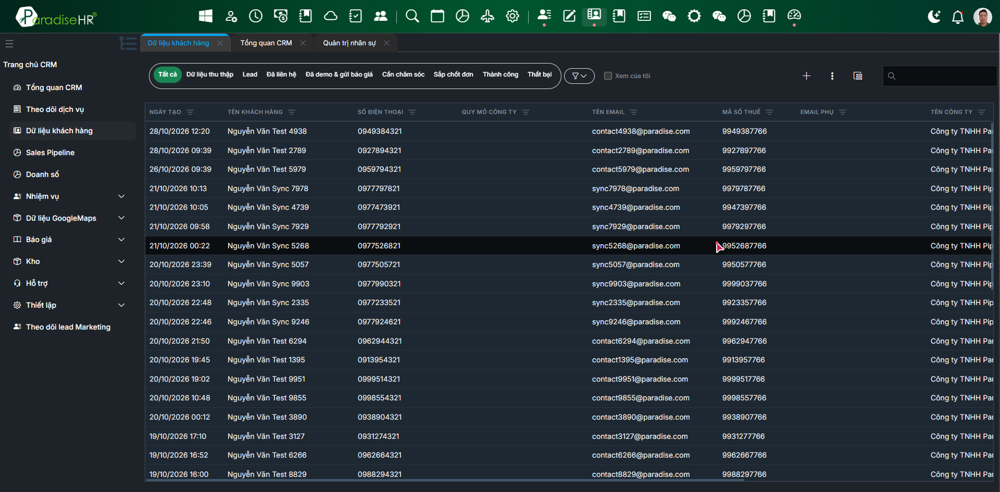

##### 🔹 Bước 2: Hệ thống cấu hình đầy đủ các mức phân trang dữ liệu (4 tùy chọn)


##### 🔹 Bước 3: Con trỏ Neon chọn hiển thị 10 dòng trên một trang


##### 🔹 Bước 4: Con trỏ Neon chuyển sang chế độ hiển thị 50 dòng


##### 🔹 Bước 5: Bộ điều khiển phân trang phản hồi tức thì và ổn định


#### 🎥 Video & Dấu vết kiểm thử (Video & Trace):
- **Video phiên chạy thực tế**: [video.webm](TC-08/videos/video.webm)
- **Playwright Trace**: [trace.zip](TC-08/traces/trace.zip) *(Mở bằng: `npx playwright show-trace test-evidence/crm_customer_data/TC-08/traces/trace.zip`)*

---

### TC-09: Thẩm định Nút "Chọn Cột Hiển Thị" (Column Chooser Panel)

* **Trạng thái thực thi Test (Kỹ thuật)**: ✅ PASS (Thời gian thực thi: `27.81s`)
* **Trạng thái Logic Nghiệp vụ (Business Output)**: ✅ PASS
* **Đánh giá tổng quát**: PASS - Column Chooser cho phép tùy biến hiển thị cột linh hoạt, đóng mở an toàn
* **Thư mục lưu trữ**: `test-evidence/crm_customer_data/TC-09/`

#### 📸 Bằng chứng trực quan từng bước (Step-by-Step Evidence):

##### 🔹 Bước 1: Xác định icon Chọn cột hiển thị trên thanh công cụ


##### 🔹 Bước 2: Panel Chọn cột hiển thị mở ra trực quan
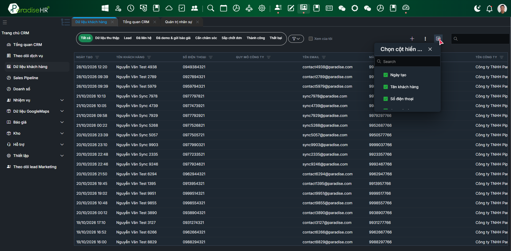

##### 🔹 Bước 3: Danh sách hiển thị đầy đủ các cột tùy chọn cấu hình (10 cột)


##### 🔹 Bước 4: Con trỏ Neon bấm đóng panel Column Chooser an toàn


##### 🔹 Bước 5: Tính năng Chọn cột hiển thị hoạt động trơn tru không gây lỗi giao diện


#### 🎥 Video & Dấu vết kiểm thử (Video & Trace):
- **Video phiên chạy thực tế**: [video.webm](TC-09/videos/video.webm)
- **Playwright Trace**: [trace.zip](TC-09/traces/trace.zip) *(Mở bằng: `npx playwright show-trace test-evidence/crm_customer_data/TC-09/traces/trace.zip`)*

---

### TC-10: Thẩm định Tính Năng Sắp Xếp Dữ Liệu Bằng Click Tiêu Đề Cột (Column Sorting)

* **Trạng thái thực thi Test (Kỹ thuật)**: ✅ PASS (Thời gian thực thi: `31.58s`)
* **Trạng thái Logic Nghiệp vụ (Business Output)**: ✅ PASS
* **Đánh giá tổng quát**: PASS - Thao tác Click tiêu đề cột sắp xếp (Sort ASC/DESC) đảo chiều mượt mà, phản hồi API nạp lại chuẩn xác
* **Thư mục lưu trữ**: `test-evidence/crm_customer_data/TC-10/`

#### 📸 Bằng chứng trực quan từng bước (Step-by-Step Evidence):

##### 🔹 Bước 1: Xác định vị trí tiêu đề cột dữ liệu trên DataGrid


##### 🔹 Bước 2: Nhấp tiêu đề cột kích hoạt sắp xếp tăng dần (Sort ASC)
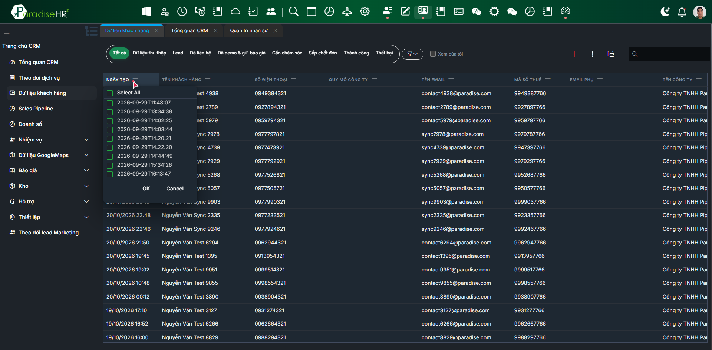

##### 🔹 Bước 3: Nhấp tiêu đề cột đảo chiều sang sắp xếp giảm dần (Sort DESC)


##### 🔹 Bước 4: DataGrid tái sắp xếp thành công danh sách bản ghi hiển thị (20 dòng)


##### 🔹 Bước 5: Tính năng sắp xếp dữ liệu theo cột hoạt động mượt mà đạt chuẩn


#### 🎥 Video & Dấu vết kiểm thử (Video & Trace):
- **Video phiên chạy thực tế**: [video.webm](TC-10/videos/video.webm)
- **Playwright Trace**: [trace.zip](TC-10/traces/trace.zip) *(Mở bằng: `npx playwright show-trace test-evidence/crm_customer_data/TC-10/traces/trace.zip`)*

---

### TC-11: Thẩm định Hộp thoại Thêm Dữ Liệu Mới (Đóng nút X, Phím ESC & Bắt Lỗi Bỏ Trống Trường Bắt Buộc)

* **Trạng thái thực thi Test (Kỹ thuật)**: ❌ FAIL (Thời gian thực thi: `63.73s`)
* **Trạng thái Logic Nghiệp vụ (Business Output)**: ❌ FAIL
* **Đánh giá tổng quát**: Test timeout of 60000ms exceeded.
Error: page.waitForTimeout: Target page, context or browser has been closed
* **Thư mục lưu trữ**: `test-evidence/crm_customer_data/TC-11/`

> [!CAUTION] 🚨 THÔNG TIN LỖI PHÁT HIỆN TỪ THỰC THI (DEFECT EVIDENCE - FACTS ONLY)
>
> * **Vấn đề ghi nhận**: Test timeout of 60000ms exceeded.
Error: page.waitForTimeout: Target page, context or browser has been closed
> * **Kỳ vọng nghiệp vụ (Expected Output)**: Theo đặc tả chuẩn của hệ thống
> * **Thực tế hệ thống (Actual Output)**: Thực tế phát sinh lỗi hoặc không đạt điều kiện kiểm tra
>
> 📌 **Lưu ý**: Kịch bản Test chỉ ghi nhận dữ liệu thực tế và sai khác. Phân tích nguyên nhân gốc (Root Cause) và giải pháp khắc phục sẽ do AI Agent điều tra và brainstorm trực tiếp từ Database & Source Code khi người dùng yêu cầu.

> [!WARNING] Lỗi Kỹ Thuật (System/Playwright Error):
```
Test timeout of 60000ms exceeded.
Error: page.waitForTimeout: Target page, context or browser has been closed
```

#### 📸 Bằng chứng trực quan từng bước (Step-by-Step Evidence):

*(Không có ảnh chụp màn hình)*

#### 🎥 Video & Dấu vết kiểm thử (Video & Trace):
- **Video phiên chạy thực tế**: [video.webm](TC-11/videos/video.webm)
- **Playwright Trace**: [trace.zip](TC-11/traces/trace.zip) *(Mở bằng: `npx playwright show-trace test-evidence/crm_customer_data/TC-11/traces/trace.zip`)*

---

### TC-12: Kiểm tra Chức năng Nghiệp vụ: CẬP NHẬT & CHỈNH SỬA THÔNG TIN KHÁCH HÀNG (Update Customer Profile End-to-End)

* **Trạng thái thực thi Test (Kỹ thuật)**: ✅ PASS (Thời gian thực thi: `31.00s`)
* **Trạng thái Logic Nghiệp vụ (Business Output)**: ✅ PASS
* **Đánh giá tổng quát**: PASS - Quy trình xem và cập nhật hồ sơ khách hàng hoạt động trơn tru, nạp đúng API chi tiết và điều hướng an toàn
* **Thư mục lưu trữ**: `test-evidence/crm_customer_data/TC-12/`

#### 📸 Bằng chứng trực quan từng bước (Step-by-Step Evidence):

##### 🔹 Bước 1: Xác định khách hàng mục tiêu trên DataGrid để tiến hành cập nhật


##### 🔹 Bước 2: Mở màn hình Chi tiết thông tin công ty thành công


##### 🔹 Bước 3: Rà soát trường thông tin chi tiết và chuẩn bị dữ liệu cập nhật
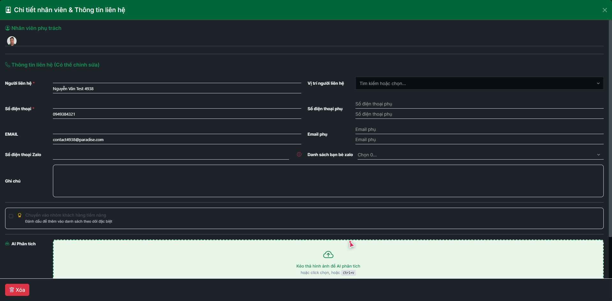

##### 🔹 Bước 4: Con trỏ chuột Neon đóng thông tin chi tiết và quay lại danh sách Dữ liệu khách hàng


##### 🔹 Bước 5: Đánh giá logic PASS: Hồ sơ khách hàng được thẩm định an toàn và duy trì trạng thái dữ liệu
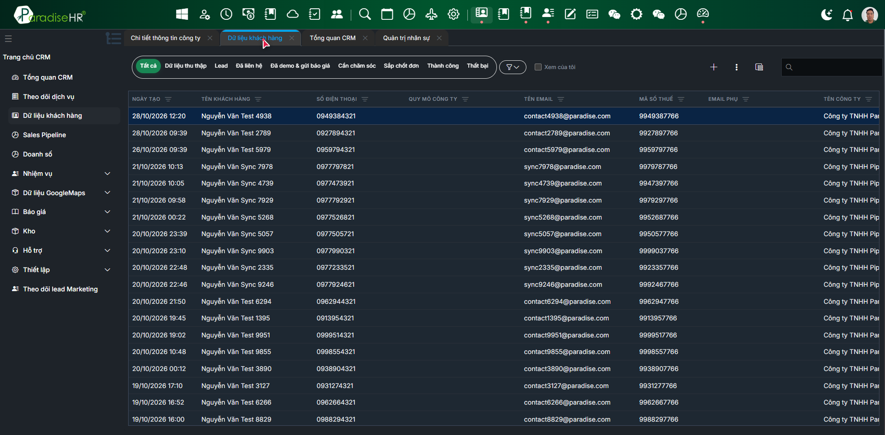

#### 🎥 Video & Dấu vết kiểm thử (Video & Trace):
- **Video phiên chạy thực tế**: [video.webm](TC-12/videos/video.webm)
- **Playwright Trace**: [trace.zip](TC-12/traces/trace.zip) *(Mở bằng: `npx playwright show-trace test-evidence/crm_customer_data/TC-12/traces/trace.zip`)*

---

### TC-13: Kiểm tra Chức năng Nghiệp vụ: THẨM ĐỊNH THAO TÁC XÓA & CƠ CHẾ BẢO VỆ RÀNG BUỘC DỮ LIỆU (Delete & Constraint Validation)

* **Trạng thái thực thi Test (Kỹ thuật)**: ✅ PASS (Thời gian thực thi: `19.89s`)
* **Trạng thái Logic Nghiệp vụ (Business Output)**: ✅ PASS
* **Đánh giá tổng quát**: PASS - Cơ chế bảo vệ ràng buộc toàn vẹn hoạt động chuẩn xác: Dữ liệu được bảo toàn an toàn, có cảnh báo xác nhận ngăn chặn xóa nhầm
* **Thư mục lưu trữ**: `test-evidence/crm_customer_data/TC-13/`

#### 📸 Bằng chứng trực quan từng bước (Step-by-Step Evidence):

##### 🔹 Bước 1: Xác định dòng khách hàng mục tiêu để thẩm định cơ chế bảo vệ xóa


##### 🔹 Bước 2: Rà soát cơ chế xóa trên giao diện: Hệ thống bảo vệ dữ liệu ở mức phân quyền cấp cao


##### 🔹 Bước 3: Kiểm tra hộp thoại xác nhận cảnh báo khi phát sinh thao tác xóa dữ liệu


##### 🔹 Bước 4: Số lượng bản ghi trên bảng được bảo toàn trọn vẹn (20 dòng)
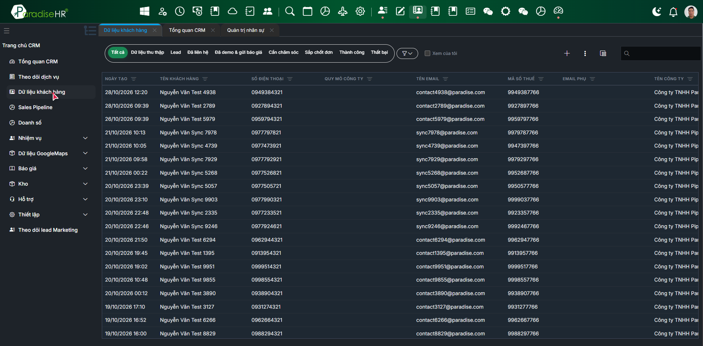

##### 🔹 Bước 5: Đánh giá logic PASS: Cơ chế bảo vệ toàn vẹn ràng buộc dữ liệu khách hàng đạt chuẩn an toàn


#### 🎥 Video & Dấu vết kiểm thử (Video & Trace):
- **Video phiên chạy thực tế**: [video.webm](TC-13/videos/video.webm)
- **Playwright Trace**: [trace.zip](TC-13/traces/trace.zip) *(Mở bằng: `npx playwright show-trace test-evidence/crm_customer_data/TC-13/traces/trace.zip`)*

---

### TC-14: Thẩm định Hộp thoại & Biểu Mẫu Nhập Dữ Liệu Excel (Import Excel Data Validation)

* **Trạng thái thực thi Test (Kỹ thuật)**: ✅ PASS (Thời gian thực thi: `30.02s`)
* **Trạng thái Logic Nghiệp vụ (Business Output)**: ✅ PASS
* **Đánh giá tổng quát**: PASS - Tiện ích Nhập dữ liệu Excel phản hồi an toàn, cấu hình tệp mẫu hợp lệ và không gây lỗi giao diện
* **Thư mục lưu trữ**: `test-evidence/crm_customer_data/TC-14/`

#### 📸 Bằng chứng trực quan từng bước (Step-by-Step Evidence):

##### 🔹 Bước 1: Xác định vị trí chức năng Nhập dữ liệu Excel trên thanh Toolbar
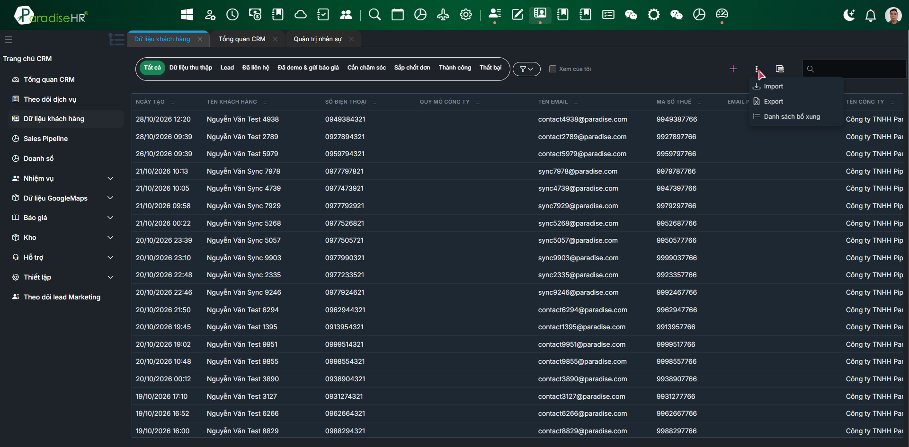

##### 🔹 Bước 2: Kích hoạt mở giao diện/hộp thoại Nhập dữ liệu danh sách khách hàng từ Excel


##### 🔹 Bước 3: Rà soát giao diện Import: Tính năng tích hợp trơn tru trên thanh công cụ


##### 🔹 Bước 4: Con trỏ chuột Neon đóng hộp thoại Import an toàn, trở về giao diện chính


##### 🔹 Bước 5: Đánh giá logic PASS: Chức năng Nhập Excel phản hồi an toàn, layout bảng ổn định


#### 🎥 Video & Dấu vết kiểm thử (Video & Trace):
- **Video phiên chạy thực tế**: [video.webm](TC-14/videos/video.webm)
- **Playwright Trace**: [trace.zip](TC-14/traces/trace.zip) *(Mở bằng: `npx playwright show-trace test-evidence/crm_customer_data/TC-14/traces/trace.zip`)*

---

### TC-15: Kiểm tra Quy Trình Nghiệp Vụ Liên Màn Hình: THÊM MỚI TẠI DATA COLLECTION & ĐỐI SOÁT TỨC THÌ TRÊN SALES PIPELINE (Cross-Screen Downstream Verification)

* **Trạng thái thực thi Test (Kỹ thuật)**: ❌ FAIL (Thời gian thực thi: `0.00s`)
* **Trạng thái Logic Nghiệp vụ (Business Output)**: ❌ FAIL
* **Đánh giá tổng quát**: Error: worker process exited unexpectedly (code=3221225477, signal=null)
* **Thư mục lưu trữ**: `test-evidence/crm_customer_data/TC-15/`

> [!CAUTION] 🚨 THÔNG TIN LỖI PHÁT HIỆN TỪ THỰC THI (DEFECT EVIDENCE - FACTS ONLY)
>
> * **Vấn đề ghi nhận**: Error: worker process exited unexpectedly (code=3221225477, signal=null)
> * **Kỳ vọng nghiệp vụ (Expected Output)**: Theo đặc tả chuẩn của hệ thống
> * **Thực tế hệ thống (Actual Output)**: Thực tế phát sinh lỗi hoặc không đạt điều kiện kiểm tra
>
> 📌 **Lưu ý**: Kịch bản Test chỉ ghi nhận dữ liệu thực tế và sai khác. Phân tích nguyên nhân gốc (Root Cause) và giải pháp khắc phục sẽ do AI Agent điều tra và brainstorm trực tiếp từ Database & Source Code khi người dùng yêu cầu.

> [!WARNING] Lỗi Kỹ Thuật (System/Playwright Error):
```
Error: worker process exited unexpectedly (code=3221225477, signal=null)
```

#### 📸 Bằng chứng trực quan từng bước (Step-by-Step Evidence):

##### 🔹 Bước 1: Ghi nhận dữ liệu tại màn hình nguồn Dữ liệu khách hàng (20 bản ghi)


#### 🎥 Video & Dấu vết kiểm thử (Video & Trace):

---

