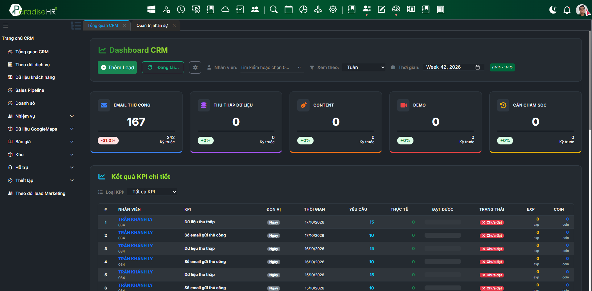

# BÁO CÁO KIỂM THỬ TRANG: CRM_DASHBOARD

> Thời gian kiểm thử: 15:03:41 15/10/2026
> Tổng số kịch bản: **2** | ✅ PASS: **2** | ❌ FAIL: **0**

---

### TC-01: TC-01: Kiểm tra Trang Chủ CRM - Dashboard KPI, Thống kê & Widget Cards

* **Kết quả**: ✅ PASS (Thời gian: `15.81s`)
* **Thư mục lưu trữ**: `test-evidence/crm_dashboard/TC-01/`

#### Bằng chứng kiểm thử (Evidence):
- **Ảnh chụp màn hình (Screenshots)**:
  - 
- **Video quay trực tiếp (Video)**:
  - [video.webm](TC-01/videos/video.webm)
- **Playwright Trace**:
  - [trace.zip](TC-01/traces/trace.zip) *(Mở bằng: `npx playwright show-trace test-evidence/crm_dashboard/TC-01/traces/trace.zip`)*

---

### TC-02: TC-02: Kiểm tra Tổng quan CRM - Bộ lọc, Tìm kiếm, Button và Modal (Cấu hình KPI, Thêm Lead)

* **Kết quả**: ✅ PASS (Thời gian: `26.43s`)
* **Thư mục lưu trữ**: `test-evidence/crm_dashboard/TC-02/`

#### Bằng chứng kiểm thử (Evidence):
- **Ảnh chụp màn hình (Screenshots)**:
  - 
- **Video quay trực tiếp (Video)**:
  - [video.webm](TC-02/videos/video.webm)
- **Playwright Trace**:
  - [trace.zip](TC-02/traces/trace.zip) *(Mở bằng: `npx playwright show-trace test-evidence/crm_dashboard/TC-02/traces/trace.zip`)*

---

