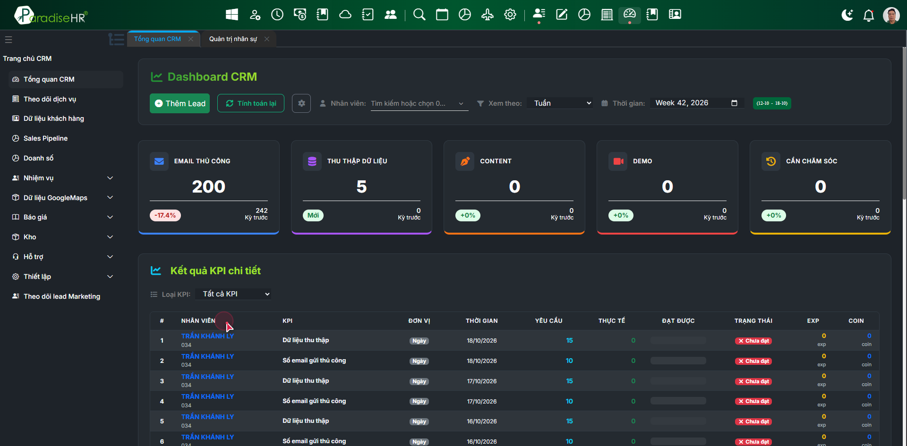
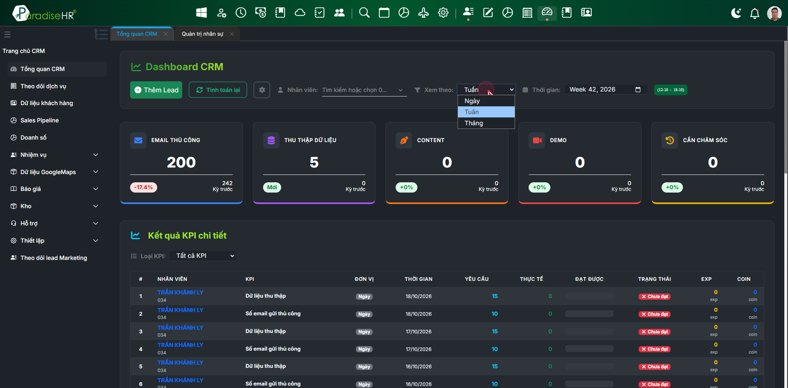
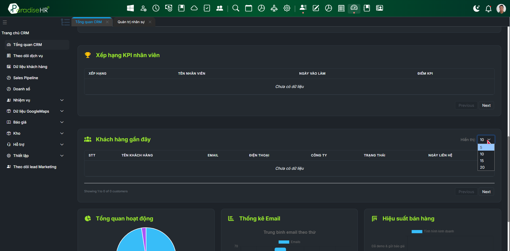
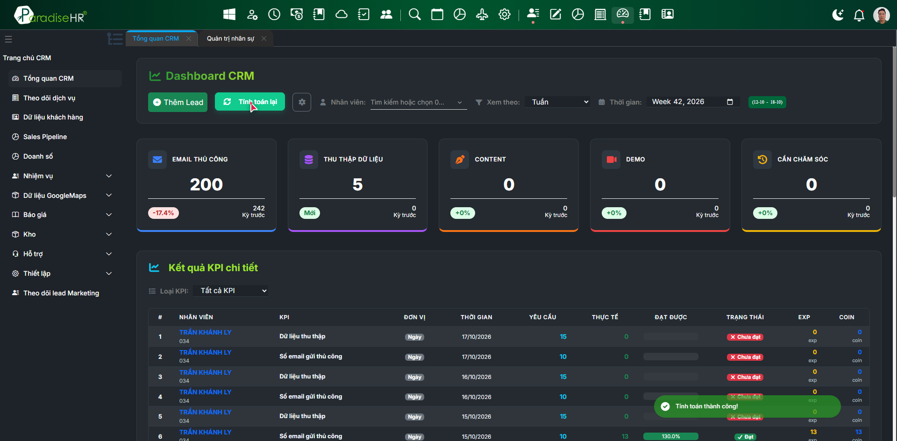
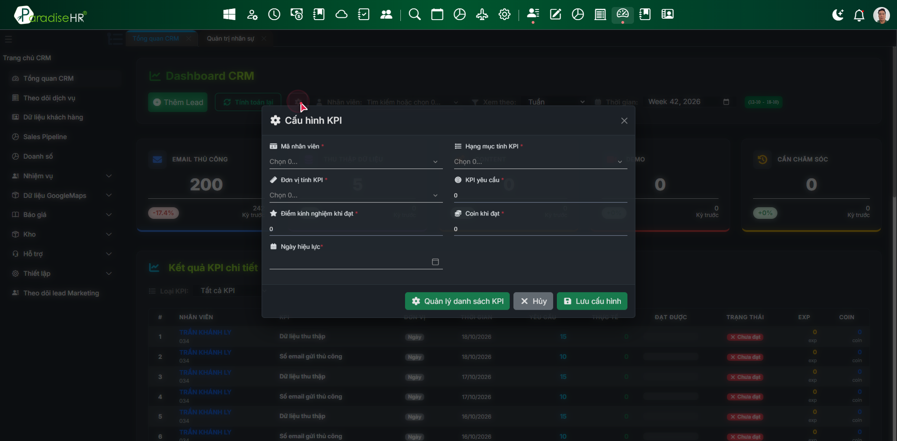
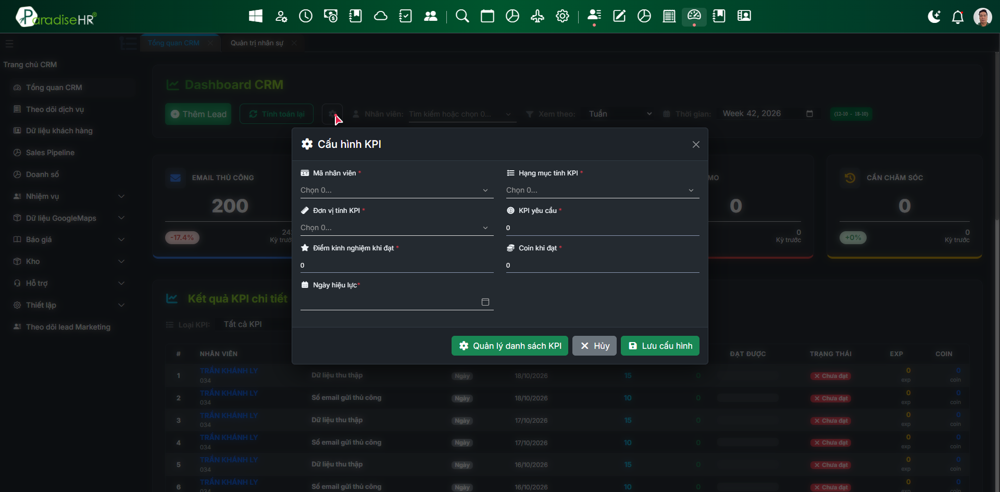
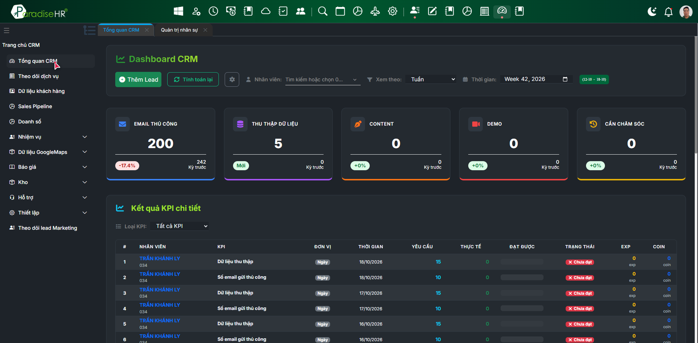
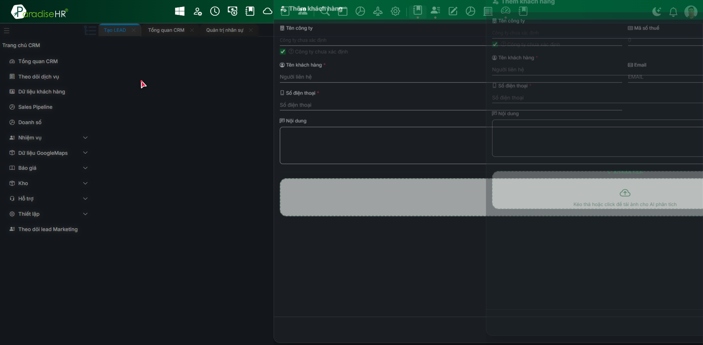
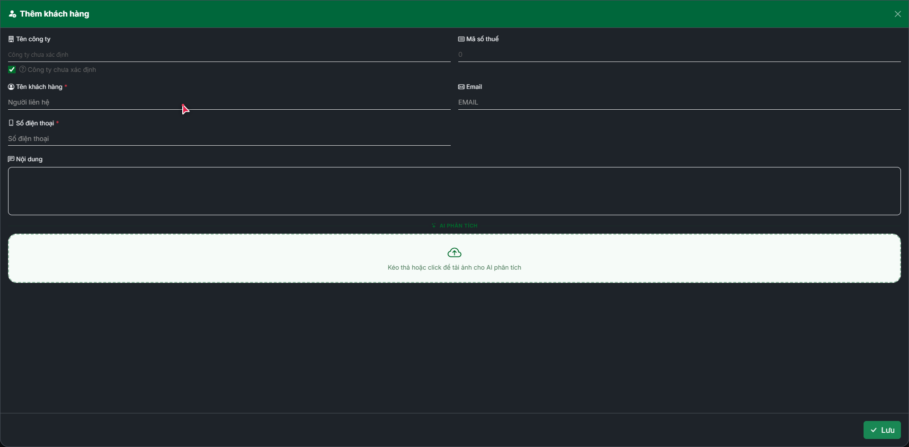

# BÁO CÁO KIỂM THỬ TRANG: CRM_OVERVIEW

> Thời gian kiểm thử: **11:11:11 19/10/2026**
> Tổng số kịch bản: **4** | ✅ LOGIC PASS: **4** | ❌ LOGIC FAIL: **0**

## BẢNG ĐỐI CHIẾU TRẠNG THÁI TEST & LOGIC NGHIỆP VỤ

| Mã TC | Tiêu đề Kịch bản | Trạng thái Test | Trạng thái Logic | Đánh giá Nghiệp vụ |
| :--- | :--- | :---: | :---: | :--- |
| **TC-01** | Thẩm định Giao diện Dashboard KPI, Thẻ Chỉ số & Bảng Kết quả Chi tiết | ✅ PASS | ✅ PASS | PASS - Màn hình Tổng quan CRM nạp đầy đủ các widget và bảng KPI chi tiết |
| **TC-02** | Thẩm định Bộ lọc Kỳ dữ liệu (#filterType, #filterDate) & Nút Tính toán lại (#btnRecalculate) | ✅ PASS | ✅ PASS | PASS - Các bộ lọc thời gian và nút Tính toán lại phản hồi tốt, dữ liệu đồng bộ |
| **TC-03** | Thẩm định Nút Thiết lập (#btnSettings) & Đóng/Mở Modal Cấu hình KPI | ✅ PASS | ✅ PASS | PASS - Modal Cấu hình KPI mở và đóng mượt mà, đầy đủ các trường thiết lập |
| **TC-04** | Thẩm định Nút Thêm Lead (#btnCreateLead) & Modal Tạo Mới Lead Nhanh | ✅ PASS | ✅ PASS | PASS - Nút Thêm Lead mở đúng modal tạo khách hàng, các trường nhập liệu phản hồi tốt |

---

### TC-01: Thẩm định Giao diện Dashboard KPI, Thẻ Chỉ số & Bảng Kết quả Chi tiết

* **Trạng thái thực thi Test (Kỹ thuật)**: ✅ PASS (Thời gian thực thi: `21.82s`)
* **Trạng thái Logic Nghiệp vụ (Business Output)**: ✅ PASS
* **Đánh giá tổng quát**: PASS - Màn hình Tổng quan CRM nạp đầy đủ các widget và bảng KPI chi tiết
* **Thư mục lưu trữ**: `test-evidence/crm_overview/TC-01/`

#### 📸 Bằng chứng trực quan từng bước (Step-by-Step Evidence):

##### 🔹 Bước 1: Mở thành công màn hình Tổng quan CRM

##### 🔹 Bước 2: Xác nhận hiển thị khu vực Dashboard KPI và các thẻ chỉ số

##### 🔹 Bước 3: Bảng kết quả KPI chi tiết nạp đầy đủ danh sách nhân viên

##### 🔹 Bước 4: Con trỏ Neon rà soát các cột chỉ số Yêu cầu Thực tế và Đạt được

##### 🔹 Bước 5: Dashboard KPI nạp dữ liệu thành công đạt chuẩn

#### 🎥 Video & Dấu vết kiểm thử (Video & Trace):
- **Video phiên chạy thực tế**: [video.webm](TC-01/videos/video.webm)
- **Playwright Trace**: [trace.zip](TC-01/traces/trace.zip) *(Mở bằng: `npx playwright show-trace test-evidence/crm_overview/TC-01/traces/trace.zip`)*

---

### TC-02: Thẩm định Bộ lọc Kỳ dữ liệu (#filterType, #filterDate) & Nút Tính toán lại (#btnRecalculate)

* **Trạng thái thực thi Test (Kỹ thuật)**: ✅ PASS (Thời gian thực thi: `28.51s`)
* **Trạng thái Logic Nghiệp vụ (Business Output)**: ✅ PASS
* **Đánh giá tổng quát**: PASS - Các bộ lọc thời gian và nút Tính toán lại phản hồi tốt, dữ liệu đồng bộ
* **Thư mục lưu trữ**: `test-evidence/crm_overview/TC-02/`

#### 📸 Bằng chứng trực quan từng bước (Step-by-Step Evidence):

##### 🔹 Bước 1: Kiểm tra dropdown chọn loại thời gian theo tuần tháng năm

##### 🔹 Bước 2: Kiểm tra ô chọn kỳ tuần hiện tại

##### 🔹 Bước 3: Thay đổi tùy chọn số dòng hiển thị trên bảng

##### 🔹 Bước 4: Con trỏ Neon bấm nút Tính toán lại và bắt phản hồi hệ thống

##### 🔹 Bước 5: Dữ liệu được tính toán lại thành công không bị gián đoạn

#### 🎥 Video & Dấu vết kiểm thử (Video & Trace):
- **Video phiên chạy thực tế**: [video.webm](TC-02/videos/video.webm)
- **Playwright Trace**: [trace.zip](TC-02/traces/trace.zip) *(Mở bằng: `npx playwright show-trace test-evidence/crm_overview/TC-02/traces/trace.zip`)*

---

### TC-03: Thẩm định Nút Thiết lập (#btnSettings) & Đóng/Mở Modal Cấu hình KPI

* **Trạng thái thực thi Test (Kỹ thuật)**: ✅ PASS (Thời gian thực thi: `23.01s`)
* **Trạng thái Logic Nghiệp vụ (Business Output)**: ✅ PASS
* **Đánh giá tổng quát**: PASS - Modal Cấu hình KPI mở và đóng mượt mà, đầy đủ các trường thiết lập
* **Thư mục lưu trữ**: `test-evidence/crm_overview/TC-03/`

#### 📸 Bằng chứng trực quan từng bước (Step-by-Step Evidence):

##### 🔹 Bước 1: Xác định vị trí nút Thiết lập cấu hình KPI

##### 🔹 Bước 2: Modal Cấu hình KPI hiển thị trực quan trên màn hình

##### 🔹 Bước 3: Kiểm tra các trường thiết lập tỷ lệ và tiêu chí KPI

##### 🔹 Bước 4: Con trỏ Neon bấm nút Đóng modal cấu hình KPI

##### 🔹 Bước 5: Modal đóng an toàn không để lại overlay chắn giao diện

#### 🎥 Video & Dấu vết kiểm thử (Video & Trace):
- **Video phiên chạy thực tế**: [video.webm](TC-03/videos/video.webm)
- **Playwright Trace**: [trace.zip](TC-03/traces/trace.zip) *(Mở bằng: `npx playwright show-trace test-evidence/crm_overview/TC-03/traces/trace.zip`)*

---

### TC-04: Thẩm định Nút Thêm Lead (#btnCreateLead) & Modal Tạo Mới Lead Nhanh

* **Trạng thái thực thi Test (Kỹ thuật)**: ✅ PASS (Thời gian thực thi: `24.28s`)
* **Trạng thái Logic Nghiệp vụ (Business Output)**: ✅ PASS
* **Đánh giá tổng quát**: PASS - Nút Thêm Lead mở đúng modal tạo khách hàng, các trường nhập liệu phản hồi tốt
* **Thư mục lưu trữ**: `test-evidence/crm_overview/TC-04/`

#### 📸 Bằng chứng trực quan từng bước (Step-by-Step Evidence):

##### 🔹 Bước 1: Xác định vị trí nút Thêm Lead màu xanh lá

##### 🔹 Bước 2: Modal Thêm LEAD mở lên với đầy đủ các trường nhập liệu

##### 🔹 Bước 3: Kiểm tra khả năng nhập liệu trực quan vào ô Tên khách hàng

##### 🔹 Bước 4: Con trỏ Neon bấm nút Đóng modal Thêm Lead

##### 🔹 Bước 5: Màn hình Tổng quan CRM phục hồi nguyên vẹn sau khi đóng modal

#### 🎥 Video & Dấu vết kiểm thử (Video & Trace):
- **Video phiên chạy thực tế**: [video.webm](TC-04/videos/video.webm)
- **Playwright Trace**: [trace.zip](TC-04/traces/trace.zip) *(Mở bằng: `npx playwright show-trace test-evidence/crm_overview/TC-04/traces/trace.zip`)*

---

