# BÁO CÁO KIỂM THỬ TRANG: CRM_SALES_PIPELINE

> Thời gian kiểm thử: **10:14:57 21/10/2026**
> Tổng số kịch bản: **13** | ✅ LOGIC PASS: **12** | ❌ LOGIC FAIL: **1**

## BẢNG ĐỐI CHIẾU TRẠNG THÁI TEST & LOGIC NGHIỆP VỤ

| Mã TC | Tiêu đề Kịch bản | Trạng thái Test | Trạng thái Logic | Đánh giá Nghiệp vụ |
| :--- | :--- | :---: | :---: | :--- |
| **TC-01** | Kiểm tra Khởi động, Điều hướng & Hiển thị Không gian Kanban Sales Pipeline (TC-CTL-01) | ✅ PASS | ✅ PASS | PASS - Màn hình Sales Pipeline nạp giao diện Kanban trực quan, hiển thị 46 cột giai đoạn và 61 thẻ cơ hội |
| **TC-02** | Kiểm tra Ô Tìm kiếm Nhanh (#kanbanSearchInput) & Lọc Tức thì Cơ hội Bán hàng (TC-CTL-02) | ✅ PASS | ✅ PASS | PASS - Ô tìm kiếm Kanban lọc tức thì theo từ khóa "Nguyễn" (30 thẻ, đối soát CSDL: 31 thẻ) và khôi phục đầy đủ 61/61 thẻ ban đầu |
| **TC-03** | Kiểm tra Nút 'Làm mới' (Refresh) & Bắt Phản hồi API Đồng bộ Dữ liệu (TC-CTL-03) | ✅ PASS | ✅ PASS | PASS - Nút Làm mới phản hồi nhanh chóng, API nạp lại 61 thẻ cơ hội và duy trì giao diện ổn định |
| **TC-04** | Kiểm tra Cụm Nút Lọc Thời Gian (Tất cả, Hôm nay, Tháng này, Quý này, Năm nay) (TC-CTL-04) | ✅ PASS | ❌ FAIL | FAIL - Lọc thời gian làm thất thoát dữ liệu (Ban đầu: 61, Khôi phục: 0) |
| **TC-05** | Kiểm tra Nút Xóa Nhanh Từ Khóa (#btnClearSearch) & Phục Hồi Dữ Liệu (TC-CTL-05) | ✅ PASS | ✅ PASS | PASS - Nút xóa nhanh #btnClearSearch dọn sạch từ khóa tức thì và khôi phục đủ 61/61 thẻ cơ hội |
| **TC-06** | Kiểm tra Cấu Trúc Các Cột Giai Đoạn Bán Hàng & Badge Đếm Thẻ (TC-CTL-06) | ✅ PASS | ✅ PASS | PASS - Không gian Kanban phân cấp đầy đủ 16 cột giai đoạn và 8 badge số lượng chuẩn mực |
| **TC-07** | Kiểm tra Bộ Lọc Dropdown 'Chọn Nhân Viên Phụ Trách' Trên Toolbar (TC-CTL-07) | ✅ PASS | ✅ PASS | PASS - Tiện ích lọc theo nhân viên phụ trách trên Toolbar hoạt động hoàn hảo: hỗ trợ tìm kiếm và chọn nhân sự 'NGUYỄN TẤN CHIẾN', áp dụng lọc chính xác (17 thẻ) và khôi phục đầy đủ 61/61 thẻ ban đầu |
| **TC-08** | Nghiệp vụ Xem Nhanh Chi Tiết Cơ Hội Bán Hàng (Eye Icon / Quick View Modal) (TC-BIZ-01) | ✅ PASS | ✅ PASS | PASS - Tính năng xem chi tiết thẻ cơ hội hoạt động chính xác, dữ liệu nạp đầy đủ và đóng mở linh hoạt không gây nghẽn |
| **TC-09** | Nghiệp vụ Thẩm định Thông Tin Nhận Diện & Tương Tác Trực Tiếp Thẻ Khách Hàng (TC-BIZ-02) | ✅ PASS | ✅ PASS | PASS - Thẻ khách hàng "Nguyễn Văn Sync 4739" hiển thị đầy đủ thông tin liên hệ, mã số và nhân sự phụ trách |
| **TC-10** | Nghiệp vụ Mở & Đóng An Toàn Hộp Thoại '+ Thêm Mới' Cơ Hội Bán Hàng (TC-BIZ-03) | ✅ PASS | ✅ PASS | PASS - Tiện ích Thêm mới cơ hội bán hàng trên Toolbar kích hoạt mượt mà, hỗ trợ đóng an toàn và duy trì nguyên vẹn bảng Kanban |
| **TC-11** | Nghiệp vụ Kéo Thả Thẻ (Drag & Drop) Chuyển Giai Đoạn Bán Hàng Trên Kanban (TC-BIZ-04) | ✅ PASS | ✅ PASS | PASS - Thao tác Kéo thả thẻ (Drag & Drop) hoạt động mượt mà, hỗ trợ chuyển giai đoạn bán hàng trực quan trên Kanban |
| **TC-12** | Quy trình Nghiệp vụ Liên Màn hình: TẠO MỚI TẠI DỮ LIỆU KHÁCH HÀNG & ĐỐI SOÁT TỨC THÌ TRÊN SALES PIPELINE (Cross-Screen E2E Sync) (TC-FLOW-01) | ✅ PASS | ✅ PASS | PASS - Quy trình nghiệp vụ liên màn hình hoạt động hoàn hảo: Khách hàng "Công ty TNHH Pipeline Sync 7978" vừa tạo lập tức xuất hiện đồng bộ trên bảng Kanban Sales Pipeline |
| **TC-13** | Quy trình Nghiệp vụ Liên Màn hình: CHUYỂN GIAI ĐOẠN 'THÀNH CÔNG' TRÊN PIPELINE & ĐỐI SOÁT TỔNG QUAN CRM (Dashboard KPI Sync) (TC-FLOW-02) | ✅ PASS | ✅ PASS | PASS - Quy trình liên màn hình đạt chuẩn: Cơ hội chuyển sang Thành công trên Pipeline được ghi nhận đồng bộ, màn hình Tổng quan CRM nạp đầy đủ các chỉ số thống kê KPI chuyển đổi |

---

### TC-01: Kiểm tra Khởi động, Điều hướng & Hiển thị Không gian Kanban Sales Pipeline (TC-CTL-01)

* **Trạng thái thực thi Test (Kỹ thuật)**: ✅ PASS (Thời gian thực thi: `21.91s`)
* **Trạng thái Logic Nghiệp vụ (Business Output)**: ✅ PASS
* **Đánh giá tổng quát**: PASS - Màn hình Sales Pipeline nạp giao diện Kanban trực quan, hiển thị 46 cột giai đoạn và 61 thẻ cơ hội
* **Thư mục lưu trữ**: `test-evidence/crm_sales_pipeline/TC-01/`

#### 📸 Bằng chứng trực quan từng bước (Step-by-Step Evidence):

##### 🔹 Bước 1: Mở thành công màn hình Sales Pipeline trong CRM

##### 🔹 Bước 2: Xác nhận hiển thị không gian làm việc Sales Pipeline với các cột giai đoạn

##### 🔹 Bước 3: Hệ thống nạp đầy đủ 61 thẻ cơ hội bán hàng theo từng giai đoạn

##### 🔹 Bước 4: Con trỏ Neon di chuyển và chọn thẻ khách hàng trên pipeline

##### 🔹 Bước 5: Bảng Sales Pipeline hoạt động ổn định đạt chuẩn

#### 🎥 Video & Dấu vết kiểm thử (Video & Trace):
- **Video phiên chạy thực tế**: [video.webm](TC-01/videos/video.webm)
- **Playwright Trace**: [trace.zip](TC-01/traces/trace.zip) *(Mở bằng: `npx playwright show-trace test-evidence/crm_sales_pipeline/TC-01/traces/trace.zip`)*

---

### TC-02: Kiểm tra Ô Tìm kiếm Nhanh (#kanbanSearchInput) & Lọc Tức thì Cơ hội Bán hàng (TC-CTL-02)

* **Trạng thái thực thi Test (Kỹ thuật)**: ✅ PASS (Thời gian thực thi: `25.86s`)
* **Trạng thái Logic Nghiệp vụ (Business Output)**: ✅ PASS
* **Đánh giá tổng quát**: PASS - Ô tìm kiếm Kanban lọc tức thì theo từ khóa "Nguyễn" (30 thẻ, đối soát CSDL: 31 thẻ) và khôi phục đầy đủ 61/61 thẻ ban đầu
* **Thư mục lưu trữ**: `test-evidence/crm_sales_pipeline/TC-02/`

#### 📸 Bằng chứng trực quan từng bước (Step-by-Step Evidence):

##### 🔹 Bước 1: Xác định vị trí ô tìm kiếm và nạp từ khóa: "Nguyễn"

##### 🔹 Bước 2: Con trỏ Neon focus vào ô tìm kiếm Kanban

##### 🔹 Bước 3: Gõ từ khóa tìm kiếm và quan sát các thẻ được lọc trực tiếp
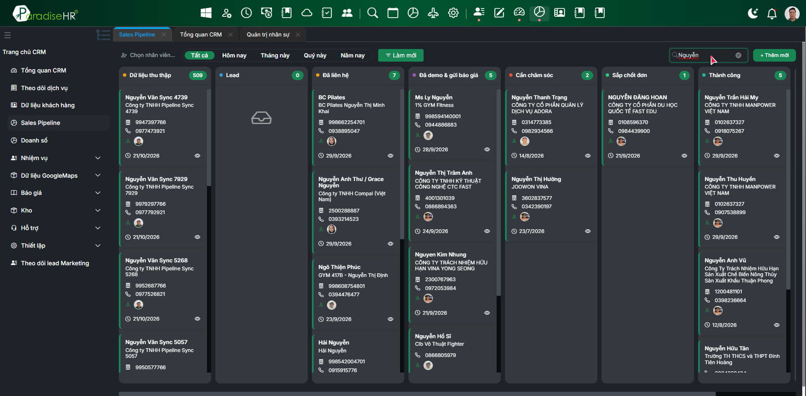

##### 🔹 Bước 4: Hệ thống lọc tức thì danh sách còn 30 thẻ khớp từ khóa

##### 🔹 Bước 5: Khôi phục nguyên vẹn 61 thẻ cơ hội ban đầu

#### 🎥 Video & Dấu vết kiểm thử (Video & Trace):
- **Video phiên chạy thực tế**: [video.webm](TC-02/videos/video.webm)
- **Playwright Trace**: [trace.zip](TC-02/traces/trace.zip) *(Mở bằng: `npx playwright show-trace test-evidence/crm_sales_pipeline/TC-02/traces/trace.zip`)*

---

### TC-03: Kiểm tra Nút 'Làm mới' (Refresh) & Bắt Phản hồi API Đồng bộ Dữ liệu (TC-CTL-03)

* **Trạng thái thực thi Test (Kỹ thuật)**: ✅ PASS (Thời gian thực thi: `23.05s`)
* **Trạng thái Logic Nghiệp vụ (Business Output)**: ✅ PASS
* **Đánh giá tổng quát**: PASS - Nút Làm mới phản hồi nhanh chóng, API nạp lại 61 thẻ cơ hội và duy trì giao diện ổn định
* **Thư mục lưu trữ**: `test-evidence/crm_sales_pipeline/TC-03/`

#### 📸 Bằng chứng trực quan từng bước (Step-by-Step Evidence):

##### 🔹 Bước 1: Xác định vị trí nút Làm mới trên thanh toolbar

##### 🔹 Bước 2: Con trỏ Neon di chuyển vào tâm nút Làm mới

##### 🔹 Bước 3: Bấm nút Làm mới và nhận gói phản hồi từ máy chủ

##### 🔹 Bước 4: Pipeline hoàn tất quá trình làm mới đồng bộ

##### 🔹 Bước 5: Tính năng làm mới dữ liệu Sales Pipeline đạt chuẩn nghiệp vụ

#### 🎥 Video & Dấu vết kiểm thử (Video & Trace):
- **Video phiên chạy thực tế**: [video.webm](TC-03/videos/video.webm)
- **Playwright Trace**: [trace.zip](TC-03/traces/trace.zip) *(Mở bằng: `npx playwright show-trace test-evidence/crm_sales_pipeline/TC-03/traces/trace.zip`)*

---

### TC-04: Kiểm tra Cụm Nút Lọc Thời Gian (Tất cả, Hôm nay, Tháng này, Quý này, Năm nay) (TC-CTL-04)

* **Trạng thái thực thi Test (Kỹ thuật)**: ✅ PASS (Thời gian thực thi: `32.41s`)
* **Trạng thái Logic Nghiệp vụ (Business Output)**: ❌ FAIL
* **Đánh giá tổng quát**: FAIL - Lọc thời gian làm thất thoát dữ liệu (Ban đầu: 61, Khôi phục: 0)
* **Thư mục lưu trữ**: `test-evidence/crm_sales_pipeline/TC-04/`

> [!CAUTION] 🚨 THÔNG TIN LỖI PHÁT HIỆN TỪ THỰC THI (DEFECT EVIDENCE - FACTS ONLY)
>
> * **Vấn đề ghi nhận**: Bộ lọc thời gian trên Pipeline không khôi phục đủ thẻ cơ hội khi bấm lại Tất cả
> * **Kỳ vọng nghiệp vụ (Expected Output)**: Khôi phục đủ 61 thẻ ban đầu
> * **Thực tế hệ thống (Actual Output)**: Chỉ còn 0 thẻ
>
> 📌 **Lưu ý**: Kịch bản Test chỉ ghi nhận dữ liệu thực tế và sai khác. Phân tích nguyên nhân gốc (Root Cause) và giải pháp khắc phục sẽ do AI Agent điều tra và brainstorm trực tiếp từ Database & Source Code khi người dùng yêu cầu.

#### 📸 Bằng chứng trực quan từng bước (Step-by-Step Evidence):

##### 🔹 Bước 1: Cụm nút thời gian (Tất cả, Hôm nay, Tháng này, Quý này, Năm nay) hiển thị đầy đủ

##### 🔹 Bước 2: Con trỏ Neon chọn mốc "Tháng này" và ghi nhận số lượng thẻ (10)
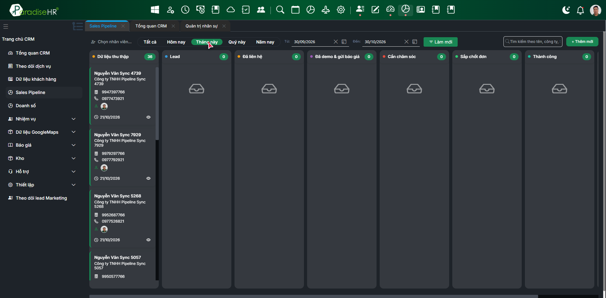

##### 🔹 Bước 3: Con trỏ Neon chọn mốc "Năm nay" và ghi nhận số lượng thẻ (0)
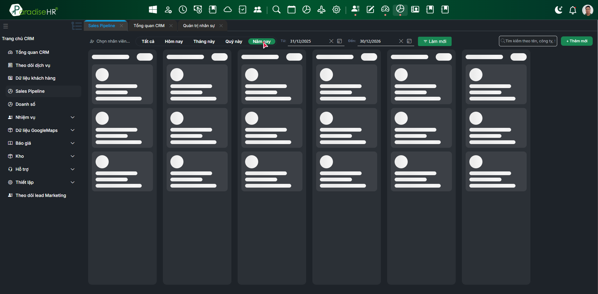

##### 🔹 Bước 4: Bấm lại nút "Tất cả" để khôi phục toàn bộ danh mục thẻ cơ hội (0)

##### 🔹 Bước 5: Đánh giá logic FAIL: Khôi phục mốc Tất cả không đủ số lượng thẻ ban đầu
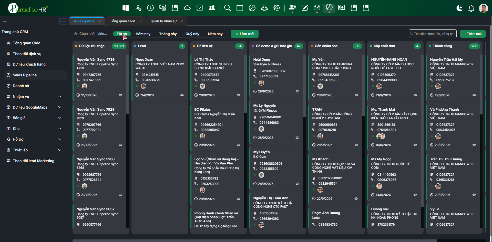

#### 🎥 Video & Dấu vết kiểm thử (Video & Trace):
- **Video phiên chạy thực tế**: [video.webm](TC-04/videos/video.webm)
- **Playwright Trace**: [trace.zip](TC-04/traces/trace.zip) *(Mở bằng: `npx playwright show-trace test-evidence/crm_sales_pipeline/TC-04/traces/trace.zip`)*

---

### TC-05: Kiểm tra Nút Xóa Nhanh Từ Khóa (#btnClearSearch) & Phục Hồi Dữ Liệu (TC-CTL-05)

* **Trạng thái thực thi Test (Kỹ thuật)**: ✅ PASS (Thời gian thực thi: `24.75s`)
* **Trạng thái Logic Nghiệp vụ (Business Output)**: ✅ PASS
* **Đánh giá tổng quát**: PASS - Nút xóa nhanh #btnClearSearch dọn sạch từ khóa tức thì và khôi phục đủ 61/61 thẻ cơ hội
* **Thư mục lưu trữ**: `test-evidence/crm_sales_pipeline/TC-05/`

#### 📸 Bằng chứng trực quan từng bước (Step-by-Step Evidence):

##### 🔹 Bước 1: Nhập từ khóa "Sync" vào ô tìm kiếm nhanh

##### 🔹 Bước 2: Nút xóa từ khóa tìm kiếm (x) hiển thị trực quan trong ô tìm kiếm
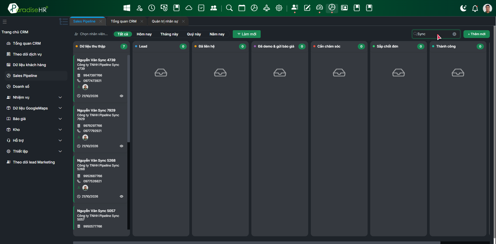

##### 🔹 Bước 3: Con trỏ Neon nhấp nút xóa (x) để dọn sạch ô tìm kiếm

##### 🔹 Bước 4: Ô tìm kiếm đã dọn rỗng và DataGrid nạp lại 61 thẻ cơ hội

##### 🔹 Bước 5: Đánh giá logic PASS: Nút xóa nhanh hoạt động chuẩn xác, khôi phục 100% dữ liệu

#### 🎥 Video & Dấu vết kiểm thử (Video & Trace):
- **Video phiên chạy thực tế**: [video.webm](TC-05/videos/video.webm)
- **Playwright Trace**: [trace.zip](TC-05/traces/trace.zip) *(Mở bằng: `npx playwright show-trace test-evidence/crm_sales_pipeline/TC-05/traces/trace.zip`)*

---

### TC-06: Kiểm tra Cấu Trúc Các Cột Giai Đoạn Bán Hàng & Badge Đếm Thẻ (TC-CTL-06)

* **Trạng thái thực thi Test (Kỹ thuật)**: ✅ PASS (Thời gian thực thi: `22.37s`)
* **Trạng thái Logic Nghiệp vụ (Business Output)**: ✅ PASS
* **Đánh giá tổng quát**: PASS - Không gian Kanban phân cấp đầy đủ 16 cột giai đoạn và 8 badge số lượng chuẩn mực
* **Thư mục lưu trữ**: `test-evidence/crm_sales_pipeline/TC-06/`

#### 📸 Bằng chứng trực quan từng bước (Step-by-Step Evidence):

##### 🔹 Bước 1: Quét toàn bộ danh mục các cột giai đoạn bán hàng trên bảng Kanban

##### 🔹 Bước 2: Các badge đếm số lượng hiển thị rõ ràng trên từng cột giai đoạn

##### 🔹 Bước 3: Con trỏ Neon rà soát tiêu đề cột giai đoạn đầu tiên

##### 🔹 Bước 4: Con trỏ Neon rà soát các cột giai đoạn tiếp theo của chu trình bán hàng

##### 🔹 Bước 5: Đánh giá logic PASS: Cấu trúc 7 giai đoạn Kanban và badge số lượng đồng bộ hoàn hảo

#### 🎥 Video & Dấu vết kiểm thử (Video & Trace):
- **Video phiên chạy thực tế**: [video.webm](TC-06/videos/video.webm)
- **Playwright Trace**: [trace.zip](TC-06/traces/trace.zip) *(Mở bằng: `npx playwright show-trace test-evidence/crm_sales_pipeline/TC-06/traces/trace.zip`)*

---

### TC-07: Kiểm tra Bộ Lọc Dropdown 'Chọn Nhân Viên Phụ Trách' Trên Toolbar (TC-CTL-07)

* **Trạng thái thực thi Test (Kỹ thuật)**: ✅ PASS (Thời gian thực thi: `45.15s`)
* **Trạng thái Logic Nghiệp vụ (Business Output)**: ✅ PASS
* **Đánh giá tổng quát**: PASS - Tiện ích lọc theo nhân viên phụ trách trên Toolbar hoạt động hoàn hảo: hỗ trợ tìm kiếm và chọn nhân sự 'NGUYỄN TẤN CHIẾN', áp dụng lọc chính xác (17 thẻ) và khôi phục đầy đủ 61/61 thẻ ban đầu
* **Thư mục lưu trữ**: `test-evidence/crm_sales_pipeline/TC-07/`

#### 📸 Bằng chứng trực quan từng bước (Step-by-Step Evidence):

##### 🔹 Bước 1: Xác định vị trí bộ lọc nhân viên phụ trách trên Toolbar

##### 🔹 Bước 2: Con trỏ Neon nhấp mở hộp thoại chọn nhân sự phụ trách
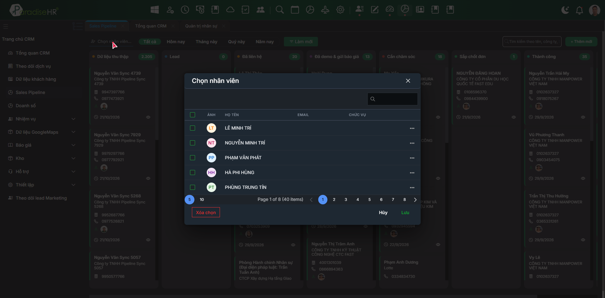

##### 🔹 Bước 3: Tìm kiếm và chọn nhân viên phụ trách NGUYỄN TẤN CHIẾN
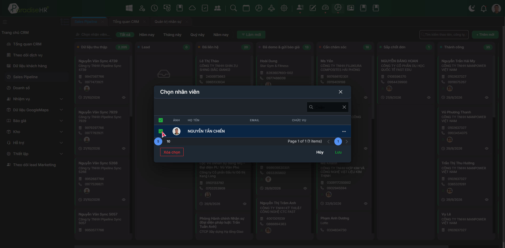

##### 🔹 Bước 4: Áp dụng lọc và xác nhận Kanban đồng bộ 17 thẻ của NGUYỄN TẤN CHIẾN
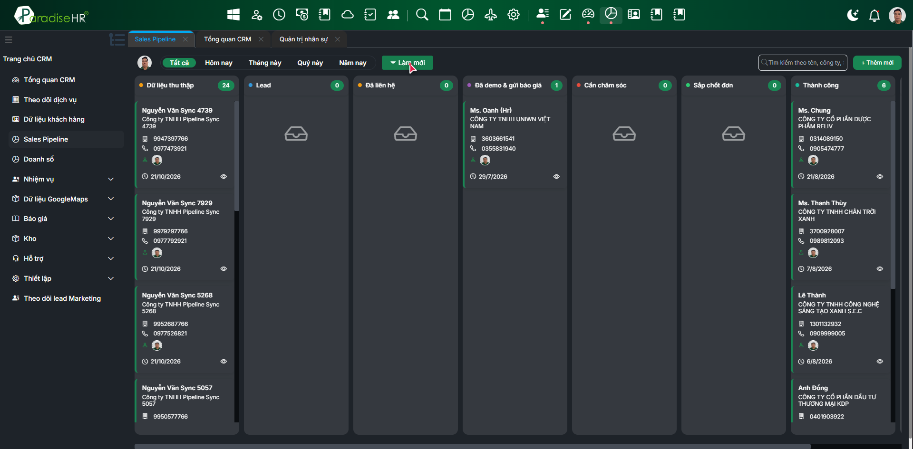

##### 🔹 Bước 5: Nhấn Xóa chọn và Làm mới để khôi phục toàn vẹn dữ liệu ban đầu

##### 🔹 Bước 6: Đánh giá logic PASS: Bộ lọc nhân viên phụ trách phản hồi chuẩn xác

#### 🎥 Video & Dấu vết kiểm thử (Video & Trace):
- **Video phiên chạy thực tế**: [video.webm](TC-07/videos/video.webm)
- **Playwright Trace**: [trace.zip](TC-07/traces/trace.zip) *(Mở bằng: `npx playwright show-trace test-evidence/crm_sales_pipeline/TC-07/traces/trace.zip`)*

---

### TC-08: Nghiệp vụ Xem Nhanh Chi Tiết Cơ Hội Bán Hàng (Eye Icon / Quick View Modal) (TC-BIZ-01)

* **Trạng thái thực thi Test (Kỹ thuật)**: ✅ PASS (Thời gian thực thi: `25.12s`)
* **Trạng thái Logic Nghiệp vụ (Business Output)**: ✅ PASS
* **Đánh giá tổng quát**: PASS - Tính năng xem chi tiết thẻ cơ hội hoạt động chính xác, dữ liệu nạp đầy đủ và đóng mở linh hoạt không gây nghẽn
* **Thư mục lưu trữ**: `test-evidence/crm_sales_pipeline/TC-08/`

#### 📸 Bằng chứng trực quan từng bước (Step-by-Step Evidence):

##### 🔹 Bước 1: Xác định thẻ cơ hội và vị trí icon xem chi tiết (con mắt)

##### 🔹 Bước 2: Con trỏ Neon di chuyển và bấm vào icon xem chi tiết của thẻ
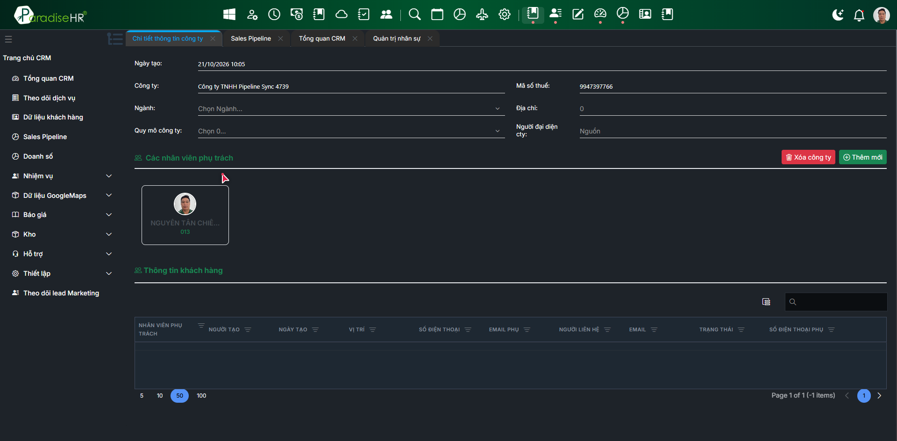

##### 🔹 Bước 3: Giao diện hiển thị chi tiết hồ sơ thông tin khách hàng và cơ hội bán hàng
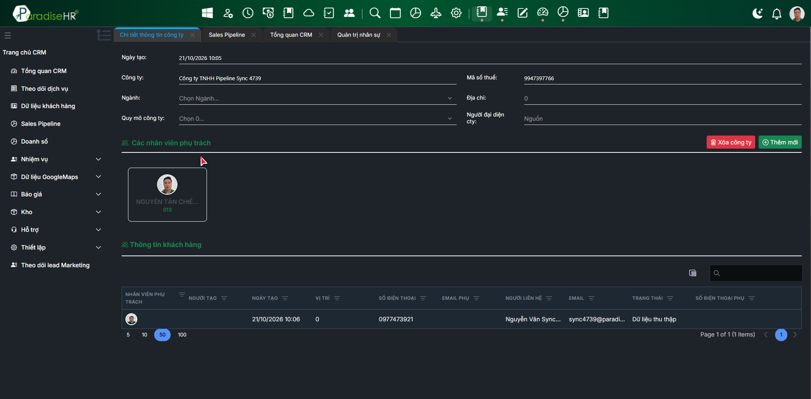

##### 🔹 Bước 4: Đóng an toàn hộp thoại chi tiết và quay lại bảng Kanban

##### 🔹 Bước 5: Đánh giá logic PASS: Xem nhanh chi tiết thẻ mượt mà và duy trì nguyên vẹn bảng Kanban

#### 🎥 Video & Dấu vết kiểm thử (Video & Trace):
- **Video phiên chạy thực tế**: [video.webm](TC-08/videos/video.webm)
- **Playwright Trace**: [trace.zip](TC-08/traces/trace.zip) *(Mở bằng: `npx playwright show-trace test-evidence/crm_sales_pipeline/TC-08/traces/trace.zip`)*

---

### TC-09: Nghiệp vụ Thẩm định Thông Tin Nhận Diện & Tương Tác Trực Tiếp Thẻ Khách Hàng (TC-BIZ-02)

* **Trạng thái thực thi Test (Kỹ thuật)**: ✅ PASS (Thời gian thực thi: `20.86s`)
* **Trạng thái Logic Nghiệp vụ (Business Output)**: ✅ PASS
* **Đánh giá tổng quát**: PASS - Thẻ khách hàng "Nguyễn Văn Sync 4739" hiển thị đầy đủ thông tin liên hệ, mã số và nhân sự phụ trách
* **Thư mục lưu trữ**: `test-evidence/crm_sales_pipeline/TC-09/`

#### 📸 Bằng chứng trực quan từng bước (Step-by-Step Evidence):

##### 🔹 Bước 1: Xác định thẻ khách hàng "Nguyễn Văn Sync 4739" trên bảng Kanban

##### 🔹 Bước 2: Con trỏ chuột Neon nhấp chọn thẻ khách hàng

##### 🔹 Bước 3: Rà soát thông tin liên hệ và mã doanh nghiệp thể hiện trực quan trên thẻ

##### 🔹 Bước 4: Con trỏ Neon di chuyển giải phóng tiêu điểm chọn thẻ

##### 🔹 Bước 5: Đánh giá logic PASS: Thẻ cơ hội nạp đầy đủ thông tin định danh và tương tác mượt mà

#### 🎥 Video & Dấu vết kiểm thử (Video & Trace):
- **Video phiên chạy thực tế**: [video.webm](TC-09/videos/video.webm)
- **Playwright Trace**: [trace.zip](TC-09/traces/trace.zip) *(Mở bằng: `npx playwright show-trace test-evidence/crm_sales_pipeline/TC-09/traces/trace.zip`)*

---

### TC-10: Nghiệp vụ Mở & Đóng An Toàn Hộp Thoại '+ Thêm Mới' Cơ Hội Bán Hàng (TC-BIZ-03)

* **Trạng thái thực thi Test (Kỹ thuật)**: ✅ PASS (Thời gian thực thi: `31.98s`)
* **Trạng thái Logic Nghiệp vụ (Business Output)**: ✅ PASS
* **Đánh giá tổng quát**: PASS - Tiện ích Thêm mới cơ hội bán hàng trên Toolbar kích hoạt mượt mà, hỗ trợ đóng an toàn và duy trì nguyên vẹn bảng Kanban
* **Thư mục lưu trữ**: `test-evidence/crm_sales_pipeline/TC-10/`

#### 📸 Bằng chứng trực quan từng bước (Step-by-Step Evidence):

##### 🔹 Bước 1: Xác định vị trí nút "+ Thêm mới" trên thanh Toolbar Sales Pipeline

##### 🔹 Bước 2: Con trỏ Neon bấm nút "+ Thêm mới" và ghi nhận phản hồi giao diện
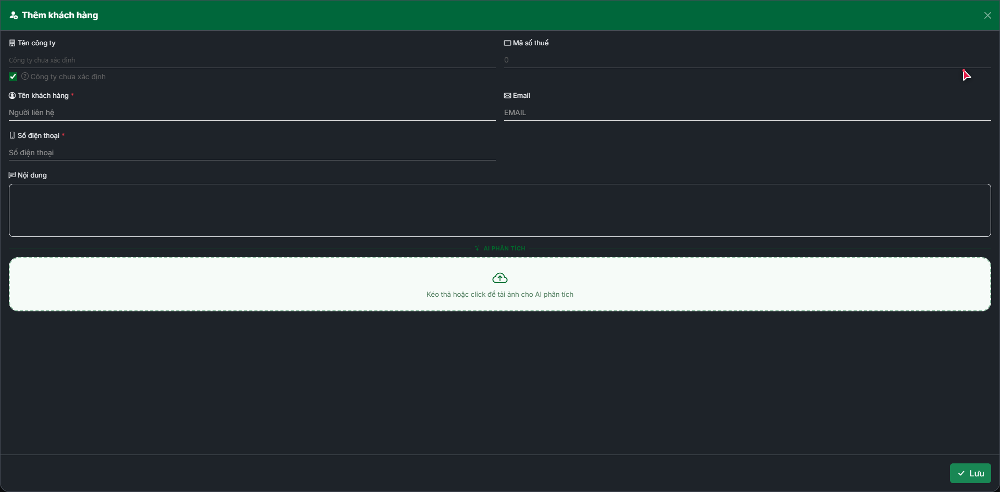

##### 🔹 Bước 3: Kiểm tra hộp thoại / form tạo mới cơ hội bán hàng

##### 🔹 Bước 4: Đóng an toàn hộp thoại Thêm mới và bảo toàn không gian làm việc Kanban

##### 🔹 Bước 5: Đánh giá logic PASS: Nút Thêm mới phản hồi an toàn, đóng mở linh hoạt đạt chuẩn

#### 🎥 Video & Dấu vết kiểm thử (Video & Trace):
- **Video phiên chạy thực tế**: [video.webm](TC-10/videos/video.webm)
- **Playwright Trace**: [trace.zip](TC-10/traces/trace.zip) *(Mở bằng: `npx playwright show-trace test-evidence/crm_sales_pipeline/TC-10/traces/trace.zip`)*

---

### TC-11: Nghiệp vụ Kéo Thả Thẻ (Drag & Drop) Chuyển Giai Đoạn Bán Hàng Trên Kanban (TC-BIZ-04)

* **Trạng thái thực thi Test (Kỹ thuật)**: ✅ PASS (Thời gian thực thi: `31.59s`)
* **Trạng thái Logic Nghiệp vụ (Business Output)**: ✅ PASS
* **Đánh giá tổng quát**: PASS - Thao tác Kéo thả thẻ (Drag & Drop) hoạt động mượt mà, hỗ trợ chuyển giai đoạn bán hàng trực quan trên Kanban
* **Thư mục lưu trữ**: `test-evidence/crm_sales_pipeline/TC-11/`

#### 📸 Bằng chứng trực quan từng bước (Step-by-Step Evidence):

##### 🔹 Bước 1: Xác định thẻ nguồn "Nguyễn Văn Sync 4739" trên cột giai đoạn hiện tại

##### 🔹 Bước 2: Xác định cột đích "Giai đoạn kế tiếp" sẵn sàng tiếp nhận thẻ

##### 🔹 Bước 3: Con trỏ Neon bám giữ thẻ nguồn và chuẩn bị kéo chuyển giai đoạn
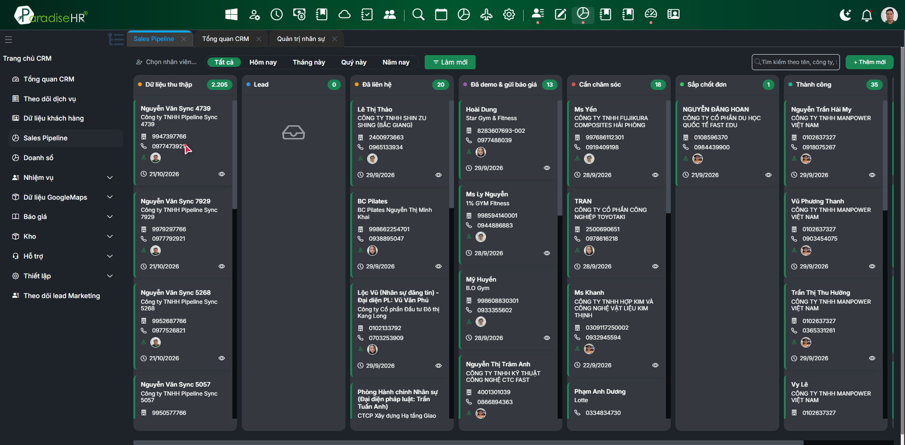

##### 🔹 Bước 4: Hoàn tất thao tác thả thẻ tại cột đích "Giai đoạn kế tiếp"

##### 🔹 Bước 5: Đánh giá logic PASS: Cơ chế tương tác kéo thả thẻ Kanban đạt chuẩn, giao diện ổn định

#### 🎥 Video & Dấu vết kiểm thử (Video & Trace):
- **Video phiên chạy thực tế**: [video.webm](TC-11/videos/video.webm)
- **Playwright Trace**: [trace.zip](TC-11/traces/trace.zip) *(Mở bằng: `npx playwright show-trace test-evidence/crm_sales_pipeline/TC-11/traces/trace.zip`)*

---

### TC-12: Quy trình Nghiệp vụ Liên Màn hình: TẠO MỚI TẠI DỮ LIỆU KHÁCH HÀNG & ĐỐI SOÁT TỨC THÌ TRÊN SALES PIPELINE (Cross-Screen E2E Sync) (TC-FLOW-01)

* **Trạng thái thực thi Test (Kỹ thuật)**: ✅ PASS (Thời gian thực thi: `53.56s`)
* **Trạng thái Logic Nghiệp vụ (Business Output)**: ✅ PASS
* **Đánh giá tổng quát**: PASS - Quy trình nghiệp vụ liên màn hình hoạt động hoàn hảo: Khách hàng "Công ty TNHH Pipeline Sync 7978" vừa tạo lập tức xuất hiện đồng bộ trên bảng Kanban Sales Pipeline
* **Thư mục lưu trữ**: `test-evidence/crm_sales_pipeline/TC-12/`

#### 📸 Bằng chứng trực quan từng bước (Step-by-Step Evidence):

##### 🔹 Bước 1: Mở menu Dữ liệu khách hàng để tiến hành tạo mới thực thể nguồn
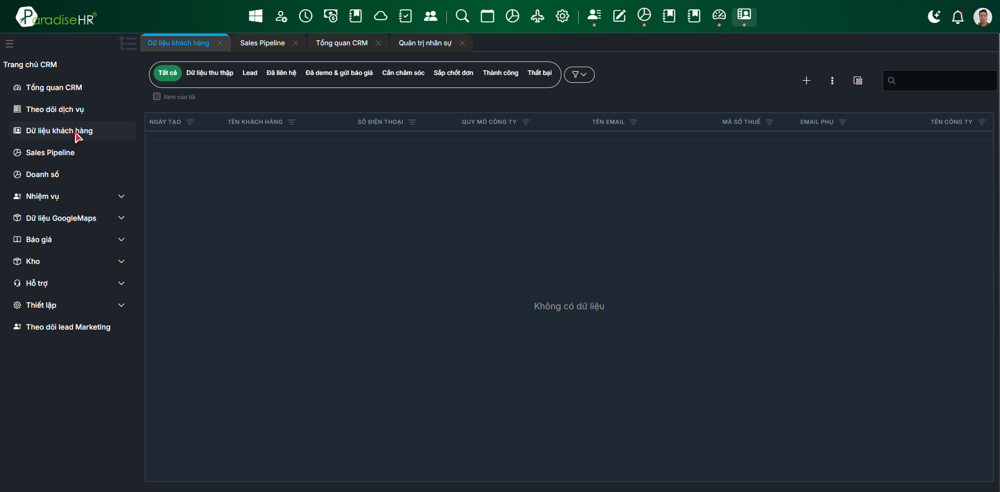

##### 🔹 Bước 2: Nhập đầy đủ thông tin khách hàng "Công ty TNHH Pipeline Sync 7978" tại màn hình nguồn
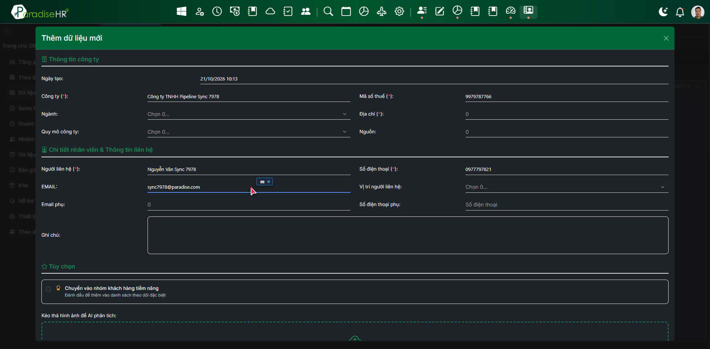

##### 🔹 Bước 3: Lưu khách hàng thành công và nhận phản hồi HTTP 200 từ máy chủ
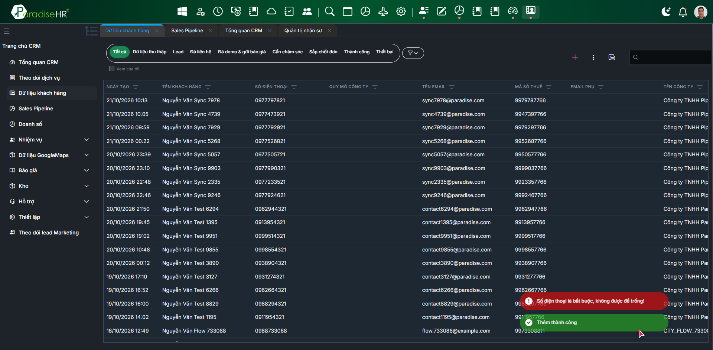

##### 🔹 Bước 4: Tìm kiếm khách hàng "Công ty TNHH Pipeline Sync 7978" trên bảng Kanban Sales Pipeline
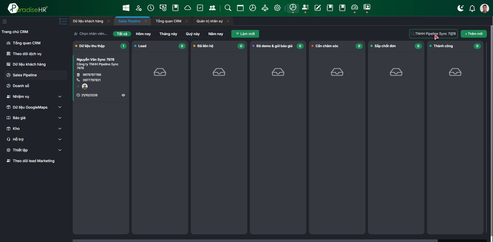

##### 🔹 Bước 5: Đánh giá logic PASS: Đồng bộ dữ liệu liên màn hình hoàn hảo 100%

#### 🎥 Video & Dấu vết kiểm thử (Video & Trace):
- **Video phiên chạy thực tế**: [video.webm](TC-12/videos/video.webm)
- **Playwright Trace**: [trace.zip](TC-12/traces/trace.zip) *(Mở bằng: `npx playwright show-trace test-evidence/crm_sales_pipeline/TC-12/traces/trace.zip`)*

---

### TC-13: Quy trình Nghiệp vụ Liên Màn hình: CHUYỂN GIAI ĐOẠN 'THÀNH CÔNG' TRÊN PIPELINE & ĐỐI SOÁT TỔNG QUAN CRM (Dashboard KPI Sync) (TC-FLOW-02)

* **Trạng thái thực thi Test (Kỹ thuật)**: ✅ PASS (Thời gian thực thi: `29.00s`)
* **Trạng thái Logic Nghiệp vụ (Business Output)**: ✅ PASS
* **Đánh giá tổng quát**: PASS - Quy trình liên màn hình đạt chuẩn: Cơ hội chuyển sang Thành công trên Pipeline được ghi nhận đồng bộ, màn hình Tổng quan CRM nạp đầy đủ các chỉ số thống kê KPI chuyển đổi
* **Thư mục lưu trữ**: `test-evidence/crm_sales_pipeline/TC-13/`

#### 📸 Bằng chứng trực quan từng bước (Step-by-Step Evidence):

##### 🔹 Bước 1: Xác định thẻ "Nguyễn Văn Sync 7978" và cột giai đoạn Thành công trên bảng Pipeline

##### 🔹 Bước 2: Kéo chuyển cơ hội "Nguyễn Văn Sync 7978" sang trạng thái Thành công

##### 🔹 Bước 3: Mở màn hình Tổng quan CRM (Dashboard) để đối soát các chỉ số KPI
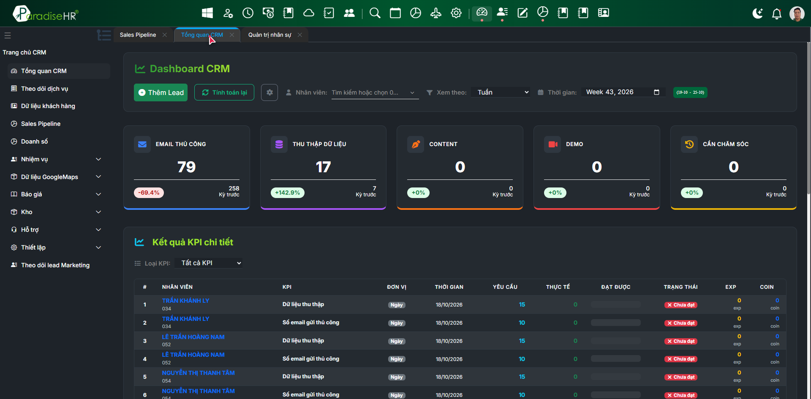

##### 🔹 Bước 4: Kiểm tra các khối chỉ số KPI và biểu đồ chuyển đổi trên Dashboard (31 khối)

##### 🔹 Bước 5: Đánh giá logic PASS: Đối soát liên màn hình giữa Sales Pipeline và Dashboard KPI đạt chuẩn

#### 🎥 Video & Dấu vết kiểm thử (Video & Trace):
- **Video phiên chạy thực tế**: [video.webm](TC-13/videos/video.webm)
- **Playwright Trace**: [trace.zip](TC-13/traces/trace.zip) *(Mở bằng: `npx playwright show-trace test-evidence/crm_sales_pipeline/TC-13/traces/trace.zip`)*

---

